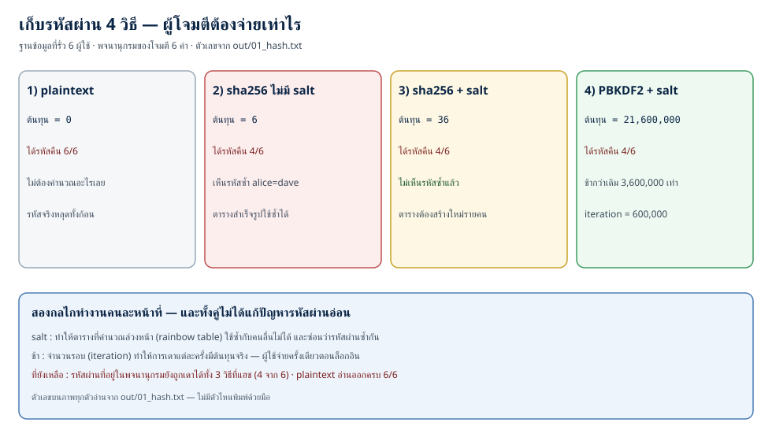
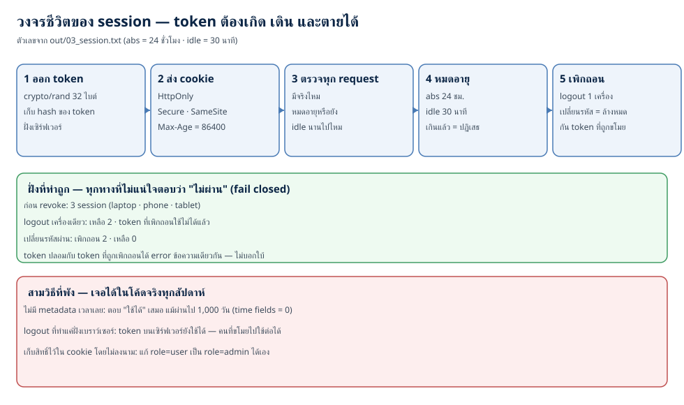
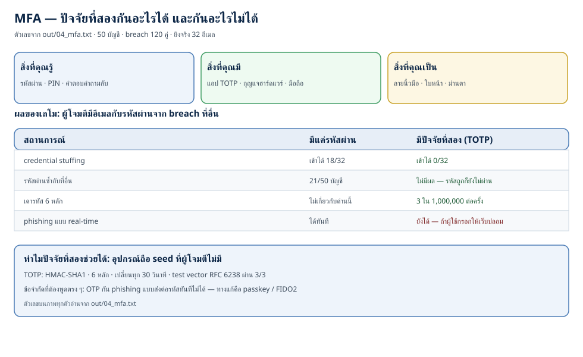

# Authentication และ session: รหัสผ่าน, token และ MFA ในทางปฏิบัติ (ตอนที่ 22)

> 📅 เขียนเมื่อ: 31 ตุลาคม 2026 (เวลาไทย, UTC+7)
>
> - **เครื่อง:** `Linux 6.18.39+rpt-rpi-2712 aarch64` — Raspberry Pi 5 · 4 คอร์ (`out/00_env.txt`)
> - **เวอร์ชันภาษา/เครื่องมือ:** `go version go1.24.4 linux/arm64` · Python `Python 3.13.5` · `rsvg-convert version 2.60.0` · `go.mod` ของเดโมระบุ `go 1.24` · **standard library ล้วน ไม่มี dependency ภายนอก (`external_deps=0`) ไม่แตะเครือข่าย (`network_dial_calls=0`) ไม่มีฐานข้อมูลจริง**
> - **ที่มาของตัวเลขในบท:** ทุกตัวเลขในบทนี้ อยู่ใน `code/ep22/out/` ของตอนนี้ และถูกพิมพ์โดยโปรแกรมเอง ไม่มีตัวไหนที่ผมพิมพ์จากความจำ · ตัวเลขที่อ้างถึง OWASP/NIST/RFC มาจากเอกสารต้นฉบับ ซึ่งผมตรวจในวันที่เขียน
> - **เรื่องเวอร์ชันที่ต้องบอกให้ชัด:** Go 1.24 คือรุ่นที่เครื่องนี้มี ผมใช้มันเพราะเดโมต้องรันซ้ำได้บนเครื่องเดิม ไม่ใช่คำแนะนำให้เริ่มโปรเจกต์ใหม่ด้วยรุ่นนี้ · `crypto/pbkdf2` ที่ผมใช้มีอยู่ใน standard library ตั้งแต่ Go 1.24 — ถ้าคุณใช้รุ่นเก่ากว่า ต้องใช้ `golang.org/x/crypto/pbkdf2` แทน (ซึ่งไม่ใช่ standard library)
> - **สิ่งที่ผมยังไม่ได้ทำในรอบนี้ (ต้องบอกตรง ๆ):** ผมไม่ได้ทดสอบกับ Redis (ฐานข้อมูล in-memory ที่เก็บของเร็ว ๆ ไว้ใน RAM) หรือฐานข้อมูลจริง · ไม่ได้ทำ WebAuthn/passkey (พูดถึงแต่ไม่ได้เขียน) · ไม่ได้วัดเวลาจริงลงในไฟล์ผลรัน เพราะเวลาขึ้นกับเครื่อง — ผมจึงรายงาน "จำนวนการคำนวณ" แทน "กี่วินาที" ตลอดบทนี้
>
> ⚠️ **หมายเหตุเรื่องจริยธรรม:** บทนี้สอนวิธี *โจมตี* ระบบยืนยันตัวตน (credential stuffing — เอารายการอีเมล+รหัสผ่านที่รั่วจากเว็บอื่นมาลองล็อกอิน, เดา token, ปลอมคุกกี้) ในระดับที่ต้องเห็นโค้ดจริงเพื่อเข้าใจ
>   - **เดโมรันที่ไหน:** ทั้งหมดรันในโปรเซสของตัวเอง บนเครื่องของคุณ ไม่เปิดพอร์ต ไม่แตะเครือข่าย ข้อมูลผู้ใช้ทั้งหมดเป็นข้อมูลสมมติที่สร้างในหน่วยความจำ
>   - **กติกาที่ผมขอให้ยึด:** ทดลองกับระบบที่ *คุณเป็นเจ้าของ* หรือ lab ที่ *ตั้งใจให้ทดลอง* เท่านั้น · การยิงรายการรหัสผ่านที่รั่วใส่ระบบของคนอื่น แม้เพียงเพื่อ "เช็คว่าบัญชีไหนยังใช้ได้" คือการบุกรุก และผิดกฎหมายในแทบทุกประเทศ
>   - **ป้ายห้ามใช้จริง:** โค้ดในแพ็กเกจ `internal/insecure` ติดป้าย "ห้ามใช้จริง" ทั้งไฟล์ (แพ็กเกจนี้มีไฟล์เดียว) และทั้ง repo มี 4 ไฟล์ที่ติดป้ายนี้ (`insecure_marked_files=4`) — โค้ดพวกนั้นมีอยู่เพื่อให้เห็นความต่าง ไม่ใช่เพื่อคัดลอกไปใช้

---

ตอนที่แล้วเราจบที่ *สองบรรทัดที่ห่างกัน*: บรรทัดที่ตรวจข้อมูลข้ามขอบเขตเข้า และบรรทัดที่เขียนข้อมูลออกไป

คืนนี้เราจะพูดถึงประตูอีกบานที่ทุกคนเดินผ่านทุกวัน — **ประตูที่ระบบตัดสินใจว่า "คุณคือใคร"** และสิ่งที่ระบบให้ติดมือคุณไปหลังจากนั้น

สองเรื่องนี้อยู่ติดกันจนคนมักคิดว่าเป็นเรื่องเดียว: **การยืนยันตัวตน (authentication)** ที่เกิดขึ้นครั้งเดียวตอนล็อกอิน และ **session** (ช่วงเวลาที่ระบบจำได้ว่าคุณคือใคร ตั้งแต่ล็อกอินจนหมดอายุ) ที่ต้องทำงานถูกต้องทุก request ตลอดหลายชั่วโมงถัดมา · ระบบที่ล็อกอินแน่นหนาแค่ไหนก็พังได้ ถ้า token ที่ออกให้หลังล็อกอินเดาง่ายหรือไม่มีวันตาย — และนี่คือความผิดพลาดที่ผมเจอบ่อยที่สุดในงานรีวิวโค้ด ไม่ใช่การเข้ารหัสที่อ่อนแอ

ตัวเลขสี่ชุดที่ผมจะใช้ตลอดบทนี้ (ทั้งหมดมาจาก `out/`):

- **เดโม 1 — เก็บรหัสผ่าน 4 วิธี** · ฐานข้อมูลที่รั่วของผู้ใช้ 6 คน · รายการคำที่ผู้โจมตีใช้เดา (attack dictionary) 6 คำ → **plaintext ต้นทุน 0 ได้รหัสคืน 6/6 · sha256 ไม่มี salt ต้นทุน 6 ได้คืน 4/6 · sha256 + salt ต้นทุน 36 ได้คืน 4/6 · PBKDF2 600,000 รอบ ต้นทุน 21,600,000 ได้คืน 4/6** (หน่วยของต้นทุน = จำนวนครั้งที่ต้องคำนวณ hash หนึ่งครั้ง) — ต้นทุนต่างกัน 3,600,000 เท่า แต่ในสามวิธีที่แฮช จำนวนรหัสที่ได้คืนเท่ากันเป๊ะ (4/6): ต้นทุนที่เพิ่มขึ้นไม่ได้ช่วยรหัสอ่อนเลย
- **เดโม 2 — token ของ session** · token จาก `math/rand` ที่ seed เดาได้ → ผู้โจมตีสร้างซ้ำได้ **5/5 ตัว** · token จาก `crypto/rand` 256 บิต → เดาไม่ได้เลย และ **0 ตัวซ้ำ** จากการสร้าง 1000 ตัว · คุกกี้ที่เก็บสิทธิ์ไว้ในตัวมันเองโดยไม่ลงนาม → ปลอมได้ทันที
- **เดโม 3 — อายุของ session** · 3 session (laptop · phone · tablet) → logout หนึ่งเครื่องเหลือ 2 → เปลี่ยนรหัสผ่านเพิกถอนอีก 2 → เหลือ **0**
- **เดโม 4 — MFA** · ผู้ใช้ 50 บัญชี · breach จากที่อื่น 120 คู่ · ยิงจริง 32 อีเมล → **รหัสผ่านอย่างเดียวเข้าได้ 18/32 (56.2%) — ใน 32 รายนั้น 15 รายใช้รหัสซ้ำกับที่อื่นจริง ๆ และอีก 3 รายรหัสชนกันโดยบังเอิญ · เพิ่ม TOTP เหลือ 0/32** — และ TOTP ที่ผมเขียนผ่าน test vector ของ RFC 6238 3/3

ศัพท์ที่คุณจะเจอ (hash · salt · work factor · session token · TOTP · credential stuffing) ผมจะนิยามตอนใช้จริงทั้งหมด — ตรงนี้ยังไม่ต้องจำ

## 1. แนวคิด: การยืนยันตัวตนคือการจัดการ "ความไว้ใจ (trust)" ไม่ใช่การเก็บรหัสผ่าน

### 1.1 สามคำที่นักศึกษาใช้ปนกันจนพัง

ในห้องสอบผมถามเสมอว่า "ล็อกอินได้" กับ "มีสิทธิ์" ต่างกันตรงไหน และคำตอบที่ได้มักเป็นความเงียบที่สุภาพ

| คำ | ตอบคำถามว่า | ตัวอย่าง |
|---|---|---|
| **identification** (การบอกว่าตัวเองเป็นใคร) | "คุณอ้างว่าคุณคือใคร" | พิมพ์อีเมล `alice@example.test` |
| **authentication** (การยืนยันตัวตน) | "คุณพิสูจน์ได้ไหม" | รหัสผ่าน · TOTP · ลายนิ้วมือ |
| **authorization** (การให้สิทธิ์) | "คุณมีสิทธิ์ทำสิ่งนี้ไหม" | `alice` ลบโพสต์ของ `bob` ได้หรือไม่ |

ทั้งสามอย่างนี้คือ **integrity ของคำกล่าวอ้างเรื่องตัวตน** ซึ่งเป็นส่วนหนึ่งของ CIA triad — confidentiality (ความลับ) · integrity (ความถูกต้อง) · availability (ใช้งานได้) — ที่เราเรียนใน[ตอนที่ 10](/blog/post.html?slug=2026-10-18-software-security-10-cia-triad-risk) — ถ้า integrity ของ "คุณคือใคร" พัง ทุกอย่างที่ตามมาพังหมด เพราะระบบจะให้สิทธิ์กับคนผิด

บทนี้พูดถึงสองตัวแรก · ตัวที่สาม (authorization) คือตอนหน้า และมันมีช่องโหว่ของมันเองที่อันดับหนึ่งของ OWASP Top 10

### 1.2 ทำไมการเก็บรหัสผ่านเป็นเรื่องแปลก — และทำไม hash เร็ว ๆ ใช้ไม่ได้

ก่อนอื่นต้องแยกคำที่คนสับสนที่สุดในเรื่องนี้:

- **hash (ฟังก์ชันแฮช)** = ฟังก์ชันทางเดียว แปลงข้อมูลอะไรก็ได้ให้เป็นค่าความยาวคงที่ · จาก hash ย้อนกลับไปหาข้อความเดิมไม่ได้ (ในทางปฏิบัติ)
- **encryption (การเข้ารหัส)** = ย้อนกลับได้ **ถ้ามีกุญแจ** · ถ้ากุญแจหลุดพร้อมข้อมูล ก็จบกัน

คำถามที่ต้องตอบให้ได้ก่อนเขียนโค้ดคือ: *ระบบของเราต้อง "อ่าน" รหัสผ่านของผู้ใช้ในภายหลังไหม* · คำตอบคือ **ไม่** — เราแค่ต้องตอบว่า "ที่ผู้ใช้พิมพ์มา ตรงกับที่เขาเคยตั้งไว้หรือเปล่า" · งานแบบนี้ต้องการฟังก์ชันทางเดียว ไม่ใช่การเข้ารหัส

และนี่คือเหตุผลที่ encryption ไม่ใช่คำตอบสำหรับรหัสผ่าน: ถ้าเราเก็บในรูปที่อ่านได้ ผู้ที่ได้ฐานข้อมูลไป (พนักงาน, backup, ผู้โจมตี) ก็อ่านได้ทั้งหมด

แล้วทำไม `sha256(password)` ถึงยังผิด? เพราะ **sha256 ถูกออกแบบมาให้เร็ว** — มันเป็นเครื่องมือตรวจความถูกต้องของไฟล์ ไม่ใช่เครื่องมือเก็บความลับ · ความเร็วคือคุณสมบัติที่ดีของมันในงานนั้น และเป็นหายนะในงานนี้: การ์ดจอหนึ่งใบคำนวณ sha256 ได้หลายพันล้านครั้งต่อวินาที

และมีปัญหาที่สองที่สำคัญไม่แพ้กัน: **sha256 ให้ผลเหมือนกันทุกครั้งสำหรับข้อมูลเดียวกัน** · ผู้ใช้ห้าคนที่ตั้งรหัสผ่าน `sunshine` จะได้ hash แบบเดียวกันหมด · เดโม 1 วัดเรื่องนี้ตรง ๆ: hash ที่ไม่ซ้ำมีแค่ 5 จาก 6 แถว — และนั่นบอกผู้โจมตีทันทีว่า `alice` กับ `dave` ใช้รหัสผ่านเดียวกัน

### 1.3 salt: สิ่งที่ไม่ลับ แต่ทำงานหนัก

**salt** คือค่าสุ่มที่สร้างใหม่สำหรับผู้ใช้แต่ละคน เก็บไว้ข้าง ๆ hash (ไม่ต้องลับ) · หน้าที่ของมันมีสองข้อ และสองข้อนี้ไม่เกี่ยวกับ "ความแข็งของรหัสผ่าน" เลย:

1. **ทำให้ตารางที่คำนวณล่วงหน้าใช้ซ้ำไม่ได้** — ตารางแบบ rainbow table คือการลงทุนคำนวณครั้งเดียวแล้วใช้กับทุกคนที่โดน · พอแต่ละคนมี salt ของตัวเอง ผู้โจมตีต้องสร้างตารางใหม่ทีละคน
2. **ซ่อนว่ารหัสผ่านซ้ำกัน** — สองคนที่ใช้รหัสผ่านเดียวกันจะได้ hash คนละค่า

สิ่งที่ salt **ไม่ได้** ทำ: ทำให้รหัสผ่านที่อ่อนแข็งขึ้น · ถ้ารหัสผ่านอยู่ในรายการคำที่ผู้โจมตีใช้ไล่เดา (attack dictionary) มันก็ยังถูกเดาได้ — แค่ต้องจ่ายแพงขึ้นเท่าจำนวนผู้ใช้ · ตัวเลขในเดโม 1 พูดชัด: salt ทำให้ต้นทุนจาก 6 เป็น 36 แต่ **ได้รหัสคืนเท่าเดิม 4/6**

### 1.4 งานที่สองของ hash เก็บรหัสผ่าน: ทำให้ช้าโดยตั้งใจ

ถ้า salt ทำให้ *แต่ละการเดาแพงขึ้นตามจำนวนผู้ใช้* ตัวที่ทำให้ *การเดาแต่ละครั้งแพงขึ้นจริง* คือ **work factor** (จำนวนรอบที่ฟังก์ชันต้องคำนวณต่อการแฮชหนึ่งครั้ง)

ไอเดียนี้ฟังดูขัดกับสัญชาตญาณของวิศวกรทุกคน: เราถูกสอนให้โค้ดเร็ว แล้วทำไมที่นี่ต้องช้า? เพราะ **ฝ่ายที่ต้องจ่ายคือผู้โจมตี ไม่ใช่ผู้ใช้** · ผู้ใช้จริงแฮชหนึ่งครั้งตอนสมัครและหนึ่งครั้งตอนล็อกอิน · ผู้โจมตีที่ถือรายการรหัสผ่านห้าล้านต้องจ่ายคูณห้าล้าน · การเพิ่ม 0.05 วินาทีต่อครั้งสำหรับคุณ คือการเพิ่มหลายวันสำหรับเขา

อัลกอริทึมที่ทำแบบนี้เรียกรวม ๆ ว่า **password hashing algorithm** และตัวที่คุณจะเจอในงานจริงคือ:

ก่อนอ่านตาราง มีศัพท์หนึ่งที่ต้องรู้: **HMAC** คือ hash ที่ใช้กุญแจลับผูกกับข้อความ — ใครไม่มีกุญแจก็สร้างค่าเดียวกันไม่ได้ · PBKDF2 สร้างความช้าด้วยการวน HMAC ซ้ำหลายแสนรอบ

| อัลกอริทึม | กลไกทำให้ช้า | ข้อสังเกต |
|---|---|---|
| **PBKDF2** (RFC 8018) | วน HMAC ซ้ำ N รอบ | มีใน standard library ของ Go 1.24 · OWASP แนะนำ 600,000 รอบสำหรับ HMAC-SHA256 |
| **bcrypt** | วนรอบแบบปรับได้ผ่าน **cost factor** (2 ยกกำลัง cost) | จำกัดรหัสผ่านที่ 72 ไบต์ · เป็นที่นิยมมานานและยังใช้ได้ |
| **scrypt** | ต้องใช้หน่วยความจำมากด้วย | กันการเร่งด้วย GPU (การ์ดจอ) / ASIC (ชิปที่ออกแบบมาทำงานนี้อย่างเดียว) ได้ดีขึ้น |
| **Argon2id** | ใช้ทั้งเวลาและหน่วยความจำ (memory-hard) | ตัวเลือกแรกของ OWASP ปัจจุบัน |

คำว่า **memory-hard** หมายถึงอัลกอริทึมที่ต้องจองหน่วยความจำจำนวนมากต่อการคำนวณหนึ่งครั้ง — ทำให้การ์ดจอที่มีคอร์เยอะแต่หน่วยความจำจำกัดไม่สามารถเร่งได้ตามจำนวนคอร์ นี่คือเหตุผลที่ OWASP จัด Argon2id เป็นตัวเลือกแรก และ PBKDF2 เป็นทางเลือกที่ยังยอมรับได้ (เช่นเมื่อต้อง FIPS-140 — มาตรฐาน crypto ที่หน่วยงานรัฐสหรัฐบังคับ)

เดโมของเราใช้ PBKDF2 เพราะมันอยู่ใน standard library ของ Go 1.24 — และเพราะผมต้องการให้ทุกคนรันตามได้โดยไม่ต้องเพิ่ม dependency · แต่สิ่งที่ผมจะพูดถึง bcrypt/Argon2id ในบทนี้คือ *บทบาท* ของมัน ไม่ใช่การอ้างว่าผมวัดได้

### 1.5 session token คือกุญแจชั่วคราว ไม่ใช่รหัสผ่าน

หลังล็อกอินสำเร็จ ระบบต้องจำคุณไว้ — แต่ HTTP ไม่จำอะไรเลย (stateless) ทุก request มาถึงโดยไม่มีบริบท

วิธีที่ใช้กันทั่วโลกคือ:

1. เซิร์ฟเวอร์สร้าง **token** สุ่มขึ้นมา
2. ส่งให้เบราว์เซอร์เก็บใน cookie (ไฟล์ข้อความก้อนเล็กที่เบราว์เซอร์เก็บไว้ แล้วแนบไปกับทุก request ไปยังโดเมนเดิม)
3. ทุก request ถัดมา เบราว์เซอร์แนบ token มา
4. เซิร์ฟเวอร์เอา token ไปค้นในที่เก็บ (memory · Redis (ฐานข้อมูล in-memory ที่เก็บของเร็ว ๆ ไว้ใน RAM) · ตารางในฐานข้อมูล) ว่าเป็นของใคร และยังใช้ได้ไหม

สิ่งที่ต้องจำ: **token คือความลับที่มีอายุ** — มันต้อง **เดาไม่ได้** (สร้างจาก `crypto/rand`) **มีวันหมดอายุ** **เพิกถอนได้** และ **ไม่ควรพาข้อมูลที่ตัดสินใจเรื่องสิทธิ์ไปกับตัวมันเองโดยไม่มีการลงนาม**

ตรงนี้มีกับดักที่ผมเจอบ่อย: คนมักเอาข้อมูลใส่ลงในคุกกี้ตรง ๆ เช่น `role=admin` แล้วคิดว่ามันปลอดภัยเพราะ "ผู้ใช้ไม่เห็น" · คุกกี้อยู่ในเครื่องผู้ใช้ — เขาเปิด DevTools (เครื่องมือนักพัฒนาในเบราว์เซอร์ กด F12) ก็เห็น และแก้ได้

ทางเลือกมีสองทาง:

1. **เก็บ session ฝั่งเซิร์ฟเวอร์** — ค่าเริ่มต้นที่ผมแนะนำ: คุกกี้ถือแค่ token สุ่ม และเซิร์ฟเวอร์เป็นคนตอบว่าคนนี้คือใคร
2. **ถ้าจำต้องเก็บข้อมูลในคุกกี้จริง ๆ** — ต้อง **ลงนามด้วย HMAC** (hash ที่ใช้กุญแจลับผูกกับข้อความ) และตรวจลายเซ็นทุกครั้งก่อนอ่านค่า

### 1.6 MFA: สามชนิดของปัจจัย และทำไมต้องต่างชนิด

**MFA (multi-factor authentication)** คือการยืนยันตัวตนด้วยปัจจัยตั้งแต่สองชนิดที่ *ต่างประเภทกัน* · ปัจจัยมีสามประเภท:

| ประเภท | คืออะไร | ตัวอย่าง |
|---|---|---|
| **สิ่งที่คุณรู้** (something you know) | ความลับในหัวคุณ | รหัสผ่าน · PIN · คำตอบคำถามลับ |
| **สิ่งที่คุณมี** (something you have) | ของที่ต้องถือไว้ | แอป TOTP · กุญแจฮาร์ดแวร์ · มือถือ |
| **สิ่งที่คุณเป็น** (something you are) | ชีวมาตร | ลายนิ้วมือ · ใบหน้า · ม่านตา |

รหัสผ่าน + คำถามความปลอดภัย **ไม่ใช่** MFA — มันเป็น "สิ่งที่คุณรู้" สองอย่าง และถ้าอย่างหนึ่งหลุด อีกอย่างก็มักหลุดตาม (คำถามความปลอดภัยส่วนใหญ่ตอบได้จากโซเชียลมีเดียของคุณ)

ตัวที่ผมจะเขียนในเดโมคือ **TOTP (time-based one-time password, RFC 6238)** — รหัส 6 หลักที่เปลี่ยนทุก 30 วินาที · กลไกของมันสวยมาก: ทั้งแอปและเซิร์ฟเวอร์ถือ **seed** (ค่าลับตั้งต้นที่เอาไปคำนวณรหัส — เปรียบเหมือนกุญแจที่ทั้งสองฝ่ายมีเหมือนกัน) ก้อนเดียวกัน แล้วต่างฝ่ายต่างคำนวณ `HMAC-SHA1(seed, เวลาปัจจุบัน / 30)` ออกมาเป็นเลข 6 หลัก · ถ้าตรงกัน แปลว่าอีกฝ่ายมี seed

seed ไปถึงแอปได้อย่างไร? ตอน enroll เซิร์ฟเวอร์สร้าง seed แล้วส่งให้ผู้ใช้ **ครั้งเดียว** ผ่าน QR code (หรือข้อความลับให้พิมพ์มือ) — แอปเก็บไว้ในเครื่อง หลังจากนั้นทั้งสองฝ่ายคำนวณรหัสเองตอนล็อกอิน ไม่มีการส่ง seed กันทางเครือข่ายอีกเลย

ก่อนจะเขียนโค้ด มาดูว่าคนที่พลาดเรื่องพวกนี้จริง ๆ จ่ายไปเท่าไร

## 2. ทำไมสำคัญ: สอง breach ที่เปลี่ยนวิธีเขียนโค้ดของทั้งอุตสาหกรรม

ประวัติศาสตร์ของเรื่องนี้สอนซ้ำ ๆ อยู่สองบทเรียน และทั้งสองบทเรียนยังมีคนพลาดทุกปี

**LinkedIn, 2012** · ผู้โจมตีได้ฐานข้อมูลผู้ใช้ไป · รหัสผ่านถูกเก็บเป็น **SHA-1 ที่ไม่มี salt** · ตอนนั้นมีคนเห็นแค่ 6.5 ล้านรายการ แต่ปี 2016 ข้อมูลชุดเต็มถูกประกาศขาย — **117 ล้านบัญชี** และรายงานของ Motherboard ระบุว่า **90% ถูก crack (ถอดจนได้รหัสผ่าน) ภายใน 72 ชั่วโมง** · สาเหตุไม่ใช่ SHA-1 ถูก "แครก" ในเชิงคณิตศาสตร์ แต่เพราะไม่มี salt: ตารางที่คำนวณไว้ใช้ได้กับทุกคนพร้อมกัน และเพราะ SHA-1 เร็ว

**Adobe, 2013** · ข้อมูลราว 153 ล้านรายการหลุด (Adobe แจ้งครั้งแรก 2.9 ล้านบัญชี แล้วขยายเป็น 38 ล้านบัญชีที่ยังใช้งานอยู่) · รหัสผ่านถูก **เข้ารหัส (encrypt)** ไม่ใช่แฮช ด้วยกุญแจเดียวกันทั้งระบบและโหมด ECB (โหมด ECB = เข้ารหัสทีละบล็อกด้วยกุญแจเดียวกันหมด บล็อกข้อมูลที่เหมือนกันจึงได้ผลเหมือนกัน → รูปแบบซ้ำโผล่ให้เห็น และเอาไปทำพจนานุกรม ciphertext ได้ · ที่มันย้อนกลับได้เพราะมันคือการเข้ารหัส (มีกุญแจ) ไม่ใช่การแฮช — ไม่ใช่เพราะ ECB) — และมี **password hint ที่เก็บเป็นข้อความธรรมดา** อยู่ข้าง ๆ · นี่คือตัวอย่างที่สมบูรณ์ของสองความผิดในบทนี้: *เก็บในรูปที่ย้อนกลับได้* และ *ให้เบาะแสที่ย้อนกลับได้ฟรี*

ย้อนไปไกลกว่านั้น — [Morris worm ปี 1988](/blog/post.html?slug=2026-10-10-software-security-02-morris-worm-1988) แพร่ได้เพราะมันลองรหัสผ่านจากรายการคำศัพท์ง่าย ๆ · ผ่านมาเกือบสี่สิบปี กลไกยังเหมือนเดิม: รายการรหัสผ่านที่รั่วจากที่อื่น + คนที่ใช้รหัสเดิมซ้ำ = บัญชีที่ถูกยึด

และในภาษาของมาตรฐาน: หัวข้อ **A07 — Authentication Failures** ใน [OWASP Top 10 รุ่น 2025 ที่เราเรียนไปตอนที่ 17](/blog/post.html?slug=2026-10-26-software-security-17-owasp-top10) คือที่อยู่ของเรื่องนี้ (รุ่น 2021 เรียกชื่อยาวกว่า: Identification and Authentication Failures — เราเห็นการเปลี่ยนชื่อนี้ในตอนที่ 17 แล้ว) · เอกสารแนะนำให้เทียบรหัสผ่านใหม่กับรายการรหัสผ่านที่แย่ที่สุด และให้จัดนโยบายรหัสผ่านตาม NIST SP 800-63B

NIST SP 800-63B-4 (หมวด memorized secret — รหัสผ่านที่ผู้ใช้จำ · ฉบับ final 31 กรกฎาคม 2025) พูดตรง ๆ ในสิ่งที่หลายองค์กรยังทำตรงข้าม: **ขั้นต่ำ 15 ตัวอักษรสำหรับรหัสผ่านที่ใช้เดี่ยว ๆ (single-factor)** — เหลือ 8 ตัวเมื่อใช้ร่วมกับ MFA (SP 800-63B-4, §3.1.1.2), **ไม่บังคับกฎการผสมอักขระ**, **ไม่บังคับเปลี่ยนรหัสผ่านเป็นรอบตามปฏิทิน**, **ต้องมี blocklist** ของรหัสผ่านที่ถูกใช้มาก/รั่วไปแล้ว, และ **ควร (SHOULD) รับรหัสผ่านยาวถึง 64 ตัวขึ้นไป** · เหตุผลคือกฎพวกนั้นทำให้คนตั้งรหัสผ่านที่เดาง่ายขึ้น (`Password1!` ผ่านทุกกฎ) ไม่ใช่ปลอดภัยขึ้น

คราวนี้เรามาเขียนระบบที่ผ่านข้อกำหนดพวกนั้นทีละข้อ — ด้วยโค้ดที่รันได้จริงบนเครื่องคุณ

## 3. ลงมือทำ: ระบบยืนยันตัวตนที่รันได้จริง

### 3.0 โครงสร้าง และวิธีรัน

ทั้งหมดอยู่ใน `code/ep22/` (relative กับโฟลเดอร์ draft นี้) — build ได้จาก repo เปล่า เพราะไม่มี dependency ภายนอก:

```go
module ep22

go 1.24
```

รันทั้งชุด (จะคอมไพล์ + รัน + เก็บผลลง `out/` + วาด SVG):

```bash
cd code/ep22
bash run_all.sh
```

สี่โปรแกรมใน `cmd/` คือสี่เดโมของบทนี้ · ส่วน `internal/` มีสี่แพ็กเกจ: `insecure` (โค้ดที่ตั้งใจทำให้พัง), `pwhash` (เก็บรหัสผ่าน), `session` (session store), `totp` (รหัส 6 หลัก) · ตัวตรวจของเดโมเองอยู่ใน `out/05_gate.txt` และมีค่าที่ผมต้องการให้เป็นศูนย์: `external_deps=0` · `time_now_calls=0` · `network_dial_calls=0` · `gofmt_unformatted=0` (gofmt = ตัวจัดรูปแบบโค้ด Go มาตรฐาน)



### 3.1 เดโม 1 — เก็บรหัสผ่าน 4 วิธี แล้วให้ผู้โจมตีลองถอด

เดโมนี้จำลองสถานการณ์ที่เกิดจริงทุกสัปดาห์: ฐานข้อมูลรั่ว และผู้โจมตีมีรายการคำที่ใช้เดา (attack dictionary) ซึ่งรวบรวมจากรหัสผ่านยอดนิยมที่รั่วมาแล้ว · ผู้ใช้ 6 คนในเดโม: สี่คนใช้รหัสผ่านที่อยู่ในพจนานุกรม (สองในนั้นใช้รหัสเดียวกัน) และสองคนใช้รหัสยาวที่ไม่อยู่ในพจนานุกรม

วิธีที่แย่ที่สุดก่อน — และมันยังอยู่ในโค้ดจริง:

```go
// UnsaltedSHA256 แฮชรหัสผ่านด้วย sha256 ตรง ๆ รอบเดียว ไม่มี salt
//
// ฟังก์ชันแฮชที่ออกแบบมาเพื่อ "ตรวจความถูกต้องของไฟล์" ไม่ใช่เพื่อ "เก็บรหัสผ่าน":
// มันเร็วเกินไป (พันล้านครั้งต่อวินาทีบนการ์ดจอระดับผู้บริโภค)
// และให้ผลเหมือนกันทุกครั้งสำหรับรหัสผ่านเดียวกัน — สองคุณสมบัตินี้คือของขวัญแก่ผู้โจมตี
func UnsaltedSHA256(password string) string {
	sum := sha256.Sum256([]byte(password))
	return hex.EncodeToString(sum[:])
}
```

ฝั่งที่ควรทำ — ฟังก์ชันที่ตั้งใจให้ช้า:

```go
// Hash แปลงรหัสผ่านเป็น key ที่เก็บได้ โดยใช้ salt และจำนวนรอบที่กำหนด
//
// PBKDF2 (Password-Based Key Derivation Function 2, RFC 8018) คือฟังก์ชันที่
// ตั้งใจให้ "ช้า" — มันคำนวณ HMAC ซ้ำ iter รอบ ผู้ใช้จริงจ่ายครั้งเดียวตอนล็อกอิน
// แต่ผู้โจมตีที่ต้องเดาหลายล้านรหัสต้องจ่ายคูณเท่านั้น
func Hash(password string, salt []byte, iter int) ([]byte, error) {
	if iter <= 0 {
		return nil, fmt.Errorf("จำนวนรอบต้องมากกว่าศูนย์ (ได้ %d)", iter)
	}
	key, err := pbkdf2.Key(sha256.New, password, salt, iter, KeyLen)
	if err != nil {
		return nil, fmt.Errorf("pbkdf2: %w", err)
	}
	return key, nil
}
```

อาร์กิวเมนต์ท้ายของ `pbkdf2.Key` คือ `KeyLen` = 32 ไบต์ (256 บิต) — ความยาวของ key ที่ได้และความยาวที่เก็บลงฐานข้อมูล · ส่วน `salt` คือ 16 ไบต์ (128 บิต) ที่ `pwhash.NewSalt()` สุ่มจาก `crypto/rand` รายคน (เดโม 1 ใช้ salt คงที่ต่อผู้ใช้เพื่อให้รันซ้ำได้ — ของจริงต้องสุ่มใหม่ทุกครั้ง)

และฝั่งที่ตรวจ:

```go
// Verify ตรวจรหัสผ่านที่ผู้ใช้พิมพ์ กับ Record ที่เก็บไว้
//
// สองจุดที่พลาดกันบ่อยและอยู่ในฟังก์ชันนี้แล้ว:
//   - ใช้จำนวนรอบ "จาก Record" ไม่ใช่จากค่าคงที่ในโค้ด → เปลี่ยนค่าในอนาคตได้โดยไม่ทำผู้ใช้เก่าพัง
//   - เทียบด้วย subtle.ConstantTimeCompare → เวลาที่ใช้ไม่ขึ้นกับว่าเดาถูกกี่ไบต์
func Verify(password string, rec Record) (bool, error) {
	if rec.Algo != AlgoPBKDF2SHA256 {
		return false, fmt.Errorf("algorithm ที่ไม่รู้จัก: %q", rec.Algo)
	}
	got, err := Hash(password, rec.Salt, rec.Iter)
	if err != nil {
		return false, err
	}
	return subtle.ConstantTimeCompare(got, rec.Key) == 1, nil
}
```

จุดที่ต้องสังเกตใน `Verify` มีสองจุด และทั้งคู่คือที่ที่โค้ดจริงพลาดบ่อย:

- **ใช้จำนวนรอบจาก `rec` (ค่าที่เก็บไว้กับผู้ใช้) ไม่ใช่ค่าคงที่ในโค้ด** — ถ้าคุณเพิ่มจำนวนรอบปีหน้า ผู้ใช้เก่าที่ถูกแฮชด้วยค่ารอบเก่าต้องล็อกอินได้ต่อไป แล้วค่อยอัปเกรดตอนที่เขาล็อกอินครั้งถัดไป
- **เทียบด้วย `subtle.ConstantTimeCompare`** — การเทียบสตริงปกติจะหยุดทันทีที่เจอไบต์ต่าง เวลาที่ใช้จึงบอกใบ้ว่าเดาถูกไปกี่ไบต์ · ในทางทฤษฎีผู้โจมตีสามารถใช้เวลานี้ไล่เดาทีละไบต์ได้ (timing attack) — การเทียบแบบ constant time ตัดช่องทางนั้น

ผลรันจริง (ทั้งไฟล์มาจาก `out/01_hash.txt`):

```
=== เดโม 1: ฐานข้อมูลที่รั่ว — รหัสผ่านถูกเก็บ 4 วิธี ===
users=6
dictionary_candidates=6
weak_password_users=4
strong_password_users=2
password_reuse_pairs=1

--- [A] เก็บเป็น plaintext (ห้ามใช้จริง) ---
stolen_rows=6
attacker_work_units=0
passwords_recovered=6/6
note=ผู้โจมตีไม่ต้องคำนวณอะไรเลย มันคือรหัสผ่านจริง

--- [B] sha256 รอบเดียว ไม่มี salt (ห้ามใช้จริง) ---
distinct_hashes=5
hash_computed_by_attacker=6
passwords_recovered=4/6
reuse_visible=yes (alice=dave ได้ hash เดียวกัน)
alice_hash=a941a4c4fd0c01cd

--- [C] sha256 รอบเดียว + salt รายคน ---
distinct_hashes=6
hash_computed_by_attacker=36
passwords_recovered=4/6
reuse_visible=no
note=salt ไม่ได้ทำให้รหัสอ่อนแข็งขึ้น แต่ทำให้ตารางที่คำนวณล่วงหน้าใช้ซ้ำไม่ได้

--- [D] PBKDF2-HMAC-SHA256 + salt รายคน ---
distinct_hashes=6
hash_computed_by_attacker=36
hash_iterations=600000
attacker_work_units=21600000
passwords_recovered=4/6
record=pbkdf2-sha256$600000$isxHjoNLjdCeyJKVHY+iKA$PTeSwOoc+au+4QcK2fahVIvFreV4JtFwizHqeMD6jkQ

--- ตรวจสองทาง: ระบบที่ถูกต้องยังใช้งานได้ ---
verify_correct_password=true
verify_wrong_password=false

--- ต้นทุนของผู้โจมตี (หน่วย = หนึ่งการคำนวณแฮช sha256) ---
work_plaintext=0
work_unsalted=6
work_salted_fast=36
work_salted_slow=21600000
slowdown_vs_unsalted=x3600000
weak_passwords_still_fall=4/6
```

สองบรรทัดที่ชื่อคล้ายกันจนสับสน: `hash_computed_by_attacker` นับจำนวนแฮชที่ผู้โจมตีต้องคำนวณจริง — แบบไม่มี salt เรียกแค่ 6 ครั้ง ([B]) เพราะค่าเดียวเอาไปเทียบได้ทุกแถว พอมี salt รายคนต้องแยกทีละผู้ใช้จึงเป็น 6 × 6 = 36 ([C]/[D]) ไม่ได้นับรอบที่อยู่ข้างใน · ส่วน `attacker_work_units` คิด **รอบจริง** (36 × 600,000 = 21,600,000) · นั่นคือเหตุผลที่ `[C]` กับ `[D]` ขึ้นเลข 36 เท่ากัน แต่ต้นทุนจริงห่างกัน 600,000 เท่า

อีกบรรทัดที่ต้องอธิบายคือ `record=pbkdf2-sha256$600000$...` — รูปแบบของมันคือ `algo$iterations$salt(base64)$key(base64)` (base64 = การแปลงข้อมูลไบต์เป็นตัวอักษร A–Z a–z 0–9 บวกอักขระอีกสองตัว (+ / ในแบบ Std, - _ ในแบบ URL-safe) เพื่อเก็บเป็นข้อความได้) · ทั้งสี่ส่วนคั่นด้วย `$` จึงเก็บในคอลัมน์เดียวได้:

- **`algo`** — ชื่ออัลกอริทึม (`pbkdf2-sha256`)
- **`iterations`** — จำนวนรอบที่ใช้แฮช (`600000`)
- **`salt`** — salt 16 ไบต์ เข้ารหัส base64
- **`key`** — key 32 ไบต์ เข้ารหัส base64

และตอนตรวจก็อ่านจำนวนรอบจากสตริงนี้เอง ไม่ใช่จากค่าคงที่ในโค้ด · ถ้าเก็บลงฐานข้อมูลจริงต้อง parse กลับเป็น `Record` ก่อนเรียก `Verify` (เดโมยังไม่เขียนส่วนนี้) — หัวใจคือ `Verify` อ่านจาก `rec.Iter` ไม่ใช่จาก `pwhash.Iterations`

อ่านตัวเลขนี้ทีละบรรทัด:

**`[A] plaintext`** — ต้นทุน 0 และได้รหัสคืน 6/6 · "ได้คืน" ในที่นี้ไม่ได้หมายถึง "ถอดได้" ด้วยซ้ำ มันคือ "อ่านออก" · ไม่มีอะไรต้องทำเลย และนี่คือสาเหตุที่ breach ที่เก็บ plaintext เป็นข่าวร้ายระดับที่ต้องแจ้งผู้ใช้ทุกคนทันที

**`[B] sha256 ไม่มี salt`** — ต้นทุน 6 (คือลองทุกคำในพจนานุกรมหนึ่งครั้ง) และได้รหัสคืน 4/6 · สังเกตบรรทัด `reuse_visible=yes (alice=dave ได้ hash เดียวกัน)` — นี่คือข้อมูลที่ระบบไม่ควรเปิดเผยด้วยซ้ำ · และ `distinct_hashes=5` จาก 6 แถวคือหลักฐานเดียวกันในรูปตัวเลข

**`[C] sha256 + salt`** — ต้นทุนกระโดดเป็น 36 (6 คำ × 6 ผู้ใช้) แต่ **ได้รหัสคืนเท่าเดิม** · นี่คือจุดที่นักศึกษามักเข้าใจผิดว่า "ใส่ salt แล้วจบ" — ไม่จบ · สิ่งที่ salt ทำคือบังคับให้ผู้โจมตีลงทุนใหม่รายคน ไม่ได้ทำให้รหัสผ่าน `sunshine` แข็งขึ้นแม้แต่นิดเดียว

**`[D] PBKDF2 + salt`** — ต้นทุนเป็น 21,600,000 (36 ครั้ง × 600,000 รอบ) ช้ากว่าแบบที่ 2 ถึง 3,600,000 เท่า · แต่บรรทัดสุดท้ายของเดโมพูดความจริงที่ต้องพูดให้ดัง: **`weak_passwords_still_fall=4/6`** — รหัสผ่านที่อ่อนยังถูกเดาได้ทั้ง 3 วิธีที่แฮช (และ plaintext อ่านออกครบ 6/6)

**สามบทเรียนจากเดโม 1:**

1. **plaintext แย่ที่สุดเพราะ "ความเสียหายเกิดทันที"** ไม่ต้องรอให้ใครคำนวณ · การแฮชซื้อเวลาให้คุณ — เวลาที่จะแจ้งผู้ใช้ ให้เขเปลี่ยนรหัสผ่าน
2. **salt กับ slow hash แก้ปัญหาคนละข้อ** และขาดข้อใดข้อหนึ่งไม่ได้ · salt กันตารางสำเร็จรูป · slow hash กันการเดาแบบเร่ง · และทั้งคู่กัน "รหัสผ่านที่อ่อน" ไม่ได้
3. **การเทียบต้อง constant time และจำนวนรอบต้องมาจากข้อมูลที่เก็บไว้** — สองรายละเอียดเล็กที่แยกโค้ดที่ใช้ได้จริงออกจากโค้ดที่ดูถูก

### 3.2 เดโม 2 — token: สุ่มแบบไหนถึงเรียกว่า "สุ่ม"

ตรงนี้ผมจะโชว์ความต่างระหว่าง "สุ่ม" สองแบบที่หน้าตาเหมือนกันเป๊ะเมื่อมองด้วยตา

แบบแรก — generator ที่ไม่ได้ออกแบบมาสำหรับความปลอดภัย:

```go
// WeakTokenSource สร้าง token จาก math/rand ที่ seed ด้วยค่าที่เดาได้ (เช่นเวลา)
//
// math/rand ไม่ใช่ generator สำหรับความปลอดภัย: ลำดับที่มันสร้างถูกกำหนดหมด
// จากการ seed ครั้งเดียว ผู้โจมตีที่รู้ (หรือเดา) seed ได้ จะสร้าง token ชุดเดียวกันได้ทันที
func WeakToken(src *rand.Rand, n int) []string {
	tokens := make([]string, 0, n)
	for i := 0; i < n; i++ {
		b := make([]byte, 16)
		for j := range b {
			b[j] = byte(src.Intn(256))
		}
		tokens = append(tokens, hex.EncodeToString(b))
	}
	return tokens
}
```

แบบที่สอง — แบบที่ควรใช้ · แต่ก่อนถึง `Issue` ต้องมีฟังก์ชันนี้ก่อน เพราะที่เก็บของเราไม่ได้เก็บ token ดิบ:

```go
func hashToken(token string) string {
	sum := sha256.Sum256([]byte(token))
	return base64.RawStdEncoding.EncodeToString(sum[:])
}
```

เหตุผลที่เก็บ hash ของ token ไม่ใช่ตัว token: token คือสิ่งที่ใช้ *แทน* รหัสผ่านในทุก request · ถ้าที่เก็บฝั่งเซิร์ฟเวอร์หลุด (Redis ที่ไม่ได้ป้องกัน, ตารางที่ backup ไว้, dump ที่หลุดจาก log) ผู้โจมตีที่ได้ตัว token ไปจะล็อกอินเป็นผู้ใช้คนนั้นได้ทันที

เก็บแค่ sha256 ของ token แล้ว คำถามเดียวที่ระบบตอบได้คือ "hash นี้ตรงกับ token ที่ส่งมาหรือเปล่า" — ตัว hash เองเอาไปแนบเป็น cookie ไม่ได้ · ที่ใช้ sha256 เร็ว ๆ ตรงนี้ได้ เพราะ token 256 บิตเดาไม่ได้อยู่แล้ว — เราไม่ได้พึ่งความช้าของ hash กันการเดา ต่างจากรหัสผ่านที่มาจากคำในหัวคน

```go
// Issue สร้าง session ใหม่ให้ผู้ใช้หนึ่งคน แล้วคืน token ที่จะใส่ cookie
//
// r คือแหล่ง randomness — ในโปรดักชันปล่อย nil (ใช้ crypto/rand)
// ในเดโมปล่อย nil เหมือนกัน — ผลรันซ้ำได้เพราะไม่พิมพ์ค่าของ token
// ส่วน r ที่ไม่ใช่ nil มีไว้ให้ test ฉีด source ปลอม (deterministic) ได้
func (s *Store) Issue(user string, r interface{ Read([]byte) (int, error) }, now time.Time) (string, error) {
	if r == nil {
		r = rand.Reader
	}
	raw := make([]byte, TokenLen)
	if _, err := io.ReadFull(r, raw); err != nil {
		return "", fmt.Errorf("สร้าง token: %w", err)
	}
	token := base64.RawURLEncoding.EncodeToString(raw)

	// กันสอง request เขียน map พร้อมกัน (map ของ Go พังถ้าเขียนจากสอง goroutine)
	s.mu.Lock()
	defer s.mu.Unlock()
	s.byHash[hashToken(token)] = &Sess{
		User:      user,
		CreatedAt: now,
		LastSeen:  now,
		ExpiresAt: now.Add(s.ttl),
	}
	return token, nil
}
```

สองคำในโค้ดของ `Issue` ที่ต้องรู้ก่อน: **goroutine** คือเธรดเบา ๆ ของ Go ที่ทำงานพร้อมกัน · **map** คือตารางเก็บค่าแบบ key → value (map ของ Go พังถ้าเขียนจากสอง goroutine พร้อมกัน — นั่นคือเหตุผลที่ต้องมี `mu.Lock()`) · และ `TokenLen` = 32 ไบต์ (256 บิต) ตามที่ประกาศใน `session.go` · อีกคำที่โผล่ในบล็อก `[D]` ข้างล่าง: `SameSite` กัน CSRF (คำขอปลอมข้ามไซต์) — รายละเอียดอยู่ที่หัวข้อ 3.2

ผลรัน:

```
=== เดโม 2: token ของ session — สุ่มแบบไหนถึงเรียกว่า "สุ่ม" ===

--- [A] math/rand + seed ที่เดาได้ (ห้ามใช้จริง) ---
weak_tokens_generated=5
victim_token_1=2ac6874b346c5e31b7b5da627f27f44a
attacker_token_1=2ac6874b346c5e31b7b5da627f27f44a
attacker_guessed=5/5
note=ผู้โจมตีไม่ต้อง brute force เลย แค่รู้ seed ก็สร้าง token เหมือนกันทุกตัว

--- [B] crypto/rand 32 ไบต์ ---
strong_token_bytes=32
strong_token_bits=256
tokens_generated=1000
duplicate_tokens=0
encoded_token_length=43
years_to_search_half_keyspace_at_1e9_per_sec=1.8e+60
note=ค่าของ token ไม่ถูกพิมพ์ลงผลรัน เพราะมันต้องไม่ซ้ำระหว่างรอบ — พิมพ์ได้แค่จำนวน

--- [C] คุกกี้ที่เก็บสิทธิ์ไว้ในตัวมันเอง ---
cookie_original=user=alice|role=user
cookie_forged=user=alice|role=admin
unsigned_forgery_accepted=true
signed_cookie=user=alice|role=user|sig=5a304d2f796710e6
signed_original_valid=true
signed_forgery_accepted=false
note=คุกกี้ที่เก็บ role ไว้ข้างในโดยไม่ลงนาม คือการให้ผู้ใช้แต่งสิทธิ์ตัวเองได้

--- [D] header ที่เซิร์ฟเวอร์ควรส่งกลับ ---
set_cookie=session=demo-token-32-bytes-abcdefghijkl; Path=/; Max-Age=86400; HttpOnly; Secure; SameSite=Lax
note=HttpOnly กัน JavaScript อ่าน · Secure กันส่งผ่าน HTTP · SameSite กัน CSRF

--- [E] ออก token ใหม่ตอนล็อกอิน (กัน session fixation) ---
token_before_login=token-ก่อนล็อกอิน
token_after_login=token-หลังล็อกอิน
token_rotated_on_login=true
note=ถ้าใช้ token เดิมต่อ ผู้โจมตีที่แอบฝัง token ไว้ก่อนจะได้ session ของเหยื่อฟรี
```

**`[A]`** คือหายนะที่ดูดี: token ยาว 32 ตัวอักษร hex (เลขฐาน 16) หน้าตาเหมือนความลับ แต่ถูกสร้างจาก `math/rand` ที่ seed ด้วยค่าที่เดาได้ · ผู้โจมตีไม่ต้อง brute force (เดาไล่ทุกค่าที่เป็นไปได้) แม้แต่ครั้งเดียว — มันสร้าง token ชุดเดียวกันได้ทันที และเดาถูก **5/5** · `math/rand` ไม่ใช่ generator สำหรับความปลอดภัย: มันคือ generator สำหรับ simulation ที่ต้องการความเร็วและความสามารถทำซ้ำ (นั่นคือเหตุผลที่เดโมนี้ใช้มันได้ — และเป็นเหตุผลเดียวที่ควรใช้มัน)

**`[B]`** คือของจริง: `crypto/rand` ให้ 256 บิต · **keyspace** คือจำนวนค่ารวมทั้งหมดที่ token หนึ่งตัวเป็นไปได้ — ที่ 256 บิตคือ 2²⁵⁶ · ตัวเลข `years_to_search_half_keyspace_at_1e9_per_sec` คือการประมาณว่า ถ้าผู้โจมตีลองได้พันล้านครั้งต่อวินาที จะต้องใช้เวลากี่ปีในการค้นครึ่งหนึ่งของ keyspace (≈1.8×10⁶⁰ ปี) — ตัวเลขที่ได้ทำให้การโจมตีแบบ brute force ไม่ใช่ภัยคุกคามเลย

สังเกตว่าเดโม **ไม่พิมพ์ค่าของ token** ลงผลรัน เพราะค่าที่ดีต้องไม่ซ้ำระหว่างรอบ (ถ้าพิมพ์ `run_all.sh` จะรันซ้ำไม่ได้ผลเดิม) · สิ่งที่พิมพ์ได้คือจำนวน: `duplicate_tokens=0` จากการสร้าง 1000 ตัว

**`[C]`** คือกับดักที่ผมเจอบ่อยที่สุดในคุกกี้: เก็บข้อมูลสิทธิ์ไว้ในตัวมันเองโดยไม่ลงนาม · โค้ดที่ใช้ตรวจลายเซ็นมีหน้าตาแบบนี้:

```go
// signCookie ต่อท้าย payload ด้วย HMAC-SHA256 ของ payload (ตัดเหลือ 16 hex ตัวให้อ่านง่าย)
func signCookie(payload string) string {
	mac := hmac.New(sha256.New, cookieKey)
	mac.Write([]byte(payload))
	return payload + "|sig=" + hex.EncodeToString(mac.Sum(nil))[:16]
}

// acceptUnsigned คือเซิร์ฟเวอร์ที่ไม่ตรวจอะไรเลย — เชื่อข้อความในคุกกี้ตรง ๆ
func acceptUnsigned(cookie, payload string) bool {
	return cookie == payload
}

// verifyCookie ตรวจลายเซ็นของคุกกี้ แล้วเทียบ payload กับค่าที่คาด
//
//	i := len(cookie) - len(marker) - 16
//
// 16 ตัวท้ายของ cookie คือ sig (hex 16 ตัวจาก HMAC) — ถอยหลังจากท้ายสตริง
// 16 ตัว แล้วถอยอีก len("|sig=") จะได้ตำแหน่งที่ต้องเป็น marker พอดี
// ถ้าไม่ใช่ แปลว่าคุกกี้ไม่ได้อยู่ในรูป payload|sig=xxxxxxxxxxxxxxxx
func verifyCookie(cookie, wantPayload string) bool {
	const marker = "|sig="
	i := len(cookie) - len(marker) - 16
	if i <= 0 || cookie[i:i+len(marker)] != marker {
		return false
	}
	payload, sig := cookie[:i], cookie[i+len(marker):]
	mac := hmac.New(sha256.New, cookieKey)
	mac.Write([]byte(payload))
	want := hex.EncodeToString(mac.Sum(nil))[:16]
	// hmac.Equal เทียบแบบ constant time — เหตุผลเดียวกับ subtle.ConstantTimeCompare
	// ใน pwhash.Verify: การเทียบสตริงปกติหยุดที่ไบต์แรกที่ต่าง เวลาที่ใช้จึงบอกใบ้ได้
	return hmac.Equal([]byte(sig), []byte(want)) && payload == wantPayload
}
```

สองจุดใน `verifyCookie` ที่ต้องอ่านช้า ๆ: `i := len(cookie) - len(marker) - 16` คือถอยหลังจากท้ายสตริง 16 ตัว (sig คือ hex 16 ตัวท้าย) แล้วถอยอีกความยาวของ `|sig=` → ถ้าตำแหน่งที่ `i` ไม่ใช่ marker แปลว่าคุกกี้ไม่ได้อยู่ในรูป `payload|sig=xxxxxxxxxxxxxxxx` · และ `hmac.Equal` เทียบ sig แบบ constant time ด้วยเหตุผลเดียวกับ `subtle.ConstantTimeCompare` ใน `pwhash.Verify` · (ในเดโม `signCookie` ตัด HMAC เหลือ 16 hex ตัว = 64 บิต ให้อ่านง่าย — ของจริงใช้แท็กเต็ม 32 ไบต์)

ผลคือ `unsigned_forgery_accepted=true` แปลว่าผู้ใช้แก้ `role=user` เป็น `role=admin` แล้วระบบเชื่อ · พอลงนามด้วย HMAC (`signed_forgery_accepted=false`) ผู้โจมตีที่ไม่มีกุญแจทำลายเซ็นใหม่ไม่ได้ — แก้ payload เมื่อไร sig ก็ไม่ตรงทันที

ก่อนอ่านตาราง สองคำที่ต้องรู้: XSS (cross-site scripting — นักโจมตีฝังสคริปต์ลงหน้าเว็บของเรา) · CSRF (cross-site request forgery — หลอกเบราว์เซอร์เหยื่อให้ส่งคำขอที่เขาไม่ได้ตั้งใจ)

**`[D]`** คือ header ที่ควรส่งกลับ · บรรทัดนี้มีทั้งค่า token และ attribute ห้าตัวในบรรทัดเดียว โดยสามตัวที่กันการโจมตีทำงานคนละเรื่อง:

| attribute | กันอะไร | ถ้าไม่ใส่ |
|---|---|---|
| `HttpOnly` | JavaScript อ่านคุกกี้ไม่ได้ | XSS หนึ่งจุด = ขโมย session ได้ทั้งก้อน (โยง[ตอนที่ 5](/blog/post.html?slug=2026-10-13-software-security-05-xss-csrf)) |
| `Secure` | เบราว์เซอร์ส่งคุกกี้ผ่าน HTTPS เท่านั้น | คุกกี้ลอยผ่าน HTTP หนึ่งครั้ง = ใครในวงเน็ตก็เห็น |
| `SameSite=Lax` | กันการส่งคุกกี้ข้ามไซต์ในคำขอที่อันตราย | CSRF กลับมาเล่นงานได้ |

อีกสองส่วนในบรรทัดเดียวกัน: `Path=/` = ใช้คุกกี้กับทุก path ของเว็บ · `Max-Age=86400` = อายุคุกกี้ 86400 วินาที (24 ชั่วโมง) ต้องตรงกับ ttl (time to live — อายุ session ที่เซิร์ฟเวอร์ตั้งไว้) ของ session ฝั่งเซิร์ฟเวอร์ ไม่งั้นจะได้เคส เบราว์เซอร์ยังถืออยู่ แต่เซิร์ฟเวอร์ปฏิเสธแล้ว

**`[E]`** คือ **session fixation** — ถ้าระบบใช้ token เดิมต่อหลังล็อกอิน ผู้โจมตีที่แอบฝัง token ของตัวเองไว้ในเบราว์เซอร์เหยื่อก่อน (เช่นส่งลิงก์ที่มี `?sessionid=` ของตัวเองให้เหยื่อคลิก แล้วระบบรับค่าจาก URL มาเป็น session) จะได้ session ของเหยื่อฟรีเมื่อเหยื่อล็อกอิน · ทางแก้คือ **ออก token ใหม่ทุกครั้งที่ระดับความเชื่อมั่นเปลี่ยน** (ล็อกอิน, ยกระดับสิทธิ์, เปลี่ยนรหัสผ่าน) — ซึ่งเป็นบรรทัดเดียว และเป็นบรรทัดที่คนลืมบ่อยที่สุด

### 3.3 เดโม 3 — session ต้อง "ตาย" ได้

ตอนนี้เรามี token ที่เดาไม่ได้แล้ว แต่ token ที่ดีก็ยังเป็นกุญแจที่ถูกขโมยได้ (มัลแวร์บนเครื่องผู้ใช้, log ที่เผลอบันทึก header, backup ที่หลุด) · สิ่งที่ทำให้ความเสียหายมีขอบเขตคือ **เวลาที่มันมีชีวิตอยู่**

ก่อนถึง `Validate` ต้องเห็นสองโครงสร้างที่มันอ่าน: `Sess` (หนึ่ง session ที่ยังมีชีวิต) และ `Store` (ที่เก็บทั้งก้อน — ในระบบจริงคือ Redis หรือตารางในฐานข้อมูล):

```go
// Sess คือหนึ่ง session ที่ยังมีชีวิตอยู่
type Sess struct {
	User      string    // เจ้าของ
	CreatedAt time.Time // เวลาที่ออก
	LastSeen  time.Time // ใช้ทำ idle timeout
	ExpiresAt time.Time // เวลาตายแบบเด็ดขาด (absolute expiry)
}

// Store คือที่เก็บ session ทั้งหมด — ในระบบจริงคือ Redis หรือตารางในฐานข้อมูล
//
// เราเก็บ "sha256 ของ token" ไม่ใช่ตัว token ดิบ: ถ้าที่เก็บหลุด ผู้โจมตี
// เอา hash ไปใช้ล็อกอินแทนไม่ได้ (เทียบได้กับเหตุผลที่เราไม่เก็บรหัสผ่านดิบ)
type Store struct {
	mu     sync.Mutex // กันสอง request เขียน map พร้อมกัน (map ของ Go พังถ้าเขียนจากสอง goroutine)
	byHash map[string]*Sess
	ttl    time.Duration
	idle   time.Duration
}
```

```go
// Validate ตรวจ token แล้วคืน session ถ้ายังใช้ได้
//
// ทุกกรณีที่ "ไม่แน่ใจ" ต้องตอบว่าใช้ไม่ได้ (fail closed):
// token ไม่รู้จัก, หมดอายุเด็ดขาด, หรือ idle นานเกิน — ทั้งสามไม่ใช่ error ที่ควรกลืน
func (s *Store) Validate(token string, now time.Time) (*Sess, error) {
	s.mu.Lock()
	defer s.mu.Unlock()

	sess, ok := s.byHash[hashToken(token)]
	if !ok {
		return nil, ErrUnknownToken
	}
	if !now.Before(sess.ExpiresAt) {
		delete(s.byHash, hashToken(token))
		return nil, ErrExpired
	}
	if now.Sub(sess.LastSeen) > s.idle {
		delete(s.byHash, hashToken(token))
		return nil, ErrIdle
	}
	sess.LastSeen = now
	return sess, nil
}
```

ผลรัน:

```
=== เดโม 3: อายุของ session — หมดอายุ (expiry) และเพิกถอน (revoke) ===

--- [A] ไม่มีวันหมดอายุ ไม่มี revoke (ห้ามใช้จริง) ---
naive_sess_fields=1
naive_sess_time_fields=0
valid_after_1000_days=true (ไม่มีเวลาให้ตรวจ จึงตอบว่าใช้ได้เสมอ)
valid_after_logout_on_server=true
note=ลบคุกกี้ที่เบราว์เซอร์ ไม่ได้ลบอะไรที่เซิร์ฟเวอร์ — token ที่ขโมยไปยังใช้ได้ตลอดไป

--- [B] มีวันหมดอายุ: 24 ชั่วโมง + idle 30 นาที ---
valid_at_29m=true
valid_at_31m_without_activity=false (สาเหตุ: session: ไม่ได้ใช้งานนานเกินกำหนด)
idle_kept_alive_by_activity=true
valid_past_absolute_expiry=false (สาเหตุ: session: session หมดอายุ)

--- [C] revoke: logout หนึ่งเครื่อง และเปลี่ยนรหัสผ่านทุกเครื่อง ---
sessions_before=3
sessions_after_one_logout=2
single_logout_kills_token=true
revoked_on_password_change=2
sessions_remaining=0

--- [D] ครบวงจร: ออก → ใช้ → logout → ลองใช้ซ้ำ ---
step1_issued_and_used_ok=true
step2_after_logout_rejected=true
step3_forged_token_rejected=true
step4_same_error_message=true
note=ทุกทางที่สงสัยว่าไม่ควรผ่าน ต้องตอบว่าไม่ผ่าน (fail closed)
note=และข้อความ error ไม่บอกว่า token นี้เคยมีจริงหรือไม่ — ไม่ให้ผู้โจมตีมีเบาะแส
```

**`[A]`** คือรูปแบบที่ผมเจอบ่อยในโปรเจกต์เล็ก: `naive_sess_fields=1` และ `naive_sess_time_fields=0` — โครงสร้างไม่มีที่ให้เก็บเวลาเลย · ผลคือ `valid_after_1000_days=true` โดยธรรมชาติ (ไม่มีอะไรให้ตรวจ) และ `valid_after_logout_on_server=true` เพราะ logout ทำแค่สั่งเบราว์เซอร์ลบคุกกี้ · token ที่ถูกขโมยไปก่อนหน้านั้นยังใช้ได้ตลอดชีพของระบบ

**`[B]`** คือสองเวลาที่ต้องมีคู่กัน:

- **absolute expiry** (ตายเด็ดขาดนับจากเวลาที่ออก) — กันกรณีที่ผู้โจมตีคอยต่ออายุด้วยการใช้งานตลอด · `valid_past_absolute_expiry=false`
- **idle timeout** (ตายถ้าไม่มีการใช้งานนานเกิน) — ลดหน้าต่างเวลา (time window) ของ token ที่ถูกขโมยแต่เจ้าของไม่ได้ใช้แล้ว · `valid_at_31m_without_activity=false` ในขณะที่ `idle_kept_alive_by_activity=true` เมื่อมีการใช้งานทุก 10 นาที

**`[C]`** คือส่วนที่ระบบส่วนใหญ่ลืม: **revoke** · `sessions_before=3` → logout มือถือหนึ่งเครื่องเหลือ 2 และ token ที่เพิกถอนใช้ไม่ได้ทันที · แล้วพอเปลี่ยนรหัสผ่าน `revoked_on_password_change=2` และเหลือ 0 · ประโยคที่ผมอยากให้คุณจำ: **ถ้าระบบเพิกถอน session ไม่ได้ การเปลี่ยนรหัสผ่านคือพิธีกรรมที่ไม่มีผลกับผู้โจมตีที่ถือ session อยู่แล้ว**

**`[D]`** รวมทุกอย่างเข้าด้วยกันและปิดด้วยรายละเอียดที่สวย: `step4_same_error_message=true` — token ที่ถูกเพิกถอนกับ token ที่ไม่เคยมีอยู่จริงให้ error ข้อความเดียวกัน

ถ้าสองกรณีนี้ให้คำตอบต่างกัน ผู้โจมตีจะรู้ว่า token ที่มันถือ "เคยมีจริง" ซึ่งเป็นข้อมูลที่มีค่า (เขาจะรู้ว่าใกล้แล้ว หรือรู้ว่าเหยื่อรายนี้มีบัญชี) · การเรียนรู้นี้เรียกว่า **oracle** — สัญญาณที่ผู้โจมตีใช้ถามระบบทีละนิดเพื่อเรียนรู้อะไรบางอย่าง · นี่คือหลัก **fail closed + ไม่ให้ oracle** ที่เราคุยกันใน[ตอนที่ 13](/blog/post.html?slug=2026-10-21-software-security-13-fail-closed-secure-default)



### 3.4 เดโม 4 — MFA กันอะไรได้ และกันอะไรไม่ได้

เดโมสุดท้ายจำลอง **credential stuffing** ซึ่งเป็นรูปแบบการโจมตีที่ครองอันดับต้น ๆ ของโลกจริง: ผู้โจมตีไม่ได้แครกรหัสผ่านของคุณ มันเอารายการอีเมล+รหัสผ่านที่รั่วจาก *เว็บอื่น* มาลองกับเว็บคุณ · ถ้าคนใช้รหัสเดิมซ้ำ ก็เข้าได้

สถานการณ์ในเดโม: ผู้ใช้ 50 บัญชี · breach จากที่อื่น 120 คู่ · ผู้โจมตีลองกับอีเมลที่ตรงกับระบบเรา 32 ราย

ก่อนอื่น TOTP ที่ผมเขียน — ฟังก์ชันสั้น ๆ ที่ต้องถูกและต้องพิสูจน์ว่าถูก · สองศัพท์ในโค้ดข้างล่าง: **epoch** คือวินาทีนับจาก 1 มกราคม 1970 (Unix epoch) — ค่า `unix` ที่ส่งเข้ามาคือจำนวนวินาทีนั้น · และ **PRF** คือ pseudo-random function — ฟังก์ชันที่ให้ผลดูสุ่มแต่ทำซ้ำได้เมื่อมีกุญแจ · `Step` คือความยาวหนึ่งช่วงเวลา = 30 วินาที (การหาร `unix / Step` คือการแบ่งเวลาเป็นช่วง ๆ ละ 30 วินาที) · `binary.BigEndian` คือการวางไบต์ที่แทนหลักใหญ่สุด (most significant byte) ไว้ข้างหน้า แล้วจึงแปลงเป็นตัวเลข ตามที่ RFC กำหนด

```go
// Code คำนวณรหัสจาก secret และเวลาที่กำหนด (หน่วยเป็นวินาที epoch)
//
// ใช้ HMAC-SHA1 ตาม RFC 6238 (มาตรฐานยังระบุ SHA1 ไว้ สำหรับ SHA1 ในที่นี้
// ไม่ได้ถูกใช้เป็นฟังก์ชันแฮชที่ต้านการชนกันของค่า (collision-resistant hash)
// — มันเป็น PRF ของ HMAC ซึ่งยังปลอดภัย)
func Code(secret []byte, unix int64, digits int) string {
	counter := uint64(unix / Step)
	var buf [8]byte
	binary.BigEndian.PutUint64(buf[:], counter)

	mac := hmac.New(sha1.New, secret)
	mac.Write(buf[:])
	sum := mac.Sum(nil)

	// dynamic truncation ตาม RFC 4226 §5.3
	offset := sum[len(sum)-1] & 0x0f
	bin := binary.BigEndian.Uint32(sum[offset:offset+4]) & 0x7fffffff
	return fmt.Sprintf("%0*d", digits, bin%pow10[digits])
}
```

สามบรรทัดท้ายของ `Code` สมควรอ่านช้า ๆ: `& 0x0f` เอาไบต์สุดท้ายของ HMAC มาดูแค่ 4 บิตขวาสุด ได้เลข 0–15 เป็นตำแหน่งเริ่มต้น แล้วตัด 4 ไบต์จากตำแหน่งนั้น (`sum[offset:offset+4]`) — นี่คือ dynamic truncation ตาม RFC 4226 · `& 0x7fffffff` เคลียร์บิตซ้ายสุด (บิตเครื่องหมาย) เพื่อกันไม่ให้ค่าที่ได้กลายเป็นเลขติดลบเมื่อถูกตีความเป็น signed int (จำนวนเต็มที่ติดลบได้) · `pow10[digits]` คือ 10 ยกกำลัง digits (10⁶ = 1,000,000 สำหรับรหัส 6 หลัก) และ `bin % pow10[digits]` ตัดเอาเศษ 6 หลักท้าย — เศษที่ได้จึงอยู่ในช่วง 0–999,999 · `%0*d` = พิมพ์ตัวเลขโดยเติมศูนย์ข้างหน้าให้ครบ digits หลัก — รหัส 6 หลักจึงเป็น 004281 ไม่ใช่ 4281

ส่วนที่ตรวจปัจจัยที่สองในเดโม:

```go
	// ---------- [B] เพิ่มปัจจัยที่สอง (TOTP) ----------
	// ผู้โจมตีมีอีเมลกับรหัสผ่าน แต่ไม่มี seed ของอุปกรณ์ผู้ใช้
	const skew = 1 // ยอมรับ ±1 ช่วงเวลา (รอบละ 30 วินาที) เพื่อเผื่อนาฬิกาคลาดเคลื่อน
	successMFA := 0
	for _, c := range leaked {
		// ผู้โจมตีเดารหัส 6 หลัก — Verify ยอมรับ 3 ช่วงเวลา (±1 ช่วง รอบละ 30 วินาที)
		// จึงมีโอกาสถูก 3 ใน 1,000,000 ต่อครั้ง (ไม่ใช่ 1 ในล้าน)
		guess := fmt.Sprintf("%06d", rng.Intn(1000000))
		for _, a := range accounts {
			if a.email != c.email || a.pass != c.pass {
				continue
			}
			if totp.Verify(a.seed, tLogin, mfaDigits, guess, skew) {
				successMFA++
			}
			break
		}
	}
	fmt.Println("--- [B] รหัสผ่าน + TOTP (ปัจจัยที่สอง) ---")
	fmt.Printf("attacker_has_totp_seed=0\n")
	fmt.Printf("totp_accept_steps=%d\n", 2*skew+1)
	fmt.Printf("login_success_with_mfa=%d/%d\n", successMFA, len(leaked))
	fmt.Printf("blocked_by_mfa=%d\n", successPassOnly-successMFA)
```

อาร์กิวเมนต์ตัวสุดท้ายของ `totp.Verify(...)` คือ `skew` (ประกาศไว้เป็น `const skew = 1` ในบล็อกโค้ดด้านบน) — skew window: ±1 ช่วงเวลา (ช่วงละ 30 วินาที) — ยอมรับรหัสของช่วงก่อนหน้าและช่วงถัดไปด้วย เพื่อเผื่อนาฬิกาโทรศัพท์ที่คลาดเคลื่อน · และเพราะมันยอมรับ 3 ช่วง รหัส 6 หลักจึงมีโอกาสถูกเดา 3 ใน 1,000,000 ต่อครั้ง ไม่ใช่ 1 ในล้าน · เดโมพิมพ์ค่านี้ออกมาเองเป็น `totp_accept_steps=3` (คำนวณจาก `2*skew+1` ไม่ได้พิมพ์มือ)

ผลรัน:

```
=== เดโม 4: credential stuffing — MFA กันอะไรได้ และกันอะไรไม่ได้ ===
accounts=50
breach_entries=120
matched_emails=32

--- [A] ล็อกอินด้วยรหัสผ่านอย่างเดียว ---
password_reuse_accounts=21/50
login_attempts=32
login_success=18/32
reuse_in_matched_sample=15
coincidental_collisions_in_sample=3
success_rate=56.2%
note=ผู้โจมตีไม่ได้ crack อะไรเลย — แค่เอารหัสผ่านเดิมที่รั่วจากที่อื่นมาลอง

--- [B] รหัสผ่าน + TOTP (ปัจจัยที่สอง) ---
attacker_has_totp_seed=0
totp_accept_steps=3
login_success_with_mfa=0/32
blocked_by_mfa=18
note=รหัสผ่านที่ถูกยังไม่พอ ต้องมีอุปกรณ์ที่ถือ seed ด้วย

--- [C] real-time phishing — สิ่งที่ MFA แบบ OTP กันไม่ได้ ---
victim_code_length=6
relayed_code_accepted_now=true
relayed_code_accepted_5min_later=false
note=ตัวเลข 6 หลักมี 1,000,000 ค่า และอายุ 30 วินาที — ผู้โจมตีที่อยู่กลางทางส่งต่อได้ทัน

--- [D] ตรวจ implementation กับ test vector ของ RFC 6238 (SHA1, 8 หลัก) ---
vector_T=59 code=94287082 match=true
vector_T=1111111109 code=07081804 match=true
vector_T=1111111111 code=14050471 match=true
rfc6238_vectors_matched=3/3
note=implementation ที่ไม่ผ่าน test vector คือ implementation ที่ยังไม่ควรใช้
```

**`[A]`** — ด้วยรหัสผ่านอย่างเดียว ผู้โจมตีเข้าได้ 18/32 คิดเป็น 56.2% ของความพยายาม · แต่ 18 รายนั้นไม่ได้มาจากสาเหตุเดียวกันทั้งหมด:

- `reuse_in_matched_sample=15` — ใช้รหัสเดิมซ้ำกับที่อื่นจริง ๆ (breach ที่อื่นมีรหัสของเขาจริง)
- `coincidental_collisions_in_sample=3` — รหัสบังเอิญชนกัน (ระบบเราสุ่มรหัสจากรายการคำยอดนิยม รหัสที่ผู้โจมตีลองจึงบังเอิญตรงได้บ้าง — ไม่ใช่เพราะเขารั่วที่อื่น)
- รวมกันเป็น 18 ราย — เดโม assert ว่า `15 + 3` ตรงกับ `login_success=18/32` ไม่ปล่อยให้ตัวเลขลอย

และภาพรวมทั้งระบบคือ `password_reuse_accounts=21/50`: ผู้ใช้ที่ใช้รหัสเดิมกับหลายบริการ คือผู้ใช้ที่ "รั่ว" ไปแล้วโดยที่ระบบคุณไม่ได้ทำอะไรผิดเลย

**`[B]`** — เพิ่ม TOTP แล้วเหลือ 0/32 · ไม่ใช่เพราะรหัสผ่านของผู้ใช้แข็งขึ้น แต่เพราะผู้โจมตีไม่มี **seed** ของอุปกรณ์ผู้ใช้ · นี่คือคำตอบของคำถามที่ว่า MFA กันอะไรได้: มันกันทุกกรณีที่ผู้โจมตี *รู้ความลับ* แต่ไม่ได้ *ถือของ*

**`[C]`** — และนี่คือส่วนที่บทความส่วนใหญ่ไม่พูด: `relayed_code_accepted_now=true` · ถ้าผู้ใช้กรอกรหัสให้เว็บปลอม และเว็บปลอมส่งต่อให้เว็บจริงภายใน 30 วินาที MFA แบบ OTP ก็ไม่ช่วย

รหัส 6 หลักมีหนึ่งล้านค่า แต่มันไม่ใช่ความลับระยะยาว — มันคือตั๋วที่ใช้ได้ครั้งเดียวและมีอายุ 30 วินาที และผู้โจมตีที่อยู่กลางทางก็ใช้ตั๋วนั้นได้ทันที · `relayed_code_accepted_5min_later=false` แสดงขอบเขตของมัน: ช้าไป 5 นาทีก็ใช้ไม่ได้

นี่คือเหตุผลที่อุตสาหกรรมกำลังย้ายไป **passkey / FIDO2 / WebAuthn** ซึ่งผูกกุญแจกับ *โดเมน* ของเว็บ — กรอกในเว็บปลอมแล้วใช้ไม่ได้เลย

**`[D]`** คือส่วนที่ผมภูมิใจที่สุดในเดโมนี้ และมันเป็นนิสัยที่ผมอยากให้คุณติดตัว: **ทดสอบ implementation ของ crypto กับ test vector มาตรฐาน** · RFC 6238 มีค่าที่คำนวณไว้ล่วงหน้าให้ ผม assert กับค่าจริง → 3/3 ผ่าน · ถ้า implementation ของคุณไม่ผ่าน test vector มันไม่ใช่ "น่าจะใช้ได้" — มันคือยังไม่ควรใช้ · เรื่องนี้จะกลับมาเต็ม ๆ ในตอนที่ 24 ซึ่งจะว่าด้วยการใช้ crypto ให้ถูกวิธีในระบบจริง



### 3.5 สิ่งที่เดโมนี้ยังไม่ได้ทำ — และคุณต้องทำก่อนขึ้น production

ผมจะไม่ปิดบทนี้ด้วยความประทับใจ · เดโมข้างบนพิสูจน์ *กลไก* แต่ยังขาดของที่ระบบจริงต้องการ:

| ยังไม่มี | ทำไมสำคัญ | ทางทำ |
|---|---|---|
| **rate limiting / lockout** (จำกัดจำนวนครั้งต่อช่วงเวลา / ล็อกบัญชีชั่วคราวเมื่อผิดติดกัน) | เดโมยิงได้ไม่จำกัด · ของจริงต้องจำกัดความพยายามต่อบัญชีและต่อ IP | นับความพยายามใน Redis + exponential backoff (เว้นนานขึ้นเรื่อย ๆ) |
| **blocklist รหัสผ่านอ่อน** | เดโมยอมให้ตั้ง `sunshine` · NIST บังคับให้ปฏิเสธรหัสผ่านที่รั่วแล้ว | เทียบกับรายการ Top 10k หรือ k-anonymity API (เช็คว่ารหัสอยู่ในรายการที่รั่วโดยไม่ต้องส่งรหัสจริง) |
| **pepper** | กุญแจลับเพิ่มอีกชั้นนอกฐานข้อมูล (defense in depth ตาม[ตอนที่ 12](/blog/post.html?slug=2026-10-20-software-security-12-least-privilege-defense-in-depth)) | HMAC รหัสผ่านด้วยกุญแจจาก secret manager ก่อนแฮช |
| **TOTP single-use** | รหัสเดียวกันใช้ซ้ำได้ภายในหน้าต่างเวลา (time window) ±1 ช่วง 30 วินาที | เก็บ counter ล่าสุดที่ใช้สำเร็จต่อผู้ใช้ |
| **recovery codes** | ผู้ใช้ทำมือถือหาย · ถ้าไม่มีทางเข้า เขาจะโทรหาคุณทุกวัน | รหัสสำรอง 10 ตัว เก็บเป็น hash |
| **argon2id** | memory-hard ดีกว่า PBKDF2 ในแง่ต้าน GPU | `golang.org/x/crypto/argon2` (ไม่ใช่ stdlib) |
| **การอัปเกรด hash ระหว่างทาง** | จำนวนรอบที่เหมาะสมจะเพิ่มขึ้นทุกปี | ตรวจ `rec.Iter` ตอนล็อกอินสำเร็จ แล้วแฮชใหม่ |

### 3.6 ถ้าคุณจะใช้ bcrypt (หรือ Argon2id) แทน PBKDF2

ในงานจริง ผมมักเลือก **bcrypt** หรือ **Argon2id** แทน PBKDF2 ที่เดโมทำมือ — และมีรายละเอียดที่ต่างกัน:

| | PBKDF2 (ที่เดโมทำ) | bcrypt | Argon2id |
|---|---|---|---|
| มาจากไหน | `crypto/pbkdf2` (stdlib) | `golang.org/x/crypto/bcrypt` (**ไม่ใช่** stdlib) | `golang.org/x/crypto/argon2` (**ไม่ใช่** stdlib) |
| salt | เราสร้างและเก็บเอง | ฝังอยู่ในสตริงผลลัพธ์แล้ว | เราสร้างและเก็บเอง |
| พารามิเตอร์ที่ต้องเก็บ | จำนวนรอบ | cost factor (อยู่ในสตริงผลลัพธ์) | time · memory · threads |
| ข้อควรระวัง | ต้องเลือกจำนวนรอบเอง | จำกัดรหัสผ่านที่ 72 ไบต์ — รหัสยาวกว่านั้นต้องจัดการเอง (ปฏิเสธ หรือ pre-hash) | ต้องจองหน่วยความจำตามที่ตั้งไว้จริง ไม่งั้นไม่ได้ผล |
| ค่าที่ OWASP แนะนำ | 600,000 รอบ (HMAC-SHA256) | cost 10 ขึ้นไป | memory 19 MiB · time 2 · threads 1 |

สองสิ่งที่เปลี่ยนไปเมื่อใช้ library และเป็นเหตุผลที่ผมอยากให้คุณรู้ก่อนใช้:

- **bcrypt จัดการ salt ให้ และเก็บ cost ไว้ในผลลัพธ์** — `GenerateFromPassword` คืนสตริงที่พกทุกอย่างมาแล้ว · ตอนตรวจใช้ `CompareHashAndPassword`
  - **ไม่ได้แปลว่าคุณแต่งพารามิเตอร์ได้** — คุณจะไม่ได้ "แต่ง" พารามิเตอร์ทีละส่วนแบบที่เดโมทำ
  - **ข้อจำกัด 72 ไบต์เป็นข้อจำกัดของตัวอัลกอริทึม ไม่ใช่ของ library** — บาง implementation ตัดส่วนที่เกินทิ้งเงียบ ๆ บางตัวคืน error ดังนั้นต้องตรวจกับตัวที่คุณใช้จริง
  - **ถ้าจะรับรหัสผ่านยาวกว่านั้น** ให้ pre-hash ด้วย sha256 ก่อนส่งเข้า bcrypt
- **Argon2id ต้องการค่าหน่วยความจำที่ระบบของคุณมีจริง** — ถ้าคุณตั้ง memory 64 MiB และเซิร์ฟเวอร์รับล็อกอินพร้อมกัน (concurrent login) ได้ 200 คน แต่ละครั้งที่ล็อกอินจะจองหน่วยความจำก้อนนั้นจริง รวมกันหลายกิกะไบต์ นี่คือ **trade-off** แบบตรง ๆ ที่เราคุยกันใน[ตอนที่ 15](/blog/post.html?slug=2026-10-23-software-security-15-security-tradeoff): ยิ่งกัน GPU ได้ดี ยิ่งกินทรัพยากรเซิร์ฟเวอร์

และไม่ว่าจะเลือกตัวไหน — **อย่าเขียน crypto เอง** · การใช้ `pbkdf2.Key`, `bcrypt.GenerateFromPassword` หรือ `argon2.IDKey` คือการใช้ของที่คนอื่นตรวจมาแล้ว · เรื่องนี้เป็นหัวข้อของตอนที่ 24

## 4. ทำผิดอย่างไร: เจ็ดความผิดที่เจอซ้ำ ๆ

ตารางนี้คือส่วนที่ผมอยากให้คุณปริ๊นแปะไว้ · ทุกแถวมาจากโค้ดจริงที่ผมเคยรีวิว (หรือเคยเขียนเอง)

| ความผิด | ผลที่เกิดขึ้นจริง | ที่ถูก |
|---|---|---|
| เก็บรหัสผ่านเป็น plaintext | breach = รหัสผ่านจริงของทุกคนทันที · ต้นทุนผู้โจมตี 0 | hash ด้วย PBKDF2/bcrypt/Argon2id + salt |
| ใช้ sha256/md5 รอบเดียว ไม่มี salt | ตารางสำเร็จรูปใช้กับทุกคน · เห็นรหัสซ้ำ · ต้นทุน 6 | slow hash + salt รายคน |
| ใส่ salt แล้วแต่ยังใช้ hash เร็ว | ต้นทุนเพิ่มเป็น 36 แต่รหัสอ่อนยังแตก | เพิ่ม work factor (เช่น 600,000 รอบขึ้นไปตามที่องค์กรวัด) |
| token จาก `math/rand` หรือ timestamp | เดาได้ **5/5** ในเดโม · ไม่ต้อง brute force | `crypto/rand` อย่างน้อย 128 บิต (เดโมใช้ 256 บิต) |
| เก็บสิทธิ์ในคุกกี้โดยไม่ลงนาม | ผู้ใช้แก้ `role=user` → `role=admin` ได้เอง | เก็บฝั่งเซิร์ฟเวอร์ หรือลงนาม HMAC และตรวจทุกครั้ง |
| session ไม่มีวันหมดอายุ / ไม่มี revoke | token ที่ขโมยไปใช้ได้ตลอดชีพ · เปลี่ยนรหัสผ่านก็ไม่ช่วย | absolute + idle expiry · revoke ตอน logout และตอนเปลี่ยนรหัสผ่าน |
| logout แค่ลบคุกกี้ฝั่งเบราว์เซอร์ | token บนเซิร์ฟเวอร์ยังใช้ได้ | ลบ session ในที่เก็บฝั่งเซิร์ฟเวอร์ด้วย |

มีอีกสองข้อที่ผมใส่เพิ่มเพราะเจอบ่อยจนต้องพูด:

- **ข้อความ error ที่บอกมากเกินไป** — "ไม่พบอีเมลนี้" กับ "รหัสผ่านไม่ถูก" คือเครื่องมือสแกนบัญชีให้ผู้โจมตีฟรี · ตอบเหมือนกันทั้งสองกรณี (และใช้เวลาใกล้เคียงกัน)
- **log ที่บันทึกรหัสผ่าน** — มีจริง รวมถึงใน request logger ที่ log body ทั้งก้อน · กฎเดียว: รหัสผ่านและ token ไม่ควรอยู่ใน log ไม่ว่ากรณีใด (ถ้าจำเป็นต้อง trace ให้เก็บ hash หรือ id เท่านั้น)

## 5. Checklist ก่อน deploy

ใช้เป็นรายการตรวจทีละข้อได้เลย:

- [ ] รหัสผ่านถูกเก็บด้วย slow hash (PBKDF2/bcrypt/Argon2id) + salt รายคน — ไม่มี sha256/md5 เดี่ยว ๆ ในโค้ด
- [ ] จำนวนรอบ/cost factor ถูกเก็บไว้กับผู้ใช้แต่ละคน และอัปเกรดได้ตอนล็อกอิน
- [ ] การเทียบ hash ใช้ constant-time compare
- [ ] token สร้างจาก `crypto/rand` ≥ 128 บิต และเก็บเฉพาะ hash ของ token ฝั่งเซิร์ฟเวอร์
- [ ] cookie มี `HttpOnly` · `Secure` · `SameSite` ครบ
- [ ] มีทั้ง absolute expiry และ idle timeout · และค่าเหล่านี้เป็นค่าที่ตั้งได้ ไม่ใช่ hardcode
- [ ] revoke ได้ทั้งราย session (logout) และทั้งผู้ใช้ (เปลี่ยนรหัสผ่าน / ออกจากทุกอุปกรณ์)
- [ ] ออก token ใหม่เมื่อระดับความเชื่อมั่นเปลี่ยน (ล็อกอิน, ยกระดับสิทธิ์)
- [ ] ข้อความ error และเวลาตอบ ใกล้เคียงกันทั้งกรณี "ไม่มีผู้ใช้นี้" และ "รหัสผ่านผิด"
- [ ] มี rate limiting และ alert เมื่อมีความพยายามล็อกอินผิดผิดปกติ
- [ ] MFA พร้อมใช้ (อย่างน้อย TOTP) และมี recovery codes
- [ ] ไม่มีรหัสผ่าน/token ใน log

## 6. โจทย์

### 6.1 Drill — ทำในเครื่องคุณ (~30-45 นาที)

1. **วัดว่า "ช้า" จริง** · ในเดโม 1 เปลี่ยน `pwhash.Iterations` จาก 600000 เป็น 10 แล้ววัด แล้วเปลี่ยนกลับ · รัน `time go run ./cmd/hashdemo` ทั้งสองครั้ง แล้วบันทึก **อัตราส่วนเวลา** (ไม่ใช่จำนวนวินาที) · จากนั้นตอบ: ถ้าผู้โจมตีมี GPU ที่เร็วกว่า Pi 1,000 เท่า ตัวเลข `slowdown_vs_unsalted` จะเปลี่ยนไหม เพราะอะไร
2. **ขอบเขตของเวลา** · ใน `session.Validate` ให้เขียน test ที่ตรวจว่าที่ `now == ExpiresAt` พอดี ต้อง **ไม่ผ่าน** · แล้วอธิบายว่าทำไมการเช็คแบบ `now <= ExpiresAt` ถึงเป็นบั๊ก (คำใบ้: มันตีความ *semantic* ของจุดหมดอายุผิด — ณ วินาทีที่ควรตายแล้วยังตอบว่าใช้ได้ · ถ้า `ExpiresAt` ถูกปัดเป็นวินาที ขอบที่เปิดกว้างก็กว้างจริง 1 วินาที)
3. **ทำ oracle ให้หาย** · แก้ `sessiondemo` ให้ token ที่ "ไม่เคยมี" กับ "ถูกเพิกถอน" ให้ error ต่างกัน แล้วเขียนสาธิตว่าผู้โจมตีเรียนรู้อะไรได้จากความต่างนั้น · แล้วเปลี่ยนกลับเป็นแบบเดียวกันพร้อมคอมเมนต์อธิบาย
4. **TOTP แบบใช้ครั้งเดียว** · เพิ่มการเก็บ counter ล่าสุดที่ใช้สำเร็จต่อ seed แล้วทำให้รหัสที่เพิ่งใช้ไปใช้ซ้ำไม่ได้ · ทดสอบด้วยรหัสเดิมสองครั้งติดกัน (ครั้งแรกผ่าน ครั้งที่สองต้องไม่ผ่าน)

### 6.2 Mini-project — "auth library ที่กล้าใช้" (~4-6 ชั่วโมง)

เขียนแพ็กเกจ `auth` หนึ่งตัว (stdlib ล้วน) ที่มี API ประมาณนี้:

```text
type Service interface {
    Register(email, password string) error        // ปฏิเสธรหัสผ่านที่อยู่ใน blocklist
    Login(email, password, totp string) (token string, err error)
    Validate(token string) (userID string, err error)
    Logout(token string) error
    LogoutAll(userID string) (int, error)
    EnrollTOTP(userID string) (secret []byte, uri string, err error)
}
```

เกณฑ์ที่ผมจะใช้ตรวจ (เขียนเป็น test ให้ครบทุกข้อ):

1. **ไม่มีรหัสผ่านในรูปที่อ่านได้** ที่ไหนในหน่วยความจำถาวร และไม่อยู่ใน log
2. **`Login` ตอบ error เดียวกัน** สำหรับ "ไม่มีผู้ใช้นี้" และ "รหัสผ่านผิด" — พิสูจน์ด้วย test ที่เทียบข้อความ error
3. **token 256 บิตจาก `crypto/rand`** และใช้ `crypto/subtle` ในการเทียบ
4. **`Validate` ต้องไม่ผ่าน** ที่เวลา `>= ExpiresAt` และเมื่อ idle เกินกำหนด — เขียน test ที่ขยับเวลาเอง (ไม่ใช้ `time.Sleep`)
5. **`Logout` ทำให้ token นั้นใช้ไม่ได้ทันที** และ `LogoutAll` คืนจำนวน session ที่เพิ่งเพิกถอน
6. **รหัส TOTP ใช้ได้ครั้งเดียว** และทดสอบกับ test vector ของ RFC 6238 อย่างน้อย 3 ค่า
7. **`go vet ./...` ผ่าน และไม่มี dependency ภายนอก**
8. `README` สั้น ๆ อธิบายว่าเลือก PBKDF2 หรือ bcrypt/Argon2id เพราะอะไร และค่า work factor ที่เลือกมาจากการวัดอะไร

ข้อ 4 กับข้อ 6 คือสองข้อที่คนทำโปรเจกต์นี้ตกมากที่สุด — และเป็นสองข้อที่ตรงกับของจริงที่สุด

## 7. สรุป

สามประโยคที่ผมอยากให้คุณพกออกไปจากบทนี้:

1. **รหัสผ่านต้องถูกเก็บในรูปที่ย้อนกลับไม่ได้ และการย้อนกลับต้องแพง** — slow hash + salt รายคน ไม่ใช่ sha256 รอบเดียว · salt กันตารางสำเร็จรูป จำนวนรอบกันการเดา และไม่มีอะไรกันรหัสผ่านที่อ่อนได้นอกจากปฏิเสธมันตั้งแต่ตอนตั้ง
2. **token คือกุญแจที่มีอายุ** — สุ่มจาก `crypto/rand` เก็บเฉพาะ hash ฝั่งเซิร์ฟเวอร์ ใส่ `HttpOnly` + `Secure` + `SameSite` และต้องมีทั้งวันหมดอายุ การหมุน และการเพิกถอน · token ที่เพิกถอนไม่ได้คือรหัสผ่านที่เปลี่ยนไม่ได้
3. **MFA เปลี่ยนสมการของการโจมตี** — จาก "รู้ความลับก็พอ" เป็น "ต้องถือของด้วย" · มันตัด credential stuffing ได้หมดในเดโมนี้ (18/32 → 0/32) แต่ไม่กัน phishing แบบส่งต่อรหัสทันที — และนั่นคือเหตุผลที่ passkey กำลังมา

ตอนหน้าเราจะขึ้นจาก "คุณคือใคร" ไปที่ "คุณทำอะไรได้" — เพราะระบบที่ยืนยันตัวตนแน่นหนาที่สุดในโลกก็ยังถูกยึดได้ ถ้าการตรวจสิทธิ์ (authorization) เขียนผิด · และนั่นคือช่องโหว่อันดับหนึ่งของ OWASP Top 10

← ตอนก่อน: [Input validation และ output encoding: ปฏิบัติการจริงใน Go (ตอนที่ 21)](/blog/post.html?slug=2026-10-30-software-security-21-input-validation-output-encoding)

---

*บทความนี้เป็นส่วนหนึ่งของซีรีส์ Software Security: จากช่องโหว่สู่การป้องกันจริง · โค้ดและผลรันทั้งหมดอยู่ใน `code/ep22/` และสร้างใหม่ได้ด้วย `bash run_all.sh` · ตัวเลขทุกตัวในบทนี้มาจาก `out/` · ถ้าคุณพบว่าโค้ดในบทความกับไฟล์ไม่ตรงกัน ให้ถือว่าไฟล์คือความจริง*
