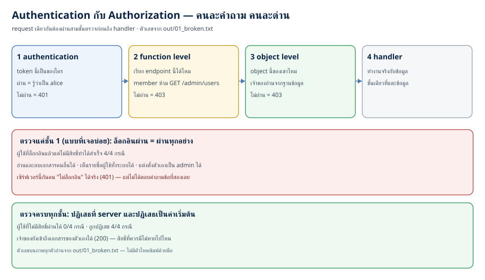
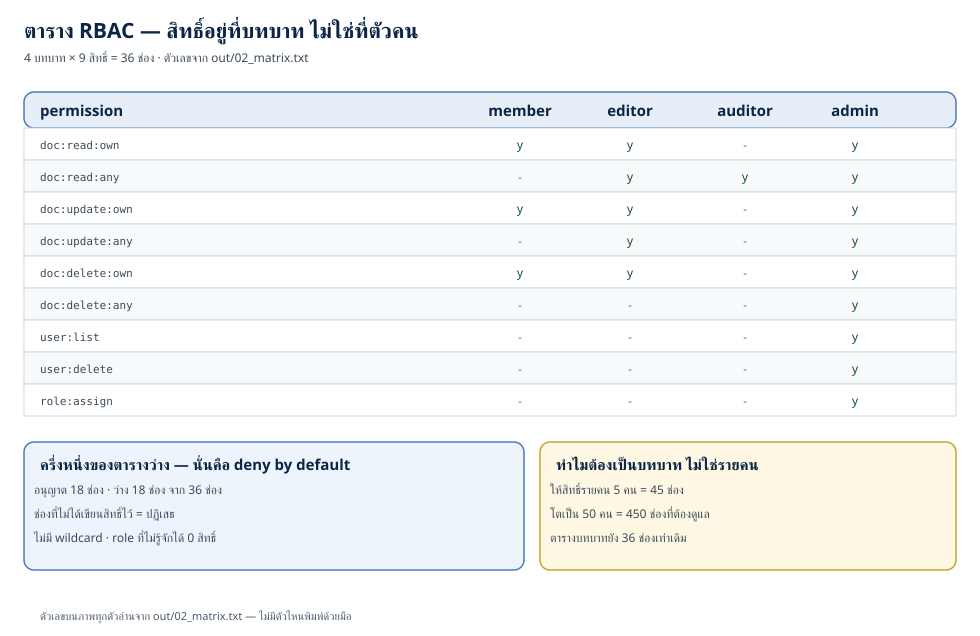
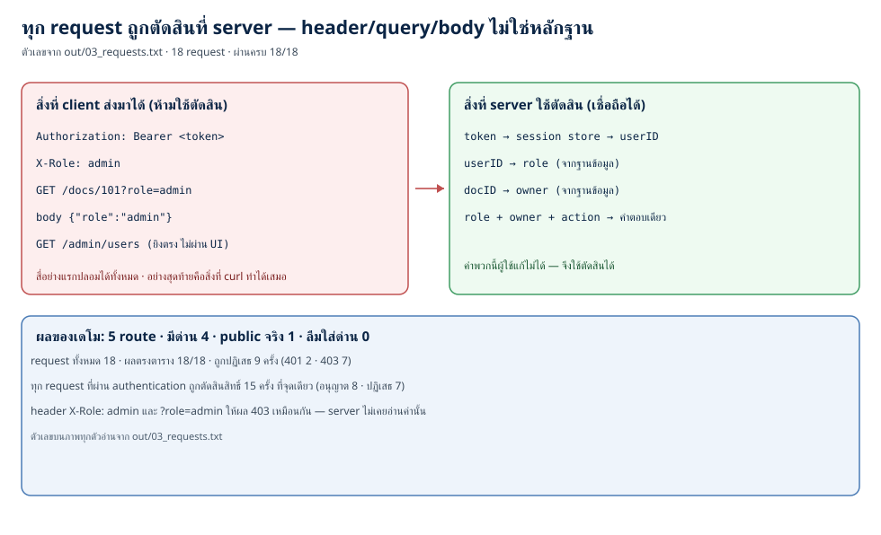

# Authorization และ access control: ทำไม "ล็อกอินแล้ว" ไม่เท่ากับ "มีสิทธิ์" (ตอนที่ 23)

> 📅 เขียนเมื่อ: 1 พฤศจิกายน 2026 (เวลาไทย, UTC+7)
>
> - **เครื่อง:** `Linux 6.18.39+rpi-2712 aarch64` — Raspberry Pi 5 · 4 คอร์ (`out/00_env.txt`)
> - **เวอร์ชันภาษา/เครื่องมือ:** `go version go1.24.4 linux/arm64` · Python `Python 3.13.5` · `rsvg-convert version 2.60.0` · `go.mod` ของเดโมระบุ `go 1.24` · **standard library ล้วน ไม่มี dependency ภายนอก (`external_deps=0`) ไม่เปิดพอร์ต (`listen_calls=0`) ไม่แตะเครือข่าย (`network_dial_calls=0`) ไม่มีฐานข้อมูลจริง**
> - **ที่มาของตัวเลขในบท:** ทุกตัวเลขในบทนี้อยู่ใน `code/ep23/out/` ของตอนนี้ และถูกพิมพ์โดยโปรแกรมเอง · ตัวเลขของ OWASP ผมอ่านจากหน้า A01:2025 บนเว็บทางการของ OWASP ในวันที่เขียน ไม่ได้มาจากความจำ
> - **เรื่องเวอร์ชันที่ต้องบอกให้ชัด:** Go 1.24 คือรุ่นที่เครื่องนี้มี ผมใช้เพราะเดโมต้องรันซ้ำได้บนเครื่องเดิม ไม่ใช่คำแนะนำให้เริ่มโปรเจกต์ใหม่ด้วยรุ่นนี้ · `http.ServeMux` ที่รับ pattern แบบ `"DELETE /docs/{id}"` และ `r.PathValue` มีให้ใช้ตั้งแต่ Go 1.22 — ถ้าคุณใช้รุ่นเก่ากว่า ต้องแยก path เองด้วย `strings.Split`
> - **สิ่งที่ผมยังไม่ได้ทำในรอบนี้ (บอกตรง ๆ):** ผมไม่ได้ทดสอบกับฐานข้อมูลจริงหรือ Redis · ไม่ได้ทำ policy engine (= ตัวตัดสินกฎที่แยกออกมา) แบบ ABAC · ไม่ได้ทดสอบกับ JWT หรือ OAuth จริง (พูดถึงแต่ไม่ได้เขียน) · ไม่ได้วัดเวลาลงในไฟล์ผลรัน เพราะ authorization ที่ออกแบบดีไม่ควรกินเวลาจนวัดได้ในระดับนี้ — สิ่งที่ผมวัดแทนคือ "ตัดสินใจกี่ครั้ง ที่กี่จุด" ซึ่งตรวจได้แน่นอนกว่า
>
> ⚠️ **หมายเหตุเรื่องจริยธรรม:** บทนี้สอนวิธี *โจมตี* ชั้นตรวจสิทธิ์ (ยิง request ตรงข้าม UI, เปลี่ยน id ของ object, ใส่ header เพื่อยกระดับสิทธิ์) ในระดับที่ต้องเห็นโค้ดจริงเพื่อเข้าใจ
>   - **เดโมรันที่ไหน:** ทั้งหมดรันในโปรเซสของตัวเอง บนเครื่องของคุณ ไม่เปิดพอร์ต ไม่แตะเครือข่าย ข้อมูลผู้ใช้และเอกสารเป็นข้อมูลสมมติที่สร้างในหน่วยความจำ
>   - **กติกาที่ผมขอให้ยึด:** ทดลองกับระบบที่ *คุณเป็นเจ้าของ* หรือ lab ที่ *ตั้งใจให้ทดลอง* เท่านั้น · การยิง request เพื่ออ่านหรือลบข้อมูลของคนอื่น แม้เพียงเพื่อ "เช็คว่ามันได้ผลไหม" คือการบุกรุก และผิดกฎหมายในแทบทุกประเทศ
>   - **ป้ายห้ามใช้จริง:** โค้ดที่ตั้งใจให้มีช่องโหว่คือแพ็กเกจ `internal/insecure` และ token ของเดโมใน `internal/authn` · ทั้ง repo มี 2 ไฟล์ที่ติดป้าย "ห้ามใช้จริง" (`insecure_marked_files=2`) — โค้ดพวกนั้นมีอยู่เพื่อให้เห็นความต่าง ไม่ใช่เพื่อคัดลอกไปใช้

---

ตอนที่แล้วเราจบที่คำถามข้อแรกว่า **"คุณเป็นใคร"** — เราเก็บรหัสผ่านให้ถูกวิธี ออก token ที่เดาไม่ได้ และทำให้ session ตายได้

คืนนี้คือคำถามข้อที่สองที่มาหลังจากนั้นไม่กี่ไมโครวินาที: **"แล้วคุณทำอะไรได้"**

สองคำถามนี้อยู่ติดกันจนคนมักเหมารวมว่าเป็นเรื่องเดียว และนั่นคือรากของช่องโหว่ที่ครองอันดับหนึ่งของ OWASP Top 10 — OWASP Top 10 คือรายการช่องโหว่ 10 หมวดที่ OWASP (องค์กรไม่แสวงกำไรด้าน security) จัดอันดับตามความถี่ที่พบจริงในแอป — และอันดับนั้นไม่ขยับมาหลายปี · ระบบที่ยืนยันตัวตนแน่นหนาที่สุดในโลกยังถูกยึดได้ ถ้าชั้นถัดไปตอบคำถามผิด — และมันตอบผิดง่ายมาก เพราะคำตอบที่ผิดไม่ทำให้โปรแกรม crash ไม่มี stack trace ไม่มี error ใน log มีแต่ผู้ใช้จริงที่เห็นข้อมูลของคนอื่น แล้วไม่มีใครรู้จนกว่าจะสาย

ตัวเลขสี่ชุดที่ผมจะใช้ตลอดบทนี้ (ทั้งหมดมาจาก `out/`):

- **เดโม 1 — เซิร์ฟเวอร์สองเวอร์ชัน request ชุดเดียวกัน** · ผู้ใช้ที่ล็อกอินแล้วแต่ไม่มีสิทธิ์ทำได้สำเร็จ **4/4 กรณี** บนเวอร์ชันที่ตรวจแค่ล็อกอิน (อ่านเอกสารคนอื่น ลบเอกสารคนอื่น เปิดรายชื่อผู้ใช้ทั้งระบบ แต่งตั้งตัวเองเป็น admin) · เวอร์ชันที่ตรวจครบสามชั้นปล่อยผ่าน **0/4** และปฏิเสธครบ **4/4** · ทั้งสองเวอร์ชันกันคนที่ไม่มี token ได้เท่ากัน (401)
- **เดโม 2 — ตาราง RBAC** · 4 บทบาท × 9 สิทธิ์ = **36 ช่อง** · อนุญาต **18 ช่อง** ว่าง **18 ช่อง** · ถ้าให้สิทธิ์รายคนแทนรายบทบาท ผู้ใช้ 5 คนต้องดูแล **45 ช่อง** และถ้าจำนวนผู้ใช้โตเป็น 50 คน (ตัวเลขสมมติในเดโม) จะเป็น **450 ช่อง** ขณะที่ตารางบทบาทยัง 36 ช่องเท่าเดิม
- **เดโม 3 — ทุก request ถูกตรวจที่ server** · 5 route (มีด่าน 4 + public จริง 1 + ลืมใส่ด่าน 0) · ยิง **18 request** ผลตรงตาราง **18/18** · ถูกปฏิเสธ 9 ครั้ง (401 สอง · 403 เจ็ด) · การตัดสินสิทธิ์เกิดขึ้น **15 ครั้ง ที่จุดเดียว**
- **ตัวตรวจของ repo** · `go vet` ผ่าน · `gofmt` ไม่มีไฟล์ค้าง · ไม่มี wildcard (สัญลักษณ์ `*` ที่ยืนแทนทุกสิทธิ์) ในตารางสิทธิ์ · ชั้น authorization ในเวอร์ชันที่มีช่องโหว่มี **0 จุด** และในเวอร์ชันที่ถูกมี **1 จุด**

รหัสสถานะที่บทนี้ใช้ทั้งบท: **200** = สำเร็จ · **204** = สำเร็จแต่ไม่มีเนื้อหาตอบกลับ · **400** = คำขอผิดรูปหรือผิดกติกา · **401** = ไม่รู้ว่าคุณเป็นใคร · **403** = รู้ว่าเป็นใครแต่ไม่ให้ผ่าน · **404** = ไม่พบสิ่งที่ขอ (object ไม่มีอยู่จริง)

ศัพท์ที่คุณจะเจอ (authorization · access control · RBAC · IDOR · BOLA · privilege escalation · deny by default · PDP/PEP) ผมจะนิยามตอนใช้จริงทั้งหมด — ตรงนี้ยังไม่ต้องจำ · แต่ตัวที่ถูกพูดถึงตลอดบทนี้ควรนิยามก่อน: **access control** (การควบคุมว่าใครทำอะไรได้กับ resource ชิ้นไหน) ซึ่งบทนี้จะเรียกสั้น ๆ ว่า "ชั้นตรวจสิทธิ์"

## 1. แนวคิด: สิทธิ์คือคำตอบของคำถามคนละข้อ

### 1.1 สามคำที่ต่อกันเป็นท่อเดียว

ตอนที่ 22 ผมวางตารางนี้ไว้แล้ว และมันยังใช้ได้:

| คำ | ตอบคำถามว่า | ตัวอย่างในเดโมนี้ |
|---|---|---|
| **identification** | "คุณอ้างว่าคุณคือใคร" | ส่ง header `Authorization: Bearer demo-alice-01` |
| **authentication** | "คุณพิสูจน์ได้ไหม" | token นั้นมีจริงใน session store หรือไม่ |
| **authorization** | "คุณมีสิทธิ์ทำสิ่งนี้ไหม" | `alice` ลบเอกสาร 102 ของตัวเองได้ แต่ลบ 201 ของ `bob` ไม่ได้ |

NIST (สถาบันมาตรฐานและเทคโนโลยีแห่งสหรัฐ) นิยาม authorization ไว้สั้น ๆ ว่าเป็น *กระบวนการตรวจสอบว่าการกระทำหรือบริการที่ขอมา ได้รับอนุญาตสำหรับ entity หนึ่ง* · สังเกตว่าคำนิยามไม่ได้พูดถึง "ล็อกอิน" เลย — เพราะ authorization เป็นคำถามที่ต้องถาม **ทุกครั้งที่แตะ resource** ไม่ใช่ครั้งเดียวตอนเข้าเว็บ

และมันเป็นคนละคำถามกับตอนที่แล้วจริง ๆ: ในเดโมนี้ ผู้ใช้ `bob` ที่ล็อกอินสำเร็จแล้วจะได้ **401** เมื่อไม่มี token แต่จะได้ **403** เมื่อมี token ถูกต้องแต่ไม่มีสิทธิ์ · สองรหัสนี้ต่างกันโดยเจตนา: 401 แปลว่า "ผมไม่รู้ว่าคุณเป็นใคร" · 403 แปลว่า "ผมรู้ว่าคุณเป็นใคร และคำตอบคือไม่"

### 1.2 สองชั้นที่ต้องแยกให้ออก: function level กับ object level

คนส่วนใหญ่ที่เริ่มเขียนระบบจะคิดว่า authorization มีชั้นเดียว คือ "บทบาทนี้เข้าหน้านี้ได้ไหม" · ของจริงมีสองชั้น และชั้นที่สองคือชั้นที่คนลืมมากที่สุด

- **function level** (ภาษา OWASP เรียกว่า BFLA — broken function level authorization) = บทบาทนี้เรียก endpoint นี้ได้ไหม · ตัวอย่าง: `member` เรียก `GET /admin/users` ไม่ได้
- **object level** (OWASP เรียกว่า BOLA — broken object level authorization) = เมื่อเรียก endpoint ได้แล้ว **object ชิ้นนี้** เป็นของเขาหรือเปล่า · ตัวอย่าง: `bob` เรียก `DELETE /docs/102` ได้ในหลักการ (เขามีสิทธิ์ลบเอกสารของตัวเอง) แต่เอกสาร 102 เป็นของ `alice` จึงต้องถูกปฏิเสธ

คำว่า **IDOR (Insecure Direct Object Reference)** คือชื่อเดิมของปัญหาชั้นที่สองในโลกเว็บ: ระบบเอา id ที่ client ส่งมาตรง ๆ ไปหยิบ object โดยไม่ตรวจว่า id นั้นเป็นของใคร · OWASP ยังใช้คำนี้ในคำอธิบาย A01 และในสายงาน API นิยมเรียกว่า BOLA · ทั้งสองคำพูดถึงความผิดเดียวกัน: **การอ้างถึง object ด้วย id ไม่ใช่หลักฐานว่าคุณมีสิทธิ์เข้าถึงมัน**

และเพราะมันแยกเป็นสองชั้น การเพิ่มสิทธิ์จึงมีสองทิศ:

- **horizontal privilege escalation** (ยกระดับแนวนอน) = เข้าถึงของคนที่อยู่ในระดับเดียวกับเรา · `bob` อ่านเอกสารของ `alice` ทั้งที่ทั้งคู่เป็น `member`
- **vertical privilege escalation** (ยกระดับแนวตั้ง) = ได้สิทธิ์ของระดับที่สูงกว่า · `bob` แต่งตั้งตัวเองเป็น `admin`

เดโม 1 ในคืนนี้สาธิตทั้งสองทิศในการรันครั้งเดียว



### 1.3 ทำไม "ล็อกอินแล้ว" ไม่เท่ากับ "มีสิทธิ์" — และทำไมการตรวจที่ client ไม่นับ

มีเหตุผลเชิงกลไกข้อเดียว แต่มันสำคัญพอที่จะเป็นทั้งบท: **ทุกอย่างที่ client ส่งมา ผู้ใช้แก้ได้** · และ "ผู้ใช้" ในที่นี้หมายถึงผู้โจมตีที่ใช้ `curl` ไม่ต้องเปิดเบราว์เซอร์เลย

ลองนึกถึงระบบที่ซ่อนเมนู "จัดการผู้ใช้" ไว้เมื่อ `role !== "admin"` · ผู้ใช้ทั่วไปมองไม่เห็นเมนูนั้นจริง ๆ — แต่ endpoint ยังอยู่ที่เดิม และไม่มีอะไรหยุด request ที่ไม่ได้ผ่าน UI:

```bash
curl -H "Authorization: Bearer <token ของผู้ใช้ทั่วไป>" https://example.test/admin/users
```

OWASP เขียนเรื่องนี้ไว้ตรง ๆ ในหน้า A01:2025 ว่า access control ได้ผลก็ต่อเมื่อมันถูก implement ใน **โค้ดฝั่งเซิร์ฟเวอร์ที่ผู้โจมตีแก้ไม่ได้** · และยกสถานการณ์ตัวอย่างที่สามเป็นกรณีนี้พอดี: แอปที่เอา access control ทั้งหมดไปไว้ใน front-end ผู้โจมตีแค่ยิง `curl` ตรงไปที่ endpoint ก็ข้ามได้ทั้งด่าน

ในเดโมของเรา ผมจำลองเรื่องนี้ด้วยการยิง request ตรงเข้า `ServeHTTP` โดยไม่ผ่าน UI เลย — และเพิ่มกรณีที่ผู้โจมตีใส่ `X-Role: admin` กับ `?role=admin` มาด้วย · ผลคือ **403 ทั้งสองกรณี** — ไม่ใช่เพราะระบบ "ตรวจจับ header ปลอม" ได้ แต่เพราะเวอร์ชันที่ถูกไม่เคยใช้ header/query เป็นหลักฐานเรื่อง role · คำตัดสินมาจาก store อย่างเดียว และ bob ไม่ใช่เจ้าของเอกสาร 101

### 1.4 RBAC: สิทธิ์อยู่ที่บทบาท ไม่ใช่ที่ตัวคน

**RBAC (Role-Based Access Control)** คือการให้สิทธิ์กับ *บทบาท* แล้วผูกผู้ใช้กับบทบาท · สามคำที่ต้องแยกให้ชัดก่อนออกแบบ:

| คำ | คืออะไร | ในเดโมนี้ |
|---|---|---|
| **role** (บทบาท) | กลุ่มของสิทธิ์ที่ตั้งชื่อตามงาน | `member` · `editor` · `auditor` · `admin` |
| **permission** (สิทธิ์) | การกระทำหนึ่งอย่างบน resource หนึ่งชนิด | `doc:delete:own` · `user:list` |
| **resource / object** | สิ่งที่ถูกกระทำ | เอกสาร id 101 ซึ่งมี `owner=alice` |

ผมเขียน permission เป็นสามส่วนคั่นด้วย `:` — `resource:action:scope` — เพราะ **scope คือส่วนที่คนลืมใส่ แล้วทำให้ระบบทั้งระบบพัง** · `doc:delete:own` กับ `doc:delete:any` เป็นสิทธิ์คนละอย่าง และบทบาท `member` ควรได้แค่อันแรก

ข้อยกเว้นที่ต้องบอกให้ชัด เพราะตารางในข้อ 3.5 มีทั้งสองแบบปนกัน: **สิทธิ์ระดับ function ที่ไม่มี object ให้ผูก ไม่มี scope** · `user:list` · `user:delete` · `role:assign` มีแค่ `resource:action` เพราะคำถามไม่ใช่ "ของใคร" แต่คือ "บทบาทนี้เรียก endpoint นี้ได้ไหม" · การที่ชื่อสิทธิ์บอกชั้นของตัวเองตั้งแต่ต้น ทำให้อ่านตารางแล้วรู้ว่าแถวไหนต้องเทียบ owner และแถวไหนไม่ต้อง

ในเดโม endpoint จัดการผู้ใช้เป็นงานระดับ function ตามที่ OWASP จัด (ทั้ง endpoint เป็นของ admin) ส่วนการห้ามกระทำกับตัวเองเป็นการ์ดคนละใบ — เป็นกติกาของโดเมน (ดูเคส [17] ที่ได้ 400) ไม่ใช่ scope ในตารางสิทธิ์ · ถ้ามี endpoint ที่ผู้ใช้ทั่วไปลบ "บัญชีตัวเอง" ได้ ต้องแยกเป็น `user:delete:own`

หกหลักที่ผมใช้ทุกครั้งที่ออกแบบตารางสิทธิ์:

1. **deny by default** — ช่องที่ไม่ได้เขียนสิทธิ์ไว้ = ปฏิเสธ · ไม่มี wildcard (`*` = เขียนครั้งเดียวแทนทุกสิทธิ์) ไม่มี "admin เห็นทุกอย่างเพราะเป็น admin"
2. **role = งาน ไม่ใช่ตำแหน่งงาน** — ถ้าตั้ง role ตามแผนก (`sales`, `hr`) คุณจะได้ role ที่มีสิทธิ์เกินความจำเป็นเพราะคนในแผนกทำงานไม่เหมือนกัน · ตั้งตามสิ่งที่เขาทำ
3. **least privilege** — เริ่มจากศูนย์แล้วเพิ่มเท่าที่จำเป็น (หลักเดียวกับ[ตอนที่ 12](/blog/post.html?slug=2026-10-20-software-security-12-least-privilege-defense-in-depth)) · การให้สิทธิ์ผิดแล้วถอนคืนยากกว่าการให้เพิ่มทีหลังเสมอ
4. **separation of duties** — งานที่เสี่ยงต้องใช้คนละคน · คนที่สร้างคำสั่งจ่ายเงินไม่ควรเป็นคนอนุมัติ (นี่คือเหตุผลที่เดโมห้าม `root` เปลี่ยนบทบาทของตัวเอง)
5. **แยกการตัดสินใจออกจาก handler** — ตรวจที่จุดเดียว ไม่ใช่กระจาย `if` ไปทุกฟังก์ชัน (ข้อ 3.4)
6. **ทดสอบทุกบทบาท** — ตารางที่ไม่มี test คือตารางที่ไม่มีใครรู้ว่ายังถูกต้องอยู่ไหม (ข้อ 6)

และมีกับดักที่ต้องรู้ชื่อ: **role explosion** · ถ้าคุณสร้าง role ใหม่ทุกครั้งที่มีความต้องการสิทธิ์ต่างกันนิดเดียว (`editor_th`, `editor_th_approver`, `editor_th_approver_readonly`) ในไม่ช้าคุณจะมี role มากกว่าผู้ใช้ และไม่มีใครตอบได้ว่าใครทำอะไรได้ · เมื่อตารางเริ่มบาน ทางออกไม่ใช่เพิ่ม role แต่คือเลื่อนไปใช้ **ABAC** (ข้อ 1.5)

### 1.5 ทางเลือกอื่น: ACL · ABAC · ReBAC

RBAC ไม่ใช่คำตอบเดียว และการรู้ว่ามันไม่เหมาะเมื่อไรคือส่วนหนึ่งของงาน

| แบบ | ตัดสินจากอะไร | เหมาะเมื่อ | ต้นทุน |
|---|---|---|---|
| **ACL** (Access Control List) | รายชื่อว่าใครทำอะไรได้บ้าง **ต่อ object** | ไฟล์/โปรเจกต์ที่เจ้าของแชร์ให้คนอื่นทีละคน | จำนวนรายการโตตาม object × คน · ตรวจยากว่า "ใครเข้าถึงอะไรได้บ้าง" |
| **RBAC** | บทบาทของผู้ใช้ | ระบบที่มีโครงสร้างงานชัด (องค์กร, SaaS หลายระดับ) | ต้องออกแบบ role ให้ดี · ไม่เก่งเรื่องเงื่อนไข |
| **ABAC** (Attribute-Based Access Control) | attribute ของ subject (ผู้ที่ขอ access) + object + environment + action | กฎที่มีเงื่อนไข: แผนกเดียวกัน · ในเวลาทำงาน · ชั้นความลับไม่เกิน L3 · ในเครือข่ายองค์กร | ต้องมี policy engine · debug ยาก · ช้ากว่า |
| **ReBAC** (Relationship-Based) | ความสัมพันธ์ในกราฟ: เจ้าของ · สมาชิกทีม · ผู้รับมอบ | ระบบแบบ share/collaborate (เอกสาร, โฟลเดอร์, หลายองค์กร) | ต้องเก็บกราฟความสัมพันธ์และ query ให้เร็ว |

ศัพท์สองตัวที่ควรรู้เมื่อมี ABAC: **PDP (Policy Decision Point)** คือที่ที่ตัดสิน ("อนุญาต/ปฏิเสธ") และ **PEP (Policy Enforcement Point)** คือที่ที่บังคับผลของคำตัดสิน (middleware = โค้ดที่ห่อทุก request ก่อนถึง handler — ตรงนี้คือตัวที่อยู่หน้าทุก endpoint) · ในเดโมของเรา `authz.Policy` คือ PDP และ `protect()` คือ PEP — สองอย่างนี้อยู่ใกล้กันเพราะระบบเล็ก แต่ในระบบใหญ่แยกกันคนละ service ได้

### 1.6 ที่ตรวจผิดตำแหน่ง: สี่แบบที่เจอซ้ำที่สุด

- **ตรวจใน UI** — ซ่อนปุ่ม/ซ่อนเมนู แล้วคิดว่าเสร็จ · UI เป็นแค่คำแนะนำ ผู้ใช้ไม่ต้องสนใจ
- **ตรวจใน query อย่างเดียว** — `SELECT * FROM docs WHERE id = ? AND owner = ?` ปลอดภัยสำหรับการอ่าน แต่พอฟังก์ชันถัดไปลบด้วย `DELETE WHERE id = ?` การตรวจหายไปทั้งชั้น
- **ตรวจครั้งเดียวตอนล็อกอิน** — "ตอนล็อกอินผมเช็คแล้วว่าเป็น admin" · แต่ทุก request หลังจากนั้นคือการอ้างสิทธิ์ใหม่ และ role ของผู้ใช้อาจเปลี่ยนไปแล้ว (เดโม 3 ข้อ 18 แสดงเรื่องนี้)
- **เชื่อ owner ที่ client ส่งมา** — รับ `owner=alice` จาก body แล้วใช้ค่านั้นตรวจ · ผู้โจมตีก็ส่ง `owner=<ตัวเอง>` มา

ทั้งสี่แบบมีอาการเดียวกัน: การตัดสินใจเกิดขึ้นในที่ที่ผู้โจมตีควบคุมได้ หรือเกิดครั้งเดียวในที่ที่ควรเกิดทุกครั้ง

## 2. ทำไมเรื่องนี้สำคัญ: อันดับหนึ่งที่ไม่เคยขยับ

### 2.1 OWASP Top 10:2025 — A01 ยังเป็นที่หนึ่ง

ผมตรวจหน้า A01:2025 บนเว็บ OWASP ก่อนเขียนบทนี้ ตัวเลขที่ระบุไว้มีดังนี้:

| ตัวชี้วัด | ค่า |
|---|---|
| อันดับ | **A01 — ที่หนึ่ง** (เท่าเดิมจากฉบับ 2021) |
| จำนวน CWE ในหมวด | **40** (CWE = ชนิดของจุดอ่อน · มากที่สุดในทั้งสิบหมวด) |
| สัดส่วนแอปที่พบช่องโหว่ในหมวดนี้ | **100% ของแอปที่ถูกทดสอบ** พบรูปแบบใดรูปแบบหนึ่ง |
| max incidence rate | **20.15%** (incidence rate = สัดส่วนของแอปที่ทดสอบแล้วพบช่องโหว่นี้ · ยิ่งมากยิ่งแย่) |
| avg incidence rate | **3.74%** |
| จำนวนครั้งที่พบ (รวมข้อมูลที่ส่งมา) | **1,839,701** |
| CVE ที่เกี่ยวข้อง | **32,654** (CVE = รหัสช่องโหว่ที่ประกาศสาธารณะ) |

สองรายละเอียดที่เปลี่ยนจากฉบับ 2021 และควรรู้:

- **SSRF (Server-Side Request Forgery) ถูกรวมเข้ามาใน A01** จากเดิมที่เป็นหมวด A10 แยก · เหตุผลคือมันเป็นการ abuse สิทธิ์ของเซิร์ฟเวอร์เอง — เซิร์ฟเวอร์ถูกหลอกให้ไปเรียก endpoint ภายในที่ผู้ใช้ภายนอกไม่ควรเข้าถึง · มุมมอง "นี่คือ access control ที่พัง" ตรงกับธรรมชาติของมันมากกว่าการเป็นหมวดเดี่ยว · ในรายการ CWE ของหมวดนี้จึงมี CWE-918 (SSRF) อยู่ด้วย
- **CSRF ก็อยู่ในหมวดนี้** (CWE-352 — CSRF = การหลอกให้เบราว์เซอร์ของผู้ใช้ที่ล็อกอินอยู่ยิง request แทนเขา) เช่นเดียวกับ path traversal (CWE-22 — ใช้ `../` หลุดออกนอกโฟลเดอร์ที่อนุญาต) และ CWE-200 (การเปิดเผยข้อมูลให้คนที่ไม่ควรเห็น)

และประโยคที่ผมอยากให้ติดไป: **"100% ของแอปที่ทดสอบ"** ไม่ใช่เพราะทุกแอปพังหนักเท่ากัน แต่เพราะชั้นนี้มีจุดที่ลืมได้มากกว่าชั้นอื่น — ทุก endpoint ใหม่คือจุดที่ต้องถามคำถามเดิมอีกครั้ง และทุกครั้งที่นักพัฒนาลืม ก็ไม่มีอะไรฟ้อง

OWASP ให้รายการป้องกันไว้ ซึ่งผมยึดเป็นโครงของบทนี้: ตรวจในโค้ดฝั่งเซิร์ฟเวอร์ · deny by default · implement ครั้งเดียวแล้วใช้ซ้ำ · ให้ model บังคับความเป็นเจ้าของของ record · log ความล้มเหลวของการตรวจสิทธิ์ · จำกัด rate · เพิกถอน session ฝั่งเซิร์ฟเวอร์ตอน logout · และใส่ functional access control ลงใน unit/integration test

### 2.2 RBAC ไม่ได้เพิ่งเกิด — และนั่นคือเหตุผลที่มันยังใช้

**Ferraiolo และ Kuhn** ตีพิมพ์แนวคิด Role-Based Access Controls ที่ NIST ในปี **1992** (การประชุม National Computer Security Conference ครั้งที่ 15, 13 ตุลาคม 1992) · ข้อโต้แย้งหลักของเปเปอร์คือ: การพึ่ง DAC (Discretionary Access Control — เจ้าของไฟล์ตัดสินใจเองว่าใครเข้าได้) ไม่เหมาะกับองค์กรจริง เพราะเมื่อมีคนหลายร้อยคนและไฟล์แสนไฟล์ การตัดสินใจรายไฟล์คือภาระที่ไม่มีใครทำไหว · RBAC ย้ายการตัดสินใจจาก "ใครเป็นเจ้าของไฟล์นี้" ไปเป็น "บทบาทนี้ทำงานอะไร"

แนวคิดนี้กลายเป็นมาตรฐาน **ANSI/INCITS 359-2004** (อนุมัติกุมภาพันธ์ 2004, ปรับปรุงเป็น INCITS 359-2012) ซึ่งนิยามองค์ประกอบพื้นฐานไว้ครบ: users · roles · permissions · operations · objects และความสัมพันธ์ระหว่างกัน · มาตรฐานนี้เองที่ทำให้คำว่า role/permission มีความหมายตรงกันข้ามผลิตภัณฑ์

สามสิบกว่าปีต่อมา RBAC ยังเป็นค่าตั้งต้นของระบบส่วนใหญ่ เพราะมันตอบโจทย์หลักได้ดี: **ลดจำนวนจุดที่ต้องตัดสินใจ** · ระบบที่มีผู้ใช้ 5,000 คนและบทบาท 8 บทบาท ต้องดูแล 8 แถว ไม่ใช่ 5,000 แถว · ตัวเลข 45 กับ 450 ในเดโม 2 คือเรื่องเดียวกันในขนาดเล็ก

### 2.3 เมื่อ authorization พัง อะไรพังตาม

| ชั้นที่พัง | อาการที่ผู้ใช้เห็น | ความเสียหายจริง |
|---|---|---|
| object level (IDOR/BOLA) | เห็นเอกสารที่ลิงก์มาแต่ไม่ใช่ของตัวเอง | ข้อมูลรั่วข้ามผู้ใช้/ข้ามองค์กร · ผิด GDPR (กฎหมายคุ้มครองข้อมูลของ EU) แบบตรง ๆ |
| function level (BFLA) | เรียก endpoint ที่ไม่มีในเมนูได้ | ยกระดับสิทธิ์ · ลบข้อมูลทั้งระบบ |
| การให้สิทธิ์กว้างเกิน | ทุกคนเป็น admin เพราะ "สะดวกตอน dev" | ขาด accountability (ตรวจสอบย้อนหลังได้ว่าใครทำอะไร) ทั้งระบบ |
| ขาดการ log | ไม่มีอะไรบอกว่าใครเข้าถึงอะไร | ตอบไม่ได้ว่าเกิดอะไรขึ้น (ต่อยอดในตอนที่ 28) |

สังเกตว่าแถวแรกกับแถวที่สองพังด้วยโค้ดที่ *compile ผ่านและ test ผ่าน* · ไม่มี type error ไม่มี panic — เพราะสิ่งที่ผิดคือ *เงื่อนไขทางธุรกิจ* ไม่ใช่ชนิดข้อมูล และนี่คือเหตุผลที่ authorization ต้องมี test ของมันเอง ไม่ใช่หวังพึ่ง test ของฟีเจอร์

## 3. ลงมือทำ: สร้างชั้นตรวจสิทธิ์ที่รันได้จริง

เดโมทั้งหมดอยู่ใน `code/ep23/` รันซ้ำได้ด้วย `bash run_all.sh` · ไม่มี dependency ภายนอก ไม่เปิดพอร์ต — request ทั้งหมดวิ่งผ่าน `http.Handler` ด้วย `httptest.NewRequest` + `httptest.NewRecorder` ซึ่งเป็นเส้นทางเดียวกับที่ production ใช้จริง (ต่างกันแค่ไม่มี socket)

โครงไฟล์:

```text
ep23/
  cmd/broken/     เดโม 1 — เทียบเซิร์ฟเวอร์สองเวอร์ชัน
  cmd/matrix/     เดโม 2 — ตาราง RBAC
  cmd/requests/   เดโม 3 — 18 request ผ่าน chain เดียว
  internal/model/ ผู้ใช้ · บทบาท · สิทธิ์ · เอกสาร
  internal/authn/ token → userID (ย่อจากตอนที่ 22)
  internal/authz/ ตารางสิทธิ์ + Decide (หัวใจของตอนนี้)
  internal/principal/ พา "ผู้ใช้ที่ยืนยันแล้ว" ผ่าน context
  internal/app/   API ที่ตรวจครบสามชั้น
  internal/insecure/ API ที่ตรวจแค่ล็อกอิน (ห้ามใช้จริง)
```

### 3.1 ชนิดข้อมูล: บทบาทและสิทธิ์เป็นชนิดของตัวเอง

จุดแรกที่ผมอยากให้สังเกตคือ **ผมไม่ใช้ `string` ลอย ๆ สำหรับ role และ permission**

```go
// Role คือบทบาท — กลุ่มของสิทธิ์ (permission) ที่ผู้ใช้ได้รับ
type Role string

const (
	RoleMember  Role = "member"
	RoleEditor  Role = "editor"
	RoleAuditor Role = "auditor"
	RoleAdmin   Role = "admin"
)
```

การมีชนิดของตัวเองทำให้ compiler ช่วยจับการสลับ argument (`Allows(perm, role)` จะไม่ compile) และทำให้ตารางสิทธิ์อ่านออกว่าแต่ละช่องคืออะไร · ลำดับของ `AllPerms` ถูกกำหนดตายตัว เพื่อให้ทุกเดโมพิมพ์ตารางด้วยลำดับเดียวกันและผลรันซ้ำได้ทุกครั้ง

ส่วน `owner` ของเอกสารเป็นข้อมูลที่ **ต้องอ่านจากที่เก็บของเราเท่านั้น**:

```go
// Doc คือเอกสารหนึ่งฉบับ — Owner คือ "ใครเป็นเจ้าของ" ซึ่งเป็นข้อมูลที่
// authorization ต้องอ่านจากฝั่งเซิร์ฟเวอร์เท่านั้น ห้ามรับจาก client
type Doc struct {
	ID    string
	Owner string
	Title string
}
```

### 3.2 หัวใจ: Need และการตัดสินใจสองชั้น

ทุก endpoint ประกาศว่ามัน "ต้องการอะไร" ด้วยค่า `Need` ที่มีสองช่อง — สิทธิ์ระดับ any และสิทธิ์ระดับ own:

```go
// Need คือสิ่งที่ request หนึ่งต้องการ — แยกสองระดับ
//
//	Any: สิทธิ์ที่ใช้ได้กับทุก object (เช่น doc:delete:any)
//	Own: สิทธิ์ที่ใช้ได้เฉพาะ object ที่ตัวเองเป็นเจ้าของ (เช่น doc:delete:own)
//
// request ที่ต้องการระดับเดียวให้ปล่อยอีกช่องเป็น "" — และถ้าเป็น request ที่
// ไม่มี object (เช่น list users) ช่อง Own ต้องว่าง
type Need struct {
	Any model.Perm
	Own model.Perm
}

// ความต้องการของแต่ละ endpoint — ประกาศที่ router ที่เดียว
var (
	NeedRead      = Need{Any: model.PermDocReadAny, Own: model.PermDocReadOwn}
	NeedUpdate    = Need{Any: model.PermDocUpdateAny, Own: model.PermDocUpdateOwn}
	NeedDelete    = Need{Any: model.PermDocDeleteAny, Own: model.PermDocDeleteOwn}
	NeedUserList  = Need{Any: model.PermUserList}
	NeedRoleGrant = Need{Any: model.PermRoleAssign}
)
```

ตารางสิทธิ์เขียนด้วยการให้สิทธิ์แบบ explicit ทุกช่อง ไม่มี wildcard:

```go
// NewPolicy สร้างตารางสิทธิ์ตั้งต้น — เขียนสิทธิ์ที่ให้ explicitly ทุกช่อง
// ไม่มี "*" และไม่มี role ใดได้สิทธิ์โดยปริยาย
func NewPolicy() *Policy {
	return &Policy{grants: map[model.Role]map[model.Perm]bool{
		model.RoleMember: grant(
			model.PermDocReadOwn, model.PermDocUpdateOwn, model.PermDocDeleteOwn),
		model.RoleEditor: grant(
			model.PermDocReadOwn, model.PermDocReadAny,
			model.PermDocUpdateOwn, model.PermDocUpdateAny,
			model.PermDocDeleteOwn),
		model.RoleAuditor: grant(
			model.PermDocReadAny),
		model.RoleAdmin: grant(model.AllPerms...),
	}}
}
```

และตัวตัดสินใจมีฟังก์ชันเดียว — ทั้งระบบเรียกผ่านมัน · แต่มีสามชื่อที่ต้องแยกให้ออกก่อนอ่านโค้ด เพราะบทนี้ใช้สลับกันตลอด: `Decide` (ทางเข้าที่ทุกคนเรียก และเป็นที่นับสถิติ) · `judge` (ตัวที่ตัดสินจริง — ที่เดียวใน repo ที่มีตรรกะสองชั้น) · `Decision` (คำตอบที่ทั้งคู่คืนกลับมา)

`Decision` เป็นชนิดที่ประกาศไว้ในแพ็กเกจนี้ — สามช่องของมันคือของที่บทนี้ใช้ทั้งบท: `Allowed` (ผ่านหรือไม่) · `Step` (`function` หรือ `object` — ตกชั้นไหน ใช้ทั้งในผลรันและ audit log · audit log คือ log ที่ตรวจสอบย้อนหลังได้ว่าใครทำอะไร) · `Reason` (ข้อความให้คนอ่าน):

```go
// Decision คือคำตอบพร้อม "ชั้นที่ตัดสิน" — ใช้เพื่อการสอนและ audit log
type Decision struct {
	Allowed bool
	Step    string // "function" หรือ "object"
	Reason  string
}
```

`Decide` คือทางเข้า: เรียก `judge` แล้วนับสถิติ (การนับอยู่ใต้ mutex — ถ้าเสิร์ฟ concurrent ตัวนับจะแข่งกัน) · การแยกแบบนี้ทำให้คำถาม "ตรวจทุก request จริงไหม" กลายเป็นตัวเลขที่วัดได้ (ข้อ 3.6):

```go
// Decide ตัดสินใจหนึ่งครั้งสำหรับหนึ่ง request
//
// ownerID ต้องมาจากฝั่งเซิร์ฟเวอร์ (อ่านจากที่เก็บ) เท่านั้น — ถ้าผู้เรียกส่งค่า
// ที่มาจาก body/query เข้ามา การตรวจชั้น object ก็ไร้ความหมาย
func (p *Policy) Decide(u model.User, need Need, ownerID string) Decision {
	d := p.judge(u, need, ownerID)
	p.mu.Lock()
	p.decisions++
	if d.Allowed {
		p.allows++
	} else {
		p.denies++
	}
	p.mu.Unlock()
	return d
}
```

และ `judge` คือที่เดียวที่มีตรรกะการตัดสิน:

```go
func (p *Policy) judge(u model.User, need Need, ownerID string) Decision {
	if need.Any == "" && need.Own == "" {
		// endpoint ที่ประกาศ Need ว่าง = ประกาศผิด ต้องไม่ผ่าน
		return Decision{false, "function", "endpoint ไม่ได้ประกาศสิทธิ์ที่ต้องการ"}
	}
	// ชั้นที่ 1 — function level: บทบาทนี้เรียก endpoint นี้ได้ไหม
	if !p.Allows(u.Role, need.Any) && !p.Allows(u.Role, need.Own) {
		return Decision{false, "function", "บทบาทไม่มีสิทธิ์เรียก endpoint นี้"}
	}
	// ชั้นที่ 2 — object level: มีสิทธิ์ระดับ any หรือเป็นเจ้าของ object
	if p.Allows(u.Role, need.Any) {
		// endpoint ที่ไม่มี object (เช่น list users) ตัดสินจบที่ชั้น function
		step := "object"
		if need.Own == "" {
			step = "function"
		}
		return Decision{true, step, "มีสิทธิ์ระดับ any"}
	}
	if u.ID == ownerID && ownerID != "" {
		return Decision{true, "object", "เป็นเจ้าของ object"}
	}
	return Decision{false, "object", "ไม่ใช่เจ้าของ object และไม่มีสิทธิ์ระดับ any"}
}
```

สี่รายละเอียดที่ซ่อนอยู่ในฟังก์ชันนี้ และผมอยากให้อ่านช้า ๆ:

- **`need.Any == "" && need.Own == ""` → ปฏิเสธ** · endpoint ที่ประกาศความต้องการว่างเปล่าคือ endpoint ที่ประกาศผิด และค่าเริ่มต้นที่ปลอดภัยคือ "ไม่ผ่าน" ไม่ใช่ "ปล่อยไปก่อนแล้วค่อยแก้" (หลัก fail closed จาก[ตอนที่ 13](/blog/post.html?slug=2026-10-21-software-security-13-fail-closed-secure-default))
- **ชั้น function ตัดสินก่อนชั้น object** · `judge` ตัดสินจบที่ชั้น function ถ้าบทบาทไม่มีสิทธิ์เลย — คำตอบของคนที่ไม่มีสิทธิ์จึงถูกเลือกก่อนถึงขั้นเทียบเจ้าของ และการปฏิเสธที่ชั้น function ไม่เปิดเผยว่า object นั้นมีอยู่จริงหรือไม่ · ใน `protect` (ข้อ 3.4) เราเตรียม `ownerID` ไว้ล่วงหน้าอยู่แล้ว (อ่านจาก store เฉพาะกรณี `need.Own != ""`) เพราะ `Decide` รับมันเป็น argument — เตรียมค่าไว้ก่อนไม่ได้แปลว่าได้เอามาเทียบก่อน
- **`!p.Allows(u.Role, need.Any) && !p.Allows(u.Role, need.Own)`** · ชั้น function ผ่านได้ถ้ามีสิทธิ์แบบใดแบบหนึ่งในสองแบบ เพราะ permission ระดับ own ก็คือการอนุญาตให้เรียก endpoint นี้ (แค่จำกัด object) — ถ้าเช็คแค่ Any ผู้ใช้ member จะถูกปฏิเสธตั้งแต่ชั้นแรก และไม่มีใครอ่านเอกสารตัวเองได้เลย
- **`u.ID == ownerID && ownerID != ""`** · เงื่อนไขที่สองสำคัญเท่าเงื่อนไขแรก: ถ้า `ownerID` ว่าง (ไม่พบเอกสาร) การเทียบจะได้ `"" == ""` เป็นจริงถ้าผู้ใช้มี id ว่าง · เช็คค่าว่างก่อนเสมอ

### 3.3 เวอร์ชันที่มีช่องโหว่: ด่านเดียวที่ตอบคำถามผิดข้อ

นี่คือโค้ดที่ผมเจอบ่อยที่สุดในงานรีวิว — มี middleware ดูดี มีชื่อว่า `requireLogin` และทุก route ก็ "มี auth" ครบ:

```go
// requireLogin ตอบคำถามเดียวว่า "token นี้เป็นของใคร" แล้วส่งต่อทันที
//
// นี่คือจุดที่ความผิดพลาดเริ่ม: ล็อกอินผ่าน = ผ่านทุกอย่าง
func (s *Server) requireLogin(next http.HandlerFunc) http.HandlerFunc {
	return func(w http.ResponseWriter, r *http.Request) {
		uid, ok := s.sess.User(bearer(r))
		if !ok {
			writeJSON(w, http.StatusUnauthorized, map[string]string{"error": "unauthorized"})
			return
		}
		u, ok := s.store.User(uid)
		if !ok {
			writeJSON(w, http.StatusUnauthorized, map[string]string{"error": "unauthorized"})
			return
		}
		next(w, r.WithContext(principal.With(r.Context(), u)))
	}
}
```

มันตอบคำถาม authentication ได้ถูกต้อง และจบงานตรงนั้น · handler จึงทำงานกับ id ที่ client ส่งมาทันที:

```go
// getDoc อ่านเอกสารตาม id — ไม่ตรวจว่าเป็นเจ้าของหรือไม่ (IDOR)
func (s *Server) getDoc(w http.ResponseWriter, r *http.Request) {
	d, ok := s.store.Doc(r.PathValue("id"))
	if !ok {
		writeJSON(w, http.StatusNotFound, map[string]string{"error": "not found"})
		return
	}
	writeJSON(w, http.StatusOK, d)
}

// deleteDoc ลบเอกสารตาม id — ไม่ตรวจเจ้าของ และไม่ตรวจบทบาท
func (s *Server) deleteDoc(w http.ResponseWriter, r *http.Request) {
	if !s.store.DeleteDoc(r.PathValue("id")) {
		writeJSON(w, http.StatusNotFound, map[string]string{"error": "not found"})
		return
	}
	w.WriteHeader(http.StatusNoContent)
}
```

ผลรันจริงของ request ชุดเดียวกันที่ยิงใส่ทั้งสองเซิร์ฟเวอร์ — คอลัมน์ `vuln_status` คือเวอร์ชันนี้:

```
=== เดโม 1: request ชุดเดียวกัน ยิงใส่สองเซิร์ฟเวอร์ ===
หลักการ: authentication ตอบคำถาม "คุณเป็นใคร" · authorization ตอบ "คุณทำอะไรได้"

-- case 1 · bob ขออ่านเอกสารของ alice
   vuln_status=200 fixed_status=403 expected=403
-- case 2 · bob ลบเอกสารของ alice
   vuln_status=204 fixed_status=403 expected=403
-- case 3 · alice เปิดรายชื่อผู้ใช้ทั้งหมด
   vuln_status=200 fixed_status=403 expected=403
-- case 4 · bob อ่านเอกสารของตัวเอง
   vuln_status=200 fixed_status=200 expected=200
-- case 5 · ไม่มี token เลย
   vuln_status=401 fixed_status=401 expected=401
-- case 6 · bob แต่งตั้งตัวเองเป็น admin
   vuln_status=200 fixed_status=403 expected=403

cases=6
unauthorized_cases=4
vuln_unauthorized_allowed=4/4
fixed_unauthorized_allowed=0/4
fixed_unauthorized_blocked=4/4
anonymous_blocked_both=1/1

อ่านตัวเลขนี้ให้ออก: ทั้งสองเซิร์ฟเวอร์กันคน "ไม่ล็อกอิน" ได้เท่ากัน (401 ทั้งคู่)
แต่พอเป็นคนที่ล็อกอินแล้วแต่ไม่มีสิทธิ์ เวอร์ชัน insecure ปล่อยผ่านครบทุกกรณี
เพราะมันมีด่านเดียว — และด่านนั้นตอบคำถามผิดข้อ
```

อ่านตารางนี้ให้ครบ (มันสั้นและมันคือทั้งบท):

- **case 1 และ 2** — `bob` อ่าน (200) และลบ (204) เอกสารของ `alice` ได้ · นี่คือ IDOR ตรงตัว: id มาจาก URL, ระบบหยิบ object ตาม id, ไม่มีใครถามว่าเป็นของใคร
- **case 3** — `alice` เปิดรายชื่อผู้ใช้ทั้งระบบได้ (200) · เมนูนี้ซ่อนจาก UI ของเธอ แต่ endpoint ไม่ได้ซ่อนจาก `curl`
- **case 4** — `bob` อ่านเอกสารของตัวเองได้ (200) · สำคัญ: ของที่ควรเข้าได้ต้องเข้าได้ด้วย ไม่ใช่ปิดหมดจนระบบใช้ไม่ได้
- **case 5** — ไม่มี token → 401 ทั้งสองเวอร์ชัน · นี่คือหลักฐานว่า authentication *ทำงานดี* และนั่นคือเหตุผลที่ช่องโหว่นี้อยู่รอดมานาน: ด่านแรกดูแข็งแรง
- **case 6** — `bob` POST ตั้งตัวเองเป็น admin ได้ (200) · vertical escalation ในบรรทัดเดียว

สรุปตัวเลข: **`vuln_unauthorized_allowed=4/4` — ความพยายามที่ไม่มีสิทธิ์ทั้งสี่ครั้งสำเร็จทั้งหมด** · ไม่ใช่ 3 จาก 4 ไม่ใช่บางกรณี: ทุกครั้ง เพราะไม่มีการตรวจเลย

### 3.4 เวอร์ชันที่ถูก: ด่านเดียวที่ตอบทั้งสองคำถาม

ทางแก้ไม่ใช่การเติม `if` ลงในทุก handler — นั่นคือทางที่ทำให้สักวันหนึ่งมี handler ที่ลืม · ทางที่ผมใช้คือ **ลงทะเบียน route ผ่านตัวห่อตัวเดียว** ซึ่งบันทึกด้วยว่า route ไหนมีด่าน:

```go
// New ประกอบเซิร์ฟเวอร์และลงทะเบียน route ทั้งหมดในที่เดียว
func New(store *model.Store, sess *authn.Sessions, pol *authz.Policy) *Server {
	s := &Server{store: store, sess: sess, pol: pol, mux: http.NewServeMux()}
	s.mux.HandleFunc("GET /health", s.allowPublic("GET /health", s.health))
	s.mux.HandleFunc("GET /docs/{id}", s.protect("GET /docs/{id}", authz.NeedRead, s.getDoc))
	s.mux.HandleFunc("DELETE /docs/{id}", s.protect("DELETE /docs/{id}", authz.NeedDelete, s.deleteDoc))
	s.mux.HandleFunc("GET /admin/users", s.protect("GET /admin/users", authz.NeedUserList, s.listUsers))
	s.mux.HandleFunc("POST /admin/users/{id}/role",
		s.protect("POST /admin/users/{id}/role", authz.NeedRoleGrant, s.grantRole))
	return s
}
```

สังเกตว่า `Need` ถูกประกาศตรงจุดลงทะเบียน ไม่ใช่ใน handler · ถ้าใครเพิ่ม endpoint ใหม่แล้วลืมใส่ `Need` มันจะไม่ผ่านตั้งแต่ตอน review เพราะบรรทัดนั้นอ่านออกทันที · และ `allowPublic` แยกชื่อไว้ชัดว่าอะไรตั้งใจให้สาธารณะ (มีอยู่ 1 route: `/health` ที่ไม่มีข้อมูลผู้ใช้)

ตัวห่อทำสามอย่างตามลำดับ และส่ง "ผู้ใช้ที่ยืนยันแล้ว" ผ่าน context ที่ client แตะไม่ได้:

```go
// protect คือด่านเดียวของทุก endpoint ที่ไม่ใช่ public
//
// ลำดับสำคัญ: authentication → function level → object level → handler
func (s *Server) protect(name string, need authz.Need, fn http.HandlerFunc) http.HandlerFunc {
	method, pattern, _ := strings.Cut(name, " ")
	s.routes = append(s.routes, Route{Method: method, Pattern: pattern, Guarded: true})
	return func(w http.ResponseWriter, r *http.Request) {
		// ด่านที่ 1 — authentication: token นี้เป็นของใคร
		uid, ok := s.sess.User(bearer(r))
		if !ok {
			writeJSON(w, http.StatusUnauthorized, map[string]string{"error": "unauthorized"})
			return
		}
		u, ok := s.store.User(uid)
		if !ok {
			writeJSON(w, http.StatusUnauthorized, map[string]string{"error": "unauthorized"})
			return
		}
		// ownerID ต้องอ่านจากที่เก็บของเราเอง — ไม่ใช่จาก body/query/header
		ownerID := ""
		if need.Own != "" {
			if d, ok := s.store.Doc(r.PathValue("id")); ok {
				ownerID = d.Owner
			}
		}
		// ด่านที่ 2-3 — authorization: function level แล้ว object level
		d := s.pol.Decide(u, need, ownerID)
		// header นี้มีไว้ให้เห็นว่าตกชั้นไหน — เดโมเท่านั้น ของจริงไม่ควรบอก
		w.Header().Set("X-Demo-Step", d.Step)
		if !d.Allowed {
			writeJSON(w, http.StatusForbidden, map[string]string{"error": "forbidden"})
			return
		}
		fn(w, r.WithContext(principal.With(r.Context(), u)))
	}
}
```

`principal` ใช้กุญแจ context ที่เป็นชนิดไม่ export — ดังนั้นต่อให้ผู้โจมตีส่ง header อะไรมาก็สร้างค่าใน context ไม่ได้:

```go
// With ใส่ผู้ใช้ที่ผ่านการยืนยันตัวตนแล้วลงใน context
func With(ctx context.Context, u model.User) context.Context {
	return context.WithValue(ctx, ctxKey{}, u)
}

// From ดึงผู้ใช้ออกจาก context — คืน false เมื่อยังไม่ผ่านการยืนยันตัวตน
func From(ctx context.Context) (model.User, bool) {
	u, ok := ctx.Value(ctxKey{}).(model.User)
	return u, ok
}
```

จุดที่ต้องพูดให้ชัดเพราะมันคือหัวใจของทั้งตอน: **`ownerID` ถูกอ่านจาก `s.store.Doc(...)` ซึ่งเป็นข้อมูลของเราเอง** · ไม่มีที่ไหนในโค้ดนี้อ่าน `owner` จาก body, query หรือ header · ถ้าคุณเปลี่ยนบรรทัดนั้นเป็น `ownerID := r.URL.Query().Get("owner")` ชั้น object ทั้งชั้นจะกลายเป็นของปลอมทันที และนั่นคือ bug ที่ผมเจอบ่อยเป็นอันดับสองรองจาก "ไม่ตรวจเลย"

ผลรันคอลัมน์ `fixed_status` ของ request ชุดเดิม:

- **case 1, 2, 3, 6 → 403** · ความพยายามที่ไม่มีสิทธิ์ทั้ง 4 ครั้งถูกปฏิเสธ (`fixed_unauthorized_blocked=4/4`) และไม่มีครั้งไหนผ่าน (`fixed_unauthorized_allowed=0/4`)
- **case 4 → 200** · เจ้าของยังอ่านของตัวเองได้ — สิทธิ์ที่ควรมีไม่หายไป
- **case 5 → 401** · คนที่ไม่มี token ยังถูกกันที่ชั้น authentication เหมือนเดิม

ประโยคที่ผมอยากให้จำจากสองเวอร์ชันนี้: **ทั้งคู่มี "auth" ครบ และทั้งคู่ผ่าน test ว่า "ล็อกอินแล้วใช้งานได้"** · ต่างกันแค่คำถามที่ด่านนั้นตอบ · และความต่างนี้ไม่มีทางเห็นได้จากชื่อ middleware

### 3.5 ตารางสิทธิ์: deny by default ที่วัดได้

เดโม 2 พิมพ์ตารางทั้งตารางออกมาเป็นตัวอักษร แล้วตรวจความสอดคล้องเชิงตัวเลขก่อนพิมพ์สรุป:

```
=== เดโม 2: ตาราง RBAC — role × permission ===
y = มีสิทธิ์ · - = ไม่มีสิทธิ์ (ทุกช่องที่ไม่ได้ให้ = ปฏิเสธ)

perm             member   editor   auditor  admin    
doc:read:own     y        y        -        y        
doc:read:any     -        y        y        y        
doc:update:own   y        y        -        y        
doc:update:any   -        y        -        y        
doc:delete:own   y        y        -        y        
doc:delete:any   -        -        -        y        
user:list        -        -        -        y        
user:delete      -        -        -        y        
role:assign      -        -        -        y        

roles=4
perms=9
cells=36
cells_allowed=18
cells_denied=18
per_role_granted=member:3,editor:5,auditor:1,admin:9

users=5
per_user_matrix_cells=45
rbac_matrix_cells=36
users_grown=50
per_user_matrix_cells_if_50=450

unknown_role_guest_granted=0
unknown_perm_granted=0
unknown_role_decide_allowed=false
unknown_role_decide_step=function

-- ตรวจทีละช่อง (ค่าที่ควรเป็น vs ค่าจริง)
   member   doc:delete:own    want=true  got=true  ok
   member   doc:delete:any    want=false got=false ok
   member   role:assign       want=false got=false ok
   editor   doc:update:any    want=true  got=true  ok
   editor   doc:delete:any    want=false got=false ok
   auditor  doc:read:any      want=true  got=true  ok
   auditor  doc:update:any    want=false got=false ok
   admin    user:delete       want=true  got=true  ok
probe_mismatches=0

policy_decisions=1
policy_allows=0
policy_denies=1

อ่านตัวเลขนี้ให้ออก: ตาราง 36 ช่อง ว่างอยู่ 18 ช่อง — นั่นคือ deny by default
ถ้าให้สิทธิ์รายคนแทนรายบทบาท จำนวนช่องที่ต้องดูแลจะโตตามจำนวนคน (45 → 450)
ขณะที่ตารางบทบาทยังคง 36 ช่องเท่าเดิม นี่คือเหตุผลที่ RBAC ถูกคิดขึ้นมา
```

อ่านตารางแล้วจะเห็นสามอย่าง:

- **ช่องว่าง 18 จาก 36** · ไม่ใช่เพราะผมขี้เกียจเขียน แต่เพราะผมเขียนเฉพาะสิทธิ์ที่ให้จริง · ระบบที่ช่องเต็มแปลว่ามีคนให้สิทธิ์ด้วยความเคยชิน
- **`auditor` มีสิทธิ์เดียว** (`doc:read:any`) · บทบาทที่ดู "ต่ำ" ไม่ได้แปลว่าไร้ค่า และบทบาทที่ดู "สูง" ไม่ได้แปลว่าได้ทุกอย่าง — `editor` อ่านและแก้ได้ทุกฉบับ **ลบเอกสารของคนอื่นไม่ได้** (`doc:delete:any` เป็นของ `admin` เท่านั้น) แต่ลบเอกสารของตัวเองได้ (ช่อง `doc:delete:own` ของ `editor` เป็น `y`) · นี่คือ least privilege ในทางปฏิบัติ: สิทธิ์ที่ให้เกินไปแล้วถอนคืนยาก จึงให้เท่าที่งานนั้นต้องใช้จริง
- **`per_role_granted=member:3,editor:5,auditor:1,admin:9`** · ตัวเลขนี้คือสิ่งที่ต้องมีในเอกสารออกแบบ ไม่ใช่ค่าที่ค้นพบทีหลัง

เดโมยังวัดเรื่องที่ตอบคำถาม "ทำไมต้อง RBAC" ด้วยการนับช่องที่ต้องดูแล: ผู้ใช้ 5 คน × 9 สิทธิ์ = **45 ช่อง** ถ้าให้สิทธิ์รายคน · สมมติว่าจำนวนผู้ใช้โตเป็น 50 คน = **450 ช่อง** · แต่ตารางบทบาทยัง **36 ช่อง** เท่าเดิม (และโตช้ากว่ามากเมื่อเทียบกับจำนวนคน)



ส่วน `unknown_role_guest_granted=0` คือหลักฐานของ deny by default ที่ผมชอบที่สุด: role ที่ไม่มีในตารางได้ 0 สิทธิ์ ไม่ใช่ได้สิทธิ์พื้นฐานบางอย่างเพราะ "เผื่อไว้" · และ `probe_mismatches=0` คือการยืนยันทีละช่องว่า 8 ความเข้าใจที่คนมักผิด (เช่น `editor` ลบเอกสารคนอื่นได้ไหม) ตรงกับที่ตารางบอก

### 3.6 ทุก request ถูกตรวจที่ server: 18 request หนึ่ง chain

ก่อนอ่านผลรัน: ผู้ใช้ในเดโม 3 มี 5 คน — `alice` · `bob` (member) · `dave` (editor) · `erin` (auditor) · `root` (admin) · และเอกสาร 4 ฉบับ: 101 กับ 102 เป็นของ `alice` · 201 ของ `bob` · 301 ของ `dave`

เดโม 3 วิ่ง request 18 ตัวผ่าน chain เดียวกัน แล้วเทียบผลกับตารางที่เขียนไว้ล่วงหน้า · ก่อนอื่นมันตรวจโครงสร้างก่อน:

```
=== เดโม 3: ทุก request ถูกตรวจที่ server ===
routes_total=5
routes_guarded=4
routes_public=1
routes_unguarded=0

[01] anon    GET    /health                        -> 200 step=-        expect=200 ok · public จริง ๆ
[02] anon    GET    /docs/101                      -> 401 step=-        expect=401 ok · ไม่มี token
[03] alice   GET    /docs/101                      -> 200 step=object   expect=200 ok · เจ้าของอ่านเอง
[04] bob     GET    /docs/101                      -> 403 step=object   expect=403 ok · ไม่ใช่เจ้าของ
[05] erin    GET    /docs/101                      -> 200 step=object   expect=200 ok · auditor อ่านได้ทุกฉบับ
[06] dave    GET    /docs/101                      -> 200 step=object   expect=200 ok · editor อ่านได้ทุกฉบับ
[07] forged  GET    /docs/101                      -> 401 step=-        expect=401 ok · token ปลอม
[08] alice   GET    /docs/999                      -> 403 step=object   expect=403 ok · ไม่มีเอกสารนี้
[09] alice   DELETE /docs/201                      -> 403 step=object   expect=403 ok · เอกสารของ bob
[10] bob     DELETE /docs/201                      -> 204 step=object   expect=204 ok · เจ้าของลบเอง
[11] alice   GET    /admin/users                   -> 403 step=function expect=403 ok · ไม่มีสิทธิ์ user:list
[12] root    GET    /admin/users                   -> 200 step=function expect=200 ok · admin ดูได้
[13] alice   POST   /admin/users/bob/role          -> 403 step=function expect=403 ok · ยกระดับสิทธิ์คนอื่น
[14] bob     GET    /docs/101                      -> 403 step=object   expect=403 ok · header ปลอม
[15] bob     GET    /docs/101?role=admin           -> 403 step=object   expect=403 ok · query ปลอม
[16] root    POST   /admin/users/bob/role          -> 200 step=function expect=200 ok · admin แต่งตั้งได้จริง
[17] root    POST   /admin/users/root/role         -> 400 step=function expect=400 ok · ห้ามเปลี่ยนบทบาทตัวเอง
[18] bob     GET    /docs/101                      -> 200 step=object   expect=200 ok · หลังถูกแต่งตั้งเป็น admin

requests=18
matched=18/18
blocked=9
status_200=7
status_204=1
status_400=1
status_401=2
status_403=7
authz_decisions=15
authz_allows=8
authz_denies=7

อ่านตัวเลขนี้ให้ออก: ทุก request ที่ผ่าน authentication ถูกตัดสินสิทธิ์ที่จุดเดียว
header/query/body ที่ผู้โจมตีใส่เข้ามาไม่มีผล — เพราะค่า role มาจากที่เก็บของเรา
```

`routes_unguarded=0` คือตัวเลขที่ผมอยากให้ทุกทีมมีใน CI (ระบบที่รัน test อัตโนมัติทุก push): จำนวน route ที่ไม่มีด่านควรเป็นศูนย์เสมอ และถ้ามันไม่ใช่ศูนย์ คุณควรรู้ก่อน deploy ไม่ใช่หลัง

จากนั้น 18 request ก็วิ่งจริง:

- **`[03]` กับ `[04]`** — `alice` อ่านเอกสาร 101 ได้ (200) แต่ `bob` ไม่ได้ (403) · ทั้งคู่ล็อกอินแล้ว มี token ถูกต้อง คนละคำตอบเพราะคนละเจ้าของ · `step=object` บอกว่าตกที่ชั้นไหน
- **`[05]` กับ `[06]`** — `erin` (auditor) และ `dave` (editor) อ่านได้ทั้งคู่ · เพราะ `doc:read:any` · สังเกตว่า `step=object` เหมือนกัน แต่คำตอบมาจากเหตุผลต่างกัน: ไม่ใช่เจ้าของ แต่มีสิทธิ์ระดับ any
- **`[08]`** — `alice` ขอเอกสาร 999 ที่ไม่มีอยู่ → **403 ไม่ใช่ 404** · เป็นพฤติกรรมที่ตั้งใจ: ผู้ใช้ระดับ own ไม่ควรรู้ว่า object นั้นมีจริงหรือไม่ · การตอบ 404 จะกลายเป็นเครื่องมือให้ไล่เดา id
- **`[11]` กับ `[13]`** — `step=function` · `alice` ตกที่ชั้นแรกทั้งการเปิดรายชื่อผู้ใช้และการแต่งตั้ง role เพราะบทบาท `member` ไม่มีสิทธิ์นั้นเลย · การปฏิเสธเกิดก่อนถึงชั้น object
- **`[14]` กับ `[15]`** — `bob` ใส่ `X-Role: admin` และ `?role=admin` → 403 ทั้งคู่ · ค่า role ของเขามาจาก `store` ไม่ใช่จาก request
- **`[16]`, `[17]`, `[18]`** — `root` แต่งตั้ง `bob` เป็น admin ได้ (200) · `root` เปลี่ยนบทบาทตัวเองไม่ได้ (400 — กติกาของโดเมน ไม่ใช่ RBAC) · และ `bob` ที่กลายเป็น admin อ่านเอกสาร 101 ได้ทันทีใน request ถัดไป (200) · ข้อสุดท้ายนี้สำคัญ: **role คือข้อมูลที่เปลี่ยนได้ระหว่างวัน** จึงต้องอ่านใหม่ทุก request ไม่ใช่จำไว้ตั้งแต่ตอนล็อกอิน

อีกจุดที่เดโมนี้ปิดไว้และไม่โผล่ในตาราง 18 บรรทัด: `grantRole` **ไม่เขียน role ที่ client ส่งมาลง store ทันที** — ถ้า role ไม่อยู่ใน `model.AllRoles` จะได้ **400** (`unknown role`) · เพราะ role ที่ไม่รู้จักไม่ได้แปลว่า "ผู้ใช้ธรรมดา" แต่แปลว่า "มีอะไรผิดปกติเกิดขึ้นแล้ว" และผู้ใช้ที่ถือ role นั้นจะไม่มีสิทธิ์ใดเลยโดยที่ไม่มีใครรู้ · `go test ./...` ของ repo มี test ปิดข้อนี้ไว้ (ดู `go_test=ok` ในตัวตรวจด้านล่าง)

ตัวเลขสรุป: **`matched=18/18`** · ถูกปฏิเสธ 9 ครั้ง (401 สอง · 403 เจ็ด) · และ **`authz_decisions=15`** ซึ่งเท่ากับ 18 request ลบ route public 1 ลบ request ที่ตกที่ authentication 2 พอดี · ตัวเลขนี้คือคำตอบของคำถาม "ตรวจทุก request จริงไหม" ในรูปที่วัดได้: ทุก request ที่ผ่านด่านแรก ถูกตัดสินสิทธิ์หนึ่งครั้ง ไม่มีข้อยกเว้น ไม่มีทางลัด



และตัวตรวจของ repo ทั้งชุด (รันทุกครั้งที่ `run_all.sh`):

```
# ตัวตรวจ (gate): จุดตรวจเดียว · ไม่มี route ลืมด่าน · ไม่มี wildcard
go_files=10
gofmt_unformatted=0
go_vet=ok
external_deps=0
network_dial_calls=0
listen_calls=0
time_now_calls=0
go_test=ok
authz_checks_insecure=0
authz_check_sites_fixed=1
guard_wrappers=4
public_routes=1
wildcard_perm_entries=0
insecure_marked_files=2
roles=4
perms=9
demo_programs=3
```

`authz_checks_insecure=0` กับ `authz_check_sites_fixed=1` คือสองบรรทัดที่ผมภูมิใจที่สุดในตอนนี้ · บรรทัดแรกวัดว่าเวอร์ชันมีช่องโหว่มีจุดตรวจสิทธิ์ศูนย์จุด (ไม่ใช่ "ตรวจผิด" — คือไม่มีเลย) · บรรทัดที่สองวัดว่าเวอร์ชันที่ถูกมีจุดตัดสินใจเดียว ซึ่งหมายความว่าไม่ว่าอนาคตจะมี 5 route หรือ 500 route ก็ยังมีที่เดียวที่ต้องถูก

### 3.7 สิ่งที่เดโมนี้ยังไม่มี — และคุณต้องทำก่อนขึ้น production

เดโมพิสูจน์ *กลไก* แต่ยังขาดของที่ระบบจริงต้องการ:

| ยังไม่มี | ทำไมสำคัญ | ทางทำ |
|---|---|---|
| **test matrix ครบทุก role × endpoint** | ตารางที่ไม่มี test จะ drift เงียบ ๆ (ค่อย ๆ คลาดเคลื่อนจากที่ตกลงโดยไม่มีใครรู้) เมื่อมีคนแก้ `grant()` | สร้างตารางคาดหวังแล้ว loop ทดสอบ (เดโม 3 ทำกับ 18 กรณี — ของจริงควรครบทุกคู่) |
| **audit log + alert** | ไม่มีใครรู้ว่ามีการพยายาม 403 ติดกัน 200 ครั้งจากบัญชีเดียว | log ทุกครั้งที่ปฏิเสธ พร้อม user · object · endpoint · แล้ว alert เมื่อผิดปกติ (ต่อในตอนที่ 28) |
| **rate limiting** | ไล่เดา id เอกสาร 1..10000 ได้ไม่จำกัด | จำกัดต่อบัญชีและต่อ IP ที่ endpoint ที่มี id ใน path |
| **tenant isolation** | ระบบหลายองค์กรต้องกรอง `tenant_id` ก่อนทุกอย่าง | ใส่ tenant ใน context และบังคับใน layer ของ data access ไม่ใช่ใน handler |
| **ABAC สำหรับเงื่อนไข** | "แก้ได้เฉพาะในเวลาทำงาน" หรือ "เฉพาะเครือข่ายองค์กร" เขียนด้วย RBAC ไม่ได้ | เพิ่ม policy engine (PDP) ที่รับ attribute และคืนคำตัดสิน |
| **การเพิกถอนสิทธิ์ทันที** | ผู้ใช้ที่ถูกลดบทบาทยังใช้ token เดิมได้จนหมดอายุ | อ่าน role จากที่เก็บทุก request (เดโมทำแบบนี้) หรือ revoke session เมื่อ role เปลี่ยน |
| **cheat sheet ในโค้ด** | คนใหม่จะเพิ่ม endpoint โดยไม่รู้ว่าต้องประกาศ Need | บังคับผ่าน API ของ router เท่านั้น + lint ตรวจ route ที่ไม่ผ่าน `protect` |

สองอย่างที่เดโมนี้ทำไว้แล้ว แม้จะไม่เกี่ยวกับ authorization โดยตรง: `model.Store` ใช้ `sync.RWMutex` (map ของ Go อ่านกับเขียนพร้อมกันไม่ได้ และ handler ถูกเรียกจากหลาย goroutine (= เส้นทางรันขนานแบบเบาของ Go คล้ายเธรด) · ตัวนับใน `Policy` ก็มี mutex ของตัวเอง · `go test ./...` มี test ที่ยิง request พร้อมกัน 8 goroutine × 25 รอบ **แต่** เครื่องที่เขียนบทนี้รัน `go test -race` ไม่ได้ (ThreadSanitizer ยังไม่รองรับ VMA 47 บิตของเคอร์เนลนี้) — บนเครื่องที่รองรับ ควรเปิด `-race` ด้วย เพราะ mutex ที่ไม่ได้ทดสอบก็เป็นแค่ความตั้งใจ

## 4. ความผิดที่เจอซ้ำ ๆ

ตารางนี้คือส่วนที่ผมอยากให้ปริ๊นแปะไว้ · ทุกแถวมาจากโค้ดจริงที่ผมเคยรีวิว (หรือเคยเขียนเอง)

| ความผิด | ผลที่เกิดขึ้นจริง | ที่ถูก |
|---|---|---|
| ตรวจแค่ว่าล็อกอินแล้ว | ผู้ใช้ที่ไม่มีสิทธิ์ทำได้ **4/4** กรณีในเดโมนี้ | ตรวจ function level + object level ทุก request |
| เอา id จาก URL ไปหยิบ object ตรง ๆ | IDOR — อ่าน/ลบของคนอื่นได้ | เทียบ owner จากที่เก็บของเรา ไม่ใช่จาก request |
| ซ่อนปุ่มใน UI แล้วคิดว่าเสร็จ | `curl` ข้ามได้ทันที | ตรวจที่ server เสมอ · UI เป็นแค่ความสะดวก |
| รับ `role`/`owner` จาก body แล้วเชื่อ | ผู้ใช้ตั้งตัวเองเป็น admin | อ่าน role/owner จากฐานข้อมูลของเรา |
| ให้สิทธิ์ด้วย wildcard (`*`) | ทุกบทบาทได้ทุกอย่างโดยไม่มีใครตั้งใจ | เขียนสิทธิ์ explicit · deny by default |
| ตรวจสิทธิ์กระจายในทุก handler | สักวันหนึ่งมี handler ที่ลืม | รวมเป็นจุดเดียว (`protect` + `Decide`) |
| ไม่มี test ของ authorization | ตาราง drift โดยไม่มีใครรู้ | test matrix ทุก role × endpoint |
| ตอบ 404 ให้คนที่ไม่มีสิทธิ์เห็นว่ามีของ | ใช้ไล่เดา id ได้ | ตอบ 403 ให้ role ระดับ own เห็นเหมือนกันหมด |

## 5. Checklist ก่อน deploy

- [ ] ทุก endpoint ที่ไม่ใช่ public ผ่านตัวห่อตัวเดียวที่ทำ authentication + authorization
- [ ] มีรายการ route ที่ตรวจได้ว่า "route ที่ไม่มีด่าน = 0" และรันใน CI
- [ ] permission ของ object เขียนเป็น `resource:action:scope` · สิทธิ์ระดับ function ที่ไม่มี object ใช้แค่ `resource:action` (เช่น `user:list`) · และมีทั้ง `own` กับ `any` แยกกัน
- [ ] ตารางสิทธิ์ไม่มี wildcard · role ที่ไม่รู้จักได้ 0 สิทธิ์
- [ ] `owner` ของ object มาจากฐานข้อมูล ไม่ใช่จาก body/query/header
- [ ] endpoint ที่ไม่มี object ใช้สิทธิ์ระดับ function อย่างเดียว (ไม่ยัด `Own` มั่ว)
- [ ] ตอบ 403 (ไม่ใช่ 404) เมื่อผู้ใช้ระดับ own ขอ object ที่ไม่มี/ไม่ใช่ของตัวเอง
- [ ] มี test matrix ครบทุก role × endpoint และมี test ของ "เจ้าของยังเข้าได้"
- [ ] ทดสอบยิงตรงด้วย `curl` ข้าม UI อย่างน้อยหนึ่งครั้งต่อ endpoint ที่มี id
- [ ] log การปฏิเสธทุกครั้ง พร้อม user · endpoint · object · และ alert เมื่อผิดปกติ
- [ ] role ถูกอ่านใหม่ทุก request หรือ revoke session เมื่อ role เปลี่ยน
- [ ] งานที่เสี่ยง (อนุมัติจ่ายเงิน · เปลี่ยนสิทธิ์) มี separation of duties และห้ามทำกับตัวเอง

## 6. โจทย์

### 6.1 Drill — ทำในเครื่องคุณ (~30-45 นาที)

1. **ทำ IDOR กลับมา แล้ววัดว่าเท่าไร** · ใน `internal/app/app.go` เปลี่ยนบรรทัดที่อ่าน `ownerID` จาก `s.store.Doc(...)` ให้เป็น `ownerID := r.URL.Query().Get("owner")` แล้วรัน `go run ./cmd/requests` — รอบนี้ยัง **ไม่** เกิด IDOR แต่จะพังอีกแบบ: request ที่ไม่ได้ส่ง `?owner=` ได้ `ownerID` เป็นค่าว่าง เจ้าของแท้จึงตกทั้งหมด (200/204 → 403) และโปรแกรม panic ที่บรรทัด `matched != len(reqs)` เพราะผลไม่ตรงตาราง · ทีนี้ยิงด้วยค่าที่ผู้โจมตีเลือกเอง: `bob` `GET /docs/101?owner=bob` → **200** (เดิม 403) และ `alice` `DELETE /docs/201?owner=alice` → **204** (เดิม 403) · สองครั้งนี้คือ IDOR ของจริง: ระบบเทียบ owner กับค่าที่ client ส่งมา ไม่ใช่กับที่เก็บของเรา · **ก่อนจะนับ**: ในตารางมี 2 บรรทัดที่ผลพลิกจาก 200/204 → 403 — แก้ค่า `expect` สองบรรทัดนั้นก่อน ไม่งั้นก็จบที่ panic ที่ `matched != len(reqs)` ทุกครั้ง · ส่วน 2 กรณีที่ผลพลิกจาก 403 → 200/204 คือการยิงมือสองครั้งข้างบน (`?owner=bob` / `?owner=alice`) — นับจากตรงนั้น · แล้วตอบ: ทำไม test ที่ตรวจแค่ "ล็อกอินแล้วได้ 200" ถึงไม่จับ bug นี้
2. **เพิ่มบทบาทที่ห้า** · เพิ่ม role `reviewer` ที่อ่านได้ทุกฉบับและอนุมัติได้ (`doc:approve:any`) แต่แก้ไม่ได้ · เพิ่ม permission ใหม่ใน `AllPerms` แล้วตอบ: ตัวเลข `cells` และ `cells_allowed` เปลี่ยนเป็นเท่าไร และมี test ข้อไหนในเดโม 2 ที่ต้องแก้ตาม
3. **ปิดช่อง 403 กับ 404** · ตอนนี้ `alice` ขอ `/docs/999` ได้ 403 · จงยิง request เดียวกันด้วย token ของ `root` แล้วดูว่าคำตอบเปลี่ยนเป็นอะไร เพราะเหตุใด · จากนั้นตัดสินใจว่าจะทำอย่างไรให้ผู้ใช้ภายนอกแยกสองกรณีไม่ออก (คำใบ้: 403 ทั้งคู่ แล้ว log 404 ไว้ข้างใน)
4. **ทดสอบกติกาของโดเมน** · เขียน test ที่ยืนยันว่า `root` เปลี่ยนบทบาทตัวเองไม่ได้ (400) และอธิบายว่าทำไมกติกานี้ไม่ควรอยู่ในตาราง RBAC (คำใบ้: มันไม่เกี่ยวกับบทบาท — มันเกี่ยวกับ *ใคร* กับ *ใคร*)

### 6.2 Mini-project — "ชั้นตรวจสิทธิ์ที่ไม่ต้องแก้ทุกครั้งที่เพิ่ม endpoint" (~4-6 ชั่วโมง)

เขียนแพ็กเกจ `access` (stdlib ล้วน) ที่มี API ประมาณนี้:

```text
type Permission string
type Need struct { Any, Own Permission }

type Policy interface {
    Allows(role Role, p Permission) bool
    Decide(u Principal, need Need, ownerID string) Decision
}

func Guard(pol Policy, need Need, next http.HandlerFunc) http.HandlerFunc
```

เกณฑ์ที่ผมจะใช้ตรวจ (เขียนเป็น test ให้ครบทุกข้อ):

1. **deny by default** — role ที่ไม่มีในตาราง · permission ที่ไม่มีในตาราง · `Need{}` ว่าง ต้องได้ `Decision.Allowed == false` ทั้งหมด
2. **สองชั้นแยกกัน** — `Decision.Step` บอกได้ว่าตกที่ `function` หรือ `object` และมี test ที่พิสูจน์ทั้งสองกรณี
3. **owner มาจากที่เก็บ** — เขียน test ที่ส่ง `owner` ปลอมมาทาง query แล้วยืนยันว่าคำตัดสินไม่เปลี่ยน
4. **ทุก route มีด่าน** — มีฟังก์ชันที่คืนรายการ route พร้อมสถานะ `Guarded` และ test ที่ assert ว่า route ที่ไม่ใช่ public ไม่มีตัวไหน `Guarded == false`
5. **test matrix** — มีตาราง (role × endpoint × owner/ไม่ owner) อย่างน้อย 4 บทบาท × 5 endpoint × 2 สถานะ และ assert ผลครบทุกช่อง
6. **ไม่มี `if role == "admin"` กระจายใน handler** — grep แล้วต้องเจอศูนย์ครั้ง (มี test หรือ script ตรวจ)
7. **`go vet ./...` ผ่าน และไม่มี dependency ภายนอก**
8. `README` สั้น ๆ อธิบายว่าเลือก RBAC เพราะอะไร และจะย้ายไป ABAC เมื่อเงื่อนไขแบบไหน

ข้อ 4 กับข้อ 5 คือสองข้อที่คนทำโปรเจกต์นี้ตกมากที่สุด — และเป็นสองข้อที่ตรงกับของจริงที่สุด

## 7. สรุป

สามประโยคที่ผมอยากให้คุณพกออกไปจากบทนี้:

1. **"ล็อกอินแล้ว" เป็นคำตอบของคำถามคนละข้อ** — authentication บอกว่า "คุณเป็นใคร" ส่วน authorization ตอบว่า "ทำอะไรได้" · ระบบที่ตอบข้อแรกเก่งแต่ไม่ตอบข้อสอง ปล่อยให้ผู้ใช้ที่ไม่มีสิทธิ์ทำสำเร็จ 4 จาก 4 กรณี โดยที่ log ไม่มีอะไรผิดปกติเลย
2. **การตรวจต้องเกิดที่ server ทุก request และแยกสองชั้น** — function level ก่อน (บทบาทเรียก endpoint นี้ได้ไหม) แล้ว object level (object นี้เป็นของเขาหรือเปล่า) · `owner` และ `role` ต้องอ่านจากที่เก็บของเรา ไม่ใช่จากสิ่งที่ client ส่งมา เพราะ header/query/body ทุกอย่างปลอมได้ และ `curl` ไม่สนใจ UI
3. **deny by default ทำให้ตารางที่ว่างครึ่งหนึ่งเป็นเรื่องปกติ** — ตาราง 36 ช่อง อนุญาตเพียง 18 ช่อง ไม่ใช่ความขี้เกียจ แต่คือการที่ทุกสิทธิ์ต้องถูกให้อย่างตั้งใจ · และการมีจุดตัดสินใจเดียว (`authz_check_sites_fixed=1`) คือสิ่งที่ทำให้ทั้งระบบตรวจสอบได้ ไม่ใช่แค่ endpoint ที่เราจำได้

ตอนหน้าเราจะกลับไปที่ crypto — คราวนี้เป็นฝั่งปฏิบัติ: hash กับ encrypt ต่างกันเมื่อไร, salt ทำงานอย่างไร, HMAC กับ AEAD แก้ปัญหาคนละข้อ, TLS รับประกันอะไรและไม่รับประกันอะไร · และทำไมคำตอบของ "เขียน crypto เองไหม" ถึงควรเป็น "ไม่" เกือบทุกกรณี

← ตอนก่อน: [Authentication และ session: รหัสผ่าน, token และ MFA ในทางปฏิบัติ (ตอนที่ 22)](/blog/post.html?slug=2026-10-31-software-security-22-authentication-session)

---

*บทความนี้เป็นส่วนหนึ่งของซีรีส์ Software Security: จากช่องโหว่สู่การป้องกันจริง · โค้ดและผลรันทั้งหมดอยู่ใน `code/ep23/` และสร้างใหม่ได้ด้วย `bash run_all.sh` · ตัวเลขทุกตัวในบทนี้มาจาก `out/` · ถ้าคุณพบว่าโค้ดในบทความกับไฟล์ไม่ตรงกัน ให้ถือว่าไฟล์คือความจริง*
