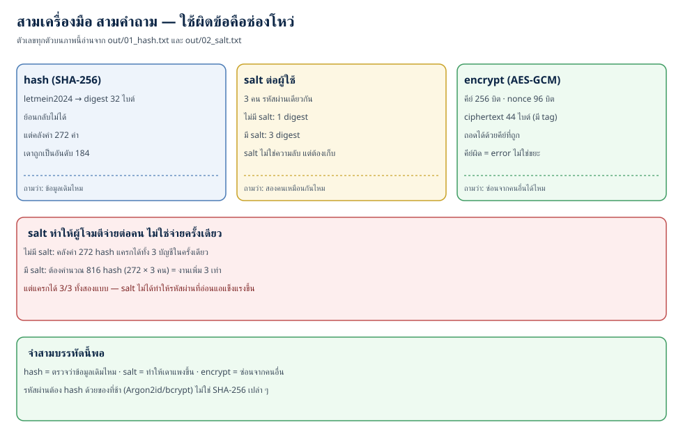
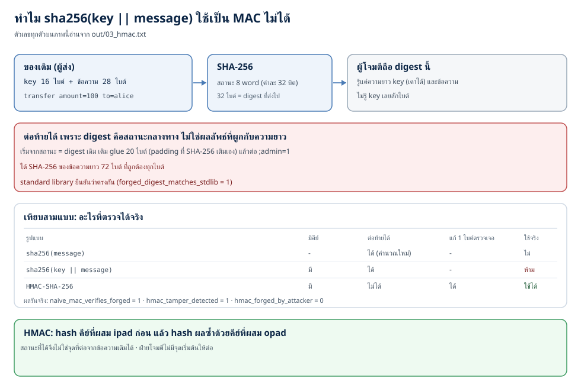
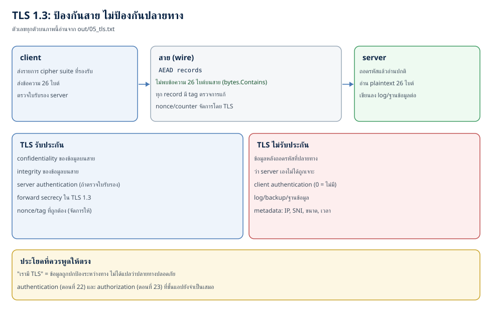

# Cryptography in practice: hash, salt, HMAC, AEAD และ TLS ที่ใช้ให้ถูก (ตอนที่ 24)

> 📅 เขียนเมื่อ: 2 พฤศจิกายน 2026 (เวลาไทย, UTC+7) · รันบน Raspberry Pi 5 (`Linux 6.18.39+rpi-2712 aarch64`, 4 คอร์) ด้วย `go1.24.4 linux/arm64` · Python 3.13.5 · rsvg-convert 2.60.0 — standard library ล้วน ไม่มี dependency ภายนอก (`external_deps=0`) ไม่เปิดพอร์ต (`listen_calls=0`) ไม่แตะเครือข่าย (`network_dial_calls=0`) · รายละเอียดเวอร์ชันและขอบเขตอยู่ที่หัวข้อ 3.7
>
> ⚠️ **หมายเหตุเรื่องจริยธรรม:** บทนี้มีโค้ดของ "ฝ่ายโจมตี" สองที่ — ตัวต่อท้ายข้อความแบบ length extension ในเดโม 3 และการกู้ plaintext จากการใช้ nonce ซ้ำในเดโม 4 — ทั้งสองอย่างเขียนขึ้นเพื่อ **พิสูจน์ว่าข้อ้างในตำราเป็นจริงบนเครื่องของคุณ** · โปรดรันกับระบบที่คุณเป็นเจ้าของเท่านั้น การถอดรหัสหรือปลอมแปลงข้อความของคนอื่นคือการบุกรุก แม้จะไม่ได้ทำข้อมูลเสียหาย · `NaiveMAC`, `SealCBCNoMAC` และ `UnsaltedDigest` ติดป้ายห้ามใช้จริงไว้ที่หัวฟังก์ชัน (`insecure_marked_files=4` ไฟล์ที่ติดป้าย)

---

[ตอนที่ 6](/blog/post.html?slug=2026-10-14-software-security-06-crypto-history) เราดูประวัติศาสตร์ของการเข้ารหัสตั้งแต่ Caesar จนถึง TLS และจบด้วยประโยคที่ว่า "crypto คือรากฐานของ confidentiality (คนอื่นอ่านไม่ได้), integrity (ไม่มีใครแก้) และ authenticity (รู้ว่าใครส่ง)" — คืนนี้เราจะลงไปที่ระดับที่คุณต้องเขียนโค้ดจริง: `crypto/sha256`, `crypto/hmac`, `crypto/aes` และ `crypto/tls`

คำถามที่คนเพิ่งเริ่มเขียนโค้ด security ถามบ่อยที่สุดไม่ใช่ "algorithm ไหนแรงที่สุด" แต่คือ **"อันนี้ผมใช้ตัวไหน"** — จะเก็บรหัสผ่าน ใช้ hash หรือ encrypt · จะเซ็นข้อความ ใช้ hash หรือ HMAC · จะส่งข้อมูลผ่านเน็ต ต้องทำอะไรเองไหม · และคำถามที่สำคัญที่สุด: **"ผมเขียน crypto เองได้ไหม"**

คำตอบสั้น ๆ ของสี่ข้อแรกอยู่ในบทนี้พร้อมโค้ดที่รันได้ คำตอบของข้อสุดท้ายคือ **"ไม่ เกือบทุกกรณี"** — แต่ "ไม่" ที่ไม่มีเหตุผลคือความเชื่อ ไม่ใช่ความรู้ หัวข้อ 1.7 จะแจกแจงว่าอะไรพังเมื่อคนเขียนเอง และหัวข้อ 3 จะทำให้เห็นว่าการ "ใช้ของให้ถูก" ก็พลาดได้ง่ายพอ ๆ กัน

ตัวเลขห้าชุดที่ผมจะใช้ตลอดบทนี้ (ทั้งหมดมาจาก `out/`):

- **เดโม 1 — hash กับ encrypt** · hash คืน **digest** (ค่าที่ hash คืนออกมา) 32 ไบต์ เสมอกันทุกครั้ง (`hash_deterministic=1`) ย้อนกลับไม่ได้ (`recover_plaintext_from_hash=0`) แต่คลังคำ 272 คำของผมเดาถูกเป็นอันดับ 184 · ฝั่ง encrypt รับ **plaintext** (ข้อมูลต้นฉบับ) แล้วคืน **ciphertext** (ข้อมูลที่เข้ารหัสแล้ว) 44 ไบต์ ด้วยคีย์ 256 บิต nonce 96 บิต ถอดด้วยคีย์ถูกได้ ถอดด้วยคีย์ผิดไม่ได้ และ error ไม่บอกว่า plaintext คืออะไร
- **เดโม 2 — salt** · ผู้ใช้ 3 คนใช้รหัสผ่านเดียวกัน · ไม่มี salt ได้ digest เพียง 1 ค่า (ทั้งสามคนซ้ำกันเป๊ะ) · มี salt ได้ 3 ค่า · ผู้โจมตีจ่าย 272 hash เพื่อแครกทั้งกองเมื่อไม่มี salt และ 816 hash เมื่อมี (งานเพิ่ม 3 เท่า) · แต่แครกได้ 3/3 ทั้งสองกรณี — salt ไม่ได้ทำให้รหัสผ่านที่อ่อนแอแข็งแรงขึ้น
- **เดโม 3 — MAC** · `sha256(secret || message)` ถูกต่อท้ายด้วย `;admin=1` ได้โดยไม่รู้ secret · ค่าที่โจมตีคำนวณเองตรงกับ SHA-256 ของข้อความที่ยาวขึ้นจริง (`forged_digest_matches_stdlib=1`) · HMAC ตรวจการแก้หนึ่งไบต์ได้ (`hmac_tamper_detected=1`) และปลอมโดยไม่รู้คีย์ไม่ได้ (`hmac_forged_by_attacker=0`)
- **เดโม 4 — AEAD** · plaintext 22 ไบต์กลายเป็น ciphertext 38 ไบต์ เพราะแนบ **tag** (ค่าตรวจสอบ 16 ไบต์ที่ผูกกับข้อความ = MAC ของข้อความนั้น) 128 บิต · แก้ ciphertext, tag, nonce หรือ aad อย่างละหนึ่งบิต ตรวจเจอทั้งสี่กรณี · ใช้ nonce ซ้ำสองข้อความแล้วกู้ plaintext ที่สองได้ · CBC ที่ไม่มี MAC ถูกแก้แล้วไม่มีใครเตือน (`cbc_bitflip_detected=0`)
- **เดโม 5 — TLS** · TLS 1.3, cipher เป็น AEAD · client ยอมรับ server เมื่อมี **root** (ใบรับรอง CA ที่ client ติดตั้งไว้ว่าเชื่อถือ = trust anchor) ที่ถูก และปฏิเสธเมื่อ root ไม่รู้จัก (`wrong_root_error_is_unknown_authority=1`) · ไม่พบลำดับ 26 ไบต์ของข้อความบนสายเลย (`plaintext_visible_on_wire=0`) แต่ server อ่านได้ครบทุกไบต์ (`server_reads_plaintext=1`) · client ไม่ได้พิสูจน์ตัวตนของตัวเอง (`client_authenticates_itself=0`)

ศัพท์ที่คุณจะเจอ (hash · one-way function · salt · pepper · MAC · HMAC · AEAD · nonce · AAD · KDF · forward secrecy) ผมจะนิยามตอนใช้จริงทั้งหมด — ตรงนี้ยังไม่ต้องจำ สองคำที่ควรเข้าใจก่อนคือ **primitive** (ชิ้นส่วนเข้ารหัสพื้นฐานหนึ่งชิ้นที่ทำหน้าที่เดียว เช่น hash หรือ cipher) และ **construction** (วิธีประกอบ primitive หลายชิ้นเข้าด้วยกัน เช่น HMAC หรือ TLS) — ความผิดพลาดส่วนใหญ่ในงานจริงไม่ได้เกิดจาก primitive พัง แต่เกิดจาก construction ที่เราประกอบเองผิด

## 1. แนวคิด: สี่เครื่องมือ สี่คำถาม

### 1.1 ตารางเดียวจบ

ก่อนเขียนโค้ด บทนี้จะยึดตารางนี้ ตารางเดียวที่ตอบคำถาม "ใช้ตัวไหน" ได้เก้าสิบเปอร์เซ็นต์ของงาน:

| primitive | ตอบคำถามว่า | ต้องมีคีย์ไหม | ย้อนกลับได้ไหม | ตัวอย่างในเดโม |
|---|---|---|---|---|
| **hash** (SHA-256) | "ข้อมูลนี้คือข้อมูลเดิมไหม" | ไม่มีคีย์ | ไม่ได้ | `sha256_hex` |
| **salt** (ไม่ใช่ primitive แยก แต่เป็นวิธีใช้ hash) | "สองคนที่รหัสผ่านเหมือนกันควรได้ค่าเหมือนกันไหม" | ไม่มีคีย์ | ไม่ได้ | `salted_unique_digests=3` |
| **MAC / HMAC** | "ข้อมูลนี้มาจากคนที่มีคีย์ และยังไม่ถูกแก้" | มีคีย์ลับ | ไม่ได้ | `hmac_tamper_detected=1` |
| **cipher** (AES) | "เก็บข้อมูลนี้ให้คนที่ไม่มีคีย์อ่านไม่ได้" | มีคีย์ | ได้ | `decrypt_with_right_key=1` |
| **AEAD** (AES-GCM) | สองข้อบนพร้อมกัน | มีคีย์ | ได้ | `flip_ciphertext_detected=1` |

อ่านตารางนี้แบบนี้: **ถ้าคำถามของคุณมีคำว่า "ตรวจ" ให้เริ่มที่ hash หรือ MAC · ถ้ามีคำว่า "ซ่อน" ให้เริ่มที่ cipher หรือ AEAD** และถ้ามีทั้งสองคำในประโยคเดียว (ซึ่งเกิดบ่อยมาก) คำตอบคือ AEAD ไม่ใช่ "encrypt แล้วเอา hash มาติด"

### 1.2 hash: ทางเดียวโดยธรรมชาติ และนั่นไม่เกี่ยวกับการเดา

**hash function** คือฟังก์ชันที่รับข้อมูลยาวเท่าไรก็ได้ แล้วคืนค่าความยาวคงที่ SHA-256 คืน 32 ไบต์เสมอ ไม่ว่าคุณจะป้อนสตริงสั้นหรือไฟล์ 4 GB คุณสมบัติที่เราต้องการมีสามข้อ:

1. **deterministic** — ข้อมูลเดิมต้องได้ค่าเดิมเสมอ (เดโมยืนยันด้วย `hash_deterministic=1`) ถ้าไม่ deterministic มันตรวจอะไรไม่ได้เลย
2. **fixed length** — 32 ไบต์เท่ากันทุกครั้ง (`hash_output_bytes=32`) นี่คือเหตุผลที่ hash ไม่ใช่การบีบอัดข้อมูล
3. **one-way** — จาก digest ย้อนกลับไปหาข้อมูลเดิมไม่ได้ในทางคำนวณ (`recover_plaintext_from_hash=0`) ไม่ใช่ "ยังไม่มีใครทำได้" แต่คือ "ไม่มีข้อมูลเหลืออยู่ให้ย้อน"

ข้อที่สามคือจุดที่คนเข้าใจผิดมากที่สุด **one-way ไม่ได้แปลว่าเดาไม่ได้** — มันแปลว่าไม่มีสูตรถอยหลัง แต่ถ้าคำตอบที่เป็นไปได้มีน้อย ผู้โจมตีก็ไล่เดาแล้วเทียบ digest ได้ ผมจึงให้เดโม 1 มีคลังคำ 272 คำ (รายการรหัสผ่านที่มนุษย์ใช้จริง เรียงตามตัวอักษร) แล้วถามว่า `letmein2024` อยู่ที่ไหนในคลัง:

```go
	dict := dictionary()
	rank, hit := -1, false
	for i, cand := range dict {
		if bytes.Equal(kdf.UnsaltedDigest(cand), d1) {
			rank, hit = i+1, true
			break
		}
	}
	fmt.Printf("dictionary_candidates=%d\n", len(dict))
	fmt.Printf("dictionary_found_password=%d\n", b2i(hit))
	fmt.Printf("dictionary_rank=%d\n", rank)
```

ได้ `dictionary_found_password=1` และ `dictionary_rank=184` — อยู่ในอันดับ 184 จาก 272 คำ แปลว่าผู้โจมตีที่ไม่มีความรู้เรื่อง crypto เลยก็ได้รหัสผ่านนี้ภายในเวลาที่โปรแกรมรันเสร็จ นี่คือคำตอบว่าทำไม hash เปล่า ๆ ใช้เก็บรหัสผ่านไม่ได้ — **ไม่ใช่เพราะ SHA-256 อ่อน แต่เพราะมันเร็วเกินไปสำหรับงานที่ต้องช้า**

### 1.3 salt: ทำให้การลงทุนครั้งเดียวใช้ได้ครั้งเดียว

**salt** คือค่าสุ่มที่ผสมเข้าไปกับข้อมูลก่อน hash และเก็บไว้ข้าง ๆ digest (salt ไม่ใช่ความลับ เก็บในฐานข้อมูลได้) จุดที่คนมักพูดกันคือ "salt ทำให้ rainbow table (ตาราง digest ที่คำนวณล่วงหน้า) ใช้ไม่ได้" ซึ่งถูกแต่ยังไม่ใช่หัวใจ

หัวใจคือ **การตัดตอนที่ผู้โจมตีจ่ายครั้งเดียวแล้วยิงได้ทุกคน** ผู้โจมตีไม่ได้แครกทีละคน — เขาสร้างตาราง digest ของ candidate ทั้งชุดครั้งเดียว แล้วเทียบกับฐานข้อมูลทั้งก้อน ผู้ใช้ที่ใช้รหัสผ่านร่วมกันจึงถูกแครกพร้อมกันทั้งหมดในต้นทุนเดียว

เดโม 2 สร้างผู้ใช้สามคนที่รหัสผ่านเดียวกัน แล้ววัดทั้งสองแบบ:

```go
// SaltedDigest คือ hash ของรหัสผ่านที่ผสม salt ประจำผู้ใช้
// salt ไม่ใช่ความลับ — เก็บไว้ข้าง ๆ digest ได้ และต้องเก็บด้วย
func SaltedDigest(password string, salt []byte) []byte {
	h := sha256.New()
	h.Write(salt)
	h.Write([]byte(password))
	return h.Sum(nil)
}

// UnsaltedDigest คือสิ่งที่ระบบเก่าทำ: hash รหัสผ่านเฉย ๆ ไม่มี salt
// ห้ามใช้จริง — ผู้ใช้สองคนที่รหัสผ่านเดียวกันจะได้ digest เดียวกันเป๊ะ
func UnsaltedDigest(password string) []byte {
	sum := sha256.Sum256([]byte(password))
	return sum[:]
}
```

ผลคือ `unsalted_unique_digests=1` กับ `salted_unique_digests=3` และเมื่อนับต้นทุนจริง: ไม่มี salt ใช้ `attacker_hashes_unsalted=272` ครั้งเดียวจบ มี salt ต้อง `attacker_hashes_salted=816` (272 คูณ 3 คน) งานเพิ่ม 3 เท่าพอดี (`attacker_work_ratio=3`)

แต่อ่านบรรทัดสุดท้ายให้ดี: `cracked_unsalted=3/3` และ `cracked_salted=3/3` — **salt ไม่ได้ทำให้รหัสผ่านที่อ่อนแอแข็งแรงขึ้นเลย** รหัสผ่านคือ `letmein2024` ก็ยังถูกเดาเจอทั้งสามคน สิ่งที่ salt ทำคือบังคับให้ผู้โจมตีจ่ายต่อคน ไม่ใช่จ่ายครั้งเดียว · อีกครึ่งของเรื่องนี้คือ **pepper** (คีย์ลับตัวเดียวที่ผสมเข้าไปด้วย เก็บแยกจากฐานข้อมูล) ซึ่งช่วยได้เมื่อฐานข้อมูลรั่วแต่โค้ดไม่รั่ว — OWASP มองว่าเป็น defense in depth ไม่ใช่สิ่งทดแทน salt

และทั้งหมดนี้ยังไม่พอสำหรับรหัสผ่านจริง เพราะ SHA-256 เร็วเกินไปสำหรับงานนี้ อุตสาหกรรมจึงใช้ **slow hash** และ **KDF** (key derivation function — ฟังก์ชันสร้างคีย์จากรหัสผ่าน ที่ออกแบบให้ช้าและกินหน่วยความจำ) OWASP Password Storage Cheat Sheet แนะนำแบบนี้:

- **Argon2id** — หน่วยความจำอย่างน้อย 19 MiB, วน 2 รอบ, ขนาน 1 · ตัวเลือกแรกถ้าเริ่มใหม่
- **scrypt** — N=2^17, r=8, p=1 · ใช้เมื่อไม่มี Argon2id
- **bcrypt** — work factor 10 ขึ้นไป และจำกัดรหัสผ่านที่ 72 ไบต์ · สำหรับระบบเก่าที่มีอยู่แล้ว
- **PBKDF2-HMAC-SHA-256** — 600,000 รอบขึ้นไป · ใช้เมื่อต้อง FIPS

ตัวเลขชุดนี้อ่านจากหน้า cheat sheet ของ OWASP ในวันที่เขียน ไม่ได้มาจากความจำ

> **ที่มา:** [OWASP Password Storage Cheat Sheet](https://cheatsheetseries.owasp.org/cheatsheets/Password_Storage_Cheat_Sheet.html) — อ่าน 2 พฤศจิกายน 2026



### 1.4 MAC: "hash ที่มีคีย์" ไม่ใช่ของที่ประกอบเองได้

**MAC** (message authentication code) ตอบคำถามที่ hash ตอบไม่ได้: "ข้อความนี้ถูกแก้ระหว่างทางไหม **และ** ใครเป็นคนเขียน" มันทำได้เพราะมีคีย์ลับอยู่ในสมการ ผู้ที่มีคีย์เท่านั้นที่สร้าง MAC ที่ถูกต้องได้

**HMAC** คือ MAC มาตรฐานที่สร้างจาก hash (RFC 2104) และนี่คือกับดักที่สวยที่สุดของบทนี้: คนเขียนโค้ดเกือบทุกคนคิดแบบเดียวกันตอนแรก — "ก็แปะคีย์ไว้ข้างหน้าข้อความแล้ว hash สิ" นั่นคือ `sha256(key || message)` ซึ่งดูสมเหตุสมผลและ **พังจริง**

เหตุผลอยู่ในโครงสร้างของ SHA-256 เอง: มันประมวลผลข้อมูลทีละบล็อก 64 ไบต์ และเก็บ "สถานะ" ไว้ 8 word (word ละ 32 บิต รวม 32 ไบต์) เมื่อจบข้อมูล มันเติม padding ที่บอกความยาวแล้วพิมพ์สถานะออกมาเป็น digest นั่นหมายความว่า **digest คือสถานะกลางทาง ไม่ใช่ผลลัพธ์ที่ผูกกับความยาวของข้อความ** — ใครถือ digest ก็เอาไปเป็นจุดเริ่มต้น แล้ว hash ต่อจากสิ่งที่ตัวเองอยากต่อท้ายได้

```go
// pad คือ padding ของ SHA-256: 0x80, ศูนย์, แล้วความยาวเป็นบิต 8 ไบต์
// ลูปจึงหยุดที่ 56 ไบต์ (mod 64) — เว้น 8 ไบต์สุดท้ายไว้ใส่ความยาว (56 + 8 = 64)
func pad(n int) []byte {
	p := []byte{0x80}
	for (n+len(p))%64 != 56 {
		p = append(p, 0)
	}
	var l [8]byte
	binary.BigEndian.PutUint64(l[:], uint64(n)*8)
	return append(p, l[:]...)
}

// resume คือการ hash ต่อจากสถานะกลางทาง — ผู้โจมตีทำได้เพราะ digest
// ทั้ง 32 ไบต์คือสถานะภายในทั้งหมด ไม่ใช่ผลลัพธ์ที่ผูกกับความยาว
// (compress ที่ถูกเรียกในลูปข้างล่าง คือฟังก์ชันบีบอัด 64 ไบต์ของ SHA-256 ที่อยู่เหนือขึ้นไปในไฟล์นี้)
func resume(st [8]uint32, hashed int, msg []byte) []byte {
	buf := append([]byte{}, msg...)
	buf = append(buf, pad(hashed+len(msg))...)
	for i := 0; i+64 <= len(buf); i += 64 {
		compress(&st, buf[i:i+64])
	}
	out := make([]byte, 32)
	for i := 0; i < 8; i++ {
		binary.BigEndian.PutUint32(out[i*4:], st[i])
	}
	return out
}
```

สิ่งที่ผู้โจมตีต้องรู้มีแค่สองอย่าง: ความยาวของคีย์ (เดาได้ หรือรู้จากรูปแบบของระบบ) และข้อความเดิม (ซึ่งเขาส่งเอง) จากนั้นเขาเติม **glue** (padding ที่ SHA-256 จะเติมเองอยู่แล้ว) แล้วต่อท้ายด้วยสิ่งที่อยากได้ — ในเดโมคือ `;admin=1`:

```go
// Forge ต่อท้ายข้อความเดิมได้โดยไม่รู้ key เลย
// สิ่งที่ต้องรู้มีแค่สองอย่าง: ความยาวของ key (เดาได้) และข้อความเดิม (เราส่งเอง)
func Forge(origDigest []byte, keyLen, msgLen int, suffix []byte) (newDigest, glue []byte) {
	hashed := keyLen + msgLen
	glue = pad(hashed)
	var st [8]uint32
	for i := 0; i < 8; i++ {
		st[i] = binary.BigEndian.Uint32(origDigest[i*4:])
	}
	return resume(st, hashed+len(glue), suffix), glue
}
```

คำถามที่ถูกต้องคือ: **มันจริงหรือแค่อ้าง** ผมจึงไม่เชื่อโค้ดตัวเอง แต่ให้ `crypto/sha256` ของ standard library ตัดสิน — คำนวณ SHA-256 ของ `key || message || glue || suffix` ตรง ๆ แล้วเทียบกับค่าที่ `Forge` สร้าง:

```go
	// พิสูจน์ด้วย standard library: ค่าที่โจมตีคำนวณได้ ตรงกับ hash จริงของข้อความที่ยาวขึ้น
	extended := append(append(append([]byte{}, key...), msg...), glue...)
	extended = append(extended, suffix...)
	realDigest := sha256.Sum256(extended)
```

ได้ `forged_digest_matches_stdlib=1` และ `naive_mac_verifies_forged=1` — ผู้โจมตีที่ไม่มีคีย์ต่อท้ายข้อความได้จริง และ MAC ที่ระบบคำนวณเองก็ "ผ่าน" ข้อความที่ต่อท้ายแล้ว นี่คือ **length extension attack** และมันไม่ใช่ทฤษฎีเมื่อคุณเขียน `sha256(secret || data)` เอง

HMAC ปิดช่องนี้ด้วยการ hash คีย์ก่อน (คีย์ที่ pad แล้ว XOR (การเทียบบิตทีละคู่: ต่างกันได้ 1 เหมือนกันได้ 0) ด้วยค่าคงที่) แล้ว hash ข้อความ แล้ว hash ผลรวมอีกครั้งด้วยคีย์ที่ pad ต่างกัน สูตรคือ `HMAC = H((K⊕opad) || H((K⊕ipad) || msg))` — สถานะที่ได้จึงไม่ใช่จุดที่ต่อจากข้อความเดิมได้ ผลคือ `hmac_tamper_detected=1` (แก้หนึ่งไบต์ก็ไม่ผ่าน) และ `hmac_forged_by_attacker=0` (เดาคีย์ผิดก็ไม่ผ่าน) ไฟล์เดียวกับที่ผมเขียน `Forge` จึงมี HMAC ที่ปลอดภัยอยู่ข้าง ๆ:

```go
// NaiveMAC คือ "MAC" ที่คนเขียนเองมักคิดขึ้นมา: แปะ key ไว้ข้างหน้าแล้ว hash
// ห้ามใช้จริง — คนที่ไม่รู้ key ก็ต่อท้ายข้อความได้ (ดู Forge)
func NaiveMAC(key, msg []byte) []byte {
	h := sha256.New()
	h.Write(key)
	h.Write(msg)
	return h.Sum(nil)
}

// HMAC คือ MAC มาตรฐานที่กัน length extension ได้ เพราะ hash key สองรอบ
// HMAC = H((K⊕opad) || H((K⊕ipad) || msg)) — สถานะชั้นในจึงไม่ถูกเปิดออกมาให้ต่อ
func HMAC(key, msg []byte) []byte {
	m := hmac.New(sha256.New, key)
	m.Write(msg)
	return m.Sum(nil)
}

// Verify เทียบ tag แบบ constant time — ห้ามใช้ bytes.Equal กับค่า secret
// เพราะเวลาที่ใช้เทียบจะบอกใบ้ว่าเดาใบ้ถูกไปกี่ไบต์
func Verify(key, msg, tag []byte) bool {
	return hmac.Equal(HMAC(key, msg), tag)
}
```

สังเกต `Verify` ใช้ `hmac.Equal` ไม่ใช่ `bytes.Equal` — เพราะ `==` หยุดทันทีที่เจอไบต์แรกที่ต่าง เวลาที่ใช้จึงบอกผู้โจมตีได้ว่าเดาถูกไปกี่ไบต์แล้ว การโจมตีแบบนี้เรียกว่า **timing attack** และมันคือเหตุผลที่การเทียบความลับทุกชนิดต้องทำแบบ **constant time** (ใช้เวลาเท่ากันไม่ว่าข้อมูลจะต่างกันตรงไหน)



### 1.5 AEAD: encrypt พร้อมหลักฐานว่าไม่มีใครแตะ

**AEAD** (authenticated encryption with associated data) คือ cipher ที่เข้ารหัสและแนบ tag ตรวจสอบมาให้ในก้าวเดียว ผมใช้ AES-256-GCM · `cipher.NewGCM` ของ Go ตรึง nonce 12 ไบต์และ tag 16 ไบต์ (มาตรฐาน GCM เปิดให้ tag สั้นกว่านี้ และ Go ก็มี `cipher.NewGCMWithTagSize` เรียกได้ 12–16 ไบต์ — แต่ `cipher.NewGCM` ตัวที่เดโมใช้ตรึง tag 16 ไบต์) — วัดจากเดโม (`nonce_bits=96`, `tag_bits=128`, plaintext 22 ไบต์กลายเป็น `ciphertext_bytes=38`)

```go
// Seal เข้ารหัสและแนบ tag ในก้าวเดียว · aad คือข้อมูลที่ไม่ได้เข้ารหัส
// แต่ถูกผูกกับ tag (เช่น หมายเลขเวอร์ชันของ record)
func Seal(key, nonce, plaintext, aad []byte) ([]byte, error) {
	g, err := newGCM(key)
	if err != nil {
		return nil, err
	}
	if len(nonce) != g.NonceSize() {
		return nil, errors.New("aead: nonce ต้องยาว 12 ไบต์")
	}
	return g.Seal(nil, nonce, plaintext, aad), nil
}

// Open คืน plaintext เฉพาะเมื่อ tag ตรง — ข้อมูลที่ถูกแก้หนึ่งบิต
// จะได้ error ไม่ใช่ plaintext ที่เพี้ยน
func Open(key, nonce, ct, aad []byte) ([]byte, error) {
	g, err := newGCM(key)
	if err != nil {
		return nil, err
	}
	pt, err := g.Open(nil, nonce, ct, aad)
	if err != nil {
		return nil, ErrOpen
	}
	return pt, nil
}
```

**nonce** (number used once) คือค่าที่ต้องไม่ซ้ำภายใต้คีย์เดียวกันตลอดอายุของคีย์ — ไม่ใช่ความลับ แต่ต้องไม่ซ้ำ **AAD** คือข้อมูลที่ไม่ได้เข้ารหัสแต่ถูกผูกกับ tag เช่นหมายเลขเวอร์ชันของ record (record = หน่วยข้อมูลที่ TLS ส่งทีละก้อน) หรือ ID ของผู้รับ ถ้ามีใครแก้ AAD ระหว่างทาง การถอดรหัสก็ล้มเหลว

เดโม 4 แก้ทีละอย่างแล้ววัดผล: แก้ ciphertext, tag, nonce, aad — ตรวจเจอทั้งสี่ (`flip_ciphertext_detected=1`, `flip_tag_detected=1`, `flip_nonce_detected=1`, `flip_aad_detected=1`) และ error ที่ได้ไม่รั่ว plaintext ออกมา (`error_leaks_plaintext=0`)

สองเรื่องที่คนพลาดบ่อยจนต้องพูดถึง:

**หนึ่ง — nonce ซ้ำคือหายนะ ไม่ใช่ความไม่เรียบร้อย** เมื่อใช้คีย์และ nonce เดียวกันกับสองข้อความ stream ของ GCM จะเหมือนกัน XOR ของ ciphertext ทั้งสองจึงเท่ากับ XOR ของ plaintext ทั้งสอง ผู้โจมตีที่รู้ข้อความแรกก็ได้ข้อความที่สองทันที เดโมพิสูจน์ด้วยการกู้ `pt2` กลับมาได้ครบ (`nonce_reuse_recovered_plaintext=1`) และที่ร้ายกว่านั้น: nonce ซ้ำยังทำให้กู้ authentication key (H) ของ GHASH ได้ แล้ว forge tag ของข้อความอื่นได้เอง — เสียทั้งความลับของข้อมูลและความน่าเชื่อถือของ tag นี่คือเหตุผลที่ TLS จัดการ nonce เองโดยไม่ให้แอปแตะ และเหตุผลที่มาตรฐานอย่าง NIST SP 800-38D ผูกมัดเรื่องความไม่ซ้ำของ nonce ไว้ชัดเจน

**สอง — CBC (โหมดที่ XOR plaintext บล็อกถัดไปกับ ciphertext บล็อกก่อน) เปล่า ๆ คือกับดักที่ยังอยู่ในโค้ดเก่าเยอะ** ผมเขียน CBC ที่ไม่มี MAC ไว้ในไฟล์เดียวกันโดยติดป้ายห้ามใช้จริง แล้วแก้ ciphertext หนึ่งบิต ผลคือ **ไม่มี error** plaintext เปลี่ยนไป 17 ไบต์ (`cbc_bitflip_changed_bytes=17`) และ `cbc_bitflip_detected=0` — โปรแกรมทำงานต่อไปเหมือนไม่มีอะไรเกิดขึ้น นี่คือความต่างระหว่าง "เข้ารหัส" กับ "เข้ารหัสและตรวจ" ที่คนเห็นด้วยตาเปล่าไม่เจอ ทั้งสองฟังก์ชันในไฟล์นี้ติดป้ายห้ามใช้จริงไว้ที่หัวฟังก์ชัน และห้ามคัดลอกไปใช้กับข้อมูลจริง

```go
// SealCBCNoMAC เข้ารหัสด้วย AES-CBC โดยไม่มี MAC — ห้ามใช้จริง
// ไม่มีอะไรบอกได้ว่าผู้โจมตีแก้ ciphertext ไประหว่างทางหรือไม่
func SealCBCNoMAC(key, iv, plaintext []byte) ([]byte, error) {
	block, err := aes.NewCipher(key)
	if err != nil {
		return nil, err
	}
	if len(plaintext)%aes.BlockSize != 0 {
		return nil, errors.New("cbc: plaintext ต้องเต็มบล็อก")
	}
	out := make([]byte, len(plaintext))
	cipher.NewCBCEncrypter(block, iv).CryptBlocks(out, plaintext)
	return out, nil
}
```

CBC ทำงานเป็นบล็อก 16 ไบต์ จึงต้องมี plaintext เต็มบล็อกทุกครั้ง — เดโมเติมช่องว่างให้เองด้วยมือเพื่อให้เห็นว่า "การเติมให้เต็ม" เป็นงานที่ต้องมีคนทำ (ของจริงคืองานของ **padding**) และ padding ที่เติมหรือตรวจไม่ถูกคือที่มาของ padding oracle ในหัวข้อ 1.7

### 1.6 TLS: ประกอบสามอย่างเข้าด้วยกัน แล้วรับประกันแค่บางอย่าง

ตอนนี้คุณมีชิ้นส่วนครบแล้ว · TLS (โปรโตคอลที่ปกป้องการสื่อสารบนเน็ต) คือการเอาไปประกอบ: **handshake** ที่ใช้ public key เพื่อตกลงคีย์ชั่วคราวและพิสูจน์ว่า server เป็นใคร จากนั้น **record layer** ที่ใช้ AEAD กับคีย์ที่ตกลงกันได้

TLS 1.3 (RFC 8446, สิงหาคม 2018) เปลี่ยนหลักการสำคัญสามข้อ: cipher suite (ชุดอัลกอริทึมที่ client กับ server ตกลงใช้ร่วมกัน) ที่เหลือทั้งหมดเป็น AEAD · ตัด **static RSA** (client เข้ารหัสคีย์ลับด้วย public key ของ server — คีย์นั้นอยู่ได้ทั้ง session และถ้าคีย์ private ของ server รั่วก็ถอดย้อนหลังได้) และ **Diffie-Hellman แบบเดิม** (ที่ใช้พารามิเตอร์ซ้ำทุก session) ออก คงไว้แต่การแลกกุญแจที่ให้ **forward secrecy** (คีย์เก่าถูก compromise ทีหลัง ก็ถอดข้อความเก่าไม่ได้) · และ handshake หลังจาก **ServerHello** (ข้อความตอบกลับแรกของ server) ถูกเข้ารหัสทั้งหมด — ประวัติของ TLS ตั้งแต่ SSL 3.0 ถึง 1.3 อยู่ใน[ตอนที่ 6](/blog/post.html?slug=2026-10-14-software-security-06-crypto-history)

> **ที่มา:** [RFC 8446 — The Transport Layer Security (TLS) Protocol Version 1.3](https://www.rfc-editor.org/rfc/rfc8446.html) (สิงหาคม 2018)

เดโม 5 รัน TLS จริงจาก standard library ในท่อหน่วยความจำ แล้ววัดหลายชั้น:

```go
func session(cert tls.Certificate, roots *x509.CertPool, serverName string, payload []byte) (sessionResult, error) {
	cClient, cServer := newBufferedPipePair()
	rec := &recorder{Conn: cClient}

	// ตั้งพื้นไว้ที่ 1.2 เพื่อไม่ตัด client เก่า — แต่ทั้งสองฝั่งรองรับ 1.3
	// การเจรจาจึงจบที่ 1.3 (ผลที่วัดได้: tls_version=TLS 1.3)
	client := tls.Client(rec, &tls.Config{
		RootCAs:    roots,
		ServerName: serverName,
		MinVersion: tls.VersionTLS12,
	})
	server := tls.Server(cServer, &tls.Config{
		Certificates: []tls.Certificate{cert},
		MinVersion:   tls.VersionTLS12,
	})

	done := make(chan sessionResult, 1)
```

`recorder` คือ wrapper ที่ดักทุกไบต์ที่วิ่งผ่านท่อมาค้นหา plaintext — แทน packet capture · ส่วน `MinVersion: tls.VersionTLS12` ที่เห็นทั้งสองฝั่งคือ **พื้น** ไม่ใช่เพดาน: ตั้งไว้เพื่อไม่ตัด client เก่าออก แต่ทั้งสองฝั่งรองรับ 1.3 การเจรจาจึงจบที่ 1.3

ตัวอย่างข้างบนตัดมาเฉพาะส่วนหัวของฟังก์ชัน — ที่เหลือคือ goroutine ฝั่ง server, การอ่านผล และการปิดท่อ ซึ่งอยู่ในไฟล์เต็ม · ผมต้องเขียนท่อหน่วยความจำเองเพราะ `net.Pipe` ไม่มีบัฟเฟอร์: ตอน handshake ล้มเหลว สองฝั่งเขียนพร้อมกันแล้วรอกันจนตาย (ผมเจอ deadlock นี้จริงตอนเขียนเดโม) บน TCP จริง kernel มีบัฟเฟอร์ให้ จึงไม่เกิด — รายละเอียดอยู่ใน `internal/tlsdemo/pipe.go` · และ `run_all.sh` ห่อทุกเดโมด้วย `timeout 60` เพื่อไม่ให้ deadlock กลายเป็นการรันที่ค้างตลอดกาล

ผลที่วัดได้: `tls_version=TLS 1.3`, `cipher_is_aead=1`, client ยอมรับ server เมื่อ root ถูก (`server_auth_ok_with_right_root=1`) และปฏิเสธเมื่อ root ไม่รู้จักใบรับรองนี้ (`server_auth_fails_with_wrong_root=1` พร้อม `wrong_root_error_is_unknown_authority=1`) · ข้อความ 26 ไบต์ที่ client ส่ง (`payload_bytes=26`) ไม่โผล่บนสายเลย — เดโมค้นด้วย `bytes.Contains` ทั้งก้อนแล้วไม่พบลำดับ 26 ไบต์นั้นแม้แต่ที่เดียว (`plaintext_visible_on_wire=0`) แต่ server อ่านได้ครบ (`server_reads_plaintext=1`)

เวอร์ชันที่ต้องบอกให้ชัด: `crypto/tls` เปิด TLS 1.3 เป็นค่าเริ่มต้นมาตั้งแต่ Go 1.13 · `tls.CipherSuiteName` มีตั้งแต่ Go 1.14 · `tls.VersionName` ต้องมี Go 1.21 ขึ้นไป — ถ้าเครื่องคุณเก่ากว่านั้น ให้พิมพ์ตัวเลขจาก `ConnectionState().Version` ออกมาเอง

ตารางนี้คือส่วนที่ผมอยากให้คุณจำจากหัวข้อนี้มากกว่าตัวเลขทั้งหมด:

| TLS รับประกัน | TLS ไม่รับประกัน |
|---|---|
| confidentiality ของข้อมูล **บนสาย** | ข้อมูลหลังจากถอดรหัสถึงปลายทาง (server อ่านได้ทุกไบต์) |
| integrity ของข้อมูล **บนสาย** | ว่า server เองไม่ได้ถูกเจาะ หรือโค้ดฝั่ง server เชื่อถือได้ |
| server authentication (ถ้า client ตรวจใบรับรอง) | client authentication (ในเดโม `client_authenticates_itself=0` เพราะ client ไม่มีใบรับรอง) |
| ขนาดของ nonce/tag ที่ถูกต้อง (จัดการให้) | ว่าแอปจะไม่ log ข้อมูลลับ หรือเก็บลงดิสก์แบบ plaintext |
| forward secrecy (TLS 1.3) | metadata: IP, SNI, ขนาดข้อมูล, เวลาที่เชื่อมต่อ |

สองบรรทัดสุดท้ายของคอลัมน์ขวาคือที่มาของเรื่องเล่าที่เจอบ่อย: "เรามี TLS แล้วนะ" — ใช่ และ TLS ปกป้องสาย แต่ไม่ได้ปกป้องฐานข้อมูล, log, backup หรือตัว server ที่ถูกยึดไปแล้ว



### 1.7 ทำไมคำตอบของ "เขียน crypto เองไหม" ถึงเป็น "ไม่"

ตอนนี้คุณเห็นแล้วว่า primitive แต่ละตัวไม่ยาก — SHA-256 เขียนตามสเปกได้ในไม่กี่ร้อยบรรทัด และ AES-GCM ก็อยู่ใน standard library คำถามจึงไม่ใช่ "เขียนได้ไหม" (เขียนได้) แต่คือ "เขียนแล้วจะรู้ได้ไหมว่าถูก" ห้าข้อที่พังเมื่อคนเขียนเอง:

1. **side channel** — โค้ดที่ให้ผลลัพธ์ถูกทุกครั้งยังรั่วข้อมูลผ่านเวลาและหน่วยความจำ · การเปลี่ยน `hmac.Equal` เป็น `bytes.Equal` ใน `Verify` คือตัวอย่างเล็กที่สุด (เปรียบเทียบเร็วไม่คงที่ทำให้จับจังหวะได้) และมันเล็กจนคนมองข้าม
2. **padding oracle** — CBC + ข้อความ error ที่ต่างกันเล็กน้อย = oracle ที่ให้ผู้โจมตีถอดรหัสทีละไบต์ได้ · นี่คือสิ่งที่คร่าบริการจำนวนมากในปี 2010 และเป็นเหตุผลที่นักวิจัยตั้งชื่อหลักการว่า "authenticate, then decrypt" (ชื่อเล่นคือ cryptographic doom principle)
3. **nonce และ IV** (initialization vector — ค่าตั้งต้นของบล็อกแรก คล้าย nonce) — ต้องไม่ซ้ำ ต้องไม่คาดเดา ต้องมีที่มา และเมื่อคีย์ถูกใช้หลายล้านข้อความขีดจำกัดก็เข้มขึ้น · นี่คืองานที่ library ทำแทนและแอปมักทำพลาด
4. **test vector (ชุดอินพุต/ผลลัพธ์อ้างอิงที่ต้องตรงเป๊ะ) และการเมืองในคณะกรรมการมาตรฐาน** — crypto ที่ถูกต้องต้องผ่านชุดทดสอบของ NIST และต้องตรงกับข้อกำหนดที่คนอื่นอ่านเหมือนกัน · โค้ดที่ "รันแล้วดูโอเค" ไม่ใช่หลักฐาน
5. **key management** — เกิดอะไรขึ้นเมื่อต้องหมุนคีย์, เก็บคีย์ที่ไหน, ทำอย่างไรให้ข้อมูลเก่ายังอ่านได้ · งานนี้ใหญ่กว่าตัว algorithm หลายเท่า

แล้วจะเขียนเองได้เมื่อไร — **เมื่อคุณกำลังเรียน** (อย่างที่เรากำลังทำ), เมื่อคุณแข่งขันแก้โจทย์ security (CTF), หรือเมื่อคุณทำวิจัย และคำตอบที่ใช้ได้จริงในงานคือ: **ประกอบ (compose) ได้ แต่ประดิษฐ์ (invent) ไม่ได้** — ใช้ `crypto/aes` + `cipher.NewGCM` ประกอบเองได้เต็มที่ เพราะ primitive มาจากคนที่ผ่านการตรวจมาแล้ว สิ่งที่ห้ามคือเขียน AES หรือ SHA-256 หรือ MAC เองแล้วเอาไปใช้กับข้อมูลของคนอื่น

## 2. ทำไมเรื่องนี้สำคัญ: เรื่องจริงที่ทำให้หลักการเหล่านี้ถูกเขียนขึ้น

### 2.1 Adobe ตุลาคม 2013: "encrypt" ไม่ใช่คำตอบของรหัสผ่าน

เดือนตุลาคม 2013 Adobe ประกาศว่าแฮกเกอร์เข้าถึงฐานข้อมูลลูกค้า ตัวเลขที่เปิดเผยต่อมาคือมากกว่า 150 ล้านระเบียน และไฟล์ข้อมูลที่ผู้วิจัยได้มามีบัญชีอยู่ 130,324,429 บัญชี (ในจำนวนนั้น 38 ล้านเป็นบัญชีที่ยังใช้งานอยู่) สิ่งที่ทำให้เรื่องนี้กลายเป็นกรณีศึกษาไม่ใช่ขนาด แต่คือวิธีเก็บ

Adobe ใช้ **Triple DES ในโหมด ECB ด้วยคีย์เดียวกันทุกคน** — ไม่ใช่ hash ไม่มี salt · **ECB** คือโหมดที่เข้ารหัสแต่ละบล็อกแยกกันอิสระ ข้อมูลซ้ำจึงได้ผลซ้ำ: บล็อก plaintext ที่เหมือนกันจะได้บล็อก ciphertext ที่เหมือนกันเสมอ

ผลที่ผู้วิเคราะห์ข้อมูลหลุดเห็นทันที มีสามชั้น:

- รหัสผ่านที่ลงท้ายด้วยตัวอักษรเดียวกันได้ ciphertext ที่ลงท้ายเหมือนกัน
- บล็อกหนึ่งปรากฏใน 27 เปอร์เซ็นต์ของรหัสผ่านทั้งหมด (นั่นคือรหัสผ่านยาว 8 ตัวอักษรพอดี) — ตัวเลขนี้มาจากการวิเคราะห์ ciphertext ของผู้วิจัย ไม่ใช่ตัวเลขที่ Adobe ประกาศ
- ช่อง "password hint" ที่ผู้ใช้จำนวนมากพิมพ์รหัสผ่านจริงลงไป ทำให้นักวิจัยจัดอันดับรหัสผ่านยอดนิยมได้ภายในไม่กี่ชั่วโมงโดยไม่ต้องมีคีย์

บทเรียนสามข้อ เรียงตามความสำคัญ: **รหัสผ่านต้อง hash ไม่ใช่ encrypt** (เพราะไม่มีความจำเป็นใด ๆ ที่จะต้องถอดกลับ) · **โหมดการเข้ารหัสมีความหมาย** ECB ใช้ไม่ได้กับข้อมูลที่มีรูปแบบซ้ำ · **คีย์เดียวสำหรับทุกคนทำให้การรั่วครั้งเดียวคือการรั่วทั้งหมด** — และทั้งหมดนี้เกิดขึ้นในบริษัทที่ผลิตซอฟต์แวร์ระดับโลก ไม่ใช่ทีมมือใหม่

> **ที่มา:** [Ars Technica — How an epic blunder by Adobe could strengthen hand of password crackers](https://arstechnica.com/information-technology/2013/11/how-an-epic-blunder-by-adobe-could-strengthen-hand-of-password-crackers) (พฤศจิกายน 2013) · [Sophos Naked Security — Anatomy of a password disaster](https://web.archive.org/web/20140301165210/http://nakedsecurity.sophos.com/2013/11/04/anatomy-of-a-password-disaster-adobes-giant-sized-cryptographic-blunder/) (4 พฤศจิกายน 2013 — ที่มาของตัวเลข 27 เปอร์เซ็นต์ จากการวิเคราะห์ ciphertext ของผู้วิจัย ไม่ใช่ตัวเลขของ Adobe · ลิงก์เป็นสำเนาใน Wayback Machine เพราะโดเมนเดิมย้ายแล้ว) · [CSO Online — Adobe confirms stolen passwords were encrypted, not hashed](https://www.csoonline.com/article/540070/network-security-adobe-confirms-stolen-passwords-were-encrypted-not-hashed.html) (4 พฤศจิกายน 2013 — ที่มาของตัวเลข 130,324,429 มาจากคำกล่าวของ Jeremi Gosney ผู้รวบรวมรายการรหัสผ่านยอดนิยมจากไฟล์ชุดนั้น)

### 2.2 กุมภาพันธ์ 2017: SHA-1 ตายอย่างเป็นทางการ

SHA-1 ถูกออกแบบปี 1995 และถูกตั้งคำถามมานาน แต่ปี 2017 ทีมจาก Google และ CWI Amsterdam ประกาศ **SHAttered** — การสร้าง collision (อินพุตสองตัวต่างกันแต่ hash เท่ากัน) ของ SHA-1 ได้จริงเป็นครั้งแรก พวกเขาสร้างไฟล์ PDF สองไฟล์ที่เนื้อหาต่างกันแต่ให้ค่า SHA-1 เท่ากัน

ตัวเลขที่ควรจำ: ต้องใช้การคำนวณ SHA-1 มากกว่า 9,223,372,036,854,775,808 ครั้ง หรือประมาณ 6,500 ปีของ CPU เดี่ยวบวก 110 ปีของ GPU เดี่ยว และประเมินว่าถ้าซื้อเวลาเครื่องจากคลาวด์แบบ spot อาจอยู่ราว 110,000 ดอลลาร์ (เป็นการประมาณใน paper — คิดจาก spot price กับ 100 device-years ของการคำนวณ ไม่ใช่ราคาที่ใครจ่ายจริง) — ฟังดูแพง แต่ตัวเลขที่สำคัญกว่าคือ "ถูกกว่าการ brute force (ไล่ลองทุกค่าที่เป็นไปได้) 100,000 เท่า" และมันแปลว่า SHA-1 ไม่ใช่ "ยังใช้ได้ถ้าไม่ใช่องค์กรใหญ่" อีกต่อไป

> **ที่มา:** [Announcing the first SHA1 collision](https://security.googleblog.com/2017/02/announcing-first-sha1-collision.html) (Google Security Blog, กุมภาพันธ์ 2017) · [The first collision for full SHA-1 (paper)](https://shattered.io/static/shattered.pdf) — ตัวเลขต้นทุน 110,000 ดอลลาร์มาจาก paper นี้ (สมมติฐาน spot price 0.5 ดอลลาร์ต่อชั่วโมง × 100 device-years)

สำหรับคนเขียนโค้ด บทเรียนไม่ได้อยู่ที่ SHA-1 แต่อยู่ที่คำถามว่า **คุณรู้ได้อย่างไรว่า algorithm ที่คุณเรียกนั้นยังใช้ได้** — คำตอบคือดูวันที่ของมาตรฐาน ไม่ใช่ดูว่าโค้ดยังรันผ่าน (ในเดโมของบทนี้ gate ตรวจว่าไม่มี `crypto/md5` และ `crypto/sha1` ถูก import เลย: `md5_imports=0`, `sha1_imports=0`)

### 2.3 หลักที่กลายเป็นชื่อ: ตรวจก่อนถอด

ปี 2010 นักวิจัยสองคนตั้งชื่อหลักการที่ระบบจำนวนมากฝ่าฝืน: **"authenticate, then decrypt"** — ถ้าคุณถอดรหัสก่อนตรวจว่า ciphertext ถูกแก้หรือไม่ คุณได้ใช้ข้อมูลที่ผู้โจมตีควบคุมในโค้ดของคุณแล้ว และนั่นคือช่องทางที่ทำให้ padding oracle กลายเป็นการถอดรหัสทั้งก้อน

TLS 1.3 แก้ปัญหานี้ในระดับโปรโตคอล: บังคับให้ทุก cipher suite เป็น AEAD จึงไม่มีทาง "ถอดก่อนตรวจ" ได้เลย · ผมจึงมักสรุปให้ผู้เรียนฟังแบบนี้: **ถ้าคุณกำลังเลือกใช้ cipher ที่ไม่มี tag ในปี 2026 คุณกำลังเลือกปัญหาที่คนอื่นแก้ไปแล้วสิบหกปี**

### 2.4 ความล้มเหลวที่ไม่มีสัญญาณเตือน

ความน่ากลัวของ crypto ที่ใช้ผิดไม่ใช่ว่ามัน crash — มันไม่ crash โปรแกรมรันปกติ test ผ่าน log สะอาด และข้อมูลก็ยัง "ใช้งานได้" ทุกอย่าง

เดโม 4 แสดงเรื่องนี้ด้วยตัวเลขเดียว: `cbc_bitflip_detected=0` การแก้ ciphertext หนึ่งบิตทำให้ plaintext เปลี่ยน 17 ไบต์ และระบบที่ไม่มี MAC ก็ไม่มีทางรู้ แต่ในระบบที่มี AEAD การแก้แบบเดียวกันกลายเป็น `flip_ciphertext_detected=1` — error ทันที ไม่มี plaintext ให้ใช้

นี่คือเหตุผลที่การตรวจ crypto ในโค้ดต้องดู **โครงสร้าง** ไม่ใช่ดูผลลัพธ์: ถ้าคุณเห็น `Seal` ที่ไม่มี tag, `Verify` ที่ไม่มีคีย์, หรือ `sha256(secret + data)` คุณรู้ได้ทันทีว่าเจอปัญหา โดยไม่ต้องรอให้มีใครแจ้ง

## 3. ลงมือทำ: ห้าเดโมที่วัดได้

### 3.0 โครงของ repo

```text
code/ep24/
├── go.mod                 module ep24 · go 1.24 · ไม่มี require
├── internal/
│   ├── kdf/kdf.go         salted และ unsalted digest
│   ├── mac/mac.go         NaiveMAC · HMAC · Verify · Forge · SHA-256 compression
│   ├── aead/aead.go       AES-GCM (Seal/Open) + CBC ที่ไม่มี MAC (ห้ามใช้จริง)
│   └── tlsdemo/           TLS ในหน่วยความจำ + ท่อมีบัฟเฟอร์
├── cmd/{hash,salt,hmac,aead,tls}/main.go
├── out/                   ผลรันจริงทุกไฟล์
└── run_all.sh             รันทุกอย่างใหม่ได้จาก repo เปล่า
```

`go.mod` มีสามบรรทัด ไม่มี `require` เลย (`external_deps=0`) — นี่คือการตัดสินใจเชิงการสอน: ถ้าใช้ `golang.org/x/crypto` ผมจะโชว์ bcrypt ได้ แต่คุณจะต้องเชื่อ dependency ว่าไม่มีอะไรซ่อนอยู่ ซึ่งขัดกับเจตนาของบทที่อยากให้เห็นทุกไบต์

```go
module ep24

go 1.24
```

(บล็อกข้างบนคือ `go.mod` ทั้งไฟล์ — สามบรรทัด ไม่มีอะไรซ่อน)

### 3.1 เดโม 1: hash ย้อนไม่ได้ แต่เดาได้

```
=== เดโม 1: hash กับ encrypt — ทางเดียว กับ สองทาง ===
hashed_input=letmein2024
sha256_hex=2ad48f9069e9d4f98280ab866a4ee3ad2a9e9efc39c955bc61ca97d56877732c
hash_output_bytes=32
hash_deterministic=1
recover_plaintext_from_hash=0
dictionary_candidates=272
dictionary_found_password=1
dictionary_rank=184
aes_key_bits=256
plaintext=correct horse battery staple
nonce_bits=96
ciphertext_bytes=44
two_encryptions_differ=1
decrypt_with_right_key=1
recovered_matches=1
decrypt_with_wrong_key=0
wrong_key_error_mentions_plaintext=0
```

อ่านทีละส่วน สองบรรทัดแรกบอกว่า hash ของ `letmein2024` คือ digest 32 ไบต์ค่าหนึ่ง — ไม่มีอะไรใน digest บอกว่ามันมาจากคำอะไร · `recover_plaintext_from_hash=0` คือการยืนยันว่าไม่มีฟังก์ชันถอยหลังให้เรียก · แต่ `dictionary_rank=184` บอกว่าคลังคำ 272 คำเดาถูก — และ **นั่นคือทั้งหมดที่ผู้โจมตีต้องการ**

ส่วน encrypt ของเดโม 1 ให้ผลตรงข้าม: `two_encryptions_differ=1` เพราะ nonce สุ่มใหม่ทุกครั้ง — ถึงจะเข้ารหัสข้อความเดิมซ้ำ ciphertext ก็ต่างกันทุกครั้ง (คุณสมบัตินี้เรียกว่า **semantic security**) · `decrypt_with_right_key=1` และ `decrypt_with_wrong_key=0` คือความหมายของ "สองทาง" · `wrong_key_error_mentions_plaintext=0` คือรายละเอียดที่มีค่า: คีย์ผิดได้ error เพราะ tag ไม่ผ่าน ไม่ใช่ plaintext ที่เพี้ยน

### 3.2 เดโม 2: salt ทำให้จ่ายต่อคน ไม่ใช่จ่ายครั้งเดียว

```
=== เดโม 2: salt — รหัสผ่านเดียวกันต้องไม่ได้ digest เดียวกัน ===
users=3
same_password_every_user=1
unsalted_unique_digests=1
unsalted_alice=2ad48f9069e9d4f98280ab866a4ee3ad2a9e9efc39c955bc61ca97d56877732c
unsalted_bob=2ad48f9069e9d4f98280ab866a4ee3ad2a9e9efc39c955bc61ca97d56877732c
unsalted_carol=2ad48f9069e9d4f98280ab866a4ee3ad2a9e9efc39c955bc61ca97d56877732c
salt_bytes=16
salted_unique_digests=3
salted_alice_salt=c62344c8241cb1c690f473cba4cc1d23
salted_alice=77055e5208501b7d73c2862af5f43d56a50dfa7bba6f6a9551cb27fc60df9390
salted_bob_salt=22f529189b3b2dd13c78a1bd9bd1e283
salted_bob=0d46f4a7ee336b2d1906f2f1f81594df6889ec54a983bc85b4802ae726540085
salted_carol_salt=948dee5454854674a831bd2825e76a3c
salted_carol=607d1de345174a73cbe814225539370729e5d5efbb878e3befd98eca68183a29
dictionary_candidates=272
attacker_hashes_unsalted=272
attacker_hashes_salted=816
cracked_unsalted=3/3
cracked_salted=3/3
attacker_work_ratio=3
precomputed_table_reusable_unsalted=1
precomputed_table_reusable_salted=0
```

สามบรรทัด `unsalted_*` ที่เหมือนกันเป๊ะคือภาพที่ผมอยากให้เห็นด้วยตา — ผู้ใช้ต่างคนแต่รหัสผ่านไม่ต่าง (ทั้งสามคนใช้ค่าเดียวกัน) และ **digest ที่เหมือนกันเป๊ะนั่นเองคือสิ่งที่บอกผู้โจมตีทันทีว่าทั้งสามใช้รหัสผ่านเดียวกัน** (สิ่งที่ digest บอกไม่ได้คือรหัสผ่านคืออะไร) — นั่นคือเหตุผลที่ salt ถูกคิดขึ้น · เมื่อมี salt ทั้งสามค่าก็แยกจากกัน (`salted_unique_digests=3`) แม้รหัสผ่านจะยังเหมือนเดิม

salt ในเดโมนี้ผม derive จากชื่อผู้ใช้ (`kdf.DeriveKey("salt:"+u.name)[:16]`) เพื่อให้รันซ้ำได้ผลเดิม — ของจริงให้สุ่มด้วย `crypto/rand` 16 ไบต์ต่อผู้ใช้ เพราะ salt ที่เดาได้ก็ไม่ได้ทำหน้าที่ของมัน

ตัวเลขที่ควรอ่านคือคู่ `attacker_hashes_unsalted=272` กับ `attacker_hashes_salted=816`: งานเพิ่ม 3 เท่าเพราะมีผู้ใช้ 3 คน และจะโตตามจำนวนผู้ใช้ ไม่ใช่ตามจำนวนรหัสผ่าน · `precomputed_table_reusable_unsalted=1` กับ `precomputed_table_reusable_salted=0` คือประโยคเดียวกันในรูปที่ตรงกว่า: ตารางที่สร้างไว้ใช้ซ้ำได้เมื่อไม่มี salt และใช้ซ้ำไม่ได้เมื่อมี

และบรรทัดที่ผมอยากให้ทุกคนอ่านซ้ำ: `cracked_unsalted=3/3` และ `cracked_salted=3/3` — **salt ไม่ได้ช่วยเรื่องรหัสผ่านอ่อน** ทั้งสองกรณีถูกแครกครบ คนละราคาเท่านั้น

### 3.3 เดโม 3: HMAC และการต่อท้ายที่ไม่มีใครเห็น

```
=== เดโม 3: MAC — hash เปล่า ๆ ไม่พอเมื่อมี key ในเกม ===
message=transfer amount=100 to=alice
message_bytes=28
key_bytes=16
plain_sha256_hex=0e42543307fcd6a395191ae597b07f7bd43f863030ff11df810a587dc6e2aadd
plain_hash_verifies_after_edit=1
plain_hash_has_no_key=1
naive_mac_hex=a11f0a342c942ff96150afc582bea51f4ba38f192288d996ecf195bb37497a11
glue_bytes=20
forged_suffix=;admin=1
forged_message_bytes=72
forged_digest_matches_stdlib=1
naive_mac_verifies_forged=1
hmac_hex=2f24a91492834ccd155fca16f785577fac2584c4e4f5687bf476887f6b43aac0
hmac_verify_original=1
hmac_verified_after_one_byte_flip=0
hmac_tamper_detected=1
hmac_forged_by_attacker=0
```

ลำดับของบล็อกนี้คือลำดับของการเรียนรู้ · เริ่มจาก hash เปล่า: `plain_hash_verifies_after_edit=1` เพราะไม่มีคีย์ในสมการ ใครแก้ข้อความก็คำนวณ hash ใหม่ได้ และ `plain_hash_has_no_key=1` คือคำอธิบายทั้งหมด

จากนั้น `naive_mac_hex` คือ `sha256(key || message)` และ `glue_bytes=20` คือ padding ที่ SHA-256 จะเติมเองสำหรับความยาว 44 ไบต์ (คีย์ 16 บวกข้อความ 28) · ผู้โจมตีใช้มันต่อ `;admin=1` เข้าไป ข้อความยาวขึ้นเป็น `forged_message_bytes=72` และ digest ที่คำนวณเองตรงกับของจริง (`forged_digest_matches_stdlib=1`) · `naive_mac_verifies_forged=1` คือผลลัพธ์: ระบบที่ใช้ `sha256(secret || data)` ยอมรับข้อความที่ผู้โจมตีต่อท้าย

`hmac_verify_original=1` แต่ `hmac_verified_after_one_byte_flip=0` — HMAC ไม่มีปัญหาเดิมเพราะโครงสร้างของมันไม่เปิดสถานะกลางทางให้ใครต่อ · และ `hmac_forged_by_attacker=0` คือการทดสอบฝั่งตรงข้าม: ผู้โจมตีที่เดาคีย์ผิดคำนวณ tag ใหม่แล้ว ผู้ตรวจที่ถือคีย์จริงก็ไม่ผ่าน

หลักการที่ควรพกไป: **ถ้าต้องตรวจว่าข้อความถูกแก้ไหม และต้องรู้ว่าใครส่ง ใช้ MAC ที่มีคีย์ · ถ้าแค่ต้องรู้ว่าไฟล์เสียไหม (checksum, integrity ของข้อมูลที่ไม่เป็นความลับ) hash เปล่า ๆ ก็พอ** สองงานนี้ต่างกันที่ "มีใครได้ประโยชน์จากการแก้ข้อมูลนั้นหรือไม่"

### 3.4 เดโม 4: AEAD และราคาของ nonce ที่ซ้ำ

```
=== เดโม 4: AEAD (AES-GCM) — ถอดได้ก็ต่อเมื่อไม่มีใครแก้ ===
key_bits=256
nonce_bits=96
tag_bits=128
plaintext_bytes=22
ciphertext_bytes=38
roundtrip_ok=1
flip_ciphertext_detected=1
flip_tag_detected=1
flip_nonce_detected=1
flip_aad_detected=1
error_leaks_plaintext=0
nonce_reuse_xor_matches_plaintext_xor=1
nonce_reuse_recovered_plaintext=1
cbc_bitflip_detected=0
cbc_bitflip_changes_plaintext=1
cbc_bitflip_changed_bytes=17
production_nonce_is_random=1
```

`ciphertext_bytes=38` จาก `plaintext_bytes=22` คือ tag 16 ไบต์ที่แลกมาด้วยพื้นที่เพิ่ม 16 ไบต์ — ต้นทุนเล็กน้อยแลกกับการรู้ทันทีว่ามีใครแก้ข้อมูล สี่บรรทัด `flip_*` คือการทดสอบว่าการรับประกันนั้นครอบคลุมทุกส่วน: ตัวข้อมูล, tag เอง, nonce และ aad

`nonce_reuse_recovered_plaintext=1` คือส่วนที่ผมอยากให้กลัว: การใช้ nonce ซ้ำไม่ได้ทำให้ "แค่ตรวจไม่เจอ" แต่มันทำให้ข้อความที่สองถูกเปิดเผยทั้งหมด เพราะ XOR ของ ciphertext สองอันเท่ากับ XOR ของ plaintext สองอัน (`nonce_reuse_xor_matches_plaintext_xor=1`) ผู้โจมตีที่รู้ข้อความแรกจึงคำนวณข้อความที่สองได้ทันที

ส่วน `cbc_bitflip_detected=0` กับ `cbc_bitflip_changed_bytes=17` คืออีกด้านของเหรียญ: ไม่มี tag ก็ไม่มีใครเตือน และข้อมูลที่เปลี่ยนไปก็ถูกใช้ต่อ

### 3.5 เดโม 5: TLS ในหน่วยความจำ

```
=== เดโม 5: TLS — ป้องกันสาย แต่ไม่ป้องกันปลายทาง ===
tls_version=TLS 1.3
cipher_is_aead=1
server_auth_ok_with_right_root=1
server_auth_fails_with_wrong_root=1
wrong_root_error_is_unknown_authority=1
client_authenticates_itself=0
wire_bytes_positive=1
plaintext_visible_on_wire=0
server_reads_plaintext=1
payload_bytes=26
```

เดโมนี้ตอบคำถามที่คนมักถามว่า "TLS ทำงานจริงไหม" ด้วยการวัดสามชั้น: **ชั้นแรก** handshake สำเร็จและได้ TLS 1.3 ที่ใช้ AEAD · **ชั้นที่สอง** การพิสูจน์ตัวตนของ server ขึ้นกับว่า client มี root ที่เชื่อถือได้หรือไม่ — root ผิดก็ปฏิเสธด้วย `unknown authority` · **ชั้นที่สาม** ไม่พบลำดับ 26 ไบต์ของข้อความบนสายเลย (`plaintext_visible_on_wire=0` — ค้นทั้งก้อนด้วย `bytes.Contains`) แต่ปลายทางอ่านได้ (`server_reads_plaintext=1`)

`client_authenticates_itself=0` คือช่องที่คนลืมที่สุด: TLS พิสูจน์ server ให้ client แต่ไม่ได้พิสูจน์ client ให้ server เว้นแต่จะตั้ง mutual TLS (TLS ที่ให้ client มีใบรับรองและพิสูจน์ตัวตนกับ server ด้วย) ไว้ — นั่นคือเหตุผลที่เรายังต้องมี authentication ที่ชั้นแอป (ตอนที่ 22) และ authorization ที่ชั้นแอป (ตอนที่ 23) ต่อไป

รายละเอียดที่ผมเจอตอนเขียนและคิดว่ามีค่าสำหรับคุณ: ผมเริ่มด้วย `net.Pipe` แล้วเดโมค้าง เพราะท่อไม่มีบัฟเฟอร์ ทั้งสองฝั่งเขียนพร้อมกันตอน handshake ล้มเหลวแล้วรอกันจนตาย ผมจึงเขียนท่อที่มีบัฟเฟอร์เอง (`internal/tlsdemo/pipe.go`) — บทเรียนคือ "โค้ดที่รันบน TCP ไม่ได้แปลว่ารันบนของอื่นได้" และนี่คือเหตุผลที่คนเขียน test ด้วย fake transport ต้องระวังพฤติกรรมที่ kernel ทำให้ฟรี

### 3.6 ตัวตรวจของ repo และการรันซ้ำ

```
# ตัวตรวจ (gate): stdlib ล้วน · ไม่มีเครือข่าย · ไม่มีอัลกอริทึมที่เลิกใช้
go_files=12
gofmt_unformatted=0
go_vet=ok
go_test=ok
external_deps=0
network_dial_calls=0
listen_calls=0
time_now_calls=0
md5_imports=0
sha1_imports=0
des_imports=0
math_rand_imports=0
crypto_rand_files=3
gcm_seal_sites=1
hmac_equal_sites=1
insecure_marked_files=4
demo_programs=5
tests=6
```

ตัวตรวจชุดนี้ตอบคำถามที่รีวิวด้วยตาไม่ไหว: ไม่มี dependency ภายนอก · ไม่มี `net.Listen` หรือ `net.Dial` · ไม่มี `time.Now()` (จึงรันซ้ำได้) · ไม่มี MD5, SHA-1, DES หรือ `math/rand` ถูก import เลย · มี AEAD ทางเดียว (`gcm_seal_sites=1`) และการเทียบ tag ทางเดียว (`hmac_equal_sites=1`) — การมีทางเดียวคือสิ่งที่ทำให้ตรวจได้ ไม่ใช่จำนวนบรรทัด

`math_rand_imports=0` คือข้อที่ผมอยากเน้น: ถ้าคุณเห็น `math/rand` ในโค้ดที่สร้างคีย์หรือ token ให้ถือว่าเป็นช่องโหว่ทันที มันเป็น generator ที่คาดเดาได้ และใน Go 1.20 ขึ้นไป global source ของมัน seed ตัวเองให้ด้วยซ้ำ (แต่ `rand.New(rand.NewSource(1))` ยังให้ผลเดิมทุกครั้ง) ซึ่งทำให้โค้ดที่ "เคยต้อง seed" ดูปลอดภัยขึ้นทั้งที่ไม่ได้ปลอดภัยขึ้นเลย

```
rerun_identical_hash=yes
rerun_identical_salt=yes
rerun_identical_hmac=yes
rerun_identical_aead=yes
rerun_identical_tls=yes
```

การรันซ้ำได้ไม่ใช่เรื่องความสวยงาม — มันคือการพิสูจน์ว่าตัวเลขในบทความไม่ใช่การเดา ถ้าผลรันเปลี่ยนทุกครั้ง ตัวเลขทุกตัวในบทนี้ก็เป็นแค่คำเล่า

### 3.7 สิ่งที่เดโมนี้ยังไม่มี

บอกตรง ๆ เพื่อให้คุณรู้ว่าอะไรคือของจริงที่ยังขาด:

- **ไม่มี HSM/KMS** — HSM (อุปกรณ์เก็บคีย์แบบฮาร์ดแวร์) และ KMS (บริการจัดการคีย์ของคลาวด์) ไม่ได้อยู่ในเดโมนี้เลย คีย์ทุกตัวจึงอยู่ในหน่วยความจำ
- **ไม่มีการหมุนคีย์ (key rotation)** — เรื่องนี้อยู่ใน mini-project ข้อ 4
- **ไม่ได้วัดเวลา bcrypt/Argon2id** — ตัวเลขนั้นขึ้นกับเครื่อง และผมจะไม่ยกเวลาที่วัดเองมาเป็นหลักฐาน
- **ไม่ได้ทดสอบ 0-RTT** ของ TLS 1.3 (การส่งข้อมูลได้ตั้งแต่ก่อน handshake จบ ซึ่งมีข้อจำกัดเรื่อง replay) · **ไม่ได้ทำ OCSP** (การถามว่าใบรับรองถูกเพิกถอนแล้วหรือยัง) หรือ certificate transparency
- **ไม่ได้แตะ post-quantum** ซึ่งเป็นเรื่องที่มาตรฐานกำลังเคลื่อนอยู่จริง ๆ ในปีนี้

เวอร์ชันที่ใช้: Go 1.24.4 · `go.mod` ระบุ `go 1.24` · standard library ล้วน ไม่มี `require` — ถ้าคุณรันบนรุ่นอื่น ตัวเลขทุกตัวควรออกมาเท่าเดิมเพราะไม่มีอะไรขึ้นกับเวลา ค่าสุ่มที่ใช้ (`crypto/rand` ในเดโม TLS) ไม่โผล่ในผลรัน และไม่แตะเครือข่าย

## 4. ความผิดที่เจอซ้ำ ๆ

รายการนี้เรียงตามความถี่ที่ผมเจอในโค้ดจริง ทุกข้อมี "อาการ" ที่ตรวจได้ด้วยตา:

| รูปแบบที่ผิด | ทำไมพัง | ที่ถูก |
|---|---|---|
| `md5` หรือ `sha1` กับข้อมูลที่ต้องเชื่อถือได้ | collision ทำได้จริงตั้งแต่ 2017 | `sha256` หรือ `sha512` |
| `sha256(password)` | คลังคำเดาได้ในไม่กี่วินาที | Argon2id, bcrypt, scrypt |
| `sha256(password + salt)` ที่ salt ซ้ำทุกคน | เท่ากับไม่มี salt | salt 16 ไบต์ขึ้นไป ต่อผู้ใช้ และเก็บพร้อม digest |
| `sha256(secret + data)` | length extension (`forged_digest_matches_stdlib=1`) | `hmac.New(sha256.New, key)` |
| `bytes.Equal(tag, expected)` | timing attack | `hmac.Equal` |
| AES-CBC ไม่มี MAC | แก้ข้อมูลแล้วไม่มีใครรู้ (`cbc_bitflip_detected=0`) | AES-GCM (AEAD) |
| nonce/IV คงที่หรือนับซ้ำ | เปิดเผย plaintext (`nonce_reuse_recovered_plaintext=1`) | nonce สุ่ม 12 ไบต์ต่อข้อความ หรือ counter ที่ไม่ซ้ำ |
| `math/rand` สร้างคีย์ | คาดเดาได้ | `crypto/rand` |
| คีย์ hardcode ในโค้ดหรือ commit ลง git | รั่วทั้งระบบเมื่อ repo หลุด | env/KMS/secret manager |
| `InsecureSkipVerify: true` | ปิดการพิสูจน์ตัวตนของ server | ใช้ root pool ที่ถูกต้อง |
| เข้ารหัสรหัสผ่านเพราะ "ต้องถอดกลับมาแสดง" | ไม่มีเหตุผลที่ต้องทำ | hash และไม่ต้องรู้รหัสผ่านเดิม |

## 5. Checklist ก่อน deploy

1. **คีย์** — มาจาก `crypto/rand` หรือ KMS · ยาว 32 ไบต์สำหรับ AES-256 · ไม่อยู่ในโค้ด ไม่อยู่ใน git ไม่พิมพ์ลง log
2. **รหัสผ่าน** — Argon2id (19 MiB, t=2, p=1) หรือ bcrypt (cost 10 ขึ้นไป, จำกัด 72 ไบต์) · salt 16 ไบต์ต่อผู้ใช้ที่**สุ่มด้วย `crypto/rand`** (ไม่ใช่ derive จากชื่อหรืออีเมล) · ไม่มีทางถอดกลับ
3. **ข้อมูลที่ต้องถอดกลับ** — AEAD เท่านั้น (AES-256-GCM) · nonce 12 ไบต์ใหม่ทุกข้อความ · ใส่ version และ ID ใน AAD
4. **การตรวจ tag** — `hmac.Equal` หรือ `subtle.ConstantTimeCompare` · ไม่มี `==` กับค่า secret
5. **MAC** — `crypto/hmac` · ไม่มี `sha256(secret || data)` ในโค้ด · ถ้าต้อง derive คีย์จากรหัสผ่าน ให้ใช้ KDF ที่ออกแบบมา (HKDF/PBKDF2/Argon2) ไม่ใช่ hash ตรง ๆ
6. **TLS** — `MinVersion` อย่างน้อย TLS 1.2 (และปล่อยให้ 1.3 ทำงาน) · ไม่มี `InsecureSkipVerify` · ตั้ง `ServerName` เสมอ · ตรวจว่าใบรับรองต่ออายุอัตโนมัติ
7. **ข้อมูลที่เหลือ** — รู้ว่าอะไรถูก log, อะไรอยู่ใน backup, อะไรอยู่ใน trace — TLS ไม่ช่วยส่วนนี้
8. **การหมุนคีย์** — มี key ID ในข้อมูล · มีแผนอ่านข้อมูลเก่าหลังหมุน · ซ้อมแล้วอย่างน้อยหนึ่งครั้ง

## 6. โจทย์

### 6.1 Drill — ทำในเครื่องคุณ (~30-45 นาที)

1. **ทำนายก่อนรัน** — เดโม 1 บอกว่า `dictionary_rank=184` ถ้าคุณเปลี่ยนคลังคำให้เรียงตามความถี่ใช้งานจริง (เช่น เริ่มด้วย `123456`) อันดับจะเป็นเท่าไร และเวลาแครกทั้งหมดจะเปลี่ยนไหม เพราะอะไร
2. **hash สองรอบ** — แก้เดโม 1 ให้ hash ด้วย SHA-256 สองรอบแล้วถามใหม่: คลังคำ 272 คำยังเจอไหม ใช้เวลากี่เท่า แล้วอธิบายว่าทำไมการ hash ซ้ำไม่ใช่คำตอบของปัญหา "SHA-256 เร็วเกินไป"
3. **salt 32 ไบต์ + HMAC** — เปลี่ยน `SaltedDigest` ให้ใช้ HMAC-SHA256 แทน `sha256(salt || password)` แล้ววัด `attacker_hashes_salted` อีกครั้ง ตัวเลขเปลี่ยนไหม เพราะอะไร
4. **nonce แบบ counter** — เขียน `Seal` ที่รับ nonce จาก counter แทนการสุ่ม แล้วอธิบายว่าเมื่อไรปลอดภัย (คำใบ้: ต้องรับประกันเรื่องอะไร และถ้า process restart จะเกิดอะไร)
5. **ปิดการตรวจใบรับรอง** — เปลี่ยนเดโม 5 ให้ใช้ `InsecureSkipVerify: true` แล้วดูว่า `server_auth_fails_with_wrong_root` เปลี่ยนเป็นอะไร อธิบายว่าโค้ดนี้ "ทำงานได้" ทั้งที่ทุกอย่างพังอย่างไร
6. **flip ทุกบิต** — เพิ่ม test ที่ flip ทุกบิตของ ciphertext (ไม่ใช่ทุกไบต์) แล้วยืนยันว่า GCM ตรวจเจอทุกกรณี จากนั้นลองกับ CBC และอธิบายผลที่ได้

### 6.2 Mini-project — "Envelope encryption CLI" (~4-6 ชั่วโมง)

เขียน CLI เล็ก ๆ ที่เข้ารหัสไฟล์ด้วย **envelope encryption**: คีย์หลัก (master key) ใช้ห่อคีย์ข้อมูล (data key) และคีย์ข้อมูลใช้เข้ารหัสไฟล์จริง — เพราะการหมุนคีย์หลักไม่ควรต้องอ่านไฟล์ทั้งหมดใหม่

โครงที่ต้องการ:

```text
type Header struct {
    Version   uint8
    KeyID     string   // ชี้ว่าคีย์ไหนใช้ห่อ data key
    Nonce     [12]byte // nonce ของการห่อ
    WrappedKey []byte  // data key ที่ถูกห่อด้วย master key (AEAD)
}
```

เกณฑ์ที่ผมจะใช้ตรวจ (เขียนเป็น test ให้ครบทุกข้อ):

1. **ไฟล์ที่ถูกแก้หนึ่งบิตต้องถอดไม่ได้** — test ที่ flip ทุกไบต์ของ header และของ body แล้วต้องได้ error ทุกกรณี
2. **header ถูกผูกกับ body** — ใส่ `Version` และ `KeyID` เป็น AAD ของ body ด้วย การสลับ header ระหว่างสองไฟล์ต้องทำให้ถอดไม่ได้
3. **nonce ไม่ซ้ำ** — เข้ารหัส 1,000 ไฟล์ด้วยคีย์เดียวกัน แล้ว assert ว่า nonce ทั้งหมดไม่ซ้ำ (เก็บใน map)
4. **หมุนคีย์ได้** — มี `rewrap` ที่เปลี่ยน master key โดยไม่ต้องถอด/เข้ารหัส body ใหม่ และ test ที่พิสูจน์ว่าไฟล์เก่ายังอ่านได้
5. **คีย์มาจากที่ถูก** — ไม่มีคีย์ใน source · อ่านจาก env หรือไฟล์ที่ระบุสิทธิ์ · มี test ที่ยืนยันว่าโปรแกรมไม่พิมพ์คีย์ลง stderr
6. **ปฏิเสธไฟล์เวอร์ชันที่ไม่รู้จัก** — fail closed ไม่ใช่เดา
7. **`go vet ./...` ผ่าน และไม่มี dependency ภายนอก** (ใช้ `crypto/aes`, `cipher.NewGCM`, `crypto/hmac` เท่านั้น)
8. **`README` อธิบาย** ว่าเลือก GCM เพราะอะไร, เก็บคีย์ที่ไหน, และข้อจำกัดที่ยังมี (เช่น ยังไม่มี HSM)

ข้อ 2 กับข้อ 4 คือสองข้อที่คนทำโปรเจกต์นี้ตกมากที่สุด — และเป็นสองข้อที่ตรงกับของจริงที่สุด: การผูก metadata กับข้อมูล และการเปลี่ยนคีย์โดยไม่ต้องแตะข้อมูล

## 7. สรุป

สามประโยคที่ผมอยากให้คุณพกออกไปจากบทนี้:

1. **hash กับ encrypt ตอบคำถามคนละข้อ และ salt ไม่ได้เปลี่ยนความแข็งของรหัสผ่าน** — hash บอกว่า "ข้อมูลเดิมไหม" แต่เดาได้ถ้าคำตอบมีน้อย (คลังคำ 272 คำเจอในอันดับ 184) · encrypt ถอดกลับได้ด้วยคีย์ · salt ทำให้ผู้ใช้ที่รหัสผ่านเหมือนกันได้ digest ต่างกัน (ไม่มี salt: 1 แบบ · มี salt: 3 แบบ) และบังคับให้ผู้โจมตีจ่าย 272 เป็น 816 แต่ยังแครกได้ 3/3 ทั้งสองกรณี
2. **MAC และ AEAD คือสิ่งที่ทำให้ "ตรวจ" เกิดขึ้นจริง** — `sha256(secret || data)` ถูกต่อท้ายได้โดยไม่รู้ secret และพิสูจน์ได้ด้วย standard library · HMAC ปิดช่องนั้น · AES-GCM ตรวจการแก้หนึ่งบิตได้ทั้งสี่ตำแหน่ง ขณะที่ CBC ที่ไม่มี MAC เงียบสนิททั้งที่ plaintext เปลี่ยน 17 ไบต์
3. **TLS ปกป้องสาย ไม่ได้ปกป้องปลายทาง** — ไม่พบลำดับ 26 ไบต์ของข้อความบนสายเลย แต่ server อ่านได้ทุกไบต์ และ client ไม่ได้พิสูจน์ตัวเอง · ดังนั้น authentication และ authorization ที่ชั้นแอปยังจำเป็นเสมอ และคำตอบของ "เขียน crypto เองไหม" คือ "ประกอบได้ ประดิษฐ์ไม่ได้"

ตอนหน้าเราจะเปลี่ยนจาก "เขียนโค้ดให้ถูก" ไปที่ "รู้ได้อย่างไรว่าโค้ดที่เขียนไปแล้วมีปัญหา" — เครื่องมือตรวจอัตโนมัติอย่าง SAST, DAST และการสแกน dependency ที่ควรรันใน CI ทุกครั้ง ไม่ใช่รอให้มีคนมาเจอ

← ตอนก่อน: [Authorization และ access control: ทำไม "ล็อกอินแล้ว" ไม่เท่ากับ "มีสิทธิ์" (ตอนที่ 23)](/blog/post.html?slug=2026-11-01-software-security-23-authorization-access-control)

อ่านต่อย้อนหลัง: [ประวัติศาสตร์การเข้ารหัส: จาก Caesar ถึง TLS (ตอนที่ 6)](/blog/post.html?slug=2026-10-14-software-security-06-crypto-history) · [Authentication และ session: รหัสผ่าน, token และ MFA (ตอนที่ 22)](/blog/post.html?slug=2026-10-31-software-security-22-authentication-session)

---

*บทความนี้เป็นส่วนหนึ่งของซีรีส์ Software Security: จากช่องโหว่สู่การป้องกันจริง · โค้ดและผลรันทั้งหมดอยู่ใน `code/ep24/` และสร้างใหม่ได้ด้วย `bash run_all.sh` · ตัวเลขทุกตัวในบทนี้มาจาก `out/` · ถ้าคุณพบว่าโค้ดในบทความกับไฟล์ไม่ตรงกัน ให้ถือว่าไฟล์คือความจริง*
