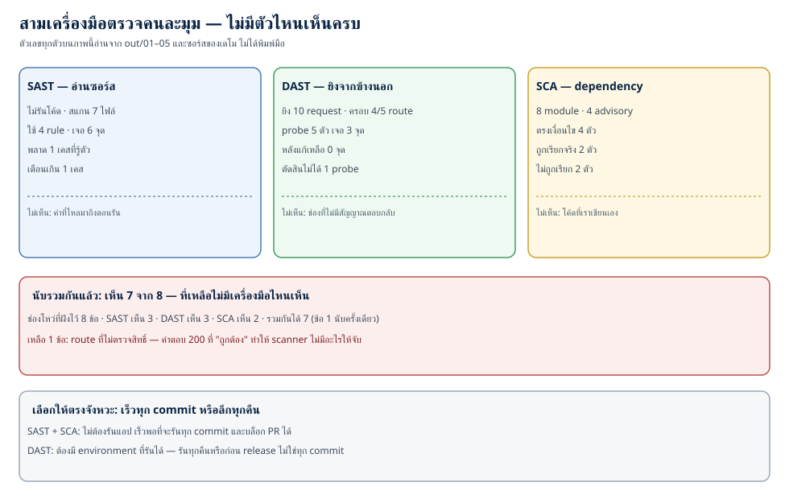
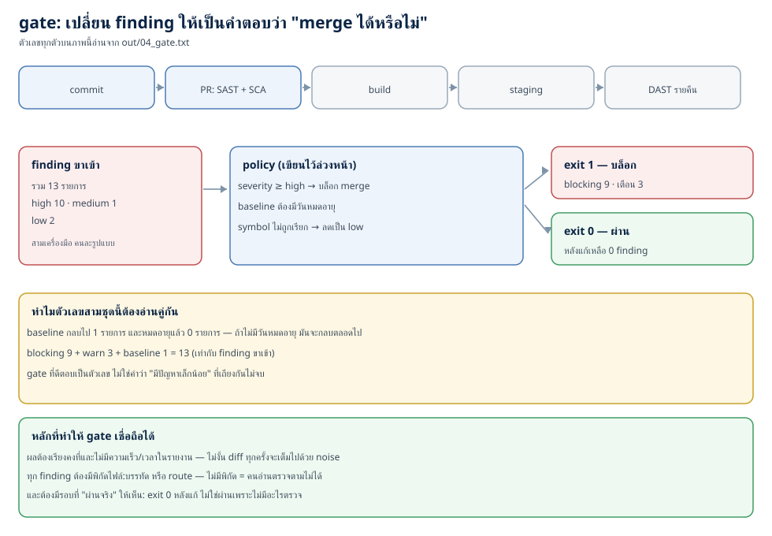
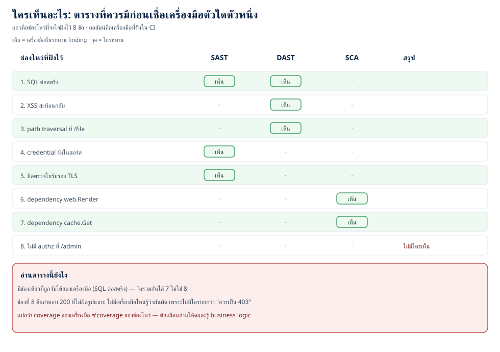

# SAST, DAST และ dependency scanning: ทำให้ช่องโหว่ถูกจับก่อน merge (ตอนที่ 25)

> 📅 เขียนเมื่อ: 3 พฤศจิกายน 2026 (เวลาไทย, UTC+7) · รันบน Raspberry Pi 5 (`Linux 6.18.39+rpi-2712 aarch64`, 4 คอร์) ด้วย `go1.24.4 linux/arm64` (รุ่นล่าสุด ณ วันเขียนคือ Go 1.27.3) · Python 3.13.5 · rsvg-convert 2.60.0 — standard library ล้วน ไม่มี dependency ภายนอก (`external_deps=0`) ไม่เปิดพอร์ต (`listen_calls=0`) ไม่แตะเครือข่าย (`network_dial_calls=0`) · รายละเอียดเวอร์ชันและขอบเขตอยู่ที่หัวข้อ 3.8
>
> ⚠️ **หมายเหตุเรื่องจริยธรรม:** โค้ดใน `testdata/app/` เป็นโค้ดที่มีช่องโหว่จริงโดยตั้งใจ (ต่อสตริงเข้า SQL, ประกอบ shell command, ปิดการตรวจใบรับรอง, ฝัง credential) ไฟล์ที่เป็นช่องโหว่ทุกไฟล์ติดป้าย **ห้ามใช้จริง** ไว้ที่หัวไฟล์ และมีไว้ให้เครื่องมือจับเท่านั้น · ส่วนเดโม DAST ยิง request ใส่ handler ที่รันอยู่ในหน่วยความจำของโปรเซสตัวเอง (`httptest.NewRecorder` ไม่เปิดพอร์ต) — การยิงเครื่องมือ DAST ใส่ระบบที่คุณไม่ได้เป็นเจ้าของหรือไม่ได้รับอนุญาตเป็นความผิดทางกฎหมาย แม้จะ "แค่สแกน" ก็ตาม

---

[ตอนที่ 18](/blog/post.html?slug=2026-10-27-software-security-18-secure-sdlc) เราพูดถึง **shift left** — เอา security เข้าไปในทุกช่วงของ SDLC (วงจรการพัฒนาซอฟต์แวร์) แทนที่จะไปตรวจตอนท้าย และผมจบตอนนั้นด้วยประโยคที่ยังไม่ได้พิสูจน์ว่า "ในทางปฏิบัติมันหน้าตาอย่างไร" คืนนี้เราจะลงมือ: เขียนเครื่องมือตรวจสามตัวด้วย Go standard library รันมันกับโค้ดที่มีช่องโหว่จริง แล้วเอามันไปต่อเป็น **gate** ที่ตอบได้คำเดียวว่า merge ได้หรือไม่

คำถามที่คนเพิ่งเริ่มทำงานถามบ่อยที่สุดไม่ใช่ "ใช้เครื่องมือตัวไหน" แต่คือ **"แล้วผมต้องเชื่อมันแค่ไหน"** — เครื่องมือบอกว่ามีช่องโหว่หลายสิบจุด คุณจะหยุดทีมทั้งทีมเพื่อแก้ทั้งหมดไหม · ถ้าไม่เชื่อแล้วปิดทั้งหมด คุณจะพลาดจุดที่แปดหรือเปล่า · และคำถามที่สำคัญที่สุด: **"ถ้ามันไม่เห็น แล้วใครจะเห็น"**

ก่อนลงรายละเอียด ขอปักหมุดสามตัวย่อที่จะเจอตั้งแต่ย่อหน้าถัดไป: **SAST** (Static Application Security Testing — อ่านซอร์สโดยไม่รันโค้ด) · **DAST** (Dynamic Application Security Testing — ยิงจากภายนอกใส่ระบบที่กำลังรัน) · **SCA** (Software Composition Analysis — ตรวจ dependency ที่ดึงมาใช้) · คำที่เหลือ (rule · sink · probe · oracle · advisory · CVE · reachability · baseline · gate) ผมจะนิยามตอนใช้จริง ตรงนี้ยังไม่ต้องจำ สองคำที่ควรเข้าใจก่อนคือ **finding** (ผลตรวจหนึ่งรายการที่บอกว่า "ตรงนี้มีปัญหา ยี่ห้ออะไร ระดับไหน") และ **triage** (การนั่งอ่าน finding ทีละตัวแล้วตัดสินว่า จริง / ไม่จริง / ยอมรับความเสี่ยง) — งานจริงคือ triage ไม่ใช่การรันสแกน เพราะการรันสแกนใช้เวลาไม่ถึงนาที

คำตอบสั้น ๆ อยู่ในบทนี้พร้อมตัวเลขที่วัดได้: SAST เห็น 6 จุดแต่พลาด 1 เคสและเตือนเกิน 1 เคส · DAST เห็น 3 จุดจาก 4 route ที่ยิงถึง (ระบบมี 5 route) และตัดสินไม่ได้ 1 probe · SCA เห็น dependency ที่มีปัญหา 4 ตัว แต่ 2 ตัวไม่มีทางถูกเรียกจากโค้ดที่ ship · รวมสามตัวแล้วเห็น 7 จาก 8 ช่องโหว่ที่ผมจงใจฝังไว้ — และข้อที่ 8 คือข้อที่สำคัญที่สุดในบทนี้

ตัวเลขห้าชุดที่ผมจะใช้ตลอดบท (ทั้งหมดมาจาก `out/`):

- **เดโม 1 — SAST** · สแกน 7 ไฟล์ด้วย 4 rule เจอ 6 จุด: SQL ต่อสตริง 2, shell command 1, credential ฝังในซอร์ส 2, ปิดตรวจใบรับรอง 1 · แต่มี **1 เคสที่รู้ตัวว่าพลาด** (ต่อสตริงเสร็จก่อนแล้วค่อยเรียก `Query`) และ **1 เคสที่เตือนเกิน** (ต่อสตริงแต่ทุกชิ้นเป็นค่าคงที่) · สแกนโลกหลังแก้ได้ 0 จุด
- **เดโม 2 — DAST** · ยิง 5 probe (ครอบ 4 จาก 5 route ที่ระบบเปิด) ใส่ทั้งเวอร์ชันมีช่องโหว่และเวอร์ชันที่แก้แล้ว = 10 request · เวอร์ชันมีช่องโหว่เจอ 3 จุด (XSS สะท้อน, SQL error หลุด, path traversal) · เวอร์ชันที่แก้แล้วเจอ 0 จุด · และมี 1 probe ที่ "ตัดสินไม่ได้" ทั้งสองเวอร์ชัน
- **เดโม 3 — SCA** · 8 module (5 ทางตรง + 3 ทางอ้อม) เทียบกับ 4 advisory · ตรงเงื่อนไข 4 ตัว · ถูกเรียกจริงจากโค้ดเรา 2 ตัว · ไม่ถูกเรียก 2 ตัว · และมี 1 เคสที่การเทียบ version แบบสตริงตอบผิด (ว่า "ปลอดภัย" ทั้งที่ยังไม่ได้อัปเดต)
- **เดโม 4 — gate** · รวม finding 13 รายการ (high 10, medium 1, low 2) · baseline กลบไป 1 · บล็อก 9 เตือน 3 · exit 1 · โลกหลังแก้ exit 0
- **เดโม 5 — matrix** · ช่องโหว่ที่ฝังไว้ 8 ข้อ · SAST เห็น 3 · DAST เห็น 3 · SCA เห็น 2 · รวมกันได้ 7 · เหลือ 1 ข้อที่ **ไม่มีเครื่องมือไหนเห็น**

## 1. แนวคิด: สามเครื่องมือ สามคำถาม

### 1.1 ตารางเดียวจบ

| เครื่องมือ | ตอบคำถามว่า | ต้องรันแอปไหม | เห็นอะไร | ไม่เห็นอะไร | ตัวอย่างในเดโม |
|---|---|---|---|---|---|
| **SAST** (Static Application Security Testing) | "ในซอร์สที่เราเขียน มีรูปแบบที่รู้ว่าเสี่ยงไหม" | ไม่ต้อง | ทุก branch ทุกไฟล์ รวมโค้ดที่ไม่มีใครเรียก | ค่าที่ไหลมาจริงตอนรัน, config ของ environment | `findings=6` จาก 7 ไฟล์ |
| **DAST** (Dynamic Application Security Testing) | "ถ้ายิงจากข้างนอกตอนนี้ มีอะไรพังไหม" | ต้อง | พฤติกรรมจริง รวม misconfig และ library ที่ประกอบร่างแล้ว | โค้ดที่ไม่มี route, ช่องที่ไม่มีสัญญาณตอบกลับ | `vulnerable_findings=3` จาก 10 request |
| **SCA** (Software Composition Analysis) | "โค้ดคนอื่นที่เราดึงมาใช้ มีช่องโหว่ที่ประกาศแล้วไหม" | ไม่ต้อง | dependency ทั้งกราฟ รวมของที่ดึงมาทางอ้อม | โค้ดที่เราเขียนเอง, การประกอบร่างของเรา | `advisory_matches=4` จาก 8 module |



*ภาพที่ 1 — สามเครื่องมือ สามคำถาม และช่องที่ไม่มีเครื่องมือไหนเห็น · ตัวเลขบนภาพมาจาก `out/01`–`out/05` และซอร์สของเดโม (จำนวน route ที่ probe ยิงถึง)*

อ่านตารางนี้แบบนี้: **ถ้าคำถามคือ "เราเขียนอะไรผิด" ให้เริ่มที่ SAST · ถ้าคำถามคือ "ของจริงพังไหม" ให้เริ่มที่ DAST · ถ้าคำถามคือ "ของที่เรายืมมามีปัญหาไหม" ให้เริ่มที่ SCA** และประโยคที่คนมักเข้าใจผิดคือ "มีตัวหนึ่งดีที่สุด" — ไม่มี เพราะทั้งสามตัวตอบคำถามคนละข้อ การเอา DAST ไปตอบคำถามของ SAST (เช่น "บรรทัดนี้ปลอดภัยไหม") เป็นการใช้งานที่ไม่มีทางได้คำตอบ

### 1.2 SAST: อ่านซอร์สเป็นโครงสร้าง ไม่ใช่ค้นข้อความ

คำว่า **static** แปลตรงตัวว่า "ไม่เคลื่อนไหว" — เครื่องมือไม่ได้รันโปรแกรม มันอ่านไฟล์ SAST ที่ขายกันจริง (Semgrep, CodeQL, gosec, และ analyzer ใน `go vet`) ทำงานต่างกันในรายละเอียด แต่หลักคิดร่วมกันคือ: แปลงซอร์สเป็น **AST** (Abstract Syntax Tree — โครงสร้างต้นไม้ของโค้ด ที่บอกว่า "อันนี้คือการเรียกฟังก์ชัน ชื่อนี้ มี argument สองตัว") แล้วเดินดูต้นไม้นั้นด้วย **rule** (กฎที่เขียนไว้ว่า "ถ้าเจอรูปแบบนี้ ให้รายงาน")

ทำไมต้อง AST ไม่ใช่ `grep` — เพราะ `grep "db.Query("` เจอทั้งคอมเมนต์ ทั้งสตริงในเทสต์ และไม่รู้ว่าอะไรคือ argument ที่หนึ่ง ถ้าเป็น AST เราแยกได้ว่า "argument ตัวนี้เป็นการต่อสตริงด้วย `+`" ซึ่งเป็นสัญญาณของ SQL injection ที่ [ตอนที่ 4](/blog/post.html?slug=2026-10-12-software-security-04-sql-injection) สอนไปแล้ว

สองคำที่ต้องแม่นก่อนอ่านตัวเลข:

1. **false negative** (พลาดของจริง) — โค้ดมีช่องโหว่ แต่เครื่องมือไม่เตือน อันตรายที่สุด เพราะเรานึกว่าปลอดภัย
2. **false positive** (เตือนเกิน) — โค้ดปลอดภัย แต่เครื่องมือเตือน อันตรายน้อยกว่า แต่ทำให้คนเลิกเชื่อเครื่องมือ ซึ่งจบลงที่ false negative แบบที่ไม่มีใครรู้

ในเดโม 1 ผมจงใจทำทั้งสองอย่าง: ไฟล์ `sqli_variable.go` ต่อสตริงเสร็จในบรรทัดหนึ่ง แล้วค่อยเรียก `db.Query(q)` อีกบรรทัด — rule ของผมมองหา "การต่อสตริงที่อยู่ใน argument ของ `Query` โดยตรง" จึงไม่เห็น (`expected_misses=1`) · ไฟล์ `sqli_quoted.go` ต่อสตริงเหมือนกัน แต่ทุกชิ้นเป็น `const` ที่ไม่มี input ผู้ใช้ — rule เตือน (`expected_false_positives=1`)

และนี่คือเหตุผลที่ **rule ที่แม่นขึ้นไม่ใช่คำตอบสุดท้าย**: ถ้าเขียน rule ให้ตามตัวแปรข้ามบรรทัดได้ (data-flow) มันจะจับ `q` ได้ แต่ก็จะเริ่มจับผิดในเคสที่ค่าถูก sanitize ผ่าน helper ซึ่งต้องเข้าใจ semantics ของ helper นั้น — งานระดับนั้นต้องมีทีมดูแล rule ของตัวเอง นั่นคือที่มาของประโยค "SAST ต้องมีคนดูแล rule"

### 1.3 DAST: ไม่เห็นซอร์ส แต่เห็นของจริง

DAST ทำงานแบบคนนอก: มันไม่รู้ว่าคุณเขียนอะไร มันรู้แค่ **endpoint** แล้วยิง **probe** (คำขอทดสอบหนึ่งชุดที่ออกแบบมาให้เกิดอาการผิดปกติ ถ้าช่องโหว่มีจริง) เข้าไป แล้วดูคำตอบว่า "มีอาการ" ไหม — payload ของ XSS โผล่กลับมาในหน้าเว็บหรือเปล่า, คำตอบมีข้อความ error ของฐานข้อมูลหรือเปล่า, ไฟล์นอกโฟลเดอร์ที่ให้บริการอ่านได้หรือเปล่า

จุดที่คนมักข้าม: DAST ต้องมี **oracle** — เกณฑ์ที่บอกว่า "คำตอบนี้ผิดปกติ" ถ้าไม่มี oracle มันรู้แค่ status code กับ body ดิบ ๆ ซึ่งบางครั้งก็เพียงพอ (เห็น `<script>` ที่เราส่งไปโผล่กลับมา = oracle) แต่บางครั้งก็ไม่ (route ที่ตอบ 200 ทั้งที่ควรเป็น 403 — ไม่มีอะไร "ผิดรูปแบบ" ให้จับ)

ในเดโม 2 มี probe 5 ตัว แต่ตัวที่ห้า (`/admin` โดยไม่แนบ token) ผมทำให้เป็น probe ที่ **ตัดสินไม่ได้** โดยตั้งใจ (`unjudged_probes=1`) — เพราะ scanner ไม่มีทางรู้ว่าคำตอบ 200 จาก `/admin` นั้นถูกหรือผิด มันไม่มีสเปกของระบบ คุณมี

อีกจุดที่ควรรู้: DAST เห็นเฉพาะสิ่งที่ **เข้าถึงได้จากภายนอก** โค้ดที่ไม่มี route, ฟังก์ชันที่ถูกเรียกจาก job ภายใน, หรือ branch ที่ต้องมีข้อมูลบางอย่างถึงจะไปถึง — DAST ไม่มีทางเห็น นั่นไม่ใช่ความผิดของมัน เพราะงานมันคือ "ทดสอบจากข้างนอก" ไม่ใช่ "ตรวจทั้งระบบ"

### 1.4 SCA: dependency คือโค้ดที่เราไม่ได้เขียน

[ตอนที่ 8](/blog/post.html?slug=2026-10-16-software-security-08-supply-chain-log4shell-solarwinds) เล่าเรื่อง Log4Shell ไปแล้ว — บทเรียนของตอนนั้นคือ **ซอฟต์แวร์ของเราส่วนใหญ่ไม่ใช่โค้ดของเรา** สัดส่วนโค้ดที่ทีมเขียนเองในระบบจริงมักน้อยกว่าที่คิด ที่เหลือคือ dependency ที่ดึงมา และ dependency เหล่านั้นก็มี dependency ของตัวเองอีกชั้น

SCA ทำงานสามขั้น:

1. **สร้างรายการ** ว่าเราใช้ module อะไร เวอร์ชันไหน รวมของที่ดึงมาทางอ้อม (ทางตรง = เราระบุใน `go.mod` · ทางอ้อม = dependency ของ dependency ซึ่งเรามักไม่รู้ว่ามี)
2. **เทียบกับฐานข้อมูลช่องโหว่** — แต่ละรายการในฐานเรียกว่า **advisory** (ประกาศช่องโหว่หนึ่งฉบับ) ซึ่งบอกว่า module ไหน, เวอร์ชันช่วงไหนมีปัญหา, และแก้ที่เวอร์ชันไหน (fixed version) ฐานที่ใช้กันจริงคือ OSV / GitHub Advisory / NVD ซึ่งเป็นที่มาของเลข **CVE** ที่ [ตอนที่ 16](/blog/post.html?slug=2026-10-24-software-security-16-cve-cwe-cvss) สอนวิธีอ่าน
3. **ตัดสินว่าเรากระทบจริงไหม** — ขั้นนี้คือจุดที่แยก SCA ชั้นดีออกจาก script ที่ไล่เทียบเวอร์ชัน

ขั้นที่สามสำคัญเพราะ "มี dependency ที่มี CVE" กับ "เรามีช่องโหว่" ไม่ใช่ประโยคเดียวกัน ถ้า advisory บอกว่าปัญหาอยู่ในฟังก์ชัน `cache.Get` แต่โค้ดเราเรียกแค่ `cache.Put` เราก็ยังไม่กระทบ (แต่ก็ยังควรอัปเดต) — `govulncheck` ของทีม Go ทำขั้นนี้ด้วยการสร้าง call graph แล้วดูว่าฟังก์ชันที่มีปัญหาถูกเรียกจากโค้ดเราจริงไหม นี่คือความหมายของ **reachability** (การเข้าถึงได้จากโค้ดที่รันจริง)

และมีกับดักที่โหดที่สุดของทั้งหัวข้อนี้อยู่ตรงขั้นที่สอง: **การเทียบเวอร์ชัน** ผมจะโชว์ในเดโม 3 ว่าโค้ดบรรทัดเดียวทำให้เครื่องมือรายงานว่า "ปลอดภัย" ทั้งที่ยังไม่ได้อัปเดต

### 1.5 ทำให้เป็นอัตโนมัติ: gate ไม่ใช่ dashboard

ทีนี้ส่วนที่ทำให้ security เป็นงานวิศวกรรม ไม่ใช่พิธีกรรม: **gate** (ประตูใน CI — continuous integration คือระบบที่รัน build/test อัตโนมัติทุกครั้งที่ push)

ความต่างระหว่าง dashboard กับ gate คือความต่างระหว่าง "มีคนควรจะดู" กับ "มีคนต้องตัดสินตอนนี้":

- **dashboard** — รวบรวม finding ไว้ให้ดู เป็นของดี แต่ finding ที่ไม่มีเจ้าของและไม่มีเดดไลน์จะกลายเป็นภาพพื้นหลังที่ไม่มีใครเห็น
- **gate** — รับ finding เข้ามา, ใช้ **policy** ที่เขียนไว้ล่วงหน้า (ระดับไหนบล็อก ระดับไหนเตือน), แล้วคืน **exit code** ที่ CI ใช้ตัดสินได้ทันที

policy ที่ผมใช้ในเดโม 4 มีสามข้อ และทั้งสามข้อคือสิ่งที่ทีมจริงเถียงกันนานที่สุด:

1. **severity ≥ high → บล็อก merge** (medium ลงไปเตือน) — ตัวเลข severity มาจากไหนก็ตาม (CVSS หรือของเครื่องมือ) แต่เส้นแบ่งต้องชัด
2. **baseline ต้องมีวันหมดอายุ** — รายการที่ "ตรวจแล้ว ยอมรับความเสี่ยง" ต้องมีวันที่ต้องกลับมาดู ถ้าไม่มีวันหมดอายุ มันจะกลายเป็นหลุมฝัง finding ตลอดไป
3. **finding ที่พิสูจน์ได้ว่าไม่มีทางถูกเรียก → ลดระดับ** — ไม่ใช่ลบทิ้ง (ยังต้องอัปเดต) แต่ไม่ควรบล็อก merge ด้วยเหตุที่ไม่มีทางเกิด

และเงื่อนไขที่ทำให้ gate ใช้ได้จริงในระยะยาวคือ **ผลลัพธ์ต้อง diff ได้** — เรียงคงที่ ไม่มีเวลา ไม่มีความเร็วอยู่ในรายงาน ไม่งั้นทุก build จะได้ diff ที่เต็มไปด้วย noise แล้วคนก็จะเลิกอ่าน

## 2. ทำไมเรื่องนี้สำคัญ: สองเรื่องจริงที่เครื่องมือจะเปลี่ยนผลได้

### 2.1 Equifax 2017: patch มีอยู่แล้วสองเดือน

กันยายน 2017 Equifax เปิดเผยว่าแฮกเกอร์เข้าถึงข้อมูลส่วนบุคคลของลูกค้าจำนวนมาก (ตัวเลขที่รายงานตอนแรกประมาณ 143 ล้านคน และตัวเลขสุดท้ายที่ใช้กันคือราว 147 ล้านคน) สาเหตุคือช่องโหว่ **CVE-2017-5638** ใน Apache Struts — Apache ประกาศ S2-045 เมื่อ 6 มีนาคม 2017 พร้อมแพตช์ 2.3.32/2.5.10.1 แต่ระบบที่ถูกเจาะยังไม่ได้อัปเดต และถูกบุกรุกในเดือนพฤษภาคมของปีเดียวกัน สองเดือนหลังแพตช์ออก

อ่านให้ตรง: ไม่มีใคร "ไม่รู้" ว่ามีช่องโหว่ ข้อมูลมีอยู่ ประกาศแล้ว มีแพตช์แล้ว สิ่งที่ขาดคือ **กลไกที่ทำให้รู้ว่าตัวเองใช้เวอร์ชันที่มีปัญหา** และทำให้การอัปเดตเกิดขึ้นจริงในเวลาที่กำหนด

นี่คือคำถามที่ SCA ตอบ และเป็นเหตุผลที่ SBOM (รายการส่วนประกอบซอฟต์แวร์ทั้งหมดของระบบ) กลายเป็นข้อกำหนดในหลายอุตสาหกรรม — ถ้าไม่มีรายการ คุณจะไม่รู้ด้วยซ้ำว่าต้องไปถามใครว่าอัปเดตแล้วหรือยัง

### 2.2 Log4Shell 2021: dependency ที่คนส่วนใหญ่ไม่รู้ว่ามี

ธันวาคม 2021 มีการเปิดเผยช่องโหว่ใน `log4j-core` (CVE-2021-44228) ที่ทำให้ผู้โจมตีสั่งรันโค้ดจากระยะไกลได้ด้วยสตริงที่พิมพ์ลง log ครั้งเดียว — คะแนน CVSS 10.0 ซึ่งเป็นคะแนนสูงสุด และผลกระทบแพร่ไปแทบทุกภาษาและทุกผลิตภัณฑ์ เพราะ Java logging library ตัวนี้ถูกฝังอยู่ในซอฟต์แวร์อื่นอีกนับไม่ถ้วน

จุดที่เกี่ยวกับบทนี้: หลายองค์กรไม่รู้ว่าตัวเองใช้ log4j จนกระทั่งต้องไปค้นทั้งบริษัท — และค้นด้วยมือไม่ได้ เพราะมันเป็น dependency ทางอ้อมของ dependency อีกชั้น นี่คือภาพที่ SCA ถูกออกแบบมาเพื่อแก้

### 2.3 บทเรียนร่วมของสองเรื่อง

ทั้งสองเรื่องไม่ได้พังเพราะ "ไม่มีเครื่องมือ" แต่พังเพราะ **ข้อมูลไม่ได้ถูกแปลงเป็นการกระทำในเวลาที่ทัน** — และนั่นคือนิยามของ gate ในหัวข้อ 1.5

## 3. ลงมือทำ: ห้าเดโมที่วัดได้

### 3.0 โครงของ repo

```text
code/ep25/
├── go.mod                 module ep25 · go 1.24 · ไม่มี require
├── internal/
│   ├── sast/sast.go       rule engine บน go/ast (4 rule) + marker checker
│   ├── dast/dast.go       handler สองเวอร์ชัน + scanner ที่ยิงผ่าน ServeHTTP
│   ├── sca/semver.go      Compare (semver) กับ CompareNaive (กับดัก)
│   ├── sca/scan.go        ฐาน advisory จำลอง + reachability
│   ├── gate/gate.go       policy: severity, baseline, exit code
│   └── report/report.go   แปลงผลสามเครื่องมือเป็น finding ชนิดเดียว
├── cmd/{sast,dast,sca,gate,pipeline}/main.go
├── testdata/app/          7 ไฟล์ (5 ไฟล์มีช่องโหว่ · ห้ามใช้จริง) — ถูกสแกน ไม่ถูก compile
├── testdata/app_fixed/    4 ไฟล์ที่แก้แล้ว
├── testdata/product/      โค้ดจำลองที่เรียก dependency (ใช้ตรวจ reachability)
├── out/                   ผลรันจริงทุกไฟล์
└── run_all.sh             รันทุกอย่างใหม่ได้จาก repo เปล่า
```

`testdata/` คือที่ที่ Go tool ไม่สนใจตอน build — เราเก็บโค้ดที่มีช่องโหว่ไว้ที่นั่นได้โดยไม่ทำให้ `go build ./...` พัง และตัวสแกนอ่านมันด้วย `go/parser` แบบเดียวกับที่อ่านโค้ดจริง

`go.mod` มีสามบรรทัด ไม่มี `require` เลย (`external_deps=0`) — เพราะบทนี้อยากให้เห็นทุกขั้นของกลไก ไม่ใช่ให้เห็นว่า "เรียกคำสั่งนี้แล้วมันก็บอก"

```go
module ep25

go 1.24
```

(บล็อกข้างบนคือ `go.mod` ทั้งไฟล์ — สามบรรทัด ไม่มีอะไรซ่อน)

### 3.1 หลักของ rule: sink และการต่อสตริง

**sink** (จุดปลายทางที่ถ้าข้อมูลอันตรายไหลถึงแล้วจบเห่) — คู่กับ **source** (จุดที่ข้อมูลผู้ใช้เข้ามา) สองคำนี้จะเป็นคู่ที่ใช้ตลอดบท: rule ในเดโมนี้เห็น sink แต่ไม่ได้ตามว่า source ของข้อมูลคืออะไร

เริ่มจากชิ้นที่เล็กที่สุด: ฟังก์ชันที่บอกว่า expression หนึ่งคือ "การต่อสตริงด้วย `+`" หรือไม่ เพราะนี่คือสัญญาณที่ rule ทั้งสองตัวแรกใช้

```go
func isConcat(e ast.Expr) bool {
	b, ok := e.(*ast.BinaryExpr)
	return ok && b.Op == token.ADD
}
```

`sink` ของเดโมนี้คือ method ที่รับคำสั่ง SQL และ `exec.Command` — rule ไม่ได้พยายามพิสูจน์ว่า "ข้อมูลนี้มาจากผู้ใช้" (นั่นคือ taint analysis ซึ่งเป็นคนละชั้น) มันแค่รายงานว่า "มีสตริงที่ถูกต่อเข้าคำสั่ง" ซึ่งเป็นรูปแบบที่ต้องมีคนดูก่อน merge

### 3.2 เดโม 1: SAST อ่านซอร์สโดยไม่รันโค้ด

ตัวสแกนเดินทุกไฟล์ `.go` ใน directory ที่กำหนด แปลงเป็น AST แล้วให้ทุก rule ตรวจ

```go
func ScanDir(dir string) (Result, error) {
	entries, err := os.ReadDir(dir)
	if err != nil {
		return Result{}, fmt.Errorf("อ่าน directory %s: %w", dir, err)
	}
	fset := token.NewFileSet()
	res := Result{Rules: len(rules)}
	for _, e := range entries {
		if e.IsDir() || !strings.HasSuffix(e.Name(), ".go") {
			continue
		}
		path := filepath.Join(dir, e.Name())
		f, err := parser.ParseFile(fset, path, nil, 0)
		if err != nil {
			return Result{}, fmt.Errorf("parse %s: %w", path, err)
		}
		res.Files++
		for _, r := range rules {
			res.Findings = append(res.Findings, r.check(fset, f, path)...)
		}
	}
	sort.SliceStable(res.Findings, func(i, j int) bool {
		a, b := res.Findings[i], res.Findings[j]
		if a.File != b.File {
			return a.File < b.File
		}
		if a.Line != b.Line {
			return a.Line < b.Line
		}
		return a.Rule < b.Rule
	})
	return res, nil
}
```

ผลลัพธ์ที่เรียงตาม (ไฟล์, บรรทัด, rule) ไม่ใช่ตามลำดับที่เดินเจอ — รายละเอียดเล็ก ๆ ที่ตัดสินว่ารายงานจะ diff ได้หรือไม่ในภายหลัง

ส่วนตัวที่ทำให้เดโมนี้ตรวจตัวเองได้คือ marker ใน fixture: ไฟล์ที่มี `MISS-EXPECTED` ต้องได้ 0 finding และไฟล์ที่มี `FP-EXPECTED` ต้องได้อย่างน้อย 1 — ถ้าพฤติกรรมของ rule เปลี่ยนจน marker ไม่จริง ฟังก์ชันนี้คืน error แล้ว `run_all.sh` หยุดทันที

```go
func CheckMarkers(dir string, fs []Finding) (misses, falsePositives int, err error) {
	perFile := map[string]int{}
	for _, f := range fs {
		perFile[f.File]++
	}
	entries, err := os.ReadDir(dir)
	if err != nil {
		return 0, 0, err
	}
	for _, e := range entries {
		if e.IsDir() || !strings.HasSuffix(e.Name(), ".go") {
			continue
		}
		path := filepath.Join(dir, e.Name())
		raw, err := os.ReadFile(path)
		if err != nil {
			return 0, 0, err
		}
		text := string(raw)
		if strings.Contains(text, "MISS-EXPECTED") {
			if perFile[path] != 0 {
				return 0, 0, fmt.Errorf("%s: marker MISS-EXPECTED แต่ rule จับได้ %d", path, perFile[path])
			}
			misses++
		}
		if strings.Contains(text, "FP-EXPECTED") {
			if perFile[path] == 0 {
				return 0, 0, fmt.Errorf("%s: marker FP-EXPECTED แต่ rule ไม่เตือนเลย", path)
			}
			falsePositives++
		}
	}
	return misses, falsePositives, nil
}
```

ผลรันจริง:

```
=== เดโม 1: SAST — อ่านซอร์สโดยไม่รันโค้ด ===
files_scanned=7
rules=4
findings=6
sast001_sql_concat=2
sast002_shell_exec=1
sast003_hardcoded_secret=2
sast004_skip_verify=1
severity_high=5
severity_medium=1
expected_misses=1
expected_false_positives=1
--- findings (เรียงตามไฟล์:บรรทัด) ---
SAST-003 high   testdata/app/hardcoded_secret.go:4 credential ฝังในซอร์ส — ย้ายไป env หรือ secret manager
SAST-003 high   testdata/app/hardcoded_secret.go:7 credential ฝังในซอร์ส — ย้ายไป env หรือ secret manager
SAST-002 high   testdata/app/shell_exec.go:7 ส่งคำสั่งให้ shell ที่ประกอบจากสตริง — แยก argument แทน sh -c
SAST-001 high   testdata/app/sqli_concat.go:7 ต่อสตริงเข้าไปในคำสั่ง SQL — ใช้ placeholder ($1) แทน
SAST-001 high   testdata/app/sqli_quoted.go:9 ต่อสตริงเข้าไปในคำสั่ง SQL — ใช้ placeholder ($1) แทน
SAST-004 medium testdata/app/tls_skip_verify.go:6 ปิดการตรวจใบรับรอง TLS — ผู้โจมตีกลางทางปลอมได้
--- โลกหลังแก้ ---
fixed_tree_files=4
fixed_tree_findings=0
```

อ่านทีละส่วน: `files_scanned=7` คือจำนวนไฟล์ที่ rule เดินผ่าน (ไม่นับ `app_fixed`) · `rules=4` คือจำนวน rule ที่ทำงาน — น้อยมากเมื่อเทียบกับเครื่องมือจริงที่มีเป็นร้อย rule แต่พอจะเห็นกลไก · `findings=6` กระจายเป็น SQL 2, shell 1, credential 2, TLS 1

สองบรรทัดที่ผมอยากให้อ่านช้า ๆ คือ `expected_misses=1` กับ `expected_false_positives=1` เพราะมันคือคำตอบของคำถาม "เชื่อถือได้แค่ไหน" — เครื่องมือนี้ **ไม่เห็น** เคสที่ต่อสตริงข้ามบรรทัด และ **เตือนเกิน** ในเคสที่ต่อแต่ค่าคงที่ ทั้งสองเคสอยู่ใน fixture เดียวกัน ห่างกันไม่กี่บรรทัด นี่ไม่ใช่ความบกพร่องที่แก้ด้วยการเขียน rule ให้ยาวขึ้น แต่เป็นธรรมชาติของการอ่านซอร์สโดยไม่รู้ค่าจริง

ท้ายไฟล์คือ `fixed_tree_findings=0` — สแกน `testdata/app_fixed` (4 ไฟล์ที่แก้แล้ว) ได้ศูนย์ นี่คือส่วนที่หลายคนข้าม: **ต้องมีโลกหลังแก้ที่สะอาดจริง** ไม่งั้นเราไม่รู้ว่า rule เงียบเพราะโค้ดดี หรือเงียบเพราะมันพัง

### 3.3 เดโม 2: DAST ยิงจากข้างนอก

handler สองเวอร์ชันอยู่ในไฟล์เดียวกัน ต่างกันแค่ไม่กี่บรรทัด — นี่คือการสอนที่ผมชอบที่สุดของบทนี้ เพราะมันทำให้เห็นว่าช่องโหว่กับ "โค้ดที่ดูปกติ" ห่างกันแค่ไหน probe หนึ่งตัวเป็น struct ที่มีฟิลด์ `name`, `route`, `id`, `sev`, `path`, `marker` (เฉพาะ probe แบบสังเกต) และ `detect` (ฟังก์ชัน oracle) — ตัวอย่าง probe หนึ่งตัว:

```go
		name: "reflected-xss", route: "/search", id: "xss-reflect", sev: "high",
		path: "/search?q=%3Cscript%3Ealert(1)%3C%2Fscript%3E",
		detect: func(status int, body string) (bool, string) {
			return strings.Contains(body, "<script>alert(1)</script>"),
				"payload ถูกสะท้อนกลับมาโดยไม่ encode"
		},
	},
```

`detect` ของ probe นี้คือ oracle: ถ้า body ที่ได้มี `<script>alert(1)</script>` แบบดิบ แปลว่า input ถูกสะท้อนกลับโดยไม่ encode — จบ ไม่ต้องเดา

ตัว scanner เองเล็กมาก และมีการตัดสินใจหนึ่งที่สำคัญ: มันแยก probe ที่ "มี oracle" ออกจาก probe ที่ "แค่สังเกต"

```go
func Scan(mux *http.ServeMux) (Result, error) {
	res := Result{Routes: len(routeList), Probes: len(probes)}
	for _, p := range probes {
		req := httptest.NewRequest(http.MethodGet, p.path, nil)
		rec := httptest.NewRecorder()
		mux.ServeHTTP(rec, req)
		res.Requests++
		body := rec.Body.String()

		if p.marker != "" {
			// probe แบบสังเกต: รู้แค่ว่าค่าที่ใส่ไปโผล่กลับมาหรือไม่
			if strings.Contains(body, p.marker) {
				res.Reflected++
			}
			continue
		}
		if p.detect == nil {
			// probe ที่ไม่มี oracle: รู้ status แต่ไม่รู้ว่า "ถูก" ควรเป็นอะไร
			res.Unjudged++
			continue
		}
		if ok, ev := p.detect(rec.Code, body); ok {
			res.Findings = append(res.Findings, Finding{
				ID: p.id, Severity: p.sev, Route: p.route, Evidence: ev,
			})
		}
	}
	return res, nil
}
```

บรรทัดที่ `p.detect == nil` คือที่ที่ความซื่อสัตย์เกิดขึ้น: probe นั้นถูกนับเป็น `unjudged` ไม่ใช่ "ผ่าน" — เครื่องมือที่รายงานว่า "ไม่พบปัญหา" ทั้งที่ไม่ได้ตรวจ คือเครื่องมือที่แย่กว่าไม่มีเครื่องมือ

ผลรันจริง:

```
=== เดโม 2: DAST — ยิงจากข้างนอก ไม่เห็นซอร์สเลย ===
routes=5
probes=5
requests_sent=10
vulnerable_findings=3
fixed_findings=0
marker_reflected=1
unjudged_probes=1
--- findings (เวอร์ชันมีช่องโหว่) ---
xss-reflect high /search payload ถูกสะท้อนกลับมาโดยไม่ encode
sqli-error-leak high /user คำตอบมีข้อความ error ของ SQL หลุดออกมา
path-traversal high /file อ่านไฟล์นอก directory ที่ให้บริการได้
--- โลกหลังแก้ ---
fixed_requests_sent=5
fixed_unjudged_probes=1
```

`requests_sent=10` มาจาก probe 5 ตัว (ครอบ 4 จาก 5 route — `/search` ถูกยิงสอง probe) × handler 2 เวอร์ชัน · เวอร์ชันมีช่องโหว่เจอ 3 จุด (`vulnerable_findings=3`) ได้แก่ XSS สะท้อน, คำตอบที่มีข้อความ error ของ SQL หลุดออกมา, และการอ่านไฟล์นอก directory ที่ให้บริการ · เวอร์ชันที่แก้แล้วเจอ 0 (`fixed_findings=0`)

`marker_reflected=1` คือ probe ที่ไม่ตัดสินอะไร แค่ยืนยันว่าค่าที่เราส่งไปโผล่กลับมาในคำตอบ (ซึ่งเป็นเหตุผลว่าทำไม probe XSS ถึงมีโอกาสเจอ) · และ `unjudged_probes=1` คือ `/admin` — เวอร์ชันมีช่องโหว่ตอบ 200, เวอร์ชันที่แก้แล้วตอบ 403 แต่ scanner ยัง "ตัดสินไม่ได้" ทั้งสองครั้ง เพราะมันไม่รู้สเปก นี่คือช่องที่ผมจะกลับมาที่หัวข้อ 3.6

### 3.4 เดโม 3: SCA และกับดักการเทียบเวอร์ชัน

เริ่มจากส่วนที่คนเขียนสคริปต์สแกนเองมักทำพลาด: การเทียบเวอร์ชันที่ถูกต้อง

```go
func Compare(a, b string) int {
	pa, ok := Parse(a)
	if !ok {
		return strings.Compare(a, b)
	}
	pb, ok := Parse(b)
	if !ok {
		return strings.Compare(a, b)
	}
	for i := 0; i < 3; i++ {
		if pa[i] < pb[i] {
			return -1
		}
		if pa[i] > pb[i] {
			return 1
		}
	}
	return 0
}
```

มันแยก `1.9.9` เป็น `[1, 9, 9]` แล้วเทียบทีละชิ้นเป็นจำนวนเต็ม — ซึ่งทำให้ `9 < 10` ถูกต้อง และนี่คือสิ่งที่โค้ดที่ "ดูสมเหตุสมผล" อีกแบบทำไม่ได้

```go
func CompareNaive(a, b string) int {
	return strings.Compare(a, b)
}
```

`strings.Compare("1.9.9", "1.10.0")` ตอบว่า `1.9.9` **มากกว่า** เพราะเทียบทีละตัวอักษร แล้ว `9` มากกว่า `1` — ผลคือ advisory ที่แก้ที่ `1.10.0` จะถูกมองว่า "เราใหม่กว่าแล้ว ปลอดภัย" ทั้งที่เรายังอยู่ที่ `1.9.9` ในเดโมนี้มีเคสนี้ 1 เคส (`naive_compare_misses=1`) และมันอยู่ใน dependency ที่ชื่อ `cache`

ฐาน advisory ของเดโมเป็นข้อความฝังในไฟล์ เก็บข้อมูลขั้นต่ำชุดเดียวกับที่ฐานช่องโหว่จริงต้องมี (module, fixed version, ระดับความรุนแรง, symbol ที่มีปัญหา, คำอธิบาย):

```go
const advisoriesText = `CVE-2026-1001|github.com/example/web|1.5.0|high|web.Render|template ไม่ escape ค่าที่ส่งเข้า attribute
CVE-2026-1002|github.com/example/cache|1.10.0|medium|cache.Get|คีย์ที่มีอักขระพิเศษทำให้อ่าน entry ผิด
CVE-2026-1003|github.com/example/parse|0.4.0|high|parse.Tokenize|อ่านเกินบัฟเฟอร์เมื่อ input ยาวผิดรูป
CVE-2026-1004|github.com/example/tlsx|0.9.1|high|tlsx.Handshake|ยอมรับใบรับรองที่ไม่มี SAN
`

```

ผมใช้ `|` คั่นเพราะอ่านง่ายในไฟล์เดียว แต่ของจริงเป็น JSON/YAML ตามสคีมาของ OSV — จุดสำคัญไม่ใช่ฟอร์แมต แต่คือ **ต้องมี fixed version** ถ้าฐานข้อมูลบอกแค่ว่า "มีช่องโหว่" โดยไม่บอกว่าแก้อะไร เครื่องมือจะตอบคำถาม "ต้องอัปเดตเป็นอะไร" ไม่ได้

ผลรันจริง:

```
=== เดโม 3: SCA — dependency เทียบฐาน CVE ===
modules_total=8
modules_direct=5
modules_indirect=3
advisories=4
advisory_matches=4
vulnerable_reachable=2
vulnerable_unreachable=2
naive_compare_misses=1
symbols_probed=4
--- findings ---
CVE-2026-1002 module=github.com/example/cache version=1.9.9 fixed=1.10.0 severity=medium reachable=0 naive_says_safe=1
CVE-2026-1003 module=github.com/example/parse version=0.3.1 fixed=0.4.0 severity=high reachable=0 naive_says_safe=0
CVE-2026-1004 module=github.com/example/tlsx version=0.9.0 fixed=0.9.1 severity=high reachable=1 naive_says_safe=0
CVE-2026-1001 module=github.com/example/web version=1.4.2 fixed=1.5.0 severity=high reachable=1 naive_says_safe=0
--- โลกหลังแก้ ---
fixed_modules_total=8
fixed_matches=0
```

`modules_total=8` แยกเป็นทางตรง 5 ทางอ้อม 3 · `advisory_matches=4` คือ dependency ที่เวอร์ชันยังอยู่ในช่วงที่มีปัญหา · ใน 4 ตัวนั้น `vulnerable_reachable=2` (โค้ดเราเรียก `web.Render` และ `tlsx.Handshake` จริง) และ `vulnerable_unreachable=2` (มี CVE แต่ symbol ไม่ถูกเรียก)

อ่านบรรทัด finding ดูจะเห็นว่าผมใส่ `naive_says_safe` ไว้ทุกบรรทัด — มีเพียงบรรทัดเดียวที่เป็น 1 คือ `cache` ที่เวอร์ชัน `1.9.9` เทียบกับ fixed `1.10.0` ถ้าสคริปต์ของคุณเทียบสตริง เคสนี้จะหายไปจากรายงานอย่างเงียบสนิท และนั่นคือเคสที่ทำให้คนเข้าใจผิดว่า "สแกนแล้วไม่พบปัญหา"

`fixed_matches=0` คือการยืนยันอีกด้าน: อัปเดตทุกตัวขึ้นไปยัง fixed version แล้ว ไม่มีอะไรตรงเงื่อนไขอีก

`reachability` ในเดโมนี้คือการค้นข้อความ `pkg.Func(` ในไฟล์ `.go` ซึ่งหยาบกว่ามาก · `govulncheck` ตัวจริงสร้าง call graph จาก SSA (Static Single Assignment form — รูปกลางของโค้ดที่ compiler ใช้วิเคราะห์) จึงตามการเรียกผ่าน interface และ function pointer ได้ในระดับหนึ่ง และมันก็เตือนเองว่าอาจมี false positive จาก interface call และมองไม่เห็นการเรียกผ่าน `reflect`

จุดที่ต้องพูดตรง ๆ: เครื่องนี้ไม่ได้ติดตั้ง `govulncheck` และการติดตั้งกับรันต้องโหลดจากเครือข่าย (โดยปริยาย `govulncheck` เรียก `vuln.go.dev` ทุกครั้ง) ผมจึงจำลองกลไกแบบไม่แตะเน็ต แล้วบอกตรง ๆ ว่าอะไรคือของจริง อะไรคือของจำลอง

### 3.5 เดโม 4: gate รวมสามเครื่องมือเป็นคำตอบเดียว

ก่อนจะรวมได้ ต้องแปลง finding ให้เป็นชนิดเดียวกันก่อน — SCA finding ต้องพา reachability มาด้วย เพราะมันเปลี่ยนระดับความรุนแรง (`titles` ในโค้ดข้างล่างคือ map จากเลข CVE ไปชื่อเรื่อง ซึ่งสร้างจากฐาน advisory ตอนโหลด — ไม่ได้พิมพ์ชื่อเรื่องซ้ำไว้สองที่)

```go
	for _, f := range cres.Findings {
		sev, title := f.Severity, titles[f.CVE]
		if !f.Reachable {
			// dependency มีช่องโหว่ แต่ symbol ไม่ถูกเรียกจากโค้ดที่ ship
			sev = "low"
			title += " (symbol ไม่ถูกเรียกจากโค้ดที่ ship)"
		}
		out.Findings = append(out.Findings, gate.Finding{
			ID:       f.CVE,
			Tool:     "sca",
			Severity: sev,
			Loc:      f.Module + "@" + f.Version,
			Title:    title,
		})
	}
```

ส่วนหัวใจของ gate คือลูปตัดสิน: เรียง finding ตามความรุนแรง, เช็ค baseline (พร้อมวันหมดอายุ), แล้วนับว่าบล็อกหรือเตือน

```go
func Evaluate(findings []Finding, p Policy) Report {
	baseline := map[string]Baseline{}
	for _, b := range p.Baseline {
		baseline[b.ID] = b
	}

	rep := Report{BySeverity: map[string]int{}}
	sorted := make([]Finding, len(findings))
	copy(sorted, findings)
	sort.SliceStable(sorted, func(i, j int) bool {
		ri, rj := rankOf(sorted[i].Severity), rankOf(sorted[j].Severity)
		if ri != rj {
			return ri > rj
		}
		if sorted[i].ID != sorted[j].ID {
			return sorted[i].ID < sorted[j].ID
		}
		return sorted[i].Loc < sorted[j].Loc
	})

	for _, f := range sorted {
		rep.BySeverity[f.Severity]++
		if b, ok := baseline[f.ID]; ok && (b.Loc == "" || strings.HasPrefix(f.Loc, b.Loc)) {
			if p.Today <= b.Until {
				rep.Suppressed = append(rep.Suppressed, f)
				continue
			}
			// baseline หมดอายุแล้ว: finding กลับมาบล็อก และต้องมีคนต่ออายุ/แก้จริง
			rep.Expired = append(rep.Expired, f.ID)
		}
		if rankOf(f.Severity) >= rankOf(p.BlockAt) {
			rep.Blocking++
		} else {
			rep.WarnOnly++
		}
	}
	rep.Findings = sorted
	if rep.Blocking > 0 {
		rep.Exit = 1
	}
	return rep
}
```

จุดที่ผมอยากให้สังเกตคือ `p.Today` — วันที่ถูกส่งเข้ามาเป็นค่า ไม่ได้เรียก `time.Now()` ข้างใน · ผลคือ test และเดโมรันซ้ำได้ผลเดิมเสมอ (`time_now_calls=0`) และเมื่อวันหมดอายุของ baseline ผ่านไป การเปลี่ยนพฤติกรรมจะเกิดตอนที่เราตั้งใจเปลี่ยน ไม่ใช่ตอนที่ clock เดิน

policy ของเดโมเขียนไว้เป็นฟังก์ชันเดียว เพื่อให้ review ได้ใน PR:

```go
func policy() gate.Policy {
	return gate.Policy{
		BlockAt: "high",
		Today:   "2026-11-03",
		Baseline: []gate.Baseline{
			{
				ID:     "SAST-001",
				Loc:    "testdata/app/sqli_quoted.go",
				Reason: "ค่าคงที่ ไม่มี input ผู้ใช้อยู่ในสตริง (ตรวจแล้วว่าเป็น false positive)",
				Until:  "2026-12-31",
			},
		},
	}
}
```

ผลรันจริง:

```
=== เดโม 4: gate — สามเครื่องมือ คำตอบเดียว: ผ่านหรือไม่ผ่าน ===
findings_raw=13
suppressed_by_baseline=1
severity_high=10
severity_medium=1
severity_low=2
blocking=9
warn_only=3
baseline_expired=0
gate_exit_current=1
gate_exit_after_fix=0
--- สิ่งที่ถูก baseline กลบ (ต้องมีวันหมดอายุ) ---
SAST-001 testdata/app/sqli_quoted.go:9 ต่อสตริงเข้าไปในคำสั่ง SQL — ใช้ placeholder ($1) แทน
--- โลกหลังแก้ ---
findings_after_fix=0
blocking_after_fix=0
```

`findings_raw=13` คือผลรวมของ 6 (SAST) + 3 (DAST) + 4 (SCA) · แยกตามระดับเป็น high 10, medium 1, low 2 — ตัวเลข low 2 มาจาก SCA ที่ถูก **ลดระดับ** เพราะ symbol ไม่ถูกเรียก ไม่ใช่เพราะความรุนแรงจริงลดลง

`suppressed_by_baseline=1` คือ false positive จากเดโม 1 ที่ทีมตรวจแล้วว่าเป็นค่าคงที่ และ `baseline_expired=0` แปลว่ายังไม่หมดอายุ (ถ้าหมดเมื่อไร finding จะกลับมาบล็อกเอง) · สมการที่ต้องบวกกันลงตัวคือ `blocking` 9 + `warn_only` 3 + baseline 1 = 13 ซึ่งเท่ากับ `findings_raw=13` — ถ้าตัวเลขสามชุดนี้ไม่ลงกัน แปลว่า gate มี bug หรือมี finding ที่หายไประหว่างทาง



*ภาพที่ 2 — จาก finding หลายรูปแบบ สู่คำตอบเดียว: บล็อกหรือผ่าน · ตัวเลขบนภาพมาจาก `out/04_gate.txt`*

`gate_exit_current=1` คือคำตอบสำหรับโค้ดวันนี้ (ไม่ผ่าน) และ `gate_exit_after_fix=0` คือคำตอบสำหรับโลกหลังแก้ — สองบรรทัดนี้ต้องมีคู่กันเสมอ ไม่งั้นเราไม่รู้ว่า gate ผ่านได้จริงหรือผ่านเพราะไม่มีอะไรตรวจ

### 3.6 เดโม 5: ใครเห็นอะไร และอะไรที่ไม่มีใครเห็น

เดโมสุดท้ายคือการเอาเครื่องมือทั้งสามมารันพร้อมกันบน fixture ชุดเดียว แล้วถามว่า "ช่องโหว่ที่ผมฝังไว้ 8 ข้อ มีอะไรถูกจับได้บ้าง" — และ **ไม่เชื่อตารางที่ผมเขียน** ตัวสคริปต์ไปเช็คกับผลสแกนจริงทีละข้อ ตารางนี้เลือกมา 8 ข้อ: ไม่นับ shell command injection (SAST-002 จับได้แล้วในเดโม 1) และไม่นับเคสที่ rule พลาด (`sqli_variable` ใน §3.2) เพราะสองเคสนั้นเล่าไปแล้ว

```go
func verifyClaims(set report.Set) int {
	sastKeys := map[string]bool{}
	for _, f := range set.SAST.Findings {
		sastKeys[f.Rule+"@"+f.File] = true
	}
	dastIDs := map[string]bool{}
	for _, f := range set.DAST.Findings {
		dastIDs[f.ID] = true
	}
	scaCVEs := map[string]bool{}
	for _, f := range set.SCA.Findings {
		scaCVEs[f.CVE] = true
	}
	ok := 0
	for _, p := range plantedIssues {
		good := true
		if p.sast != "" && !sastKeys[p.sast] {
			good = false
			fmt.Fprintf(os.Stderr, "ตารางอ้างว่า SAST เห็น %s แต่ไม่พบ\n", p.sast)
		}
		if p.dast != "" && !dastIDs[p.dast] {
			good = false
			fmt.Fprintf(os.Stderr, "ตารางอ้างว่า DAST เห็น %s แต่ไม่พบ\n", p.dast)
		}
		if p.sca != "" && !scaCVEs[p.sca] {
			good = false
			fmt.Fprintf(os.Stderr, "ตารางอ้างว่า SCA เห็น %s แต่ไม่พบ\n", p.sca)
		}
		if good {
			ok++
		}
	}
	if ok != len(plantedIssues) {
		fmt.Fprintf(os.Stderr, "ตารางกับผลจริงไม่ตรงกัน: %d/%d\n", ok, len(plantedIssues))
		os.Exit(1)
	}
	return ok
}
```

มันตรวจว่า finding ที่ตารางอ้างว่ามี อยู่จริงในผลของเครื่องมือนั้น และถ้าไม่ตรงก็ exit 1 — เพราะตารางที่โกหกทำให้คนอ่านเชื่อ coverage ที่ไม่มีอยู่

ผลรันจริง:

```
=== เดโม 5: สามเครื่องมือเห็นอะไร — และอะไรที่ไม่มีใครเห็น ===
planted_issues=8
sast_sees=3
dast_sees=3
sca_sees=2
seen_by_any_tool=7
seen_by_no_tool=1
matrix_claims_verified=8
rerun_identical=1
report_has_timestamp=0
--- ตาราง: ใครเห็นอะไร ---
#1 sql-concat         seen_by=sast+dast
#2 xss-reflect        seen_by=dast
#3 path-traversal     seen_by=dast
#4 hardcoded-secret   seen_by=sast
#5 tls-skip-verify    seen_by=sast
#6 dep-web-render     seen_by=sca
#7 dep-cache-get      seen_by=sca
#8 missing-authz-admin seen_by=-
```

`planted_issues=8` · `sast_sees=3` · `dast_sees=3` · `sca_sees=2` · `seen_by_any_tool=7` · `seen_by_no_tool=1`

ตัวเลข 3 + 3 + 2 บวกกันได้ 8 แต่ `seen_by_any_tool` เป็น 7 เพราะข้อ 1 (SQL ต่อสตริง) ถูกจับทั้ง SAST และ DAST — "เครื่องมือเห็นกี่ข้อ" กับ "ช่องโหว่ที่ถูกเห็นกี่ข้อ" จึงเป็นคนละผลบวก และตัวที่ต้องใช้ตัดสินคือตัวหลัง



*ภาพที่ 3 — coverage ของเครื่องมือ ไม่เท่ากับ coverage ของช่องโหว่ · แถวที่ 8 ไม่มีใครเห็น*

ข้อที่ 8 คือ `/admin` ที่ไม่ตรวจสิทธิ์: SAST ไม่มี rule สำหรับ "route นี้ควรตรวจสิทธิ์ไหม" (เพราะต้องรู้ business logic), DAST ได้ 200 ซึ่งเป็นคำตอบที่ "ถูกต้องตามรูปแบบ", SCA ไม่เกี่ยวกับโค้ดที่เราเขียน · ทั้งสามตัวทำงานถูกต้อง และทั้งสามตัวก็ไม่เห็น — นี่คือคำตอบของคำถาม "แล้วใครจะเห็น" และเป็นเหตุผลที่เครื่องมือไม่ได้แทนคน แต่ย้ายเวลาและความสนใจของคนไปที่จุดที่เครื่องมือทำไม่ได้

สองบรรทัดท้ายของเดโม 5 เป็นเรื่องของ CI โดยตรง: `rerun_identical=1` (รันสองรอบ ได้รายงานไบต์เดิม) และ `report_has_timestamp=0` — รายงานที่ไม่มีเวลาและเรียงคงที่คือรายงานที่เอาไป diff ระหว่าง build ได้ ถ้าอยากรู้ว่า "PR นี้เพิ่ม finding อะไรเข้ามา" คำตอบต้องมาจาก diff ไม่ใช่จากการอ่าน log ทั้งก้อน

### 3.7 ตัวตรวจของ repo และการรันซ้ำ

repo นี้ตรวจตัวเองด้วยสคริปต์เดียว ซึ่งพิมพ์ตัวเลขชุดเดียวกับที่ผมใช้ในบท:

```
# ตัวตรวจ (gate): stdlib ล้วน · ไม่เปิดพอร์ต · ไม่แตะเครือข่าย · ไม่มีเวลาลงในผล
go_files=25
gofmt_unformatted=0
go_vet=ok
go_test=ok
external_deps=0
network_dial_calls=0
listen_calls=0
httptest_recorder_calls=1
time_now_calls=0
sast_rules=4
cve_ids=4
lab_marked_files=6
vulnerable_fixtures=7
fixed_fixtures=4
demo_programs=5
tests=5
```

`go_files=25` (`gofmt_unformatted=0`, `go_vet=ok`, `go_test=ok`) · `external_deps=0` · `network_dial_calls=0` · `listen_calls=0` · `httptest_recorder_calls=1` — สามตัวหลังคือหลักฐานว่าเดโม DAST ไม่ได้เปิดพอร์ตจริง: มันเรียก `ServeHTTP` ตรง ๆ ผ่าน recorder ในหน่วยความจำ

ข้อควรอ่านให้ถูก: `httptest_recorder_calls=1` ไม่ใช่จำนวนครั้งที่เรียก recorder — มันคือจำนวน **บรรทัด** ที่ `grep` เจอ (มีอยู่บรรทัดเดียวในฟังก์ชัน `Scan`) การเรียกจริงคือ 10 ครั้ง มาจาก 5 probe × 2 handler ที่วนผ่านบรรทัดเดิมนั้น ถ้าอ่านเป็น "เรียกครั้งเดียว" จะเข้าใจผิดว่าเดโมยิงแค่ครั้งเดียว

`time_now_calls=0` คือเงื่อนไขที่ทำให้ผลรันซ้ำได้ · `lab_marked_files=6` คือจำนวนไฟล์ที่ติดป้าย "ห้ามใช้จริง" (fixture ที่มีช่องโหว่ 5 ไฟล์ + handler ที่มีช่องโหว่ 1 ไฟล์) · และ `tests=5` คือจำนวน test ที่ผูกกับตัวเลขในบทนี้

การรันซ้ำ:

```
rerun_identical_sast=yes
rerun_identical_dast=yes
rerun_identical_sca=yes
rerun_identical_gate=yes
rerun_identical_pipeline=yes
```

ทั้งห้าเดโมรันซ้ำแล้วได้ผลเหมือนเดิมทุกไบต์ — เงื่อนไขที่ทำให้เรากล้าเขียนตัวเลขลงในบทความ และกล้าให้ CI เอาไปใช้ตัดสิน

### 3.8 สิ่งที่เดโมนี้ยังไม่มี

ผมจะบอกตรง ๆ เพราะบทความ security ที่บอกว่าครบคือบทความที่ทำให้คนประมาท:

1. **ไม่มีฐาน CVE จริง** — ของจริงต้องดึง OSV/NVD และต้องมีกลไกจัดการเวอร์ชันของฐานข้อมูลเอง (ฐานเปลี่ยนทุกวัน เครื่องมือที่ scan ด้วยฐานเก่าก็คือเครื่องมือที่โกหก)
2. **ไม่มี taint analysis** — rule ของเราดูรูปแบบ ไม่ได้ตามข้อมูลจากจุดที่ข้อมูลผู้ใช้เข้ามา (source) ไปถึงจุดรับปลายทาง (sink) ข้ามฟังก์ชัน สิ่งที่ทำได้จริงในระดับนี้คือ `go/analysis` framework หรือ `golang.org/x/tools/go/ssa`
3. **DAST ไม่ได้ยิงผ่านเครือข่าย** — ไม่มี TLS, ไม่มี proxy, ไม่มี rate limit, ไม่มี auth flow ซึ่งล้วนเป็นสิ่งที่ DAST จริงต้องจัดการ
4. **ไม่มี secret scanning** — การหา credential ใน git history เป็นอีกตระกูลหนึ่ง (มี rule SAST-003 จับในซอร์ส แต่ history ทั้งก้อนเป็นคนละเรื่อง)
5. **ไม่มี IaC/config scanning** — Dockerfile, Kubernetes manifest, nginx config มีช่องโหว่ของตัวเอง และเครื่องมือที่ตรวจก็คนละตัว
6. **ไม่มี SBOM** — ยังไม่ได้ผลิต CycloneDX/SPDX ออกมา ซึ่งเป็นสิ่งที่ทำให้ตอบคำถาม "เรามี log4j ไหม" ได้ในห้านาที

## 4. ความผิดที่เจอซ้ำ ๆ

| สิ่งที่ทำ | ทำไมพัง | ทำแทน |
|---|---|---|
| ต่อสตริงเข้า SQL | `SAST-001` จับได้ แต่ถ้าต่อข้ามบรรทัด rule เดี่ยว ๆ พลาด | placeholder `$1` ตั้งแต่แรก |
| เอา `sh -c` กับ input ผู้ใช้ | shell ตีความสตริงที่เราไม่ได้ตั้งใจ | แยก argument เป็นชิ้น |
| ฝัง credential ในซอร์ส | git history จำไว้ตลอดกาล ลบ commit ก็ไม่หาย | env / secret manager |
| `InsecureSkipVerify: true` | ปิดการพิสูจน์ตัวตนของ server | ตั้ง `ServerName` และใช้ root pool ที่ถูก |
| เชื่อ DAST ว่า "ไม่พบปัญหา" | มันเห็นแค่ route ที่ยิงถึง และต้องมี oracle | อ่านคู่กับ coverage ว่า probe อะไรถูกยิง |
| เทียบ version ด้วยสตริง | `1.9.9` ถูกมองว่าใหม่กว่า `1.10.0` | parse เป็นตัวเลขแล้วเทียบทีละชิ้น |
| SCA รายงานทุก CVE ที่ตรงเวอร์ชัน | ทำให้เกิด noise จนคนปิดทั้งหมด | ใช้ reachability ลดระดับ ไม่ใช่ลบ |
| baseline ไม่มีวันหมดอายุ | กลายเป็นที่ซ่อน finding ถาวร | ใส่วันหมดอายุและเจ้าของ |
| รายงานมี timestamp/เวลาในผล | diff ทุก build เต็มไปด้วย noise | เรียงคงที่และแยกเวลาออก |
| gate ที่ผ่านเพราะไม่มีอะไรตรวจ | ดูปลอดภัยแต่ไม่จริง | ต้องมี test ที่พิสูจน์ว่า gate เคย fail |

## 5. Checklist ก่อนต่อ gate เข้า CI

1. **SAST รันทุก commit และบล็อกที่ high** — เริ่มจาก rule ไม่กี่ตัวที่ทีมเข้าใจดีก่อน อย่าเปิดทั้งชุดแล้วปิดทั้งหมดในสัปดาห์แรก
2. **SCA รันทุก build พร้อมฐานข้อมูลที่อัปเดต** — ถ้าฐานข้อมูลไม่ใหม่ รายงานก็ไม่มีความหมาย ตั้งเวลาอัปเดตฐานให้ชัด
3. **DAST รันที่ staging ตามตาราง** — ทุกคืนหรือก่อน release เพราะต้องมี environment และใช้เวลามากกว่า
4. **ทุก finding ต้องมีพิกัด** — ไฟล์:บรรทัด หรือ route ถ้าไม่มีพิกัด คนอ่านตรวจตามไม่ได้ แล้วจะปิดทิ้ง
5. **baseline มีวันหมดอายุและเจ้าของ** — ทุกรายการที่ถูกกลบต้องมีคนรับผิดชอบและวันที่ต้องกลับมาดู
6. **ผลลัพธ์ diff ได้** — เรียงคงที่ ไม่มีเวลา ไม่มี path แบบ absolute ที่เปลี่ยนตามเครื่อง
7. **มีรอบที่ผ่านจริง** — test ที่พิสูจน์ว่าโค้ดที่แก้แล้วได้ exit 0 ไม่ใช่ผ่านเพราะไม่มีอะไรถูกตรวจ
8. **นับ coverage ของเครื่องมือ ไม่ใช่ coverage ของช่องโหว่** — รู้ว่า probe กี่ตัว ครอบ route ไหน และอะไรที่ยังไม่มีใครดู

## 6. โจทย์

### 6.1 Drill — ทำในเครื่องคุณ (~30-45 นาที)

1. **ทำนายก่อนรัน** — ในเดโม 1 ถ้าเพิ่ม `break` ออกจากลูปหลังจับ finding แรกของแต่ละ rule ตัวเลข `findings` จะเหลือเท่าไร และเพราะอะไรการนับ "จำนวนจุด" ถึงไม่ควรผูกกับจำนวน rule
2. **ปิด false positive ให้ถูกวิธี** — ในเคสนั้น operand ไม่ใช่ literal ล้วน แต่มี `cols` ซึ่งเป็น `const` ที่ประกาศในไฟล์เดียวกัน ลองเพิ่มการตรวจว่า operand ทุกตัวเป็น literal หรือ ident ที่ resolve ไปยัง `const` (ไม่ใช่ parameter) แล้วรันใหม่: `expected_false_positives` ควรเหลือเท่าไร และ marker `FP-EXPECTED` จะยังจริงอยู่ไหม (คำใบ้: ถ้าไม่จริงแล้ว ต้องตัดสินว่าจะแก้ fixture หรือแก้ marker)
3. **ตามให้ทันเคสที่พลาด** — เขียน rule ใหม่ที่จำ `q := "..." + name` แล้วเตือนตอน `db.Query(q)` ในฟังก์ชันเดียวกัน (ไม่ต้องข้ามฟังก์ชัน) แล้วดูว่า `expected_misses` เปลี่ยนเป็นเท่าไร
4. **เพิ่ม probe ที่มี oracle** — เพิ่ม probe ที่ตรวจว่า response มี header `X-Content-Type-Options: nosniff` ไหม แล้วรันกับทั้งสองเวอร์ชัน: เวอร์ชันที่แก้แล้วควรได้ finding ใหม่ (เพราะยังไม่ได้ตั้ง header) — อธิบายว่าทำไม "แก้ช่องโหว่เดิมครบ" ไม่ได้แปลว่า "ผ่านทุก probe"
5. **ทำ semver ให้พังกว่านี้อีก** — ลองเทียบ `1.0.0-rc1` กับ `1.0.0` ด้วย `Compare` ที่ให้มา: ผลเป็นอย่างไร และทำไม pre-release ถึงต้องเทียบต่างจาก release (คำใบ้: `1.0.0-rc1` ต้องถือว่า *เก่ากว่า* `1.0.0`)
6. **gate ที่เดือนเปลี่ยนแล้วพัง** — เปลี่ยน `Today` เป็น `2027-01-01` แล้วรันเดโม 4: ตัวเลขไหนเปลี่ยน และเพราะอะไรการที่ baseline หมดอายุจึงควรทำให้ build แดง ไม่ใช่แค่เตือน

### 6.2 Mini-project — "security gate สำหรับ repo ของคุณ" (~5-7 ชั่วโมง)

เอา repo จริงของคุณ (หรือ repo เล็กที่คุณเขียนเอง) มาต่อ gate แบบเดียวกับเดโมนี้ โดยใช้ของจริงแทนของจำลอง:

1. **SAST** — ใช้ `go vet` (analyzer ที่มีมาใน standard library) เป็นชั้นแรก แล้วเพิ่ม rule ของตัวเอง 1-2 ตัวด้วย `go/analysis` หรือ `go/ast` ตามถนัด ต้องมี test ที่พิสูจน์ว่า rule จับเคสที่ตั้งใจ
2. **SCA** — ใช้ `govulncheck ./...` (ต้องมีเครือข่ายและ toolchain ที่รองรับ) หรืออ่าน `go.sum` เทียบฐาน OSV ที่ดาวน์โหลดเก็บไว้ locally ก็ได้ สิ่งที่ต้องมีคือ **ตัวแปลงผลเป็น finding ชนิดเดียวกับชั้นอื่น**
3. **DAST** — รันแอปบน `127.0.0.1` เท่านั้น (ห้ามผูกกับ `0.0.0.0`) แล้วยิง probe 5-10 ตัวที่คุณเขียนเอง ปิดโปรเซสเมื่อจบ และบันทึกว่า probe ไหน "ตัดสินไม่ได้"
4. **อย่าคัดลอก fixture ไปใช้** — ไฟล์ที่เป็นช่องโหว่ใน `testdata/app/` ติดป้าย **ห้ามใช้จริง** เพราะมันคือตัวอย่างที่ต้องมีช่องโหว่ เอาไว้ให้เครื่องมือจับเท่านั้น
5. **policy เป็นไฟล์** — severity threshold, baseline (พร้อมวันหมดอายุและเหตุผล) อยู่ในไฟล์ config ที่ review ใน PR ได้ ไม่ใช่ hardcode ในสคริปต์
6. **exit code** — `0` เมื่อไม่มี finding ที่ถึงเกณฑ์, `1` เมื่อมี, และอีก code หนึ่ง (`2`) เมื่อเครื่องมือตัวใดตัวหนึ่งรันไม่สำเร็จ — "สแกนไม่สำเร็จ" ต้องไม่ถูกตีความเป็น "ผ่าน"
7. **รายงานที่ diff ได้** — JSON ที่เรียงคีย์และเรียง finding คงที่ ไม่มี timestamp ไม่มี absolute path และมี test ที่รันสองรอบแล้วเทียบว่าไบต์เท่ากัน
8. **หลักฐานว่า gate ทำงาน** — CI job ที่ตั้งใจให้ fail หนึ่งครั้ง (มี test หรือ fixture ที่รู้ว่าผิด) เพื่อพิสูจน์ว่า gate ไม่ใช่ของประดับ
9. **README อธิบายขอบเขต** — เครื่องมือเห็นอะไร ไม่เห็นอะไร และ finding แบบไหนที่ต้องใช้คนตัดสิน

ข้อ 6 กับข้อ 8 คือสองข้อที่โปรเจกต์ลักษณะนี้ตกมากที่สุด — และเป็นสองข้อที่แยก "สคริปต์สแกน" ออกจาก "gate ที่ทีมเชื่อ"

## 7. สรุป

สามประโยคที่ผมอยากให้คุณพกออกไปจากบทนี้:

1. **เครื่องมือสามตระกูลตอบคำถามคนละข้อ และไม่มีตัวไหนเห็นครบ** — SAST อ่านซอร์สเจอ 6 จุดจาก 7 ไฟล์ แต่พลาด 1 เคสและเตือนเกิน 1 เคส · DAST ยิง 10 request เจอ 3 จุดจากภายนอก แต่ตัดสินไม่ได้ 1 probe · SCA เทียบ 8 module กับ 4 advisory และเจอ dependency ที่มีปัญหา 4 ตัว ซึ่ง 2 ตัวไม่มีทางถูกเรียกจากโค้ดที่ ship
2. **ตัวเลขที่ต้องอ่านคู่กันเสมอคือ "เจอกี่จุด" กับ "ไม่เห็นกี่จุด"** — รวมสามเครื่องมือแล้วเห็น 7 จาก 8 ช่องโหว่ที่ฝังไว้ และข้อที่ 8 (route ที่ไม่ตรวจสิทธิ์) ไม่มีเครื่องมือไหนเห็น เพราะทุกตัวทำงานถูกต้องตามหน้าที่ของมัน — coverage ของเครื่องมือไม่เท่ากับ coverage ของช่องโหว่
3. **gate คือสิ่งที่เปลี่ยน finding เป็นการกระทำ** — 13 finding กลายเป็น blocking 9, เตือน 3, ถูก baseline กลบ 1 (พร้อมวันหมดอายุ) และคำตอบเดียวคือ exit 1 · โลกหลังแก้คือ exit 0 · ถ้า gate ของคุณไม่เคย fail มันไม่ได้แปลว่าโค้ดดี มันแปลว่ายังไม่ได้ต่อมันเข้ากับอะไรจริง

← ตอนก่อน: [Cryptography in practice: hash, salt, HMAC, AEAD และ TLS ที่ใช้ให้ถูก (ตอนที่ 24)](/blog/post.html?slug=2026-11-02-software-security-24-crypto-in-practice)

อ่านต่อย้อนหลัง: [Secure SDLC และ shift left: เอา security เข้าไปทุกช่วงของการพัฒนา (ตอนที่ 18)](/blog/post.html?slug=2026-10-27-software-security-18-secure-sdlc) · [CVE, CWE, CVSS: ภาษากลางของช่องโหว่ (ตอนที่ 16)](/blog/post.html?slug=2026-10-24-software-security-16-cve-cwe-cvss) · [Supply chain: Log4Shell และ SolarWinds (ตอนที่ 8)](/blog/post.html?slug=2026-10-16-software-security-08-supply-chain-log4shell-solarwinds)

---

*บทความนี้เป็นส่วนหนึ่งของซีรีส์ Software Security: จากช่องโหว่สู่การป้องกันจริง · โค้ดและผลรันทั้งหมดอยู่ใน `code/ep25/` และสร้างใหม่ได้ด้วย `bash run_all.sh` · ตัวเลขทุกตัวในบทนี้มาจาก `out/` · ถ้าคุณพบว่าโค้ดในบทความกับไฟล์ไม่ตรงกัน ให้ถือว่าไฟล์คือความจริง*
