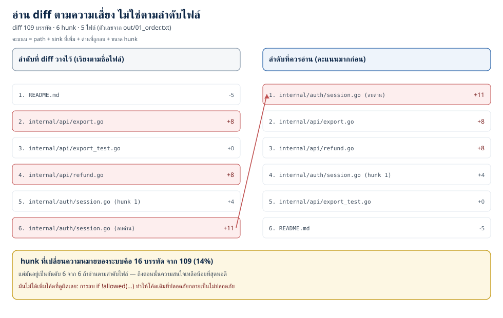
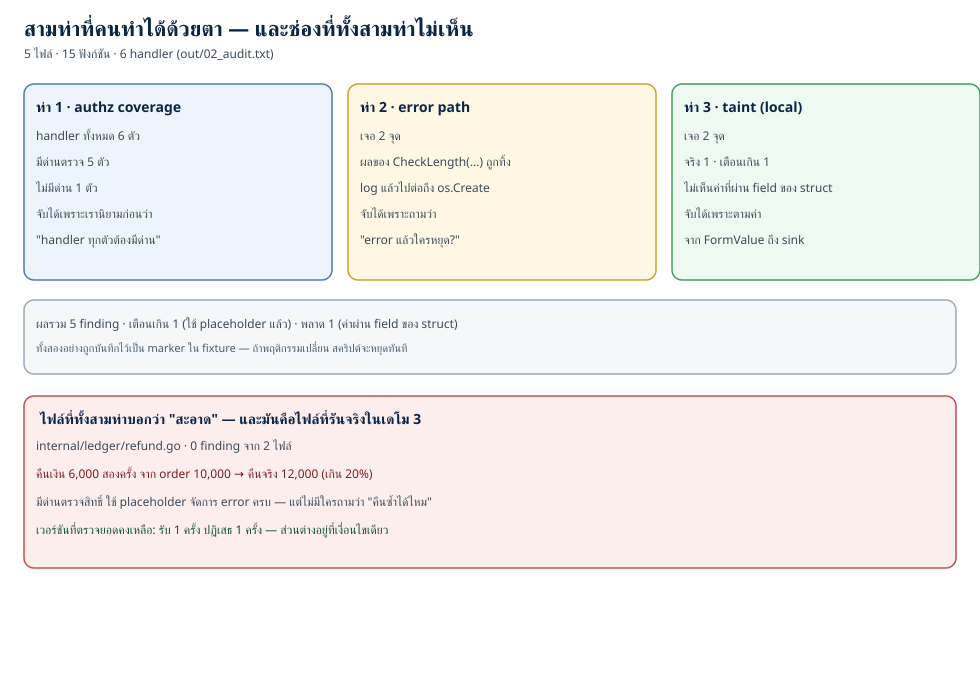
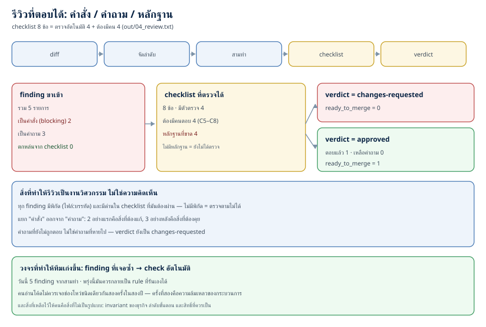

# Secure code review: อ่านโค้ดหาช่องโหว่ที่เครื่องมือมองไม่เห็น (ตอนที่ 26)

> 📅 เขียนเมื่อ: 4 พฤศจิกายน 2026 (เวลาไทย, UTC+7) · รันบน Raspberry Pi 5 (`Linux 6.18.39+rpi-2712 aarch64`, 4 คอร์) ด้วย `go1.24.4 linux/arm64` · Python 3.13.5 · rsvg-convert 2.60.0 · GNU diffutils 3.10 — standard library ล้วน ไม่มี dependency ภายนอก (`external_deps=0`) ไม่เปิดพอร์ต (`listen_calls=0`) ไม่แตะเครือข่าย (`network_dial_calls=0`) ไม่มีเวลาลงในผลลัพธ์ (`time_now_calls=0`) · รายละเอียดเวอร์ชันและขอบเขตอยู่ที่หัวข้อ 3.9
>
> ⚠️ **หมายเหตุเรื่องจริยธรรม:** โค้ดใน `testdata/service/` และ `internal/ledger/refund.go` เป็น **โค้ดช่องโหว่ที่โชว์เพื่อสอน — ห้ามใช้จริง** และไฟล์ที่มีช่องโหว่ทุกไฟล์ติดป้าย "ห้ามใช้จริง" ไว้ที่หัวไฟล์ ผมเขียนมันขึ้นมาเพื่อให้ถูกอ่านและถูกจับ ไม่ได้ออกแบบให้ใช้งาน · การนำเทคนิคในบทนี้ไปตรวจระบบที่คุณไม่ได้เป็นเจ้าของหรือไม่ได้รับอนุญาตเป็นการละเมิดกฎหมาย — การรีวิวทำได้เฉพาะโค้ดที่คุณมีสิทธิ์อ่านหรือได้รับมอบหมาย

---

ตอนที่ 25 ผมปิดท้ายด้วยตัวเลขที่ค้างคา: เรารันเครื่องมือตรวจสามตระกูล (SAST, DAST, SCA) กับช่องโหว่ที่จงใจฝังไว้ 8 ข้อ แล้วเครื่องมือเห็น 7 — ข้อที่ 8 คือ route ที่ไม่ตรวจสิทธิ์ และไม่มีเครื่องมือไหนเห็นมันเลย ผมเขียนไว้สั้น ๆ ว่า "แล้วใครจะเห็น" คำตอบคือคน แต่ประโยคนั้นยังไม่ใช่คำแนะนำอะไรที่ทำตามได้

คืนนี้เราจะทำให้มันเป็นวิธีทำ

คำถามที่ต้องตอบให้ชัดก่อนคือ **"secure code review ต่างจาก code review ธรรมดาตรงไหน"** — เพราะทีมส่วนใหญ่มี code review อยู่แล้ว มีคนกด approve มีคนคอมเมนต์เรื่องชื่อตัวแปรและเรื่อง tab กับ space ถ้าการรีวิวคือคำตอบของ security ระบบส่วนใหญ่ก็ควรปลอดภัยแล้ว ซึ่งไม่จริง

คำตอบที่ผมจะใช้ตลอดบทนี้คือ: **code review ธรรมดาถามว่า "โค้ดนี้ดีไหม" — secure code review ถามว่า "โค้ดนี้โกหกใครได้บ้าง"** คำถามที่สองต้องมีสมมติฐานว่าผู้เขียน (ซึ่งอาจเป็นตัวเราเองเมื่อสามเดือนก่อน) พลาดในจุดที่เรามองไม่เห็น และต้องมี **invariant** (เงื่อนไขที่ระบบสัญญาว่าจะรักษาเสมอ เช่น "ยอดคืนรวมต้องไม่เกินยอดสั่งซื้อ") อยู่ในหัวก่อนเริ่มอ่าน

ตัวเลขห้าชุดที่ผมจะใช้ตลอดบท (ทั้งหมดมาจาก `out/`):

- **เดโม 1 — จัดลำดับการอ่าน** · diff 109 บรรทัด 6 hunk (hunk = กลุ่มการเปลี่ยนแปลงหนึ่งกลุ่มใน diff) จาก 5 ไฟล์ · hunk ที่อันตรายที่สุดคือ 16 บรรทัด (14% ของจำนวนบรรทัดทั้ง diff) และมันอยู่ **อันดับ 6 จาก 6** ถ้าอ่านตามลำดับไฟล์ · คะแนน 11 มาจาก path ของไฟล์ (+4) บวกกับ **ด่านตรวจที่ถูกลบ** (ด่าน = การตรวจสิทธิ์หรือเงื่อนไขที่กันไว้; +7) — ไม่มี sink (จุดปลายทางที่ข้อมูลอันตรายไหลถึง) ใหม่เลยใน hunk นั้น
- **เดโม 2 — สามท่าที่คนทำได้ด้วยตา** · สแกน 5 ไฟล์ 15 ฟังก์ชัน 6 handler · ท่า authz เจอ 1 (จาก 6 handler ที่มีด่าน 5) · ท่า error path เจอ 2 · ท่า taint เจอ 2 · รวม 5 finding แต่ **เตือนเกิน 1** และ **พลาด 1** โดยที่ทั้งคู่ถูกบันทึกไว้เป็น marker (ป้ายในหัวไฟล์ตัวอย่างที่ระบุว่าผลลัพธ์นี้คือสิ่งที่คาดไว้ — ถ้าผลเปลี่ยน สคริปต์จะหยุด)
- **เดโม 3 — ช่องโหว่เชิงตรรกะ** · ไฟล์เดียวกับที่รันจริงได้ **0 finding** จากทั้งสามท่า · แต่คืนเงิน 6,000 สองครั้งจาก order 10,000 = คืนจริง 12,000 (เกิน 20%) · เวอร์ชันที่ตรวจยอดคงเหลือรับ 1 ครั้งและปฏิเสธ 1 ครั้ง
- **เดโม 4 — รีวิวที่ตอบได้** · checklist 8 ข้อ = ตรวจอัตโนมัติ 4 + ต้องมีคน 4 · finding 5 รายการแยกเป็นคำสั่ง 2 คำถาม 3 · หลักฐานที่ขาด 4 · คำตัดสิน (verdict) `changes-requested`, `ready_to_merge=0` · รอบที่สอง `approved`, `ready_to_merge=1`
- **เดโม 5 — ตัวตรวจของ repo** · 23 ไฟล์ Go · `gofmt` 0 · `go vet` ผ่าน · `go test` ผ่าน · 3 ท่า · checklist 8 ข้อ · 12 `func Test` (10 ตัวรันจริง อีก 2 อยู่ใน diff fixture — ไฟล์ตัวอย่างที่เตรียมไว้ให้เครื่องมืออ่าน)

## 1. แนวคิด: การอ่านคือเครื่องมือ ไม่ใช่พิธีกรรม

### 1.1 สองคำที่ต้องแยกก่อน: defect กับ vulnerability

**defect** คือโค้ดที่ทำงานไม่ตรงกับที่คิดไว้ · **vulnerability** คือ defect ที่มีคนอื่นได้ประโยชน์จากมัน คำสองคำนี้ทับกันบ่อยจนคนใช้สลับ แต่ผลต่างกันมาก: defect ทุกตัวควรถูกแก้ ส่วน vulnerability ทุกตัว **ต้องถูกแก้ก่อน merge** เพราะเมื่อมันออกไปถึงผู้ใช้แล้ว การแก้ต้องผ่านกระบวนการเปิดเผยช่องโหว่ (disclose), patch, แจ้งลูกค้า และบางครั้งก็สายไปแล้ว

การรีวิวแบบปกติจับ defect ได้ในระดับหนึ่ง (โดยเฉพาะ defect ที่ทำให้ test แดง) แต่ vulnerability ส่วนใหญ่ **ไม่ทำให้ test แดง** เพราะ test ที่เราเขียนตรวจพฤติกรรมที่เราคิดถึง และช่องโหว่คือพฤติกรรมที่เราไม่ได้คิดถึง นี่คือเหตุผลที่ "test ผ่านหมด" กับการ "ปลอดภัย" เป็นคนละประโยค และเป็นเหตุผลที่ต้องมีคนอ่าน

### 1.2 งานสามชั้น (และชั้นที่เครื่องมือทำได้)

secure code review ที่ทำได้จริงในทีมขนาดเล็กมีสามชั้น และสองชั้นแรกควรจบลงด้วยการ **เขียนเป็นโค้ด**:

1. **นิยาม invariant** — ระบบนี้สัญญาอะไรบ้าง: handler ทุกตัวต้องตรวจสิทธิ์ · อินพุตจาก request ต้องผ่าน sanitizer (ฟังก์ชันที่ทำให้ค่าสะอาด — รายละเอียดที่ 3.5) ที่เหมาะกับ sink · error ต้องหยุดงาน · ยอดคืนรวมต้องไม่เกินยอดสั่งซื้อ
2. **แปลง invariant ที่มีรูปแบบให้เป็น check อัตโนมัติ** — invariant อย่าง "handler ทุกตัวต้องมีด่าน" เป็นรูปแบบที่ตรวจได้ด้วย AST (Abstract Syntax Tree — โครงสร้างต้นไม้ของโค้ด ที่บอกว่าอะไรคือการเรียกฟังก์ชันและใครเป็น argument) เมื่อแปลงได้แล้วมันจะรันทุก commit และไม่มีวันลืม
3. **อ่านส่วนที่เหลือด้วยตา** — ส่วนที่เหลือคือส่วนที่ไม่มีรูปแบบ: ลำดับขั้นตอน, สิทธิ์ที่ *ควร* เป็น, การเรียกซ้ำแบบ recursion, ผลข้างเคียง, และความหมายของตัวเลขทางธุรกิจ

ชั้นที่ 2 คือส่วนที่คนมักข้าม และมันคือส่วนที่ทำให้อาชีพนี้ต่างจาก "คนที่อ่านเก่ง" — **finding ที่เจอซ้ำ ๆ ต้องกลายเป็น check ไม่ใช่ความทรงจำของคนคนหนึ่ง** ถ้าปีนี้คุณเจอ "handler ไม่มี authz" สองครั้ง แล้วปีหน้ามันเกิดอีก นั่นไม่ใช่ความผิดของคนเขียนคนใหม่ นั่นคือความล้มเหลวของกระบวนการ

### 1.3 จัดสรรความสนใจ: อ่าน diff ตามความเสี่ยง ไม่ใช่ตามลำดับไฟล์

**diff** คือชุดความเปลี่ยนแปลงที่เครื่องมือ version control สร้างให้ (git เรียกมันว่า patch) และ **hunk** คือกลุ่มการเปลี่ยนแปลงหนึ่งกลุ่มที่ขึ้นต้นด้วยบรรทัด `@@ -10,15 +10,12 @@` — ตัวเลขบอกว่าไฟล์เดิมเริ่มที่บรรทัดไหนกี่บรรทัด และไฟล์ใหม่เริ่มที่ไหนกี่บรรทัด

คนส่วนใหญ่อ่าน diff จากบนลงล่างตามลำดับที่เครื่องมือเรียงให้ ซึ่งปกติเรียงตามชื่อไฟล์ตามตัวอักษร นั่นหมายความว่า **ลำดับการอ่านของคุณถูกตัดสินโดยตัวอักษรตัวแรกของชื่อไฟล์** ไม่ใช่โดยความเสี่ยง

และความสนใจของคนไม่ใช่ของไม่จำกัด: การอ่าน 400 บรรทัดแล้วยังจับรายละเอียดได้เหมือนบรรทัดแรกนั้นไม่มีจริง ในเดโม 1 ผมจึงเขียนเครื่องมือที่ให้คะแนนแต่ละ hunk จากสัญญาณชัด ๆ สี่อย่าง:

- **sink ที่ถูกเพิ่ม** — sink คือจุดปลายทางที่ถ้าข้อมูลอันตรายไหลถึงแล้วจบเห่ (`db.Query`, `exec.Command`, `os.Open`, `http.Redirect`) การเพิ่ม sink ใหม่ = พื้นที่ใหม่ที่ต้องตรวจ
- **ด่านที่ถูกลบ** — ด่านคือการตรวจ (`RequireRole`, `allowed`, `if err != nil`, `validate`, `escape`) นี่คือสัญญาณที่หนักที่สุดของทั้งสี่ข้อ เพราะ **การลบด่านไม่ได้เพิ่มโค้ดที่ดูผิดเลย** มันทำให้โค้ดเดิมที่เคยปลอดภัยกลายเป็นไม่ปลอดภัย และ diff ไม่มีสีบอกว่า "บรรทัดที่หายไปคือเกราะ"
- **path ของไฟล์** — ไฟล์ใน `auth/`, `crypto/`, `tls/` มีน้ำหนักมากกว่าไฟล์เทสต์หรือ README
- **ขนาด hunk** — hunk ใหญ่มีโอกาสซ่อนอะไรได้มากกว่า

### 1.4 สิ่งที่ตาเห็นและเครื่องมือไม่เห็น: ตรรกะทางธุรกิจ

ศัพท์ที่ต้องรู้จักตรงนี้คือ **business logic error** (ข้อผิดพลาดเชิงตรรกะทางธุรกิจ) ใน CWE (Common Weakness Enumeration — บัญชี weakness มาตรฐานที่ตอนที่ 16 สอนอ่าน) หมวดที่คนมักอ้างถึงคือ **grouping CWE-840: Business Logic Errors** — ชื่อปัจจุบันใน CWE 5.0 คือ *CWE Grouping: Business Logic Errors* และมันเป็น **grouping** คือกลุ่มที่รวบ weakness ที่อยู่ในเรื่องเดียวกันไว้ด้วยกัน ไม่ใช่ weakness เดี่ยว · CWE ระบุว่าการ map ช่องโหว่จริงลง grouping แบบนี้เป็นสิ่งที่ **ห้ามทำ (PROHIBITED)** เพราะกว้างเกินกว่าจะบอกว่าโค้ดผิดตรงไหน — finding แต่ละตัวจึงต้องลงที่ member ของกลุ่ม เช่น **CWE-837** (Improper Enforcement of a Single, Unique Action — ตรงกับ "คืนเงินซ้ำ" ในเดโม 3) หรือ **CWE-841** (Improper Enforcement of Behavioral Workflow — ตรงกับ "ข้ามลำดับขั้น") และนิยามของกลุ่มนี้อธิบายปัญหาทั้งบทไว้แล้วว่า *"difficult to find automatically, since they typically involve legitimate use of the application's functionality"* — หาเองได้ยากเพราะมันใช้ฟังก์ชันของแอปตามปกติ ไม่มีอะไร "ผิดรูปแบบ"

ตัวอย่างที่เจอบ่อยในงานจริงมีสี่แบบ:

1. **เรียกซ้ำแล้วผลไม่เท่าเดิม (ขาด idempotency)** — request เดียวกันมาสองครั้ง ระบบทำงานสองครั้ง (คืนเงินซ้ำ, สร้าง order ซ้ำ, ใช้คูปองซ้ำ) ทั้งที่ idempotency คือสมบัติที่ว่าทำซ้ำแล้วผลลัพธ์ต้องเท่าเดิม
2. **การแข่งกันระหว่างตรวจกับใช้ (TOCTOU)** — Time-of-check to time-of-use คือช่องว่างระหว่าง "ตอนตรวจว่ายังทำได้" กับ "ตอนลงมือทำ": ตรวจแล้วว่ายอดพอ แล้วอีก request ก็ใช้ยอดเดียวกันไปก่อน (CWE-367)
3. **ลำดับขั้นตอน** — ระบบยอมให้ข้ามขั้น (อนุมัติก่อนจ่าย, คืนของก่อนได้รับสินค้า)
4. **เพดานที่ไม่เคยถูกบังคับ** — ระบบมีฟิลด์ `limit` แต่ไม่มีที่ไหนบังคับใช้มัน

ทั้งสี่แบบนี้มีสมบัติร่วมกันข้อหนึ่ง: **มันไม่ผิดไวยากรณ์ ไม่ผิด type ไม่ผิด test เดิม และไม่มีรูปแบบให้ grep** สิ่งเดียวที่จับได้คือคนที่รู้ว่าธุรกิจนี้สัญญาอะไรไว้ แล้วถามว่า "แล้วถ้าทำสองครั้งล่ะ"

### 1.5 คำสั่ง คำถาม และหลักฐาน

การรีวิวที่แย่ที่สุดไม่ใช่การรีวิวที่พลาดช่องโหว่ — คือการรีวิวที่ทำให้คนอื่นเลิกอ่านรีวิว เพราะทุกคอมเมนต์เป็นคำสั่งเสียงแข็งในเรื่องที่ผู้รีวิวเองก็ไม่แน่ใจ

ผมจึงแยกผลลัพธ์ของการรีวิวเป็นสามชนิด และให้แต่ละชนิดมีที่ทางของมัน:

- **คำสั่ง (blocking)** — "ต้องแก้ก่อน merge" ใช้เมื่อเราพิสูจน์ได้: มีด่านหายไปจริง, ค่าจาก request ถึง sink จริง อันนี้ต้องมีหลักฐานกำกับ (ไฟล์:บรรทัด)
- **คำถาม (question)** — "ทำไมที่นี่ถึงปลอดภัย" ใช้เมื่อ finding ต้องอาศัยบริบทที่เราไม่มี: ทำไมใช้ `os.Create` ที่ path คงที่, ทำไม `QueryRow` ที่มี placeholder ถึงถูกเตือน, ทำไมการ log แล้วไปต่อถึงเป็นเจตนา **คำถามไม่ใช่คำสั่ง และมันไม่ใช่การปล่อยผ่าน** — คำถามที่ยังไม่ถูกตอบทำให้ verdict ยังเป็น `changes-requested`
- **หลักฐาน (evidence)** — สำหรับข้อที่เครื่องมือตรวจไม่ได้ ต้องมีคนเขียนว่า "ตรวจอะไร เห็นอะไร" ถ้าไม่มีหลักฐาน ให้ถือว่ายังไม่ได้ตรวจ

ข้อสุดท้ายฟังดูเป็นพิธีกรรม แต่ในเดโม 4 มันคือความต่างระหว่าง "รีวิวแล้ว" กับ "มีคนเซ็นว่ารีวิวแล้ว" และ checklist ที่ไม่มีหลักฐานก็คือ checklist ที่ไม่มีใครใช้

## 2. ทำไมเรื่องนี้สำคัญ: ช่องโหว่ที่แพงที่สุดไม่เคยเป็นแบบที่ grep เจอ

### 2.1 goto fail (2014): สองบรรทัดที่ไม่มีใครอ่าน

กุมภาพันธ์ 2014 Apple ออก iOS 7.0.6 เพื่อแก้ช่องโหว่ที่ภายหลังได้หมายเลข **CVE-2014-1266** — ช่องโหว่ในฟังก์ชัน `SSLVerifySignedServerKeyExchange` ใน `libsecurity_ssl/lib/sslKeyExchange.c` ของ Secure Transport ซึ่งเป็นไลบรารี TLS ของ Apple เอง

สาเหตุคือบรรทัดเดียว:

```text
if ((err = SSLHashSHA1.update(&hashCtx, &signedParams)) != 0)
    goto fail;
    goto fail;
if ((err = SSLHashSHA1.final(&hashCtx, &hashOut)) != 0)
    goto fail;
err = sslRawVerify(...);
```

ในภาษา C ตัว `if` ที่ไม่มีปีกกา (`{ }`) จะครอบเพียงคำสั่งถัดไปหนึ่งคำสั่งเท่านั้น บรรทัด `goto fail;` บรรทัดแรกจึงอยู่ใต้ `if` ส่วนบรรทัดที่สอง **ถูกทำงานเสมอ** ไม่ว่าจะมี error หรือไม่ ผลคือฟังก์ชันกระโดดออกไปก่อนถึงบรรทัด `sslRawVerify` — ขั้นตอนสุดท้ายที่ตรวจลายเซ็นของ server ไม่เคยถูกเรียก และฟังก์ชันคืนค่าที่หมายถึง "สำเร็จ"

ผลลัพธ์คือการโจมตีแบบ **man-in-the-middle** (คนกลางแทรกตัวเองระหว่างคุณกับ server) ทำได้ทุกที่ที่อุปกรณ์นั้นต่อ TLS: ผู้โจมตีใช้ private key อะไรก็ได้ หรือไม่ลงนามเลยก็ได้ และอุปกรณ์ก็ยังบอกว่าการเชื่อมต่อปลอดภัย ช่องโหว่นี้อยู่ในโค้ดตั้งแต่ iOS 6.0 (กันยายน 2012) จนถึงวันที่แพตช์

อ่านให้ตรง: นี่ไม่ใช่บั๊กที่ต้องใช้เครื่องมือพิเศษจับ ไม่มี memory corruption ไม่มี buffer overflow ไม่มี pattern ที่ SAST รู้จัก มันคือ **บรรทัดที่ซ้ำเกินมาหนึ่งบรรทัด** — และคนที่อ่านโค้ดส่วนนั้นด้วยคำถามว่า "ทำไมมี goto fail สองอันติดกัน" จะเห็นมันในห้าวินาที

ยังมีรายละเอียดที่เกี่ยวกับบทนี้อีกข้อ: บล็อก ReadyHash → update สามครั้ง → final ถูกคัดลอกซ้ำสองรอบในฟังก์ชันเดียว (MD5 ในสาขาของ `isRsa` กับ SHA1 ที่ใช้ร่วมกัน) และทั้งไฟล์เรียก `ReadyHash(` ถึงหกครั้ง — การคัดลอกคือที่ที่คนอ่านเร็วที่สุด เพราะสมองบอกว่า "เห็นแล้ว อันนี้เหมือนอันบน" — **โค้ดที่ซ้ำกันคือบริเวณที่การรีวิวเสื่อมคุณภาพมากที่สุด** และมันก็เป็นบริเวณที่บั๊กแบบนี้เกิดขึ้นบ่อยที่สุดด้วย

### 2.2 ทำไม diff ใหญ่ทำให้การรีวิวเสื่อม

Google เขียนไว้ในคู่มือ engineering practices ของตัวเองตรง ๆ ว่าไม่มีกฎตายตัวว่าอะไร "ใหญ่เกินไป" แต่ **100 บรรทัดเป็นขนาดที่สมเหตุสมผล และ 1,000 บรรทัดมักใหญ่เกินไป** เหตุผลไม่ใช่เรื่องวัฒนธรรม แต่เป็นเรื่องของความสนใจ: ยิ่ง diff ยาว คนอ่านยิ่งอ่านเร็วขึ้นเรื่อย ๆ จนถึงจุดที่อ่านเพื่อ "ผ่านให้จบ" ไม่ใช่เพื่อหา

ในเดโม 1 diff ของเรามีแค่ **109 บรรทัด** ซึ่งอยู่ในช่วงที่ Google บอกว่าสมเหตุสมผล — และถึงอย่างนั้น hunk ที่อันตรายที่สุดยังอยู่ท้ายสุดของลำดับไฟล์ ถ้า diff ของคุณคือ 900 บรรทัด ปัญหานี้ไม่ได้บวกกันเป็นเส้นตรง มันคูณกัน

### 2.3 บทเรียนร่วม

ทั้งสองเรื่องไม่ได้พังเพราะคนไม่เก่ง ทั้งคู่พังเพราะ **ความสนใจถูกจัดสรรผิดที่** — goto fail ถูกอ่านในฐานะ "โค้ดซ้ำที่เคยเห็น" และ diff ใหญ่ถูกอ่านในฐานะ "งานที่ต้องผ่านให้จบ"

การจัดลำดับความเสี่ยง (หัวข้อ 1.3) แก้ปัญหาแรก ส่วนการทำ invariant ให้เป็น check (หัวข้อ 1.2) แก้ปัญหาที่สองในระยะยาว และการแยกคำสั่งออกจากคำถาม (หัวข้อ 1.5) ทำให้ทั้งสองอย่างไม่กลายเป็น noise ที่คนเลิกอ่าน

## 3. ลงมือทำ: ห้าเดโมที่วัดได้

### 3.0 โครงของ repo

```text
code/ep26/
├── go.mod                 module ep26 · go 1.24 · ไม่มี require
├── internal/
│   ├── diff/diff.go       parse unified diff + ให้คะแนน hunk (เดโม 1)
│   ├── review/review.go   สามท่าบน go/ast: authz, error path, taint (เดโม 2)
│   ├── ledger/refund.go   ตรรกะคืนเงินที่รันจริงและมีช่องโหว่เชิงตรรกะ (เดโม 3)
│   └── checklist/         checklist ที่ตรวจได้ + verdict (เดโม 4)
├── cmd/{order,audit,blindspot,review}/main.go
├── testdata/service/          3 ไฟล์ตัวอย่าง (ช่องโหว่ 2 + false positive 1) — ห้ามใช้จริง
├── testdata/service_fixed/    3 ไฟล์ที่แก้แล้ว
├── testdata/pr_before|pr_after/  ต้นทางของ diff ที่ใช้ในเดโม 1
├── out/                   ผลรันจริงทุกไฟล์
└── run_all.sh             รันทุกอย่างใหม่ได้จาก repo เปล่า
```

`testdata/` คือที่ที่ Go tool ไม่สนใจตอน build — เราเก็บโค้ดที่มีช่องโหว่ไว้ที่นั่นได้โดยไม่ทำให้ `go build ./...` พัง ไฟล์ทั้งสามใน `testdata/service/` เป็น **ไฟล์ตัวอย่างสำหรับสอน — ห้ามใช้จริง** แต่ไม่ได้มีช่องโหว่ทั้งสามไฟล์: `handlers.go` กับ `transfer.go` มีช่องโหว่ที่จงใจฝังไว้ ส่วน `refund_param.go` ปลอดภัยโดยตั้งใจ — มันอยู่ในชุดนี้เพื่อให้ตัวสแกนเตือนเกิน และให้เราเห็นว่า false positive หน้าตาเป็นอย่างไร · ตัวสแกนอ่านมันด้วย `go/parser` แบบเดียวกับที่อ่านโค้ดจริง

```go
module ep26

go 1.24
```

(บล็อกข้างบนคือ `go.mod` ทั้งไฟล์)

ไม่มี `require` เลย (`external_deps=0`) — บทนี้อยากให้เห็นทุกขั้นของกลไก ไม่ใช่ให้เห็นว่า "เรียกคำสั่งนี้แล้วมันก็บอก"

diff ที่ใช้ในเดโม 1 ไม่ได้พิมพ์มือ — `run_all.sh` สร้างมันจากสองโฟลเดอร์ (`pr_before/` กับ `pr_after/`) ด้วย `diff -u --label a/... --label b/...` ตัวเลือก `--label` ตัด timestamp ออก จึงได้ไฟล์เดิมทุกครั้งที่รัน และจำนวนบรรทัดในหัว `@@` จึงถูกต้องเสมอเพราะเครื่องเป็นคนนับ (มี test ที่ตรวจซ้ำอีกชั้น)

### 3.1 อ่าน diff เป็นโครงสร้าง

หัวใจของเดโม 1 คือการแยก "บรรทัดที่เพิ่ม" กับ "บรรทัดที่ลบ" ออกจากกัน เพราะสัญญาณที่สำคัญที่สุด — ด่านที่หายไป — อยู่ในบรรทัดที่ลบ ซึ่งคนอ่านมักข้ามเพราะมันไม่มีอะไรให้อ่าน

```go
func Parse(text string) (Result, error) {
	var res Result
	var cur string
	var h *Hunk

	flush := func() {
		if h != nil {
			res.Hunks = append(res.Hunks, *h)
			h = nil
		}
	}

	for i, ln := range strings.Split(text, "\n") {
		switch {
		case strings.HasPrefix(ln, "+++ b/"):
			cur = strings.TrimPrefix(ln, "+++ b/")
			if !contains(res.Files, cur) {
				res.Files = append(res.Files, cur)
			}
		case strings.HasPrefix(ln, "--- "), strings.HasPrefix(ln, "diff --git"),
			strings.HasPrefix(ln, "index "):
			// metadata ของ diff — ไม่ใช่เนื้อหาที่ต้องอ่าน
		case strings.HasPrefix(ln, "@@"):
			flush()
			if cur == "" {
				return res, fmt.Errorf("บรรทัด %d: hunk มาก่อนบรรทัดที่บอกชื่อไฟล์", i+1)
			}
			h = &Hunk{File: cur, Header: ln}
		case strings.HasPrefix(ln, "+"):
			if h == nil {
				return res, fmt.Errorf("บรรทัด %d: บรรทัดที่เพิ่มอยู่นอก hunk", i+1)
			}
			h.Lines = append(h.Lines, Line{Kind: '+', Text: ln[1:]})
			res.Added++
		case strings.HasPrefix(ln, "-"):
			if h == nil {
				return res, fmt.Errorf("บรรทัด %d: บรรทัดที่ลบอยู่นอก hunk", i+1)
			}
			h.Lines = append(h.Lines, Line{Kind: '-', Text: ln[1:]})
			res.Removed++
		case strings.HasPrefix(ln, " "):
			if h != nil {
				h.Lines = append(h.Lines, Line{Kind: ' ', Text: ln[1:]})
			}
		}
	}
	flush()
	if len(res.Hunks) == 0 {
		return res, fmt.Errorf("ไม่พบ hunk ใน diff")
	}
	return res, nil
}
```

จุดที่ต้องระวังมีสองจุด และทั้งคู่เป็นสิ่งที่ diff parser ทุกตัวต้องจัดการ: บรรทัด `+++ b/path` ขึ้นต้นด้วย `+` และ `--- a/path` ขึ้นต้นด้วย `-` — ถ้าเช็ค `+`/`-` ก่อนจะนับหัวไฟล์เป็นเนื้อหา และบรรทัดที่เป็นบริบท (ขึ้นต้นด้วยช่องว่าง) ไม่ใช่ทั้งการเพิ่มและการลบ จึงไม่ถูกนับในตัวเลขใด ๆ

ส่วนการให้คะแนนคือที่ที่ความเห็นของคนกลายเป็นตัวเลขที่เถียงได้:

```go
func Score(h *Hunk) {
	h.Score = 0
	h.Reasons = nil

	for _, p := range pathSignals {
		if strings.Contains(h.File, p.sub) {
			h.Score += p.w
			h.Reasons = append(h.Reasons, fmt.Sprintf("path %s (%+d: %s)", p.sub, p.w, p.why))
		}
	}
	for _, s := range sinkSignals {
		if n := count(h.Added(), s.re); n > 0 {
			h.Score += s.weight * n
			h.Reasons = append(h.Reasons, fmt.Sprintf("เพิ่ม %s ×%d (+%d)",
				s.name, n, s.weight*n))
		}
	}
	for _, s := range guardSignals {
		if n := count(h.Removed(), s.re); n > 0 {
			h.Score += s.weight * n
			h.Reasons = append(h.Reasons, fmt.Sprintf("ลบด่าน %s ×%d (+%d)",
				s.name, n, s.weight*n))
		}
	}
	if n := len(h.Added()); n >= 20 {
		h.Score += 2
		h.Reasons = append(h.Reasons, fmt.Sprintf("hunk ใหญ่ %d บรรทัด (+2)", n))
	}
}
```

สองอย่างที่ผมอยากให้สังเกต: ทุกคะแนนมี **เหตุผล** กำกับ (เพราะคนอ่านต้องเถียงกับตัวเลขได้ ถ้าเถียงไม่ได้มันก็คือกล่องดำอีกลูก) และน้ำหนักของ "ลบด่าน" คือ 7 ซึ่งมากกว่าน้ำหนักของ sink ใด ๆ — นั่นคือการตัดสินใจเชิงบรรณาธิการ ไม่ใช่คณิตศาสตร์ ผมเลือกแบบนั้นเพราะในประสบการณ์ของผม ช่องโหว่ที่ถูกพาเข้ามาใน PR มักไม่ได้เกิดจากบรรทัดใหม่ที่ผิด แต่เกิดจากบรรทัดเก่าที่ถูกลบ

### 3.2 เดโม 1: hunk ที่สำคัญที่สุดอยู่ท้ายสุด

```
=== เดโม 1: จัดลำดับการอ่าน diff ตามความเสี่ยง ===
diff_files=5
hunks=6
lines_added=87
lines_removed=5
lines_in_diff=109
high_risk_hunks=3
top_hunk_file=internal/auth/session.go
top_hunk_score=11
top_hunk_lines=16
top_hunk_share_pct=14
top_hunk_position_in_file_order=6
--- ลำดับที่ควรอ่าน (คะแนนมากก่อน) ---
1. score=11 internal/auth/session.go @@ -10,15 +10,12 @@ (16 บรรทัด)
   path /auth (+4: ไฟล์เกี่ยวกับสิทธิ์) · ลบด่าน allowed( ×1 (+7)
2. score=8 internal/api/export.go @@ -0,0 +1,22 @@ (22 บรรทัด)
   path /api (+2: ชั้น API) · เพิ่ม os.Open( ×1 (+4) · hunk ใหญ่ 22 บรรทัด (+2)
3. score=8 internal/api/refund.go @@ -0,0 +1,25 @@ (25 บรรทัด)
   path /api (+2: ชั้น API) · เพิ่ม db.Query( ×1 (+4) · hunk ใหญ่ 25 บรรทัด (+2)
4. score=4 internal/auth/session.go @@ -2,7 +2,7 @@ (8 บรรทัด)
   path /auth (+4: ไฟล์เกี่ยวกับสิทธิ์)
5. score=0 internal/api/export_test.go @@ -0,0 +1,25 @@ (25 บรรทัด)
   path /api (+2: ชั้น API) · path _test (-4: เทสต์ (อ่านเร็วได้)) · hunk ใหญ่ 25 บรรทัด (+2)
6. score=-5 README.md @@ -0,0 +1,13 @@ (13 บรรทัด)
   path README (-5: เอกสาร (ไม่ใช่โค้ดที่รัน))
--- สรุปสัญญาณ ---
hunks_removing_a_guard=1
hunks_adding_a_sink=2
อ่านจากสัญญาณ ไม่ใช่จากชื่อไฟล์: hunk ที่ลบด่านไม่ได้เพิ่มโค้ดที่ดูผิดเลย
มันทำให้โค้ดเดิมที่เคยปลอดภัยกลายเป็นไม่ปลอดภัย — และนั่นคือสิ่งที่ diff ไม่มีสีบอก
```

อ่านผลลัพธ์ทีละส่วน: `hunks=6` ใน 5 ไฟล์ และ `lines_in_diff=109` คือจำนวนบรรทัดทั้งหมดที่อยู่ใน hunk (เพิ่ม 87 ลบ 5 ที่เหลือเป็นบริบท) · `top_hunk_lines=16` และ `top_hunk_share_pct=14` คือจำนวนบรรทัดของ hunk ที่อันตรายที่สุด และสัดส่วนจำนวนบรรทัดของ hunk นั้นต่อทั้ง diff · `top_hunk_position_in_file_order=6` คือตำแหน่งของมันในลำดับที่ diff วางไว้

ตัวเลขคู่นี้คือข้อความทั้งหมดของเดโม: **บรรทัด 14% ของ diff อยู่ใน hunk ที่เปลี่ยนความหมายของระบบ — และมันอยู่ท้ายสุดของลำดับที่คุณจะอ่าน**

`sink` ที่ถูกเพิ่มมีสองที่ (`os.Open` ใน handler ที่ส่งออกไฟล์ และ `db.Query` ใน handler คืนเงิน) และทั้งคู่เป็นของใหม่ที่ต้องอ่าน — แต่ไม่มีอันไหนสำคัญเท่า hunk ที่ลบ `if !allowed(...)` ออกจาก middleware ของ session เพราะสองอันแรกคือ "โค้ดใหม่ที่อาจจะผิด" ส่วนอันหลังคือ "โค้ดเก่าที่เคยป้องกันคุณอยู่ และตอนนี้ไม่ป้องกันแล้ว"



*ภาพที่ 1 — ลำดับไฟล์กับลำดับความเสี่ยงไม่เหมือนกัน · ตัวเลขบนภาพมาจาก `out/01_order.txt` ทั้งหมด*

### 3.3 ท่าที่หนึ่ง: ทุก handler ต้องมีด่าน

จากเดโม 1 ที่วัดลำดับการอ่าน ต่อไปคือเดโม 2: สามท่าที่คนทำได้ด้วยตา (ผลรวมทั้งสามท่าอยู่ที่ 3.6) — ท่าแรกตอบคำถามว่า handler ทุกตัวมีด่านจริงไหม

นี่คือท่าที่ SAST ทำไม่ได้ และเป็นข้อที่ 8 ที่ค้างจากตอนที่ 25 — เพราะ "handler ทุกตัวต้องตรวจสิทธิ์" ไม่ใช่รูปแบบของโค้ด มันเป็น invariant ของ **สถาปัตยกรรม** ที่คนออกแบบระบบเป็นคนนิยาม

เมื่อนิยามแล้ว มันก็ตรวจได้ด้วย AST อย่างง่ายดาย เริ่มจากฟังก์ชันที่ตอบว่า "ฟังก์ชันนี้เป็น handler ไหม" — ซึ่งในที่นี้หมายถึงรับ `*http.Request` เป็นพารามิเตอร์:

```go
func isHandler(fd *ast.FuncDecl) bool {
	if fd.Type.Params == nil {
		return false
	}
	for _, p := range fd.Type.Params.List {
		if isHTTPRequest(p.Type) {
			return true
		}
	}
	return false
}
```

จากนั้นคือส่วนที่ตอบคำถามจริง ๆ ว่า "ในฟังก์ชันนี้ มีการเรียกด่านที่ไหนหรือไม่":

```go
func hasGuard(body *ast.BlockStmt) bool {
	found := false
	ast.Inspect(body, func(n ast.Node) bool {
		if found {
			return false
		}
		call, ok := n.(*ast.CallExpr)
		if !ok {
			return true
		}
		if guardFuncs[calleeName(call)] {
			found = true
			return false
		}
		return true
	})
	return found
}
```

`ast.Inspect` เดินทั้งต้นไม้ของ function body — ไม่สนใจว่า guard อยู่บรรทัดแรกหรืออยู่ใน `if` ซ้อนห้าชั้น คำถามเดียวคือ "มีที่ไหนในฟังก์ชันนี้ที่เรียกฟังก์ชันซึ่งอยู่ในรายการด่านไหม"

และนี่คือข้อจำกัดที่ต้องพูดให้ชัด: การตรวจแบบนี้ตอบว่า "มีด่าน" ไม่ได้ตอบว่า **"ด่านถูกต้อง"** — handler ที่เรียก `RequireRole(r, "anyone")` ก็ผ่าน check นี้ ทั้งที่มันไม่ตรวจอะไรเลย ในระบบจริงผมจึงมักเพิ่ม invariant อีกข้อว่า role ที่ส่งเข้า guard ต้องมาจากค่าคงที่ที่ประกาศไว้ที่เดียว ไม่ใช่สตริงที่ประกอบจาก input

### 3.4 ท่าที่สอง: error path คือด่านที่มักถูกทิ้ง

ท่าที่สองจับสองรูปแบบที่ต่างกันแต่มีอาการเดียวกัน — **ด่านรันแล้วแต่ผลของมันไม่มีใครใช้**

รูปแบบแรกคือการทิ้งผลตรง ๆ ด้วย `_`:

```go
func scanBlankAssign(path string, fset *token.FileSet, fd *ast.FuncDecl) []Finding {
	var out []Finding
	ast.Inspect(fd.Body, func(n ast.Node) bool {
		as, ok := n.(*ast.AssignStmt)
		if !ok || len(as.Lhs) != 1 || len(as.Rhs) != 1 {
			return true
		}
		if id, ok := as.Lhs[0].(*ast.Ident); !ok || id.Name != "_" {
			return true
		}
		call, ok := as.Rhs[0].(*ast.CallExpr)
		if !ok {
			return true
		}
		name := calleeName(call)
		for _, s := range sensitiveCheck {
			if strings.HasPrefix(name, s) {
				out = append(out, Finding{
					Pass: "error", File: path, Line: fset.Position(as.Pos()).Line,
					Severity: "medium",
					Title:    "ผลของ " + name + "(...) ถูกทิ้งด้วย _ — ด่านที่รันแล้วแต่ไม่มีใครดูผล",
					Note:     "ถ้าไม่มีใครดูผล มันไม่ใช่ด่าน",
				})
				break
			}
		}
		return true
	})
	return out
}
```

อ่านโค้ดข้างบนทีละขั้น: หา assignment ที่ข้างซ้ายมีตัวเดียวและชื่อ `_` → ดูว่าข้างขวาเป็นการเรียกฟังก์ชัน → เทียบชื่อฟังก์ชันกับ `sensitiveCheck` (`Validate`, `Verify`, `Authorize`, `Check`, `validate`, `check`) → ถ้าตรง แปลว่าเจอด่านที่รันแล้วแต่ผลถูกทิ้ง · ทั้งสี่ขั้นคือการเดินต้นไม้ครั้งเดียว ไม่มีการเดาชนิดของค่า และไม่สนใจว่าผลที่ทิ้งเป็น bool, error หรือ struct

รูปแบบที่สองละเอียดกว่าและอันตรายกว่า: `if err != nil { log.Print(err) }` ที่ **ไม่หยุด** แล้วโค้ดยังทำงานต่อไป การ log แล้วไปต่อไม่ใช่เรื่องผิดเสมอ — ถ้าเป็น audit log ที่ล้มเหลวก็ไม่ควรทำให้ upload ล้มเหลว — แต่มันผิดเมื่อ **สิ่งที่ตามหลังคือ sink** เพราะนั่นแปลว่าเรารู้ว่ามีปัญหาแล้วยังเดินหน้าใส่จุดที่จะพัง

```go
func swallowedInList(path string, fset *token.FileSet, list []ast.Stmt) []Finding {
	var out []Finding
	for i, st := range list {
		ifs, ok := st.(*ast.IfStmt)
		if !ok || !isErrNotNil(ifs.Cond) || blockStops(ifs.Body) {
			continue
		}
		for _, after := range list[i+1:] {
			sink := firstSink(after)
			if sink == "" {
				continue
			}
			out = append(out, Finding{
				Pass: "error", File: path, Line: fset.Position(ifs.Pos()).Line,
				Severity: "medium",
				Title:    "error ถูก log แล้วทำงานต่อถึง " + sink,
				Note:     "ค่าเริ่มต้นของ error คือ 'หยุด' ไม่ใช่ 'บอกแล้วไปต่อ'",
			})
			break
		}
	}
	return out
}
```

เงื่อนไข `blockStops(ifs.Body)` คือหัวใจ: ถ้าใน `if` มี `return`, `continue`, `break` หรือ `panic` แปลว่ามันหยุดงานจริง — ไม่ใช่ finding ถ้าไม่มี การที่ statement ถัดไปมี sink คือหลักฐานว่า error ไม่ได้หยุดอะไร

### 3.5 ท่าที่สาม: ตามค่าจาก request ถึง sink

**taint analysis** คือการตามค่าที่ "ปนเปื้อน" (มาจากผู้ใช้) ไปจนถึง sink · **sanitizer** คือฟังก์ชันที่ทำให้ค่าสะอาด (`url.QueryEscape`, `html.EscapeString`) ท่าที่ผมเขียนเป็นแบบ **local** คือตามเฉพาะภายในฟังก์ชันเดียว ไม่ข้ามฟังก์ชัน และไม่ตามค่าที่ถูกเก็บลง field ของ struct

```go
func sinksIn(path string, fset *token.FileSet, exprs []ast.Expr, tainted map[string]bool) []Finding {
	var out []Finding
	for _, e := range exprs {
		if e == nil {
			continue
		}
		ast.Inspect(e, func(n ast.Node) bool {
			call, ok := n.(*ast.CallExpr)
			if !ok {
				return true
			}
			name := calleeName(call)
			if !sinkNames[name] {
				return true
			}
			argIdx := -1
			for i, a := range call.Args {
				for id := range identsIn(a) {
					if tainted[id] {
						argIdx = i
						break
					}
				}
				if argIdx >= 0 {
					break
				}
			}
			if argIdx < 0 {
				return true
			}
			f := Finding{
				Pass: "taint", File: path, Line: fset.Position(call.Pos()).Line,
				Severity: "high",
				Title:    "ค่าจาก request ไปถึง " + name + "(...) ที่ argument " + fmt.Sprint(argIdx+1),
			}
			if placeholderShape(call, argIdx) {
				f.Note = "argument แรกเป็นสตริงคงที่ที่มี placeholder — รูปแบบที่มักเป็น false positive"
			}
			out = append(out, f)
			return true
		})
	}
	return out
}
```

บรรทัด `placeholderShape` คือตัวอย่างเล็ก ๆ ของสิ่งที่ทำให้เครื่องมือใช้ได้จริงในมือคน: มันไม่ได้เปลี่ยน finding ให้หายไป — มัน **ติดป้าย** ว่า "อันนี้น่าจะเป็นการเตือนเกิน" เพราะ argument แรกคือสตริง SQL คงที่ที่มี `$1` ส่วนค่าที่ปนเปื้อนถูกส่งเป็นค่าให้ `$1` ไม่ได้ถูกต่อเข้าไปในสตริง จึงมักเป็น false positive แล้วปล่อยให้คนตัดสิน (ในเดโม 4 การติดป้ายนี้เปลี่ยน finding จาก "คำสั่ง" เป็น "คำถาม" ทั้งที่ severity ยังเป็น high)

ฝั่งที่ทำให้ตัวแปร "ติด" ไปเรื่อย ๆ คือ propagation ซึ่งมีกฎเดียว: ถ้า RHS มีค่าที่ปนเปื้อน ตัวแปรทางซ้ายก็ปนเปื้อน — ยกเว้น RHS มี sanitizer ที่เรารู้จัก

```go
func propagate(lhs, rhs []ast.Expr, tainted map[string]bool) {
	dirty := false
	clean := false
	for _, r := range rhs {
		if hasSanitizer(r) {
			clean = true
		}
		for id := range identsIn(r) {
			if tainted[id] {
				dirty = true
			}
		}
		if isSource(r) {
			dirty = true
		}
	}
	if clean {
		dirty = false
	}
	for _, l := range lhs {
		id, ok := l.(*ast.Ident)
		if !ok || id.Name == "_" {
			continue
		}
		if dirty {
			tainted[id.Name] = true
		}
	}
}
```

ตรงนี้มีจุดที่ควรหยุดคิด: การที่ `dirty` ถูกตั้งเป็นจริงเมื่อ RHS **กล่าวถึง (mention)** ค่าที่ปนเปื้อน (ไม่ใช่เมื่อค่ามันไหลจริง ๆ) ทำให้ทุกอย่างที่ "คำนวณจาก" ค่าปนเปื้อนกลายเป็นปนเปื้อนทั้งหมด — รวมถึงค่าที่ผ่าน helper ของทีมอย่าง `safe := sanitizeName(name)` ด้วย (สมมติว่าทีมเพิ่งเขียน helper ตัวนี้ขึ้นมา): รายการ `sanitizers` ในโค้ดนี้มี `cleanName` กับ `validExportName` อยู่แล้ว แต่ `sanitizeName` ยังไม่อยู่ในรายการ ในโลกจริงมันคือ sanitizer ที่ถูกต้อง (ตัด `..` และตัวคั่น path ออก) แต่ตราบใดที่ยังไม่ได้ประกาศ ค่าที่ผ่านมันก็ยังถูกนับว่าปนเปื้อน และ finding ก็ยังโผล่ที่ sink

นี่ไม่ใช่บั๊กของโค้ด มันคือธรรมชาติของ taint analysis: **ความแม่นของมันขึ้นกับรายการ sanitizer ที่ทีมประกาศ** และรายการนั้นไม่มีวันครบ

และมันก็มี blind spot ที่ตรงข้ามกัน: ค่าที่ถูกเก็บลง field ของ struct แล้วส่งข้ามฟังก์ชัน

```go
	name := r.FormValue("file")
	j := exportJob{Path: name}
	if err := runExport(j); err != nil {
		http.Error(w, "ย้ายไฟล์ไม่ได้", http.StatusInternalServerError)
	}
```

`j` ถูกทำเครื่องหมายว่าปนเปื้อน (เพราะ RHS มี `name`) แต่พอเข้าไปใน `runExport` ตัวแปร `j` เป็น parameter ที่ท่า taint ไม่รู้จัก และ `j.Path` เป็น selector (การอ้างฟิลด์ด้วยจุด เช่น `j.Path`) ไม่ใช่ ident (ชื่อตัวแปรเดี่ยว เช่น `j`) — การตามค่าจบลงตรงนั้น ช่องโหว่จริงจึงรอดไปได้

### 3.6 เดโม 2: 5 finding, 1 ที่เตือนเกิน, 1 ที่พลาด

```
=== เดโม 2: อ่านโค้ดสามท่า — authz, error path, taint ===
files_scanned=5
funcs_scanned=15
handlers=6
handlers_with_authz=5
findings_authz=1
findings_error_path=2
findings_taint=2
findings_total=5
known_misses=1
known_false_positives=1
--- findings (เรียงตามไฟล์:บรรทัด) ---
AUTHZ high   testdata/service/handlers.go:14 HandleExport รับ *http.Request แต่ไม่มีการเรียกตรวจสิทธิ์เลย — handler ที่ไม่มีด่าน = ช่องโหว่ที่ SAST ไม่มี rule จับ เพราะมันต้องรู้ดีไซน์
TAINT high   testdata/service/handlers.go:16 ค่าจาก request ไปถึง Open(...) ที่ argument 1
ERROR medium testdata/service/handlers.go:34 ผลของ CheckLength(...) ถูกทิ้งด้วย _ — ด่านที่รันแล้วแต่ไม่มีใครดูผล — ถ้าไม่มีใครดูผล มันไม่ใช่ด่าน
ERROR medium testdata/service/handlers.go:45 error ถูก log แล้วทำงานต่อถึง Create — ค่าเริ่มต้นของ error คือ 'หยุด' ไม่ใช่ 'บอกแล้วไปต่อ'
TAINT high   testdata/service/refund_param.go:18 ค่าจาก request ไปถึง QueryRow(...) ที่ argument 2 — argument แรกเป็นสตริงคงที่ที่มี placeholder — รูปแบบที่มักเป็น false positive
--- โลกหลังแก้ (testdata/service_fixed) ---
fixed_authz_findings=0
fixed_error_findings=0
fixed_taint_findings=1
fixed_total_findings=1
TAINT high   testdata/service_fixed/refund_param.go:17 ค่าจาก request ไปถึง QueryRow(...) ที่ argument 2 — argument แรกเป็นสตริงคงที่ที่มี placeholder — รูปแบบที่มักเป็น false positive
```

อ่านบรรทัดแรก ๆ ก่อน: 5 ไฟล์ (3 fixture ใน `testdata/service/` + 2 ใน `internal/ledger/` ซึ่งรวม `_test.go` หนึ่งไฟล์) · 15 ฟังก์ชัน · `handlers=6` และ `handlers_with_authz=5` — ตัวเลขคู่นี้คือผลของท่าที่หนึ่ง และ `findings_authz=1` คือ handler ที่เหลือ

`findings_error_path=2` มาจากสองรูปแบบที่ต่างกัน (ผลถูกทิ้ง 1, log แล้วไปต่อ 1) และ `findings_taint=2` มาจาก 1 จริง + 1 ที่เตือนเกิน — findings ทั้ง 5 เรียงตาม (ไฟล์, บรรทัด) ซึ่งทำให้มัน diff ได้ระหว่าง commit

`known_misses=1` กับ `known_false_positives=1` คือสองบรรทัดที่ผมอยากให้อ่านช้าที่สุด เพราะมันคือคำตอบของคำถาม "เชื่อถือได้แค่ไหน" ทั้งคู่มาจาก marker ในหัวไฟล์ fixture: ไฟล์ที่ติด `MISS-EXPECTED` ต้องได้ 0 finding (และมันได้ 0 จริง — ช่องโหว่ผ่าน field ของ struct) และไฟล์ที่ติด `FP-EXPECTED` ต้องได้อย่างน้อย 1 (และมันได้ 1 จริง — `QueryRow` ที่ใช้ placeholder)

ตัวตรวจที่ผูก marker ไว้กับผลจริงคือสิ่งที่ทำให้บทความนี้ไม่โกหก:

```go
func CheckMarkers(dir string, fs []Finding) (misses, fps int, err error) {
	perFile := map[string]int{}
	for _, f := range fs {
		perFile[f.File]++
	}
	entries, err := os.ReadDir(dir)
	if err != nil {
		return 0, 0, err
	}
	for _, e := range entries {
		if e.IsDir() || !strings.HasSuffix(e.Name(), ".go") {
			continue
		}
		path := filepath.Join(dir, e.Name())
		raw, err := os.ReadFile(path)
		if err != nil {
			return 0, 0, err
		}
		text := string(raw)
		if strings.Contains(text, "MISS-EXPECTED") {
			if perFile[path] != 0 {
				return 0, 0, fmt.Errorf("%s: marker MISS-EXPECTED แต่เจอ %d finding", path, perFile[path])
			}
			misses++
		}
		if strings.Contains(text, "FP-EXPECTED") {
			if perFile[path] == 0 {
				return 0, 0, fmt.Errorf("%s: marker FP-EXPECTED แต่ไม่มี finding เลย", path)
			}
			fps++
		}
	}
	return misses, fps, nil
}
```

ถ้าวันหนึ่งมีคนแก้ท่า taint จนมันจับเคส field ของ struct ได้ marker `MISS-EXPECTED` จะทำให้ `run_all.sh` หยุดทันที — และผมต้องกลับมาแก้บท ไม่ใช่ปล่อยให้ผู้อ่านได้บทความที่เล่าเรื่องที่โค้ดไม่ได้ทำแล้ว

ท้ายไฟล์คือโลกหลังแก้: `fixed_authz_findings=0` และ `fixed_error_findings=0` คือสองท่าที่เงียบสนิทเมื่อแก้จริง แต่ `fixed_taint_findings=1` ยังเตือน — และ finding ที่เหลือคือตัวเดียวกับที่เตือนในเวอร์ชันเดิม (placeholder) **มันไม่หายเพราะมันไม่เคยเป็นช่องโหว่** นี่คือหน้าตาของ false positive ที่อยู่กับคุณตลอดไปถ้าคุณไม่ตอบมันด้วยการ triage



*ภาพที่ 2 — สามท่าเห็น 5 finding แต่พลาด 1 และเตือนเกิน 1 · กล่องล่างคือไฟล์ที่ได้ 0 finding จากทั้งสามท่า · ตัวเลขจาก `out/02_audit.txt` และ `out/03_blindspot.txt`*

### 3.7 เดโม 3: ไฟล์ที่ทั้งสามท่าบอกว่าสะอาด

นี่คือหัวใจของบท และมันคือไฟล์ที่รันจริง ไม่ใช่ fixture — `internal/ledger/refund.go` เป็นทั้งโค้ดที่ตัวอ่านโค้ดสแกนและโค้ดที่โปรแกรมรัน จึงไม่มีทางที่บทความจะเล่าเรื่องคนละเวอร์ชันกับที่รัน · ฟังก์ชัน `Refund` ในไฟล์นี้เป็น **โค้ดช่องโหว่ที่โชว์เพื่อสอน — ห้ามใช้จริง** (ตัวที่ใช้ได้คือ `RefundSafe` ในไฟล์เดียวกัน)

```go
// Refund คืนเงินแบบ "ตรวจสถานะ" — ห้ามใช้จริง (มีช่องโหว่เชิงตรรกะ)
//
// มันตรวจว่าเคยคืนไปแล้วหรือยัง แต่ไม่ได้ตรวจว่า "ยอดที่คืนไปแล้ว + ยอดที่กำลังจะคืน"
// เกินยอดรวมหรือไม่ · สองคำขอที่มียอดไม่เกินเพดานทีละครั้ง จึงผ่านทั้งคู่
func (s *Service) Refund(orderID string, cents int) error {
	o, ok := s.orders[orderID]
	if !ok {
		return ErrNotFound
	}
	if cents <= 0 {
		return ErrInvalidAmount
	}
	if o.RefundedCents >= o.TotalCents {
		return fmt.Errorf("คืนครบแล้ว")
	}
	o.RefundedCents += cents
	return nil
}
```

```go
// RefundSafe ตรวจยอดคงเหลือก่อนคืน — นี่คือส่วนต่างทั้งหมดระหว่างสองฟังก์ชัน
func (s *Service) RefundSafe(orderID string, cents int) error {
	o, ok := s.orders[orderID]
	if !ok {
		return ErrNotFound
	}
	if cents <= 0 {
		return ErrInvalidAmount
	}
	if o.RefundedCents+cents > o.TotalCents {
		return fmt.Errorf("ยอดคืนเกินยอดคงเหลือ")
	}
	o.RefundedCents += cents
	return nil
}
```

อ่านสองฟังก์ชันนี้เทียบกัน: ตัวแรกตรวจว่า "เคยคืนครบแล้วหรือยัง" ตัวที่สองตรวจว่า "ยอดที่คืนไปแล้วบวกยอดที่กำลังจะคืน เกินยอดรวมหรือไม่" ต่างกันที่ **เงื่อนไขเดียว** และเงื่อนไขเดียวนั้นคือทั้งหมดของช่องโหว่

ผลรันจริง:

```
=== เดโม 3: ช่องโหว่เชิงตรรกะ — เครื่องมือเงียบ แต่ยอดเงินไม่ตรง ===
review_files=2
review_findings_on_ledger=0
authz_findings=0
error_findings=0
taint_findings=0
--- รันตรรกะจริง: คืนเงิน 6,000 สองครั้ง จาก order 10,000 ---
order_total_cents=10000
refund_amount_cents=6000
refund_attempts=2
accepted_vulnerable=2
refunded_vulnerable_cents=12000
over_refund_pct=20
accepted_guarded=1
refunded_guarded_cents=6000
rejected_guarded=1
guard_reason=ยอดคืนเกินยอดคงเหลือ
--- สิ่งที่ 'การอ่าน' มองเห็นกับมองไม่เห็น ---
เห็น: มีด่านตรวจสิทธิ์ · ใช้ placeholder · error ถูกจัดการครบ
ไม่เห็น: 'คืนซ้ำได้' เป็น violation ของ invariant ที่อยู่ในหัวคนเขียน spec
```

`review_findings_on_ledger=0` และแยกเป็นศูนย์ทั้งสามท่า — ไม่มี authz finding (เพราะไม่ใช่ handler), ไม่มี error finding (เพราะทุก error ถูกจัดการ), ไม่มี taint finding (เพราะไม่มีค่าจาก request ไหลเข้า sink; ฟังก์ชันรับ `cents int` ตรง ๆ)

แต่ `accepted_vulnerable=2` และ `refunded_vulnerable_cents=12000` จาก `order_total_cents=10000` — นั่นคือ `over_refund_pct=20` คือการคืนเงินเกินยอด 20% ด้วยคำขอที่แต่ละครั้ง "ถูกต้อง"

เวอร์ชันที่ตรวจยอดคงเหลือให้ผลตรงข้าม: `accepted_guarded=1` และ `rejected_guarded=1` พร้อมเหตุผล `ยอดคืนเกินยอดคงเหลือ`

สามสิ่งที่เดโมนี้สอน และทั้งสามเป็นเรื่องที่เครื่องมือทำแทนไม่ได้:

1. **ช่องโหว่ชนิดนี้ไม่มีรูปแบบให้จับ** เพราะมันใช้ฟังก์ชันของแอปตามปกติ — ไม่มี string concat, ไม่มี `_ =`, ไม่มี input ที่ไม่ถูก sanitize
2. **มันเห็นได้จาก invariant เท่านั้น** — "ยอดคืนรวม ≤ ยอดสั่งซื้อ" เป็นประโยคที่ต้องมีคนเขียนไว้ก่อน ถ้าไม่มีใครเขียน ไม่มีใครตรวจ
3. **วิธีทำให้มันไม่กลับมาคือเขียน invariant เป็น test** ไม่ใช่จำไว้ ในไฟล์เดียวกันมี `TestRefundSafeHoldsInvariant` ที่ตรวจ invariant นี้กับเวอร์ชันที่ถูก และมี `TestRefundAllowsDoubleRefund` ที่ **บันทึกว่าบั๊กยังอยู่** — ถ้าวันหนึ่งมีคนแก้ `Refund` ให้ถูก test ตัวหลังจะแดง และนั่นคือสัญญาณว่าบทความนี้ล้าสมัย

### 3.8 เดโม 4: checklist ที่ตรวจได้, คำสั่ง, คำถาม, หลักฐาน

finding 5 ตัวจากเดโม 2 คือ input ของเดโม 4 — ที่นี่เราเอาไปตัดสินแทนที่จะแค่นับ · checklist ในเดโมนี้เก็บเป็นข้อมูล ไม่ใช่ย่อหน้าคำอธิบาย:

```go
var Items = []Item{
	{"C1", "ทุก handler ตรวจสิทธิ์ก่อนแตะข้อมูล", "authz"},
	{"C2", "อินพุตจาก request ผ่าน sanitizer ที่เหมาะกับ sink หรือยัง", "taint"},
	{"C3", "error path หยุดงาน หรือแค่ log แล้วไปต่อ", "error"},
	{"C4", "ผลของด่านตรวจ (validate/check) ถูกใช้จริงไหม", "error"},
	{"C5", "การเงิน: เรียกซ้ำหรือเรียกพร้อมกันแล้วยอดยังถูกไหม", ""},
	{"C6", "ลำดับ check-then-act มีช่องให้สถานะเปลี่ยนระหว่างกลางไหม", ""},
	{"C7", "ความลับหลุดไป log หรือ error message ไหม", ""},
	{"C8", "ผลข้างเคียงเมื่อ retry / duplicate request", ""},
}
```

แต่ละข้อมี `Detector` บอกว่ามีตัวตรวจอัตโนมัติไหม (`authz` / `error` / `taint`) หรือว่างเปล่าแปลว่า **ต้องมีคน** — และนั่นคือการยอมรับอย่างตรงไปตรงมาว่า 4 ใน 8 ข้อของ secure code review ในบทนี้เครื่องมือทำไม่ได้

ส่วนการตัดสินใช้ฟังก์ชันเดียวที่อ่านจบในหน้าเดียว:

```go
func Judge(findings []review.Finding, signoff Signoff, answered map[string]bool) Verdict {
	var v Verdict

	for _, f := range findings {
		if ItemFor(f) == "" {
			v.Unmapped++
			continue
		}
		if answered[f.String()] {
			v.Answered++
			continue
		}
		switch Classify(f) {
		case Blocking:
			v.Blocking++
		default:
			v.Questions++
		}
	}

	for _, it := range Items {
		if it.Detector != "" {
			continue
		}
		v.EvidenceRequired++
		if strings.TrimSpace(signoff[it.ID]) == "" {
			v.EvidenceMissing++
			v.ManualOpen = append(v.ManualOpen, it)
		}
	}

	v.ReadyToMerge = 0
	switch {
	case v.Blocking > 0:
		v.Decision = "changes-requested"
	case v.Questions > 0:
		v.Decision = "changes-requested"
	case v.EvidenceMissing > 0:
		v.Decision = "changes-requested"
	default:
		v.Decision = "approved"
		v.ReadyToMerge = 1
	}
	return v
}
```

มันนับสามอย่างแยกกัน: finding ที่เป็นคำสั่ง, finding ที่เป็นคำถาม, และ finding ที่ถูก **ตอบแล้ว** (พร้อมเหตุผล) · จากนั้นนับหลักฐานที่ขาดของข้อที่ต้องใช้คน · และคำตัดสินมีลำดับความสำคัญชัดเจน: มีคำสั่งค้าง → `changes-requested` · ไม่มีคำสั่งแต่ยังมีคำถาม → `changes-requested` · ไม่มีทั้งสองแต่หลักฐานไม่ครบ → `changes-requested` · ครบทั้งหมด → `approved`

ผลรันจริง (รอบแรก):

```
=== เดโม 4: review ที่มีหลักฐาน — checklist, verdict, และคำถาม ===
checklist_items=8
items_automated=4
items_manual_only=4
findings=5
findings_unmapped=0
blocking=2
questions=3
answered=0
manual_evidence_required=4
manual_evidence_missing=4
verdict=changes-requested
ready_to_merge=0
--- finding: คำสั่งหรือคำถาม (พร้อมด่านที่มันต้องผ่าน) ---
[blocking] C1 AUTHZ high   testdata/service/handlers.go:14 HandleExport รับ *http.Request แต่ไม่มีการเรียกตรวจสิทธิ์เลย — handler ที่ไม่มีด่าน = ช่องโหว่ที่ SAST ไม่มี rule จับ เพราะมันต้องรู้ดีไซน์
[question] C4 ERROR medium testdata/service/handlers.go:34 ผลของ CheckLength(...) ถูกทิ้งด้วย _ — ด่านที่รันแล้วแต่ไม่มีใครดูผล — ถ้าไม่มีใครดูผล มันไม่ใช่ด่าน
[question] C3 ERROR medium testdata/service/handlers.go:45 error ถูก log แล้วทำงานต่อถึง Create — ค่าเริ่มต้นของ error คือ 'หยุด' ไม่ใช่ 'บอกแล้วไปต่อ'
[blocking] C2 TAINT high   testdata/service/handlers.go:16 ค่าจาก request ไปถึง Open(...) ที่ argument 1
[question] C2 TAINT high   testdata/service/refund_param.go:18 ค่าจาก request ไปถึง QueryRow(...) ที่ argument 2 — argument แรกเป็นสตริงคงที่ที่มี placeholder — รูปแบบที่มักเป็น false positive
--- checklist ข้อที่ไม่มีตัวตรวจ: ต้องมีคนตอบและแนบหลักฐาน ---
C5 การเงิน: เรียกซ้ำหรือเรียกพร้อมกันแล้วยอดยังถูกไหม → ยังไม่มีหลักฐาน
C6 ลำดับ check-then-act มีช่องให้สถานะเปลี่ยนระหว่างกลางไหม → ยังไม่มีหลักฐาน
C7 ความลับหลุดไป log หรือ error message ไหม → ยังไม่มีหลักฐาน
C8 ผลข้างเคียงเมื่อ retry / duplicate request → ยังไม่มีหลักฐาน
--- รอบที่สอง: แก้โค้ด + ตอบคำถาม + แนบหลักฐาน ---
findings_after=1
blocking_after=0
questions_after=0
answered_after=1
manual_evidence_missing_after=0
verdict_after=approved
ready_to_merge_after=1
```

`findings=5` แยกเป็น `blocking=2` (handler ไม่มีด่าน 1 + ค่าจาก request ถึง `os.Open` 1) และ `questions=3` (error path 2 + taint ที่ติดป้าย placeholder 1) · `findings_unmapped=0` แปลว่า finding ทุกตัวมีด่านใน checklist ที่มันต้องผ่าน — ถ้ามีตัวไหน unmapped แปลว่า checklist ของเราขาดข้อ

`manual_evidence_missing=4` คือสี่ข้อที่ไม่มีใครเขียนว่าตรวจอะไร (C5 การเงินเรียกซ้ำ, C6 ลำดับ check-then-act, C7 ความลับใน log, C8 ผลข้างเคียงเมื่อ retry) — สี่ข้อนี้คือเหตุผลที่รอบแรกล้มด้วย ไม่ใช่เพราะ finding อย่างเดียว

รอบที่สองคือโลกที่แก้แล้ว: `findings_after=1` (placeholder ตัวเดิม) แต่ `answered_after=1` ทำให้ `questions_after=0` · หลักฐานครบ 4 ข้อ (`manual_evidence_missing_after=0`) · `verdict_after=approved` และ `ready_to_merge_after=1`

ความต่างระหว่างสองรอบไม่ได้อยู่ที่ "โค้ดดีขึ้น" อย่างเดียว แต่อยู่ที่ **มีคนตอบและมีคนเซ็น** — และนี่คือเหตุผลที่ผมไม่เชื่อ checklist ที่ไม่มีช่องให้เขียนหลักฐาน



*ภาพที่ 3 — จาก diff ถึง verdict เดียว · ตัวเลขบนภาพมาจาก `out/04_review.txt`*

### 3.9 เดโม 5: ตัวตรวจของ repo และการรันซ้ำ

repo นี้ตรวจตัวเองด้วยบล็อกเดียวใน `run_all.sh`:

```
# ตัวตรวจ (gate): stdlib ล้วน · ไม่เปิดพอร์ต · ไม่แตะเครือข่าย · ไม่มีเวลาลงในผล
go_files=23
gofmt_unformatted=0
go_vet=ok
go_test=ok
external_deps=0
network_dial_calls=0
listen_calls=0
time_now_calls=0
review_passes=3
checklist_items=8
lab_marked_files=3
vulnerable_fixtures=3
fixed_fixtures=3
demo_programs=4
tests=12
```

`go_files=23` (`gofmt_unformatted=0`, `go_vet=ok`, `go_test=ok`) · `external_deps=0` · `network_dial_calls=0` · `listen_calls=0` · `time_now_calls=0` — สามตัวหลังคือหลักฐานว่าเดโมทั้งหมดไม่แตะโลกภายนอกและผลรันซ้ำได้

`tests=12` คือจำนวน `func Test` ทั้ง repo — แต่ **10 ตัวรันจริง** อีก 2 ตัวอยู่ใน `testdata/pr_after/internal/api/export_test.go` ซึ่งเป็นส่วนหนึ่งของ diff fixture (Go tool ไม่รันไฟล์ใต้ `testdata`) ผมเขียนไว้ตรงนี้เพราะตัวเลข 12 กับ 10 ต่างกัน และการที่บทความอธิบายความต่างได้คือหลักฐานว่าผมอ่านตัวเลขของตัวเอง

`review_passes=3` คือจำนวนท่าที่ไม่ซ้ำ · `checklist_items=8` · `lab_marked_files=3` คือจำนวนไฟล์ที่ติดป้าย "ห้ามใช้จริง" (ไฟล์ตัวอย่างสองไฟล์ที่มีช่องโหว่ และ `refund.go` ที่มีช่องโหว่เชิงตรรกะ) · `vulnerable_fixtures=3` กับ `fixed_fixtures=3` คือสองโลกที่ต้องมีคู่กันเสมอ — และ 3 ไฟล์ของโลกแรกคือ **มีช่องโหว่ 2 (`handlers.go`, `transfer.go`) + false positive ที่ปลอดภัยโดยตั้งใจ 1 (`refund_param.go`)** · ชื่อ key ยังเป็น `vulnerable_fixtures` เพราะมันนับไฟล์ในโฟลเดอร์ ไม่ได้นับช่องโหว่

การรันซ้ำ:

```
rerun_identical_order=yes
rerun_identical_audit=yes
rerun_identical_blindspot=yes
rerun_identical_review=yes
```

ทั้งสี่เดโมรันซ้ำแล้วได้ผลเหมือนเดิมทุกไบต์ — เงื่อนไขที่ทำให้เรากล้าเขียนตัวเลขลงในบทความ และกล้าให้ผู้อ่านเอาไปเถียง

### 3.10 สิ่งที่เดโมนี้ยังไม่มี

ผมจะบอกตรง ๆ เพราะบทความ security ที่บอกว่าครบคือบทความที่ทำให้คนประมาท:

1. **taint ไม่ข้ามฟังก์ชันและไม่ตาม field** — ของจริงต้องสร้าง data-flow graph (แผนภูมิว่าค่าจากที่หนึ่งไหลไปถึงไหนได้) ทั้งโปรแกรม (เช่น `golang.org/x/tools/go/ssa` หรือ `go/analysis`) และยังพลาดเคสที่ค่าผ่าน interface, `reflect`, หรือ serialize ลง JSON แล้วอ่านกลับมา
2. **ไม่มีรายการ sanitizer ที่ครบ** — ในเดโมผมประกาศ 8 ตัวด้วยมือ ในทีมจริงรายการนี้ต้องมีเจ้าของและต้องรีวิวเมื่อมี helper ใหม่
3. **authz check ตรวจแค่ว่า "มีด่าน" ไม่ได้ตรวจว่า "ด่านถูก"** — การตรวจว่า role ที่ส่งเข้า guard เหมาะกับ route เป็นอีกชั้นที่ต้องดึงจาก config หรือ annotation
4. **ไม่มี business logic check อัตโนมัติ** — C5–C8 ยังเป็นงานคนทั้งหมด สิ่งที่ทำได้คือเขียน invariant เป็น test และบังคับให้ PR ที่แตะเรื่องเงินต้องมี test แบบนั้น
5. **ไม่มี concurrency testing** — เดโม 3 เป็นคำขอสองครั้งตามลำดับ ถ้าเป็นสอง goroutine พร้อมกัน ช่องโหว่จะกว้างกว่านี้มาก (`go test -race` จับ data race ได้ แต่จับ check-then-act ที่ไม่ใช่ data race ไม่ได้)
6. **ไม่มี metrics ว่า reviewer แต่ละคนเจออะไร** — ทีมที่จริงจังจะรู้ว่า finding มาจากคำถามอะไรบ่อยที่สุด และเอาไปปรับ checklist

## 4. ความผิดที่เจอซ้ำ ๆ

| สิ่งที่ทำ | ทำไมพัง | ทำแทน |
|---|---|---|
| อ่าน diff จากบนลงล่างตามชื่อไฟล์ | hunk อันตรายที่สุดมักอยู่ท้าย (เดโม 1: อันดับ 6 จาก 6) | ให้คะแนนความเสี่ยงก่อน แล้วอ่านจากมากไปน้อย |
| อ่านเฉพาะบรรทัดที่เพิ่ม | ช่องโหว่ที่แย่ที่สุดมาจากด่านที่ถูกลบ | ตรวจบรรทัดที่ลบด้วยคำถาม "อันนี้เคยกันอะไรไว้" |
| รีวิวแต่โค้ดใหม่ | โค้ดเก่าที่ถูกเรียกจากที่ใหม่คือพื้นที่เสี่ยง | ตาม call path ของ sink ที่เพิ่ม |
| เชื่อว่า "test ผ่าน" = ปลอดภัย | test ตรวจพฤติกรรมที่เราคิดถึง ช่องโหว่คือสิ่งที่ไม่ได้คิด | เขียน invariant test สำหรับเรื่องเงิน/สิทธิ์ |
| ใช้ `_ = Validate(x)` | ด่านรันแล้วแต่ผลไม่มีใครดู | `if err := Validate(x); err != nil { return ... }` |
| `if err != nil { log.Print(err) }` แล้วไปต่อ | error กลายเป็นข้อความ ไม่ใช่การหยุด | return หรือส่งต่อ error ขึ้นไป |
| ตรวจสิทธิ์ใน middleware แล้วถือว่าจบ | handler ที่ถูกเรียกจาก path อื่นไม่ผ่าน middleware | ตรวจที่ handler หรือบังคับ invariant ด้วย check |
| ปล่อยให้ finding ค้างโดยไม่มีเจ้าของ | กลายเป็นภาพพื้นหลังที่ไม่มีใครเห็น | ทุก finding ต้องมีคนตัดสิน + เหตุผล + วันหมดอายุ |
| คอมเมนต์รีวิวเป็นคำสั่งในเรื่องที่ไม่แน่ใจ | ผู้เขียนเถียง แล้วคนอื่นเลิกอ่านรีวิว | แยก "คำสั่ง" (มีหลักฐาน) จาก "คำถาม" (ต้องบริบท) |
| checklist ที่ไม่มีช่องเขียนหลักฐาน | กลายเป็นพิธีกรรมภายในสองสัปดาห์ | ทุกข้อที่คนตรวจต้องมีประโยค "ตรวจอะไร เห็นอะไร" |
| เจอช่องโหว่ชนิดเดิมซ้ำปีหน้า | องค์กรไม่ได้เรียนรู้อะไร | แปลง finding ที่เจอซ้ำเป็น check อัตโนมัติ |

## 5. Checklist สำหรับรีวิวหนึ่ง diff

ตารางนี้คือ checklist เดียวกับที่อยู่ในโค้ด (`internal/checklist`) — คอลัมน์ "ใครตรวจ" คือคำตอบว่าข้อนั้นมีตัวตรวจอัตโนมัติหรือต้องมีคน

| # | คำถาม | ใครตรวจ | หลักฐานที่ต้องมี |
|---|---|---|---|
| C1 | ทุก handler ตรวจสิทธิ์ก่อนแตะข้อมูลหรือยัง | อัตโนมัติ (`authz`) | ไฟล์:บรรทัดของ handler ที่ไม่มีด่าน |
| C2 | อินพุตจาก request ผ่าน sanitizer ที่เหมาะกับ sink ไหม | อัตโนมัติ (`taint`) | เส้นทางค่าตั้งแต่ source ถึง sink |
| C3 | error path หยุดงาน หรือแค่ log แล้วไปต่อ | อัตโนมัติ (`error`) | statement ที่ตามหลัง `if err != nil` |
| C4 | ผลของด่านตรวจ (validate/check) ถูกใช้จริงไหม | อัตโนมัติ (`error`) | บรรทัดที่ทิ้งผลด้วย `_` |
| C5 | เรียกซ้ำหรือเรียกพร้อมกันแล้วยอดยังถูกไหม | คน | ผลทดลองสองครั้ง + ตัวเลขที่ได้ |
| C6 | ลำดับ check-then-act มีช่องให้สถานะเปลี่ยนไหม | คน | ชื่อเงื่อนไขที่ใช้ตัดสิน + ที่มาของสถานะ |
| C7 | ความลับหลุดไป log หรือ error message ไหม | คน | รายการ field ที่ถูก log |
| C8 | ผลข้างเคียงเมื่อ retry / duplicate request | คน | พฤติกรรมของ idempotency key หรือเงื่อนไขที่กันซ้ำ |

และสี่ข้อที่เป็นเรื่องของ **กระบวนการ** ไม่ใช่ของโค้ด:

1. **diff เล็ก** — ตั้งเป้าที่หลักสิบถึงหลักร้อยบรรทัด ถ้าใหญ่กว่านั้นให้แยก และถ้าแยกไม่ได้ให้จัดลำดับความเสี่ยงแทน
2. **ผู้รีวิวไม่ใช่นักเขียนคนเดียวกัน** — คนเขียนอ่านโค้ดตัวเองด้วยสมมติฐานว่า "มันถูก" ซึ่งเป็นสมมติฐานที่ปิดตา
3. **ทุกคำถามมีจุดจบ** — คำถามที่ไม่มีใครตอบคือ finding ที่ถูกฝัง คำถามที่ตอบแล้วต้องถูกบันทึกว่าตอบอะไร
4. **finding ที่เจอซ้ำกลายเป็น check** — ไม่งั้นคุณกำลังจ่ายค่าคนอ่านเรื่องเดิมทุกไตรมาส

## 6. โจทย์

### 6.1 Drill — ทำในเครื่องคุณ (~40-60 นาที)

1. **ทำนายก่อนรัน** — ในเดโม 1 ถ้าเปลี่ยนน้ำหนักของ "ลบด่าน" จาก 7 เป็น 3 อันดับของ 6 hunk จะเปลี่ยนเป็นอะไร และ hunk ไหนจะขึ้นมาอันดับหนึ่ง เพราะอะไรน้ำหนักของ "ด่านที่หายไป" จึงควรสูงกว่า sink ใหม่
2. **ห้ามอ่านชื่อไฟล์** — เพิ่มไฟล์ `internal/auth/session_test.go` ที่แก้ 40 บรรทัดเข้าไปใน `pr_after/` แล้วรันเดโม 1 ใหม่: มันไปอยู่อันดับไหน และตัวเลข `high_risk_hunks` เปลี่ยนไหม (คำใบ้: path signal ให้ −4 กับ `_test` แต่ sink ที่เพิ่มยังนับ)
3. **จับให้ได้ว่า "ด่านถูก"** — เขียน check ที่บอกว่า role ที่ส่งเข้า `RequireRole` ต้องเป็นสตริงคงที่ ไม่ใช่ค่าที่ประกอบจาก input แล้วรันกับ `testdata/service/` — มี handler ไหนที่ผ่าน check เดิมแต่ตก check ใหม่
4. **ปิด blind spot ของ taint** — ทำให้ `scanTaint` ตามค่าเข้าไปใน `exportJob{Path: name}` แล้วใช้ในฟังก์ชันอื่น (ทำได้ด้วยการเก็บ map ของ struct field ที่ปนเปื้อนต่อฟังก์ชัน หรือทำ inter-procedural (ตามข้ามฟังก์ชัน) ง่าย ๆ ด้วย call graph) แล้วดูว่า `known_misses` เปลี่ยนเป็นเท่าไร และ marker `MISS-EXPECTED` ยังจริงอยู่ไหม
5. **เพิ่ม sanitizer ที่ถูกต้อง** — helper ที่ยังไม่ถูกประกาศทำให้เกิด finding ที่ไม่ควรมี: คัดลอก repo ไป directory ว่าง แล้วแก้ `HandleExport` ให้เก็บผลของ `sanitizeName` ลง **ตัวแปรใหม่** — `name := r.FormValue("file")` ตามด้วย `safe := sanitizeName(name)` แล้วส่ง `safe` เข้า `os.Open("/srv/exports/" + safe)` (ประกาศ `func sanitizeName` ไว้ในไฟล์) · รัน `go run ./cmd/audit`: `findings_taint` ยังเป็น 2 และ finding ที่ `os.Open` ยังอยู่ ทั้งที่ค่าถูกทำให้สะอาดแล้ว · จากนั้นเพิ่ม `"sanitizeName": true` เข้าไปใน `sanitizers` แล้วรันใหม่: finding นั้นหายไป (`findings_taint` เหลือ 1) — และการที่มันหายทำให้คุณพลาดอะไรได้บ้าง · **ต้องเก็บค่าสะอาดลงตัวแปรใหม่เท่านั้น:** ไม่ใช่เขียนทับตัวแปรเดิม (`name = sanitizeName(name)`) และไม่ใช่ห่อ `FormValue` ไว้ใน sanitizer โดยตรง (`name := sanitizeName(r.FormValue("file"))`) — สองแบบนั้น taint ไม่หาย: แบบแรกยังได้ 2 แม้ประกาศ sanitizer แล้ว เพราะตอน propagate มันตั้ง tainted เพิ่มให้ตัวแปร แต่ไม่เคยล้างค่าที่ติดอยู่เดิม ส่วนแบบที่สองได้ 1 ตั้งแต่ก่อนประกาศ sanitizer เพราะ `isSource` มองเฉพาะ call ที่มี `FormValue` เป็น callee ชั้นบนสุด · คำถามต่อ: `Base` ที่อยู่ในรายการแล้วกันได้แค่ไหน (กัน path traversal แต่ไม่ได้กัน symlink)
6. **ทดลอง TOCTOU** — เขียนเดโมที่เรียก `Refund` สองครั้งจากสอง goroutine พร้อมกันด้วยยอด 6,000 ทั้งคู่ รันด้วย `-race` และรายงานว่ายอดสุดท้ายเป็นเท่าไร อธิบายว่าทำไม `-race` อาจไม่ฟ้อง ทั้งที่ยอดเกิน
7. **verdict ที่ไม่ตรงความจริง** — ในเดโม 4 ลองให้ `signoff` มีหลักฐานครบ 4 ข้อแต่ปล่อยให้ `blocking` เป็น 2: verdict ควรเป็นอะไร และถ้าเรียงลำดับเงื่อนไขใน `Judge` ผิด (เช็คหลักฐานก่อน blocking) ผลจะเปลี่ยนไหม

### 6.2 Mini-project — "รีวิว PR จริงหนึ่งอัน" (~6-8 ชั่วโมง)

เอา PR จริงหนึ่งอันจาก repo ของคุณ (หรือ repo open-source ที่คุณมีสิทธิ์อ่าน) มาทำรีวิวแบบมีหลักฐาน:

1. **สร้าง diff** — `git diff main...HEAD > pr.diff` แล้วรันเครื่องมือจัดลำดับของเดโม 1 กับมัน (ปรับ `pathSignals` ให้ตรงกับโครง repo ของคุณ) บันทึกว่าลำดับที่ได้ต่างจากลำดับไฟล์อย่างไร
2. **นิยาม invariant 3 ข้อของ repo คุณ** — เขียนเป็นประโยคที่ตรวจได้ เช่น "ทุก endpoint ที่แก้ข้อมูลต้องมี authz" และ "ทุก query ต้องมี placeholder" จากนั้นเขียน check อย่างน้อย 1 ข้อด้วย `go/ast`
3. **รีวิวด้วยสามท่า** — ใช้เครื่องมือในบทนี้กับ diff ของคุณ (คัดลอกเฉพาะไฟล์ที่เปลี่ยนไปไว้ใน directory ชั่วคราว) แล้วจัดประเภท finding เป็นคำสั่ง/คำถาม
4. **หาหนึ่งอย่างที่เครื่องมือไม่เห็น** — ตั้งคำถามเชิงธุรกิจกับโค้ดที่เปลี่ยนอย่างน้อย 3 ข้อ (ทำซ้ำได้ไหม เรียกพร้อมกันเป็นอย่างไร เพดานถูกบังคับที่ไหน) บันทึกคำตอบ
5. **เขียน invariant test** — สำหรับข้อที่คุณพบว่าไม่มี test คุมอยู่ เขียน test ที่ fail ถ้า invariant ถูกทำลาย (และระวัง: test ที่ผ่านทันทีอาจไม่ได้ตรวจอะไร)
6. **ทำ checklist เป็นไฟล์** — 8 ข้อของบทนี้ในรูปแบบที่ทีมใช้ได้ (YAML/Markdown) โดยแต่ละข้อมีช่อง `evidence` ที่ต้องกรอก
7. **เขียนรีวิวจริง** — คอมเมนต์บน PR 2-3 จุด โดยแยกให้ชัดว่าอันไหนคำสั่ง (พร้อมหลักฐาน) อันไหนคำถาม
8. **retrospective หนึ่งหน้า** — finding ไหนที่เครื่องมือเจอ finding ไหนที่คุณเจอ และ finding ไหนที่ทั้งคู่พลาด

ข้อ 4 กับข้อ 8 คือสองข้อที่โปรเจกต์ลักษณะนี้ตกมากที่สุด — เพราะมันบังคับให้คุณยอมรับขอบเขตของเครื่องมือที่คุณเพิ่งสร้างเอง

## 7. สรุป

สามประโยคที่ผมอยากให้คุณพกออกไปจากบทนี้:

1. **secure code review คือการอ่านโดยมี invariant อยู่ในหัว ไม่ใช่การอ่านให้ครบทุกบรรทัด** — ในเดโม 1 diff 109 บรรทัดมี hunk ที่เปลี่ยนความหมายของระบบอยู่ 16 บรรทัด (14%) และมันอยู่ท้ายสุดของลำดับไฟล์ · การจัดลำดับความเสี่ยงคือการยอมรับว่าความสนใจมีจำกัด แล้วใช้มันให้ถูกที่
2. **เครื่องมือที่ดีคือเครื่องมือที่รู้ว่าตัวเองพลาดอะไร** — สามท่าในเดโม 2 เจอ 5 finding แต่เตือนเกิน 1 และพลาด 1 และทั้งคู่ถูกบันทึกไว้เป็น marker ให้สคริปต์หยุดถ้าพฤติกรรมเปลี่ยน · ส่วนไฟล์ที่ทั้งสามท่าบอกว่าสะอาด (`review_findings_on_ledger=0`) คือไฟล์ที่คืนเงิน 6,000 สองครั้งจาก order 10,000 ได้สำเร็จ — คืนจริง 12,000 เกิน 20%
3. **รีวิวที่ไม่มีหลักฐานและไม่แยกคำสั่งจากคำถาม จะกลายเป็นพิธีกรรม** — 5 finding แยกเป็นคำสั่ง 2 คำถาม 3 · checklist 8 ข้อมีเพียง 4 ข้อที่เครื่องมือตรวจได้ อีก 4 ข้อต้องมีคนเขียนว่า "ตรวจอะไร เห็นอะไร" · และเมื่อตอบครบและมีหลักฐานครบ verdict จึงเปลี่ยนจาก `changes-requested` เป็น `approved` — ไม่ใช่เพราะโค้ดสวยขึ้น แต่เพราะมีคนรับผิดชอบสิ่งที่เครื่องมือมองไม่เห็น

← ตอนก่อน: [SAST, DAST และ dependency scanning: ทำให้ช่องโหว่ถูกจับก่อน merge (ตอนที่ 25)](/blog/post.html?slug=2026-11-03-software-security-25-sast-dast-dependency-scanning)

อ่านต่อย้อนหลัง: [Secure SDLC และ shift left: เอา security เข้าไปทุกช่วงของการพัฒนา (ตอนที่ 18)](/blog/post.html?slug=2026-10-27-software-security-18-secure-sdlc) · [Threat modeling: คิดแบบ attacker ก่อนเขียนโค้ด (ตอนที่ 11)](/blog/post.html?slug=2026-10-19-software-security-11-threat-modeling) · [CVE, CWE, CVSS: ภาษากลางของช่องโหว่ (ตอนที่ 16)](/blog/post.html?slug=2026-10-24-software-security-16-cve-cwe-cvss)

---

*บทความนี้เป็นส่วนหนึ่งของซีรีส์ Software Security: จากช่องโหว่สู่การป้องกันจริง · โค้ดและผลรันทั้งหมดอยู่ใน `code/ep26/` และสร้างใหม่ได้ด้วย `bash run_all.sh` · ตัวเลขทุกตัวในบทนี้มาจาก `out/` · ถ้าคุณพบว่าโค้ดในบทความกับไฟล์ไม่ตรงกัน ให้ถือว่าไฟล์คือความจริง*
