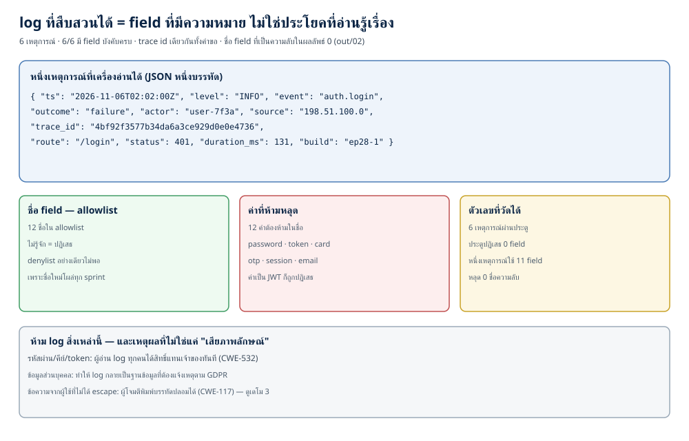
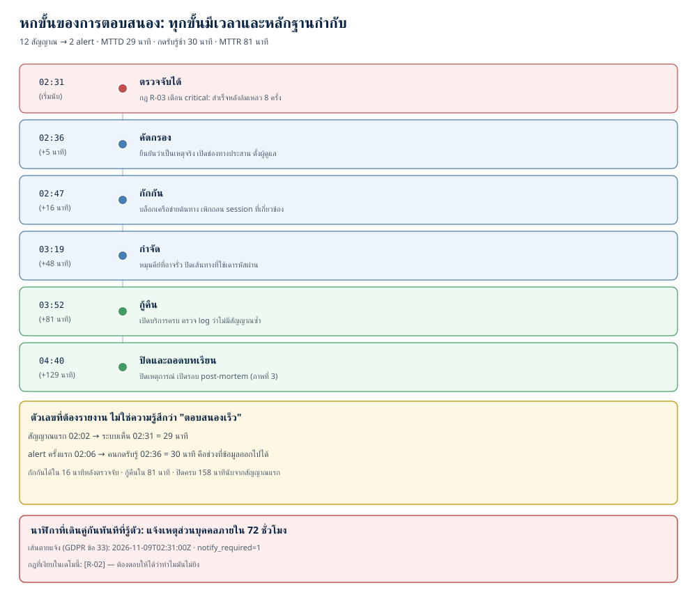
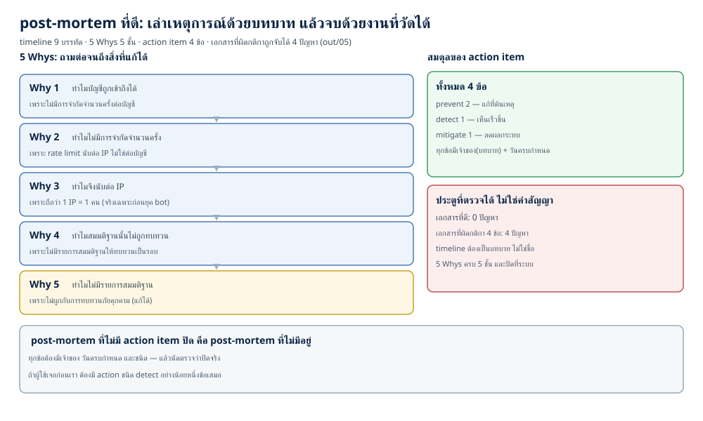

# Logging และการรับมือเหตุการณ์: log ที่สืบสวนได้ ถึง post-mortem ที่ไม่กล่าวโทษใคร (ตอนที่ 28)

> 📅 เขียนเมื่อ: 6 พฤศจิกายน 2026 (เวลาไทย, UTC+7) · รันบน Raspberry Pi 5 (`Linux 6.18.60+rpi-2712 aarch64`) ด้วย `go1.24.4 linux/arm64` — รุ่นล่าสุดตอนเขียนคือ Go 1.27 (สิงหาคม 2026) แต่โค้ดในบทนี้ใช้เฉพาะ standard library ที่มีมาตั้งแต่ Go 1.21 (`log/slog`) และ `go.mod` ของ repo ตั้ง `go 1.24` ไว้ จึงรันได้ทั้งรุ่นที่ติดตั้งและรุ่นปัจจุบัน · Python 3.13.5 · rsvg-convert 2.60.0 · ไม่มี dependency ภายนอก (`external_deps=0`) ไม่เปิดพอร์ต (`listen_calls=0`) ไม่แตะเครือข่าย (`network_dial_calls=0`) ไม่มีเวลาจริงอยู่ในเส้นทางที่พิมพ์ผล (`time_now_calls=0`) · เอกสารอ้างอิงที่ใช้ตรวจ: NIST SP 800-61 Rev. 3 (เมษายน 2025; ฉบับนี้เปลี่ยนรูปเป็น community profile ของ CSF 2.0 จึงไม่ได้นิยามลำดับขั้นการตอบสนองแบบหกขั้น), NIST SP 800-92 (กันยายน 2006; ฉบับ Rev. 1 ยังเป็น draft ตุลาคม 2023), RFC 5424, W3C Trace Context, OWASP Top 10:2025 (A09:2025 Security Logging and Alerting Failures), PCI DSS v4.0.1 ข้อ 10.5.1, GDPR ข้อ 33
>
> ⚠️ **หมายเหตุเรื่องจริยธรรม (อ่านก่อนทุกอย่าง):** เดโมทุกตัวในบทนี้รันในหน่วยความจำของโปรแกรมเดียว ไม่มีพอร์ตเปิด ไม่มีแพ็กเก็ตออกนอกเครื่อง และไม่แตะข้อมูลของใคร — "ความลับ" ทั้งหมดเป็นค่าปลอมที่ผมสร้างขึ้นเพื่อตรวจจับการรั่ว (`CANARY-...`) ไม่ใช่ความลับจริง · โค้ดที่จงใจ insecure (เดโม 1) เขียนขึ้นเพื่อการสอนเท่านั้น — **ห้ามใช้จริง** · ถ้าคุณจะทดลองกับระบบจริง ต้องเป็นระบบที่คุณเป็นเจ้าของหรือได้รับอนุญาตเป็นลายลักษณ์อักษร และต้องไม่เก็บข้อมูลจริงออกจากระบบระหว่างทดสอบ — การเข้าถึงข้อมูลของผู้อื่นโดยไม่ได้รับอนุญาตเป็นความผิดทางอาญาในหลายประเทศ รวมถึงประเทศไทย · และเมื่อเกิดเหตุการณ์จริง สิ่งที่คุณเขียนลง post-mortem คือหลักฐานที่อาจถูกใช้ในกระบวนการทางกฎหมาย จึงต้องแม่นยำและไม่ใส่ข้อมูลส่วนบุคคลเกินจำเป็น

---

ตอนที่ 27 เราจบลงด้วยตัวเลขที่ผมค้างคาใจ: `alerts_on_login=0` — ระบบที่เราเพิ่งยิงจนแตก ไม่มีกฎไหนเห็นการข้ามรหัสผ่านเลยสักครั้ง คืนนี้เราจะกลับมาที่ช่องว่างนั้น และตอบคำถามที่ใหญ่กว่านั้น: **เมื่อระบบถูกเจาะแล้ว (หรือกำลังถูกเจาะ) เราจะรู้ได้อย่างไร และเมื่อรู้แล้วจะทำอะไรตามลำดับ**

คำถามสองข้อนี้ผูกกันเพราะมีคำตอบเดียวกัน: **log** ถ้า log ของคุณเก็บสิ่งที่ต้องใช้ตัดสินใจไม่ได้ การตอบสนองก็คือการเดา และถ้าการตอบสนองของคุณไม่มีลำดับขั้น ทีมก็จะทำสิ่งที่เร็วที่สุดก่อน ซึ่งมักคือการรีสตาร์ตเครื่องที่เก็บหลักฐานไว้

ผมจะใช้คำสามคำให้ชัดตั้งแต่ต้น เพราะคนใช้ปนกันตลอด:

- **event** (เหตุการณ์) คือสิ่งที่เกิดขึ้นจริงหนึ่งครั้ง เช่น "ผู้ใช้ `user-7f3a` ล็อกอินไม่สำเร็จจาก `198.51.100.0` เวลา 02:02"
- **log** คือบันทึกของ event ที่โปรแกรมเขียนออกมา — เป็น *คำอธิบาย* ของ event ไม่ใช่ตัว event
- **incident** (เหตุการณ์ความปลอดภัย) คือ event หนึ่งหรือหลาย event ที่รวมกันแล้วกระทบ confidentiality (ความลับ), integrity (ความถูกต้อง) หรือ availability (ความพร้อมใช้) ของระบบ

**post-mortem** คือเอกสาร (และบ่อยครั้งคือการประชุม) ทบทวนหลังเหตุ: ไทม์ไลน์ว่าเกิดอะไรเมื่อไร ทำไมถึงเกิด และงานที่จะแก้ไม่ให้ซ้ำ

และประโยคที่ผมอยากให้จำไว้ก่อนอ่านต่อ: **log ที่ดีไม่ได้ทำให้ระบบปลอดภัยขึ้น แต่ทำให้คุณรู้ว่ามันพังตอนไหน และรู้เร็วพอที่จะลดความเสียหาย** ส่วน post-mortem ที่ดีไม่ได้ทำให้ไม่มีเหตุการณ์ครั้งหน้า แต่ทำให้ครั้งหน้าเจ็บน้อยลง

ห้าชุดตัวเลขของคืนนี้ (ทั้งหมดมาจาก `out/`):

- **เดโม 1 — log แบบข้อความอิสระ** · **8 บรรทัด** จาก **7 เหตุการณ์** (6 ปกติ + 1 ที่มีอักขระขึ้นบรรทัดใหม่) · canary 5 ตัวที่ซ่อนไว้ **หลุดครบ 5** · ตัวแปลง JSON กู้คืนเหตุการณ์ได้ **0** · ตัวนับแบบเดียวกับ `forged()` ในเดโม 3 (นับบรรทัดที่ขึ้นต้นด้วย timestamp ลบ 7 เหตุการณ์จริง) ได้บรรทัดปลอม **1**
- **เดโม 2 — structured log + correlation id** · **6 เหตุการณ์** · แปลงกลับได้ **6** · มี field บังคับครบ **6** · รวม **66 field** สูงสุด **11 field** ต่อเหตุการณ์ · ทุกเหตุการณ์ผ่านประตู (`attrs_rejected=0`) · trace id เดียวกันทั้งคำขอ · traceparent ผิดรูปถูกปฏิเสธ **1**
- **เดโม 3 — redaction + log injection** · เสนอ **14 field** → ผ่าน **7** ถูกปฏิเสธ **7** · ชื่อความลับในผลลัพธ์ **0** · ค่าที่ mask หลุดออกมาแบบดิบ **0** · log แบบข้อความได้บรรทัดปลอม **1** ขณะที่ JSON ได้ **0**
- **เดโม 4 — detection + เครื่องสถานะ** · **12 สัญญาณ → 2 alert** (และมี **1 กฎที่เงียบ**) · MTTD **29 นาที** · alert ถึงคนกดรับรู้ **30 นาที** · กักกันใน **16 นาที** · กู้คืนใน **81 นาที** · ปิดครบ **158 นาที** (นับจากสัญญาณแรก)
- **เดโม 5 — post-mortem** · timeline **9 บรรทัด** · 5 Whys **5 ชั้น** · action item **4 ข้อ** (prevent 2 · detect 1 · mitigate 1) · เอกสารที่ดีผ่านประตู **0 ปัญหา** เอกสารที่ผิดกติกาถูกจับ **4 ปัญหา**

ตัวย่อที่ใช้ทั้งบท: **MTTD** (mean time to detect) คือเวลาจากสัญญาณแรกถึงตอนที่ระบบเห็น · **MTTC** (mean time to contain) คือจากตอนที่ระบบเห็นถึงตอนกักกันได้ · **MTTR** (mean time to recover) คือจากตอนที่ระบบเห็นถึงตอนกู้คืนใช้ได้ (MTTD ตัวเดียวที่นับจากสัญญาณแรก) · **time-to-ack** คือจาก alert ถึงตอนมีคนกดรับรู้ — สี่ตัวนี้วัดจากคนละจุด และตัวที่ชี้ช่องว่างของกระบวนการมากที่สุดคือ time-to-ack **30 นาที**

## 1. แนวคิด: log คือหลักฐาน ไม่ใช่ debug print

### 1.1 สี่อย่างที่ทำให้ log "ใช้สืบสวนได้"

เรียงจากสิ่งที่คนมักข้ามไปหาสิ่งที่คนทำก่อน:

1. **มีโครงสร้าง (structured)** — แต่ละเหตุการณ์เป็นชุด key/value ที่เครื่องอ่านได้ ไม่ใช่ประโยคที่ต้องใช้ regex แยก ความต่างนี้วัดได้ตรง ๆ: ในเดโม 1 ตัวแปลง JSON กู้คืนเหตุการณ์ได้ 0 จาก 8 บรรทัด ในเดโม 2 ได้ 6 จาก 6
2. **มีตัวโยง (correlation id)** — ค่าเดียวที่พาเราจาก log ของ reverse proxy (พร็อกซีที่รับคำขอแทนแอป) ไปถึง log ของแอปและของฐานข้อมูล ในระบบที่กระจายตัว คำขอหนึ่งครั้งวิ่งผ่านหลายบริการ ถ้าไม่มีค่านี้ คุณจะมี log สามกองที่เล่าเรื่องเดียวกันแต่ต่อกันไม่ได้
3. **มีระดับ (level)** — เพื่อให้คนและเครื่องกรองได้ว่า อะไรคือ "ต้องดูเดี๋ยวนี้" อะไรคือ "เก็บไว้เผื่อ"
4. **มีประตู (policy)** — กฎที่ตัดสินว่าอะไรออกจากโปรเซสได้ และอะไรห้ามออกเด็ดขาด ประตูนี้คือที่ที่ความลับส่วนใหญ่หลุดหรือไม่หลุด

ข้อ 4 คือข้อที่คนมักทำเป็นอันดับสุดท้าย และเป็นข้อที่แพงที่สุดเมื่อพลาด เพราะ log ถูกคัดลอกไปทุกที่: ไปที่ aggregator (ตัวรวม log จากหลายเครื่อง), ไปที่ dashboard, ไปที่ backup, ไปที่เครื่องของวิศวกรที่เปิดดูตอนตีสาม



*ภาพที่ 1 — หนึ่งเหตุการณ์ของ log ที่ใช้สืบสวนได้: ชื่อ field มาจาก allowlist, ค่าที่หน้าตาเป็นความลับถูกปฏิเสธที่ประตู, และตัวเลขบนการ์ดทุกตัวอ่านจาก `out/02` กับ `out/03`*

### 1.2 ระดับ log: ตัวเลขของ RFC 5424 และกับดัก "level ที่โกหก"

มาตรฐาน syslog (RFC 5424, มีนาคม 2009) นิยามระดับความรุนแรงไว้ 8 ระดับ ตั้งแต่ 0 ถึง 7 โดย **เลขน้อย = ร้ายกว่า**:

| ระดับ | ชื่อ | ความหมาย |
|---|---|---|
| 0 | Emergency | ระบบใช้งานไม่ได้แล้ว |
| 1 | Alert | ต้องมีคนลงมือทันที |
| 2 | Critical | สภาวะวิกฤต |
| 3 | Error | เกิดข้อผิดพลาด |
| 4 | Warning | สภาวะที่น่ากังวล |
| 5 | Notice | ปกติแต่สำคัญ |
| 6 | Informational | ข้อมูลทั่วไป |
| 7 | Debug | ข้อมูลสำหรับไล่บั๊ก |

`log/slog` ของ Go มีสี่ระดับ (Debug, Info, Warn, Error) ซึ่งเมื่อแมปกับตารางนี้จะได้ 7, 6, 4 และ 3 — แต่การแมปนี้เป็น**การแมปของเราเอง**ด้วย `ReplaceAttr` ไม่ใช่ built-in ของ `slog` · และเพราะระดับใน `slog` เป็นจำนวนเต็ม (`Info = 0`, `Warn = 4`) เราจึงสร้างระดับคั่นกลางของตัวเองได้ เช่นใช้ `slog.Level(2)` — เลข 2 นี้อยู่บนสเกลของ `slog` (ระหว่าง `Info=0` กับ `Warn=4`) **ไม่ใช่เลขระดับ RFC ในตารางข้างบน** (ที่ 2 = Critical) · สองสเกลนี้หน้าตาคล้ายกัน แต่ความหมายไม่เกี่ยวกันเลย

กับดักที่ผมเจอบ่อยไม่ใช่การเลือกเลขผิด แต่คือ **level ที่โกหก**: โค้ดที่เขียน `logger.Info("ล็อกอินล้มเหลว")` เพราะกลัวว่า Error จะทำให้ dashboard แดง ทั้งที่เหตุการณ์นั้นคือสัญญาณของการโจมตี · ผลคือกฎที่ตั้งบน level Error ไม่เคยยิง และคนก็สรุปว่า "ระบบเราไม่เคยมีปัญหา"

หลักที่ผมใช้: **level บอกความร้ายแรงของผลกระทบ ไม่ได้บอกว่าคนเขียนอยากให้ใครเห็น** ถ้าล็อกอินล้มเหลว 20 ครั้งในหนึ่งนาทีคือเรื่องร้าย การที่ครั้งเดียวไม่ร้ายก็ไม่ได้ทำให้ทั้งกลุ่มไม่ร้าย — การรวมกลุ่มเป็นงานของกฎ (หัวข้อ 3.5) ไม่ใช่งานของ level

### 1.3 correlation id: รหัสที่ต้องตรวจก่อนใช้

correlation id ที่ใช้ในบทนี้คือ trace id ตามมาตรฐาน W3C Trace Context — ค่าเดียวกันที่ทุกบริการหยิบใส่ log ได้ ไม่ต้องตั้งชื่อ field ใหม่ของตัวเอง

วิธีที่มาตรฐานที่สุดตอนนี้คือ **W3C Trace Context** ซึ่งนิยาม header ชื่อ `traceparent` หน้าตาแบบนี้:

```text
traceparent: 00-4bf92f3577b34da6a3ce929d0e0e4736-00f067aa0ba902b7-01
             ^  ^                                ^                ^
             |  trace-id (32 hex = 16 ไบต์)     parent-id (16 hex)  flags
             version (00)
```

สเปกกำหนดว่าทั้ง `trace-id` และ `parent-id` เป็น hex ตัวเล็ก (lowercase) และ **ห้ามเป็นศูนย์ทั้งก้อน** สองข้อนี้ไม่ใช่รายละเอียดจุกจิก — มันคือประตูที่กันไม่ให้คนนอกยัดค่าอะไรก็ได้เข้ามาเป็น id ใน log ของเรา

ทำไมต้องสน: ถ้าเราเชื่อ header ที่เข้ามาโดยไม่ตรวจ ผู้โจมตีสามารถส่ง `traceparent` ที่ทำให้เหตุการณ์ของเขาปนกับเหตุการณ์ปกติ หรือทำให้ log ของเรามีค่าแปลกปลอมที่ไปพังตัวรวม log ก็ได้ นี่คือหลัก "never trust input" จากตอนที่ 14 ในขนาดเล็ก ๆ: **header ก็คือ input**

ในเดโม 2 ผมจึงแยกสองทาง: header ที่ถูกต้องตามรูปแบบถูกใช้เป็น trace id ของทั้ง 6 เหตุการณ์ (ได้ `trace_ids_seen=1`) ส่วน header ที่ใช้ hex ตัวใหญ่ถูกปฏิเสธ (`bad_traceparent_rejected=1`) แล้วระบบสร้าง id ใหม่เอง — ไม่ใช่ปฏิเสธคำขอ แต่ปฏิเสธ *ค่า* ที่จะเข้าไปอยู่ใน log

### 1.4 อะไรควร log และอะไรห้าม log

ฝั่ง "ควร" คือเหตุการณ์ที่ตอบคำถามสี่ข้อนี้ได้: ใครทำ (actor), ทำอะไร (action/event), กับอะไร (resource/route), ผลเป็นอย่างไร (outcome/status) — บวกเวลาและตัวโยง

ฝั่ง "ห้าม" มีชื่อเรียกใน CWE (Common Weakness Enumeration — สารบัญช่องโหว่ซอฟต์แวร์):

- **CWE-532: Insertion of Sensitive Information into Log File** — ผลิตภัณฑ์เขียนข้อมูลอ่อนไหวลงไฟล์ log เช่น รหัสผ่าน, token, หมายเลขบัตร, ข้อมูลสุขภาพ
- **CWE-117: Improper Output Neutralization for Logs** — ผลิตภัณฑ์สร้างข้อความ log จากข้อมูลภายนอกโดยไม่ neutralize อักขระพิเศษ ผู้โจมตีจึง "พิมพ์บรรทัดใหม่" ปลอมได้
- **CWE-778: Insufficient Logging** — กลับกัน: เหตุการณ์สำคัญไม่ถูกบันทึก หรือบันทึกแต่ขาดรายละเอียดที่ใช้สืบสวน

ทั้งสามข้ออยู่ในหมวด **A09 ของ OWASP Top 10:2025** ซึ่งเปลี่ยนชื่อจาก *Security Logging and Monitoring Failures* (ฉบับ 2021) เป็น **A09:2025 Security Logging and Alerting Failures** — เติมคำว่า alerting เข้ามาเพราะการบันทึกโดยไม่มีใครถูกเตือนให้ลงมือก็ไม่ช่วยอะไร (ตอนที่ 17 ของซีรีส์นี้) ข้อความในหมวดนี้พูดตรง ๆ ว่า *ถ้าไม่มีการบันทึกและการเฝ้าดู การละเมิดจะถูกตรวจจับไม่ได้เลย*

ผมชอบนิยามของ CWE-532 เพราะมันบังคับให้คิดถึง **ผู้อ่าน** ไม่ใช่แค่ตัวโปรแกรม: log ไม่ใช่ที่ส่วนตัว มันคือเอกสารที่คนอื่นอ่านได้ และในระบบจริงมันถูกส่งต่อไปยังบริการภายนอกด้วยซ้ำ การเขียนรหัสผ่านลง log จึงเท่ากับการส่งรหัสผ่านให้ทุกคนที่มีสิทธิ์อ่าน dashboard

### 1.5 log injection: ทำไม "escape ให้ถูก" ไม่ใช่เรื่องของ HTML อย่างเดียว

ลองนึกถึง log แบบข้อความ:

```text
2026-11-06T02:31:00Z INFO authz check actor=user-7f3a result=deny
```

แล้วลองนึกว่าค่าของ `actor` มาจากไหน — จากผู้ใช้ ตอนนี้ถ้าผู้ใช้ตั้งชื่อตัวเองว่า `user-7f3a` ตามด้วยอักขระขึ้นบรรทัดใหม่ แล้วตามด้วยบรรทัดที่หน้าตาเหมือน log จริง ระบบที่ประกอบข้อความด้วย `fmt.Fprintf` จะเขียนออกมาเป็น **สองบรรทัด** และตัวเก็บ log จะอ่านเป็น **สองเหตุการณ์** ผู้โจมตีจึงสามารถสร้างหลักฐานปลอมว่า "มีคนให้สิทธิ์ admin" หรือกลบเหตุการณ์จริงด้วยการ Flood ได้ (หรือในระบบที่เก่ากว่านั้น ใส่ ANSI escape sequence — ชุดอักขระควบคุมสีและตำแหน่งเคอร์เซอร์ของ terminal — ลงหน้าจอคนอ่าน log ได้ด้วย)

ทางแก้ไม่ใช่การ regex ลบ `\n` ออกจากทุกค่า (ซึ่งจะทำให้ข้อมูลเพี้ยนและยังพลาดรูปแบบอื่น) แต่คือ **ให้ตัว encoder เป็นคนจัดการ**: JSON handler ของ slog จะ escape อักขระควบคุมให้อยู่ในสตริงเดียวเสมอ (`\n` กลายเป็นสองตัวอักษร) — ในเดโม 3 ตัวเลขคือ `naive_forged_lines=1` กับ `json_forged_lines=0`

## 2. ทำไมเรื่องนี้สำคัญ: บทเรียนที่แพงที่สุดคือ "เราเห็น แต่ไม่มีใครดู"

### 2.1 Target 2013: ระบบเตือนทำงาน แต่คนไม่ได้กดรับรู้

ปลายปี 2013 นักโจมตีเข้าทางระบบของบริษัทรับเหมาดูแลเครื่องปรับอากาศ แล้วไต่เข้าไปถึงระบบจุดขายของ Target · สิ่งที่ทำให้เรื่องนี้น่ากลัวไม่ใช่ช่องโหว่ แต่คือ **ระบบตรวจจับของ Target (FireEye) เตือนจริง** — รายงานของคณะกรรมาธิการการพาณิชย์สหรัฐฯ (มีนาคม 2014) ระบุว่า Target ไม่ได้ตอบสนองต่อคำเตือนอัตโนมัติหลายครั้ง และไม่ยอมให้ซอฟต์แวร์ลบมัลแวร์นั้นอัตโนมัติ · Target รู้ตัวว่าโดนเจาะเมื่อกรมยุติธรรมสหรัฐฯ โทรมาแจ้ง (12 ธันวาคม) ไม่ใช่จากระบบของตัวเอง — และในที่สุดมีบัตรประมาณ 40 ล้านใบถูกเปิดเผย

บทเรียนไม่ได้อยู่ที่ "ควรซื้อเครื่องมือที่ดีกว่า" แต่อยู่ที่: **alert ที่ไม่มีคนรับรู้ มีค่าเท่ากับ log ที่ไม่มีใครอ่าน** และนี่คือเหตุผลที่เดโม 4 ของคืนนี้วัด `time_to_ack` แยกจาก `mttd` — เพราะระบบที่ "เห็นเร็ว" แต่ "มีคนกดรับรู้ช้า" ยังแพ้อยู่ดี

### 2.2 จากตอนที่ 27: `alerts_on_login=0`

ตอนที่ 27 เราวัดว่ากฎสองชุดที่เขียนไว้เห็นการโจมตีของเราไหม คำตอบคือกฎนับ 5xx เตือน 0 ครั้ง กฎเชิงความหมายเตือน 2 ครั้ง และ **ทั้งสองชุดไม่เห็นการข้ามรหัสผ่านเลย** สาเหตุไม่ใช่กฎเขียนผิด แต่คือ log ของ lab ไม่มี field ที่บอก "การล็อกอินครั้งนี้สำเร็จหรือล้มเหลว" และไม่มีการรวมกลุ่มตามแหล่งที่มา

คืนนี้เราแก้ที่ต้นเหตุ: สัญญาณ (signal) ที่กฎอ่านคือ event ที่มีโครงสร้างจากเดโม 2 ไม่ใช่บรรทัดข้อความ และกฎทุกข้อต้องประกาศ **ตัวกระตุ้น (trigger)**, **ตัวนับ (count)**, **กุญแจจัดกลุ่ม (key)** และ **หน้าต่างเวลา + จำนวนครั้ง** ให้ครบ — กฎที่ไม่มีสี่ส่วนนี้จะเงียบหรือจะตะโกนตลอดเวลา และทั้งสองแบบทำให้คนเลิกอ่าน

### 2.3 เมื่อ log กลายเป็นข้อผูกพันทางกฎหมาย

สองข้อที่ควรรู้เพราะมันเปลี่ยน "ควรทำ" เป็น "ต้องทำ" — และทั้งสองข้อหมุนรอบคำว่า **ข้อมูลส่วนบุคคล (PII — Personally Identifiable Information)** ซึ่งหมายถึงข้อมูลที่ระบุตัวบุคคลได้ เช่น ชื่อ อีเมล หมายเลขบัตร หรือเบอร์โทร · log ที่เก็บ PII จึงไม่ใช่แค่ log แต่มันคือฐานข้อมูลส่วนบุคคลที่กฎหมายบังคับใช้ด้วย:

- **PCI DSS v4.0.1 ข้อ 10.5.1** — เก็บประวัติ audit log (บันทึกการกระทำที่มีผลต่อระบบ) อย่างน้อย **12 เดือน** โดย **3 เดือนล่าสุดต้องพร้อมใช้สอบสวนได้ทันที** เหตุผลที่เขียนไว้ในมาตรฐานตรงกับเรื่องของ Target: การละเมิดมักไม่ถูกตรวจพบเป็นเวลานาน
- **GDPR ข้อ 33** — เมื่อรู้ตัวว่ามีการละเมิดข้อมูลส่วนบุคคล ต้องแจ้งหน่วยงานกำกับภายใน **72 ชั่วโมง** (ถ้าไม่ทันต้องแจ้งพร้อมเหตุผลของความล่าช้า) และต้องบันทึกเหตุการณ์ไว้แม้ไม่ต้องแจ้ง

ข้อความ "เมื่อรู้ตัว" (having become aware) ใน GDPR คือคำที่ทำให้ log สำคัญมาก: เวลาที่ใช้ตัดสินว่า "เราเริ่มรู้อะไร เมื่อไร" มาจาก log ไม่ใช่จากความจำของใคร · ในเดโม 4 เส้นตายนี้คำนวณจากเวลาที่ระบบตรวจจับได้ ไม่ใช่เวลาที่มีคนเปิด ticket

## 3. ลงมือทำ: ห้าเดโมที่วัดได้ทุกก้าว

### 3.1 โครงของ repo

```text
code/ep28/
├── internal/logkit/       กติกาของ event: allowlist, redaction, traceparent
├── internal/detect/       กฎตรวจจับ (trigger/count/key/window/threshold)
├── internal/incident/     เครื่องสถานะของเหตุการณ์ + ตัวชี้วัดเวลา
├── internal/postmortem/   post-mortem ที่ตรวจกติกาได้ + render markdown
├── cmd/badlog/            เดโม 1: log แบบข้อความอิสระ (ห้ามใช้จริง)
├── cmd/structured/        เดโม 2: slog + JSON + traceparent
├── cmd/redact/            เดโม 3: redaction + log injection
├── cmd/incident/          เดโม 4: detection + เครื่องสถานะ
├── cmd/postmortem/        เดโม 5: post-mortem + ประตูตรวจ
└── run_all.sh             รันทุกอย่างแล้วเก็บผลลง out/
```

ทั้ง repo มี 13 ไฟล์ Go, 23 เทสต์ และไม่มี dependency ภายนอก — เพราะเดโมที่ต้องพึ่งบริการภายนอกจะรันซ้ำบนเครื่องอื่นไม่ได้ และตัวเลขในบทความก็จะเชื่อถือไม่ได้

### 3.2 เดโม 1: log แบบข้อความอิสระ — เก็บทุกอย่าง แล้วจ่ายด้วยทุกอย่าง

ฟังก์ชันนี้คือต้นตอของปัญหาและเป็นโค้ดที่ผมเจอบ่อยที่สุดในโปรเจกต์จริง — เดโมนี้จงใจ insecure เพื่อการสอน **ห้ามใช้จริง**:

```go
func naiveLog(w *bytes.Buffer, at time.Time, level, msg string) {
	fmt.Fprintf(w, "%s %s %s\n", at.Format("2006-01-02T15:04:05Z"), level, msg)
}
```

และผู้เรียกก็ประกอบข้อความเองตามใจ:

```go
	naiveLog(&buf, base, "INFO", fmt.Sprintf(
		"user login ok email=%s password=%s from=203.0.113.42", canaryEmail, canaryPassword))
```

สิ่งที่เสียไปมีสามอย่างพร้อมกัน: (ก) ไม่มีโครงสร้างให้เครื่องอ่าน (ข) ไม่มีประตูให้ความลับถูกกรอง และ (ค) ข้อความของผู้ใช้ถูกต่อเข้าไปตรง ๆ ผลรัน:

```
# เดโม 1: log แบบข้อความอิสระ — เขียนทุกอย่างที่อยากรู้ แล้วจ่ายด้วยข้อมูลที่หลุด
naive_log_lines=8
log_bytes=584
canaries_offered=5
canaries_in_log=5
leaked_field_names=email,password,authorization,card_number,otp
events_recoverable_by_parser=0
forged_lines_accepted=1
# เนื้อใน log ไม่ถูกพิมพ์ในบทความ: การพิมพ์ซ้ำคือการทำผิดซ้ำ
```

อ่านสามบรรทัด `canaries_in_log`, `events_recoverable_by_parser`, `forged_lines_accepted` ให้ดี: canary 5 ตัวที่เราซ่อนไว้ **หลุดครบทั้ง 5** — รหัสผ่าน, JWT (JSON Web Token — โทเคนที่ฝังสิทธิ์ไว้ในตัวเอง ใช้แทน session), หมายเลขบัตร, รหัส OTP (รหัสใช้ครั้งเดียว), และอีเมล · ตัวแปลง JSON ที่เราลองใช้กู้คืนเหตุการณ์ได้ **0 จาก 8 บรรทัด** เพราะไม่มีบรรทัดไหนเป็น JSON · และมี **1 บรรทัดปลอม**: บรรทัดที่ขึ้นต้นด้วย timestamp มี 8 บรรทัด แต่เหตุการณ์จริงมี 7 — ตัวเก็บ log จึงอ่านเป็นเหตุการณ์เกินมา 1 (ตัวนับแบบเดียวกับ `forged()` ในเดโม 3)

ผมจงใจไม่พิมพ์เนื้อในของ log นั้นลงบทความ เพราะการพิมพ์ซ้ำคือการทำผิดซ้ำ — สิ่งที่ควรอ่านคือ *ชื่อ field ที่หลุด* ไม่ใช่ค่าของมัน และนี่คือหลักที่ควรใช้ตอนเขียนรายงานเหตุการณ์จริงด้วย: รายงานว่า "มีรหัสผ่าน 1 ค่าและหมายเลขบัตร 1 หมายเลขอยู่ใน log บรรทัดที่ N" ไม่ใช่คัดลอกค่ามาแปะ

### 3.3 เดโม 2: structured log ที่เครื่องอ่านได้ และ trace id ที่ตรวจก่อนใช้

เดโม 2 มีสองงานที่ต้องทำพร้อมกัน: เขียน log ให้เครื่องอ่านได้ และ **กรอง field ผ่านประตูก่อนถึง handler** (ตัวรับ record ไปเขียนออกเป็นรูปแบบ เช่น JSON) — ถ้าเราแค่เปลี่ยนข้อความให้เป็น JSON โดยไม่มีประตู ก็เท่ากับย้ายปัญหาเดิมไปอยู่ในรูปที่อ่านง่ายขึ้น

ประตูตัวแรกคือ **allowlist** (รายชื่อที่อนุญาต — อะไรไม่อยู่ในรายการถือผิด) — และจุดสำคัญคือมันเป็น allowlist ไม่ใช่ **denylist** (รายชื่อที่ห้าม — อะไรไม่อยู่ถือว่าผ่าน):

```go
// allowedFields คือชุดที่ทีมตกลงกันว่า "พอสำหรับสืบสวน" และไม่มากไปกว่านั้น
// denyKeys คือชื่อ field ที่ห้ามผ่านไม่ว่ากรณีใด — กันคนเผลอเพิ่มเข้า allowlist ทีหลัง
var (
	allowedFields = []string{
		"ts", "level", "event", "outcome", "actor", "source",
		"trace_id", "route", "status", "duration_ms", "error_code", "build",
	}

	denyKeys = []string{
		"password", "passwd", "secret", "token", "authorization",
		"cookie", "card", "cvv", "otp", "session", "email", "phone",
	}
)
```

ทำไมต้องมีทั้งสองชั้น: allowlist กัน field ที่เราไม่รู้จัก ส่วน denyKeys กันกรณีที่คนแก้ allowlist ในอนาคตเผลอเพิ่ม `api_token` เข้าไป — และ `NewPolicy` จะ **ปฏิเสธตอนสร้าง policy** ถ้าพบชื่อที่ชนกับ denyKeys (มีเทสต์คุมไว้) นี่คือ fail closed จากตอนที่ 13 ในขนาดเล็ก: policy ที่ผิดต้องพังตอนเริ่มโปรแกรม ไม่ใช่ตอนมีเหตุการณ์

ประตูทำงานที่ฟังก์ชันเดียว:

```go
func (p Policy) reason(key, value string) string {
	for _, bad := range p.deny {
		if strings.Contains(key, bad) {
			return "deny_key:" + key
		}
	}
	if !p.allowed(key) {
		return "not_in_allowlist:" + key
	}
	if LookLikeSecret(value) {
		return "deny_value:" + key
	}
	return ""
}
```

บรรทัดสุดท้ายคือส่วนที่คนมักลืม: **ชื่อ field อาจจะถูก แต่ค่าอาจเป็นความลับ** ตัวอย่างจริงในเดโม 3 คือ `route` ที่มีค่าเป็น `/reset?token=eyJhbGciOi...` — ชื่อ `route` อยู่ใน allowlist แต่ค่ามันคือ JWT เราจึงปฏิเสธทั้ง field ด้วยเหตุผล `deny_value:route`

ฝั่งผู้เรียกใช้ `slog` และประกอบ attribute จากชนิดจริง:

```go
func attrs(kv ...any) []slog.Attr {
	out := make([]slog.Attr, 0, len(kv)/2)
	for i := 0; i+1 < len(kv); i += 2 {
		k, _ := kv[i].(string)
		// ใช้ slog.Any เพื่อเก็บชนิดจริง: ตัวเลขต้องเป็นตัวเลข ไม่ใช่สตริง
		// (status ที่เป็น "401" ทำให้กราฟและกฎ aggregate พังโดยไม่มีใครเห็น)
		out = append(out, slog.Any(k, kv[i+1]))
	}
	return out
}
```

และเราไม่ปล่อยให้ handler ดึงเวลาปัจจุบันเอง เพราะเดโมต้องรันซ้ำได้ผลเดิม — และ **ประตูถูกต่อเข้าเส้นทาง emit จริง** ไม่ใช่ฟังก์ชันที่เขียนไว้สวย ๆ แล้วไม่มีใครเรียก:

```go
// emit เขียน record ลง handler ด้วยเวลาที่ผู้เรียกกำหนด ไม่ใช่เวลาที่รันสคริปต์
// attr ทุกตัวผ่านประตูก่อนถึง handler: ชื่อต้องอยู่ใน allowlist และค่าต้องไม่หน้าตาเป็นความลับ
// คืนจำนวน field ที่ถูกปฏิเสธ เพื่อให้ตัวเลข "ประตูทำงานไหม" วัดได้จากผลรันจริง
func emit(h slog.Handler, p logkit.Policy, r record) (int, error) {
	kept, rejected := p.CheckAttrs(r.attrs)
	rec := slog.NewRecord(r.at, r.level, r.event, 0)
	rec.AddAttrs(kept...)
	return len(rejected), h.Handle(context.Background(), rec)
}
```

อีกจุดที่ต้องเข้าใจก่อนใช้ policy กับ `slog`: ประตูอย่าง `CheckAttrs` ตรวจเฉพาะ attr ที่ *เราส่งเข้า* ก่อนถึง handler ส่วน handler เติม `time` กับ `msg` ของตัวเอง **หลัง** ประตูแล้ว (จึงไม่ได้ถูกประตูตัดทิ้ง) · เราจึงแมปชื่อด้วย `ReplaceAttr` — `slog.TimeKey` กลายเป็น `ts` และ `slog.MessageKey` กลายเป็น `event` (สองค่านี้เป็นค่าคงที่ที่ `slog` ประกาศไว้ ไม่ใช่สตริงที่เราพิมพ์เอง)

การแมปนี้มีไว้ให้ชื่อ field ที่ออกมาตรงกับคำศัพท์ของ allowlist (`ts`/`event`) ที่ตัวตรวจ required และกฎ/query อ้างถึง — ถ้าไม่แมป `required_fields_ok` จะเป็น 0 และ query หา `ts`/`event` ไม่เจอ ทั้งที่โปรแกรมยังรันผ่านและ log ยังออกมาครบ

ผลรัน (หัวข้อและตัวเลข):

```
# เดโม 2: structured log (log/slog, JSON) + correlation id จาก traceparent
events=6
json_decode_ok=6
required_fields_ok=6
total_fields=66
max_fields=11
trace_ids_seen=1
trace_parent=4bf92f3577b34da6a3ce929d0e0e4736
bad_traceparent_rejected=1
attrs_offered=48
attrs_rejected=0
deny_keys_in_output=0
```

และนี่คือสี่จากหกบรรทัด (ที่เหลืออีกสองบรรทัดอยู่ใน `out/02_structured.txt`) — ตั้งแต่ล้มเหลวสองครั้ง ไปจนถึงสำเร็จ:

```
{"ts":"2026-11-06T02:02:00Z","level":"INFO","event":"auth.login","outcome":"failure","actor":"user-7f3a","source":"198.51.100.0","trace_id":"4bf92f3577b34da6a3ce929d0e0e4736","route":"/login","status":401,"duration_ms":131,"build":"ep28-1"}
{"ts":"2026-11-06T02:02:04Z","level":"INFO","event":"auth.login","outcome":"failure","actor":"user-7f3a","source":"198.51.100.0","trace_id":"4bf92f3577b34da6a3ce929d0e0e4736","route":"/login","status":401,"duration_ms":128,"build":"ep28-1"}
{"ts":"2026-11-06T02:02:09Z","level":"INFO","event":"auth.reset.request","outcome":"accepted","actor":"user-91c2","source":"203.0.113.0","trace_id":"4bf92f3577b34da6a3ce929d0e0e4736","route":"/reset","status":202,"duration_ms":77,"build":"ep28-1"}
{"ts":"2026-11-06T02:31:00Z","level":"WARN","event":"auth.login","outcome":"success","actor":"user-7f3a","source":"198.51.100.0","trace_id":"4bf92f3577b34da6a3ce929d0e0e4736","route":"/login","status":200,"duration_ms":96,"build":"ep28-1"}
```

สังเกตสามอย่าง: `"status":401` เป็น **ตัวเลข** ไม่ใช่สตริง (เพราะเราส่ง int เข้า `slog.Any` และประตูคืน attr เดิมโดยไม่แปลงชนิด) · ทุกบรรทัดมี `trace_id` เดียวกัน · และไม่มีชื่อ field ที่เป็นความลับเลย (`deny_keys_in_output=0` — ตัวตรวจวนจากรายการ deny ชุดเดียวกับประตู (`DenyKeys()`) ไม่ใช่ลิสต์ที่พิมพ์มือ ซึ่งเคยขาด `email` กับ `phone`) ทั้งที่เหตุการณ์ทำนองเดียวกันในระบบจริงมักมีอีเมลและรหัสผ่านติดมาด้วยเสมอ · อีกคู่ที่ควรอ่านคือ `attrs_offered=48` กับ `attrs_rejected=0` — 8 attr ต่อเหตุการณ์คูณ 6 เหตุการณ์ เดินผ่านประตูครบและไม่มีตัวไหนถูกตัด นี่คือหลักฐานว่าเดโม 2 ผ่านประตูจริง ไม่ใช่แค่เขียน JSON ให้สวย

`level` ในตัวอย่างนี้อ่านให้ตรงหลัก §1.2: ล้มเหลวแต่ละครั้งเป็น INFO เพราะผลกระทบต่อครั้งยังปกติ (401 ที่ถูกปฏิเสธคือเรื่องปกติของระบบ) ส่วน 02:31 ที่สำเร็จหลังล้มเหลว 8 ครั้งเป็น WARN เพราะนั่นคือสัญญาณว่ามีคนเดารหัสถูก — level บอกความร้ายแรง ไม่ได้บอกว่าอยากให้ใครเห็น และการรวมกลุ่มเป็นงานของกฎ

`total_fields=66` กับ `max_fields=11` สอดคล้องกันเพราะ 6 × 11 = 66 — ทุกเหตุการณ์มี 11 field เท่ากัน ซึ่งเป็นผลจาก `attrs` ที่ใส่ชุดเดียวกันตลอด ไม่ใช่บังเอิญ

### 3.4 เดโม 3: redaction ที่ระดับ field และการทดสอบ log injection

**redaction** คือการตัดหรือปิดบางส่วนของข้อมูลก่อนมันออกจากโปรเซส — ทำตอนเขียน ไม่ใช่ตามไปแก้ทีหลัง (การตามไปแก้ทีหลังแปลว่าค่าดิบออกไปถึงที่เก็บ log แล้ว)

เดโมนี้เสนอ 14 field เข้าประตู และวัดว่าอะไรผ่าน:

```
# เดโม 3: redaction ที่ระดับ field + log injection (CWE-532, CWE-117)
fields_offered=14
fields_accepted=7
fields_rejected=7
rejected_route=deny_value:route
rejected_password=deny_key:password
rejected_authorization=deny_key:authorization
rejected_card_number=deny_key:card_number
rejected_session_token=deny_key:session_token
rejected_otp_code=deny_key:otp_code
rejected_user_email=deny_key:user_email
masked_actor=m***@example.com
masked_source=203.0.113.0
masked_fields_in_event=2
masked_email_in_output=1
raw_email_in_output=0
policy_allow=12
policy_deny=12
secret_attr_key=api_key
secret_value_in_output=0
redacted_marker_in_output=1
naive_lines=2
naive_forged_lines=1
json_lines=1
json_forged_lines=0
attacker_newline_escaped=1
```

อ่านให้ครบจะเห็นว่ามี **สองกลไกที่ต่างกัน** ทำงานร่วมกัน:

- **การปฏิเสธ (reject)** — field ที่ชื่อชน denyKeys หรือค่าเป็นความลับ ถูกทิ้งทั้ง field (7 จาก 14) นี่คือค่าเริ่มต้นที่ปลอดภัย: ไม่มีข้อมูลดีกว่ามีข้อมูลที่ผิด
- **การปิดบางส่วน (mask)** — ค่าที่เรา *ต้อง* เก็บเพื่อ correlate แต่ไม่ควรเก็บเต็ม ถูกแปลง **ตอนประกอบ event ก่อนเขียนลง handler**: `malee@example.com` เป็น `m***@example.com` และ IP ถูกตัดเหลือระดับวง `/24` (เก็บสามออกเตตแรกไว้ ที่เหลือปัดเป็น 0 — จึงรู้แค่วงเครือข่าย ไม่รู้เครื่อง) — `203.0.113.42` กลายเป็น `203.0.113.0` ผู้ใช้ยังตอบคำถาม "มาจากเครือข่ายเดียวกันกี่ครั้ง" ได้ แต่ระบุตัวบุคคลไม่ได้ · ในเดโมนี้ `actor` ผ่านประตูได้ (ชื่อ field ไม่ได้ชน denyKeys) แต่ค่าของมันเป็นอีเมล เราจึงเรียก `MaskEmail` ตอนประกอบ แล้ววัดด้วย `masked_email_in_output=1` กับ `raw_email_in_output=0` — ถ้า mask ตอนพิมพ์ผลอย่างเดียว ตัวเลขคู่นี้จะกลับกัน

อ่านคู่ `policy_allow=12` กับ `policy_deny=12` ให้ดี: ตัวแรกคือ **12 ชื่อ** ที่อนุญาต และตัวที่สองคือ **12 คำ** ที่ห้ามโผล่ในชื่อ field — สองตัวเลขนี้คือขนาดของประตูสองชั้น ตรวจได้ ไม่ใช่คำโฆษณา

กลไกที่สองคือ `Secret` ซึ่งใช้ `slog.LogValuer`: ค่าที่ถูกครอบด้วยชนิดนี้จะถูกแทนด้วย `[REDACTED]` **ตอนที่ handler เขียน** ไม่ใช่วิ่งไป regex แทนที่ทีหลัง:

```go
// Secret ครอบค่าที่เป็นความลับเพื่อให้ slog เก็บได้แค่คำว่า [REDACTED]
// แม้จะมีคนเรียก fmt.Print กับมันตรง ๆ ก็ไม่หลุด (String/GoString/LogValue ถูก override หมด)
type Secret string

func (s Secret) String() string   { return "[REDACTED]" }
func (s Secret) GoString() string { return "[REDACTED]" }

// LogValue ทำให้ slog ใช้ค่านี้แทนค่าจริงตอนเขียน log
func (s Secret) LogValue() slog.Value { return slog.StringValue("[REDACTED]") }
```

ทำไมต้อง override สามตัว: เพราะความลับหลุดได้หลายทาง — `slog` เรียก `LogValue`, `fmt.Printf("%v")` เรียก `String`, `%#v` เรียก `GoString` ถ้าทำแค่ทางเดียว อีกสองทางที่เหลือก็ยังรั่ว ผลรันยืนยัน: `secret_value_in_output=0` และ `redacted_marker_in_output=1`

ส่วน log injection วัดด้วยสิ่งที่ตัวเก็บ log ทำจริง คือการแบ่งข้อความเป็นบรรทัดตามอักขระขึ้นบรรทัดใหม่:

```go
// tsLine คือบรรทัดที่ "ขึ้นต้นด้วยเวลา" — คือรูปที่ตัวเก็บ log จะอ่านเป็นเหตุการณ์ใหม่
var tsLine = regexp.MustCompile(`^\d{4}-\d{2}-\d{2}T\d{2}:\d{2}:\d{2}`)

// forged นับบรรทัดที่ดูเป็นเหตุการณ์เกินจำนวนเหตุการณ์จริง
func forged(lines []string, real int) int {
	n := 0
	for _, ln := range lines {
		if tsLine.MatchString(ln) {
			n++
		}
	}
	if n < real {
		return 0
	}
	return n - real
}
```

ผลคือ log แบบข้อความได้ **2 บรรทัด** จาก 1 เหตุการณ์ (บรรทัดปลอม 1) ขณะที่ JSON ได้ **1 บรรทัด** และบรรทัดปลอม **0** — เพราะอักขระขึ้นบรรทัดใหม่ถูกเก็บเป็น `\n` สองตัวอักษรอยู่ในสตริง (`attacker_newline_escaped=1`)

### 3.5 เดโม 4: กฎที่ต้องประกาศสี่ส่วน และเครื่องสถานะที่ข้ามขั้นไม่ได้

กฎในเดโมนี้ประกาศสี่ส่วน และสองส่วนแรก (trigger กับ count) แยกออกจากกันเพราะเหตุผลที่ผมเจอด้วยตัวเองตอนเขียน:

```go
// Rule คือกฎหนึ่งข้อ
type Rule struct {
	ID        string
	Severity  string
	Window    time.Duration
	Threshold int
	Trigger   func(Signal) bool // เหตุการณ์ที่ทำให้กฎต้องตรวจ (ตัวกระตุ้น)
	Count     func(Signal) bool // เหตุการณ์ที่นับเข้าเกณฑ์ (ตัวนับ)
	Key       func(Signal) string
	Summary   string
}
```

กฎที่สำคัญที่สุดของเดโมคือ R-03 ซึ่ง **นับการล้มเหลว แต่เตือนตอนสำเร็จ**:

```go
// ruleSuccessAfterFailures คือ R-03: นับการล้มเหลว แต่เตือนตอนสำเร็จ
// สองส่วนนี้ต้องแยกกัน ไม่งั้นกฎจะนับการสำเร็จ (ซึ่งมีครั้งเดียว) แล้วไม่เคยยิง
func ruleSuccessAfterFailures() Rule {
	return Rule{
		ID: "R-03", Severity: "critical", Window: 30 * time.Minute, Threshold: 5,
		Summary: "ล็อกอินสำเร็จหลังล้มเหลวหลายครั้งจากเครือข่ายเดียว",
		Trigger: okLogin, Count: failedLogin,
		Key: func(s Signal) string { return s.Source },
	}
}
```

ร่างแรกของผมใช้ `Match` ตัวเดียวทั้งกระตุ้นและนับ (แทนที่จะแยก `Trigger` กับ `Count`) ผลคือกฎนี้ไม่เคยยิงเลย เพราะมันนับ "การสำเร็จ" ที่มีแค่ครั้งเดียว ไม่เคยถึง 5 — ตอนนั้นผมเห็นทั้ง R-02 และ R-03 เงียบในผลรัน แต่ร่างนั้นถูกเขียนทับไปแล้ว ผมจึงไม่ยกตัวเลขจากรอบนั้นมาอ้าง สิ่งที่ตรวจได้คือกับดักที่ผมเก็บไว้เป็นเทสต์: `TestSingleMatchRuleIsSilent` สร้างกฎแบบตัวกรองเดียวแล้วยืนยันว่ามันไม่ยิง ขณะที่กฎที่แยก `Trigger`/`Count` ยิงกับสัญญาณชุดเดียวกัน — บั๊กประเภทนี้ไม่ทำให้โปรแกรมพัง มันแค่ทำให้ระบบเงียบ

ฝั่งการตอบสนองคือเครื่องสถานะที่ **บังคับให้เดินทีละขั้นและมีหลักฐานทุกครั้ง** — แต่ก่อนอ่านโค้ด ต้องรู้ก่อนว่า "หกขั้น" ที่บทนี้ใช้คืออะไร และต้องพูดให้ชัดเรื่องที่มาของมัน: ลำดับหกขั้นนี้เป็น **แบบของบทนี้เอง** (อิง SP 800-61 Rev. 2 กับ PICERL — Preparation, Identification, Containment, Eradication, Recovery, Lessons learned — ของ SANS) **ไม่ใช่ลำดับที่ NIST SP 800-61 Rev. 3 นิยาม** เพราะฉบับ r3 (เมษายน 2025) เปลี่ยนรูปเป็น community profile ของ CSF 2.0 และไม่ได้ให้ลำดับขั้นแบบนี้:

1. **detect (ตรวจจับ)** — ระบบรู้ว่ามีอะไรผิดปกติ และบันทึกเวลาที่มันรู้
2. **triage (คัดกรอง)** — ยืนยันว่าเป็นเหตุจริง ขนาดเท่าไร ใครเป็นเจ้าภาพ
3. **contain (กักกัน)** — จำกัดวงไม่ให้ลุกลาม (บล็อกเครือข่าย เพิกถอน session)
4. **eradicate (กำจัด)** — เอาสาเหตุออก (หมุนคีย์ ปิดช่องทางที่ถูกใช้)
5. **recover (กู้คืน)** — เปิดบริการกลับ และเฝ้าดูว่าไม่มีสัญญาณซ้ำ
6. **close (ปิดและถอดบทเรียน)** — สรุปหลักฐาน เปิดรอบ post-mortem

คู่ที่ยังจับไม่ลงตรง ๆ คือ Preparation กับ Lessons learned: Preparation ไปอยู่ใน checklist §5 "ก่อนมีเหตุ" และ Lessons learned คือขั้น close + เดโม 5

หกขั้นนี้เรียงเป็นเส้นตรงโดยตั้งใจ เพราะในเหตุการณ์จริงคนมักข้ามขั้นด้วยความรีบ และทุกครั้งที่ข้ามมักมีหลักฐานหายไปหนึ่งชิ้น

```go
// Advance เดินไปขั้นถัดไป ต้องมีหลักฐาน (note) ทุกครั้ง
// กติกา: ข้ามขั้นไม่ได้ · ไม่มีหลักฐานไม่ได้ · ซ้ำสถานะเดิมได้แต่ไม่บันทึก
func (m *Machine) Advance(to Phase, actor, note string) error {
	if to == m.phase {
		return ErrNoop
	}
	if !isNext(m.phase, to) {
		return fmt.Errorf("ข้ามขั้นไม่ได้: จาก %s ไป %s (ขั้นถัดไปคือ %s)",
			m.phase, to, next(m.phase))
	}
	if actor == "" || note == "" {
		return errors.New("ต้องระบุผู้ทำและหลักฐานทุกครั้ง (timeline ที่ไม่มีหลักฐานคือความจำ)")
	}
	m.phase = to
	m.entries = append(m.entries, Entry{At: m.now(), Phase: to, Actor: actor, Note: note})
	return nil
}
```

กติกาสามข้อนี้ดูเข้มเกินไปจนถึงขั้นน่ารำคาญ — จนกว่าคุณจะอยู่ในเหตุการณ์จริงตอนตีสาม ซึ่งเป็นเวลาที่คนจะกด "รีสตาร์ตเลย" ก่อนเก็บสำเนา log · เครื่องสถานะที่ปฏิเสธคำสั่งนั้นคือเพื่อนที่ดีที่สุดของคุณในนาทีนั้น

ขั้น detect ของเครื่องสถานะหมายถึงเวลาที่ยืนยันว่าเป็นการบุกรุก (R-03 critical ที่ 02:31) ไม่ใช่เวลาที่ alert แรกยิง — R-01 ที่ 02:06 เป็นการเตือนที่ยังต้องคัดกรอง MTTD จึงนับถึง 02:31

ผลรัน:

```
# เดโม 4: กฎตรวจจับ + เครื่องสถานะของเหตุการณ์ (detect → triage → contain → eradicate → recover → close)
signals=12
alerts_fired=2
alert_R-01=high@02:06
alert_R-03=critical@02:31
silent_rules=[R-02]
admin_denials=3
admin_denial_accounts=2
max_denials_per_account_5m=1
illegal_transition_rejected=1
illegal_reason=ข้ามขั้นไม่ได้: จาก detected ไป recovered (ขั้นถัดไปคือ triaged)
first_signal=02:02
first_alert=02:06
detected=02:31
triaged=02:36
contained=02:47
eradicated=03:19
recovered=03:52
closed=04:40
timeline_entries=5
duplicate_advances=1
duplicate_entries_added=0
mttd_minutes=29
time_to_ack_minutes=30
mttc_minutes=16
mttr_minutes=81
time_to_close_minutes=158
pii_involved=1
pii_fields=invoices.customer_email
notify_required=1
notify_deadline=2026-11-09T02:31:00Z
```

`pii_involved=1` ไม่ใช่ค่าที่พิมพ์มือ: โค้ดเดินดู field ที่เหตุการณ์นี้อ่านจริงจาก audit log ของสองตาราง (`invoices`, `sessions`) แล้วเจอ `customer_email` — ชื่อ field ที่ทำให้ได้ 1 อยู่ใน `pii_fields=invoices.customer_email` — จึงเป็นที่มาของ `notify_required=1` และเส้นตายแจ้งเหตุด้านล่าง · ส่วน `duplicate_advances=1` กับ `duplicate_entries_added=0` คือคู่ที่บอกว่าเราเรียกสถานะเดิมซ้ำจริง (ได้ `ErrNoop`) แต่ timeline ไม่เพิ่มบรรทัด: กติกา "ซ้ำได้แต่ไม่บันทึก" ทำงาน

ตัวเลขที่ผมอยากให้อ่านช้า ๆ คือคู่ `alert_R-01=high@02:06` กับ `time_to_ack_minutes=30`: ระบบเตือนครั้งแรกตอน 02:06 แต่มีคนกดรับรู้ตอน 02:36 — ใน 30 นาทีนั้น บอทล็อกอินสำเร็จไปแล้ว (02:31) นี่คือเรื่องของ Target ในขนาดจิ๋ว และเป็นเหตุผลที่เราวัด MTTD (29 นาที) แยกจากเวลาในการรับรู้ (30 นาที) เพราะสองตัวเลขนี้ชี้ไปที่คนละการแก้: ตัวแรกแก้ด้วยกฎ ตัวที่สองแก้ด้วยกระบวนการ

ส่วน `silent_rules=[R-02]` คือกฎที่ **ไม่ยิงเลย** และเราต้องตอบให้ได้ว่าทำไม: R-02 นับการถูกปฏิเสธสิทธิ์บน `/admin` **แยกตามผู้ใช้** (5 นาที / 3 ครั้ง) แต่ในเดโมนี้มีการปฏิเสธ 3 ครั้งจาก 2 บัญชี — `user-91c2` สองครั้งห่างกัน 20 นาที (02:20 กับ 02:40) และ `user-3311` ครั้งเดียว (02:21) — และ **ไม่มีบัญชีไหนได้ครบ 3 ครั้งในหน้าต่าง 5 นาที** ตัวเลขที่ยืนยันเรื่องนี้คือ `admin_denials=3`, `admin_denial_accounts=2` และ `max_denials_per_account_5m=1` กฎจึงไม่ผิด มันแค่ตอบคำถามคนละข้อ ("ผู้ใช้คนหนึ่งกำลังเดาสิทธิ์" ไม่ใช่ "มีคนจำนวนมากกำลังเคาะประตู") การรู้ว่ากฎไหนเงียบ สำคัญพอ ๆ กับการรู้ว่ากฎไหนยิง

และ `notify_deadline=2026-11-09T02:31:00Z` คือเส้นตาย 72 ชั่วโมงนับจากเวลาที่ระบบรู้ตัว (02:31 ของวันที่ 6 พฤศจิกายน) — ค่าที่คำนวณจากโค้ด ไม่ใช่จากปฏิทินในหัวของใคร:

```go
// NotificationDeadline คือเส้นตายแจ้งเหตุตาม GDPR ข้อ 33: 72 ชั่วโมงนับจาก "รู้ตัว"
// เราเก็บเป็นฟังก์ชัน ไม่ใช่ค่าคงที่ในหัว เพราะทุกเหตุการณ์มีจุดเริ่มนับของตัวเอง
func NotificationDeadline(aware time.Time) time.Time {
	return aware.Add(72 * time.Hour)
}
```



*ภาพที่ 2 — หกขั้นของการตอบสนองที่วัดเวลาได้ทุกขั้น: ตัวเลข MTTD, เวลากดรับรู้, MTTC และ MTTR ทั้งหมดอ่านจาก `out/04_incident.txt`*

### 3.6 เดโม 5: post-mortem ที่ตรวจกติกาได้ ไม่ใช่คำสัญญาบนกระดาษ

**5 Whys** คือการถาม "ทำไม" ซ้ำ ๆ ห้าชั้น โดยเอาคำตอบของชั้นก่อนเป็นคำถามของชั้นถัดไป จนถึงสาเหตุเชิงระบบที่แก้ได้ — ไม่ใช่จนถึงชื่อคน

"Blameless" (ไม่กล่าวโทษใคร) ในที่นี้ไม่ใช่คำสวย ๆ บนหัวกระดาษ แต่เป็นกติกาที่โค้ดตรวจได้:

```go
// roles คือบทบาทที่อนุญาตใน timeline — ตัวเลขที่ใช้ตอบ "ใครทำ" ต้องตอบด้วยหน้าที่
// blameMarkers คือถ้อยคำที่ทำให้ post-mortem กลายเป็นการสอบสวนบุคคล
var (
	roles = []string{"on-call", "sre", "dev", "platform", "security", "support", "dba"}

	blameMarkers = []string{
		"ประมาท", "ไม่ระวัง", "ละเลย", "ไม่ใส่ใจ", "ผิดพลาดส่วนตัว",
		"human error", "careless", "negligent", "at fault",
	}
)
```

เหตุผลที่บทบาทสำคัญกว่าชื่อ: post-mortem ที่เขียนว่า "เวลา 02:36 คุณเอ กดรับรู้ช้า" จะถูกอ่านเป็นการตำหนิคน และครั้งหน้าไม่มีใครอยากเป็นคนที่อยู่ใน timeline · แต่ post-mortem ที่เขียนว่า "เวลา 02:36 บทบาท on-call กดรับรู้ 30 นาทีหลัง alert แรก" ทำให้คำถามเปลี่ยนเป็น "ทำไมการแจ้งเตือนตอนตีสองถึงไปไม่ถึงคนที่พร้อมรับ" ซึ่งเป็นคำถามที่แก้ได้ด้วยระบบ (ยกเลิก alarm ที่ไม่มีคนรับ, ใส่ escalation — การโยนต่อให้คนถัดไปเมื่อไม่มีใครรับในเวลาที่กำหนด, หมุนเวียนเวร) ไม่ใช่แก้ที่คน

ประตูตรวจที่เหลืออยู่ใน `Validate` — และมันตรวจมากกว่าถ้อยคำ:

```go
// requireDetectAction บังคับให้มีงานด้าน detect เมื่อผู้ใช้เป็นคนเจอเหตุการณ์ก่อนเรา
// (ถ้าผู้ใช้เจอก่อน แปลว่า "การตรวจจับ" คือช่องว่าง ไม่ใช่แค่การป้องกัน)
func (d *Doc) requireDetectAction(kinds map[string]int) string {
	if d.UsersDetectedFirst && kinds["detect"] == 0 {
		return "ผู้ใช้เจอก่อน แต่ไม่มี action item ชนิด detect เลย"
	}
	return ""
}
```

บรรทัดนี้มาจากหลัก "action item ต้องสมดุล" ใน **Google SRE Workbook บทที่ 10** (*Postmortem Culture: Learning from Failure*) — เล่มต่อของ *Site Reliability Engineering* — ซึ่งเขียนไว้ตรง ๆ ว่า *A postmortem with no action items is ineffective* (post-mortem ที่ไม่มี action item คือ post-mortem ที่ไม่มีผล) · ส่วนกฎ "ถ้าผู้ใช้เจอก่อน ต้องมี action ชนิด detect" เป็น **ข้อกำหนดของเดโมนี้เอง** ไม่ใช่คำแนะนำในหนังสือ: ผมใส่เข้าไปเพราะเคสที่เจ็บที่สุดคือเคสที่ผู้ใช้เป็นคนบอกเราก่อนที่ระบบจะรู้

ผลรัน (ทั้งตัวเลขและเอกสารที่ generator สร้าง):

```
# เดโม 5: post-mortem แบบ blameless — timeline + 5 Whys + action item
timeline_entries=9
whys_depth=5
action_items=4
actions_prevent=2
actions_detect=1
actions_mitigate=1
users_detected_first=0
problems_in_good_doc=0
problems_in_bad_doc=4
bad_doc_problem=timeline บรรทัด 4 ระบุ "malee" ซึ่งไม่ใช่บทบาทที่อนุญาต
bad_doc_problem=5 Whys ต้องมี 5 ชั้น แต่พบ 4
bad_doc_problem=action item น้อยเกินไป: 1 (ต้องมีอย่างน้อย 3)
bad_doc_problem=พบถ้อยคำที่ตัดสินคน: "ประมาท" (ให้เล่าเหตุการณ์ ไม่ใช่ตัดสินคน)
```

การมี `problems_in_bad_doc=4` สำคัญพอ ๆ กับ `problems_in_good_doc=0`: ประตูที่ไม่มีเคสลบคือประตูที่ไม่มีใครรู้ว่าทำงานไหม ผมจึงสร้างเอกสารที่ผิดกติกาตั้งใจ (ระบุชื่อคน, 5 Whys แค่ 4 ชั้น, action item เดียว, ใช้คำว่า "ประมาท") แล้วยืนยันว่ามันถูกจับได้ครบทั้งสี่ข้อ

และนี่คือเอกสารที่ generator สร้าง (ท่อน timeline กับ action items):

```
## Timeline (UTC)
| เวลา | บทบาท | เหตุการณ์ |
|---|---|---|
| 02:02 | sre | เกิดสัญญาณแรก: ล็อกอินล้มเหลว 8 ครั้งจากเครือข่ายเดียว (ยังไม่มีใครเห็น ระบบเห็นตอน 02:31) |
| 02:06 | security | กฎ R-01 เตือนระดับ high — ไม่มีคนกดรับรู้ในรอบนั้น |
| 02:31 | security | กฎ R-03 เตือนระดับ critical: สำเร็จหลังล้มเหลว 8 ครั้ง |
| 02:36 | on-call | รับรู้เหตุการณ์ เปิดช่องทางประสาน และตั้งผู้ดูแลเหตุการณ์ |
| 02:47 | platform | กักกัน: บล็อกเครือข่ายต้นทาง เพิกถอน session ของบัญชีที่ถูกใช้ |
| 03:02 | security | เก็บหลักฐาน: สำเนา log 6 ชั่วโมง และ snapshot ของตาราง session |
| 03:19 | dev | กำจัด: หมุนคีย์ที่อาจรั่ว ปิดเส้นทางที่ใช้เดารหัสผ่าน |
| 03:52 | on-call | กู้คืน: เปิดบริการครบ ตรวจ log ว่าไม่มีสัญญาณซ้ำ |
| 04:40 | sre | ปิดเหตุการณ์ และนัดประชุม post-mortem |
```

```
## Action items
| ID | งาน | เจ้าของ | ชนิด | ครบกำหนด |
|---|---|---|---|---|
| A1 | นับ rate limit ต่อบัญชี ไม่ใช่ต่อ IP | dev | prevent | 2026-11-20 |
| A2 | เพิ่มกฎ R-04: สำเร็จหลังล้มเหลว 3 ครั้งใน 30 นาทีต่อบัญชี | security | detect | 2026-11-13 |
| A3 | บังคับ MFA สำหรับบัญชีที่เข้าถึงข้อมูลการเงิน | platform | mitigate | 2026-12-04 |
| A4 | เพิ่มสมมติฐานของระบบยืนยันตัวตนเข้า checklist ทบทวนรายไตรมาส | sre | prevent | 2026-12-31 |
```

อ่าน action item สี่ข้อนี้เทียบกับ 5 Whys ใน `out/05_postmortem.txt` จะเห็นว่า A1 มาจาก Why 2, A4 มาจาก Why 5 และ A2 มาจากช่องว่างที่เดโม 4 เปิดไว้ (กฎทั้งสามข้อนับตามเครือข่ายหรือตามผู้ใช้ แต่ไม่มีข้อไหนนับ "การล้มเหลวต่อบัญชี" ซึ่งเป็นสิ่งที่บอทกำลังทำ) · A3 คือการเพิ่ม MFA (การยืนยันตัวตนหลายปัจจัย — รหัสผ่านบวกอีกหนึ่งหลักฐาน เช่น รหัสใช้ครั้งเดียวหรือกุญแจฮาร์ดแวร์) ให้บัญชีที่แตะข้อมูลการเงิน ซึ่งเป็นงานชนิด mitigate: ไม่ได้ลดโอกาสถูกเดารหัส แต่ลดผลเมื่อรหัสหลุด — action item ที่ดีต้องชี้กลับไปที่ Why ข้อใดข้อหนึ่งได้ ถ้าชี้ไม่ได้ มันคือของตกแต่ง



*ภาพที่ 3 — post-mortem ที่ตรวจได้: 5 Whys ห้าชั้น, action item ที่แยกชนิด prevent/detect/mitigate, และประตูที่จับเอกสารซึ่งระบุชื่อคนหรือใช้ถ้อยคำตัดสินคน (ตัวเลขจาก `out/05_postmortem.txt`)*

### 3.7 ตัวตรวจของ repo และการรันซ้ำ

```bash
bash run_all.sh
```

```
# ตัวตรวจ (gate): stdlib ล้วน · ไม่เปิดพอร์ต · ไม่แตะเครือข่าย · ไม่มีเวลาจริงในเส้นทางที่พิมพ์ผล
go_files=13
gofmt_unformatted=0
go_vet=ok
go_test=ok
external_deps=0
network_dial_calls=0
listen_calls=0
time_now_calls=0
demo_programs=5
tests=23
lab_marked_files=2
policy_allow=12
policy_deny=12
canaries_in_log=5
alerts_fired=2
action_items=4
```

`time_now_calls=0` คือบรรทัดที่ผมภูมิใจที่สุดในบล็อกนี้ เพราะมันคือเงื่อนไขที่ทำให้ตัวเลขทุกตัวในบทนี้ตรวจซ้ำได้: ไม่มีเวลาจริงอยู่ในเส้นทางที่พิมพ์ผล ทุกเวลาถูกส่งเข้ามาจากค่าคงที่ · `canaries_in_log=5` คือผลของเดโม 1 ที่ยังหลุดครบ — เราเก็บความล้มเหลวไว้เป็นหลักฐาน ไม่ได้ลบ · `lab_marked_files=2` คือจำนวนไฟล์ที่ติดป้าย "ห้ามใช้จริง" และสองไฟล์นั้นติดป้ายด้วยเหตุผลต่างกัน: `cmd/badlog/main.go` ติดเพราะ **โค้ดจงใจ insecure** (ห้ามใช้จริงทุกกรณี) ส่วน `internal/logkit/logkit.go` ติดเพราะ **เป็นเดโมการสอนที่ยังไม่ครบพอจะเป็น logging library ของ production** (ไม่ได้จงใจไม่ปลอดภัย แต่ยังขาดสิ่งที่ของจริงต้องมี เช่น handler, sampling, การส่งออก) — การแยกเหตุผลสำคัญ เพราะป้ายเดียวกันที่แปลว่าสองอย่างจะทำให้คนอ่านป้ายเลิกอ่านป้าย

และการรันซ้ำ:

```
rerun_identical_badlog=yes
rerun_identical_structured=yes
rerun_identical_redact=yes
rerun_identical_incident=yes
rerun_identical_postmortem=yes
```

ทั้งห้าเดโมรันซ้ำแล้วได้ผลเหมือนเดิมทุกไบต์

### 3.8 สิ่งที่เดโมนี้ยังไม่มี

1. **ไม่มี aggregator จริง** — เราเขียน log ลงบัฟเฟอร์ในหน่วยความจำ ไม่มี Kafka, ไม่มี Elasticsearch, ไม่มี SIEM (ระบบรวม log จากหลายแหล่งมาตรวจจับ) · ของจริงต้องคิดเรื่องการส่งที่หลุด (at-least-once — ส่งซ้ำได้ดีกว่าหาย), ลำดับเวลา, และการเก็บ 12 เดือนตาม PCI
2. **ไม่มี distributed tracing จริง** — เราตรวจ `traceparent` และใส่มันลง log แต่ไม่ได้ส่งต่อไปยังบริการถัดไป หรือสร้าง span (ช่วงงานหนึ่งช่วงใน trace ที่วัดเวลาได้) ที่วัดเวลาแต่ละช่วง
3. **detection เป็นของเล่นอีกครั้ง** — สามกฎที่เขียนด้วยมือ ไม่มี baseline (ค่าปกติที่วัดไว้ล่วงหน้า), ไม่มีอัตรา false positive (เตือนผิด) ที่วัดได้, ไม่มี suppression (กฎปิดชั่วคราว)
4. **ไม่มี digital forensics** — เราเก็บ "สำเนา log 6 ชั่วโมง" เป็นข้อความใน timeline แต่ไม่ได้ทำ disk image (สำเนาทั้งดิสก์), memory dump (สำเนาหน่วยความจำ) หรือ chain of custody (สายการครอบครองหลักฐาน ที่ต้องรู้ว่าใครแตะหลักฐานเมื่อไร) ซึ่งเป็นเรื่องที่ผิดพลาดแล้วเสียคดีทั้งคดี
5. **ไม่ได้ทดสอบการแจ้งเหตุ** — เราคำนวณเส้นตาย 72 ชั่วโมง แต่ไม่ได้ซ้อมว่าใครเซ็น ใครส่ง และส่งไปที่ไหน
6. **ไม่มี multi-tenant** — log ของเรามี tenant (ผู้เช่า — องค์กรที่ใช้ระบบเดียวกัน) เดียว ซึ่งทำให้เรื่องการแยกข้อมูล (ใครเห็น log ของใคร) หายไปทั้งเรื่อง

## 4. ความผิดที่เจอซ้ำ ๆ

| สิ่งที่ทำ | ทำไมพัง | ทำแทน |
|---|---|---|
| ประกอบข้อความ log เองด้วย `fmt.Sprintf` | เครื่องอ่านไม่ได้ กฎยิงไม่ได้ และความลับหลุด (เดโม 1: 5/5) | structured log + field ที่มีชื่อจาก allowlist |
| ใช้ denylist อย่างเดียว | ชื่อ field ใหม่โผล่ทุก sprint และหลุดทุกครั้ง | allowlist + denyKeys สองชั้น และปฏิเสธ policy ที่ผิดตั้งแต่สร้าง |
| เชื่อ `traceparent` ที่ส่งเข้ามา | ผู้โจมตีเลือก id ที่ทำให้ log ปนกันได้ | ตรวจรูปแบบตามสเปก ไม่ผ่านก็สร้างใหม่ |
| แทนที่ความลับด้วย regex ทีหลัง | พลาดรูปแบบใหม่ และหลุดทาง `fmt`/`%#v` | ครอบค่าตั้งแต่ต้นทางด้วย `LogValuer` |
| log ข้อความผู้ใช้ตรง ๆ | 1 เหตุการณ์กลายเป็น 2 บรรทัด และตัวเก็บ log อ่านบรรทัดปลอมเป็นเหตุการณ์จริง | ให้ encoder (JSON) escape อักขระควบคุม |
| ใช้ `Match` ตัวเดียวทั้งกระตุ้นและนับ | กฎ "สำเร็จหลังล้มเหลว" ไม่เคยยิง (R-03 ร่างแรก) | แยก trigger กับ count และมีเทสต์คุม |
| รายงานแค่ MTTD | ตัวเลขดูดีทั้งที่คนกดรับรู้ช้า 30 นาที | วัด MTTD, time-to-ack, MTTC, MTTR แยกกัน |
| ข้ามขั้นการตอบสนองตอนตื่นเต้น | รีสตาร์ตก่อนเก็บหลักฐาน หลักฐานหาย | เครื่องสถานะที่ปฏิเสธการข้ามขั้นและบังคับมี note |
| post-mortem ที่ระบุชื่อคน | ครั้งหน้าไม่มีใครเล่าความจริง | timeline ใช้บทบาท + ประตูตรวจถ้อยคำ |
| action item ที่ไม่มีเจ้าของ/วันครบกำหนด | ไม่มีใครปิด และไม่มีใครตรวจ | บังคับ owner (บทบาท), due date, ชนิด prevent/detect/mitigate |
| เก็บ log แค่ 7 วัน | ตามรอยเหตุการณ์ย้อนหลังไม่ทัน (PCI: 12 เดือน/3 เดือนพร้อมใช้) | กำหนด retention ตามข้อผูกพันและทดสอบดึงย้อนหลังจริง |

## 5. Checklist: ก่อนมีเหตุ ระหว่างเหตุ และหลังเหตุ

**ก่อนมีเหตุ (งานที่ต้องทำตอนยังไม่มีใครกำลังถูกเจาะ)**

1. ทุก event ความปลอดภัยมี field ครบ: actor, action, resource, outcome, source, trace id
2. allowlist ของ field ถูกประกาศในโค้ด และ policy ที่ผิดทำให้โปรแกรมไม่ยอมเริ่ม
3. ค่าที่เป็นความลับถูกครอบด้วยชนิดที่รู้จัก (ไม่ใช่ความหวังว่าคนจะจำ)
4. log ถูกส่งออกจากเครื่องทันที ไม่รอให้เครื่องนั้นถูกเข้ารหัส
5. มีกฎที่เขียนเป็นโค้ด พร้อม trigger/count/key/window/threshold และมีเทสต์ว่ามันยิง
6. ทุก alert มีเจ้าของและช่องทางที่คนตื่นมาอ่านได้จริง (ไม่ใช่ inbox ที่ไม่มีใครเปิด)
7. ซ้อมเส้นตาย 72 ชั่วโมง: ใครเซ็น ใครส่ง ส่งไปที่ไหน

**ระหว่างเหตุ**

8. บันทึก timeline ตั้งแต่ก่อนรู้ตัว (เวลาของสัญญาณแรก ไม่ใช่เวลาที่มีคนเปิด ticket)
9. กักกันก่อนทำความสะอาด และเก็บสำเนาหลักฐานก่อนรีสตาร์ต
10. ทุกการเปลี่ยนสถานะมีผู้ทำ (บทบาท) และหลักฐาน — ไม่มี note ไม่เดิน
11. แยกช่องทางสื่อสารออกจากระบบที่อาจถูกยึด
12. เริ่มนาฬิกาแจ้งเหตุทันทีที่ "รู้ตัว" และจดเวลานั้นไว้

**หลังเหตุ**

13. เขียน timeline จาก log ไม่ใช่จากความจำ และเรียงตามเวลา
14. 5 Whys ให้ถึงชั้นที่เป็นระบบ ไม่ใช่ "คนประมาท"
15. action item ทุกข้อมีเจ้าของ (บทบาท) วันครบกำหนด และชนิด
16. ถ้าผู้ใช้เจอก่อนเรา ต้องมีงานด้าน detect อย่างน้อยหนึ่งข้อ
17. นัดวันตรวจว่า action item ปิดจริง แล้วปิดมัน

## 6. โจทย์

### 6.1 Drill — ทำในเครื่องคุณ (~60-90 นาที)

1. **ทำนายก่อนรัน แล้วทำสองขั้น** — (ก) ถอดคำว่า `email` กับ `phone` ออกจาก `denyKeys` (เหลือ 10 คำ) เดโม 3 จะได้ `fields_accepted` เท่าไร · คำตอบคือ **ยัง 7** เพราะ `user_email` ไม่ได้ถูกกันด้วย denyKeys แต่ถูกกันด้วยชั้นที่สองคือ allowlist (`not_in_allowlist:user_email`) — ตอนนี้เราเห็นเหตุผลเป็น `deny_key` เพราะ `reason()` ตรวจ deny ก่อน แต่พอถอดคำออก ชั้น allowlist ก็ยังกันอยู่ (ข) จากนั้นเพิ่ม `user_email` เข้า `allowedFields` แล้วรันใหม่: `fields_accepted` จะเป็น 8 และอีเมล **หลุดออกมาเต็ม** ซึ่งเป็นเหตุผลที่ประตูอย่างเดียวไม่พอ ต้องมี mask · ระวังลำดับ: ถ้าเพิ่ม allowlist ก่อนถอด denyKeys โปรแกรมจะไม่ยอมเริ่มเลย (`NewPolicy` fail closed) — คำตอบข้อนี้ถูกเก็บเป็นเทสต์ `TestAllowlistIsTheSecondGate`
2. **เพิ่มกฎที่ควรมี** — เขียน R-05: "ล็อกอินสำเร็จจากเครือข่ายใหม่ที่ไม่มีประวัติสำเร็จมาก่อน" โดยใช้ `Trigger`/`Count` ให้ถูก · รันแล้วรายงานว่า `alerts_fired` เปลี่ยนจาก 2 เป็นเท่าไร และกฎใหม่ยิงที่เวลากี่โมง
3. **แก้ Key แล้วยังไม่ยิง — เพราะอะไร** — เปลี่ยน `Key` ของ R-02 จาก `Actor` เป็น `Source` แล้วรัน: `alerts_fired` ยังเป็น 2 และ `silent_rules` ยังเป็น `[R-02]` เพราะ denial ทั้ง 3 ครั้งของเดโมนี้อยู่ที่ 02:20, 02:21 และ 02:40 — ไม่มีสามครั้งใดอยู่ในหน้าต่าง 5 นาทีเดียวกัน · **ต้องแก้อะไรอีก:** ขยาย `Window` เป็น 30 นาที (หรือเพิ่ม denial ให้เกิดในเวลาเดียวกันจริง) แล้วกฎจะยิง · คำตอบข้อนี้ถูกเก็บเป็นเทสต์ `TestAdminDenialKeyAloneIsNotEnough` (หน้าต่าง 5 นาที = เงียบ, 30 นาที = ยิง 1 ครั้ง) · และถามต่อว่าการเปลี่ยนแบบนี้แลกมาด้วยอะไร (คำใบ้: false positive จากสำนักงานที่มี IP ออกเดียวกัน)
4. **ทดสอบ log injection แบบอื่น** — ลองใส่ `\r` (carriage return) แทน `\n` แล้วดูว่า `forged` จับได้ไหม และอธิบายว่าเหตุใด `tsLine` แบบที่เขียนไว้จึงไม่จับ (`\r` ทำให้บรรทัดทับกันบน terminal แต่ไม่ขึ้นบรรทัดใหม่)
5. **ข้ามขั้นให้ถูกวิธี** — บางเหตุการณ์จำเป็นต้องกักกันก่อนคัดกรองเต็มรูปแบบ (เช่น กำลังถูกเข้ารหัสข้อมูล) · ออกแบบให้เครื่องสถานะอนุญาต "contained before triaged" ได้ แต่ต้องบันทึกเหตุผลกำกับ และเขียนเทสต์คุมว่าการข้ามแบบอื่นยังถูกปฏิเสธ
6. **แก้ 5 Whys ให้แย่ลงแล้วดูประตู** — เปลี่ยน Why 5 เป็น "เพราะทีมไม่รอบคอบ" แล้วรัน · ประตูจับได้ไหม ถ้าไม่จับ ให้เติมคำนั้นลง `blameMarkers` พร้อมอธิบายว่าทำไมคำนี้ถึงควรอยู่ในรายการ
7. **คำนวณเส้นตายใหม่** — สมมติว่าเรารู้ตัวช้ากว่าที่ระบบเห็น 4 ชั่วโมง (มีคนมาอ่าน alert ตอนเช้า) เส้นตายแจ้งเหตุจะเลื่อนไปเป็นเวลาใด และเหลือเวลาทำงานจริงกี่ชั่วโมง

### 6.2 Mini-project — "ระบบ log + ซ้อมเหตุ ของตัวเอง" (~8-10 ชั่วโมง)

เลือกบริการเล็ก ๆ ที่คุณเขียนเอง (หรือแอปในเครื่อง) แล้วทำครบวงจร:

1. **นิยาม event** — เขียนรายการ event ความปลอดภัย 6 ชนิดที่ระบบคุณ *ต้อง* เห็น (ล็อกอินสำเร็จ/ล้มเหลว, เปลี่ยนสิทธิ์, เข้าถึงข้อมูลอ่อนไหว, เปลี่ยนรหัสผ่าน, ลบข้อมูล, เรียก API ผิดรูปแบบ) พร้อม field ของแต่ละชนิด
2. **สร้างประตู** — เขียน allowlist + denyKeys ของคุณเอง และทำให้ policy ที่ผิดทำให้โปรแกรมไม่ยอมเริ่ม (fail closed)
3. **ทำให้ทุก log มี trace id** — รับ `traceparent` จาก header ถ้าถูกต้อง ใช้มัน ถ้าไม่ถูกต้องสร้างใหม่ แล้วทดสอบด้วย header ห้ากรณีรวมทั้งกรณีที่ผิดรูป
4. **เขียนกฎสามข้อ** — หนึ่งข้อต้องเป็นแบบ "นับการล้มเหลว เตือนตอนสำเร็จ" และหนึ่งข้อต้องเป็นกฎที่คุณ *ตั้งใจ* ให้เงียบ พร้อมอธิบายว่าทำไม
5. **ซ้อมเหตุการณ์** — จำลองการยิงรหัสผ่านด้วยสคริปต์ของคุณเอง (ในเครื่องคุณ) แล้วเดินครบหกขั้น จดเวลาจริงทุกขั้น
6. **เขียน post-mortem** — ใช้โครงเดียวกับเดโม 5 (timeline ด้วยบทบาท, 5 Whys, action item 4 ข้อ) และรัน `Validate` ของคุณเองกับมัน
7. **วัดและรายงาน** — รายงาน MTTD, time-to-ack, MTTC, MTTR และตอบว่า "ถ้าจะลดเวลารวมลงครึ่งหนึ่ง ต้องแก้ที่ขั้นไหน"
8. **ทบทวน** — เขียนครึ่งหน้าที่ตอบว่า log อะไรที่คุณ *ยังไม่ได้เก็บ* แต่คิดว่าอยากได้ตอนเกิดเหตุจริง และเพราะอะไรคุณถึงยังไม่เก็บมัน

ข้อ 7 กับข้อ 8 คือสองข้อที่โปรเจกต์ลักษณะนี้ตกมากที่สุด — เพราะมันบังคับให้คุณยอมรับว่าตัวเลขที่ดีที่สุดคือตัวเลขที่ยังไม่ได้วัด และ log ที่ดีที่สุดคือ log ที่คุณยังไม่ได้เขียน

## 7. สรุป

สามประโยคที่ผมอยากให้คุณพกออกไป:

1. **log คือหลักฐาน และหลักฐานต้องมีโครงสร้าง** — 8 บรรทัดแบบข้อความอิสระกู้คืนได้ 0 เหตุการณ์ และพาความลับออกไปครบ 5 ตัว ขณะที่ 6 เหตุการณ์แบบ structured มี field ครบ ได้ trace id เดียว และไม่มีชื่อความลับเลยสักชื่อ
2. **การตรวจจับกับการตอบสนองเป็นคนละงาน และต้องวัดแยก** — 12 สัญญาณกลายเป็น 2 alert โดยมี 1 กฎที่เงียบ · MTTD 29 นาที แต่คนกดรับรู้ช้า 30 นาที และในช่วงนั้นบอทเข้าระบบสำเร็จแล้ว · ตัวเลขที่ต้องรายงานจึงมีสี่ตัว ไม่ใช่ตัวเดียว
3. **post-mortem ที่ดีทำให้ระบบดีขึ้น ไม่ใช่ทำให้คนเล็กลง** — timeline 9 บรรทัดที่ใช้บทบาท 5 Whys ที่ไปถึงสมมติฐาน และ action item 4 ข้อที่มีเจ้าของและวันครบกำหนด · และถ้าเอกสารของคุณระบุชื่อคน ประตูจับได้ทันที — เอกสารที่ผมตั้งใจทำให้ผิดกติกาสี่ข้อถูกจับครบทั้งสี่

ตอนหน้าเราจะลงไปอีกชั้นในเรื่องที่ค้างไว้ตลอดซีรีส์: **ความลับที่ไม่ได้อยู่ใน log แต่ถูก commit ลง git** — secrets management, dependency pinning และการพิสูจน์ว่า artifact ที่ deploy คือ artifact ที่ build

← ตอนก่อน: [Penetration testing เบื้องต้น: จาก recon ถึงรายงานที่ทีมใช้ได้จริง (ตอนที่ 27)](/blog/post.html?slug=2026-11-05-software-security-27-pentest-basics)

อ่านต่อย้อนหลัง: [Supply chain: Log4Shell และ SolarWinds (ตอนที่ 8)](/blog/post.html?slug=2026-10-16-software-security-08-supply-chain-log4shell-solarwinds) · [OWASP Top 10: 10 ความเสี่ยงที่ต้องรู้จักก่อนเขียนเว็บ (ตอนที่ 17)](/blog/post.html?slug=2026-10-26-software-security-17-owasp-top10) · [Compliance: GDPR, PCI-DSS และเมื่อความปลอดภัยกลายเป็นข้อบังคับ (ตอนที่ 20)](/blog/post.html?slug=2026-10-29-software-security-20-compliance-gdpr-pci) · [Morris Worm 1988: ไวรัสตัวแรกที่ทำให้เกิดทีมตอบสนองเหตุการณ์ (ตอนที่ 2)](/blog/post.html?slug=2026-10-10-software-security-02-morris-worm-1988)

---

*บทความนี้เป็นส่วนหนึ่งของซีรีส์ Software Security: จากช่องโหว่สู่การป้องกันจริง · โค้ดและผลรันทั้งหมดอยู่ใน `code/ep28/` และสร้างใหม่ได้ด้วย `bash run_all.sh` · ตัวเลขทุกตัวในบทนี้มาจาก `out/` · เดโม 1 เป็นโค้ดที่จงใจ insecure เพื่อการสอน — ห้ามนำไปใช้จริง และห้ามใช้เทคนิคในบทนี้กับระบบที่คุณไม่ได้รับอนุญาต*
