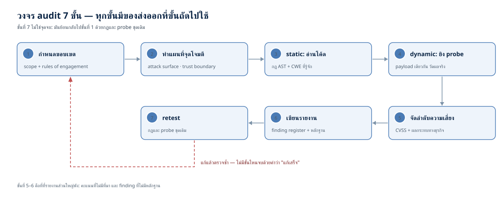
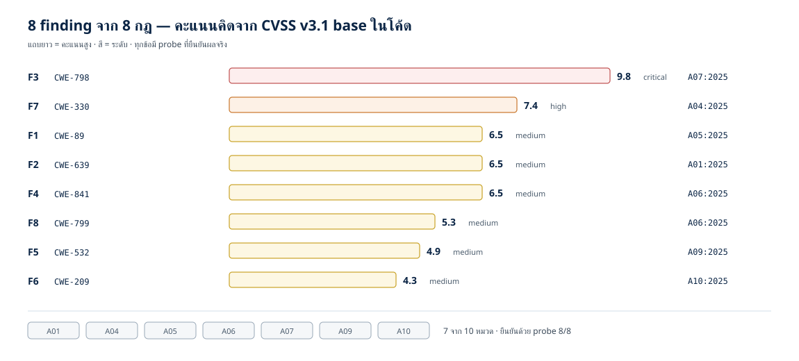
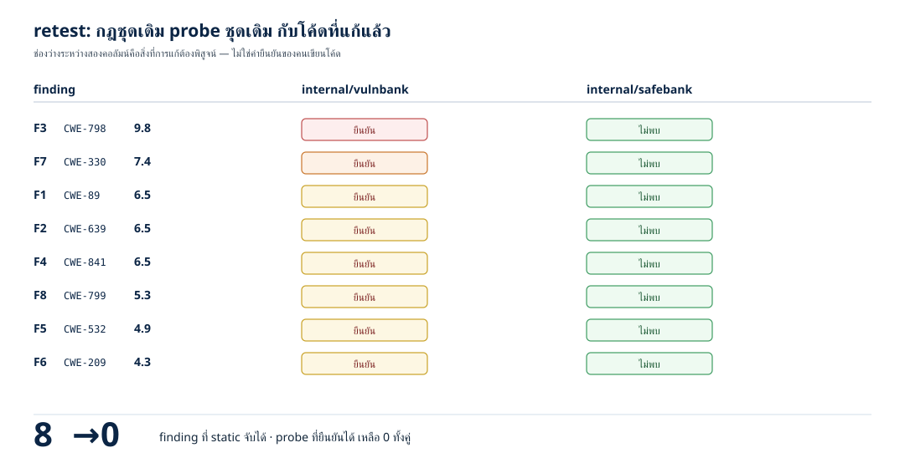

# Capstone: audit โปรเจกต์จริงตั้งแต่ scope ถึงรายงาน — และเส้นทางสายงานที่ต่อจากตรงนี้ (ตอนที่ 30)

> 📅 เขียนเมื่อ: 8 พฤศจิกายน 2026 (เวลาไทย, UTC+7) · รันบน Raspberry Pi 5 (`Linux 6.18.60+rpi-2712 aarch64`) ด้วย `go1.24.4 linux/arm64` — รุ่นล่าสุดตอนเขียนคือ Go 1.27.3 (ตรวจที่ go.dev/dl) แต่บทนี้ใช้เฉพาะ standard library ที่มีมานานแล้ว (`go/ast`, `go/parser`, `crypto/sha256`, `crypto/rand`, `math/rand`) และ `go.mod` ตั้ง `go 1.24` ไว้ · Python 3.13.5 · rsvg-convert 2.60.0 · ไม่มี dependency ภายนอก (`external_deps=0`) ไม่เปิดพอร์ต (`listen_calls=0`) ไม่แตะเครือข่าย (`network_dial_calls=0`) ไม่มีเวลาจริงในเส้นทางที่พิมพ์ผล (`time_now_calls=0`) · เอกสารอ้างอิงที่เปิดตรวจก่อนเขียน: หน้า OWASP Top 10:2025 ทั้งสิบหมวด (ประกาศ 6 พฤศจิกายน 2025) โดยเฉพาะ A01, A04, A05, A06, A07, A09, A10 ที่บทนี้อ้างถึงราย CWE · สเปก CVSS v3.1 ของ FIRST (หัวข้อ 7.1 และ 7.4) — FIRST ระบุว่ารุ่นปัจจุบันคือ v4.0 (พฤศจิกายน 2023) บทนี้จึงใช้ v3.1 ตามตอนที่ 16 และบอกเหตุผลไว้ในหัวข้อ 3.7 · นิยาม CWE-89, CWE-639, CWE-798, CWE-841, CWE-532, CWE-209, CWE-330, CWE-799 จาก cwe.mitre.org
>
> ⚠️ **หมายเหตุเรื่องจริยธรรม (อ่านก่อนทุกอย่าง):** เป้าหมายของบทนี้คือ `internal/vulnbank` — **แอปจำลองที่จงใจมีช่องโหว่ เขียนขึ้นเพื่อการสอนเท่านั้น ห้ามใช้จริง** ทุกอย่างทำงานในหน่วยความจำของโปรเซสเดียว ไม่มีพอร์ตเปิด ไม่มีแพ็กเก็ตออกนอกเครื่อง ไม่มีไฟล์ข้อมูลจริง · credential ทุกค่าเป็นค่าปลอม รหัสผ่านเป็น fixture ของเดโม และ "เงิน" เป็นตัวเลขใน struct · เทคนิคในบทนี้ (อ่านโค้ด ยิง payload วัดผล เขียนรายงาน) ใช้ได้เฉพาะกับระบบที่คุณเป็นเจ้าของ หรือได้รับอนุญาตเป็นลายลักษณ์อักษรพร้อมขอบเขตที่ระบุชัด — การตรวจสอบระบบของคนอื่นโดยไม่ได้รับอนุญาตเป็นความผิดทางอาญาในหลายประเทศ รวมถึงประเทศไทย และ "ฉันแค่อยากรู้" ไม่ใช่ข้อแก้ตัวในชั้นศาล · ถ้าอยากฝึกกับโค้ดของคนอื่น ให้เลือกโปรเจกต์ open-source ที่มีนโยบายรับรายงานช่องโหว่ (SECURITY.md) และทำตามนโยบายนั้น ไม่ใช่ยิงใส่ production ของเขา

---

สามสิบตอนก่อน เราเริ่มจากคำถามที่ฟังดูง่าย: **ทำไมซอฟต์แวร์ถึงไม่ปลอดภัย** แล้วเราก็เดินมาไกลพอสมควร — ผ่านหนอน Morris, stack overflow, SQL injection, XSS, Heartbleed, Log4Shell, ผ่าน CIA triad, threat modeling, least privilege, ผ่าน CVE/CWE/CVSS, OWASP, SDLC, NIST, compliance และผ่านการลงมือทำจริงตั้งแต่ input validation ไปจนถึง secrets กับ supply chain

คืนนี้ไม่มีบทเรียนใหม่ ผมจะไม่สอนเครื่องมือใหม่ ไม่มีแนวคิดใหม่ให้จด และไม่มีอะไรที่คุณยังไม่เคยเห็นใน 29 ตอนที่ผ่านมา สิ่งที่คืนนี้ทำคือ **เอาทุกอย่างที่เรียนมาใช้พร้อมกันกับโค้ดจริงหนึ่งก้อน** แล้วจบด้วยรายงานที่คนอื่นเอาไปทำงานต่อได้

นี่คือสิ่งที่แยก "คนที่เรียน security มา" กับ "คนที่ทำงาน security ได้" — ไม่ใช่ความรู้ แต่คือ **ลำดับของงาน** คนที่ทำงานได้รู้ว่าต้องเริ่มที่ไหน หยุดตรงไหน และต้องพิสูจน์อะไรก่อนจะเขียนคำว่า "ช่องโหว่" ลงในเอกสาร

ห้าตัวเลขของคืนนี้ (ทุกตัวมาจาก `out/`):

- **8 finding** จาก **8 กฎ** ในโค้ดที่ยังไม่แก้ — critical **1** · high **1** · medium **6** · low **0** · กระจายใน **7 จาก 10** หมวดของ OWASP Top 10:2025
- **8/8** finding ถูกยืนยันด้วย probe ที่วัดผลจริง — ไม่มีข้อไหนอยู่ในรายงานด้วยหลักฐานเพียง "อ่านแล้วคิดว่าน่าจะ..."
- **9.8** คือคะแนนสูงสุด (credential ฝังในซอร์ส) และ **7.4** คืออันดับสอง (token ที่ทำนายได้) — คะแนนทั้งแปดคิดจากสมการ CVSS v3.1 ในโค้ดของเราเอง
- **13000 → 1013000** คือยอดเงินรวมของระบบก่อนกับหลังคำขอโอนหนึ่งครั้งที่ **ถูกปฏิเสธ** (ผู้เรียกได้ error กลับไป แต่เงินงอกขึ้นหนึ่งล้าน)
- **8 → 0** คือผล retest: กฎชุดเดิม probe ชุดเดิม ยิงใส่โค้ดที่แก้แล้ว ได้ finding 0 และยืนยันได้ 0

## 1. แนวคิด: audit คืออะไร และต่างจากสองคำที่คนชอบใช้ปนกันตรงไหน

### 1.1 scan, pentest, audit — สามคำที่ตอบคำถามคนละข้อ

คนส่วนใหญ่ที่เพิ่งเข้าสู่วงการจะใช้สามคำนี้แทนกัน และนั่นทำให้งานที่ส่งออกมาผิดรูปตั้งแต่ต้น เพราะมันตอบคำถามคนละข้อ:

- **scan** ตอบว่า *"มีรูปแบบที่เรารู้ว่าเสี่ยงไหม"* — เครื่องมือเดินดูโค้ดหรือยิงคำขอตามรายการที่ตั้งไว้แล้วรายงานว่าพบรูปแบบนั้น ๆ มันเร็ว ทำซ้ำได้ และ **ไม่รู้บริบทเลย** ว่าข้อมูลที่มันเห็นสำคัญแค่ไหนกับธุรกิจนี้
- **pentest** ตอบว่า *"เจาะเข้าไปได้จริงไหม และไปได้ไกลแค่ไหน"* — คนจริง ๆ ใช้เวลาไม่กี่วัน พยายามทำสิ่งที่ผู้โจมตีจะทำ แล้วจบด้วยหลักฐานว่าถึงไหน (ตอนที่ 27 เราทำอันนี้ครบทั้งห้าขั้น)
- **audit** ตอบว่า *"ระบบนี้เชื่อถือได้แค่ไหน และควรทำอะไรต่อ"* — ครอบทั้งโค้ด การออกแบบ การตั้งค่า และ **หลักฐานที่ทำให้คนอื่นเชื่อได้** โดยไม่จำกัดว่าต้องมาจากเครื่องมือหรือจากคน

ความต่างที่สำคัญที่สุดไม่ได้อยู่ที่เทคนิค แต่อยู่ที่ **ของส่งออก** scan ส่งรายการ pentest ส่งหลักฐานการเจาะ audit ส่ง **การตัดสินใจ**: อะไรต้องแก้ก่อน อะไรยอมรับได้ และอะไรที่เรายังไม่รู้

ในงานจริงสามอย่างนี้อยู่ด้วยกันตลอด: audit กว้างและต่อเนื่อง, pentest เป็นช่วงสั้น ๆ ที่วัดผลได้, scan เป็นชั้นอัตโนมัติที่วิ่งทุก commit ถ้าคุณมีแค่ scan คุณจะมีรายการยาวที่ไม่มีใครแก้ ถ้าคุณมีแค่ pentest คุณจะมีหลักฐานชั่วขณะหนึ่งที่เก่าภายในสัปดาห์เดียว

### 1.2 เจ็ดขั้นที่เราจะเดินจริงในคืนนี้



ทุกขั้นมี "ของส่งออก" ที่ขั้นถัดไปใช้ และทุกขั้นมีคำถามที่คุณต้องตอบได้ก่อนไปต่อ:

| ขั้น | ของส่งออก | คำถามที่ต้องตอบได้ |
|---|---|---|
| 1. กำหนดขอบเขต | scope + rules of engagement | อะไรอยู่ในขอบเขต อะไรไม่อยู่ และใครอนุญาต |
| 2. ทำแผนที่จุดโจมตี | รายการ input, route, trust boundary | ข้อมูลจากคนนอกรับเข้าไปถึงไหนได้บ้าง |
| 3. static | finding ที่มีตำแหน่งในโค้ด | รูปแบบไหนที่โค้ดนี้ทำ และมันอยู่บรรทัดไหน |
| 4. dynamic | หลักฐานว่าผลกระทบเกิดจริง | ถ้าฉันเป็นผู้โจมตี ฉันเห็นอะไรที่ฉันไม่ควรเห็น |
| 5. จัดลำดับ | คะแนนที่มีที่มา + ผลกระทบ | ทำไมข้อนี้ก่อนข้อนั้น (ไม่ใช่ "เพราะคะแนนสูงกว่า") |
| 6. รายงาน | ทะเบียน finding + สิ่งที่ต้องแก้ | คนที่ไม่ได้อยู่ห้องนี้เข้าใจและลงมือได้ไหม |
| 7. retest | ผลของชุดเดิมบนโค้ดที่แก้แล้ว | ปิดจริงหรือแค่ดูเหมือนปิด |

ขั้นที่ 1 กับขั้นที่ 7 คือสองขั้นที่คนข้ามบ่อยที่สุด และเป็นสองขั้นที่ทำให้งานทั้งชิ้นมีค่าหรือไม่มีค่าเลย ขั้นที่ 1 เพราะถ้าไม่มีขอบเขต การทดสอบของคุณคือการบุกรุก (และรายงานของคุณใช้เถียงในศาลไม่ได้) ขั้นที่ 7 เพราะ **finding ที่ยังไม่ถูก retest คือ finding ที่ยังเปิดอยู่** ต่อให้มี commit message เขียนว่า "fix security issue" ก็ตาม

### 1.3 คำศัพท์แปดคำที่ใช้ทั้งบท

ผมจะใช้แปดคำนี้ซ้ำ ๆ ตลอดบท จึงอธิบายให้จบตรงนี้เลย:

- **finding** (ข้อค้นพบ) — ช่องโหว่ *หนึ่งข้อ* ที่เขียนเป็นข้อ ๆ พร้อมตำแหน่ง หลักฐาน และคะแนน ไม่ใช่ทั้งรายงาน และไม่ใช่ทั้งหมวด
- **finding register** (ทะเบียน finding) — ตารางที่รวม finding ทุกข้อของงานนี้ ใช้เป็นเอกสารตั้งต้นของการติดตามงาน (ใครแก้ เมื่อไร สถานะอะไร)
- **triage** (การคัดกรอง) — ตัดสินว่า finding ไหนจริง ไหนซ้ำ ไหนไม่เกี่ยว แล้วจัดลำดับก่อนลงมือ
- **severity** (ระดับความรุนแรง) — ค่าที่มาจากคะแนน ไม่ใช่ความรู้สึก: CVSS แบ่งเป็น none (0.0), low (0.1–3.9), medium (4.0–6.9), high (7.0–8.9), critical (9.0–10.0)
- **PoC** (proof of concept) — ชุดคำสั่งหรือ payload สั้น ๆ ที่ทำให้เห็นผลกระทบได้จริง โดยไม่ทำลายอะไร (ตอนที่ 27 ใช้หลัก "พิสูจน์แล้วหยุด")
- **false positive / false negative** — เครื่องมือบอกว่ามีแต่จริง ๆ ไม่มี / เครื่องมือบอกว่าไม่มีแต่จริง ๆ มี · ตัวหลังอันตรายกว่ามาก และเป็นเหตุผลที่ audit ต้องมีคนอ่านโค้ด
- **remediation** (การแก้) — การเปลี่ยนแปลงที่ทำให้ finding ปิด และต้องบอกด้วยว่า *แก้อะไร* ไม่ใช่แค่ "แก้ security"
- **chain** (เส้นเชื่อม) — finding สองข้อที่แยกกันไม่น่ากลัว แต่ต่อกันแล้วพาไปถึงสิ่งที่แย่กว่าผลรวมของทั้งสองข้อมาก

### 1.4 สี่กติกาที่ผมใช้ตัดสินทุก audit

สี่ข้อนี้จะโผล่ซ้ำในทุกหัวข้อของบท และผมอยากให้คุณพกไปใช้กับงานแรกของคุณ:

1. **ไม่มีหลักฐาน = ไม่ใช่ finding** — "โค้ดนี้น่าจะมีปัญหา" คือสมมติฐาน ไม่ใช่ข้อค้นพบ · ถ้ายังพิสูจน์ไม่ได้ ให้เขียนไว้ในหัวข้อ "สิ่งที่ยังต้องตรวจ" ไม่ใช่ในทะเบียน
2. **คะแนนต้องมีที่มา** — ถ้าคุณเขียน 9.8 ต้องตอบได้ว่ามาจาก vector ไหน และใครคำนวณ · คะแนนที่ไม่มี vector คือความเห็นที่แต่งเป็นตัวเลข
3. **ขอบเขตเขียนก่อนเริ่ม ไม่ใช่หลังเจออะไรน่าสนใจ** — scope ที่ค่อย ๆ ขยายระหว่างทางคือวิธีที่งาน audit กลายเป็นเหตุการณ์
4. **retest ด้วยชุดเดิม** — ถ้าวิธีตรวจเปลี่ยนตอน retest คุณกำลังวัดอย่างอื่น แล้วเรียกมันว่าการปิด finding

## 2. ทำไมเรื่องนี้สำคัญ: หมวดที่อันดับหนึ่งคือหมวดที่เครื่องมือจับได้แย่ที่สุด

มีข้อสังเกตหนึ่งที่ผมชอบเล่าให้นักศึกษาฟัง เพราะมันอธิบายว่าทำไมอาชีพนี้ยังต้องมีคน:

**OWASP Top 10:2025 จัดให้ Broken Access Control (A01) อยู่อันดับ 1** และหน้าเอกสารของหมวดนี้เขียนว่า **100% ของแอปที่นำมาทดสอบมีปัญหานี้รูปแบบใดรูปแบบหนึ่ง** ขณะที่หมวด Injection (A05) มี CVE มากที่สุดในสิบหมวด — ราว 62,445 ใบ (ตัวเลขที่เราตรวจในตอนที่ 17) — แต่ความชุก (prevalence) ต่ำกว่า

แปลว่าอะไร? แปลว่า **ช่องโหว่ที่พบบ่อยที่สุดในโลกคือช่องโหว่ที่ scanner จับได้แย่ที่สุด** เพราะการตรวจ access control ต้องตอบคำถามว่า "ผู้ใช้คนนี้ *ควร* เข้าถึง object นี้ไหม" ซึ่งเป็นคำถามเรื่องเจตนาและกติกาของธุรกิจ ไม่ใช่เรื่องรูปแบบของโค้ด scanner รู้ได้แค่ว่า "มี endpoint ที่รับ `id` จาก query" — มันไม่รู้ว่าบ๊อบควรอ่านใบเสร็จของอลิซได้หรือไม่

finding ที่อันดับหนึ่งของเราในคืนนี้ไม่ได้มาจาก A01 — credential ที่ฝังในซอร์ส (F3, 9.8) อยู่หมวด **A07 Authentication Failures** · และมันก็ไม่ใช่บั๊กที่ scanner ต้องฉลาดจึงจับได้ — มันง่ายจนเครื่องมือทุกตัวจับได้ แต่สิ่งที่ทำให้มันอันตรายคือ **บริบท**: ค่านั้นเปิดประตูบานที่ใหญ่ที่สุดในระบบ

และมีอีกด้านที่ต้องพูดถึงเพื่อความยุติธรรมกับเครื่องมือ: **A09 Security Logging & Alerting Failures** มี CVE เพียง **723 ใบ** ในข้อมูลของ OWASP (น้อยมากเมื่อเทียบกับ A05 ที่ 62,445 ใบ · หมวดที่มี CVE น้อยที่สุดคือ A03 supply chain เพียง 11 ใบ) และเอกสารเองก็ยอมรับว่าหมวดนี้ "ยากมากที่จะทดสอบ" — แต่ผลกระทบของมันคือ *การมองไม่เห็น* ซึ่งเป็นตัวคูณของทุกอย่างที่เหลือ ในเดโมของเรา finding ที่จะได้เลข F5 ในหัวข้อ 3.2 (รหัสผ่านใน log, 4.9) คือ finding ที่คะแนนต่ำที่สุดอันดับสอง และมันคือ finding ที่ทำให้การรั่วของ finding อื่นกินเวลานานขึ้นเป็นเดือน

นี่คือเหตุผลที่ audit ยังต้องมีคน: **คะแนนบอกความรุนแรงของ finding เดี่ยว ๆ แต่ไม่บอกว่ามันต่อกันแล้วเกิดอะไร** และไม่มีเครื่องมือไหนที่ต่อจุดให้คุณได้ — ตอนที่ 27 เราเห็นแล้วว่า finding ระดับ medium สองข้อต่อกันพาไปถึงทั้งระบบ

> **หมายเหตุเรื่องความซื่อสัตย์ของตัวเลข:** ตัวเลข OWASP ข้างบนเป็นตัวเลขที่เอกสารของ OWASP เองเผยแพร่ และในตอนที่ 17 เราตรวจแล้วว่าเอกสารชุดนั้นมีจุดที่ไม่ตรงกันเอง (เช่น A01 ที่หน้า introduction บอก 3.73% แต่ตารางบอก 3.74%) ผมจึงไม่เอามันมาคิดผลลัพธ์อะไร — ใช้เป็น *บริบท* ว่าทำไมหมวดนี้สำคัญ ไม่ใช่ใช้เป็นหลักฐานทางสถิติของงานเรา

## 3. ลงมือทำ: audit หนึ่งครั้งตั้งแต่ต้นจนจบ

### 3.1 ขอบเขต และสิ่งที่อยู่ในกล่อง

ขอบเขตของคืนนี้คือ **แอปธนาคารจำลองหนึ่งแพ็กเกจ** ที่ผมเขียนขึ้นโดยจงใจให้มีช่องโหว่แปดแบบที่เราเรียนมาแล้วในซีรีส์นี้ และ **เวอร์ชันที่แก้แล้ว** ของมันอีกหนึ่งแพ็กเกจ · ทั้งคู่ทำฟีเจอร์เดียวกัน: ล็อกอิน ค้นรายการเดินบัญชีด้วยข้อความ อ่าน statement ตามเลขบัญชี และโอนเงิน

| path | หน้าที่ |
|---|---|
| `internal/vulnbank` | เป้าหมายที่ยังไม่แก้ — ช่องโหว่ทุกจุดมีคอมเมนต์ `VULN Fx` กำกับ |
| `internal/safebank` | เป้าหมายที่แก้แล้ว — ฟีเจอร์เดิม สัญญาเดิม (`Subject`) แต่ทุกจุดที่ผิดถูกแก้ |
| `internal/audit` | เครื่องมือ: 8 กฎ static + 8 probe + ตัวสร้างรายงาน |
| `internal/cvss` | เครื่องคำนวณ CVSS v3.1 (ย้ายมาจากตอนที่ 16 และ 27 โดยไม่แก้สูตร) |
| `cmd/audit` | โปรแกรมที่รันทั้งสามอย่างเรียงกันและเขียนรายงาน |
| `gen_svgs.py` | สร้างภาพทั้งสามของบทนี้ (ตรวจ fit ก่อนวาดทุกครั้ง) |

สี่อย่างที่ **ไม่อยู่** ในขอบเขต และผมจะเขียนไว้ในรายงานด้วยเพราะมันสำคัญเท่ากับสิ่งที่อยู่: ชั้น TLS/proxy, ฐานข้อมูลจริง, race condition ภายใต้ concurrency และ dependency/supply chain (สองเรื่องหลังเราทำในตอนที่ 25 กับ 29 แล้ว) การบอกว่าอะไร *ไม่* ตรวจ เป็นส่วนหนึ่งของรายงานที่ซื่อสัตย์ ไม่ใช่ข้ออ้าง

> ทำไมต้องเป็นแอปที่เราเขียนเอง: เพราะกฎข้อแรกของคอร์สนี้คือทดสอบในสิ่งที่คุณควบคุมได้ · การ audit โปรเจกต์จริงของคนอื่นทำได้ แต่ต้องมีขอบเขตเป็นลายลักษณ์อักษรจากเจ้าของก่อน และสำหรับ mini-project ท้ายบทผมจะบอกว่าต้องทำอย่างไรให้ถูก

### 3.2 แปด finding ที่ผมจะพาคุณหา

ก่อนเปิดโค้ด ผมวางแผนไว้ว่าจะหาอะไร นี่คือสิ่งที่ต่างระหว่าง audit กับการไล่อ่านโค้ดไปเรื่อย ๆ:

| ID | ช่องโหว่ | สังเกตอะไร |
|---|---|---|
| F1 | ประกอบเงื่อนไขค้นหาด้วยการต่อสตริง | ข้อมูลของผู้ใช้ถูกอ่านเป็นไวยากรณ์ |
| F2 | อ่าน statement ตามเลขบัญชีโดยไม่ตรวจเจ้าของ | ล็อกอินแล้วไม่ได้แปลว่ามีสิทธิ์ |
| F3 | credential ฝังอยู่ในซอร์ส | ง่ายที่สุด และแรงที่สุด |
| F4 | โอนเงินแบบไม่ atomic (เครดิตปลายทางสำเร็จแล้ว แต่หักต้นทางไม่เกิด — งานชุดเดียวทำครึ่งเดียวได้) | สถานะถูกแก้ไปครึ่งทางแล้วย้อนคืนไม่ครบ |
| F5 | รหัสผ่านถูกเขียนลง log | หลักฐานที่มีอายุยืนกว่าระบบ |
| F6 | ส่ง error ภายในกลับไปให้ผู้เรียกทั้งก้อน | แผนที่ภายในหลุดออกไปฟรี ๆ |
| F7 | session token มาจาก `math/rand` ที่ seed คงที่ | ลำดับเดิมทุกครั้งที่บูต |
| F8 | ล็อกอินไม่จำกัดจำนวนครั้ง | เดารหัสได้ไม่จำกัด |

ตารางเต็มพร้อม CWE, หมวด OWASP และคะแนนอยู่ที่หัวข้อ 3.8 — ที่นี่ผมสนใจแค่ว่า "จะหาอะไร" ไม่ใช่ "ได้เท่าไร"

ดูแถว F4 กับ F8 ให้ดี เพราะมันควรทำให้คุณหยุดคิด: **CWE-841 (business logic) และ CWE-799 (การจำกัดจำนวนครั้ง) อยู่ในหมวดเดียวกันคือ A06 Insecure Design** ไม่ใช่ A01 และไม่ใช่ A07 ตามที่สัญชาตญาณบอก · นี่คือเหตุผลที่ผมย้ำในตอนที่ 17 ว่าเลขหมวดไม่ใช่ตรรกะ — มันคือการจัดกลุ่มของเอกสาร และคุณต้องเปิดหน้า A0x ของปีที่ถูกต้องดูรายการ CWE ด้วยตาตัวเองทุกครั้ง (ผมตรวจทั้งแปดตัวจากหน้าเอกสารของ OWASP ก่อนเขียนตารางนี้ และไม่มีตัวไหนที่ผมเดาจากความจำ)

### 3.3 เป้าหมาย: โค้ดที่จงใจผิด

เริ่มจากฟังก์ชันที่ทำมากที่สุดในระบบ — ล็อกอิน ฟังก์ชันเดียวนี้มีช่องโหว่สามข้อ และไม่มีข้อไหนต้องใช้ความชำนาญพิเศษจึงจะเห็น:

```go
func (b *Bank) Login(user, password string) (string, error) {
	// VULN F5: เขียนทั้ง user และรหัสผ่านดิบลง log (CWE-532)
	b.logf("login user=%s password=%s", user, password)

	// VULN F3: token ตั้งต้นของผู้ดูแลระบบอยู่ในซอร์ส → ใครอ่านซอร์สก็ล็อกอินเป็น admin ได้
	if user == "admin" && password == seedAdminToken {
		tok := b.newToken()
		b.sessions[tok] = "admin"
		return tok, nil
	}

	acc, ok := b.accounts[user]
	if !ok || acc.passHash != hashPassword(password) {
		// VULN F8: ไม่นับจำนวนครั้งที่ล้มเหลว ไม่มีการหน่วง ไม่มีการล็อกบัญชี (CWE-799)
		return "", ErrInvalidCredentials
	}
	tok := b.newToken()
	b.sessions[tok] = user
	return tok, nil
}
```

อ่านช้า ๆ ทีละบรรทัด:

- `b.logf("login user=%s password=%s", user, password)` — **F5** · รหัสผ่านดิบถูกเขียนลง log ทุกครั้งที่ล็อกอิน ไม่ว่าจะสำเร็จหรือไม่ · log ไม่ได้อยู่ที่เดียวกับฐานข้อมูล: มันถูกส่งไประบบรวมศูนย์ ถูกสำรอง ถูกเก็บนานกว่า และถูกอ่านโดยคนที่ไม่ควรเห็นรหัสผ่านของใคร (SRE, คนทำ dashboard, vendor) — นี่คือ CWE-532 และมันคือ finding ที่คะแนนต่ำแต่ผลกระทบยาวนาน
- `if user == "admin" && password == seedAdminToken` — **F3** · credential ฝังอยู่ในซอร์ส · ค่าคงที่ (constant) นี้ไหลลงไบนารี ต่อไปยัง container image, backup และ artifact ทุกชิ้นที่แจกจ่าย · ใครอ่าน repo ได้ก็ล็อกอินเป็นผู้ดูแลระบบได้ และ **ไม่มี log ไหนที่จะบอกว่าผิดปกติ** เพราะเขาล็อกอินด้วยรหัสที่ถูกต้อง
- ไม่มีการนับจำนวนครั้งที่ล้มเหลวเลย — **F8** · ไม่มีตัวนับ ไม่มีการหน่วง ไม่มีการล็อกบัญชี · ฟังก์ชันตอบ "รหัสผิด" ทุกครั้งอย่างสุภาพ ไม่จำกัดว่ากี่ครั้ง

ต่อไปคือการค้นหา ซึ่งเป็นที่อยู่ของ F1:

```go
func (b *Bank) SearchStatement(token, memo string) (int, error) {
	user, ok := b.sessions[token]
	if !ok {
		return 0, ErrNotLoggedIn
	}
	// VULN F1: ประกอบเงื่อนไขค้นหาด้วยการต่อสตริง (CWE-89) — ค่าที่ผู้ใช้ส่งมาถูก
	// อ่านเป็น "ไวยากรณ์" ของคำสั่ง ไม่ใช่ถูกมองเป็นข้อมูลก้อนหนึ่ง
	q := "owner='" + user + "' AND memo='" + memo + "'"
	n := 0
	for _, t := range b.txns {
		if evalQuery(q, t, b) {
			n++
		}
	}
	return n, nil
}
```

```go
func evalQuery(q string, t txn, b *Bank) bool {
	for _, orPart := range strings.Split(q, " OR ") {
		ok := true
		for _, andPart := range strings.Split(orPart, " AND ") {
			if !evalTerm(andPart, t, b) {
				ok = false
				break
			}
		}
		if ok {
			return true
		}
	}
	return false
}
```

`evalQuery` เป็นตัวประเมินที่ *จริง* — มันแยกเทอมด้วยตัวคั่นในสตริง (`" AND "`, `" OR "`) ไม่ใช่จากโครงสร้างคำสั่ง และนั่นคือกลไกเดียวกับ SQL engine ที่แยก token จากข้อความ raw · ผมไม่ได้ใช้ฐานข้อมูลจริงเพราะทั้งคอร์สนี้ไม่แตะไฟล์และเครือข่าย แต่กลไกของช่องโหว่ไม่ต้องใช้ฐานข้อมูล: **เมื่อข้อมูลของผู้ใช้ถูกอ่านเป็นไวยากรณ์ ผู้ใช้ก็เขียนคำสั่งได้**

ถ้า `memo` คือ `ค่าเช่า` เงื่อนไขที่ประกอบได้คือ `owner='alice' AND memo='ค่าเช่า'` — ผลลัพธ์หนึ่งรายการ ถ้า `memo` คือ `x' OR '1'='1` เงื่อนไขกลายเป็น `owner='alice' AND memo='x' OR '1'='1'` และตัวประเมินจะเห็นสองกลุ่ม: กลุ่มแรกไม่จริง แต่กลุ่มที่สอง (`'1'='1'`) จริงเสมอ · ผลคือทุกรายการของทุกบัญชี

ต่อไปคือการโอนเงิน — F4 ซึ่งเป็น finding ที่ผมภูมิใจที่สุดในเดโมนี้ เพราะมันไม่ใช่บั๊กที่ "อ่านแล้วเห็น":

```go
func (b *Bank) Transfer(token, toOwner string, amount int64) error {
	from, ok := b.sessions[token]
	if !ok {
		return ErrNotLoggedIn
	}
	src, ok := b.accounts[from]
	if !ok {
		return ErrNoAccount
	}
	dst, ok := b.accounts[toOwner]
	if !ok {
		return ErrNoAccount
	}

	// VULN F4: ใส่เครดิตให้ปลายทางก่อน แล้วค่อยตรวจยอดต้นทาง (CWE-841) — เมื่อยอด
	// ไม่พอ ฟังก์ชันคืน error แต่เครดิตถูกใส่ไปแล้ว ระบบจึง "งอก" เงินขึ้นมา
	// (fail open + ไม่ atomic) และไม่มีการตรวจว่า amount เป็นบวก
	b.credit(dst.Owner, amount)
	if src.Balance < amount {
		return ErrInsufficient
	}
	src.Balance -= amount
	return nil
}
```

ลำดับของสามบรรทัดสุดท้ายคือทั้งหมดของเรื่อง: **ให้เครดิตปลายทาง → ตรวจยอดต้นทาง → หักยอด** · ถ้ายอดไม่พอ ฟังก์ชันคืน error และ *ไม่หักยอด* แต่เครดิตที่ใส่ไปแล้วไม่ถูกย้อนกลับ · ผู้เรียกเห็นความล้มเหลว ส่วนระบบมีเงินเพิ่มขึ้นหนึ่งล้าน

และชั้น transport ที่ส่ง error ออกไป (F6):

```go
func (h *Handler) Statement(token, account string) response {
	n, err := h.bank.ReadStatement(token, account)
	if err != nil {
		// VULN F6: ส่ง err.Error() ออกไปทั้งก้อน → ผู้เรียกเห็น path ภายใน ชื่อไฟล์
		// และโครงสร้างที่เก็บข้อมูล (CWE-209)
		return respond(500, err.Error())
	}
	return respond(200, fmt.Sprintf("rows=%d", n))
}
```

`respond(500, err.Error())` คือบรรทัดที่ทำให้ path ภายในของเซิร์ฟเวอร์กลายเป็นข้อมูลที่ผู้โจมตีอ่านได้ฟรี · ในระบบจริงมันคือ `http.Error(w, err.Error(), 500)` ซึ่งพบได้ในโค้ด Go ทั่วไป และเป็นเหตุผลที่ตอนที่ 28 เราพูดถึง "error ที่ผู้ใช้เห็น" กับ "error ที่ log เก็บ" แยกกัน

### 3.4 กฎ: ทำไมต้องอ่าน AST ไม่ใช่ grep

เครื่องมือ audit ของเรามีกฎแปดข้อ ข้อละหนึ่ง finding และกฎทุกข้อมีข้อมูลครบสำหรับเขียนรายงาน (CWE, หมวด OWASP, CVSS vector, probe ที่ใช้พิสูจน์, เหตุผล, วิธีแก้) — กฎที่ไม่รู้ว่าจะรายงานอะไรไม่ควรมีอยู่

กฎส่วนใหญ่ดูซอร์สด้วย `go/ast` (AST = ต้นไม้โครงสร้างของโค้ด แตกจากซอร์สเป็นชิ้นส่วน เช่น "นี่คือการเรียกฟังก์ชัน ชื่อนี้ มีอาร์กิวเมนต์สองตัว" — อธิบายไว้ในตอนที่ 25) ไม่ใช่ regex (ค้นหาด้วยรูปแบบตัวอักษร) เพราะมีสองสิ่งที่ regex ทำไม่ได้: **ดูโครงสร้าง** และ **ดูการไม่มีอยู่**

```go
func checkMissingAuthz(f *ast.File, fset *token.FileSet, src []byte) []Hit {
	var hits []Hit
	for _, fd := range funcBody(f, func(name string) bool { return name == "ReadStatement" }) {
		hasCheck := mentionsSelector(fd.Body, "Owner")
		for _, authzCall := range []string{"authorize", "requireOwner", "canRead"} {
			if mentionsSelector(fd.Body, authzCall) {
				hasCheck = true
			}
		}
		if hasCheck {
			continue
		}
		file, line := pos(fset, fd)
		hits = append(hits, Hit{File: file, Line: line, Code: lineText(src, line)})
	}
	return hits
}
```

กฎนี้ถามว่า: ในฟังก์ชันที่ชื่อ `ReadStatement` มีการอ้างถึง `.Owner` หรือเรียกฟังก์ชันตรวจสิทธิ์ (`authorize`, `requireOwner`, `canRead`) หรือไม่ · ถ้าไม่มีเลย มันรายงาน · สังเกตว่ามันไม่ได้อ่านว่ามีคำว่า "auth" ในโค้ดไหม — มันถามถึง **โครงสร้างของการตัดสินใจ** ซึ่ง grep (ค้นหาด้วยรูปแบบตัวอักษร) ตอบไม่ได้เพราะ "การไม่ปรากฏ" ของอะไรบางอย่างในฟังก์ชันหนึ่ง ๆ เป็นคำถามเกี่ยวกับ AST ไม่ใช่เกี่ยวกับข้อความ

กฎที่สองคือตัวอย่างของสิ่งที่เครื่องมือ SAST เชิงพาณิชย์เรียกว่า flow rule — มันดู **ลำดับ**:

```go
func checkCreditBeforeCheck(f *ast.File, fset *token.FileSet, src []byte) []Hit {
	var hits []Hit
	for _, fd := range funcBody(f, func(name string) bool { return name == "Transfer" }) {
		creditLine, checkLine := 0, 0
		ast.Inspect(fd.Body, func(n ast.Node) bool {
			if call, ok := n.(*ast.CallExpr); ok && callName(call) == "credit" && creditLine == 0 {
				_, creditLine = pos(fset, call)
			}
			if ifs, ok := n.(*ast.IfStmt); ok && checkLine == 0 && mentionsSelector(ifs.Cond, "Balance") {
				_, checkLine = pos(fset, ifs)
			}
			return true
		})
		if creditLine > 0 && checkLine > 0 && creditLine < checkLine {
			file, line := pos(fset, fd)
			hits = append(hits, Hit{
				File: file, Line: line,
				Code: lineText(src, creditLine),
			})
		}
	}
	return hits
}
```

มันหาบรรทัดที่เรียก `credit` และบรรทัดของ `if` ที่ตรวจ `Balance` แล้วเทียบว่าอันไหนมาก่อน · ถ้าเครดิตมาก่อนการตรวจ มันคือ F4

ก่อนไปต่อ: กฎทุกข้อไม่ได้เขียน AST traversal เองหมด — มันใช้ helper ห้าตัวร่วมกัน · `funcBody(f, match)` คืน `*ast.FuncDecl` ของฟังก์ชันที่ชื่อผ่านเงื่อนไข (จุดเริ่มของกฎส่วนใหญ่) · `mentionsSelector(n, "Owner")` เดินทั้ง subtree แล้วถามว่าเคยอ้าง `x.Field` ชื่อนั้นไหม · `pos(fset, node)` แปลงตำแหน่งใน AST เป็น `(ไฟล์, บรรทัด)` ที่คนอ่านเปิดตามได้ · `lineText(src, line)` ดึงข้อความของบรรทัดนั้น (ตัดช่องว่างหัวบรรทัด) เพื่อแนบ "บรรทัดโค้ดจริง" ลงรายงาน · `callName(call)` คืนชื่อฟังก์ชันที่ถูกเรียก (`b.credit(...)` → `credit`) — ทั้งห้าตัวมีจุดร่วมแค่ "ทำงานกับ AST" แต่ **คืนค่าแบบต่างกันหมด**: `funcBody` คืน `[]*ast.FuncDecl`, `mentionsSelector` คืน `bool`, `pos` คืน `(ไฟล์, บรรทัด)`, `lineText` กับ `callName` คืน `string`

ตัวที่ประกอบร่างเป็น `Hit` คือ **กฎแต่ละข้อ (`checkXxx`) เอง** — มันเอา helper พวกนี้มาต่อกันเป็น `Hit` ซึ่งก็คือ struct สี่ฟิลด์ (ไฟล์, บรรทัด, โค้ด, ค่าที่จับได้) ที่แปลว่า "เจอหนึ่งตำแหน่ง" · และ `evalTerm` ในหัวข้อ 3.3 เป็นคนละชั้น: มันตัดสินเทอมเดียว (`owner='alice'`) ว่าจริงหรือเท็จ แล้ว `evalQuery` จึงรวมผลของหลายเทอมเข้าด้วยกัน

ผมต้องบอกข้อจำกัดของกฎนี้ตรง ๆ เพราะมันคือบทเรียน: **กฎนี้ผูกกับชื่อ helper (`credit`)** ถ้าคนเขียนเปลี่ยนชื่อเป็น `add` มันจะจับไม่ได้ · เครื่องมือจริงแก้เรื่องนี้ด้วย data-flow analysis (ตามค่าจากต้นทางไปปลายทาง) ไม่ใช่การเทียบชื่อ · การรู้ว่ากฎของตัวเองตาบอดตรงไหนคือทักษะเดียวกับที่ตอนที่ 25 สอนเรื่อง false negative: **เครื่องมือที่คุณไม่รู้ข้อจำกัดคือเครื่องมือที่คุณเชื่อผิดคน**

### 3.5 probe: finding ที่ไม่มีหลักฐานไม่ควรอยู่ในรายงาน

static บอกว่า "โค้ดมีรูปแบบนี้" — มันไม่บอกว่า "ผลกระทบเกิดจริง" · ชั้นที่สองของเครื่องมือเราจึงเป็น probe ที่เรียกแอปเป้าหมายด้วย payload แล้ว **วัดผลลัพธ์**

หัวใจของการออกแบบคือ probe ต้องใช้ได้กับทั้งสองเป้าหมาย ด้วยสัญญาเดียวกัน:

```go
type Subject interface {
	Name() string
	Login(user, password string) (string, error)
	SearchStatement(token, memo string) (int, error)
	ReadStatement(token, accountID string) (int, error)
	Transfer(token, toOwner string, amount int64) error
	Balance(token string) int64
	TotalSupply() int64
	Logs() []string
	StatementResponse(token, accountID string) (string, int)
}
```

`Subject` คือ interface ที่ทั้ง `vulnbank.Bank` และ `safebank.Bank` ทำได้ · ใน `cmd/audit` มี assertion สองบรรทัดที่ทำให้เรื่องนี้เป็นข้อบังคับตอนคอมไพล์ ไม่ใช่ความหวัง:

```go
var (
	_ audit.Subject = (*vulnbank.Bank)(nil)
	_ audit.Subject = (*safebank.Bank)(nil)
)
```

ในบล็อกนี้ `_ =` แปลว่า "ไม่ใช้ค่าตัวแปรนี้" แต่ compiler ยังบังคับให้ type ตรง: ฝั่งซ้ายเป็น `audit.Subject` ฝั่งขวาเป็น `*vulnbank.Bank` — ถ้า `Bank` ขาด method ใดของ `Subject` บรรทัดนี้ไม่คอมไพล์ และเพราะตัวแปรไม่มีชื่อ มันจึงไม่กินที่และไม่มีใครเผลอไปใช้

ถ้าใครแก้ลายเซ็นฝั่งใดฝั่งหนึ่ง โปรแกรมจะไม่คอมไพล์ — ดีกว่าปล่อยให้ probe พังตอนรันแล้วเจอทีหลังว่า retest ไม่ได้ทำ

probe ของ F4 วัดสิ่งที่รายงานต้องการจริง ๆ คือ *ผลกระทบ* ไม่ใช่ *อาการ*:

ในลายเซ็นของมันมีสองอย่างที่ผมยังไม่ได้อธิบาย · `Factory` คือ type `func() Subject` — ฟังก์ชันที่สร้างเป้าหมายใหม่หนึ่งอินสแตนซ์ probe แต่ละตัวจึงเริ่มจากสถานะสะอาด ไม่ปนกับตัวก่อน · พารามิเตอร์ตัวที่สองคือ `leakedSecret` ซึ่ง probe นี้ไม่ใช้ จึงเขียนเป็น `_` (พารามิเตอร์ไม่มีชื่อ — เช่นเดียวกับ `_ =` ข้างบน แต่ตำแหน่งต่างกัน)

```go
func probeTransferNotAtomic(newTarget Factory, _ string) ProbeResult {
	r := ProbeResult{Finding: "F4", Name: "transfer-not-atomic"}
	s := newTarget()
	before := s.TotalSupply()
	tok, err := s.Login("alice", demoPassword)
	if err != nil {
		r.Detail = "login=" + errText(err)
		return r
	}
	const amount = 1000000 // alice มี 1000 → คำขอต้องถูกปฏิเสธ
	errT := s.Transfer(tok, "bob", amount)
	after := s.TotalSupply()
	r.Detail = fmt.Sprintf("amount=%d err=%s total_before=%d total_after=%d", amount, errText(errT), before, after)
	r.Confirmed = errT != nil && after > before
	return r
}
```

มันวัดสองอย่าง: error ที่ได้กลับมา และ **ยอดเงินรวมของระบบก่อนกับหลัง** · ถ้า error เกิดขึ้นแต่ยอดรวมเพิ่ม นั่นคือเงินที่งอกจากอากาศ และนั่นคือสิ่งที่ต้องเขียนในรายงาน — ไม่ใช่ "ฟังก์ชัน Transfer ไม่ตรวจยอด"

probe ของ F7 ใช้อีกเทคนิคหนึ่งที่ผมชอบ เพราะมันไม่ต้องเดาอะไรเลย: **สร้างเป้าหมายใหม่สองอินสแตนซ์ แล้วล็อกอินด้วยผู้ใช้คนเดียวกัน** · ถ้าได้ token ค่าเดียวกัน แปลว่าลำดับ token ไม่ได้ขึ้นกับความสุ่มจริง — และในเดโมนี้มันได้ค่าเดียวกันจริง ๆ เพราะ `rand.NewSource(1)` ให้ลำดับเดิมทุกครั้งที่โปรเซสเริ่ม

### 3.6 ผลรัน: สิ่งที่เครื่องมือเจอ

นี่คือผลจริงจาก `go run ./cmd/audit` — ทั้งแปดข้อ เรียงจากคะแนนมากไปน้อย (ผลรันของ `safebank` และตัวชี้วัดต่าง ๆ อยู่ใน `out/01_audit.txt` ไฟล์เดียวกัน):

```text
F3  CWE-798  A07:2025 Authentication Failures
    at internal/vulnbank/bank.go:28
    code: const seedAdminToken = "SB-ADMIN-SEED-9f2c41ab77e0"
    cvss=9.8 (critical) vector=CVSS:3.1/AV:N/AC:L/PR:N/UI:N/S:U/C:H/I:H/A:H
F7  CWE-330  A04:2025 Cryptographic Failures
    at internal/vulnbank/bank.go:251
    code: func (b *Bank) newToken() string {
    cvss=7.4 (high) vector=CVSS:3.1/AV:N/AC:H/PR:N/UI:N/S:U/C:H/I:H/A:N
F1  CWE-89   A05:2025 Injection
    at internal/vulnbank/bank.go:119
    code: q := "owner='" + user + "' AND memo='" + memo + "'"
    cvss=6.5 (medium) vector=CVSS:3.1/AV:N/AC:L/PR:L/UI:N/S:U/C:H/I:N/A:N
F2  CWE-639  A01:2025 Broken Access Control
    at internal/vulnbank/bank.go:168
    code: func (b *Bank) ReadStatement(token, accountID string) (int, error) {
    cvss=6.5 (medium) vector=CVSS:3.1/AV:N/AC:L/PR:L/UI:N/S:U/C:H/I:N/A:N
F4  CWE-841  A06:2025 Insecure Design
    at internal/vulnbank/bank.go:190
    code: b.credit(dst.Owner, amount)
    cvss=6.5 (medium) vector=CVSS:3.1/AV:N/AC:L/PR:L/UI:N/S:U/C:N/I:H/A:N
F8  CWE-799  A06:2025 Insecure Design
    at internal/vulnbank/bank.go:90
    code: func (b *Bank) Login(user, password string) (string, error) {
    cvss=5.3 (medium) vector=CVSS:3.1/AV:N/AC:L/PR:N/UI:N/S:U/C:L/I:N/A:N
F5  CWE-532  A09:2025 Security Logging & Alerting Failures
    at internal/vulnbank/bank.go:92
    code: b.logf("login user=%s password=%s", user, password)
    cvss=4.9 (medium) vector=CVSS:3.1/AV:N/AC:L/PR:H/UI:N/S:U/C:H/I:N/A:N
F6  CWE-209  A10:2025 Mishandling of Exceptional Conditions
    at internal/vulnbank/bank.go:280
    code: return respond(500, err.Error())
    cvss=4.3 (medium) vector=CVSS:3.1/AV:N/AC:L/PR:L/UI:N/S:U/C:L/I:N/A:N
findings=8
```

รูปแบบของแต่ละ finding คือ: หมายเลข, CWE, หมวด, ตำแหน่ง (`ไฟล์:บรรทัด`), บรรทัดโค้ดจริง, คะแนนและ vector · การมี "บรรทัดโค้ดจริง" ในผลลัพธ์สำคัญมาก เพราะมันทำให้ finding อ้างอิงได้และตรวจซ้ำได้ — รายงานที่บอกว่า "มี hardcoded secret ที่ไหนสักแห่ง" ใช้ไม่ได้

และนี่คือผลของ probe ทั้งแปดบนเป้าหมายที่ยังไม่แก้:

```text
target: vulnbank
F1 search-injection     confirmed=1  rows_normal=1 rows_injected=5 err=nil
F2 idor-statement       confirmed=1  own_rows=2 other_rows=2 err=nil
F3 leaked-credential    confirmed=1  leaked_secret_len=26 login_as_admin=ok
F4 transfer-not-atomic  confirmed=1  amount=1000000 err=insufficient_funds total_before=13000 total_after=1013000
F5 password-in-log      confirmed=1  log_lines=1 password_in_log=1
F6 error-leak           confirmed=1  status=500 internal_path_in_body=1
F7 predictable-token    confirmed=1  two_instances_same_token=1 token_len=22
F8 no-throttle          confirmed=1  attempts=20 processed=20 blocked=0
confirmed=8/8
```

อ่านสี่บรรทัดที่สำคัญที่สุดในบล็อกนี้:

- `rows_injected=5` — อลิซค้นด้วย payload แล้วเห็น **5 รายการ** ซึ่งคือรายการทั้งหมดของทั้งสามบัญชี (ปกติเห็น 1)
- `other_rows=2` — อลิซอ่าน statement ของบ๊อบได้ 2 รายการ โดยไม่ต้องเป็นบ๊อบ
- `err=insufficient_funds total_before=13000 total_after=1013000` — คำขอถูกปฏิเสธ และเงินรวมเพิ่มขึ้น 1,000,000
- `two_instances_same_token=1 token_len=22` — สองอินสแตนซ์ที่เพิ่งบูตให้ token เดียวกัน

บรรทัดสุดท้ายของแต่ละ probe คือ `confirmed=1` หรือ `0` — และแปดบรรทัดนั้นคือสิ่งที่แยก finding ที่มีหลักฐานออกจากความคิดเห็น

### 3.7 คะแนน: 9.8 มาจากไหน และทำไม F5 ได้ 4.9 ไม่ใช่ 6.5



คะแนนทุกตัวในรายงานคิดจากสมการ CVSS v3.1 ใน `internal/cvss` — โค้ดตัวเดียวกับตอนที่ 16 ที่เราเทียบกับคะแนนที่ NVD เผยแพร่แล้วตรง 4/4 ใบ (และไฟล์ทดสอบของ repo นี้ยังรันการเทียบนั้นทุกครั้งที่ `go test ./...`)

**ทำไม v3.1 ไม่ใช่ v4.0:** FIRST ระบุว่ารุ่นปัจจุบันคือ CVSS v4.0 (พฤศจิกายน 2023) และ SIG ยังปรับเอกสารของ v4.0 อยู่ · ผมใช้ v3.1 เพราะ (ก) สูตร base ของมันตรวจเทียบกับคะแนนที่เผยแพร่ได้ตรง ๆ ซึ่งทำให้เราพิสูจน์ได้ว่าเครื่องคำนวณไม่เพี้ยน (ข) ตอนที่ 16 กับ 27 ใช้ v3.1 และการเทียบข้ามตอนเป็นประโยชน์กว่า และ (ค) งาน audit ในโลกจริงยังรายงาน v3.1 กันมาก · แต่ผมจะไม่บอกว่า v3.1 คือรุ่นล่าสุด เพราะมันไม่จริง

สามคะแนนที่ควรอธิบาย เพราะมันดู "ผิดที่" สำหรับคนที่อ่านครั้งแรก — และเพื่อให้เทียบกันได้ ผมเขียนทุกข้อในรูปแบบเดียวกัน (ตัวย่อ = ความหมาย):

- **F3 = 9.8 (critical)** · `AV:N/AC:L/PR:N/UI:N/S:U/C:H/I:H/A:H` — `AV:N` = โจมตีผ่านเครือข่าย, `AC:L` = ความซับซ้อนต่ำ, `PR:N` = **ไม่ต้องมีสิทธิ์เลย**, `UI:N` = ไม่ต้องให้เหยื่อทำอะไร, `S:U` = กระทบเฉพาะระบบที่ถูกโจมตี ไม่ลาม, `C:H` = ความลับเสียหายสูง, `I:H` = ความถูกต้องของข้อมูลเสียหายสูง, `A:H` = การให้บริการเสียหายสูง · credential ที่ฝังในซอร์สคือ finding ที่ "ง่ายที่สุดและแรงที่สุด" และนี่คือเหตุผลที่มันควรอยู่บรรทัดแรกของรายการที่ต้องแก้
- **F5 = 4.9 (medium)** · `AV:N/AC:L/PR:H/UI:N/S:U/C:H/I:N/A:N` — `AV:N` = โจมตีผ่านเครือข่าย, `AC:L` = ความซับซ้อนต่ำ, `PR:H` = ต้องมีสิทธิ์ระดับผู้ดูแลระบบ, `UI:N` = ไม่ต้องให้เหยื่อทำอะไร, `S:U` = กระทบเฉพาะระบบนี้ ไม่ลาม, `C:H` = ความลับเสียหายสูง, `I:N` = ไม่กระทบความถูกต้องของข้อมูล, `A:N` = ไม่กระทบการให้บริการ · `PR:H` คือส่วนที่ทำให้คะแนนลดลง เพราะการอ่าน log ต้องมีสิทธิ์ระดับผู้ดูแลระบบ · และนี่คือจุดที่ผมอยากให้คุณเถียงกับคะแนน: ในองค์กรจริง คนที่อ่าน log ได้มีเป็นสิบคน และรหัสผ่านที่หลุดไปใน log ใช้ได้จากที่ไหนก็ได้ · **คะแนนไม่ใช่ผลกระทบทางธุรกิจ** และรายงานที่ดีต้องมีทั้งสองคอลัมน์ (ตอนที่ 27 เจอเคสเดียวกัน: finding 6.5 ที่ทำให้ข้อมูลลูกค้าหลุด สำคัญกว่า finding 8.1 ที่แก้ยี่สิบบรรทัด)
- **F7 = 7.4 (high)** · `AV:N/AC:H/PR:N/UI:N/S:U/C:H/I:H/A:N` — `AV:N` = โจมตีผ่านเครือข่าย, `AC:H` = ความซับซ้อนสูง (ต้องสังเกตอะไรบางอย่างก่อน), `PR:N` = ไม่ต้องมีสิทธิ์, `UI:N` = ไม่ต้องให้เหยื่อทำอะไร, `S:U` = กระทบเฉพาะระบบนี้ ไม่ลาม, `C:H` = ความลับเสียหายสูง, `I:H` = ความถูกต้องเสียหายสูง, `A:N` = ไม่กระทบการให้บริการ · `AC:H` เพราะผู้โจมตีต้องสังเกต token อย่างน้อยหนึ่งอันก่อนจึงจะใช้ประโยชน์ได้ · แต่เมื่อ token มาจาก seed คงที่ การสังเกตหนึ่งครั้งก็พอสำหรับทุกครั้งต่อไป

และมีอีกเรื่องที่ต้องพูดถึง: **ผลรวมของคะแนนไม่มีความหมาย** 9.8 + 7.4 + 6.5 ไม่ใช่ 23.7 และไม่มีหน่วยอะไรที่เรียกว่า "ความไม่ปลอดภัยรวม" · CVSS ให้คะแนน finding เดี่ยว เพื่อให้เทียบและจัดลำดับได้ ไม่ใช่เพื่อบวกกัน (สเปกเองก็ไม่รองรับการใช้แบบนั้น)

### 3.8 รายงาน: ของส่งออกที่ทำให้งานนี้มีค่าหรือไม่มีค่า

รายงานที่เครื่องมือเขียนออกมาอยู่ที่ `out/02_report.md` นี่คือส่วนสรุปของผู้บริหาร:

```text
| ตัวชี้วัด | ค่า |
|---|---|
| finding ทั้งหมด | 8 |
| critical / high / medium / low | 1 / 1 / 6 / 0 |
| ยืนยันด้วย PoC | 8 จาก 8 |
| หมวด OWASP Top 10:2025 ที่พบ | 7 จาก 10 (A01 A04 A05 A06 A07 A09 A10) |
| finding ที่ควรแก้ก่อนปล่อย | 2 (critical + high) |
```

และนี่คือทะเบียน finding ทั้งแปดข้อ เรียงตามคะแนน:

```text
| ID | finding | ที่อยู่ | CWE | OWASP | CVSS | ระดับ | PoC |
|---|---|---|---|---|---|---|---|
| F3 | credential ฝังอยู่ในซอร์ส (token ตั้งต้นของผู้ดูแลระบบ) | `bank.go:28` | CWE-798 | A07:2025 | 9.8 | critical | ยืนยัน |
| F7 | session token มาจาก math/rand ที่ seed คงที่ | `bank.go:251` | CWE-330 | A04:2025 | 7.4 | high | ยืนยัน |
| F1 | ประกอบเงื่อนไขค้นหาด้วยการต่อสตริง (SQL injection) | `bank.go:119` | CWE-89 | A05:2025 | 6.5 | medium | ยืนยัน |
| F2 | อ่าน statement ตามเลขบัญชีโดยไม่ตรวจเจ้าของ | `bank.go:168` | CWE-639 | A01:2025 | 6.5 | medium | ยืนยัน |
| F4 | โอนเงินแบบไม่ atomic: ใส่เครดิตก่อนตรวจยอด | `bank.go:190` | CWE-841 | A06:2025 | 6.5 | medium | ยืนยัน |
| F8 | ล็อกอินไม่จำกัดจำนวนครั้ง | `bank.go:90` | CWE-799 | A06:2025 | 5.3 | medium | ยืนยัน |
| F5 | รหัสผ่านถูกเขียนลง log | `bank.go:92` | CWE-532 | A09:2025 | 4.9 | medium | ยืนยัน |
| F6 | ส่ง error ภายในกลับไปให้ผู้เรียกทั้งก้อน | `bank.go:280` | CWE-209 | A10:2025 | 4.3 | medium | ยืนยัน |
```

สี่อย่างที่ทำให้รายงานนี้ "ใช้ได้" และผมอยากให้คุณลอกไปใช้:

1. **ทุกแถวมีที่อยู่** (`bank.go:119`) — คนที่แก้โค้ดเปิดไปถึงบรรทัดนั้นได้ทันที ไม่ต้องถามกลับ
2. **ทุกแถวมีคะแนนและระดับ** — และคะแนนมี vector อยู่ในรายงาน (หัวข้อที่ 4 ของไฟล์) ไม่ใช่ตัวเลขลอย
3. **ทุกแถวบอกว่ายืนยันแล้วหรือยัง** — คอลัมน์ PoC · ในงานนี้ 8/8 ยืนยันแล้ว ซึ่งเป็นสถานะที่หาได้ยากในรายงานจริง (ปกติจะมีบางข้อที่ "ต้องตรวจด้วยมือ")
4. **มีหัวข้อข้อจำกัด** — สิ่งที่การตรวจนี้อาจพลาด · รายงานที่ไม่บอกข้อจำกัดของตัวเองคือรายงานที่ขอให้คนอ่านเชื่อโดยไม่ต้องคิด

### 3.9 retest: 8 → 0 และสิ่งที่พิสูจน์ว่าการแก้จริง



`internal/safebank` คือเวอร์ชันที่แก้แล้ว · ฟีเจอร์เหมือนเดิมทุกข้อ สัญญา (`Subject`) เดิม แต่ทุกจุดที่ผิดถูกแก้ — และที่สำคัญคือ **ผมไม่ได้แก้แปดจุดแบบแยกกัน** ผมแก้ที่ *หลักการ*: ทั้งแปดจุดเกิดจากหลักที่หายไปข้อใดข้อหนึ่งในแปดข้อของตารางข้างล่าง และเมื่อใส่หลักกลับเข้าไป จุดที่ผิดก็หายไปพร้อมกัน

ตัวอย่างที่ชัดที่สุดคือการโอนเงิน:

```go
func (b *Bank) Transfer(token, toOwner string, amount int64) error {
	from, ok := b.sessions[token]
	if !ok {
		return ErrNotLoggedIn
	}
	// ตรวจอินพุตก่อนแตะสถานะ: จำนวนต้องเป็นบวกและไม่เกินเพดาน
	if amount <= 0 || amount > maxTransfer {
		return ErrInvalidAmount
	}
	src, ok := b.accounts[from]
	if !ok {
		return ErrNoAccount
	}
	dst, ok := b.accounts[toOwner]
	if !ok {
		return ErrNoAccount
	}
	// ตรวจยอดให้ผ่านก่อน แล้วจึงแก้ทั้งสองฝั่งในฟังก์ชันเดียว (atomic ในหน่วยความจำ)
	if src.Balance < amount {
		return ErrInsufficient
	}
	b.applyTransfer(src, dst, amount)
	return nil
}
```

เทียบกับของเดิม: ไม่มีการแตะสถานะก่อนตรวจครบ (อินพุต → เพดาน → บัญชีมีจริง → ยอดพอ) แล้วจึงเรียก `applyTransfer` ที่แก้สองฝั่งในฟังก์ชันเดียว · มันไม่ใช่ "เพิ่ม if แล้วจบ" — มันคือการเปลี่ยน **ลำดับ** ของงาน ซึ่งเป็นสิ่งที่การแก้ security ส่วนใหญ่เป็นจริง ๆ

ผลของ probe ชุดเดิมบนโค้ดที่แก้แล้ว:

```text
target: safebank
F1 search-injection     confirmed=0  rows_normal=1 rows_injected=0 err=invalid_memo
F2 idor-statement       confirmed=0  own_rows=2 other_rows=0 err=forbidden
F3 leaked-credential    confirmed=0  leaked_secret_len=26 login_as_admin=denied
F4 transfer-not-atomic  confirmed=0  amount=1000000 err=invalid_amount total_before=13000 total_after=13000
F5 password-in-log      confirmed=0  log_lines=1 password_in_log=0
F6 error-leak           confirmed=0  status=404 internal_path_in_body=0
F7 predictable-token    confirmed=0  two_instances_same_token=0 token_len=32
F8 no-throttle          confirmed=0  attempts=20 processed=5 blocked=15
confirmed=0/8
```

อ่านคู่กันแล้วจะเห็นว่าทุกบรรทัดเป็น "ภาพสะท้อน" ของบรรทัดก่อนหน้า:

| finding | vulnbank | safebank | หลักที่ใช้แก้ |
|---|---|---|---|
| F1 injection | `rows_injected=5` | `err=invalid_memo` (ปฏิเสธก่อนถึงตัวกรอง) | ตรวจชนิดข้อมูลของอินพุตแล้วใช้คำสั่งสำเร็จรูป ไม่ต่อสตริง + ตรวจรูปแบบก่อนใช้ |
| F2 IDOR (อ่าน object ของคนอื่นได้) | `other_rows=2 err=nil` | `other_rows=0 err=forbidden` | ตรวจเจ้าของทุกครั้งที่เข้าถึง (complete mediation = ไม่มีทางลัดข้ามการตรวจ) |
| F3 credential | `login_as_admin=ok` | `login_as_admin=denied` | ไม่มีความลับในซอร์ส |
| F4 ไม่ atomic | `total 13000 → 1013000` | `total 13000 → 13000` | ตรวจให้ครบก่อนแตะสถานะ |
| F5 รหัสผ่านใน log | `password_in_log=1` | `password_in_log=0` | log เฉพาะฟิลด์ที่อนุญาต (allowlist) ไม่ log ทั้งก้อน |
| F6 error leak | `status=500 internal_path_in_body=1` | `status=404 internal_path_in_body=0` | แยก error ภายในออกจากคำตอบ |
| F7 token ทำนายได้ | `two_instances_same_token=1` | `two_instances_same_token=0` | `crypto/rand` 128 บิต |
| F8 ไม่มี throttle (ตัวจำกัดจำนวนครั้ง) | `processed=20 blocked=0` | `processed=5 blocked=15` | นับความล้มเหลว + จำกัด |

และ **static scan บน safebank ได้ 0 finding** — กฎชุดเดิม ไม่ได้ปิดกฎทิ้ง · นี่คือความต่างระหว่าง "แก้จนเครื่องมือเงียบ" กับ "แก้จนปัญหาไม่เกิด": เราต้องมีทั้งสองอย่าง และการมีทั้งสองอย่างคือเหตุผลที่ probe ต้องเป็นชุดเดิม

### 3.10 สิ่งที่ audit นี้ยังไม่ครอบคลุม (และผมจะเขียนไว้ในรายงานเสมอ)

- **race condition** — เป้าหมายเป็นโปรเซสเดียวในหน่วยความจำ การโอนสองคำขอพร้อมกันจึงไม่ถูกทดสอบ · ของจริงต้องมี concurrency test และการล็อก/transaction ที่ฐานข้อมูล
- **threat model** — ผมตรวจกับ design ที่มีอยู่ ไม่ได้ตั้งคำถามกับมัน · ถ้า design ผิดตั้งแต่ต้น (ตอนที่ 11) การตรวจโค้ดจะไม่เจอ
- **dependency และ supply chain** — ไม่มี dependency ภายนอกในเดโมนี้ จึงไม่มีอะไรให้สแกน · ในโปรเจกต์จริงนี่คือครึ่งหนึ่งของงาน (ตอนที่ 25 และ 29)
- **false negative ของกฎ** — กฎแปดข้อจับแปดแบบ · ช่องโหว่ที่ไม่มีในรายการนี้จะไม่ถูกจับ และผมไม่มีทางรู้ว่ามีกี่ข้อ · นี่คือเหตุผลที่ audit ต้องมีคนอ่านโค้ด ไม่ใช่แค่เครื่องมือ

## 4. ความผิดที่เจอซ้ำ ๆ ในการ audit

แปดข้อนี้ผมเจอทุกครั้งที่สอนหรือมีคนส่งรายงานมาให้อ่าน — และเกือบทั้งหมดไม่ใช่เรื่องเทคนิค:

| ความผิด | ทำไมมันพัง | ทำแทน |
|---|---|---|
| เริ่มจากเครื่องมือก่อนกำหนดขอบเขต | ได้รายการที่ไม่มีใครรู้ว่าครบไหม และบางครั้งเป็นการบุกรุก | เขียน scope หนึ่งหน้าก่อนติดตั้งอะไรทั้งสิ้น |
| นับ finding แทนที่จะจัดลำดับ | ทีมเห็น "38 ข้อ" แล้วไม่เริ่มสักข้อ | สองข้อแรกที่ต้องแก้ ต้องชัดเจนและมีเหตุผล |
| ใส่ finding ที่ยังพิสูจน์ไม่ได้ | ทีมเถียงข้อแรก แล้วเลิกอ่านที่เหลือ | ข้อที่ยังพิสูจน์ไม่ได้ ให้ไปอยู่ใน "สิ่งที่ต้องตรวจต่อ" |
| รวม finding ที่ไม่เกี่ยวกันเข้าข้อเดียว | หลักฐานคนละชุด แต่ถูกอ่านเป็นชุดเดียว | แยกเป็นข้อ ๆ แล้วเชื่อมด้วยหัวข้อ chain |
| ลืม retest | finding ที่ถูก "ปิด" ด้วย commit message | ยิงชุดเดิมซ้ำ และบันทึกผลไว้ในรายงาน |
| ปล่อยให้ scope โตระหว่างทาง | งานไม่มีวันจบ และความรับผิดชอบเบลอ | เขียน scope ที่ไม่รวมอะไรไว้ด้วย และอ้างมันเมื่อมีของใหม่ |
| รายงานแต่ช่องโหว่ ไม่พูดถึงการมองเห็น | ทีมแก้ช่องโหว่ แต่ยังไม่รู้ว่าถูกโจมตีอยู่ไหม | เพิ่มหัวข้อว่าเหตุการณ์นี้จะเห็นใน log ไหม และขาดอะไร |
| เขียนให้คนจ่ายเงินอ่าน แต่ไม่ให้คนแก้โค้ดอ่าน | รายงานสวยที่ไม่มีใครเปิดตอนแก้ | ทุกข้อต้องมี ที่อยู่ + วิธีแก้ + วิธีทดสอบว่าหายแล้ว |

ข้อสุดท้ายคือข้อที่ผมถือว่าสำคัญที่สุด และเป็นเหตุผลที่ทะเบียน finding ของเรามีคอลัมน์ "ที่อยู่" ตั้งแต่ต้น: **รายงานคือเครื่องมือของคนที่แก้ ไม่ใช่ใบประกาศของคนที่ตรวจ**

## 5. Checklist: ก่อน ระหว่าง และหลัง audit

**ก่อนเริ่ม**

1. ขอบเขตเป็นลายลักษณ์อักษร: ระบบไหน สภาพแวดล้อมไหน ช่วงเวลาไหน และใครอนุมัติ
2. ระบุสิ่งที่ *ไม่อยู่* ในขอบเขตให้ชัด (third-party, production data, mobile client)
3. ตกลงช่องทางและเวลาการแจ้งช่องโหว่ร้ายแรง — ระหว่างงาน ไม่ใช่หลังส่งรายงาน
4. เตรียม environment ที่แยกจากของจริง และข้อมูลที่ไม่มีข้อมูลส่วนบุคคลจริง
5. ตกลงนิยาม "ปิด" ล่วงหน้า: retest ด้วยชุดเดิมผ่าน = ปิด

**ระหว่าง**

6. จด finding ทันทีที่เห็น พร้อมตำแหน่ง (`ไฟล์:บรรทัด`) — ความจำไม่ใช่เอกสาร
7. แยกให้ชัดระหว่าง "เห็นรูปแบบ" กับ "พิสูจน์ผลกระทบได้" และบันทึกทั้งสองสถานะ
8. ทุก PoC ต้องทำลายน้อยที่สุด: พิสูจน์ว่าเข้าถึงได้แล้วหยุด ไม่ขนข้อมูลออก
9. บันทึกสิ่งที่ลองแล้วไม่สำเร็จด้วย — มันกันคนถัดไปเสียเวลาและกันการสรุปผิด
10. ตรวจว่า finding ที่เจอเกี่ยวข้องกันไหม (chain) ก่อนเขียนรายงาน
11. คิดคะแนนพร้อม vector ทันที ไม่ใช่ย้อนมาคิดทีหลัง

**หลัง**

12. เขียนหัวข้อข้อจำกัดของตัวเอง ก่อนจะเขียนข้อเสนอแนะ
13. ส่งให้คนที่แก้โค้ด ไม่ใช่แค่คนที่จ่ายเงิน
14. นัดวัน retest ตั้งแต่วันส่งรายงาน และผูก finding ที่ยังเปิดกับเจ้าของ + วันครบกำหนด
15. เพิ่มกฎหรือเทสต์ที่จับเคสนี้ได้ เพื่อไม่ให้กลับมา — แล้วพิสูจน์ว่ากฎยิงจริง

## 6. โจทย์

### 6.1 Drill — ทำในเครื่องคุณ (~60–90 นาที)

ทุกข้อทำใน `code/ep30` ของคุณเอง และตอบด้วย *ตัวเลขจากผลรัน* ไม่ใช่คำอธิบาย:

1. **ทำนายก่อนแก้** — เปลี่ยน `rand.NewSource(1)` เป็น `rand.NewSource(time.Now().UnixNano())` แล้วรัน `go run ./cmd/audit` · probe F7 จะได้ `confirmed` เท่าไร · **คำตอบ:** 0 (สองอินสแตนซ์ได้ token ต่างกัน) — และคำถามที่สำคัญกว่าคือ: นั่นแปลว่าโค้ดปลอดภัยแล้วหรือยัง (คำใบ้: ยังเป็น `math/rand` ที่ทำนายได้ถ้ารู้ state และ probe ของเราจับ *อาการ* ไม่ใช่ *สาเหตุ* — นี่คือ false negative ที่คุณสร้างเองด้วยมือ)
2. **ทำให้กฎตาบอดโดยไม่แก้อะไร** — เปลี่ยนชื่อฟังก์ชัน `credit` เป็น `add` ใน `internal/vulnbank` แล้วรัน · `findings_total` เหลือเท่าไร และ `confirmed_by_probe` เท่าไร · **คำตอบ:** 7 กับ 8 · ตัวเลขคู่นี้คือคำจำกัดความของ false negative ที่วัดได้ — และเทสต์ `TestScanFindsEight...` จะ fail ซึ่งเป็นพฤติกรรมที่ถูกต้อง (เทสต์คือคนที่จำได้ว่าเราเคยจับได้)
3. **หา finding ที่เก้า** — ในโค้ดมีช่องโหว่ที่แปดกฎไม่จับอย่างน้อยสองข้อ · ข้อแรก: session ไม่มีวันหมดอายุ (`sessions` ไม่เคยถูกลบ) · ข้อที่สอง: รหัสผ่านถูก hash ด้วย SHA-256 เปล่า ๆ ไม่มี salt · เขียนกฎเพิ่มหนึ่งข้อสำหรับข้อใดข้อหนึ่ง พร้อม CWE และ probe ที่พิสูจน์ได้
4. **คิดคะแนนด้วยมือ** — `CVSS:3.1/AV:N/AC:L/PR:L/UI:N/S:C/C:H/I:H/A:H` ได้เท่าไร · **คำตอบ:** 9.9 และเทียบกับ F1 (`PR:L`, `S:U`) ที่ได้ 6.5 · สอง vector นี้ต่างกันสาม metric และแต่ละตัวมีราคาของมัน (คิดด้วยเครื่องคำนวณใน repo): `S:U→S:C` เดี่ยว ๆ ได้ 7.7, `I:N→I:H` เดี่ยว ๆ ได้ 8.1, `I` กับ `A` เปลี่ยนด้วยกันได้ 8.8, เปลี่ยนครบสามตัวได้ 9.9 — เพราะเมื่อขอบเขตเปลี่ยน (`S:C`) ผลกระทบไปถึงระบบอื่นที่ไม่ใช่ระบบที่ถูกโจมตี
5. **เขียน probe ที่พิสูจน์ "ไม่มี" ได้** — probe F6 ปัจจุบันพิสูจน์ว่ามี path หลุด · เขียน probe ที่พิสูจน์ฝั่งตรงข้ามอย่างวัดได้: body ต้องไม่มี `/srv/`, `.db`, `ledger` และ status ต้องเป็น 404 · ถ้าโปรแกรมวันหน้าหลุดข้อความภายในอีก probe นี้ต้อง fail
6. **ทดสอบว่า "ผ่าน" ไม่ได้แปลว่าปลอดภัย** — เขียน probe เพิ่มที่โอน `500` (จำนวนที่ถูกต้อง alice มี 1000) บน vulnbank แล้วรายงานยอดรวมก่อน/หลัง · **คำตอบ:** 13000 → 13000 และ probe F4 ยัง `confirmed=1` (บั๊กยังอยู่ แต่คำขอนี้ไม่ได้กระตุ้น) · บทเรียน: การทดสอบที่ "ผ่าน" ด้วยคำขอปกติไม่ได้พิสูจน์อะไร
7. **เพิ่มการจำกัดที่ถูกที่** — ทำให้ F8 เงียบโดยไม่แตะตรรกะตรวจรหัสผ่าน — เพิ่มการเรียกตัวนับที่ต้น `Login` เช่น `b.noteAttempt(user)` แล้วรัน · กฎจะเงียบเพราะมันเห็นชื่อที่มีคำว่า attempt อยู่ในฟังก์ชัน (ไม่ใช่เพราะมีการจำกัดจริง) · แล้วตอบว่าทำไมยังไม่พอสำหรับระบบจริง (คำใบ้: ต้องนับต่อบัญชี ไม่ใช่ต่อโปรเซส และต้องมี alert)
8. **อ่านรายงานแบบผู้บริหาร** — เปิด `out/02_report.md` แล้วตอบในสามบรรทัด: ต้องแก้สองข้อแรกอะไร เพราะอะไร และถ้าแก้ได้ข้อเดียวจะเลือกข้อไหน · คำตอบที่ดีต้องอ้างทั้งคะแนนและผลกระทบ ไม่ใช่อ้างคะแนนอย่างเดียว

### 6.2 Mini-project — "audit หนึ่งโปรเจกต์ เขียนหนึ่งรายงาน" (~8–12 ชั่วโมง)

เลือก **โปรเจกต์ของคุณเอง** หรือ **โปรเจกต์ open-source ที่มี `SECURITY.md`** แล้วทำครบหกข้อ:

1. **scope หนึ่งหน้า** — ระบบอะไร ขอบเขตไหน สิ่งที่ไม่อยู่ในขอบเขต และถ้าเป็น open-source: ลิงก์นโยบายรับรายงาน + ยืนยันว่าคุณทดสอบบน fork/สำเนาของตัวเองเท่านั้น
2. **ห้ากฎของตัวเอง** — อย่างน้อยหนึ่งกฎแบบ "absence" (หาการไม่มีอยู่ของสิ่งที่ควรมี) และหนึ่งกฎแบบ "order" (หาลำดับที่ผิด) · ต้องมี CWE ทุกข้อ
3. **สาม probe ที่วัดผลกระทบ** — ไม่ใช่วัดอาการ · ต้องมีตัวเลขก่อน/หลังที่อ้างในรายงานได้
4. **แปด finding ที่มี vector** — คิด CVSS เองพร้อม vector และตรวจคะแนนด้วยเครื่องคำนวณที่เขียนเองหรือของ FIRST
5. **รายงานหกหัวข้อ** — สรุปผู้บริหาร, ทะเบียน finding, chain, สิ่งที่ต้องแก้, retest, ข้อจำกัด
6. **retest และปิดงานอย่างซื่อสัตย์** — ข้อที่ยังเปิดต้องมีเจ้าของ วันครบกำหนด และระบุว่าเป็นความเสี่ยงที่ยอมรับ ไม่ใช่กลบด้วยคำว่า "แก้แล้ว"

ถ้าเลือก open-source: **อย่าเพิ่งเผยแพร่** · ส่งให้ผู้ดูแลก่อน ให้เวลาตามนโยบายของเขา (หลายโปรเจกต์ใช้ราว 90 วัน) และถ้าเขาไม่ตอบ ให้ถาม CERT/CC หรือผู้ประสานงานระดับประเทศตามขั้นตอน · การโพสต์ช่องโหว่ที่ยังไม่แก้ลงที่สาธารณะทำให้ผู้ใช้จริงตกอยู่ในความเสี่ยง ซึ่งเป็นคนละเรื่องกับการเป็น "นักวิจัยที่กล้าหาญ"

## 7. เส้นทางสายงาน: จากตรงนี้ไปได้ทางไหน

ถ้าทำ mini-project ข้างบนจบ คุณมีงานหนึ่งชิ้นที่พูดแทนคุณได้ — และคำถามที่ผมได้ยินบ่อยที่สุดหลังจบคอร์สคือ "แล้วต้องทำอะไรต่อ" คำตอบไม่ใช่ใบรับรองและไม่ใช่เครื่องมือ แต่คือ **เลือกสายที่ตรงกับสิ่งที่คุณทนทำซ้ำได้** เพราะงาน security ทุกสายมีส่วนที่ซ้ำและน่าเบื่อ

| สาย | งานประจำวัน | ทักษะแกน | เริ่มจาก |
|---|---|---|---|
| Secure developer | เขียนโค้ดพร้อม security requirement และรีวิวของทีม | การออกแบบ API, threat modeling, testing | โปรเจกต์ตัวเองหนึ่งตัวที่มี threat model |
| AppSec engineer | ทำ SAST/DAST, triage, ช่วยทีมแก้, สร้าง guardrail | อ่านโค้ดหลายภาษา, false positive triage | งานนี้ (audit + รายงาน) ทำซ้ำกับ repo จริง |
| Pentester / offensive | ทดสอบเจาะระบบตามขอบเขต เขียนรายงาน | recon, exploitation, การเขียน PoC ที่ปลอดภัย | lab ของตัวเอง (ตอนที่ 27) + bug bounty ที่มี scope ชัด |
| Security engineer (infra/cloud) | IAM, network, secrets, hardening, pipeline | OS/network, IaC, identity | ตอนที่ 12–13 และ 29 แล้วลงมือกับระบบของคุณเอง |
| Detection & response | เขียน detection rule, ตอบเหตุการณ์, forensics | log, สถิติ, การสืบสวน | ตอนที่ 28 + ฝึกกับ dataset สาธารณะ |
| Security researcher | หาช่องโหว่ใหม่ เขียน advisory | ความลึกของ memory/compiler/crypto | อ่านซอร์สของโปรเจกต์ใหญ่ + fuzzing (ตอนที่ 7, 25) |
| GRC / compliance | แปลงมาตรฐานเป็นกระบวนการ ตรวจหลักฐาน | NIST/ISO, กฎหมาย, การเขียนเอกสาร | ตอนที่ 18–20 + audit ภายในองค์กรตัวเอง |
| Security architect | ออกแบบระบบและขอบเขตความเชื่อใจ | สถาปัตยกรรม, trade-off, การสื่อสาร | งานออกแบบจริงหนึ่งระบบ + บทเรียนตอนที่ 10–15 |

**คำย่อในตารางนี้:** IAM = ระบบจัดการตัวตนและสิทธิ์ · IaC = เขียนโครงสร้างระบบเป็นโค้ด · hardening = ปิดช่องที่เปิดเกินจำเป็น · GRC = governance/risk/compliance · OSCP = ใบรับรองสายทดสอบเจาะระบบ · CISSP = ใบรับรองสายบริหารความปลอดภัย (สองใบสุดท้ายมีข้อกำหนดประสบการณ์และค่าสอบของตัวเอง)

ห้าทักษะที่ทุกสายต้องการจริง ๆ (และเรียนได้จากคอร์สนี้):

1. **อ่านโค้ดคนอื่นได้เร็ว** — ไม่ใช่แค่ภาษาที่คุณถนัด · งาน audit ครึ่งหนึ่งคือการสร้างแผนที่ในหัวจากโค้ดที่ไม่เคยเห็น
2. **เขียน PoC ที่ทำลายน้อยที่สุด** — พิสูจน์ให้เห็นพอ แล้วหยุด · คนที่ทำเกินคือคนที่ทำให้งาน security ทั้งวงการเสียความเชื่อถือ
3. **อธิบายความเสี่ยงให้คนไม่ใช่สายเทคนิคฟัง** — "ช่องโหว่นี้ทำให้ใครทำอะไรได้กับข้อมูลของใคร" ไม่ใช่ "CWE-639"
4. **รู้มาตรฐานอ้างอิง** — OWASP, CWE, CVSS, NIST SSDF · ไม่ใช่ท่องได้ แต่รู้ว่าจะเปิดหาที่ไหนและอ่านให้ถูกปี
5. **เขียนเอกสารที่คนอื่นใช้ทำงานต่อได้** — รายงานคือผลผลิต ไม่ใช่ของแถม

เรื่องใบรับรอง: **ไม่ใช่ประตูเข้า** และไม่มีใบไหนแทนผลงานได้ · ถ้าองค์กรที่คุณสมัครขอ ใบที่ถูกถามถึงบ่อยคือสายทดสอบเจาะระบบ (เช่น OSCP) และสายบริหาร/GRC (เช่น CISSP) แต่ทั้งสองใบมีข้อกำหนดประสบการณ์หรือค่าใช้จ่ายของมันเอง — ตรวจจากเว็บไซต์ผู้ให้บริการก่อนตัดสินใจ ไม่ใช่จากโพสต์ในโซเชียล

**30 วันแรกหลังจบคอร์ส** (ถ้าอยากให้สิ่งที่เรียนไม่หายไป):

1. audit โปรเจกต์ของคุณเองหนึ่งตัวให้จบตาม mini-project (หนึ่งรายงาน ไม่ต้องสมบูรณ์แบบ)
2. เขียนกฎ SAST ของตัวเองหนึ่งข้อที่จับเคสจริงในโค้ดของคุณ แล้วเพิ่มลง CI
3. อ่าน CWE Top 25 ทั้งหมด แล้วเลือกสามข้อที่เกี่ยวกับงานคุณ อ่านหน้าเต็มของมัน
4. ทำ threat model หนึ่งระบบที่คุณดูแล ตามตอนที่ 11 (หนึ่งแผนภาพ หนึ่งตาราง)
5. ตั้งเป้า: ภายใน 90 วัน มี finding หนึ่งข้อที่คุณค้นพบเองและถูกแก้จริง (ในงานหรือใน open-source ที่แจ้งอย่างถูกต้อง)

## 8. ปิดคอร์ส

สามสิบตอนแบ่งได้เป็นห้ากลุ่มที่ต่อกันเป็นเส้นเดียว:

| กลุ่ม | ตอน | สิ่งที่ติดตัวไป |
|---|---|---|
| ประวัติศาสตร์ | 1–9 | ความล้มเหลวที่เกิดซ้ำ และกลไกที่ถูกสร้างขึ้นมาแก้ |
| หลักคิด | 10–15 | CIA, threat modeling, least privilege, fail closed, trust boundary, trade-off |
| มาตรฐาน | 16–20 | ภาษากลาง: CVE/CWE/CVSS, OWASP, SSDF, ISO/NIST, กฎหมาย |
| ลงมือทำ | 21–26 | input/output, auth/session, authorization, crypto, SAST/DAST, code review |
| ปฏิบัติการ | 27–30 | pentest, logging/IR, secrets/supply chain, audit ทั้งระบบ |

และสามประโยคที่ผมอยากให้คุณพกออกไปจากซีรีส์นี้:

1. **ช่องโหว่ส่วนใหญ่ไม่ใช่ความผิดพลาดของคนโง่ แต่เป็นผลของคนฉลาดที่ทำงานภายใต้แรงกดดัน** — ทุกเคสในเก้าตอนแรกเกิดจากคนที่กำลังส่งของให้ทันเวลา ซึ่งคือสภาพที่คุณจะอยู่ทุกสัปดาห์
2. **security คือการทำให้ "ค่าเริ่มต้น" ปลอดภัย** — การตรวจสอบที่ต้องมีคนจำได้ว่าจะทำ คือการตรวจสอบที่จะถูกข้ามในวันที่งานเยอะ (นี่คือเหตุผลที่ทั้งคอร์สนี้ย้ำ fail closed, least privilege และการย้ายภาระจากคนไปที่เครื่องมือ)
3. **งานนี้จบด้วยหลักฐาน ไม่ใช่ด้วยคำยืนยัน** — 8 finding ที่ยืนยันได้ 8 ข้อ และ retest ที่เหลือ 0 คือรูปทรงของงานที่เชื่อถือได้ ไม่ว่าจะทำที่ไหนและกับระบบอะไร

ขอบคุณที่อ่านมาถึงตอนสุดท้าย ถ้าคุณทำ drill ครบทั้งแปดข้อของคืนนี้ คุณไม่ได้แค่ "อ่านจบคอร์ส" — คุณเริ่มทำงานสายนี้แล้ว

← ตอนก่อน: [Secrets และ Supply Chain: ความลับที่หลุดไปกับ git และหลักฐานว่า artifact ที่ deploy คือ artifact ที่ build (ตอนที่ 29)](/blog/post.html?slug=2026-11-07-software-security-29-secrets-supply-chain-defense)

**ตอนถัดไป: ไม่มี — นี่คือตอนสุดท้ายของซีรีส์** ถ้าอยากเริ่มใหม่ یاส่งต่อให้เพื่อน: [ตอนที่ 1 ทำไมต้อง software security](/blog/post.html?slug=2026-10-09-software-security-01-why-security-matters)

อ่านต่อย้อนหลัง: [Penetration testing เบื้องต้น (ตอนที่ 27)](/blog/post.html?slug=2026-11-05-software-security-27-pentest-basics) · [SAST/DAST และ dependency scanning (ตอนที่ 25)](/blog/post.html?slug=2026-11-03-software-security-25-sast-dast-dependency-scanning) · [OWASP Top 10:2025 (ตอนที่ 17)](/blog/post.html?slug=2026-10-26-software-security-17-owasp-top10)

---

*บทความนี้เป็นส่วนหนึ่งของซีรีส์ Software Security: จากช่องโหว่สู่การป้องกันจริง · โค้ดและผลรันทั้งหมดอยู่ใน `code/ep30/` และสร้างใหม่ได้ด้วย `bash run_all.sh` · ตัวเลขทุกตัวในบทนี้มาจาก `out/` · `internal/vulnbank` เป็นแอปที่จงใจมีช่องโหว่เพื่อการสอน — ห้ามนำไปใช้จริง และห้ามใช้เทคนิคในบทนี้กับระบบที่คุณไม่ได้รับอนุญาต*
