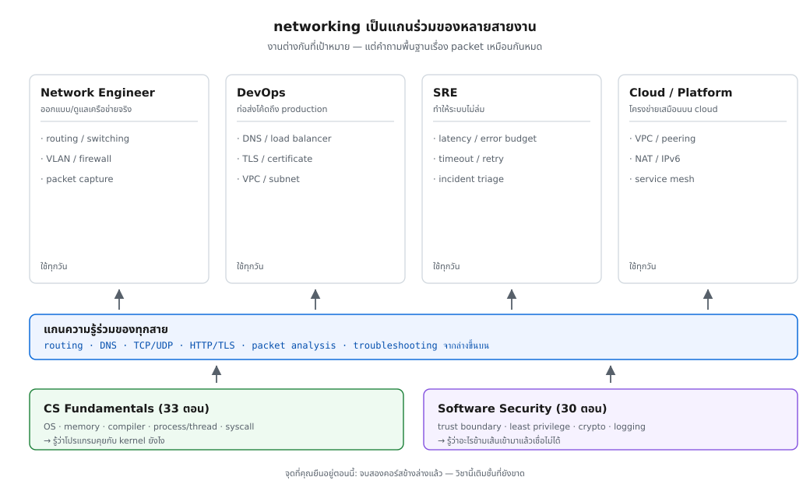
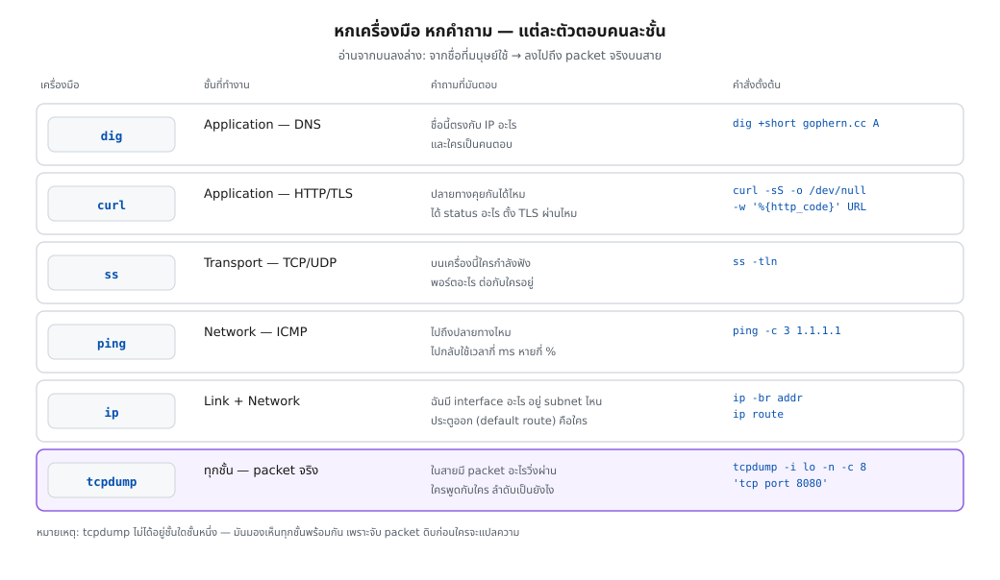

> 📅 เขียนเมื่อ: 11 พฤศจิกายน 2026 (เวลาไทย, UTC+7)
>
> **ผลรันทั้งหมดในบทนี้มาจากเครื่องเดียว** — Raspberry Pi 5, Debian GNU/Linux 13 (trixie), kernel 6.18.60, aarch64
> **เวอร์ชันที่ติดตั้งจริงบนเครื่องนี้:** Go 1.24.4, iproute2 6.15.0, iputils 20240905, BIND/dig 9.20.30, curl 8.14.1, tcpdump 4.99.5
>
> **เวอร์ชันล่าสุด ณ วันเขียน** (ก่อนใช้จริงให้ตรวจเว็บทางการของแต่ละโปรเจกต์อีกครั้ง):
> - Go **1.27.4** (10 พฤศจิกายน 2026)
> - iproute2 **7.3.0** (21 ตุลาคม 2026)
> - BIND **9.20.30** (21 ตุลาคม 2026)
> - curl **8.23.0** (14 ตุลาคม 2026)
> - tcpdump **4.99.7** (21 กันยายน 2026)
>
> ⚠️ เครื่องมือและภาษาเปลี่ยนเวอร์ชันเรื่อย ๆ และผลรันบางค่า (เวลา ping, TTL ของ DNS, พอร์ตปลายทาง) เปลี่ยนทุกครั้งที่รัน — ก่อนใช้จริงให้ตรวจเอกสารทางการล่าสุดเสมอ
> 🛡️ **จริยธรรม:** ทุกคำสั่งในซีรีส์นี้ให้รันกับ **เครื่องและ network ที่คุณควบคุมเอง** เท่านั้น — การดัก packet หรือสแกนพอร์ตในระบบของคนอื่นโดยไม่ได้รับอนุญาตผิดกฎหมายในแทบทุกประเทศ และเป็นสิ่งที่ทำให้คนทั้งวงการเสียชื่อ การเรียนรู้เรื่องนี้ไม่ได้ต้องการสิทธิ์นั้นเลย

---

ยินดีต้อนรับสู่ซีรีส์ใหม่ **Network: จากสายไฟเส้นเดียวสู่การออกแบบเครือข่ายจริง** — 30 ตอนที่ตั้งใจพาคนที่จบคอร์ส **[CS Fundamentals](/blog/post.html?slug=2026-09-05-cs-fundamentals-01-why-foundations)** (33 ตอน) และ **[Software Security](/blog/post.html?slug=2026-10-09-software-security-01-why-security-matters)** (30 ตอน) มาต่อในชั้นที่ยังขาด

ขอพูดกับคุณแบบอาจารย์ในวันแรกของวิชา: สองคอร์สที่คุณจบมาเล่าเรื่อง **เครื่องเดียว** ทั้งหมด เราเปิดเครื่อง ใส่ข้อมูลลง memory ให้ CPU ประมวลผล เขียนไฟล์ รับ input จากผู้ใช้ แล้วก็ปิดเครื่อง — ทุกอย่างจบในกล่องใบเดียว

แต่ลองคิดดูว่าตอนคุณกดโหลดหน้าเว็บหนึ่งหน้า มันเกิดอะไรขึ้น ข้อมูลไม่ได้เกิดขึ้นในเครื่องคุณ มันเดินทางมาจากเครื่องอื่นที่คุณไม่รู้จัก ผ่านอุปกรณ์ที่คุณไม่เห็น ผ่านสายที่คุณไม่ได้สัมผัส และผ่านคนกลางที่คุณไม่ได้อนุญาตให้อ่าน — แล้วมันก็มาถึงหน้าจอคุณในเวลาไม่ถึงวินาที

ช่องว่างตรงนั้นแหละ คือทั้งวิชา

## 1. networking คืออะไร — นิยามที่เอาไปทำงานได้จริง

นิยามในตำราเล่มหนา ๆ จะบอกว่า networking คือ "การเชื่อมต่อคอมพิวเตอร์เข้าด้วยกันเพื่อแลกเปลี่ยนข้อมูล" ซึ่งจริงแต่ใช้งานไม่ได้ ผมขอให้นิยามที่ผมใช้จริงเวลาทำงาน:

> **networking คือศาสตร์ของการย้าย byte จาก process หนึ่ง ไปยังอีก process หนึ่ง บนคนละเครื่อง โดยที่ชั้นล่างพังได้ตลอดเวลา และซอฟต์แวร์ของคุณยังต้องทำงานถูก**

คำนิยามนี้ยาว แต่มันบรรจุปัญหาทั้งหมดไว้ครบ — และคำที่คุณจะเจอตลอดซีรีส์คือ **packet** (ก้อนข้อมูลที่ network ตัดออกเป็นหน่วย ๆ แล้วห่อ header — ส่วนหัวที่แต่ละชั้นเติมไว้ บอกว่าข้างในคืออะไร มาจากไหน ไปไหน และของแต่ละชั้นก็เติมของตัวเองแล้วส่งต่อ) สังเกตว่ามันมีสองส่วนที่ตึงกันอยู่: ข้างบนคือ **byte จาก process ถึง process** (สิ่งที่คุณต้องการ) ข้างล่างคือ **ชั้นล่างพังได้ตลอดเวลา** (สิ่งที่โลกความจริงเป็น)

ทั้งสองส่วนนี้ไม่เคยเข้ากันได้เอง มนุษย์จึงสร้าง "สัญญาซ้อนกันเป็นชั้น" ขึ้นมากลาง ๆ แต่ละชั้นสัญญากับชั้นบนว่า "ส่งมาเถอะ เดี๋ยวจัดการให้" แล้วซ่อนความยากของตัวเองไว้ข้างล่าง นี่คือเหตุผลที่คุณเขียน `http.Get(url)` บรรทัดเดียวแล้วได้ HTML กลับมา โดยไม่ต้องรู้ว่าสายเส้นนั้นเป็นไฟเบอร์หรือ WiFi หรือ tunnel

ลองนับดูว่ามีงานอะไรบ้างที่ถูกทำซ้ำในทุกชั้น — คุณจะเจอสี่งานเดิมตลอดทั้งซีรีส์นี้:

| งาน | คำถามที่ต้องตอบ | ตัวอย่าง |
|---|---|---|
| **addressing** | ของชิ้นนี้คือใคร | MAC address (ที่อยู่ของการ์ดในวงเดียวกัน), IP address, port (หมายเลขช่องทางของ service บนเครื่องเดียว — เครื่องเดียวเปิดหลาย port พร้อมกันได้), ชื่อโดเมน |
| **routing** | จะพาไปส่งที่ไหนต่อ | routing table, default gateway, BGP (โปรโตคอลหาเส้นทางระหว่างผู้ให้บริการ internet) |
| **framing** | ขอบเขตของข้อมูลอยู่ตรงไหน | Ethernet frame, TCP segment, HTTP header |
| **reliability** | ถ้าหายไปจะรู้ได้ยังไง | checksum (เลขตรวจสอบที่คำนวณจากข้อมูล ถ้าข้อมูลเพี้ยนระหว่างทางจะรู้), ACK, retransmission, timeout |

จำตารางนี้ไว้ มันจะทำให้คุณเดาคำตอบของตอนอื่นได้ก่อนอ่านด้วยซ้ำ — เพราะทุกเทคโนโลยีที่เราจะเรียนกัน 30 ตอน คือการแก้สี่ข้อนี้ด้วยข้อจำกัดที่ต่างกัน

### ทำไมวิชานี้ถึง "มองไม่เห็น" — และทำไมนั่นคือปัญหา

การเขียนโปรแกรมปกติให้ feedback ที่ตรงไปตรงมา: โค้ดผิด → compiler บอกบรรทัด, panic → stack trace ชี้จุดตาย, query ช้า → profiler ชี้ฟังก์ชัน

network ไม่ให้อะไรแบบนั้นเลย มันให้แค่ **อาการปลายทาง**:

- request ค้าง 30 วินาทีแล้ว timeout — ตายที่ DNS? route? firewall? TLS? server? **ไม่มีใครบอก**
- หน้าเว็บโหลดได้ที่บ้าน แต่ลูกค้าบางรายโหลดไม่ได้ — ปัญหาอยู่ที่โค้ดคุณ หรือ network ของเขา
- `ping` ไม่ตอบ — เครื่องตาย หรือแค่มีคนบล็อก ICMP[^7]

นี่คือเหตุผลที่ debugging network ยากกว่า debugging โค้ด และเป็นเหตุผลที่คนที่ debug ได้กลายเป็นคนที่ทีมต้องการที่สุดตอนตีสาม — เพราะตอนนั้นโค้ดไม่ได้เปลี่ยน แต่ network เปลี่ยน

## 2. ใครจ่ายเงินให้คนที่เข้าใจเรื่องนี้

ก่อนลงมือ ผมอยากให้คุณเห็นภาพว่าความรู้นี้ไปอยู่ตรงไหนในตลาดงาน เพราะนักเรียนส่วนหนึ่งเลิกกลางทางเพราะคิดว่า "networking คือสายงานของช่างติดตั้งสาย" ซึ่งไม่จริงเลยในปี 2026



ภาพนี้อ่านจากล่างขึ้นบน: สองคอร์สที่คุณจบมาแล้วคือฐาน, แถบกลางคือความรู้ network ที่ทุกสายใช้ร่วมกัน, และสี่กล่องบนคือตำแหน่งงานที่จ่ายเงินให้ความรู้นั้น

| สายงาน | เป็นเจ้าของอะไร | วัดผลด้วยอะไร | เครื่องมือที่ใช้ทุกวัน |
|---|---|---|---|
| **Network Engineer** | อุปกรณ์และนโยบาย L1–L3 (L1 = สาย/สัญญาณ, L2 = frame ในวงเดียวกัน, L3 = IP ที่ route ข้ามเครือข่าย, L4 = TCP/UDP ที่คุม connection): switch (อุปกรณ์รวมสายในวง LAN — คนละตัวกับ switch ในโค้ด), router (อุปกรณ์เลือกเส้นทางส่ง packet ต่อไปยังเครือข่ายถัดไป), firewall (ตัวกรอง packet ตามกฎว่าใครคุยกับใครได้), routing policy | reachability, uptime, การเปลี่ยน config โดยไม่ทำให้ล่ม | `ip`, `traceroute`, `tcpdump`, config ของอุปกรณ์ |
| **DevOps** | เส้นทางจาก commit ถึง production | deploy บ่อยแค่ไหน, นานแค่ไหนกว่าจะถึงมือผู้ใช้, rollback ได้ไหม | DNS, load balancer (เครื่องหน้าที่กระจาย request ไปหลายเครื่อง), TLS certificate (ใบรับรองที่พิสูจน์ว่าเซิร์ฟเวอร์คือตัวจริง), `curl`, `dig` |
| **SRE** | ความน่าเชื่อถือของ service | SLO (เป้าความพร้อมที่ตกลงไว้), error budget (โควตาความผิดพลาดที่ยอมให้เกิด), latency p99 (99% ของ request เร็วกว่าค่านี้), เวลากู้คืน | `ss`, `tcpdump`, metric/log, trace |
| **Cloud / Platform** | โครงข่ายเสมือนบน cloud | ความแยกกันระหว่างลูกค้า, self-service ที่ปลอดภัย | VPC (เครือข่ายเสมือนส่วนตัวบน cloud), peering (ต่อสอง VPC เข้าหากัน), NAT (แปลง IP ภายในเป็น IP สาธารณะ), service mesh (ชั้น proxy ที่คุม traffic ระหว่าง service) |

ชื่อตำแหน่งพวกนี้เปลี่ยนได้ทุกสองสามปี แต่คำถามที่ต้องตอบเหมือนกันหมด: **packet ไปถึงไหนแล้ว ผ่านอะไรมาบ้าง และใครเป็นคนตัดสินใจเส้นทางนั้น**

และต่อไปนี้คือสิ่งที่ผมอยากให้คุณทดลองทำจริง ๆ ก่อนไปต่อ — เปิดประกาศงานที่คุณอยากได้สัก 10 ใบ แล้วนับว่ามีกี่ใบเขียนว่า TCP/IP, DNS, load balancing, troubleshooting network ผมจะรอ

คำตอบที่คุณจะได้เห็นคือเหตุผลที่ซีรีส์นี้มี 30 ตอน

### สายงานหนึ่งที่คนมักมองข้าม: developer ที่ debug network เป็น

ในทางปฏิบัติ คนที่ได้เปรียบที่สุดไม่ใช่คนที่จำคำสั่งได้ครบ แต่คือ **developer ที่อ่าน packet ออก** เพราะตอน incident คุณจะไม่ต้องรอทีม network มาช่วยแปล — คุณเปิด capture ดูเองได้ว่าฝั่งไหนไม่ตอบ และตอบคำถามนั้นได้ด้วยหลักฐาน ไม่ใช่ด้วยความเห็น

ผมเคยเห็นทีมเถียงกันครึ่งวันว่า "API ช้าเพราะ network" หรือ "network ปกติเพราะโค้ดช้า" — ทะเลาะกันด้วยความรู้สึก เพราะไม่มีใครมี packet ให้ดู พอมีคนเปิด capture เรื่องจบในห้านาที มันไม่ได้จบเพราะมีคนเก่งกว่า แต่จบเพราะมีหลักฐาน

## 3. ต่อยอดจากสองคอร์สที่คุณจบมาแล้ว

ผมไม่ต้องการให้คุณรู้สึกว่าเริ่มนับหนึ่งใหม่ เพราะความจริงคือคุณรู้ครึ่งหนึ่งของเรื่องนี้อยู่แล้ว แค่ยังไม่เคยเอามาเรียงในมุม network

| สิ่งที่คุณรู้แล้ว | ใน network มันกลายเป็นอะไร |
|---|---|
| **syscall / ขอบเขต user–kernel** ([ตอน 19](/blog/post.html?slug=2026-09-22-cs-fundamentals-19-syscalls-user-kernel)) | `socket` คือ syscall ตระกูลเดียวกับ `read`/`write` — network I/O ไม่ใช่เวทมนตร์ แต่คือการเรียก kernel |
| **pointer, buffer, stack/heap** ([ตอน 14](/blog/post.html?slug=2026-09-17-cs-fundamentals-14-pointers-arrays), [ตอน 16](/blog/post.html?slug=2026-09-19-cs-fundamentals-16-memory-safety-overflow)) | ทุก packet ถูกอ่านเป็น byte slice — parser ของ protocol คือโค้ดที่รับข้อมูลจากคนแปลกหน้า จึงเป็นที่อยู่ยอดนิยมของช่องโหว่ |
| **process / thread / scheduling** ([ตอน 18](/blog/post.html?slug=2026-09-21-cs-fundamentals-18-process-thread-scheduling)) | หนึ่ง process รับหลาย connection พร้อมกันได้อย่างไร คือคำถามเรื่อง concurrency ที่กำหนด throughput ของ server (throughput = ปริมาณข้อมูลที่รับส่งได้ต่อหน่วยเวลา) |
| **compile / assemble / link** ([ตอน 17](/blog/post.html?slug=2026-09-20-cs-fundamentals-17-compile-assemble-link)) | wire format คือสัญญาไบนารีระหว่างสองเครื่องที่ compiler คนละตัว — ไม่มี linker มาช่วยจับ mismatch ให้ |
| **trust boundary** ([security ตอน 14](/blog/post.html?slug=2026-10-22-software-security-14-trust-boundaries-input)) | network คือ trust boundary ที่ใหญ่ที่สุดในระบบ: อะไรก็ตามที่มาจากสาย **untrusted ทั้งหมด** |
| **least privilege / defense in depth** ([security ตอน 12](/blog/post.html?slug=2026-10-20-software-security-12-least-privilege-defense-in-depth)) | firewall rule และ ACL คือ least privilege ที่ชั้น 3/4 (IP/TCP) — หลักคิดเดียวกัน คนละที่บังคับใช้ |
| **crypto in practice** ([security ตอน 24](/blog/post.html?slug=2026-11-02-software-security-24-crypto-in-practice)) | TLS คือ crypto ที่ต้องทำงานข้ามเครื่อง กับคู่สนทนาที่คุณเพิ่งเจอเป็นครั้งแรก (หัวข้อ 5.4 ได้จับ handshake ของมันจริง) |
| **logging / incident response** ([security ตอน 28](/blog/post.html?slug=2026-11-06-software-security-28-logging-incident-response)) | flow log และ packet capture คือหลักฐานชั้นต้นของ incident — ถ้าไม่ได้เก็บไว้ ตอนเกิดเรื่องจะไม่รู้เลยว่าเกิดอะไร |

บทเรียนสำคัญที่อยากให้คุณเห็นจากตารางนี้: network ไม่ได้เพิ่มความรู้ใหม่แบบแยกส่วน — **มันเปลี่ยนคำว่า "ในเครื่องเดียว" ให้กลายเป็น "สัญญาระหว่างสองฝ่ายที่เชื่อใจกันไม่ได้"** ทุกอย่างที่คุณเคยทำได้เพราะคุมทั้งสองฝั่ง ตอนนี้ทำไม่ได้แล้ว

ตัวอย่างที่คมที่สุดคือ buffer overflow ที่คุณเรียนไปแล้ว (นั่นคือ [ตอน 16](/blog/post.html?slug=2026-09-19-cs-fundamentals-16-memory-safety-overflow)) ในเครื่องเดียว มันคือ bug; บน network มันคือช่องโหว่ที่ยิงจากอีกซีกโลกได้ เพราะ parser ของ protocol คือจุดที่ข้อมูลจากคนแปลกหน้าไหลเข้าบัฟเฟอร์ของคุณตรง ๆ — Heartbleed ที่คุณอ่านใน [security ตอน 07](/blog/post.html?slug=2026-10-15-software-security-07-heartbleed-2014) คือเรื่องนี้เป๊ะ ๆ

## 4. สี่ความคิดหลักที่ใช้ได้ตลอดซีรีส์

ก่อนจับเครื่องมือ ขอปู "แว่น" สี่อันที่จะทำให้ทุกตอนหลังจากนี้อ่านง่ายขึ้น

**หนึ่ง — ทุกอย่างเป็นชั้น และแต่ละชั้นมี header ของตัวเอง** ข้อมูลของคุณถูกห่อซ้ำ ๆ เหมือนซองจดหมายซ้อนกัน: HTTP อยู่ใน TCP, TCP อยู่ใน IP, IP อยู่ใน Ethernet frame[^1] แต่ละชั้นใส่ header ของตัวเองแล้วส่งต่อให้ชั้นล่าง ความสวยของมันคือคุณเปลี่ยนชั้นล่างได้โดยไม่ต้องแก้ชั้นบน — นี่คือเหตุผลที่ WiFi, ไฟเบอร์ และ 5G ใช้แอปเดียวกันได้หมด

**สอง — ที่อยู่มีสองแบบ และคนละหน้าที่** มนุษย์จำ **ชื่อ** (`gophern.cc`) เครื่องใช้ **หมายเลข** (`172.67.151.38`) และการเชื่อมต่อจริงใช้ **คู่หมายเลข + port** งานแปลงชื่อเป็นหมายเลขคือ DNS ซึ่งเป็นทั้งบริการที่เปราะที่สุดและถูกเพ่งเล็งที่สุดของ internet

**สาม — ไม่มีการันตีใด ๆ นอกจากสัญญา** TCP การันตีว่า byte มาครบและเรียงถูก แต่ **ไม่การันตีเวลา** — connection ที่ช้า 30 วินาทีถือว่า "สำเร็จ" ตามสัญญาของ TCP นี่คือเหตุผลที่ timeout เป็นความรับผิดชอบของคุณ ไม่ใช่ของ network

**สี่ — debug จากล่างขึ้นบน** และนี่คืออันที่สำคัญที่สุดในทางปฏิบัติ



ภาพนี้คือแผนที่การเดินทางของ packet และเครื่องมือที่ใช้ตรวจแต่ละช่วง อ่านจากบนลงล่าง: ชื่อที่มนุษย์ใช้ → DNS → HTTP → TCP → IP → สาย เมื่ออะไรพัง ให้เริ่มจากล่างสุดที่ยังผ่าน แล้วไต่ขึ้น — **อย่าเริ่มจากชั้นที่คุณเดาว่าพัง**

ลำดับที่ผมใช้จริงตอนได้แจ้งเตือนว่า service ล่ม:

1. `ip addr` / `ip route` — เครื่องยังมีที่อยู่และมีประตูออกไหม (ชั้น L2/L3)
2. `ping <gateway>` แล้ว `ping 1.1.1.1` — ออกนอกบ้านได้ไหม (ชั้น L3/ICMP)
3. `ss -tln` — process ของเราฟังอยู่จริงไหม พอร์ตถูกไหม (ชั้น L4/transport)
4. `dig <ชื่อ>` — ชื่อยังแปลงได้ไหม (DNS)
5. `curl -v <url>` — ปลายทางคุยได้ไหม ปฏิเสธที่ TLS หรือ HTTP
6. `tcpdump` — เมื่อ 1–5 ไม่ชัด ก็ดูของจริง

หกข้อนี้คือหกเครื่องมือที่เราจะตั้งให้ครบในหัวข้อถัดไป

## 5. ลงมือทำ: ติดตั้งและลองหกเครื่องมือ

### 5.0 เตรียมเครื่อง

`ip`, `ss` มาจากชุด **iproute2**, `ping` จาก **iputils**, `dig` จาก **BIND**, ที่เหลือคือ `curl` กับ `tcpdump`

```bash
# Debian / Ubuntu
sudo apt-get update
sudo apt-get install -y iproute2 iputils-ping dnsutils curl tcpdump

# Fedora / RHEL
sudo dnf install -y iproute iputils bind-utils curl tcpdump
```

หมายเหตุจากของจริง: `ip`, `ping`, `curl`, `ss` มักติดมากับเครื่องอยู่แล้ว แต่ **`dig` กับ `tcpdump` บ่อยครั้งไม่มี** (เครื่องที่ใช้เขียนบทนี้ก็ไม่มีทั้งสองตัว ต้องติดตั้งเพิ่มก่อนเริ่ม) — ตรวจให้ครบก่อนไปต่อ:

```bash
for c in ip ping dig curl ss tcpdump; do printf '%-8s ' "$c"; command -v "$c" || echo "ยังไม่มี"; done
```

คำสั่งในบทนี้ขึ้นกับ OS ต่างกันค่อนข้างมาก เพราะ `ip` เป็นเครื่องมือเฉพาะ Linux:

| OS | สิ่งที่ต้องมีก่อน | หมายเหตุ |
|---|---|---|
| Linux | แพ็กเกจข้างบน | ผลรันในบทนี้มาจาก Linux |
| macOS | `dig`, `curl`, `tcpdump` ติดมากับเครื่องแล้ว | ไม่มี `ip` — ใช้ `ifconfig`, `netstat -rn`; ถ้าอยากได้ `ip` ให้ติดตั้ง `iproute2mac` ผ่าน Homebrew |
| Windows | แนะนำ WSL2 | `tcpdump` บน Windows ต้องใช้ Npcap; ทางที่ตรงกับบทนี้ที่สุดคือรันใน WSL2 |
| WSL2 | `sudo apt-get install -y ...` | interface ที่เห็นเป็นของ WSL ไม่ใช่ของการ์ดจริง — ตัวเลขจะต่างจากเครื่อง host |

และขอย้ำอีกครั้งก่อนพิมพ์คำสั่งที่มี `tcpdump`: ทำในเครื่องและ network ของคุณเอง

### 5.1 `ip` — ฉันคือใครใน network นี้

คำถามแรกของทุกปัญหา network ไม่ใช่ "อะไรพัง" แต่คือ "ฉันคือใคร":

```bash
ip -br addr
ip route
```

ธงที่ใช้: `-br` = brief (interface ละบรรทัด ไม่ใช่ตารางกว้าง) และ `addr` = ขอดูเฉพาะส่วนที่อยู่ของแต่ละ interface

```text
## ip -br addr
lo               UNKNOWN        127.0.0.1/8 ::1/128 
eth0             DOWN           
wlan0            UP             192.168.101.134/24 fe80::dd92:c603:4454:16bf/64 
br-5a61f2026633  UP             172.18.0.1/16 
br-af6fdc106489  UP             172.20.0.1/16 
docker0          DOWN           172.17.0.1/16 
br-edd30e7bc00f  UP             172.19.0.1/16 
vethfee545d@if2  UP             
vethaca7d91@if2  UP             
veth1bc16ae@if2  UP             
vethfcd5cff@if2  UP             
veth94d6847@if2  UP             
veth015e859@if2  UP             
vethff5ea27@if2  UP             
vethe07ed82@if2  UP             
veth2ef3f4f@if2  UP             
veth0a38109@if2  UP             
tailscale0       UNKNOWN        

## ip route
default via 192.168.101.1 dev wlan0 proto static metric 600 
172.17.0.0/16 dev docker0 proto kernel scope link src 172.17.0.1 linkdown 
172.18.0.0/16 dev br-5a61f2026633 proto kernel scope link src 172.18.0.1 
172.19.0.0/16 dev br-edd30e7bc00f proto kernel scope link src 172.19.0.1 
172.20.0.0/16 dev br-af6fdc106489 proto kernel scope link src 172.20.0.1 
192.168.101.0/24 dev wlan0 proto kernel scope link src 192.168.101.134 metric 600 
```

ก่อนอ่านผลรัน ขอนิยามสองคำที่จะโผล่ทุกบรรทัด: **interface** = จุดเชื่อมเครื่องกับ network หนึ่งวง เช่น `wlan0` (WiFi) หรือ `lo` (loopback) และ **MTU** (Maximum Transmission Unit) = ขนาด packet ใหญ่สุดที่ส่งได้ในหนึ่ง frame

อ่านแบบคนทำงาน (ไม่ใช่ท่อง):

- **`lo` = loopback** — interface พิเศษที่เครื่องคุยกับตัวเอง `127.0.0.1` ไม่เคยออกจากเครื่อง ไม่ว่าอะไรจะพังก็ใช้ได้ และ MTU 65536 เพราะไม่มีสายจริงให้ต้องแบ่ง frame
- **`wlan0` ถือ `192.168.101.134/24`** — `/24` คือ prefix ที่บอกว่าเครือข่ายนี้มี 256 ที่อยู่ ตั้งแต่ `192.168.101.0` ถึง `.255`[^2] เครื่องนี้จึงมีเพื่อนบ้านได้ถึง 254 ตัวในวงเดียวกัน
- **`br-*` กับ `docker0` (`172.17–172.20`)** — bridge (สวิตช์เสมือนที่ต่อหลาย interface เข้าวงเดียวกัน) ที่ Docker สร้างขึ้นเป็น network ย่อยแยกแต่ละชุด container นี่คือเหตุผลที่เครื่องเดียวมี "หลาย network" พร้อมกันได้
- **`fe80::...` = link-local address** — ที่อยู่ IPv6 ที่ใช้คุยกับเพื่อนบ้านในสายเดียวกันเท่านั้น ออก internet ไม่ได้
- **`default via 192.168.101.1 dev wlan0`** — บรรทัดที่สำคัญที่สุดในผลรันนี้ แปลว่า "ถ้าไม่รู้จะส่งไปไหน ให้ส่งให้ `192.168.101.1` ทาง `wlan0`" นี่คือ **default gateway** ประตูบ้านของคุณ

ทำไม `ip route` มี `metric 600` ต่อท้าย? เพราะถ้าเครื่องมีหลายเส้นทางที่ใช้ได้ ระบบจะเลือกเส้นที่ metric ต่ำกว่า — WiFi ที่วัดได้ 600 แพ้สาย ethernet ที่มักเป็น 100 ถ้าคุณเสียบสาย เครื่องจะเปลี่ยนไปใช้สายเองโดยไม่ต้องบอก

> 💡 ข้อสังเกตที่คนมักงง: `eth0` ขึ้น `DOWN` แต่ถ้าถามโปรแกรม Go ในหัวข้อ 5.7 มันจะบอกว่า interface นี้ "เปิดอยู่" — ทั้งสองถูก เพราะ `DOWN` ในคอลัมน์นี้คือ **operstate** (สถานะ link) ไม่ใช่สถานะ "admin เปิด/ปิด" ซึ่งเป็นคนละเรื่องกัน

### 5.2 `ping` — ไปถึงไหม และไปกลับนานเท่าไร

`ping` ใช้โปรโตคอล **ICMP** (Internet Control Message Protocol — โปรโตคอลข้อความควบคุม/ทดสอบของ network เช่น echo request–reply ที่ `ping` ใช้) และเป็นเครื่องมือที่ถูกใช้มากที่สุด ตีความผิดมากที่สุดในบรรดาเครื่องมือทั้งหมด

```bash
ping -c 3 -W 2 1.1.1.1
```

ธงที่ใช้: `-c 3` = ส่ง 3 ครั้งแล้วหยุด และ `-W 2` = รอคำตอบไม่เกิน 2 วินาทีต่อ packet

```text
PING 1.1.1.1 (1.1.1.1) 56(84) bytes of data.
64 bytes from 1.1.1.1: icmp_seq=1 ttl=55 time=8.53 ms
64 bytes from 1.1.1.1: icmp_seq=2 ttl=55 time=11.8 ms
64 bytes from 1.1.1.1: icmp_seq=3 ttl=55 time=10.3 ms

--- 1.1.1.1 ping statistics ---
3 packets transmitted, 3 received, 0% packet loss, time 2003ms
rtt min/avg/max/mdev = 8.528/10.220/11.797/1.337 ms
```

อ่านทีละส่วน:

- **`56(84) bytes`** — ส่งข้อมูล 56 byte และ packet ทั้งหมดบนสาย 84 byte (56 + ICMP header 8 + IP header 20) ตัวเลขนี้คือหลักฐานว่า header กินพื้นที่จริง ไม่ใช่ของฟรี
- **`icmp_seq=1..3`** — ลำดับ ICMP echo request ที่เราส่งไป; ถ้าเลขกระโดดแปลว่า packet หาย
- **`ttl=55`** — ผู้ส่งตั้งต้นไว้ 64 แล้วลดลงหนึ่งทุก router ที่ผ่าน เครื่องนี้จึงอยู่ห่างราว 9 hop (hop = ผ่านอุปกรณ์หาเส้นทาง (router) มาแล้ว 1 ตัว)[^3]
- **`time=... ms`** — round-trip time (RTT) ของ packet นั้น
- **`0% packet loss`** — ไม่มี packet หายเลย

และนี่คือสิ่งที่ `ping` **ไม่ได้** บอกคุณ: ว่า service ทำงาน หรือว่าแอปคุณเร็ว

อีกอย่างที่ต้องอ่านให้เป็น: ค่า `time` ของแต่ละ packet ไม่เท่ากันเลย แม้ปลายทางจะเป็นเครื่องเดิม ความไม่สม่ำเสมอนี้เรียกว่า **jitter** เกิดจาก WiFi, การแย่ง bandwidth และ buffer ของ router — และตัวเลขจะเปลี่ยนทุกครั้งที่รัน อย่าเอาไปอ้างเป็นค่าตายตัว

ถ้าคุณต้องการตัดสิน "network ดีไหม" ให้ดู **ทั้ง** loss และ jitter ไม่ใช่แค่ค่าเฉลี่ย เพราะค่าเฉลี่ยที่ดีสามารถซ่อนหางที่แย่ได้ — ซึ่งเป็นเรื่องที่เราจะลงลึกในตอนที่ 25 (latency vs throughput)

### 5.3 `dig` — ชื่อนี้ตรงกับหมายเลขอะไร และใครเป็นคนตอบ

ก่อนเครื่องจะต่อถึง `gophern.cc` ได้ มันต้องแปลงชื่อเป็น IP ก่อน คนที่ทำหน้าที่นี้คือ resolver ในเครื่องคุณ:

```bash
grep -E '^(nameserver|search)' /etc/resolv.conf
dig +short gophern.cc A
dig +noall +comments +question +answer gophern.cc A
```

```text
## /etc/resolv.conf — resolver ที่เครื่องนี้ถามเป็นด่านแรก
nameserver 192.168.101.1
nameserver 1.1.1.1

## dig +short gophern.cc A
172.67.151.38
104.21.72.138

## dig +noall +comments +question +answer gophern.cc A
;; Got answer:
;; ->>HEADER<<- opcode: QUERY, status: NOERROR, id: 28259
;; flags: qr rd ra; QUERY: 1, ANSWER: 2, AUTHORITY: 0, ADDITIONAL: 1

;; OPT PSEUDOSECTION:
; EDNS: version: 0, flags:; udp: 1232
;; QUESTION SECTION:
;gophern.cc.			IN	A

;; ANSWER SECTION:
gophern.cc.		300	IN	A	104.21.72.138
gophern.cc.		300	IN	A	172.67.151.38
```

อ่านผลรัน:

- **`nameserver 192.168.101.1`** — resolver ตัวแรกคือ gateway ในบ้าน (มักเป็น router ที่ทำ DNS forwarder ให้) ตัวที่สอง `1.1.1.1` เป็นตัวสำรอง นี่คือเหตุผลที่ "เปลี่ยน DNS" แล้ว internet รู้สึกเร็วขึ้น — คุณเปลี่ยนคนตอบ ไม่ได้เปลี่ยนสาย
- **`dig +short`** คืนมา 2 บรรทัด = มี `A` record สองตัว ชื่อเดียวผูกกับหลาย IP ได้ และนี่คือวิธีที่ผู้ให้บริการเนื้อหาใหญ่กระจายโหลด
- **`status: NOERROR` + `ANSWER: 2`** — คำถามสำเร็จ และมีคำตอบ 2 รายการ
- **`flags: qr rd ra`** — ย่อจาก response, recursion desired, recursion available คือคำตอบนี้ผ่านการไล่ถามแทนคุณมาแล้ว ไม่ใช่คำตอบจาก authoritative ตรง ๆ (authoritative = server ที่ถือข้อมูลจริงของโดเมนนั้น ไม่ใช่ตัวกลางที่ cache ไว้)[^4]
- **ตัวเลขก่อน `IN A`** — TTL ที่เหลืออยู่: resolver บอกว่า "เก็บคำตอบนี้ไว้อีกกี่วินาที" ตัวเลขนี้จะนับลดลงทุกครั้งที่ถามซ้ำ เพราะทุกชั้น cache คำตอบไว้ (ลองรันสองครั้งติดกันแล้วเทียบ)
- **`id:`** — หมายเลขสุ่มของ query นี้ ใช้จับคู่คำถามกับคำตอบ จึงเปลี่ยนทุกครั้ง

`dig` ที่ผมใช้บ่อยที่สุดในงานจริงคือ `+short` เพราะเอาไปใช้ใน script ต่อได้ทันที (เช่น เช็คว่า DNS ยังชี้ไปที่ IP ที่เพิ่ง deploy หรือยัง)

### 5.4 `curl` — คุยกันจบไหม และได้อะไรกลับมา

`ping` บอกว่า "ถึง" แต่ไม่ได้บอกว่า "คุยกันรู้เรื่อง" — นั่นคืองานของ `curl`

คำที่ต้องรู้ก่อนอ่านผลรัน: **TLS** คือโปรโตคอลที่เข้ารหัสการเชื่อมต่อ (คนกลางที่ดัก packet ไว้จึงอ่านข้อมูลไม่ออก) และ **certificate** คือใบรับรองที่พิสูจน์ว่าเซิร์ฟเวอร์ที่คุณคุยด้วยคือตัวจริง ไม่ใช่คนกลางที่ปลอมตัวมา — สองอย่างนี้คือสิ่งที่ทำให้ `https://` ต่างจาก `http://`

```bash
curl -sS -o /dev/null \
  -w 'http_code=%{http_code}\nhttp_version=%{http_version}\nremote_ip=%{remote_ip}\nremote_port=%{remote_port}\nsize_header=%{size_header}\nssl_verify_result=%{ssl_verify_result}\n' \
  https://gophern.cc/
```

ธงที่ใช้: `-sS` = เงียบ (ปิดแถบ progress) แต่ยังโชว์ error, `-o /dev/null` = ทิ้ง body ไม่ต้องเก็บลงไฟล์ และ `-w` = พิมพ์ค่าที่เราขอผ่าน `%{...}` หลังจบ

```text
http_code=200
http_version=2
remote_ip=172.67.151.38
remote_port=443
size_header=987
ssl_verify_result=0
```

อ่านผลรัน:

- **`http_code=200`** — ปลายทางตอบว่าสำเร็จ (ถ้าเป็น `301` คือย้ายที่, `403` คือปฏิเสธ, `502` คือ proxy ต่อ upstream ไม่ได้ — รหัสพวกนี้คือภาษาแรกที่คุณต้องอ่านออก)
- **`http_version=2`** — เจรจาได้ HTTP/2 ผ่าน TLS ด้วย ALPN (กลไกให้สองฝ่ายตกลงใน TLS handshake ว่าจะพูด HTTP/2 หรือ 1.1) แปลว่าทั้งสองฝ่ายสมัยใหม่ทั้งคู่
- **`remote_ip` / `remote_port=443`** — ปลายทางจริงที่คุณคุยด้วย ในผลรันนี้เป็นหนึ่งใน IP ที่ DNS ตอบ แต่ไม่รับประกันว่าจะเป็นตัวเดิมทุกครั้ง เพราะมี CDN (เครือข่ายเครื่องสำเนาที่กระจายอยู่ทั่วโลก) และ load balancer คั่นกลางที่เลือกเครื่องให้คุณ นี่คือเหตุผลที่ "ping ไปโดเมนแล้วไม่ตอบ" ไม่ได้แปลว่าเว็บล่ม
- **`ssl_verify_result=0`** — `0` คือ "ตรวจใบรับรองผ่าน" ถ้าเป็นค่าอื่น นั่นคือสัญญาณว่า certificate/chain มีปัญหา
- **`size_header`** — ขนาด header ที่ได้กลับมา (เกือบ 1 KB ในผลรันนี้) ก่อนเนื้อหาจะเริ่มด้วยซ้ำ

เคล็ดลับที่ใช้จริง: ทำ script health check ด้วย `-w '%{http_code}'` และ `--max-time` เพราะ `curl` ที่ไม่มี timeout จะค้างได้นานจนระบบคุณค้างตาม

### 5.5 `ss` — ใครกำลังฟังอยู่บนเครื่องฉัน

ถ้า `curl` คือการมองออกไปนอกบ้าน `ss` คือการมองเข้ามาในบ้าน

```bash
ss -tln | head -12
ss -tln | grep -c LISTEN
ss -tln | grep 8080
```

ธงที่ใช้: `-t` = เฉพาะ TCP, `-l` = เฉพาะ socket ที่กำลัง listening และ `-n` = แสดงเป็นตัวเลข ไม่แปลงเป็นชื่อ service

```text
## ss -tln (12 บรรทัดแรก)
State  Recv-Q Send-Q   Local Address:Port  Peer Address:Port
LISTEN 0      100    192.168.101.134:45887      0.0.0.0:*   
LISTEN 0      50             0.0.0.0:445        0.0.0.0:*   
LISTEN 0      50             0.0.0.0:139        0.0.0.0:*   
LISTEN 0      4096         127.0.0.1:8080       0.0.0.0:*   
LISTEN 0      4096         127.0.0.1:20241      0.0.0.0:*   
LISTEN 0      4096           0.0.0.0:111        0.0.0.0:*   
LISTEN 0      4096         127.0.0.1:18554      0.0.0.0:*   
LISTEN 0      128            0.0.0.0:2222       0.0.0.0:*   
LISTEN 0      4096           0.0.0.0:2283       0.0.0.0:*   
LISTEN 0      100          127.0.0.1:1883       0.0.0.0:*   
LISTEN 0      128            0.0.0.0:8123       0.0.0.0:*   

## นับเฉพาะ TCP listener บนเครื่องนี้
28

## ss -tln | grep 8080
LISTEN 0      4096         127.0.0.1:8080       0.0.0.0:*   
```

อ่านคอลัมน์ให้เป็น:

- **`State = LISTEN`** — มี process จองพอร์ตนี้ไว้และรอ connection อยู่
- **`Local Address:Port`** — หัวใจอยู่ที่ส่วนหน้าเครื่องหมาย `:` คือ Local Address ส่วนหลังคือ port:
  - `127.0.0.1:8080` = รับเฉพาะ connection ที่มาจากในเครื่องเดียวกัน — คนนอกเข้ามาไม่ได้
  - `0.0.0.0:445` = รับจาก **ทุก** interface — ใครก็ตามที่ต่อมาถึงเครื่องคุณได้ ก็คุยกับพอร์ตนี้ได้ ตามพอร์ตมาตรฐาน: 445 = SMB (แชร์ไฟล์ Windows), 139 = NetBIOS, 111 = rpcbind, 1883 = MQTT (โปรโตคอล IoT)
  
  ความต่างระหว่างสองบรรทัดนี้คือความต่างระหว่าง "บริการภายใน" กับ "ช่องทางที่เปิดสู่โลก" — และเป็นจุดที่คนเปิด database ทิ้งไว้ให้ทั้ง internet เห็นบ่อยที่สุด
- **`Recv-Q` / `Send-Q` ตอนเป็น LISTEN** — สองคอลัมน์นี้ไม่ได้แปลว่าข้อมูลค้าง แต่แปลว่า **คิว connection ที่รออยู่** กับ **ขนาดคิวสูงสุด** (`0/4096` = ยังไม่มีใครรอ และรับรอได้สูงสุด 4096) ถ้า `Recv-Q` เริ่มสูงค้าง แปลว่าแอปคุณรับ connection ไม่ทัน — ซึ่งเป็นอาการที่คนมักโทษ network ทั้งที่คอขวดอยู่ที่แอป[^6]
- **`grep -c LISTEN`** — เครื่องนี้มี TCP listener 28 รายการ ทุกตัวคือพื้นที่โจมตีที่ต้องอธิบายได้ว่าทำไมเปิด

ถ้าอยากรู้ว่า process ไหนถือพอร์ต ให้ `sudo ss -tlnp` (ต้องมีสิทธิ์เพราะเป็นการดู process ของคนอื่น)

### 5.6 `tcpdump` — ดูของจริงบนสาย

นี่คือเครื่องมือที่เปลี่ยนคนจาก "เดา" เป็น "รู้" แต่ก็เป็นตัวที่ต้องใช้อย่างมีความรับผิดชอบที่สุด

เราจะไม่ดัก traffic ที่ออก internet แต่จะสร้าง traffic ของเราเองบน **loopback** ซึ่งไม่มีใครได้รับผลกระทบ — และได้ผลพลอยได้คือเห็น handshake ครบทุก packet

ก่อนอื่น เขียน server จิ๋วใน Go ที่ฟังเฉพาะ `127.0.0.1:8080`:

```go
// server — HTTP server จิ๋วบน loopback สำหรับเดโม packet capture
// รัน: go run ./capture   (ฟังที่ 127.0.0.1:8080 เท่านั้น)
package main

import (
	"fmt"
	"net"
	"net/http"
	"os"
)

func main() {
	ln, err := net.Listen("tcp", "127.0.0.1:8080")
	if err != nil {
		fmt.Fprintln(os.Stderr, "listen ไม่ได้:", err)
		os.Exit(1)
	}
	// บอกผู้เรียก (run_all.sh) ว่า "พร้อมรับแล้ว" — พิมพ์แล้ว flush ทันที
	fmt.Printf("listening on %s\n", ln.Addr())

	mux := http.NewServeMux()
	mux.HandleFunc("/", func(w http.ResponseWriter, r *http.Request) {
		fmt.Printf("request: %s %s from %s\n", r.Method, r.URL.Path, r.RemoteAddr)
		w.Header().Set("Content-Type", "text/plain; charset=utf-8")
		fmt.Fprintln(w, "hello from loopback")
	})

	if err := http.Serve(ln, mux); err != nil {
		fmt.Fprintln(os.Stderr, "serve จบ:", err)
	}
}
```

จากนั้นเปิดสามหน้าต่าง (หรือสาม terminal):

```bash
# หน้าต่าง 1 — server
go run ./capture

# หน้าต่าง 2 — ดัก packet (ต้องมีสิทธิ์ระดับ raw socket)
sudo tcpdump -i lo -n -c 8 'tcp port 8080'

# หน้าต่าง 3 — ทำให้เกิด traffic
curl -sS http://127.0.0.1:8080/
```

ธงที่ใช้: `-i lo` = ฟังบน interface `lo` (loopback), `-n` = ไม่แปลง IP/port เป็นชื่อ, `-c 8` = เก็บ 8 packet แล้วหยุด และ `'tcp port 8080'` คือ filter (BPF) ให้เก็บเฉพาะ traffic ของพอร์ตนี้

ผลจากฝั่ง server:

```text
listening on 127.0.0.1:8080
request: GET / from 127.0.0.1:38324
```

ผลจากฝั่ง client:

```text
## curl http://127.0.0.1:8080/ (ทำให้เกิด traffic บน loopback)
body: hello from loopback
```

และผลจากฝั่งสาย — packet ดิบ 8 packet:

```text
23:24:09.235368 IP 127.0.0.1.38324 > 127.0.0.1.8080: Flags [S], seq 860855566, win 65495, options [mss 65495,sackOK,TS val 590869150 ecr 0,nop,wscale 10], length 0
23:24:09.235388 IP 127.0.0.1.8080 > 127.0.0.1.38324: Flags [S.], seq 2733050652, ack 860855567, win 65483, options [mss 65495,sackOK,TS val 2045516163 ecr 590869150,nop,wscale 10], length 0
23:24:09.235403 IP 127.0.0.1.38324 > 127.0.0.1.8080: Flags [.], ack 1, win 64, options [nop,nop,TS val 590869150 ecr 2045516163], length 0
23:24:09.235455 IP 127.0.0.1.38324 > 127.0.0.1.8080: Flags [P.], seq 1:79, ack 1, win 64, options [nop,nop,TS val 590869150 ecr 2045516163], length 78: HTTP: GET / HTTP/1.1
23:24:09.235463 IP 127.0.0.1.8080 > 127.0.0.1.38324: Flags [.], ack 79, win 64, options [nop,nop,TS val 2045516163 ecr 590869150], length 0
23:24:09.235678 IP 127.0.0.1.8080 > 127.0.0.1.38324: Flags [P.], seq 1:138, ack 79, win 64, options [nop,nop,TS val 2045516163 ecr 590869150], length 137: HTTP: HTTP/1.1 200 OK
23:24:09.235689 IP 127.0.0.1.38324 > 127.0.0.1.8080: Flags [.], ack 138, win 64, options [nop,nop,TS val 590869150 ecr 2045516163], length 0
23:24:09.235759 IP 127.0.0.1.38324 > 127.0.0.1.8080: Flags [F.], seq 79, ack 138, win 64, options [nop,nop,TS val 590869150 ecr 2045516163], length 0
```

สรุปจาก tcpdump เอง:

```text
8 packets captured
20 packets received by filter
0 packets dropped by kernel
```

สองบรรทัดแรกนี้ไม่ขัดกัน: `20 packets received by filter` นับทุก packet ที่ filter เห็น ซึ่งบน `lo` packet เดียวถูกมองเห็นสองรอบ (ขาออกและขาเข้า) ส่วน `8 packets captured` คือจำนวนที่เก็บจริง ซึ่ง `-c 8` สั่งให้หยุดที่ 8 พอดี

ตอนผมเห็นผลรันนี้ครั้งแรกสมัยเรียน ผมเข้าใจทันทีว่าทำไมอาจารย์ถึงบังคับให้ดู packet ก่อนอ่านตำรา — เพราะทุกอย่างที่ตำราบอก อยู่ในแปดบรรทัดที่ดักไว้ครบ — เริ่มจากตัวอักษรตัวเดียวอย่าง `S` หรือ `F.` ที่บอกสถานะของ connection ได้ทั้งเรื่อง[^5]

อ่านตามลำดับ (ตัวเลข port ปลายทางเป็น ephemeral port ที่ OS สุ่มให้ เปลี่ยนทุกครั้ง):

| # | flags | ความหมาย |
|---|---|---|
| 1 | `[S]` | client ขอเปิด connection (SYN) พร้อม `seq` เริ่มต้น |
| 2 | `[S.]` | server ตอบรับ (SYN+ACK) พร้อม `seq` ของตัวเองและ `ack` เลขถัดไปของ client |
| 3 | `[.]` | client ตอบ ACK — **ครบ 3 ขั้น (three-way handshake)** ต่อได้แล้ว |
| 4 | `[P.]` | client ส่งข้อมูลจริง: `GET / HTTP/1.1` ยาว 78 byte (P = PSH = "ส่งขึ้นไปให้แอปเลย") |
| 5 | `[.]` | server รับทราบ (ACK) |
| 6 | `[P.]` | server ตอบ `HTTP/1.1 200 OK` ยาว 137 byte |
| 7 | `[.]` | client รับทราบ (ACK) |
| 8 | `[F.]` | client ปิด connection (FIN) |

ตารางนี้ยังไม่ครบลำดับปิด connection เพราะ `-c 8` ตัดก่อน — request เดียวจบที่ **10 packet** ยังขาด `[F.]` (FIN จากฝั่ง server) และ `[.]` (ACK สุดท้ายจาก client) อีกสองตัว นั่นคือเหตุผลที่ `received by filter` ขึ้นไปถึง 20 (10 packet × 2 ด้าน)

สามอย่างที่ควรสังเกต:

1. **`seq 1:79` กับ `ack 1` เป็นเลข relative** ไม่ใช่เลขจริงใน packet — tcpdump แปลงให้อ่านง่ายขึ้น มิฉะนั้นคุณจะเห็นเลขสุ่มสิบหลักที่ไม่มีใครอ่านออก
2. **จำนวน packet น้อยกว่าที่คิด** — request หนึ่งครั้งบน loopback ใช้แค่ 10 packet บน internet จริงจะมี ACK แทรก, retransmission, และ handshake ที่แพงกว่านี้มาก นี่คือเหตุผลที่ "ลดจำนวน round-trip" คือการ optimize ที่ได้ผลที่สุดเสมอ
3. **สามมุมมองเดียวกัน** — เหตุการณ์เดียวถูกเล่าจากสามที่: server log บอกว่าแอปเห็นอะไร, curl บอกว่าผลลัพธ์คืออะไร, tcpdump บอกว่าบนสายเกิดอะไร นี่คือวิธีคิดที่ผมอยากให้คุณติดตัวไปทั้งซีรีส์: **เมื่อสองมุมไม่ตรงกัน ความจริงอยู่ที่มุมที่สาม**

> ⚠️ `tcpdump` ต้องมีสิทธิ์ระดับ raw socket (root หรือ capability `CAP_NET_RAW`) เพราะมันอ่าน packet ก่อนที่ kernel จะแยกให้ process ใด ๆ — และนั่นคือเหตุผลว่าทำไมเครื่องที่ให้คนอื่นรันได้ทุกอย่างจึงอันตราย

### 5.7 เขียน Go อ่าน network เอง — และบทเรียนเรื่อง "อ่านชื่อคอลัมน์"

เครื่องมือทั้งหมดข้างบนเป็นโปรแกรมของคนอื่น ซึ่งดีเพราะเราต้องใช้มันทุกวัน แต่วิชานี้จะไม่จบที่ "ใช้เป็น" — เราต้องอ่านข้อมูลเดียวกันนั้นจากโค้ดได้ด้วย เพราะเมื่อไหร่ที่ต้องตัดสินใจอัตโนมัติ — health check, service discovery (ให้ service หากันเจออัตโนมัติ), operator (โปรแกรมที่คุม service บน Kubernetes) — คุณจะเรียก `ip` ผ่าน `exec.Command` ซึ่งเปราะและช้า

Go standard library ให้ข้อมูลเดียวกันผ่าน `net.Interfaces()`:

```go
// ifinfo — อ่านรายการ network interface ของเครื่องนี้ผ่าน Go standard library
// รัน: go run .
package main

import (
	"fmt"
	"net"
	"os"
	"text/tabwriter"
)

// scopeOf ตอบว่า address นี้อยู่ "ขอบเขต" ไหน — ใช้ตัดสินว่าเป็นที่อยู่ภายในหรือที่อยู่ที่ออก internet ได้
func scopeOf(ip net.IP) string {
	switch {
	case ip.IsLoopback():
		return "loopback"
	case ip.IsLinkLocalUnicast():
		return "link-local"
	case ip.IsPrivate():
		return "private"
	case ip.IsGlobalUnicast():
		return "global"
	default:
		return "other"
	}
}

func main() {
	ifaces, err := net.Interfaces()
	if err != nil {
		fmt.Fprintln(os.Stderr, "อ่าน interface ไม่ได้:", err)
		os.Exit(1)
	}

	up, run, down, addrs := 0, 0, 0, 0
	w := tabwriter.NewWriter(os.Stdout, 0, 0, 2, ' ', 0)
	fmt.Fprintln(w, "NAME	MTU	IFF_UP	RUNNING	MAC	ADDRESS	SCOPE")

	for _, ifi := range ifaces {
		// IFF_UP = ผู้ดูแล "เปิด" interface ไว้; IFF_RUNNING = link ขึ้นจริง (ตรงกับ operstate ของ ip)
		state := "no"
		if ifi.Flags&net.FlagUp != 0 {
			state = "yes"
			up++
		} else {
			down++
		}
		running := "no"
		if ifi.Flags&net.FlagRunning != 0 {
			running = "yes"
			run++
		}
		mac := ifi.HardwareAddr.String()
		if mac == "" {
			mac = "-"
		}

		list, err := ifi.Addrs()
		if err != nil || len(list) == 0 {
			fmt.Fprintf(w, "%s	%d	%s	%s	%s	%s	%s\n", ifi.Name, ifi.MTU, state, running, mac, "-", "-")
			continue
		}
		for _, a := range list {
			ipnet, ok := a.(*net.IPNet)
			if !ok {
				continue
			}
			addrs++
			ones, _ := ipnet.Mask.Size()
			fmt.Fprintf(w, "%s	%d	%s	%s	%s	%s/%d	%s\n",
				ifi.Name, ifi.MTU, state, running, mac, ipnet.IP.String(), ones, scopeOf(ipnet.IP))
		}
	}
	w.Flush()

	fmt.Printf("\nsummary: interfaces=%d iff_up=%d running=%d addr=%d\n", len(ifaces), up, run, addrs)
	fmt.Printf("loopback_present=%d\n", countLoopback(ifaces))
	fmt.Printf("(IFF_UP/IFF_RUNNING มาจาก net.Flags — ไม่ได้อ่าน /sys และไม่ได้เรียก ip)\n")
}

// countLoopback นับว่ามี interface ที่ถือ loopback address กี่ตัว
func countLoopback(ifaces []net.Interface) int {
	n := 0
	for _, ifi := range ifaces {
		list, err := ifi.Addrs()
		if err != nil {
			continue
		}
		for _, a := range list {
			if ipnet, ok := a.(*net.IPNet); ok && ipnet.IP.IsLoopback() {
				n++
				break
			}
		}
	}
	return n
}
```

รัน:

```bash
go run .
```

```text
NAME             MTU    IFF_UP  RUNNING  MAC                ADDRESS                       SCOPE
lo               65536  yes     yes      -                  127.0.0.1/8                   loopback
lo               65536  yes     yes      -                  ::1/128                       loopback
eth0             1500   yes     no       2c:cf:67:3a:37:88  -                             -
wlan0            1500   yes     yes      2c:cf:67:3a:37:89  192.168.101.134/24            private
wlan0            1500   yes     yes      2c:cf:67:3a:37:89  fe80::dd92:c603:4454:16bf/64  link-local
br-5a61f2026633  1500   yes     yes      2a:31:da:4e:0a:2f  172.18.0.1/16                 private
br-af6fdc106489  1500   yes     yes      ca:00:cb:f3:c1:d1  172.20.0.1/16                 private
docker0          1500   yes     no       de:b2:f3:fd:df:6a  172.17.0.1/16                 private
br-edd30e7bc00f  1500   yes     yes      8a:d2:73:8a:1d:fe  172.19.0.1/16                 private
vethfee545d      1500   yes     yes      e6:d7:68:dd:56:35  -                             -
vethaca7d91      1500   yes     yes      9e:97:3d:fd:8f:0f  -                             -
veth1bc16ae      1500   yes     yes      32:2a:db:3c:4a:4d  -                             -
vethfcd5cff      1500   yes     yes      d6:55:93:88:1d:d9  -                             -
veth94d6847      1500   yes     yes      a2:04:60:70:41:26  -                             -
veth015e859      1500   yes     yes      3e:f3:d3:f4:a9:a9  -                             -
vethff5ea27      1500   yes     yes      3a:1b:b2:4d:4c:a9  -                             -
vethe07ed82      1500   yes     yes      56:f4:67:9f:c9:6d  -                             -
veth2ef3f4f      1500   yes     yes      92:f0:81:fe:48:14  -                             -
veth0a38109      1500   yes     yes      ca:50:1d:04:34:d9  -                             -
tailscale0       1280   yes     yes      -                  -                             -

summary: interfaces=18 iff_up=18 running=16 addr=8
loopback_present=1
(IFF_UP/IFF_RUNNING มาจาก net.Flags — ไม่ได้อ่าน /sys และไม่ได้เรียก ip)
```

ตอนนี้กลับไปดู `ip -br addr` ในหัวข้อ 5.1 อีกครั้ง แล้วเทียบกัน:

- `ip` บอก `eth0` เป็น `DOWN` และ `docker0` เป็น `DOWN`
- โปรแกรม Go ของเราบอก `IFF_UP=yes` แต่ `RUNNING=no` ทั้งสองตัว

**ทั้งสองถูก** และนี่คือบทเรียนที่ผมอยากฝากไว้มากที่สุดของตอนนี้:

- **`IFF_UP`** = ผู้ดูแล "เปิด" interface ไว้ (administrative state) — เปิดแล้วแต่ยังไม่มี link
- **`IFF_RUNNING`** = link ขึ้นจริง มีฝั่งตรงข้ามคุยได้ — ตัวนี้คือสิ่งที่ `ip` เรียกว่า operstate
- `eth0` เปิดไว้แต่ไม่มีสาย/ไม่มีคู่สนทนา จึง `UP=yes, RUNNING=no`
- `docker0` เปิดไว้แต่ยังไม่มี container ต่อ จึงเหมือนกัน

ถ้าคุณอ่านแค่ตัวเลข `yes` แล้วสรุปว่า "การ์ดเครือข่ายพร้อมใช้" คุณจะ debug ผิดทั้งวัน เพราะปัญหาจริงคือ link ไม่ขึ้น — และคำตอบซ่อนอยู่ใน **ชื่อคอลัมน์** ไม่ใช่ในค่า

นี่คือสกิลที่แยกคนที่ "ใช้ tool เป็น" ออกจากคนที่ "เข้าใจระบบ": เวลาอ่านผลลัพธ์ใด ๆ ให้ถามก่อนว่า **คอลัมน์นี้ตอบคำถามอะไร** แล้วค่อยดูค่า

## 6. โจทย์

### 6.1 Drill — 30 นาที ลงมือเอง

ทำในเครื่องตัวเองทั้งหมด ตอบด้วยหลักฐานจากผลรัน ไม่ใช่จากความจำ

1. **อ่าน routing table** — รัน `ip route` แล้วตอบ: packet ที่ไป `8.8.8.8` จะออกทาง interface ไหน เพราะอะไร (ใบ้: ดูว่าเส้นไหน match เยอะที่สุด) และถ้าคุณเพิ่ม route ที่เจาะจงกว่า มันจะชนะ default ได้ไหม
2. **วัดสองระยะ** — `ping -c 5 <gateway>` กับ `ping -c 5 1.1.1.1` แล้วเทียบ RTT กับ jitter อธิบายว่าส่วนต่างที่เห็น มาจาก hop ระหว่างกลางหรือจาก WiFi ของคุณ — และบอกว่าคุณสรุปแบบนั้นได้อย่างไร
3. **อ่าน DNS สามแบบ** — เลือกโดเมน 3 แบบ: โดเมนที่มี `A` หลายตัว, โดเมนที่ไม่มีอยู่จริง, และโดเมนที่มี `CNAME` แล้วรัน `dig +noall +comments +answer` ทั้งสาม อธิบายความต่างของ `status` และจำนวน `ANSWER`
4. **หาช่องที่เปิดอยู่** — รัน `ss -tln` แล้วแยกให้ได้ว่าตัวไหนผูก `127.0.0.1` ตัวไหนผูก `0.0.0.0` และอธิบายว่าถ้าเครื่องนี้อยู่ใน WiFi ร้านกาแฟ ตัวไหนที่คนอื่นเอื้อมถึงได้
5. **จับ handshake ของ HTTPS** — `sudo tcpdump -i any -n -c 12 'tcp port 443'` แล้วรัน `curl -sS -o /dev/null https://gophern.cc/` ในอีกหน้าต่าง ตอบจากสิ่งที่เห็น: handshake ใช้ 3 ขั้นจริงไหม และ TLS handshake กินไปกี่ packet

**คำถามใบ้ท้ายบท:** ทำไม `eth0` ขึ้น `DOWN` ใน `ip -br addr` แต่ Go บอก `IFF_UP=yes`? (ถ้าตอบได้โดยไม่กลับไปอ่าน 5.7 แสดงว่าคุณเข้าใจเรื่อง administrative state กับ link state แล้ว)

### 6.2 Mini-project — `netcheck`: เครื่องมือตรวจ network ของคุณเอง

เป้าหมาย: รวมสิ่งที่เรียนในตอนนี้เป็น CLI ตัวเดียวที่คุณใช้จริงได้ และจะต่อยอดไปทั้งซีรีส์

**สเปก**

- ชื่อคำสั่ง `netcheck`, เขียนด้วย Go (standard library เท่านั้น ไม่ต้องมี dependency)
- flag: `-iface <name>` (กรองเฉพาะ interface), `-host <host:port>` (เป้าหมาย TCP connect, ค่าเริ่มต้น `1.1.1.1:443`), `-dns <domain>` (โดเมนที่จะ lookup), `-json` (output เป็น JSON)
- รายงาน 4 ส่วน:
  1. **interfaces** — name, MTU, flags ที่สำคัญ (`up`, `running`, `loopback`), address + prefix, scope (loopback/private/global)
  2. **tcp** — วัดเวลาที่ใช้ต่อ TCP ไป `-host` (timeout 2 วินาที)
  3. **dns** — resolve `-dns` แล้วรายงาน IP ทั้งหมด + เวลาที่ใช้ (timeout 2 วินาที)
  4. **verdict** — สรุปว่าอะไรผ่าน/ไม่ผ่าน พร้อมเหตุผลสั้น ๆ

**เกณฑ์ผ่าน (ตรวจเองได้)**

- `go vet ./...` ผ่าน และ `gofmt -l .` ไม่พิมพ์อะไรออกมา
- **ทุก** network call มี timeout — รันตอนถอดสาย WiFi แล้วโปรแกรมต้องจบในเวลาไม่เกิน 3 เท่าของ timeout ไม่ค้าง
- exit code สื่อความหมาย: `0` = ผ่านหมด, `1` = ผ่านบางส่วน, `2` = ผิดพลาดจนตรวจไม่ได้
- `-json` ต้อง unmarshal กลับด้วย `encoding/json` ได้ (เขียน test สั้น ๆ พิสูจน์)
- ไม่ panic ไม่ว่ากรณีใด และไม่พิมพ์ error ภายในออกมาแบบดิบ ๆ

**ต่อยอด (ทำเพิ่มได้ ถ้ามีเวลา)**

- `-trace` แสดง hop ด้วย `net.Dialer.Control` หรืออ่าน TTL จาก `syscall` — ระวัง: ต้องมีสิทธิ์
- อ่าน `/proc/net/dev` นับ byte ที่รับ/ส่ง แล้วเทียบกับการรันซ้ำ 2 ครั้ง (อ่านตัวเลข network จริงจาก kernel)
- เพิ่ม HTTP check ด้วย `http.Client` ที่ตั้ง `Timeout` และ `Transport` ของตัวเอง แล้วรายงาน status + เวลาต่อ phase
- เขียน test ที่ไม่ต้องมี network จริง โดยแยกส่วน "อ่าน interface" ออกเป็นฟังก์ชันที่รับ `[]net.Interface` เข้ามา (แบบเดียวกับที่ `ifinfo` ทำ)

**ข้อห้าม:** เป้าหมายของ `netcheck` ต้องเป็น host ที่คุณมีสิทธิ์ตรวจ — ค่าเริ่มต้นเป็น IP สาธารณะสำหรับวัด latency เท่านั้น ห้ามใส่ feature สแกนช่วง IP หรือยิงพอร์ตเป็นชุด ๆ เพราะนั่นคือเครื่องมือโจมตี ไม่ใช่เครื่องมือตรวจสอบ

## 7. สรุป และก้าวต่อไป

สามสิ่งที่ผมอยากให้คุณติดตัวออกจากตอนนี้:

1. **network คือสัญญาซ้อนชั้น ไม่ใช่เส้นสาย** — และทุกชั้นแก้ปัญหาเดียวกันสี่ข้อ: addressing, routing, framing, reliability
2. **เครื่องมือหกตัว = หกคำถามต่างชั้น** — `ip` (ฉันอยู่ไหน) → `ping` (ไปถึงไหม) → `ss` (ใครฟังอยู่) → `dig` (ชื่อคืออะไร) → `curl` (คุยจบไหม) → `tcpdump` (ของจริงเป็นยังไง) เรียงจากล่างขึ้นบนเสมอ
3. **อ่านชื่อคอลัมน์ก่อนอ่านค่า** — บทเรียน `IFF_UP` กับ `RUNNING` จะกลับมาหาคุณอีกตลอดซีรีส์นี้

ถ้าคุณทำ drill ครบและเริ่ม `netcheck` ได้แค่ส่วนแรก คุณก็พร้อมสำหรับประวัติศาสตร์ในตอนหน้าแล้ว — เพราะต่อไปเราจะย้อนไปปี 1969 เพื่อดูว่ามนุษย์คิด "สัญญาซ้อนชั้น" นี้ขึ้นมาได้อย่างไร ทั้งที่ยังไม่มีใครรู้ว่า internet คืออะไร

**ตอนถัดไป → ตอน 02: ARPANET (1969) และสงครามระหว่าง circuit switching กับ packet switching** (`network-02-arpanet-packet-switching`) — เราจะเห็นว่าคำตอบของคำถาม "จะแบ่งข้อมูลเป็นก้อนเล็ก ๆ แล้วปล่อยให้แต่ละก้อนหาทางเองได้ไหม" กลายเป็นรากของทุกอย่างที่คุณเพิ่งรันในวันนี้

ถ้าติดตรงไหน เขียนมาได้เลย — โดยเฉพาะผลรันที่ต่างจากในบท เพราะเครื่องคุณไม่เหมือนเครื่องผม และความต่างนั่นแหละคือเนื้อหาของวิชานี้

---

[^1]: **encapsulation** คือการห่อข้อมูลซ้อนกันเป็นชั้น: ข้อมูลแอป → TCP segment (เติม TCP header) → IP packet (เติม IP header) → Ethernet frame (เติม frame header + trailer) แต่ละชั้นอ่าน header ของตัวเองแล้วส่งต่อ กฎสำคัญคือแต่ละชั้น **ไม่สนใจ** ว่าข้างในบรรจุอะไร — นี่คือเหตุผลที่เปลี่ยน WiFi เป็นไฟเบอร์ได้โดยไม่ต้องแก้แอป

[^2]: **CIDR prefix** (`/24`) บอกจำนวน bit ที่เป็น "ส่วนเครือข่าย" ของ address — `/24` เหลือ 8 bit สำหรับ host = 256 ที่อยู่ (หัก network address กับ broadcast ออก เหลือใช้จริง 254) ที่อยู่ private ตาม RFC 1918 คือ `10.0.0.0/8`, `172.16.0.0/12`, `192.168.0.0/16` — Go ตรวจให้ด้วย `net.IP.IsPrivate()` และ `fe80::/10` (IPv6) คือ link-local ที่ใช้คุยในสายเดียวกันเท่านั้น

[^3]: **TTL (Time To Live)** ลดลงหนึ่งทุก router ที่ packet ผ่าน ใช้กัน loop: ถ้า TTL หมด packet ถูกทิ้งและผู้ส่งได้รับแจ้ง ค่าเริ่มต้นที่พบบ่อยคือ 64 (Linux) หรือ 128 (Windows) — เราเดาจำนวน hop จากผลต่างได้ แต่เดาไม่ได้แม่นถ้าไม่รู้ค่าเริ่มต้นของปลายทาง

[^4]: **สถานะของ DNS ที่ควรรู้**: `NOERROR` = คำถามสำเร็จ (แต่อาจมี 0 answer), `NXDOMAIN` = ไม่มีชื่อนี้จริง, `SERVFAIL` = resolver ทำงานผิดพลาด, `REFUSED` = ถูกปฏิเสธ — และ record ที่ใช้บ่อย: `A` (IPv4), `AAAA` (IPv6), `CNAME` (ชื่อพ้อง), `MX` (mail), `NS` (ผู้ดูแล zone), `TXT` (ข้อความ) เราจะไล่ทีละชั้นในตอนที่ 13

[^5]: **flag ของ TCP ที่เห็นใน tcpdump**: `S`=SYN (ขอเปิด), `F`=FIN (ขอปิด), `R`=RST (ตัดทันที), `P`=PSH (ส่งขึ้นแอปเลย), `.`=ACK (รับทราบ) ตัวเลขหลัง `seq`/`ack` เป็น **relative** ที่ tcpdump แปลงให้อ่านง่าย — เลขจริงใน packet เป็นค่าสุ่ม 32-bit

[^6]: **ทำไม `ss` ตอน LISTEN มีสองคอลัมน์คิว**: `Recv-Q` คือจำนวน connection ที่รออยู่ใน backlog (ยังไม่ถูก `accept`), `Send-Q` คือขนาด backlog สูงสุดที่ตั้งไว้ (`0/4096` = ว่าง/รับได้ 4096) ถ้า `Recv-Q` ค้างสูงตลอด = แอปรับไม่ทัน ไม่ใช่ network ช้า — และการเพิ่ม backlog ก็ไม่ช่วยถ้าแอปยังช้า

[^7]: **`ping` ไม่ตอบไม่ได้แปลว่าเครื่องตาย** — ICMP มักถูก firewall บล็อกหรือ rate-limit โดยเจตนา (ทั้งเพื่อลด attack surface และลดภาระ) วิธีตรวจที่ตรงกว่า: `curl` ไปพอร์ตจริง, `nc -vz host port`, หรือดู `ss` ฝั่งปลายทางถ้าคุณคุมมันได้
