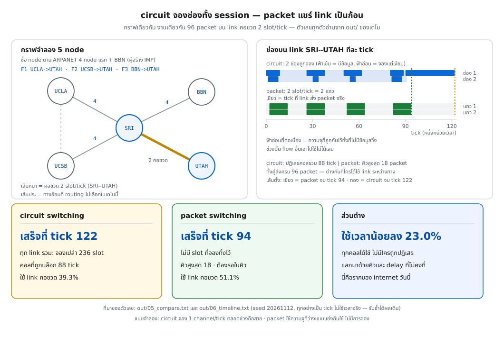
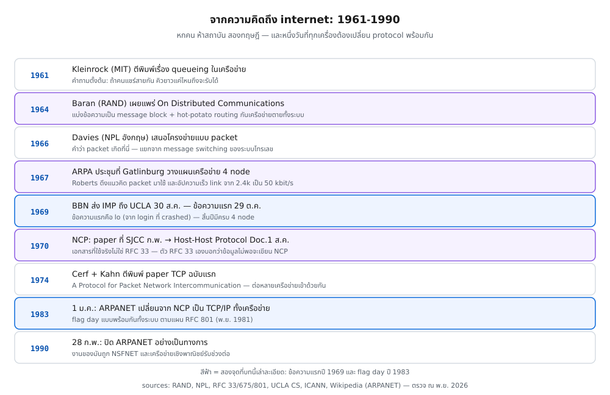

> 📅 เขียนเมื่อ: 12 พฤศจิกายน 2026 (เวลาไทย, UTC+7)
>
> **ผลรันทั้งหมดในบทนี้มาจากเครื่องเดียว** — Raspberry Pi 5, Debian GNU/Linux 13 (trixie), kernel 6.18.60+rpt-rpi-2712, aarch64
> **เวอร์ชันที่ใช้จริงในเดโม:** Go 1.24.4 · `gofmt` และ `go vet` ผ่านสะอาด (0 ไฟล์ที่ยังไม่ format)
> เดโมนี้ **ไม่แตะ network จริงเลย** — ไม่มี packet ออกจากการ์ดเน็ตแม้แต่ใบเดียว ไม่มี `tcpdump` ไม่มีการยิงพอร์ต
> ทุกตัวเลขมาจากการจำลองบน CPU ในหน่วย "tick" (หนึ่งหน่วยเวลาสมมติ) และใช้ seed คงที่ → รันซ้ำได้ผลเท่าเดิมทุกครั้ง
>
> 🛡️ **จริยธรรม (ยังใช้กับทั้งซีรีส์):** ทุกคำสั่งและทุกการทดลองให้ทำกับ **เครื่องและเครือข่ายที่คุณควบคุมเอง** เท่านั้น — การดัก packet หรือสแกนระบบของคนอื่นโดยไม่ได้รับอนุญาตผิดกฎหมายในแทบทุกประเทศ

---

## 0. สองตัวอักษรที่เริ่มทุกอย่าง

วันที่ 29 ตุลาคม 1969 เวลาสี่ทุ่มครึ่ง ที่ห้อง 3420 อาคาร Boelter Hall มหาวิทยาลัย UCLA นักศึกษาชื่อ Charley Kline พิมพ์คำว่า `login` เพื่อส่งไปยังเครื่อง SDS 940 ที่ Stanford Research Institute (SRI) ห่างออกไปราว 500 กิโลเมตร เขากับ Bill Duvall ที่ปลายทางคุยกันทางโทรศัพท์ตลอดเวลา

พิมพ์ `L` — "ได้ L ไหม" — "ได้ L"
พิมพ์ `O` — "ได้ O ไหม" — "ได้ O"
พิมพ์ `G` — ระบบที่ SRI crash

ข้อความแรกที่เดินทางข้ามเครือข่ายคอมพิวเตอร์ในประวัติศาสตร์จึงมีแค่สองตัวอักษร: **`lo`** อีกหนึ่งชั่วโมงต่อมาพวกเขาทำสำเร็จทั้งคำว่า `login` (Kleinrock เล่าเองในงานเขียนที่ UCLA เก็บไว้ และในบล็อก ICANN ปี 2019)

> เกร็ดที่ผมชอบที่สุดในเรื่องนี้: ทั้งสองฝั่งคุยกัน**ทางโทรศัพท์**ขณะส่งข้อความผ่านเครือข่ายที่ออกแบบมาเพื่อฆ่าระบบโทรศัพท์ Kleinrock เล่าเรื่องนี้ด้วยถ้อยคำของเขาเองว่า *"Note the irony that here we were using the telephone network to launch the new technology of packet switching which would destroy the telephone network!"* — เรากำลังใช้เครือข่ายโทรศัพท์เปิดตัวเทคโนโลยีที่จะทำลายเครือข่ายโทรศัพท์

สองเดือนก่อนหน้านั้น ไม่มีใครในโลกเคยส่งข้อมูลระหว่างเครื่องคอมพิวเตอร์สองเครื่องผ่านเครือข่าย packet แบบนี้เลย และสามปีก่อนหน้านั้น คำว่า "packet" ยังไม่มีใครใช้

บทนี้จะพาคุณย้อนไปดูว่า มนุษย์คิดวิธีนี้ขึ้นมาได้อย่างไร ทำไมวิธีที่ "เห็นชัดว่าดีกว่า" (circuit switching ของระบบโทรศัพท์) แพ้ และเราจะ**วัด** ความต่างนั้นด้วยโปรแกรม Go ตัวเล็ก ๆ ที่คุณรันตามได้จบในไม่กี่นาที

---

## 1. circuit switching — มรดกจากระบบโทรศัพท์

ก่อนจะมี data network ที่เป็นเครือข่ายของตัวเอง โลกมีเครือข่ายเดียวที่ใหญ่ที่สุด: **Public Switched Telephone Network (PSTN)** — เครือข่ายโทรศัพท์สาธารณะที่ต่อทุกบ้านเข้าด้วยกัน

หลักการของมันเรียกว่า **circuit switching** (การสลับวงจร): เมื่อคุณยกหูแล้วหมุนเบอร์ ระบบจะ **จองเส้นทางจริงทั้งเส้น** ตั้งแต่หูคุณไปจนถึงหูปลายทาง และจองไว้ตลอดเวลาที่คุยกัน

ลองนึกภาพว่าคุณจองถนนส่วนตัวไว้หนึ่งเลน ตั้งแต่บ้านคุณถึงบ้านเพื่อน คุณไม่ต้องแย่งเลนกับใคร ไม่ต้องรอไฟแดง ไม่มีใครตัดหน้า — แต่ถ้าคุณหยุดคุยกลางคัน เลนนั้นก็ยังถูกกันไว้ให้คุณอยู่ดี คนอื่นใช้ไม่ได้

ในระบบโทรศัพท์ "เลน" ที่ว่านั้นมีชื่อว่า **channel** (ช่องสัญญาณ) ความจุของสายหนึ่งเส้นถูกแบ่งออกเป็นหลายช่องด้วยเทคนิคที่เรียกว่า FDM (แบ่งตามความถี่) หรือ TDM (แบ่งตามช่วงเวลา) แต่ละช่องจองให้หนึ่งบทสนทนา และมีอัตราคงที่ เช่น 64 kbit/s สำหรับเสียงหนึ่งช่องในระบบดิจิทัลยุคหลัง

circuit switching ทำงานสามขั้นตอน ซึ่งทุกคนเคยได้ยินเสียงของมัน:

| ขั้น | สิ่งที่เกิด | เสียง/อาการที่คุณรู้จัก |
|---|---|---|
| **setup** (ตั้งสาย) | ระบบหาเส้นทางว่างทั้งเส้นแล้วจองไว้ | เสียงรอสาย ก่อนปลายทางรับ |
| **transfer** (ส่งข้อมูล) | ข้อมูลไหลด้วยอัตราคงที่ตลอดสาย | เสียงพูดคุย |
| **teardown** (ปลดสาย) | คืนช่องทั้งเส้นให้คนอื่น | วางหู |

### จุดแข็งที่ต้องยอมรับก่อน

circuit switching **เก่งเรื่องเสียงมาก** และเหตุผลก็ตรงไปตรงมา:

- **ความหน่วงคงที่** — ข้อมูลไหลด้วยอัตราเดียวกันตลอด ไม่มีคิว ไม่มีคนแทรก
- **jitter ต่ำ** — jitter คือความแปรปรวนของ delay ระหว่าง packet ที่ต่อเนื่องกัน เสียงคนไม่ชอบ jitter เลย เพราะมันทำให้เสียงขาด ๆ หาย ๆ
- **รับประกันได้เชิงกายภาพ** — ช่องเป็นของคุณจริง ๆ ไม่มีใครมาแย่งกลางคัน

ถ้าโลกมีแต่งานเสียง circuit switching ก็คงไม่ต้องไปไหน

### ปัญหาสามข้อที่ฆ่ามันในโลกของ data

พอเปลี่ยนจาก "เสียงคนพูด" เป็น "คอมพิวเตอร์คุยกัน" คุณสมบัติทั้งสามข้อที่ทำให้มันเก่งกับเสียงกลับกลายเป็นปัญหาทันที:

**หนึ่ง — setup มีต้นทุนเวลา** การตั้งสายกินเวลาไม่กี่วินาที ถ้าคุณคุยโทรศัพท์ห้านาที ต้นทุนนี้เล็กมาก แต่ถ้าคุณส่งคำสั่งสั้น ๆ ไปถามฐานข้อมูลแล้วจบใน 200 มิลลิวินาที การตั้งสายกลับใช้เวลามากกว่างานจริงเป็นสิบเท่า

**สอง — data ไม่ต่อเนื่อง (bursty)** นี่คือข้อที่สำคัญที่สุด ตอนคุณพิมพ์คำสั่งใน terminal คุณพิมพ์ 20 ตัวอักษรแล้วนั่งคิด 10 วินาที แล้วพิมพ์อีก 20 ตัวอักษร ระหว่างที่คุณคิด ช่องสัญญาณที่จองไว้ **ว่างเปล่า แต่คนอื่นใช้ไม่ได้** ในระบบเสียงไม่มีปัญหานี้ เพราะคนพูดต่อเนื่อง แต่ data เงียบเป็นส่วนใหญ่

**สาม — call blocking** เพราะช่องมีจำนวนจำกัด ถ้าช่องเต็ม คำขอใหม่ถูก **ปฏิเสธ** ไม่ใช่ถูกทำให้ช้า นี่คือสิ่งที่คุณเห็นเป็นสัญญาณไม่ว่างในสมัยก่อน และมันเป็นคุณสมบัติเชิงโครงสร้าง ไม่ใช่ความผิดพลาด: ระบบโทรศัพท์ถูกออกแบบให้ "รับสายที่รับได้" ดีกว่า "รับทุกสายแล้วทุกสายฟังไม่รู้เรื่อง" — นักคณิตศาสตร์โทรศัพท์มีเครื่องมือคำนวณเรื่องนี้ชื่อ **Erlang B formula** ไว้บอกว่าโทรศัพท์ต้องมีช่องกี่ช่องถึงจะรับสายพลาดได้ไม่เกินหนึ่งเปอร์เซ็นต์

สำหรับเสียง ตรรกะนี้ถูกต้อง สำหรับ data มันคือหายนะ เพราะ traffic ของ data ไม่ได้เรียบเสมอกันตลอดเวลาแบบเสียง

---

## 2. packet switching — ความคิดที่เกิดสองที่พร้อมกัน

คำตอบของปัญหาข้างบนฟังดูเรียบง่ายจนน่าตกใจ:

> **อย่าจองอะไรเลย**
>
> แบ่งข้อความเป็นชิ้นเล็ก ๆ ที่เรียกว่า **packet** (ก้อนข้อมูลที่ห่อด้วย header — ส่วนหัวที่บอกว่ามาจากไหน ไปไหน ลำดับที่เท่าไร) แล้วปล่อยแต่ละก้อนเดินทางอิสระ
>
> link (เส้นเชื่อมระหว่างสอง node) ทุกเส้นกลายเป็นทรัพยากรที่ **ใครมีข้อมูลก็ได้ใช้** ใน tick ที่มันว่าง
>
> ถ้ามีคนใช้พร้อมกันจนเต็ม ก้อนที่มาเกินจะรอใน **buffer** (หน่วยความจำของอุปกรณ์ที่ใช้พัก packet) แล้วค่อยออกไป

แนวคิดนี้ไม่ปรากฏขึ้นครั้งเดียวในที่เดียว — มันเกิดสองที่ห่างกันครึ่งโลก เกือบพร้อมกัน และทั้งสองคนไม่รู้จักงานของกันและกัน

### Paul Baran ที่ RAND (1960–1964)

Baran ทำงานให้ RAND Corporation ซึ่งเป็น think tank ของกองทัพสหรัฐฯ ในยุค Cold War โจทย์ของเขาคือ: **ถ้าเกิดสงครามนิวเคลียร์ เครือข่ายสั่งการทางทหารจะรอดไหม**

คำตอบที่เขาเห็นคือไม่รอด เพราะเครือข่ายแบบโทรศัพท์มีศูนย์สลับสาย (switching center) เป็นจุดศูนย์กลาง ทำลายไม่กี่จุดก็จบทั้งระบบ

ข้อเสนอของเขาคือเครือข่ายที่ **ไม่มีศูนย์กลาง**: node (จุดหนึ่งจุดในเครือข่าย = เครื่องหนึ่งเครื่องที่ต่อสายได้) ทุกตัวต่อกันแบบตาข่าย (distributed) และเมื่อ node หนึ่งรับ packet มา มันจะ **เก็บไว้ชั่วครู่แล้วส่งต่อ** ไปยังเพื่อนบ้านที่ยังว่างที่สุด วิธีนี้เขาเรียกว่า **hot-potato routing** — เพราะ node พยายาม "โยนมันออกไปให้เร็วที่สุดเหมือนมันเป็นมันฝรั่งร้อน" งานของเขารวมเล่มตีพิมพ์ปี 1964 ในชื่อ *On Distributed Communications*

Baran เรียกก้อนข้อมูลของเขาว่า **message block** และเขาไม่ได้เรียกมันว่า packet

### Donald Davies ที่ NPL อังกฤษ (1965–1966)

ฝั่งอังกฤษ Donald Davies ที่ National Physical Laboratory (NPL) กำลังคิดเรื่องอื่น: ทำอย่างไรให้ระบบ time-sharing (เครื่องใหญ่เครื่องเดียวให้หลายคนใช้พร้อมกันผ่าน terminal) ตอบสนองได้เร็วขึ้น ปัญหาของเขาคือสายสื่อสารยุค 1960 ช้าและแพงเกินไปสำหรับคนหลายคนที่ไม่ได้พิมพ์ตลอดเวลา

Davies มาถึงข้อสรุปเดียวกับ Baran และเขาเลือกคำที่คมกว่ามาก: **packet** — เขาตั้งใจใช้คำนี้เพื่อแยกจาก **message switching** ของระบบโทรเลข ที่รับข้อความทั้งก้อนแล้วส่งต่อทั้งก้อน (การแยกเป็นชิ้นเล็ก ๆ ทำให้ชิ้นหนึ่งไม่ต้องรอชิ้นที่ใหญ่กว่าทั้งฉบับ)

คำว่า **packet** ปรากฏเป็นครั้งแรกในรายงาน *Proposal for a Digital Communication Network* เดือนมิถุนายน 1966 — และวันนี้ทั้งวงการเรียกเทคนิคนี้ว่า **packet switching**

Baran เขียนยอมรับเองในภายหลัง — ในบทความ "The Beginnings of Packet Switching" (IEEE) — ว่าคำของ Davies เป็น "การเลือกใช้คำที่ดีกว่ามาก" ของเขา

### สองสิ่งที่ packet switching ทำได้ และ circuit ทำไม่ได้

**หนึ่ง — statistical multiplexing** (การแชร์ตามสถิติจริง ไม่ใช่การแบ่งตายตัว) นี่คือหัวใจทั้งหมด ถ้าคุณมี 10 คนใช้ link เดียวกัน แต่ละคนมีข้อมูลแค่ 10% ของเวลา ถ้าแบ่งช่องตายตัวแบบ circuit คุณต้องมี 10 ช่องตลอดเวลา แต่ถ้าแชร์แบบ packet ทั้ง 10 คนใช้ช่องเดียวสลับกันได้ เพราะโอกาสที่ทั้ง 10 คนส่งข้อมูลพร้อมกันเป๊ะ ๆ นั้นน้อยมาก (แต่ไม่ใช่ศูนย์ — นี่คือที่มาของปัญหา)

**สอง — ไม่มี call blocking ที่ระดับกายภาพ** ถ้าคนเยอะเกิน link จะช้าและมีคิว แต่ไม่มีใครถูก "ปฏิเสธ" ที่หน้าประตู — และนี่คือสิ่งที่ทำให้เครือข่ายขยายตัวได้แบบไม่มีเพดานแข็ง

### ราคาที่ต้องจ่าย (ซึ่งบทนี้จะวัดออกมาเป็นตัวเลข)

packet switching ไม่ได้ฟรี มันแลกมาด้วย:

- **queueing delay** — packet ต้องรอคิว ระยะเวลารอไม่คงที่
- **jitter** — packet ที่ส่งติดกันอาจมาถึงห่างกัน เพราะไปคนละคิว
- **packet loss** — buffer เต็มแล้ว packet ถูกทิ้ง (เรียกว่า tail drop — ทิ้ง packet ที่มาถึงตอนคิวเต็ม ตัวที่มาทีหลังสุดถูกทิ้งก่อน)
- **ความซับซ้อนย้ายขึ้นไปชั้นบน** — ถ้า packet หาย ใครจะส่งซ้ำ? ไม่ใช่ link แล้ว แต่เป็น protocol ที่ปลายทาง (นี่คือเหตุผลที่ TCP มีอยู่)
- **ต้องมี "คอมพิวเตอร์" อยู่กลางเครือข่าย** — อุปกรณ์ที่รับ packet เก็บ แล้วตัดสินใจส่งต่อ นี่คือสิ่งที่โลกจะเรียกว่า **router** ในอีก 20 ปีต่อมา

---

## 3. ทำไม packet ชนะ — สี่ข้อที่ตอบได้ด้วยเศรษฐศาสตร์

ถ้าคุณอ่านจนถึงตรงนี้ คำถามที่ควรถามคือ: "แล้วทำไม circuit ถึงยอมแพ้?" เพราะในปี 1969 ระบบโทรศัพท์คือสิ่งที่ดีที่สุดที่มนุษย์มี และ AT&T ก็ไม่ใช่บริษัทที่จะยอมแพ้อะไรง่าย ๆ

เหตุผลมีสี่ข้อ และสามข้อแรกเป็นเรื่องเงิน:

1. **data ไม่ได้ต้องการอัตราคงที่** — งานพิมพ์ terminal ต้องการแค่ "ตอบเร็วเมื่อมีข้อมูล" ไม่ต้องการ 64 kbit/s ตลอดเวลา การจ่ายเงินจองช่องที่ว่างเกือบตลอดเวลาคือการจ่ายเงินทิ้ง
2. **ต้นทุนต่อผู้ใช้ลดลงเมื่อแชร์** — link เดียวรองรับผู้ใช้ได้มากกว่าเมื่อใช้ statistical multiplexing เพราะไม่ได้กันช่องให้คนที่กำลังคิดอยู่
3. **ความทนทาน** — เครือข่ายที่ไม่มีศูนย์กลาง ไม่มีจุดเดียวที่ล้มแล้วทั้งระบบล้ม และเราจะเห็นเรื่องนี้ชัดขึ้นตอนเรียน routing
4. **มันเข้ากับคอมพิวเตอร์** — คอมพิวเตอร์เก่งเรื่องแบ่งข้อมูลเป็นชิ้น จัดลำดับ ตรวจ error และรอ ถ้าปลายทางฉลาดพอ ปัญหาหลายอย่างก็ไม่ต้องแก้ที่ link

มีอีกเหตุผลที่ลึกกว่านั้น และมันอยู่ในคำถามที่คนมักไม่ถาม: **circuit switching บังคับให้คุณตัดสินใจล่วงหน้า** ว่าคุณจะใช้ความจุเท่าไร circuit จอง 1 ช่องและได้ 1 ช่อง ไม่มากไม่น้อย แต่ packet switching ให้คุณ **ใช้เท่าที่มี** ถ้ามี 4 ช่องว่างและคุณมีข้อมูลค้าง 4 packet คุณก็ส่งได้ทั้ง 4 ใน tick เดียว

นี่คือความต่างเชิงปรัชญา: circuit คือ **สัญญาว่าจะให้เท่าเดิมเสมอ** ส่วน packet คือ **สัญญาว่าจะพยายามให้ดีที่สุด**

---

## 4. ลงมือทำ: จำลองสงครามนี้ด้วย Go

เราจะไม่เถียงกันด้วยคำพูด แต่จะเขียน simulator สองตัวที่ทำงานบนกราฟเดียวกัน งานเดียวกัน และวัดผลด้วยตัวเลขชุดเดียวกัน

### 4.1 สิ่งที่เราจะจำลอง

กราฟ 5 node — ชื่อตาม ARPANET 4 node แรก (UCLA, SRI, UCSB, UTAH) บวก BBN ซึ่งเป็นบริษัทที่สร้าง IMP (Interface Message Processor — เครื่องที่รับ packet แล้วส่งต่อ เล่าละเอียดในข้อ 5.1):

```text
## node ในกราฟจำลอง (5 node)
  BBN, SRI, UCLA, UCSB, UTAH

## link และความจุ (capacity-slot ต่อ tick = จำนวน packet ที่ link ส่งได้พร้อมกัน)
link           capacity  ใช้โดย
SRI--UCLA             4  F1 UCLA->UTAH
SRI--UCSB             4  F2 UCSB->UTAH
UCLA--UCSB            4  -
BBN--SRI              4  F3 BBN->UTAH
SRI--UTAH             2  F1 UCLA->UTAH, F2 UCSB->UTAH, F3 BBN->UTAH

หมายเหตุ: SRI--UTAH คือคอขวด — ความจุ 2 slot/tick แต่มีสาม flow ที่ต้องผ่าน
```

ชื่อ link เขียนเป็นคู่ node (`SRI--UCLA` = เส้นระหว่าง SRI กับ UCLA) และมีจุดที่ต้องอ่านให้ถูกตั้งแต่ต้น:

- **capacity** ของ link คือจำนวน packet ที่ link นั้นส่งได้พร้อมกันในหนึ่ง tick — ผมจะเรียกหนึ่งหน่วยของมันว่า **capacity-slot** (หนึ่งช่องของความจุ)
- link ปกติมีความจุ 4 slot/tick แต่ **SRI--UTAH มีแค่ 2** — เพราะเราต้องการคอขวด (bottleneck) จุดหนึ่งให้ทุกคนแย่งกัน
- ทั้งสาม flow (กระแสข้อมูลหนึ่งชุดจากต้นทางหนึ่งไปปลายทางหนึ่ง — F1 คือข้อมูลทั้งหมดที่ UCLA ส่งไป UTAH) ต้องผ่านคอขวดนี้ (F1 UCLA→UTAH, F2 UCSB→UTAH, F3 BBN→UTAH) นี่คือสถานการณ์ที่ทำให้เห็นความต่างชัดที่สุด

งานที่ต้องส่ง: แต่ละ flow มี 4 ข้อความ ข้อความละ 8 packet = **32 packet ต่อ flow, 96 packet รวม** และข้อความถัดไปจะ "พร้อมส่ง" หลังผู้ใช้พิมพ์เสร็จ ซึ่งตารางเวลาถูกสร้างจาก seed คงที่:

```text
seed=20261112  msg_per_flow=4  msg_packets=8

flow            arrive path                      packet   hop  ข้อความ (ready tick/ขนาด)
F1 UCLA->UTAH        0 UCLA->SRI->UTAH               32     2  0/8  30/8  54/8  81/8
F2 UCSB->UTAH        1 UCSB->SRI->UTAH               32     2  0/8  26/8  50/8  80/8
F3 BBN->UTAH         2 BBN->SRI->UTAH                32     2  0/8  24/8  54/8  84/8

อ่าน: ข้อความทั้งก้อนพร้อมส่งที่ tick ที่ระบุ แล้วผู้ใช้เงียบจนถึงข้อความถัดไป
```

อ่านตารางนี้ให้ดี เพราะมันคือหัวใจของเดโม: flow F1 มีข้อความพร้อมส่งที่ tick 0, 30, 54, 81 — ระหว่างนั้นคือ **silent gap** (ช่วงที่ผู้ใช้เงียบ) ซึ่งเป็นสิ่งที่ทำให้ circuit switching เสียเปรียบ และเป็นสิ่งที่ผู้ก่อตั้ง ARPANET เห็นชัดเพราะงานของพวกเขาคือ terminal ที่คนพิมพ์ทีละบรรทัด

### 4.2 ตัวจำลองที่หนึ่ง: circuit switching

โมเดลของ circuit ในเดโมนี้ตรงกับของจริงสามข้อ:

- จอง **1 channel ต่อ tick** บน **ทุก link ของ path** ตลอดช่วงถือสาย
- ไม่คิดเวลา setup (ให้ circuit ไม่เสียเปรียบ) คิดแค่ teardown 2 tick
- ถ้า link ใดไม่มีช่องว่าง — **call ถูกปฏิเสธ** และผู้ใช้ลองใหม่ทุก tick (แบบเดียวกับคนที่กด redial ซ้ำ ๆ)

จุดที่ต้องเข้าใจให้ถูกคือ: การจอง 1 channel ไม่ใช่การจำกัดที่ผมตั้งขึ้นมาเอง แต่เป็นธรรมชาติของระบบที่ขาย "ช่อง" เป็นหน่วย — ช่องคือสิ่งที่คุณซื้อ และช่องก็มีอัตราคงที่

```go
func circuitFinish(f flow, answered int) (int, [][2]int) {
	t := answered
	var send [][2]int
	for _, m := range f.msgs {
		if m.ready > t {
			t = m.ready // ข้อมูลยังไม่เกิด → ช่องที่จองไว้ว่างเปล่า
		}
		start := t
		t += (m.size + circuitRate - 1) / circuitRate // ปัดขึ้น ไม่ให้เหลือเศษ packet ค้าง
		send = append(send, [2]int{start, t})
	}
	return t, send
}
```

ส่วนตัวจำลองหลัก ทำงานเป็น loop ของ tick และตัดสินใจ "รับคอลหรือปฏิเสธ" ด้วยการดูว่าช่วงเวลาที่จะจองซ้อนกับของเดิมเกินความจุหรือไม่:

```go
func simulateCircuit(flows []flow, g *graph) []circuitStat {
	// held เก็บช่วงเวลา [start,end) ที่แต่ละ link ถูกจอง — key คือชื่อ link
	held := map[string][]reservation{}
	stats := make([]circuitStat, len(flows))
	done := make([]bool, len(flows))

	// loop t = เดินเวลาทีละ tick จนครบ horizon หรือทุก flow ได้สายแล้ว
	for t := 0; t < horizon; t++ {
		for i, f := range flows {
			if done[i] || f.arrive > t {
				continue
			}
			stats[i].flow, stats[i].arrive = f.id, f.arrive
			answered := t
			finish, send := circuitFinish(f, answered)
			end := finish + teardownTicks

			// ok/overlapping = เช็คว่าถ้าจองช่วงนี้แล้ว link ไหนรับไม่ไหว
			ok := true
			for _, l := range g.hops(f.path) {
				if overlapping(held[l.key()], answered, end) > l.capacity {
					ok = false
					break
				}
			}
			if !ok {
				stats[i].waited++ // ลองแล้วโดนปฏิเสธ (call blocked)
				continue
			}
			for _, l := range g.hops(f.path) {
				held[l.key()] = append(held[l.key()], reservation{start: answered, end: end})
			}
			// stats[i]=... บันทึกผลของ flow ที่รับสายแล้ว (ช่วงจอง + ช่วงข้อมูลไหลจริง)
			stats[i] = circuitStat{
				flow:     f.id,
				arrive:   f.arrive,
				answered: answered,
				waited:   stats[i].waited,
				finish:   finish,
				released: end,
				payload:  f.payload(),
				hops:     f.hops(),
				send:     send,
			}
			done[i] = true
		}
		all := true
		for _, d := range done {
			if !d {
				all = false
			}
		}
		if all {
			break
		}
	}
	// flow ที่ยังไม่ได้สายภายใน horizon = งานไม่ครบ ต้องรายงาน ไม่ใช่ปล่อยเป็นศูนย์
	// (finish == 0 แปลว่าไม่เคยมีข้อมูลไหลจริงเลย เช่นกรณีปิด retry แล้วคอลล้มเลิก)
	for i, f := range flows {
		if !done[i] || (stats[i].finish == 0 && f.payload() > 0) {
			stats[i].flow, stats[i].arrive = f.id, f.arrive
			stats[i].unfinished = true
		}
	}
	return stats
}
```

ฟังก์ชัน `overlapping` (ที่เรียกข้างใน) คือหัวใจของการตรวจ: มันนับว่าในช่วง `[start, end)` ที่คอลใหม่ต้องการ มีช่องถูกจองพร้อมกันสูงสุดกี่ช่อง **รวมตัวที่กำลังขอ** ถ้าเกิน capacity ของ link นั้น ก็รับไม่ได้

### 4.3 ตัวจำลองที่สอง: packet switching

ฝั่ง packet ไม่มีการจองเลย แต่ละ link มีคิวรอส่งของตัวเอง เก็บ packet ที่รอจะออกบน link นั้น (packet ยังไม่ถึง link ถัดไปจนกว่าจะถูกส่งออก) และทุก tick เดินสามขั้น:

1. **ส่งต่อ** — แต่ละ link ดึง packet จากคิวของตัวเองได้สูงสุด `capacity` ก้อน แล้วพักผลไว้ใน staging ยังไม่เทลงคิว link ถัดไป (หรือนับเป็น delivered ถ้าเป็น hop สุดท้าย)
2. **รับเข้า** — host (เครื่องปลายทางที่ผู้ใช้อยู่) แต่ละตัวอัด packet เข้า link แรกได้สูงสุด `accessRate` ก้อนต่อ tick (จำกัดที่ host ไม่ใช่ที่ link — ในโลกจริงนี่คือความเร็วการ์ดเน็ตหรือความเร็วที่แอปเขียนข้อมูล)
3. **commit** — จบ tick ค่อยเท staging ลงคิวจริง → packet เดินได้ทีละ hop ต่อหนึ่ง tick (store-and-forward)

ที่ต้องแยกสองเฟสเพราะถ้าไม่แยก packet จะไต่หลาย hop ได้ภายใน tick เดียว (cut-through) แล้วตัวเลขจะขึ้นกับลำดับที่โปรแกรมประมวลผล link ใน tick นั้น — ซึ่งเป็นรายละเอียดของโปรแกรม ไม่ใช่คุณสมบัติของเครือข่าย

```go
func simulatePacket(flows []flow, g *graph) packetStat {
	st := packetStat{
		delivered:   map[string]int{},
		lastArrive:  map[string]int{},
		firstArrive: map[string]int{},
		busy:        map[string]int{},
		peak:        map[string]int{},
		maxQueue:    map[string]int{},
		dropsBy:     map[string]int{},
		hist:        map[string][]int{},
	}
	queues := map[string][]pkt{}
	staged := map[string][]pkt{}
	injected := make([]int, len(flows))

	// เดิน link ตามชื่อ (ไม่ใช่ตามลำดับที่ประกาศใน g.links) → ตัวเลขไม่ผูกกับลำดับโค้ด
	links := append([]link(nil), g.links...)
	sort.Slice(links, func(i, j int) bool { return links[i].key() < links[j].key() })

	pending := func(i, t int) int {
		avail := 0
		for _, m := range flows[i].msgs {
			if m.ready <= t {
				avail += m.size
			}
		}
		return avail - injected[i]
	}

	for t := 0; t < horizon; t++ {
		// เฟส 1) ส่งต่อบนทุก link จาก snapshot ของคิวตอนเริ่ม tick
		for _, l := range links {
			k := l.key()
			q := queues[k]
			n := l.capacity
			if n > len(q) {
				n = len(q)
			}
			for i := 0; i < n; i++ {
				p := q[i]
				f := flows[p.flow]
				st.waitSum += t - p.entered
				st.moved++
				if p.hop == f.hops()-1 {
					st.delivered[f.id]++
					if st.firstArrive[f.id] == 0 {
						st.firstArrive[f.id] = t + 1
					}
					st.lastArrive[f.id] = t + 1
					continue
				}
				next := g.mustFind(f.path[p.hop+1], f.path[p.hop+2]).key()
				if len(queues[next])+len(staged[next]) >= bufPackets {
					// buffer ของ link ปลายทางเต็ม → tail drop ที่ link นั้น
					// (ของจริง TCP จะส่งซ้ำ โมเดลนี้ไม่ส่งซ้ำ จึงรายงานเป็น drops)
					st.drops++
					st.dropsBy[next]++
					continue
				}
				staged[next] = append(staged[next], pkt{flow: p.flow, hop: p.hop + 1, entered: t})
			}
			queues[k] = q[n:]
			st.busy[k] += n
			st.hist[k] = append(st.hist[k], n)
			if n > st.peak[k] {
				st.peak[k] = n
			}
		}

		// host อัด packet เข้า link แรก (สูงสุด accessRate ต่อ tick) — ลง staging เช่นกัน
		for i, f := range flows {
			if f.arrive > t {
				continue
			}
			first := g.mustFind(f.path[0], f.path[1]).key()
			for room := accessRate; room > 0 && pending(i, t) > 0; room-- {
				if len(queues[first])+len(staged[first]) >= bufPackets {
					st.drops++ // buffer เต็ม = ทิ้ง packet (ของจริง TCP จะส่งซ้ำ)
					st.dropsBy[first]++
					injected[i]++
					continue
				}
				staged[first] = append(staged[first], pkt{flow: i, hop: 0, entered: t})
				injected[i]++
			}
		}

		// เฟส 2) commit — packet ที่ถูกส่งใน tick นี้เข้าคิว link ถัดไปตอนจบ tick
		for k, ps := range staged {
			if len(ps) == 0 {
				continue
			}
			// เรียงตาม (flow, hop) ก่อนเข้าคิว: packet ที่มาถึงพร้อมกันจึงเรียงแบบเดียวกัน
			// ไม่ว่าจะประมวลผล link ไหนก่อน
			sort.Slice(ps, func(i, j int) bool {
				if ps[i].flow != ps[j].flow {
					return ps[i].flow < ps[j].flow
				}
				return ps[i].hop < ps[j].hop
			})
			queues[k] = append(queues[k], ps...)
			if len(queues[k]) > st.maxQueue[k] {
				st.maxQueue[k] = len(queues[k])
			}
			staged[k] = ps[:0]
		}

		// จบเมื่อทุก packet ถึงปลายทางหรือถูกทิ้ง — ที่ยังอยู่ในคิว/staging ยังไม่จบ
		lost := 0
		for _, f := range flows {
			lost += f.payload() - st.delivered[f.id]
		}
		if lost <= st.drops {
			st.finish = t + 1
			return st
		}
	}
	st.finish = horizon
	return st
}
```

สังเกตสี่บรรทัดที่สำคัญที่สุดในฟังก์ชันนี้:

- `n := l.capacity; if n > len(q) { n = len(q) }` — link ส่งได้เท่าที่มีของ และไม่เกินความจุ **ไม่มีใครจองล่วงหน้า**
- `st.waitSum += t - p.entered` — ทุก packet ถูกจับเวลาว่ารอในคิวนานเท่าไร นี่คือต้นทุนที่ circuit ไม่มี (ขั้นต่ำ 1 tick ต่อ hop เพราะต้องรอ commit ก่อน)
- `if len(queues[next])+len(staged[next]) >= bufPackets { st.drops++; continue }` — buffer ของ link ปลายทางเต็ม = tail drop (ทิ้ง packet ที่มาถึงตอนคิวเต็ม — ตัวที่มาทีหลังสุดถูกทิ้งก่อน) ซึ่งเป็นจุดที่ packet switching เจอปัญหาที่ circuit ไม่เจอ
- `staged[next] = append(staged[next], ...)` แล้วค่อยเทลง `queues` ตอนจบ tick — บรรทัดนี้คือ store-and-forward นั่นเอง

### 4.4 รันเอง

```bash
cd network/code/ep02          # โฟลเดอร์เดโมของตอนนี้ (อยู่ใน repo ของซีรีส์)
bash run_all.sh          # รันทุก section แล้วเก็บผลลง out/
go run . -section compare   # หรือดูเฉพาะตารางสรุป
```

`run_all.sh` จะ build, รันทุก section, รัน fingerprint สองรอบเพื่อพิสูจน์ว่า deterministic แล้วสั่ง `gen_svgs.py` วาดภาพประกอบจากผลจริง ถ้าผลสองรอบไม่ตรงกัน script จะ exit 1 ทันที

### 4.5 ผลของ circuit switching

```text
circuit switching: teardown=2 tick, หนึ่ง channel=1 packet/tick (ไม่คิดเวลา setup)
ช่องถูกจองบนทุก link ของ path ตลอดช่วงถือสาย — ว่างหรือไม่ว่างก็กันไว้

flow            arrive answered     รอ  finish ถือสาย จอง(slot)  ใช้จริง
F1 UCLA->UTAH        0        0      0      89     91       182       64
F2 UCSB->UTAH        1        1      0      88     89       178       64
F3 BBN->UTAH         2       90     88     122     34        68       64

finished_all_tick=122
unfinished_flows=0
reserved_capacity_slots=428
useful_capacity_slots=192
idle_but_reserved_slots=236
utilisation_pct=44.9
peak_slots_per_flow=1

สังเกตคอลัมน์ 'จอง(slot)' กับ 'ใช้จริง' — ช่องที่ถูกกันไว้ตอนผู้ใช้เงียบคือของที่หายไปฟรี ๆ
```

อ่านทีละบรรทัด:

- **F1 และ F2 ได้สายทันที** (answered ที่ tick 0 และ 1) เพราะคอขวดมี 2 ช่องพอดี
- **F3 มาถึงที่ tick 2 แต่ตอบสายที่ tick 90** — รอ 88 tick เพราะช่องทั้งสองถูกจองโดย F1/F2 ซึ่ง**ส่วนใหญ่ของเวลานั้นไม่มีข้อมูลวิ่ง** (ดูคอลัมน์ "ถือสาย 91/89" เทียบกับ "ใช้จริง 64/64")
- คอลัมน์ **"จอง(slot) 182" กับ "ใช้จริง 64"** คือภาพของความสูญเปล่า: จองช่องไว้ 182 slot บนสอง link แต่ใช้ส่งจริงแค่ 64 slot
- **utilisation 44.9%** = 192 slot ที่ส่งจริง ÷ 428 slot ที่จองไว้ (ทุก link) — มุมของการจอง; ส่วน 39.3% ในข้อ 4.7 = 96 slot ÷ (2 slot/tick × 122 tick) = ใช้ความจุ link คอขวดไปกี่ % ตลอดเวลาที่รัน — คนละตัวหารและคนละขอบเขต (192 = 96 packet × 2 hop นับทุก link; 96 = นับเฉพาะ link คอขวด)

ตัวเลขนี้ไม่ได้บอกว่า circuit ทำงานผิด — มันทำงานถูกต้องตามสัญญาของมันทุกข้อ ปัญหาคือสัญญานั้นไม่เข้ากับ traffic แบบนี้

### 4.6 ผลของ packet switching

```text
packet switching: link=4 slot/tick, access=4 packet/tick, buffer=32 packet
ไม่มีการจอง: packet เข้าคิวที่ link แล้วออกตามช่องที่ว่างใน tick นั้น

flow           delivered   ตัวแรก ตัวสุดท้าย
                           (tick)   (tick)
F1 UCLA->UTAH         32        3       90
F2 UCSB->UTAH         32        7       88
F3 BBN->UTAH          32       11       94

## busy = slot ที่ link ใช้ส่งจริงรวมทุก tick · cap = ความจุต่อ tick · peak = ค่าสูงสุดในหนึ่ง tick
## maxq = คิวลึกสุด (packet) · drop = packet ที่ถูกทิ้งที่ link นี้เพราะ buffer ปลายทางเต็ม
link           busy    cap   peak   maxq   drop
BBN--SRI         32      4      4      4      0
SRI--UCLA        32      4      4      4      0
SRI--UCSB        32      4      4      4      0
SRI--UTAH        96      2      2     18      0
UCLA--UCSB        0      4      0      0      0

finished_all_tick=94
unfinished_flows=0
link_transmissions=192
packets_dropped=0
queue_wait_ticks_total=480
queue_wait_ticks_mean=2.50
queue_max_depth=18
```

- **ทั้งสาม flow ส่งครบ 32 packet** — ไม่มีใครถูกปฏิเสธ ไม่มี packet หาย (`packets_dropped=0`)
- คอขวด `SRI--UTAH` ใช้เต็ม `peak=2` (คือเต็มความจุ 2 slot/tick) ในช่วงที่ข้อมูลมาพร้อมกัน
- **queue_max_depth=18** และ **queue_wait_ticks_mean=2.50** — นี่คือราคาที่จ่าย: เฉลี่ย 2.5 tick ต่อหนึ่ง transmission และขั้นต่ำคือ 1 tick ต่อ hop เพราะ packet ต้องรอ commit ก่อนขึ้น link ถัดไป ส่วนที่เกินมาคือเวลานั่งรอในคิว (ในโลกจริงตัวเลขนี้คือหลักมิลลิวินาทีถึงหลายร้อยมิลลิวินาที ขึ้นกับว่า link แน่นแค่ไหน)

### 4.7 เทียบกันตรง ๆ

```text
                                  circuit     packet
----------------------------------------------------
finished_all_tick                     122         94
unfinished_flows                        0          0
payload_packets                        96         96
packets_dropped                         0          0
call_blocked_ticks                     88          0
reserved_capacity_slots               428          0
idle_but_reserved_slots               236          0
network_slots_used                    192        192
bottleneck_utilisation_pct           39.3       51.1
sessions_in_flight_max                  2          3
queue_max_depth                         0         18
queue_wait_mean_ticks                   0       2.50

speedup_pct=23.0
throughput_circuit_packets_per_tick=0.79
throughput_packet_packets_per_tick=1.02
bottleneck_capacity=2
bottleneck_busy_slots=96
```

ห้าบรรทัดที่ผมอยากให้คุณจำ:

1. **finished_all_tick 122 vs 94** — packet ส่งครบทุก flow ใช้เวลาน้อยลง 28 tick = 23.0% (เร็วขึ้นราว 1.30 เท่า) ในงานเดียวกัน
2. **call_blocked_ticks 88 vs 0** — circuit ปฏิเสธ/ให้รอ 88 tick, packet ไม่มีแนวคิดนี้เลย
3. **idle_but_reserved_slots 236 vs 0** — circuit จอง capacity-slot ทิ้งไว้ 236 หน่วยจาก 428 ที่จองไปทั้งหมด (เกินครึ่ง) เพราะผู้ใช้เงียบ
4. **bottleneck_utilisation_pct 39.3 vs 51.1** — link คอขวดถูกใช้ประโยชน์ได้มากกว่าเมื่อไม่มีใครจอง (สูตรเดียวกันทั้งสองฝั่ง: 96 slot ÷ (2 slot/tick × tick ที่ใช้จนจบ) — 122 tick ฝั่ง circuit, 94 tick ฝั่ง packet)
5. **queue_max_depth 0 vs 18 · queue_wait_mean_ticks 0 vs 2.50** — ราคาที่ packet ต้องจ่าย และมันเป็นราคาที่ *จ่ายเมื่อจำเป็น* ไม่ใช่จ่ายตลอดเวลา

และมีอีกสองบรรทัดที่คนมักอ่านผิด:

- `sessions_in_flight_max` = 2 (circuit) กับ 3 (packet) — **ทั้งสองฝั่งเป็นค่าคำนวณ ไม่ได้วัดจากไทม์ไลน์**: ฝั่ง circuit คือสูตร `min(จำนวน flow, ความจุคอขวด)` = min(3, 2) = 2 เพราะ circuit ไม่มีทางถือสายเกินจำนวนช่องของคอขวด; ฝั่ง packet คือสูตร `len(flows)` = 3 เพราะไม่มีเพดานการจองให้ใครต้องรอ ความหมายคือ circuit มีเพดานแข็งที่ 2 session ส่วน packet รับได้ทั้งสามแล้วทำให้ช้าลงแทนการปฏิเสธ
- `network_slots_used` = 192 ทั้งสองคอลัมน์ แต่นิยามคนละแบบ: ฝั่ง circuit นับ payload × hop (96 packet × 2 hop — ทุก packet ต้องผ่านสองเส้น) ฝั่ง packet นับ transmission จริงบนทุก link (ผลบวกของคอลัมน์ busy) — เท่ากันเพราะในเดโมนี้ไม่มี packet หายแม้ใบเดียว



> **ข้อควรระวังทางความคิด:** ตัวเลขชุดนี้ไม่ใช่การพิสูจน์ว่า "packet ดีกว่า circuit เสมอ" มันพิสูจน์เฉพาะกับ **traffic แบบ bursty ที่ยอมรับ delay ได้** ซึ่งคือ traffic ของ data เกือบทั้งหมด ถ้าเราเปลี่ยน workload เป็นเสียงต่อเนื่องที่ต้องการอัตราคงที่ circuit จะกลับมาได้เปรียบ — และนี่คือเหตุผลที่โลกยังใช้ circuit อยู่ในบางที่ (และทำ packet ให้เลียนแบบ circuit ด้วย buffer + QoS (การจัดลำดับความสำคัญ/รับประกันคุณภาพของ traffic) ในตอนที่ 30)

---

## 5. จาก IMP ถึง TCP/IP — 40 ปีที่ protocol เปลี่ยนสามรอบ



ตอนนี้เรารู้แล้วว่าทำไม packet ชนะ แต่คำถามที่ยังไม่ตอบคือ: **แล้วมันถูกสร้างจริงได้อย่างไรในปี 1969** ในเมื่อยังไม่มี router ไม่มี switch ไม่มีแม้แต่คำว่า "internet"

### 5.1 IMP — router รุ่นแรกที่ยังไม่มีชื่อ router

ARPA (Advanced Research Projects Agency ของกระทรวงกลาโหมสหรัฐฯ) เริ่มโครงการนี้ในปี 1966–1967 — Robert Taylor ตั้งโจทย์เรื่องเครื่องใหญ่ที่ใช้ร่วมกันในปี 1966 และ Lawrence Roberts คือคนที่นำแผนไปเสนอที่ประชุม ACM ที่ Gatlinburg ในปี 1967

รายละเอียดสำคัญคือ Roberts เห็นงานของ Davies ที่ NPL แล้วตัดสินใจอัปความเร็ว link ของ ARPANET จาก 2.4 kbit/s เป็น **50 kbit/s** — เพราะบทวิเคราะห์ของ NPL บอกว่าความเร็วต่ำจะทำให้ delay สูงจนใช้งานไม่ได้

โจทย์ทางวิศวกรรมคือ: เครื่อง host แต่ละเครื่องเป็น mainframe ต่างยี่ห้อ ต่าง OS ไม่มีทางที่เราจะแก้ OS ของทุกเครื่องให้คุยกันได้ทันเวลา

ทางออกที่เลือกคือ **แยกงานสื่อสารออกมาเป็นเครื่องของตัวเอง** เรียกว่า **IMP — Interface Message Processor** (ตัวประมวลผลส่วนติดต่อ) ซึ่งก็คือ "router" ในความหมายวันนี้: เครื่องเล็กที่รับ packet จาก host เก็บไว้ แล้วส่งต่อผ่าน leased line (สายเช่าใช้ตลอด) ไปยัง IMP ตัวถัดไป

BBN (Bolt Beranek and Newman) ชนะสัญญาสร้าง IMP ในเดือนธันวาคม 1968 (เริ่มงานเดือนมกราคม 1969) และส่งเครื่องแรกถึง UCLA ปลายเดือนสิงหาคม 1969 ฮาร์ดแวร์คือ Honeywell DDP-516 เวอร์ชัน rugged (แบบทหาร) พร้อมหน่วยความจำ core (แม่เหล็กรุ่นเก่า) 24 KB — ทั้งระบบ (hardware + software) ถูกออกแบบและติดตั้งเสร็จในเก้าเดือน

จุดที่ผมอยากให้สังเกต: **IMP ไม่สนใจว่าเจ้าของข้อมูลเป็นโปรแกรมอะไรบน host** มันสนใจแค่ "packet นี้ต้องไป IMP ปลายทางไหน" การแยกแบบนี้ทำให้ host แต่ละเครื่องเป็นอิสระจากกัน — host ตัวหนึ่ง crash ก็ไม่ลากทั้งเครือข่ายลงไปด้วย และมันคือแนวคิด **layering** (แบ่งงานเป็นชั้น ๆ แต่ละชั้นรู้เท่าที่จำเป็น) ที่คุณจะเจอตลอดซีรีส์นี้

ภายในสิ้นปี 1969 มีครบ 4 node: UCLA, SRI, UC Santa Barbara และ University of Utah

### 5.2 NCP — protocol คุยกันรุ่นแรกที่ฝังอยู่ในเครือข่ายเดียว

IMP ส่ง packet ได้ แต่ IMP ไม่รู้จัก "process" — มันไม่รู้ว่าข้อมูลนี้ควรไปให้โปรแกรมไหนบน host ปลายทาง งานนั้นต้องมี protocol อีกชั้น

ชั้นนั้นชื่อ **NCP** ซึ่งย่อจาก **Network Control Program** (โปรแกรมควบคุมเครือข่าย) และต่อมาคนเรียกมันว่า **Network Control Protocol** — เอกสารรุ่นแรก ๆ ที่วางโครงให้ protocol นี้คือ paper ที่เสนอที่ประชุม SJCC เดือนกุมภาพันธ์ 1970 (byline S. Crocker ที่ UCLA, S. Carr ที่ Utah และ V. Cerf ที่ UCLA) ซึ่งต่อมาออกมาในชื่อ RFC (เอกสารมาตรฐาน internet ชื่อ Request for Comments) 33 — แต่ตัว RFC 33 เองก็เขียนไว้ตรง ๆ ว่า "does not contain enough information to write a NCP" เอกสารที่ใช้จริงคือ Host-Host Protocol Document No. 1 ลงวันที่ 3 สิงหาคม 1970 (ต่อมาพิมพ์ซ้ำเป็น RFC 6529)

NCP ทำงานได้ดีในโลกของมัน แต่มีข้อสมมติสามข้อที่กลายเป็นเพดาน:

- **มันรู้จักแค่ ARPANET** — address ของ NCP ชี้ไปได้ไกลสุดที่ IMP ปลายทาง ไม่สามารถชี้ไปยังเครือข่ายอื่นที่ต่ออยู่ข้างหลังได้
- **มันพึ่ง ARPANET ให้รับประกันความถูกต้อง** — NCP ไม่มี error control ระดับ end-to-end (ตรวจความถูกต้องจากปลายถึงปลาย) เพราะสมมติว่าเครือข่ายเดียวที่มันอยู่จะเชื่อถือได้
- **มันผูกกับ IMP** — NCP ทำงานเหมือน device driver มากกว่า protocol ของการสื่อสาร

พอ ARPA เริ่มต่อเครือข่าย packet อื่นเข้ามา (radio packet network, satellite network) ข้อสมมติทั้งสามก็พังทันที

### 5.3 TCP/IP — protocol ที่ออกแบบให้ "ไม่รู้จักเครือข่ายข้างล่าง"

ปี 1973 Bob Kahn (ARPA) กับ Vint Cerf (Stanford) นั่งออกแบบใหม่ทั้งชั้น และบทความของพวกเขาตีพิมพ์ใน *IEEE Transactions on Communications* เดือนพฤษภาคม 1974 ในชื่อ **"A Protocol for Packet Network Intercommunication"**

แนวคิดใหม่มีสองข้อ:

1. **ให้ host รับผิดชอบความถูกต้องเอง** ไม่ใช่เครือข่าย — เครือข่ายทำหน้าที่แค่ส่ง datagram (หน่วยข้อมูลที่ไม่มีสัญญาณรับประกัน) แล้วจบ
2. **ให้มีชั้น IP อยู่กลาง** ที่ทำหน้าที่แค่ addressing + forwarding ระหว่างเครือข่าย (internetworking) ส่วนความถูกต้องเป็นงานของชั้นบน

ตอนแรกมันเป็น protocol เดียวชื่อ TCP ต่อมาในปี 1978 Jon Postel (และ Danny Cohen, David Reed) แยกส่วนที่ทำ addressing/forwarding ออกมาเป็น **IP** และเหลือ **TCP** ไว้ทำ reliable stream (ลำดับข้อมูลที่มาถึงครบและเรียงถูก) + เพิ่ม **UDP** สำหรับงานที่ต้องการเร็วมากกว่าครบถ้วน

การแยกนี้คือสิ่งที่ทำให้ TCP/IP ยังใช้ได้ถึงวันนี้ — เครือข่ายข้างล่างเปลี่ยนได้ ส่วนปลายทางยังคุยกันด้วยสัญญาเดิม

### 5.4 1 มกราคม 1983 — วันที่ทุกเครื่องต้องเปลี่ยนพร้อมกัน

การเปลี่ยนจาก NCP เป็น TCP/IP ไม่ใช่เรื่องง่าย เพราะ ARPANET ปลายปี 1982 มี host ราว 235–250 เครื่อง (ตัวเลขจากตาราง host ของ NIC เดือนพฤษภาคม 1982 และการคาดการณ์ใน RFC 801)

แย่กว่านั้น: **NCP กับ TCP คุยกันไม่ได้เลย** — ไม่มีกลไกให้เครื่องหนึ่งรันทั้งสองแบบแล้วเจรจากันเองอัตโนมัติ

แผนถูกเขียนไว้ล่วงหน้ากว่าหนึ่งปี (14 เดือน) ใน **RFC 801 "NCP/TCP Transition Plan"** (Jon Postel, พฤศจิกายน 1981) ซึ่งกำหนด milestone เป็นขั้น: host ใหม่ต้องทำ IP/TCP, host เดิมเริ่มทำภายในมกราคม 1982, ใช้ relay (เครื่องกลางที่พูดได้ทั้งสองภาษา) ระหว่างเปลี่ยน และเป้าหมายสุดท้ายคือ **1 มกราคม 1983 — ตัด NCP ออกทั้งเครือข่าย**

วันที่ 1 มกราคม 1983 จึงถูกเรียกว่า **flag day** — วันเดียวที่ทุกคนต้องเปลี่ยนพร้อมกัน ไม่มี backward compatibility (ความเข้ากันได้ย้อนหลัง) ที่ระดับ protocol — หลัง 1 มกราคม 1983 เครื่องที่ยัง NCP-only คุยกับ TCP-only ไม่ได้โดยตรง เพราะ relay (ตัวกลางที่พูดได้ทั้งสองภาษา) ถูกยกเลิกตามแผน (มีบันทึกว่าช่วงนั้นมีการแจกเข็มกลัด "I survived the TCP/IP transition")

> **บทเรียนที่สำคัญที่สุดของตอนนี้:** flag day แบบนี้ **ทำไม่ได้แล้วในวันนี้** ตอนนั้นมีเครื่องไม่กี่ร้อยเครื่องที่ทุกคนรู้จักกัน แต่สมัยนี้มีหลายพันล้านเครื่อง การเปลี่ยน IPv6 จึงใช้เวลาสองทศวรรษและยังไม่จบ — ขนาดของเครือข่ายเปลี่ยนกลยุทธ์ที่ใช้ได้ การเปลี่ยน protocol กลายเป็นเรื่องการเมืองและเศรษฐศาสตร์ ไม่ใช่แค่เทคนิค

ในปีเดียวกันนั้น ARPANET ถูกแบ่งเป็นสองเครือข่าย: ARPANET สำหรับงานวิจัย และ **MILNET** สำหรับงานปฏิบัติการทางทหาร โดยมี gateway (เครื่องที่ต่อสองเครือข่ายต่าง protocol ให้คุยกันได้) คั่นกลาง — ภาพของ "network of networks" เริ่มชัดขึ้น

ARPANET ถูกปิดอย่างเป็นทางการวันที่ 28 กุมภาพันธ์ 1990 หลัง NSFNET (เครือข่ายวิจัยของ National Science Foundation ที่รับงานช่วงต่อจาก ARPANET) และเครือข่ายเชิงพาณิชย์รับงานต่อ Vint Cerf เขียนบทกวีสั้น ๆ ในชื่อ "Requiem of the ARPANET" ซึ่งจบด้วยบรรทัดที่ผมชอบมาก:

> *Lay down thy packet, now, O friend, and sleep.*

---

## 6. โจทย์

ก่อนไปต่อตอนหน้า ลองเอาเดโมนี้ไปบิดตัวเลขดูเอง — คำตอบที่ได้จะบอกว่าคุณเข้าใจโมเดลจริงหรือแค่ตามอ่าน

### 6.1 Drill — 30 นาที ปรับเดโมแล้วตอบคำถาม

ทุกข้อให้รันจริงแล้วตอบจาก **ตัวเลขใน `out/`** ไม่ใช่จากการเดา ถ้าใครตอบว่า "น่าจะ" ถือว่ายังไม่ทำ

1. **เปลี่ยน seed** (`schedSeed`) เป็น 3 ค่า แล้วรัน `-section compare` ทุกครั้ง — blocking ของ circuit เปลี่ยนไหม? utilisation เปลี่ยนไหม? และข้อสรุป "packet เร็วกว่า" ยังจริงทุก seed หรือไม่?
2. **ลด `bottleneckCap` เป็น 1** — circuit รับได้กี่คอลพร้อมกัน? ต้องรอนานเท่าไร? ส่วน packet ยังส่งครบไหม และ `queue_max_depth` เปลี่ยนเป็นเท่าไร? อธิบายว่าทำไม packet ยัง "ทำงานได้" ทั้งที่ความจุไม่พอสำหรับทุกคน
3. **เพิ่ม `msgPackets` เป็น 16 และ `bufPackets` เป็น 64** (หรือรัน `-msg 16 -buf 64`) — ผลต่างของ `finished_all_tick` กว้างขึ้นหรือแคบลง? ทำไม? (ใบ้: คิดว่าอะไรคือเพดานของ packet ในเดโมนี้ — และถ้าลืมเพิ่ม `bufPackets` ตามไปด้วย จะเกิดอะไรขึ้น)
4. **ลด `bufPackets` เหลือ 2** — เกิดอะไรขึ้นกับ `packets_dropped` และ `delivered`? แล้วลองตอบว่าในโลกจริงใครรับผิดชอบ packet ที่หายไป
5. **ปิดการ retry ของ circuit** (ให้คอลที่ถูกบล็อกล้มเลิกเลย) — ตัวเลข `finished_all_tick` จะดีขึ้นหรือแย่ลง? และแบบไหนสะท้อนพฤติกรรมของผู้ใช้จริงมากกว่า? (ระวัง: งานจะไม่ครบ — โปรแกรมจะพิมพ์แถว `unfinished` และ exit ไม่เป็นศูนย์ แทนที่จะรายงานเลขสวย ๆ ที่หายไปหนึ่ง flow)

### 6.2 Mini-project — `netsim`: เครื่องมือทดลอง network design ของคุณเอง

สร้าง CLI ชื่อ `netsim` ที่ต่อยอดจากเดโมนี้ เป็นเครื่องมือที่คุณใช้ตอบคำถามจริงได้ เช่น "ถ้า link นี้ล่ม traffic จะเป็นอย่างไร" หรือ "ต้องเพิ่มความจุกี่เท่าถึงจะรับ flow ได้"

**ขอบเขตขั้นต่ำ**

- topology (แผนผังการต่อของ node กับ link) อ่านจากไฟล์ JSON: `nodes`, `links` (มี `capacity`), `flows` (มี `path` และ `messages`) — validate ว่า path เดินได้จริงและ capacity > 0 ก่อนเริ่ม
- รับ `-mode circuit|packet` และ `-seed` (ต้องได้ผลซ้ำได้เสมอเมื่อ seed เดิม)
- หาเส้นทางอัตโนมัติด้วย Dijkstra (ไม่ต้องรับ path จากไฟล์) และรายงานเส้นทางที่เลือก
- output เป็นตารางสรุป + `-json` ที่ unmarshal กลับได้
- วัดและรายงาน: completion tick, utilisation ต่อ link, queue max/mean, drops, และ **Jain's fairness index** ของ throughput ระหว่าง flow (ตัวเลข 0–1 ใช้วัดว่าทุก flow ได้ใช้ link ใกล้เคียงกันแค่ไหน)

**เกณฑ์ผ่าน**

- `go vet ./...` ผ่าน, `gofmt -l .` ไม่พิมพ์อะไร
- มี `go test` ที่ **assert fingerprint** ของผลรัน (แบบเดียวกับ `out/07_determinism.txt`) → รันซ้ำต้องได้ค่าเดิม และมี test ที่จับ behavior ไม่ใช่แค่ตัวเลข (เช่น "circuit ต้องปฏิเสธคอลเมื่อ capacity ไม่พอ")
- ไม่มี panic ไม่ว่าอินพุตจะเพี้ยนแค่ไหน (topology ที่มี cycle, flow ที่ path ไม่ถึง, capacity = 0) — คืน error ที่อ่านรู้เรื่อง ไม่ใช่ stack trace
- รายงานไม่เกิน 1 หน้าจอสำหรับ topology 10 node (ถ้ายาวให้มี `-summary`)

**ต่อยอด (ถ้ามีเวลา)**

- เพิ่มโหมด `-mode circuit -overbook 2` ที่ขายช่องเกินความจุ (over-subscription) แล้วดูว่า blocking rate เปลี่ยนอย่างไร — นี่คือสิ่งที่ ISP ทำจริง
- เพิ่ม priority queue: flow หนึ่งได้คิวก่อน แล้ววัดว่า fairness index แย่ลงแค่ไหน
- วาดกราฟ utilisation ต่อ tick ออกมาเป็น CSV แล้ว plot ด้วย gnuplot

**ข้อห้าม:** อย่าให้ `netsim` อ่าน/เขียน network จริงในเวอร์ชันนี้ — มันเป็น simulator บน CPU ทั้งหมด ถ้าจะต่อกับของจริงในตอนหลัง ให้ทำกับเครื่องและ network ที่คุณควบคุมเท่านั้น

---

## 7. สรุป

สามสิ่งที่ผมอยากให้คุณถือออกจากบทนี้:

1. **circuit switching ไม่ได้โง่ — มันแก้ปัญหาของเสียงได้ดีเยี่ยม** มันแพ้เพราะโลกเปลี่ยนงานจาก "คุยต่อเนื่อง" เป็น "พิมพ์เป็นช่วง ๆ" และเพราะการจองทรัพยากรที่ไม่ได้ใช้คือการจ่ายเงินฟรี
2. **packet switching ชนะด้วยสถิติ ไม่ใช่เวทมนตร์** — statistical multiplexing ให้คนจำนวนมากแชร์ link เดียวได้ เพราะโอกาสที่ทุกคนส่งพร้อมกันเป๊ะ ๆ นั้นต่ำ และราคาที่ต้องจ่ายคือคิว, jitter และ packet loss ที่ต้องมี protocol ชั้นบนมารับผิดชอบ
3. **ประวัติศาสตร์ของ internet คือประวัติของการย้ายความซับซ้อนขึ้นไปชั้นบน** — จาก circuit (ทุกอย่างอยู่ในสาย) → packet (ความซับซ้อนอยู่ที่ router) → TCP/IP (ความถูกต้องอยู่ที่ host) → และในตอนต่อ ๆ ไปคุณจะเห็นว่ามันไปไกลกว่านั้นอีก

ในเดโมของเรา packet ชนะอย่างชัดเจน: ส่งครบทุก flow ที่ tick 94 เทียบกับ 122 (ใช้เวลาน้อยลง 28 tick = 23.0% เร็วขึ้นราว 1.30 เท่า), ใช้ link คอขวด 51.1% เทียบกับ 39.3%, และไม่มี capacity-slot ถูกจองทิ้งไว้เลย แต่ก็ต้องแลกด้วยคิวสูงสุด 18 packet — ตัวเลขที่บอกว่าที่ใดมีคิว ที่นั่นมี jitter และที่นั่นคือจุดที่ congestion control จะเข้ามาเป็นพระเอกในตอนที่ 29

ตอนหน้าเราจะลงมาจากชั้น network ลงไปที่ **ชั้นล่างสุดของสาย**: Ethernet เริ่มจาก coax เส้นเดียวในปี 1973 โดย Bob Metcalfe ที่ Xerox PARC แล้วกลายเป็นมาตรฐานที่ทำให้ LAN ทั้งโลกพูดภาษาเดียวกันได้ — และคุณจะได้เห็น frame แรกด้วยตาตัวเอง

---

**← ตอนก่อน: [ทำไมต้องเรียน networking จริงจัง](/blog/post.html?slug=2026-11-11-network-01-why-networking-matters)**

---

## แหล่งอ้างอิง (ตรวจ ณ 12 พฤศจิกายน 2026)

- UCLA Computer Science — ["First Words"](http://web.cs.ucla.edu/csd/first_words.html) (บันทึก IMP log ของข้อความแรก 29 ต.ค. 1969)
- ICANN — ["The First Message Transmission"](https://icann.org/en/blogs/details/the-first-message-transmission-29-10-2019-en) โดย Leonard Kleinrock
- RAND — [Paul Baran and the Origins of the Internet](https://www.rand.org/pubs/articles/2018/paul-baran-and-the-origins-of-the-internet.html) และ *On Distributed Communications* (1964)
- NPL — [Packet Switching: The first steps on the road to the information society](https://www.npl.co.uk/getattachment/de2d9db5-999d-4a75-99ce-6730b8c204a6/UK-role-in-Packet-Switching-%281%29.pdf?lang=en-US) (PDF)
- L. Roberts — ["The ARPANET and Computer Networks"](https://dl.acm.org/doi/pdf/10.1145/12178.12182) (1986, ACM)
- RFC 33 — [New HOST-HOST Protocol](https://www.rfc-editor.org/info/rfc33) (S. Crocker, S. Carr, V. Cerf — 12 ก.พ. 1970)
- P. Baran — "The Beginnings of Packet Switching: Some Underlying Concepts", *IEEE Communications Magazine* (2002) — ที่มาของคำยอมรับเรื่องคำว่า packet
- RFC 6529 — [Host/Host Protocol for the ARPA Network](https://www.rfc-editor.org/info/rfc6529) (ที่มาของชื่อ NCP)
- RFC 675 / Cerf–Kahn (1974) และ RFC 791 / RFC 793 (1981)
- RFC 801 — [NCP/TCP Transition Plan](https://www.rfc-editor.org/info/rfc801) (J. Postel, พ.ย. 1981)
- B. Leiner et al. — ["A Brief History of the Internet"](https://arxiv.org/html/cs.NI/9901011)
- BBN — [Internet Engineering Timeline](http://exbbn.weebly.com/bbn-internet-engineering-timeline.html)
- Wikipedia — [ARPANET](https://en.wikipedia.org/wiki/ARPANET) (ใช้เป็นจุดเริ่มต้นแล้วไล่ตรวจกับเอกสารต้นทางข้างบน)
