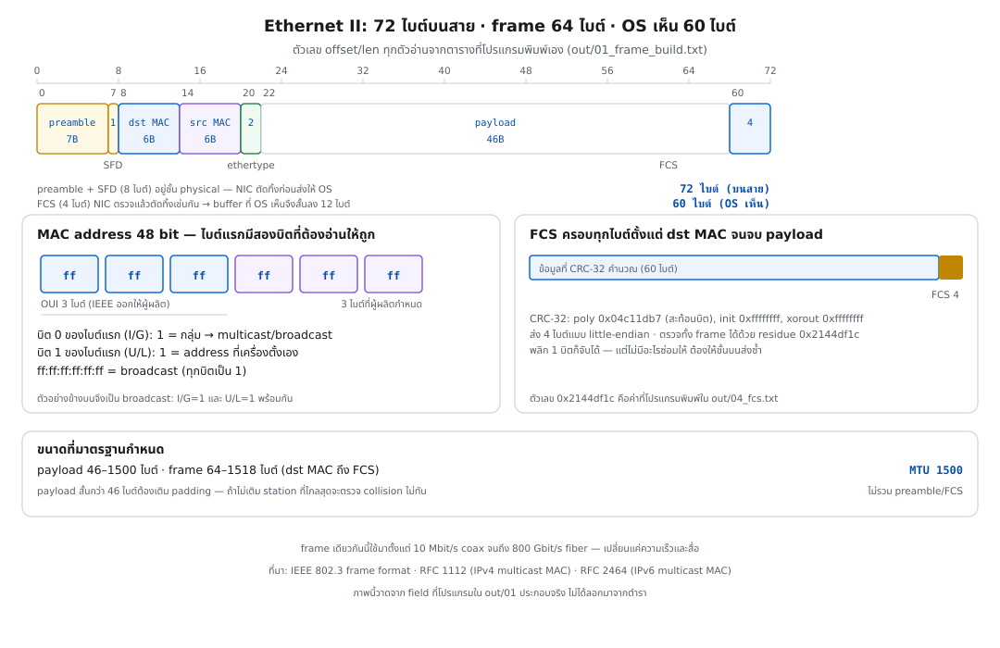
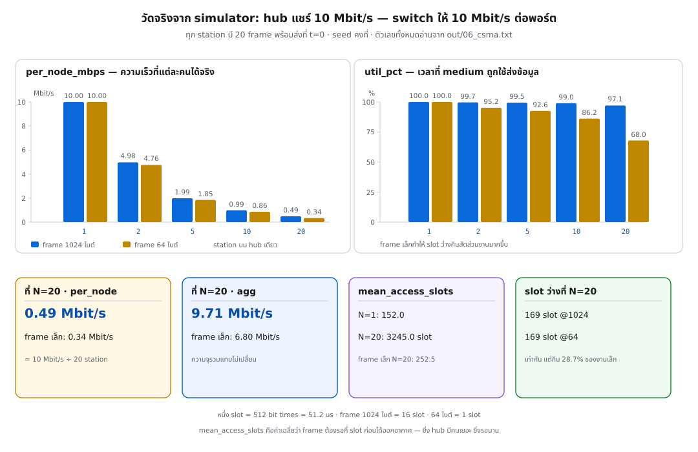
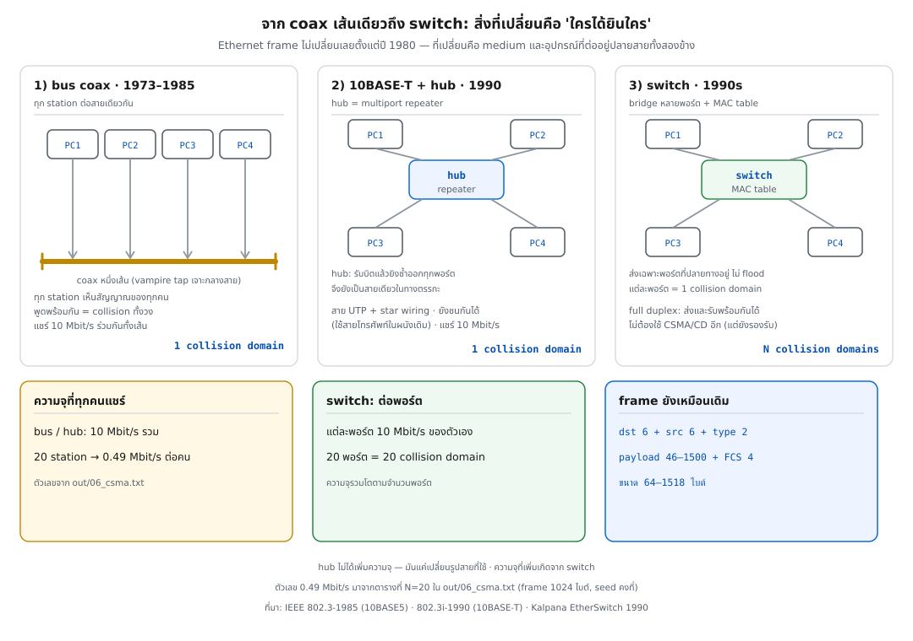

> 📅 เขียนเมื่อ: 13 พฤศจิกายน 2026 (เวลาไทย, UTC+7)
>
> **ผลรันทั้งหมดในบทนี้มาจากเครื่องเดียว** — Raspberry Pi 5, Debian GNU/Linux 13 (trixie), kernel 6.18.60+rpt-rpi-2712, aarch64
> **เวอร์ชันที่ใช้จริงในเดโม:** Go 1.24.4 · `gofmt` และ `go vet` ผ่านสะอาด (0 ไฟล์ที่ยังไม่ format)
> เดโมนี้ **ไม่แตะ network จริงเลย** — ไม่มีการดัก packet ไม่มีการยิงพอร์ต ไม่มี frame ออกจากการ์ดเน็ตแม้แต่ใบเดียว
> frame (หน่วยข้อมูลชั้น 2 — นิยามเต็มอยู่ในข้อ 3) ทุกใบในบทนี้ **โปรแกรมประกอบขึ้นเองจาก field** (ช่องข้อมูลแต่ละส่วนของ frame) แล้ว parse (อ่านไบต์กลับมาแยกเป็นช่อง) ด้วยโค้ดตัวเดียวกัน — ไม่ได้อ้างว่าเป็น packet ที่ดักได้จากเครือข่าย
> ตัวเลขของ CSMA/CD มาจาก simulator บน CPU หน่วยเวลาเป็น "slot" (512 bit times) และใช้ seed คงที่ → รันซ้ำได้ผลเท่าเดิม
>
> 🛡️ **จริยธรรม (ยังใช้กับทั้งซีรีส์):** ทุกคำสั่งและทุกการทดลองให้ทำกับ **เครื่องและเครือข่ายที่คุณควบคุมเอง** เท่านั้น — การดัก packet หรือสแกนระบบของคนอื่นโดยไม่ได้รับอนุญาตผิดกฎหมายในแทบทุกประเทศ

---

## 0. บันทึกหนึ่งหน้าที่เปลี่ยนวิธีที่เครื่องคอมพิวเตอร์คุยกัน

วันที่ 22 พฤษภาคม 1973 ที่ Xerox Palo Alto Research Center (PARC) วิศวกรหนุ่มคนหนึ่งนั่งเขียนบันทึกภายในถึงหัวหน้า เขาเสนอวิธีต่อคอมพิวเตอร์ส่วนบุคคลที่ PARC กำลังสร้างอยู่ (ชื่อ Alto) เข้ากับเครื่องพิมพ์เลเซอร์และเครื่องอื่น ๆ ด้วย **สาย coax (coaxial cable — สายแกนเดี่ยวที่มีชีลด์หุ้ม) เส้นเดียวที่ลากไปตามทางเดินของอาคาร**

ในบันทึกนั้นมันยังไม่มีชื่อว่า Ethernet — มันชื่อ **Alto Aloha Network** เพราะแรงบันดาลใจมาจาก ALOHAnet เครือข่ายวิทยุของมหาวิทยาลัยฮาวาย ที่เครื่องส่งข้อมูลออกไปในอากาศเมื่อมีข้อมูล แล้วถ้าชนกันก็รอสุ่มเวลาแล้วส่งใหม่

แต่มีจุดหนึ่งที่เปลี่ยนชื่อทั้งวงการ: ทีมงานตระหนักว่าเครือข่ายนี้ไม่ได้มีไว้ต่อ Alto อย่างเดียว มันต่อได้ทุกเครื่อง และพฤติกรรมของมันก็ห่างจาก ALOHA ไปไกลแล้ว พวกเขาจึงตั้งชื่อใหม่โดยอิงคำว่า **ether** — สสารสมมติในฟิสิกส์ศตวรรษที่ 19 ที่เชื่อกันว่าเป็นตัวกลางให้แสงและคลื่นแม่เหล็กไฟฟ้าเดินทาง

Chuck Thacker เคยพูดเล่นไว้ (Alan Kay เล่าต่อในภายหลัง) ว่า **"coax ก็คือ ether ที่จับใส่กรงได้"** — สายเส้นเดียวที่มองไม่เห็นตัวตน แต่อยู่ตรงนั้นให้ทุกคนส่งสัญญาณใส่ได้ตลอดเวลา

เครือข่ายทดลองนี้ออกแบบให้ทุกสถานี **แชร์สายเส้นเดียว** ไม่มีศูนย์กลาง ไม่มีใครขออนุญาตใคร และวิ่งด้วยความเร็ว 2.94 Mbit/s (ได้มาจาก clock — วงจรจังหวะความถี่ของเครื่อง — ของ Alto ไม่ใช่มาตรฐานอะไรทั้งสิ้น) — เครื่องแรกต่อเข้าสายจริงในเดือนพฤศจิกายนปีเดียวกัน

สิบปีต่อมา (1983) สถาบันวิศวกรรมไฟฟ้าและอิเล็กทรอนิกส์สหรัฐฯ รับมันเป็นมาตรฐานสากล และสี่สิบปีต่อมา มันกลายเป็นพอร์ตที่ถูกผลิตใหม่ปีละกว่าพันล้านพอร์ต

บทนี้จะตอบสามคำถาม: **ทำไมวิธีที่ดู "แย่กว่า" (แย่งกันพูด ไม่มีการจอง) ถึงชนะ, frame แรกของมันหน้าตาเป็นอย่างไร, และทำไมวันนี้คุณจึงไม่ต้องใช้ CSMA/CD อีกแล้วทั้งที่ยังเรียกว่า Ethernet**

---

## 1. ปัญหาใหม่: สายเส้นเดียว กับคนที่อยากพูดพร้อมกัน

ตอนที่ 02 เราจบที่ packet switching บน ARPANET — เครือข่ายระยะไกล ที่มี IMP (เครื่องรับส่ง packet) คอยต่อระหว่าง link แต่ละเส้น

พอเราลงมาที่ระดับ **LAN (Local Area Network — เครือข่ายในอาคารเดียวหรือบริเวณเดียว)** โจทย์เปลี่ยนไปคนละเรื่อง:

| | ARPANET (WAN) | LAN |
|---|---|---|
| ระยะทาง | ร้อยถึงพันกิโลเมตร | ไม่กี่สิบเมตรถึงไม่กี่กิโลเมตร |
| link | leased line (วงจรเช่าเหมาจาก carrier — ผู้ให้บริการโครงข่ายโทรคมนาคม) เดือนละหลายพันดอลลาร์ | สายที่ลากเองในอาคาร |
| อุปกรณ์กลาง | ต้องมี IMP ทุกจุด | อยากให้ไม่มีเลย จะได้ถูก |
| จำนวนเครื่อง | ไม่กี่สิบเครื่อง | อยากต่อได้เป็นร้อย |
| traffic | terminal ที่พิมพ์ทีละบรรทัด | ไฟล์กับเครื่องพิมพ์ ที่เป็นก้อนใหญ่ |

ความต่างข้อสุดท้ายสำคัญ: ในอาคารเดียวกัน เรา **ไม่ต้องการ router** เพราะทุกเครื่องอยู่ใกล้กันพอที่จะได้ยินกันโดยตรง

แต่ถ้าทุกคนต่อสายเส้นเดียวกัน แล้วมีสองเครื่องส่งข้อมูลพร้อมกันสัญญาณจะทับกันหายไปทั้งคู่ ใครจะเป็นคนตัดสินว่าใครได้พูดก่อน?

คำตอบแบบระบบโทรศัพท์คือ "ให้มีศูนย์กลางคอยจัดคิว" — แต่นั่นคือการเพิ่มอุปกรณ์ที่ต้องมีคนดูแลและเป็นจุดที่ล้มแล้วทั้งวงล้ม ซึ่งขัดกับเป้าหมายของ LAN ที่อยากถูกและง่าย

### 1.1 ALOHA — ต้นแบบที่ยอมรับความวุ่นวาย

Norman Abramson ที่มหาวิทยาลัยฮาวายสร้าง ALOHAnet ราวปี 1970 เพื่อเชื่อมเกาะต่าง ๆ ด้วยคลื่นวิทยุ UHF วิธีของมันเรียบง่ายจนน่าตกใจ:

> **มีข้อมูลก็ส่งเลย ไม่ต้องรอใคร ถ้าชนก็รอสุ่มเวลาแล้วส่งใหม่**

ปรากฏว่ามันได้ผล แต่ได้ผลแบบจำกัดมาก Abramson คำนวณว่าช่องสัญญาณหนึ่งช่องถูกใช้ประโยชน์ได้สูงสุดประมาณ 18% (pure ALOHA) และถ้าแบ่งเวลาเป็น slot ให้ส่งตรงขอบ slot จะขึ้นไปได้ราว 37% (slotted ALOHA)

สาเหตุที่ได้แค่นั้นตรงไปตรงมา: เครื่องส่งไม่รู้ว่าคนอื่นกำลังส่งอยู่หรือเปล่า มันเลยส่งชนกันบ่อย

### 1.2 CSMA/CD — เพิ่มการฟังก่อนพูด และฟังขณะพูด

Metcalfe กับ David Boggs ต่อยอด ALOHA ด้วยสองกลไก และสองกลไกนั้นคือทั้งหมดของ Ethernet รุ่นแรก

**Carrier Sense — ฟังก่อนพูด**
ก่อนส่ง ให้ฟังสายก่อน ถ้ามีสัญญาณอยู่ (คนอื่นกำลังส่ง) ให้รอจนสายว่าง คำนี้อธิบายชื่อมันเอง: *carrier* คือสัญญาณที่บอกว่ามีคนกำลังใช้สายอยู่, *sense* คือการรับรู้

การฟังก่อนพูดทำให้ไม่ชนกับคนที่กำลังส่งอยู่แล้ว — ลด collision ได้มากทันที

**Multiple Access — หลายคนใช้ร่วมกัน**
ทุกสถานีมีสิทธิ์เท่ากัน ไม่มีใครเป็นหัวหน้า ไม่มี token (สิทธิ์ส่งที่หมุนเวียนกัน) ไม่มีคิวกลาง — ทุกคนที่แชร์สายเส้นเดียวกันอยู่ใน **collision domain** เดียว (กลุ่ม station — เครื่องที่ต่ออยู่ในวง — ที่สัญญาณชนกันได้)

**Collision Detection — ฟังขณะที่ตัวเองพูด**
นี่คือส่วนที่ทำให้ Ethernet ต่างจาก CSMA ธรรมดา ขณะที่ส่งข้อมูลอยู่ ให้ฟังสายไปด้วย ถ้าสิ่งที่ได้ยินไม่ตรงกับสิ่งที่ตัวเองส่ง (หรือสัญญาณแรงกว่าปกติเพราะสองสัญญาณบวกกัน) แปลว่าชนกันแล้ว

เมื่อตรวจพบ collision สถานีจะ **หยุดส่งทันที** แล้วส่ง **jam signal** 32 บิต ออกไปเพื่อให้ทุกคนในวงรู้ว่ามี collision เกิดขึ้น (รวมถึงคนที่กำลังรับ frame นั้นอยู่ ซึ่งจะเห็น FCS (Frame Check Sequence) ผิดแล้วทิ้ง frame ไปเอง) จากนั้นจึงรอตาม **binary exponential backoff** แล้วลองใหม่

การหยุดทันทีสำคัญมาก เพราะถ้าปล่อยให้ส่ง frame ที่เสียแล้วจนจบ จะเสียเวลาทั้ง frame เปล่า ๆ — การหยุดเร็วทำให้เสียเวลาแค่ช่วงต้นของ frame และคู่แข่งที่ฟังอยู่ก็รู้ทันทีว่าต้องหยุดด้วย

(กลไกนี้ใช้ได้เฉพาะกับสื่อที่ฟังขณะส่งได้ — WiFi จึงต้องใช้วิธีอื่น ดูเชิงอรรถ[^2])

### 1.3 ตัวเลขสามตัวที่ผูกกันด้วยฟิสิกส์

ในสเปคของ Ethernet มีตัวเลขสามตัวที่ดูเหมือนตั้งขึ้นลอย ๆ แต่จริง ๆ แล้วผูกกันด้วยความเร็วแสงในสายทองแดง

**หนึ่ง — slot time = 512 bit times**
ที่ 10 Mbit/s หนึ่งบิตใช้เวลา 100 ns ดังนั้น 512 บิต = **51.2 µs** นี่คือ "หนึ่งหน่วยเวลาของการแย่งสาย" ทั้งหมด

**สอง — frame เล็กสุด 64 ไบต์**
ทำไมต้องมีขั้นต่ำ? เพราะการตรวจจับ collision ต้องเกิด **ก่อนที่ frame จะส่งจบ** ถ้า frame สั้นเกินไป ผู้ส่งอาจส่งจบและเลิกฟังไปแล้ว ก่อนที่สัญญาณของคู่กรณีจากอีกสุดสายจะเดินทางมาถึง

ลองคิดเลข: สัญญาณในสายทองแดงเดินทางราว 5 µs ต่อกิโลเมตร ถ้าสายยาว 1 กิโลเมตรไป-กลับคือ 10 µs และ slot time 51.2 µs จึงรองรับระยะทางได้ราว 10 กิโลเมตรไป-กลับ (ประมาณ 5 กิโลเมตรเส้นตรง) ตัวเลข 64 ไบต์จึงไม่ใช่การสุ่มเลือก แต่คือ **ความยาวที่ทำให้ผู้ส่งยังฟังอยู่จนถึงเวลาที่สัญญาณจากปลายไกลสุดมาถึง**

64 ไบต์นั้นนับจาก dst MAC (Media Access Control address) ถึง FCS หัก header 14 ไบต์กับ FCS 4 ไบต์ เหลือ **payload ขั้นต่ำ 46 ไบต์** — ไม่นับ preamble/SFD 8 ไบต์ที่นำหน้า frame (อธิบายในข้อ 3.1) — และนั่นคือเหตุผลที่ payload สั้นกว่านั้นต้อง **เติม padding** (ไบต์เติมให้ถึงขนาดขั้นต่ำ — จะเห็นกับตาตัวเองในข้อ 3.3)

**สาม — ชนได้ไม่เกิน 16 ครั้ง**
หลังชนครั้งที่ n ให้สุ่ม k จากช่วง `[0, 2^min(n,10) - 1]` แล้วรอ k × slot time ช่วงยิ่งกว้างขึ้นแบบทวีคูณเมื่อชนซ้ำ (จึงเรียกว่า exponential backoff) ถ้าชนครบ 16 ครั้ง สถานีจะ **ทิ้ง frame นั้นแล้วรายงานความล้มเหลวขึ้นชั้นบน**

จุดนี้สำคัญและคนมักลืม: **Ethernet ไม่ส่งซ้ำให้คุณในระดับ hardware** มันแค่รายงานว่าส่งไม่สำเร็จ แล้วปล่อยให้ protocol ชั้นบน (ปกติคือ TCP) จัดการ — นี่คือ "การย้ายความซับซ้อนขึ้นไปชั้นบน" แบบเดียวกับที่ตอนที่ 02 สอน

---

## 2. ทำไม Ethernet ชนะ — และทำไมมันไม่ใช่เพราะ "ดีที่สุด"

ตรงนี้ต้องพูดตรง ๆ ก่อน: **ในทางทฤษฎี Ethernet รุ่นแรกไม่ได้เหนือกว่าคู่แข่ง**

ฝั่ง token passing (ส่ง "token" หมุนเวียนกันไป ใครถือ token เท่านั้นมีสิทธิ์ส่ง) ให้ความยุติธรรมแบบ **รับประกันได้** และมีความหน่วงที่คาดเดาได้ ซึ่งเป็นสิ่งที่ระบบ real-time (ระบบเรียลไทม์ — ต้องตอบสนองภายในกรอบเวลาที่กำหนด) ชอบมาก ส่วน CSMA/CD ให้ได้แค่ "โดยเฉลี่ยแล้วยุติธรรม" และถ้าคนเยอะ ความหน่วงจะแกว่ง

แต่ Ethernet ชนะ เพราะเหตุผลที่ไม่เกี่ยวกับทฤษฎีเลย

### 2.1 คู่แข่งในสนามเดียวกัน

| | Ethernet (IEEE 802.3) | Token Ring (IEEE 802.5) | ARCNET |
|---|---|---|---|
| เริ่มใช้ | 1973 (ทดลอง) · 1980 (DIX 10 Mbit/s) | IBM เปิดตัว ต.ค. 1985 ที่ 4 Mbit/s | พัฒนา 1976 เปิดตัว 1977 |
| วิธีแย่งสาย | CSMA/CD — แย่งกัน แล้วแก้ทีหลัง | token passing — ผลัดกัน | token passing |
| สาย | coax → UTP (unshielded twisted pair — สายเกลียวคู่ไม่มีชีลด์) | STP (shielded twisted pair) ของ IBM (หรือ UTP รุ่นหลัง) | coax RG-62 |
| ความเร็วช่วงแรก | 10 Mbit/s | 4 Mbit/s (16 Mbit/s ปี 1988) | 2.5 Mbit/s |
| ใครกำหนด | consortium (กลุ่มบริษัทที่ร่วมกันกำหนดมาตรฐาน) 3 บริษัท + IEEE | IBM เป็นเจ้าของหลัก | Datapoint |
| จุดอ่อนเชิงโครงสร้าง | ชนกันได้ ไม่รับประกันความหน่วง | แพง ซับซ้อน ต้องมีคนจัดการ ring | ช้า ตั้ง node ID ด้วย switch |

### 2.2 สี่เหตุผลที่ทำให้ Ethernet กินทั้งตลาด

**หนึ่ง — สเปคของมันเขียนเป้าหมายไว้ชัดว่าต้องเรียบง่าย**
ในเอกสาร DIX Ethernet v1.0 (กันยายน 1980) เป้าหมายข้อแรกคือ *Simplicity* โดยเขียนไว้ตรง ๆ ว่า **"คุณสมบัติใดที่จะทำให้การออกแบบซับซ้อนขึ้นโดยไม่ได้ช่วยให้บรรลุเป้าหมายอื่น จะถูกตัดออก"** (แปลจากต้นฉบับ) ตามด้วย *Low cost* (ต้นทุนต่อการเชื่อมหนึ่งเครื่องต้องต่ำ) และ *Compatibility* (ห้ามมี optional feature ที่ทำให้ของสองยี่ห้อคุยกันไม่ได้)

การตัดของออกคือการตัดต้นทุนออก และต้นทุนต่อพอร์ตคือสมรภูมิจริงของ LAN

**สอง — มันใช้สายที่มีอยู่แล้วในอาคาร**
ยุค coax คุณใช้ tap ของเคเบิลทีวีเจาะกลางสายได้โดยไม่ต้องตัดสาย (นี่คือที่มาของคำว่า **vampire tap**) พอถึงปี 1990 **10BASE-T** เอา Ethernet ไปวิ่งบนสายโทรศัพท์ที่เดินไว้ในผนังอาคาร (UTP Cat 3) ซึ่งมีอยู่แล้วทุกอาคาร — ติดตั้งใหม่แทบไม่มีต้นทุนสาย ส่วน Token Ring ต้องใช้สาย STP เฉพาะของ IBM ที่แพงกว่าและเดินยากกว่า

**สาม — มันเป็นมาตรฐานเปิด**
Metcalfe ออกจาก Xerox ในเดือนมิถุนายน 1979 ไปตั้งบริษัท 3Com และมีบทบาทเป็นคนกลางทำให้ DEC, Intel และ Xerox ยอมนั่งลงทำสเปคร่วมกัน (จึงเรียกกันว่า **DIX**) สเปคที่ออกมาเปิดให้ใครก็ผลิตได้ ผลคือมีผู้ผลิตหลายร้อยรายทำการ์ด Ethernet ออกมาขาย และราคาต่อพอร์ตดิ่งลงตามขนาดการผลิตและเศรษฐกิจจากขนาด (economies of scale)

**สี่ — มันปรับตัวได้เร็วกว่า**
พอตลาดต้องการความเร็วเพิ่ม Ethernet ก็เพิ่มความเร็วบน frame เดิม: 100 Mbit/s (1995), 1 Gbit/s (1998), 10 Gbit/s (2002) มาจนถึง 800 Gbit/s วันนี้ — โดย **frame ยังหน้าตาเหมือนเดิมทุกไบต์** ส่วน Token Ring ไปถึง 16 Mbit/s แล้วก็หยุดรอตลาดอยู่หลายปี

และมีเหตุผลข้อที่ห้าที่มักไม่ถูกพูดถึง: **switch มาถูกเวลา** (ข้อ 4.4) มันลบจุดอ่อนข้อใหญ่ที่สุดของ Ethernet — การแย่งสาย — ออกไปทั้งข้อ

### 2.3 ไทม์ไลน์ที่ควรจำ

| ปี | เหตุการณ์ |
|---|---|
| 1973 | memo 22 พ.ค. (ชื่อ Alto Aloha Network) → เปลี่ยนชื่อเป็น Ethernet · เครื่องแรกต่อสาย พ.ย. |
| 1976 | paper "Ethernet: Distributed Packet Switching for Local Computer Networks" (Metcalfe + Boggs, CACM) — 100 node บน coax 1 กิโลเมตร |
| 1979 | Metcalfe ตั้ง 3Com (มิ.ย.) และเริ่มผลักดันมาตรฐานเปิด |
| 1980 | DIX Ethernet v1.0 "Blue Book" 30 ก.ย. — 10 Mbit/s, สูงสุด 1024 station, ระยะรวม 2.5 km |
| 1982 | DIX v2.0 (แก้ไขรายละเอียด เลข version สุดท้ายของ DIX) |
| 1983 | IEEE อนุมัติ 802.3 (มิ.ย.) — มาตรฐาน Ethernet ฉบับแรก |
| 1985 | พิมพ์เผยแพร่เป็น ANSI/IEEE Std 802.3-1985 · 10BASE2 (coax บาง 185 เมตร, 30 station) |
| 1990 | 10BASE-T (802.3i) — UTP + star topology + hub (อุปกรณ์กลางที่ยิงสัญญาณซ้ำทุกพอร์ต) · Kalpana ออก EtherSwitch 7 พอร์ต |
| 1995 | Fast Ethernet 100 Mbit/s (802.3u) |
| 1998 | Gigabit Ethernet (802.3z) |

จุดที่ผมอยากให้สังเกต: **ชื่อมาตรฐานไม่เคยมีคำว่า Ethernet อยู่ในชื่อ** เอกสาร IEEE ฉบับแรกชื่อ "Carrier Sense Multiple Access with Collision Detection (CSMA/CD) Access Method and Physical Layer Specifications" — เพราะคณะกรรมการไม่สบายใจที่จะเอาชื่อสินค้าเชิงพาณิชย์มาเป็นชื่อมาตรฐาน ต้องรออีกกว่าสองทศวรรษกว่าคำว่า Ethernet จะได้อยู่ในชื่อมาตรฐานอย่างเป็นทางการ

---

## 3. ลงมือทำ: ประกอบ frame เอง ทีละช่อง

**สองคำที่ต้องแยกให้ชัดก่อนลงมือ:** *packet* คือหน่วยข้อมูลของ **ชั้น 3** (IP) — มี IP header ของตัวเองและ
เดินทางข้ามเครือข่ายได้ · *frame* คือหน่วยข้อมูลของ **ชั้น 2** (data link) ที่ห่อ packet ไว้อีกชั้นหนึ่งก่อนส่งออกสาย
ในที่นี้คือ Ethernet frame — หนึ่ง frame บรรทุกได้หนึ่ง packet (หรือชิ้นส่วนของ packet เมื่อถูกแบ่ง)
เวลาพูดถึง "สิ่งที่อยู่บนสายจริง ๆ" คำที่ถูกคือ frame

Ethernet เองทำงานสองชั้น: **ชั้น 1 (physical)** คือสัญญาณไฟฟ้าบนสาย (preamble, การเข้ารหัสบิต, ระดับแรงดัน)
ส่วน **ชั้น 2 (data link)** คือ frame ที่มี MAC address กับ FCS คอยตรวจว่าข้อมูลมาครบ — บทนี้สนใจชั้น 2 เป็นหลัก
และจะกลับไปแตะชั้น 1 เฉพาะตอนที่มันอธิบายตัวเลขใน frame

ถึงตรงนี้เรารู้แล้วว่าทำไมมันชนะ ต่อไปคือคำถามที่สำคัญกว่าสำหรับคนทำงานจริง: **frame หนึ่งใบมีอะไรอยู่ในนั้น**

### 3.1 หกส่วนที่ต้องจำ

Ethernet II frame (หรือ DIX frame) มีหกส่วน เรียงจากหัวไปท้าย:

| ส่วน | ขนาด | หน้าที่ |
|---|---|---|
| preamble | 7 ไบต์ | บิตสลับ 10101010 ให้ฝั่งรับล็อก clock (จังหวะนาฬิกาของสัญญาณ) ให้ตรงกับฝั่งส่ง |
| SFD (start frame delimiter) | 1 ไบต์ | `10101011` — บิตสุดท้ายที่ต่างออกไปคือสัญญาณว่า "frame เริ่มแล้ว" |
| destination MAC | 6 ไบต์ | ที่อยู่ MAC (Media Access Control) ของปลายทาง |
| source MAC | 6 ไบต์ | ต้นทาง |
| EtherType (หรือ length) | 2 ไบต์ | บอกว่าข้างในเป็น protocol อะไร |
| payload | 46–1500 ไบต์ | ข้อมูลจริง (สั้นกว่านี้ต้องเติม padding) |
| FCS | 4 ไบต์ | CRC-32 ของทุกไบต์ตั้งแต่ dst MAC จนจบ payload |

รวม frame (dst MAC ถึง FCS) = **64 ถึง 1518 ไบต์** (1522 ไบต์เมื่อมี 802.1Q tag — แท็ก VLAN 4 ไบต์ที่แทรกหลัง src MAC ก่อน EtherType — รายละเอียดตอนที่ 20) และถ้านับ preamble+SFD ที่ชั้น physical ด้วย = 72 ถึง 1526 ไบต์ (1530 ไบต์เมื่อมี tag)

**ข้อจำกัดของเดโมนี้:** ยังไม่รองรับ 802.1Q tag — โปรแกรมกำหนดเพดานขนาดที่ 1518 ไบต์ (frame จริงที่มี tag จะยาว 1522 ไบต์) ถ้าป้อน frame ที่มี tag เข้ามา มันจะอ่านไบต์ของ tag เป็น ethertype (ได้ `0x8100`) และ frame ที่เต็มขนาด 1522 ไบต์ก็จะติด flags `oversize=1` ทั้งที่ถูกต้องตามมาตรฐาน

สองจุดที่คนอ่านข้ามบ่อยจนพลาด:

**preamble เก็บเป็นไบต์ `0x55` ไม่ใช่ `0xAA`** เพราะ Ethernet ส่งบิตในแต่ละไบต์จาก **LSB ก่อน**[^1] ไบต์ `0x55` คือ `01010101` พอส่งจากขวาไปซ้ายจึงได้ `10101010` ตามที่ต้องการ (และ SFD `10101011` ก็เก็บเป็น `0xd5`)

**EtherType กับ length ใช้ช่องเดียวกัน** ค่าตั้งแต่ 1536 (0x0600) ขึ้นไปแปลว่า "type" (0x0800 = IPv4, 0x0806 = ARP, 0x86DD = IPv6) ค่าตั้งแต่ 1500 ลงมาแปลว่า "ความยาว payload" ซึ่งเป็นรูปแบบของ 802.3 ดั้งเดิมที่ต้องมี header ของ 802.2 LLC ตามมาอีกชั้น — ค่าที่อยู่ระหว่าง 1501 ถึง 1535 ไม่นิยาม คนที่อ่าน hex (เลขฐาน 16) จึงตัดสินใจได้ทันทีว่ากำลังดู frame แบบไหน[^4]

### 3.2 รันเองก่อน แล้วค่อยอ่านโค้ด

เดโมของตอนนี้อยู่ใน `network/code/ep03/` (นับจากโฟลเดอร์ `devto-drafts/`) รันได้จบในไม่กี่วินาที และไม่แตะ network จริง:

```bash
cd network/code/ep03                 # โฟลเดอร์เดโมของตอนนี้
bash run_all.sh                      # build + รันทุก section + ตรวจ determinism + วาด SVG
go run . -section frame              # ดูเฉพาะตาราง field
go run . -section csma               # ดูเฉพาะผล CSMA/CD
go run . -section pernode            # ตารางรายเครื่อง (N=10) ที่บทอ้างถึง
```

และถ้าคุณมี hex (เลขฐาน 16 ที่เขียนไบต์ละ 2 ตัว) ของ frame อยู่ในมือ (เช่นคัดลอกจาก log หรือได้มาในโจทย์) ส่งเข้า `-hex` ได้เลย

ผลลัพธ์ที่ได้ใช้สามคำนี้ (station = เครื่องที่ต่ออยู่ในวง) — **broadcast** = ส่งถึงทุก station ในวง · **unicast** = ส่งถึง station เดียว ·
**OUI** = สามไบต์แรกของ MAC ที่ IEEE ออกให้ผู้ผลิต (รายละเอียดข้อ 3.6):

```bash
go run . -hex "ffffffffffff02112233445588b568656c6c6f2065746865726e6574000000000000000000000000000000000000000000000000000000000000000056ffff39"
```

```text
frame_len=64 on_wire=0
dst=ff:ff:ff:ff:ff:ff (broadcast)
src=02:11:22:33:44:55 (unicast)
ethertype=0x88b5
payload_len=46
fcs=0x39ffff56 fcs_check=ok
```

`run_all.sh` จะ build, รันทุก section เก็บผลลง `out/`, รัน fingerprint สองรอบเพื่อพิสูจน์ว่า deterministic แล้วสั่ง `gen_svgs.py` วาดภาพประกอบจากผลจริง — ถ้าผลสองรอบไม่ตรงกัน script จะ exit 1 ทันที



### 3.3 ประกอบ frame ด้วย Go

ฟังก์ชันนี้คือทั้งหมดของ `buildFrame` — ประกอบ field ตามลำดับ แล้วคำนวณ FCS ปิดท้าย
ค่าคงที่ที่มันใช้ประกาศไว้บนสุดของไฟล์: `headerLen=14`, `fcsLen=4`, `minPayload=46`, `maxPayload=1500` (MTU),
`maxFrameLen=1518` (1522 เมื่อมี 802.1Q tag) และ `etherTypeMin=1536` (ต่ำกว่านี้ช่อง 2 ไบต์คือ length field ไม่ใช่ ethertype):

```go
func buildFrame(spec frameSpec) ([]byte, error) {
	if spec.etherType < etherTypeMin {
		return nil, fmt.Errorf("etherType 0x%04x < %d (0x0600): ค่านี้เป็น length field ของ 802.3 ไม่ใช่ etherType", spec.etherType, etherTypeMin)
	}
	if len(spec.payload) > maxPayload {
		return nil, fmt.Errorf("payload %d ไบต์ เกิน MTU %d: frame %d ไบต์ใหญ่กว่า %d (jumbo frame ไม่อยู่ใน IEEE 802.3)", len(spec.payload), maxPayload, headerLen+len(spec.payload)+fcsLen, maxFrameLen)
	}
	payload := append([]byte(nil), spec.payload...)
	if len(payload) < minPayload {
		payload = append(payload, make([]byte, minPayload-len(payload))...)
	}
	f := make([]byte, 0, headerLen+len(payload)+fcsLen)
	f = append(f, spec.dst[:]...)
	f = append(f, spec.src[:]...)
	f = binary.BigEndian.AppendUint16(f, spec.etherType)
	f = append(f, payload...)
	f = binary.LittleEndian.AppendUint32(f, crc32.ChecksumIEEE(f))
	return f, nil
}
```

จุดที่โค้ดนี้เข้มกว่าที่คนมักเขียนมีสองที่:

- **payload สั้นกว่า 46 ไบต์ถูกเติม padding (ไบต์เติมให้ถึงขนาดขั้นต่ำ) ไม่ใช่ปล่อยให้ frame สั้นลง** เพราะ frame ที่สั้นกว่า 64 ไบต์จะกลายเป็น **runt frame** ซึ่ง station ปลายทางตีความว่า "collision" ทันที
- **ค่าที่ผิดมาตรฐานคืน error ไม่ใช่ตัดทิ้งเงียบ ๆ** ทั้ง etherType ที่ต่ำกว่า 1536 (≤ 1500 คือ length field ของ 802.3 · 1501–1535 ไม่นิยาม) และ payload ที่เกิน MTU (Maximum Transmission Unit — payload ใหญ่สุด 1500 ไบต์)

ผลรันจริง (frame A payload 14 ไบต์, frame B เป็น IPv4/UDP):

```text
Ethernet II frame — ประกอบจาก field ทีละช่อง (ไม่ใช่ packet ที่ดักจากเครือข่าย)
preamble 7 + SFD 1 = 8 ไบต์ อยู่ชั้น physical · frame (dst MAC ถึง FCS) 64–1518 ไบต์ (1522 เมื่อมี 802.1Q tag)

## frame A — ethertype=0x88b5 (IEEE Local Experimental 1) payload="hello ethernet"
## payload จริง 14 ไบต์ → ต้องเติม padding 32 ไบต์ เพราะ payload ขั้นต่ำคือ 46
offset len  field        value
------ ---- ------------ ----------------------------------------------
0      7    preamble     55 55 55 55 55 55 55 (บนสายคือ 10101010 ซ้ำ)
7      1    SFD          d5 (บนสายคือ 10101011 = จบ preamble)
8      6    dst MAC      ff ff ff ff ff ff (broadcast)
14     6    src MAC      02 11 22 33 44 55 (unicast, local)
20     2    ethertype    88 b5 = 0x88b5
22     46   payload      "hello ethernet" + 32 ไบต์ 0x00 (padding)
60     4    FCS          56 ff ff 39 (CRC-32, ส่งไบต์ต่ำก่อน)
       72   on-wire      72 ไบต์ = 8 + 64
       64   frame        64 ไบต์ (ต่ำสุด 64)

## frame B — ethertype=0x0800 (IPv4/UDP) — payload จริง 32 ไบต์ + padding 14
offset len  field        value
------ ---- ------------ ----------------------------------------------
0      7    preamble     55 55 55 55 55 55 55
7      1    SFD          d5
8      6    dst MAC      00 00 0c 12 34 56 (unicast, global OUI)
14     6    src MAC      02 11 22 33 44 55 (unicast, local)
20     2    ethertype    08 00 = 0x0800 (IPv4)
22     46   payload      45 00 00 20 ... "ping" + padding 0x00
60     4    FCS          00 45 57 1a
       72   on-wire      72 ไบต์
       64   frame        64 ไบต์

## ค่าที่มาตรฐานไม่ยอม — builder คืน error ไม่ใช่ตัดของทิ้งเงียบ ๆ
payload 1501 ไบต์: payload 1501 ไบต์ เกิน MTU 1500: frame 1519 ไบต์ใหญ่กว่า 1518 (jumbo frame ไม่อยู่ใน IEEE 802.3)
ethertype 0x03e8: etherType 0x03e8 < 1536 (0x0600): ค่านี้เป็น length field ของ 802.3 ไม่ใช่ etherType
```

อ่านตารางนี้ให้ดี เพราะมันบอกความจริงสามข้อที่คนมักเข้าใจผิด

1. **offset 0 (ตำแหน่งไบต์นับจากต้น frame เริ่มที่ 0) คือ preamble ไม่ใช่ dst MAC** ในสายจริง frame มี 8 ไบต์นำหน้าเสมอ และสองบรรทัดท้ายบอกความต่างระหว่าง "72 ไบต์บนสาย" กับ "64 ไบต์ที่เป็น frame"
2. **payload 46 ไบต์ของ frame A เก็บข้อมูลจริงแค่ 14 ไบต์** ที่เหลือเป็น `0x00` 32 ไบต์ — ตัวเลข 46 ไม่ได้มาจากข้อมูลของคุณ แต่มาจากข้อกำหนดขั้นต่ำ
3. **frame B มี payload จริง 32 ไบต์ เติม padding 14** และ etherType เป็น `0x0800` ซึ่งแปลว่า IPv4

พอมองเป็น hex ทั้ง packet จะเห็นภาพชัดขึ้น — preamble `55` เจ็ดตัวติดกัน, `d5` ปิดท้าย, แล้วค่อยเป็น MAC:

```text
hex dump — 16 ไบต์ต่อบรรทัด (offset ฐาน 16) · คอลัมน์ขวาคือ ASCII ที่อ่านออก

## packet A บนสาย: 72 ไบต์ = preamble/SFD 8 + frame 64
0000  55 55 55 55 55 55 55 d5  ff ff ff ff ff ff 02 11  |UUUUUUU.........|
0010  22 33 44 55 88 b5 68 65  6c 6c 6f 20 65 74 68 65  |"3DU..hello ethe|
0020  72 6e 65 74 00 00 00 00  00 00 00 00 00 00 00 00  |rnet............|
0030  00 00 00 00 00 00 00 00  00 00 00 00 00 00 00 00  |................|
0040  00 00 00 00 56 ff ff 39                           |....V..9|

## packet B บนสาย: 72 ไบต์ (IPv4/UDP + padding)
0000  55 55 55 55 55 55 55 d5  00 00 0c 12 34 56 02 11  |UUUUUUU.....4V..|
0010  22 33 44 55 08 00 45 00  00 20 00 00 00 00 40 11  |"3DU..E.. ....@.|
0020  66 cb 0a 00 00 01 0a 00  00 02 9c 40 9c 41 00 0c  |f..........@.A..|
0030  00 00 70 69 6e 67 00 00  00 00 00 00 00 00 00 00  |..ping..........|
0040  00 00 00 00 00 45 57 1a                           |.....EW.|

## frame A แบบที่ NIC ส่งให้ OS: 60 ไบต์ (ตัด preamble/SFD/FCS ออก)
0000  ff ff ff ff ff ff 02 11  22 33 44 55 88 b5 68 65  |........"3DU..he|
0010  6c 6c 6f 20 65 74 68 65  72 6e 65 74 00 00 00 00  |llo ethernet....|
0020  00 00 00 00 00 00 00 00  00 00 00 00 00 00 00 00  |................|
0030  00 00 00 00 00 00 00 00  00 00 00 00              |............|

offset 0–5 = dst MAC · 6–11 = src MAC · 12–13 = ethertype · เหลือตรงกลางคือ payload
FCS 4 ไบต์ท้ายไม่อยู่ใน buffer ที่ OS เห็น — NIC ตรวจแล้วทิ้ง (จะเห็นก็ต่อเมื่อใช้ sniffer ระดับ hardware)
```

สังเกตบรรทัดสุดท้าย: **buffer ที่ NIC (Network Interface Card — การ์ดเน็ต) ส่งให้ OS สั้นลง 12 ไบต์** (8 ไบต์ preamble+SFD และ 4 ไบต์ FCS หายไป) นี่คือเหตุผลที่เวลาใช้ `tcpdump` หรือ Wireshark คุณไม่เคยเห็น preamble และ FCS — มันถูกตัดทิ้งตั้งแต่ชั้น hardware แล้ว ถ้าอยากเห็นจริง ๆ ต้องใช้เครื่องมือระดับ hardware sniffer ซึ่งแพงและไว้ใช้ตรวจปัญหาระดับสาย

### 3.4 อ่านมันกลับ: parser ตัวเดียวกัน

การเขียน parser (โปรแกรมที่อ่านไบต์ดิบแล้วแยกกลับเป็น field) คือการพิสูจน์ว่าคุณเข้าใจ format จริง เพราะมันต้องตอบได้ว่าไบต์ที่เท่าไรคืออะไร:

```go
func parseFrame(raw []byte) (*parsed, error) {
	p := &parsed{wireLen: len(raw)}
	if len(raw) >= preambleLen+1 {
		pre := true
		for i := 0; i < preambleLen; i++ {
			if raw[i] != 0x55 {
				pre = false
				break
			}
		}
		if pre && raw[preambleLen] == sfdByte {
			p.onWire = true
			raw = raw[preambleLen+1:]
		}
	}
	if len(raw) < headerLen+fcsLen {
		return nil, fmt.Errorf("frame สั้นเกินไป: %d ไบต์ (ต่ำสุดที่ parse ได้ %d)", len(raw), headerLen+fcsLen)
	}
	p.frameLen = len(raw)
	copy(p.dst[:], raw[0:6])
	copy(p.src[:], raw[6:12])
	p.etherType = binary.BigEndian.Uint16(raw[12:14])
	p.payload = raw[headerLen : len(raw)-fcsLen]
	p.fcs = binary.LittleEndian.Uint32(raw[len(raw)-fcsLen:])
	p.fcsOK = crc32.ChecksumIEEE(raw[:len(raw)-fcsLen]) == p.fcs
	p.residue = crc32.ChecksumIEEE(raw)
	p.runt = len(raw) < minFrameLen
	p.oversize = len(raw) > maxFrameLen
	return p, nil
}
```

ผลรัน (parse packet ที่มี preamble, frame ที่ OS เห็น, และของเสีย):

```text
parse — อ่าน byte กลับเป็น field ทีละช่อง (offset นับจากต้น frame: 0 = dst MAC)

## input: on-wire packet 72 ไบต์ (preamble+SFD 8 ไบต์ + frame 64 ไบต์)
on_wire=1 frame_len=64
offset len  field      value
------ ---- ---------- ----------------------------------------------
0      6    dst MAC      ff:ff:ff:ff:ff:ff (broadcast)
6      6    src MAC      02:11:22:33:44:55 (unicast, OUI 02-11-22)
12     2    ethertype    0x88b5 (IEEE Local Experimental 1)
14     46   payload      46 ไบต์ = "hello ethernet" + padding
60     4    FCS          0x39ffff56 (crc32 ok)

## input: frame 64 ไบต์ ไม่มี preamble (แบบที่ OS เห็น) ethertype=0x0800
ipv4_version=4 ihl=20 total_len=32 protocol=17 checksum=ok
ipv4_src=10.0.0.1 ipv4_dst=10.0.0.2
ethernet_payload=46 ไบต์ = IPv4 32 ไบต์ + padding 14 ไบต์
อ่านความยาวจริงจาก total_len ใน IPv4 header — Ethernet บอกไม่ได้เพราะ padding เติม frame ที่ payload สั้นจนยาว 64 ไบต์เท่ากันหมด
fcs_field=0x1a574500 fcs_check=ok

## ของเสีย
runt frame 40 ไบต์: runt=1 fcs_check=FAIL (เกิดจาก collision — ผู้ส่งหยุดกลาง frame)
frame 12 ไบต์: frame สั้นเกินไป: 12 ไบต์ (ต่ำสุดที่ parse ได้ 18)
oversize frame 1600 ไบต์: oversize=1 fcs_check=ok (jumbo — ต้องตกลงทั้งสองฝั่งก่อนใช้)
```

สามบรรทัดที่ควรอ่านช้า ๆ:

- **`on_wire=1 frame_len=64`** — parser เดียวกันรับได้ทั้ง packet ที่มี preamble (72 ไบต์) และ frame ที่ถูกตัดหัวแล้ว (64 ไบต์) โดยดูจาก pattern `55×7 + d5` ที่หัว
- **`total_len=32 ... padding 14`** — Ethernet บอกความยาวจริงของ payload ไม่ได้ เพราะ padding เติม frame ที่ payload สั้นให้ยาว 64 ไบต์เท่ากันหมด ตัวที่บอกได้คือ header ของชั้นบน (IPv4 `total_len`) นี่คือ encapsulation ที่ทำงานจริง: **แต่ละชั้นต้องมีทางบอกความยาวของตัวเอง**
- **`runt frame 40`** มี `runt=1` และ `fcs_check=FAIL` — ของจริงที่เกิดจาก collision: ผู้ส่งหยุดกลาง frame สายจึงมีเศษข้อมูลที่ไม่มี FCS ถูกต้องหลงเหลืออยู่

### 3.5 FCS: CRC-32 ไม่ใช่ checksum ธรรมดา

ทุกคนรู้ว่า frame มี "checksum" (ค่าตรวจสอบที่คำนวณจากข้อมูลแล้วส่งไปด้วยให้ปลายทางเทียบ) แต่รายละเอียดทำให้มันตรวจ error ได้ดีกว่าที่คิดมาก

Ethernet ใช้ **CRC-32** (cyclic redundancy check) ด้วย polynomial `0x04c11db7` แบบสะท้อนบิต (ค่าที่ใช้คำนวณจริงคือ `0xedb88320`), ค่าเริ่มต้น `0xffffffff` และ xor ผลลัพธ์ด้วย `0xffffffff` สี่ไบต์ที่ได้ถูกส่งออกไป **ไบต์ต่ำก่อน**

```text
FCS — CRC-32 (poly 0x04c11db7 สะท้อนบิต, init 0xffffffff, xorout 0xffffffff)
ส่ง 4 ไบต์แบบ little-endian: ไบต์ต่ำของ CRC ออกก่อน

good_frame_len=64 crc32=0x39ffff56 fcs_field=0x39ffff56 match=1
flip_1_bit_at=22 fcs_field=0x39ffff56 crc32=0xb47702b4 match=0
burst_4_bits_at=7 match=0
flip_1_bit_in_fcs match=0
residue_good=0x2144df1c expected=0x2144df1c
residue_after_flip=0x807d5bf2
residue_is_constant=1

ตัวเลข 0x2144df1c คือ 'magic check' ของ reflected CRC-32 — NIC บางรุ่นตรวจ FCS
ด้วยการคำนวณ CRC ต่อทั้ง frame แล้วเทียบค่านี้ ไม่ต้องแยก field FCS ออกมา
```

สิ่งที่ผลรันนี้พิสูจน์:

- **พลิกหนึ่งบิตที่ offset 22 ก็จับได้** (match=0) — และพลิกบิตใน FCS เองก็จับได้เหมือนกัน
- **`residue_good=0x2144df1c`** คือค่าคงที่ที่มีประโยชน์มาก: ถ้าคำนวณ CRC-32 ต่อทั้ง frame **รวม FCS** ผลลัพธ์จะเป็นค่านี้เสมอเมื่อ frame ไม่เสีย ที่เป็นเช่นนี้เพราะ CRC ที่ถูก xor ด้วย `0xffffffff` ท้ายกระบวนการจะเหลือ residue คงที่เมื่อหารลงตัว — NIC จำนวนมากใช้วิธีนี้เพราะไม่ต้องแยก field FCS ออกมา
- **`residue_after_flip=0x807d5bf2`** ไม่ใช่ค่าคงที่ → จับได้

ทำไมต้อง CRC ไม่ใช่ checksum บวกเลขธรรมดา? เพราะ CRC มองข้อมูลเป็นพหุนามแล้วหารด้วยพหุนามตัวหนึ่ง คุณสมบัติที่ได้คือ **error burst ยาวไม่เกิน 32 บิตถูกจับได้ทุกกรณี** และ error แบบสุ่มมีโอกาสหลุดประมาณ 1 ใน 2³² — ดีกว่า checksum บวกเลขมากในราคาใกล้ศูนย์ (hardware ที่คำนวณ CRC ระหว่างรับ–ส่งมีอยู่แล้วใน NIC ทุกตัว)

และเช่นเดียวกับทุกอย่างใน Ethernet: **FCS ตรวจได้ แต่ซ่อมไม่ได้** เมื่อ frame เสีย มันถูกทิ้งแล้วปล่อยให้ชั้นบนส่งซ้ำ (CRC ต่างจาก hash และจาก checksum บวกเลขอย่างไร ดูเชิงอรรถ[^5])

### 3.6 MAC address: 48 บิตที่ซ่อนกติกาไว้สองบิต

MAC address คือ 6 ไบต์ที่เขียนเป็น `aa:bb:cc:dd:ee:ff` แต่ไบต์แรกไม่ใช่แค่ตัวเลข มันมีสองบิตที่เปลี่ยนความหมายของ address ทั้งตัว:

```go
// macBits อ่านสองบิตที่มีความหมายในไบต์แรก แล้วบอกชนิดของ address
// I/G (บิต 0): 1 = กลุ่ม (multicast/broadcast) · U/L (บิต 1): 1 = address ที่เครื่องตั้งเอง
func (m mac) group() bool { return m[0]&0x01 == 0x01 }

func (m mac) local() bool { return m[0]&0x02 == 0x02 }

func (m mac) broadcast() bool {
	for _, b := range m {
		if b != 0xff {
			return false
		}
	}
	return true
}
```

- **บิต 0 (I/G)** — 1 แปลว่า address นี้เป็น **กลุ่ม** (multicast หรือ broadcast) ไม่ใช่เครื่องเดียว
- **บิต 1 (U/L)** — 1 แปลว่า address นี้ **เครื่องตั้งเอง** ไม่ได้มาจาก IEEE (พบบ่อยใน VM, container และ virtualization)

```text
MAC address 48 bit = OUI 24 bit (IEEE ออกให้ผู้ผลิต) + ส่วนที่ผู้ผลิตกำหนด 24 bit
ไบต์แรก: บิต 0 = I/G (1 = กลุ่ม) · บิต 1 = U/L (1 = address ที่เครื่องตั้งเอง)

address             byte0   I/G  U/L  type       OUI       note
------------------- ------- ---- ---- ---------- --------- ---------------------------------------
00:00:0c:12:34:56   0x00    0    0    unicast    00-00-0c  global OUI (IEEE ออกให้ผู้ผลิต)
08:00:27:aa:bb:cc   0x08    0    0    unicast    08-00-27  global OUI (IEEE ออกให้ผู้ผลิต)
02:11:22:33:44:55   0x02    0    1    unicast    02-11-22  locally administered (VM/container ตั้งเอง)
01:00:5e:00:00:01   0x01    1    0    multicast  01-00-5e  IPv4 multicast 224.0.0.1 (RFC 1112)
33:33:00:00:00:01   0x33    1    1    multicast  33-33-00  IPv6 multicast ff02::1 (RFC 2464)
ff:ff:ff:ff:ff:ff   0xff    1    1    broadcast  ff-ff-ff  broadcast — ทุก station ใน collision domain
unicast=3 multicast=2 broadcast=1

broadcast 1 address เปลืองเท่ากับ multicast 1 กลุ่ม แต่ทุก station ต้องรับและส่งขึ้นไปให้ OS
ตัดสินใจ (switch จะ flood ออกทุกพอร์ต) — นี่คือเหตุผลที่ broadcast เยอะทำให้ทั้งวงช้า
```

อ่านตารางนี้มีสามจุดที่ควรสะดุด:

- **`ff:ff:ff:ff:ff:ff` เป็นได้ทั้ง multicast และ broadcast** ตามนิยาม (I/G=1) แต่กรณีพิเศษที่ทุกบิตเป็น 1 หมายถึง "ทุก station" — ซึ่งแพงที่สุด เพราะทุกคนต้องรับและส่งขึ้นไปให้ OS ตัดสินใจ
- **`33:33:00:00:00:01` มี U/L=1** ซึ่งดูแปลกสำหรับ address ของ multicast IPv6 แต่ถูกต้อง: MAC ของ IPv6 multicast ถูกสร้างจาก prefix `33:33` ซึ่งบังเอิญเปิดบิต U/L ไว้ ไม่ได้หมายความว่าเครื่องตั้งเอง
- **OUI 3 ไบต์แรกคือของ IEEE** ฐานข้อมูล OUI เป็นสาธารณะ คุณจึงบอกได้ว่าการ์ดใบนี้มาจากผู้ผลิตเจ้าไหน — และในทางกลับกัน MAC address ปลอมก็ทำได้ง่ายมาก (การยืนยันตัวตนด้วย MAC จึงไม่ปลอดภัยเลย)

### 3.7 จำลอง CSMA/CD: ทำไม hub ถึงแชร์ได้แค่ 10 Mbit/s

**hub** คืออุปกรณ์กลางที่รับบิตจากพอร์ตหนึ่งแล้วยิงซ้ำออกทุกพอร์ตที่เหลือ (multiport repeater) — ทุกพอร์ตจึงยังเป็น
สายเส้นเดียวกันในทางตรรกะ เรียกว่าเป็น **collision domain** เดียว (กลุ่ม station ที่สัญญาณชนกันได้) และทุกคนแชร์
**medium** (ตัวกลางส่งสัญญาณ) เส้นเดียว รายละเอียดอุปกรณ์อยู่ในข้อ 4.3

ตอนนี้เรามี frame แล้ว แต่คำถามที่ใหญ่กว่าคือ: **เมื่อมี 20 เครื่องแย่งสายเส้นเดียว เกิดอะไรขึ้น**

โปรแกรมจำลองของเราทำตาม algorithm จริงสี่ข้อ: ฟังก่อนส่ง, ส่งพร้อมกัน = ชน, ชนแล้วส่ง jam แล้วหยุด, และ backoff แบบทวีคูณ:

```go
func simulateCSMA(nNodes, framesPer, frameByteSize int, seed int64) csmaStat {
	if nNodes < 1 {
		nNodes = 1
	}
	// frame ขนาด frameByteSize ไบต์กินกี่ slot — 64 ไบต์ = 512 bit = 1 slot, 1024 ไบต์ = 16 slot
	slotsPerFrame := frameByteSize * 8 / slotBits
	if slotsPerFrame < 1 {
		slotsPerFrame = 1
	}
	rng := rand.New(rand.NewSource(seed))
	nodes := make([]csmaNode, nNodes)
	for i := range nodes {
		nodes[i].pending = framesPer
	}
	st := csmaStat{nodes: nNodes, framesPer: framesPer, frameBytes: frameByteSize, frameSlots: slotsPerFrame}

	t := 0
	for ; t < maxSlots; t++ {
		idleSlot := false
		// 1) carrier sense: มีสัญญาณอยู่บน medium ไหม
		busy := -1
		for i := range nodes {
			if nodes[i].txLeft > 0 {
				busy = i
				break
			}
		}
		if busy >= 0 {
			st.busySlots++
			nodes[busy].txLeft--
			if nodes[busy].txLeft == 0 {
				nodes[busy].pending--
				nodes[busy].frames++
				nodes[busy].attempts = 0
				st.framesDone++
			}
		} else {
			// 2) medium ว่าง: ใครพร้อมส่งบ้าง (backoff หมดแล้ว)
			ready := make([]int, 0, nNodes)
			for i := range nodes {
				if nodes[i].pending > 0 && nodes[i].backoff == 0 {
					ready = append(ready, i)
				}
			}
			switch len(ready) {
			case 0:
				st.idleSlots++
				idleSlot = true
			case 1:
				n := &nodes[ready[0]]
				n.txLeft = slotsPerFrame - 1 // -1 เพราะ slot ปัจจุบันนับเป็นการส่งไปแล้วหนึ่ง slot
				st.busySlots++
				st.startSum += t
				if t > st.lastStart {
					st.lastStart = t
				}
				if n.txLeft == 0 {
					n.pending--
					n.frames++
					n.attempts = 0
					st.framesDone++
				}
			default:
				// collision: ทุกคนที่ส่งพร้อมกันหยุด ส่ง jam แล้วรอสุ่ม
				st.jamSlots++
				st.collisions++
				for _, i := range ready {
					n := &nodes[i]
					n.collisions++
					n.attempts++
					if n.attempts >= maxAttempts {
						n.pending--
						n.dropped++
						n.attempts = 0
						n.backoff = 0
						st.dropped++
						continue
					}
					n.backoff = rng.Intn(1 << min(n.attempts, 10))
					st.retries++
				}
			}
		}
		// 3) backoff นับเฉพาะ slot ที่ medium ว่างจริง (ระหว่างมีคนส่ง มันหยุดนิ่ง)
		if idleSlot {
			for i := range nodes {
				if nodes[i].txLeft == 0 && nodes[i].backoff > 0 {
					nodes[i].backoff--
					nodes[i].waits++
					st.waitSlots++
				}
			}
		}
		if pendingTotal(nodes) == 0 {
			break
		}
	}
	st.slots = t + 1
	st.truncated = pendingTotal(nodes) > 0
	st.perNode = nodes
	return st
}
```

สามจุดในโค้ดนี้ที่ควรอ่านให้ออก:

- **`busy := -1` ถึง `if busy >= 0`** — นี่คือ carrier sense ทั้งหมด: ถ้ามีใครกำลังส่งอยู่ใน slot นี้ ทุกคนต้องนิ่ง (แม้ backoff จะหมดแล้วก็ตาม)
- **`switch len(ready)` สามกรณี** — 0 = ไม่มีใครส่ง (นับเป็น slot ว่าง), 1 = ได้ส่ง, มากกว่า 1 = collision แล้วทุกคนหยุดพร้อมกัน
- **`if idleSlot { ... backoff-- }`** — ตัวนับ backoff ลดลง **เฉพาะ slot ที่สายว่างจริง** ตอนผมเขียนรอบแรก ผมลดมันทุก slot (รวมตอนมีคนกำลังส่ง) แล้วเจอปัญหาแปลก ๆ: คนที่แพ้จะพร้อมส่งเป๊ะในจังหวะที่คนชนะเพิ่งส่งจบ → ชนซ้ำไม่จบไม่สิ้น ตัวเลขที่ได้คือ utilization ราวครึ่งเดียวของที่ควรเป็น ซึ่งต่ำจนผิดสังเกต นี่คือตัวอย่างที่ดีของ "โมเดลผิดไม่ได้ทำให้โปรแกรม crash — มันแค่ให้ตัวเลขที่ดูน่าเชื่อถือ"

ผลรัน (สองตาราง: frame 1024 ไบต์ กับ frame 64 ไบต์):

```text
CSMA/CD — slot = 512 bit times (51.2 us ที่ 10 Mbit/s) · ทุก station มี 20 frame พร้อมส่งที่ t=0
ชนครั้งที่ n → รอ k slot โดย k สุ่มใน [0, 2^min(n,10)-1] · ชนครบ 16 ครั้งทิ้ง frame · seed = 20261113 + จำนวน node
หนึ่งแถว = hub หนึ่งตัวที่มี N station แชร์ medium เดียวกัน (collision domain เดียว)

## frame 1024 ไบต์ = 16 slot (ขนาดที่คนใช้จริงส่วนใหญ่)
nodes frames  slots   collisions  dropped  util_pct  agg_mbps  per_node_mbps  mean_access_slots
----- ------- ------- ----------- -------- --------- --------- -------------- -----------------
1     20      320     0           0        100.0     10.00     10.00          152.0
2     40      642     1           0        99.7      9.97      4.98           313.5
5     100     1608    3           0        99.5      9.95      1.99           797.8
10    200     3232    8           0        99.0      9.90      0.99           1610.2
20    400     6588    19          0        97.1      9.71      0.49           3245.0
cap_slots=4000000 truncated=0

อ่านแถวแรก ๆ: agg_mbps เกือบเท่าเดิมทุกแถว เพราะ medium มีคนพูดได้ทีละคน — hub ไม่ได้เพิ่มความจุ
ที่เปลี่ยนคือ per_node_mbps (10/N) และ mean_access_slots ที่โตตามจำนวนคนที่แย่ง

## frame 64 ไบต์ = 1 slot (frame เล็กสุดที่มาตรฐานยอม)
nodes frames  slots   collisions  dropped  util_pct  agg_mbps  per_node_mbps  mean_access_slots
----- ------- ------- ----------- -------- --------- --------- -------------- -----------------
1     20      20      0           0        100.0     10.00     10.00          9.5
2     40      42      1           0        95.2      9.52      4.76           21.0
5     100     108     3           0        92.6      9.26      1.85           55.3
10    200     232     8           0        86.2      8.62      0.86           117.7
20    400     588     19          0        68.0      6.80      0.34           252.5
cap_slots=4000000 truncated=0

N=20 frame 1024: busy=6400 jam=19 idle=169 ของ 6588 slot
N=20 frame 64: busy=400 jam=19 idle=169 ของ 588 slot
ต้นทุนที่ไม่ใช่การส่งข้อมูลเป็นก้อนคงที่ต่อรอบ (jam 19 + idle 169 = 188 slot) — frame 64 ไบต์กิน 188/588=32% แต่ 1024 ไบต์เพียง 188/6588=2.9%
idle เท่ากันทั้งสองขนาด สิ่งที่ต่างคือมันกินสัดส่วนของงานเท่าไร

## per-node สรุป (frame 1024 ไบต์, N=10) — ตารางเต็ม 10 แถวอยู่ใน out/09_pernode.txt
wait_slots_min=2 wait_slots_max=24 wait_slots_total=112 frames_done=200 dropped=0

collision domain เดียว = ชะตาร่วมกัน: ทุกคนรอคิวเดียว ไม่มีใครได้เกินหนึ่ง frame ต่อหนึ่ง slot
```

อ่านตารางแรกทีละคอลัมน์:

- **`agg_mbps` แทบไม่เปลี่ยน** — 10.00 ที่ N=1 และ 9.71 ที่ N=20 นี่คือข้อเท็จจริงที่สำคัญที่สุดของ hub: **มันไม่ได้เพิ่มความจุ** สายยังวิ่ง 10 Mbit/s เท่าเดิม ไม่ว่าจะมีคนกี่คน
- **`per_node_mbps` ลดลงเป็น 10/N** — 10.00 → 4.98 → 1.99 → 0.99 → 0.49 การเพิ่มเครื่องคือการแบ่งเค้กก้อนเดิม ไม่ใช่การทำเค้กเพิ่ม
- **`mean_access_slots` โตเป็นเส้นตรง** — 152.0 slot ที่ N=1 ขึ้นไป 3245.0 slot ที่ N=20 นี่คือความหน่วงที่ผู้ใช้รู้สึก: frame พร้อมส่งแล้ว แต่ต้องรออีก 3245 slot (3245 × 51.2 µs ≈ 166 ms) กว่าจะได้ออกอากาศ
- **`collisions` แค่ 19 ครั้งจาก 400 frame** — น้อยกว่าภาพจำของคนที่เคยใช้ hub มาก เพราะ backoff แยกคนที่ชนออกจากกันได้ผล และเมื่อใครได้ส่งแล้วเขาจะส่งจนจบ frame โดยไม่มีใครตัดกลางทาง ต้นทุนจริงของ hub จึงไม่ใช่ "ชนกันบ่อย" แต่เป็น "ทุกคนต้องรอคิวเดียวกัน"

ตารางที่สองคือการทดลองที่ผมชอบที่สุดในบทนี้ — เปลี่ยนแค่ขนาด frame เป็น 64 ไบต์ (frame เล็กสุดที่มาตรฐานยอม) โดยใช้ seed เดิม:

- **`util_pct` ตกลงถึง 68.0** ที่ N=20 (จาก 97.1 เมื่อ frame 1024 ไบต์) ทั้งที่จำนวน collision เท่ากันเป๊ะ คือ 19 ครั้ง — เพราะคนที่ชนกับใครถูกกำหนดโดยลำดับการสุ่ม ซึ่งเป็นชุดเดียวกันทั้งสองตาราง สิ่งที่เปลี่ยนคือ **สัดส่วนของกำลังงานที่การชนหนึ่งครั้งกินไป** — 51.2 µs เท่ากับ 1 frame เมื่อ frame 64 ไบต์ แต่เป็นแค่ 1/16 frame เมื่อ 1024 ไบต์
- **`per_node_mbps` เหลือ 0.34** (จาก 0.49) และ **`agg_mbps` เหลือ 6.80** (จาก 9.71) — ความจุที่ใช้ได้จริงหายไปกว่าสอง Mbit/s
- **`mean_access_slots` ลดลงเหลือ 252.5** (จาก 3245.0) ซึ่งดูเหมือนดีขึ้น แต่ไม่ใช่: frame จบเร็วขึ้น 16 เท่า คิวจึงระบายเร็วขึ้น — ที่ลดลงคือ **เวลาต่อ frame** ไม่ใช่เวลาทั้งหมดที่ต้องใช้ส่งงานให้ครบ
- สาเหตุอยู่ในบรรทัด `jam 19 + idle 169 = 188 slot` ข้างบน: **`idle=169` เท่ากันทั้งสองกรณี** แต่ 169 slot นั้นคิดเป็น 2.6% ของงานใหญ่ และ 28.7% ของงานเล็ก

ตาราง per-node เต็ม (10 แถว) อยู่ใน `out/09_pernode.txt` — สรุปที่ควรจำ: ทุกเครื่องส่งครบ 20 frame ไม่มีใครถูกทิ้ง
แต่ `wait_slots` ต่างกันตั้งแต่ 2 ถึง 24 slot นั่นคือความไม่ยุติธรรมที่วัดได้

นี่คือบทเรียนที่ใช้อธิบายได้ทั้งทฤษฎีและการออกแบบระบบ: **ต้นทุนคงที่ต่อหนึ่ง collision (เวลารอ backoff) ไม่เปลี่ยนตามขนาด frame — แต่ยิ่ง frame เล็กลง ต้นทุนนั้นกินสัดส่วนที่ใหญ่ขึ้น** และนี่คือเหตุผลเชิงเศรษฐศาสตร์ที่ Ethernet กำหนด frame ขั้นต่ำไว้ ไม่ใช่แค่เรื่องการตรวจจับ collision



### 3.8 พิสูจน์ว่าเดโมเชื่อได้

```text
runs=2
identical=1
fingerprint_lines=3
fingerprint_sha256=fd1c8e5e4f7aae3abb8db5504d4eed086fe180172fe365a648e169a3e6f2a008
```

`run_all.sh` รัน fingerprint สองรอบแล้วเทียบ — ถ้าต่างกันแม้ไบต์เดียว script จะ exit 1 ทันที วิธีนี้ทำให้ตัวเลขในบทกับในภาพไม่สามารถ "เพี้ยนกันเงียบ ๆ" ได้

---

## 4. จาก coax ถึง switch: เมื่อ medium เปลี่ยน แต่ frame ไม่เปลี่ยน

frame ไม่เปลี่ยน แต่ medium เปลี่ยนสามรอบ และแต่ละรอบแก้ปัญหาที่ต่างกัน



### 4.1 ยุค coax — สายเส้นเดียวที่ทั้งวงแชร์กัน

ชื่อรุ่นยุค coax อ่านแบบนี้: **10BASE5** = 10 Mbit/s · BASE = baseband (ส่งสัญญาณแบบไม่ผสมคลื่นพาหะ) ·
5 = 500 เมตรต่อหนึ่ง segment (10BASE2 ใช้เลข 2 แทนราว 200 เมตร ซึ่งคือ 185 เมตรจริง · 10BASE-T คือ T = twisted pair)

**bus topology** (ทุกเครื่องต่อสายร่วมเส้นเดียว — ไม่ใช่ bus ของ CPU) คือรูปสายของยุคนี้ **10BASE5** (มาตรฐานปี 1983)
คือ Ethernet รุ่นแรกที่ขายจริง ใช้ coax หนา (ราว 10 มม.) ยาวได้ถึง **500 เมตรต่อหนึ่ง segment**
(ช่วงสายช่วงเดียวที่ต่อกันด้วย tap) ต่อได้ **100 station** ต่อ segment และต่อเพิ่มได้ด้วย **vampire tap** — หัวเจาะที่คลัมป์ลงบนสายแล้วเจาะทะลุเปลือกไปแตะตัวนำกลาง **โดยไม่ต้องตัดสายและไม่ต้องดับเครือข่าย**

ข้อดีคือถูกและง่าย ข้อเสียคือเลวร้าย:
- สายหนาและแข็ง ดัดมุมอาคารแทบไม่ได้
- tap ต้องอยู่ห่างกันเป็นระยะ 2.5 เมตรพอดี (เพื่อไม่ให้สัญญาณสะท้อนที่จุดต่าง ๆ รวมเฟสกันแล้วกลายเป็น collision ปลอม)
- **จุดต่อเดียวที่ทำไม่ดี ทำให้ทั้งวงล่ม** และหาสาเหตุยากมาก

**10BASE2** (ปี 1985) แก้เรื่องราคาและความคล่องตัวด้วย coax บาง (RG-58) ต่อด้วย BNC T-connector — ยาว 185 เมตร ต่อได้ 30 station ต่อ segment ยุคนี้น่าจะเป็นยุคที่คนวัยทำงานหลายคนจำได้ดีที่สุด

### 4.2 1990: สายโทรศัพท์ในผนังอาคารเปลี่ยนเกม

**10BASE-T** (802.3i, ปี 1990) เปลี่ยนทุกอย่างด้วยการทิ้ง bus topology แล้วใช้ **star topology** (ทุกเครื่องมีสายของ
ตัวเอง วิ่งไปหาอุปกรณ์กลางตัวหนึ่ง): ระยะสูงสุด 100 เมตร บนสายโทรศัพท์ที่เดินไว้ในผนังอาคาร (UTP Cat 3) ซึ่งมีอยู่แล้วทุกอาคาร

กำไรที่ได้มีสี่ข้อ และข้อหลัง ๆ คือข้อที่คนมองข้าม:

1. **ใช้สายเดิมในอาคาร** — ต้นทุนติดตั้งแทบเป็นศูนย์
2. **แต่ละเครื่องมีสายของตัวเอง** — สายใครขาดก็เสียคนเดียว ไม่ลากทั้งวงลง
3. **แก้ปัญหาง่ายขึ้นมาก** — ถอดปลั๊กทีละพอร์ตแล้วดูว่าไฟดับไหม
4. **อัปเกรดได้โดยเปลี่ยนอุปกรณ์กลาง** — สายเดิมใช้ต่อได้อีก 20 ปี

### 4.3 hub: อุปกรณ์ที่แค่ยิงซ้ำ

อุปกรณ์กลางของ 10BASE-T คือ **hub** ซึ่งในทางเทคนิคคือ **multiport repeater** — มันทำหน้าที่เดียว: รับบิตที่พอร์ตหนึ่ง แล้วยิงออกทุกพอร์ตที่เหลือ

ผลลัพธ์เชิงตรรกะคือ **ทุกพอร์ตยังเป็นสายเส้นเดียวกัน** ถึงจะดูเป็นดาวในแผนผัง แต่ในแง่การแย่งสายมันคือ bus เดิมทุกประการ: 1 collision domain, แชร์ 10 Mbit/s, ยังต้องใช้ CSMA/CD, และยังเป็น half duplex (ส่งกับรับพร้อมกันไม่ได้) — **collision domain** ในที่นี้คือกลุ่ม station
ที่สัญญาณชนกันได้ (ฟังกันและกัน); hub ทุกพอร์ตจึงนับเป็นหนึ่ง domain เดียว

นี่คือสิ่งที่ตัวเลขในข้อ 3.7 พูดแทน: hub 20 พอร์ต = ทุกคนแชร์ 10 Mbit/s และรอคิวเฉลี่ย 3245 slot (คำว่า collision domain หมายถึงอะไร ดูเชิงอรรถ[^3])

### 4.4 switch: การแยก "สาย" ออกจากกันจริง ๆ

**switch** คือ **bridge** ที่มีหลายพอร์ต (คำว่า bridge กับ switch ต่างกันแค่จำนวนพอร์ตและยุคสมัย)[^6] มันทำงานต่างจาก hub สองข้อ:

**หนึ่ง — จำได้ว่า MAC ไหนอยู่พอร์ตไหน** switch เรียนรู้จาก source MAC ของทุก frame ที่เข้ามา แล้วเก็บลง **MAC table** (เรียกอีกชื่อว่า forwarding database หรือ CAM (Content-Addressable Memory) table — หน่วยความจำที่ค้นด้วยเนื้อหา ไม่ใช่ด้วยที่อยู่) พอมี frame เข้ามา มันดู destination MAC แล้วส่งออก **เฉพาะพอร์ตเดียว** ที่ปลายทางอยู่ — ไม่ flood ให้ทุกคนฟัง

**สอง — แต่ละพอร์ตมี collision domain ของตัวเอง** เพราะไม่มีใครแชร์สายกับใคร แต่ละพอร์ตจึงส่งได้เต็ม 10 Mbit/s ตลอดเวลา และเมื่อทำ **full duplex** ได้ (ส่งและรับพร้อมกันคนละคู่สาย) ก็ไม่ต้องใช้ CSMA/CD อีกเลย — แต่ต้องรองรับ **ทั้งสองข้าง**: ปลายสายทั้งสองข้างต้องเป็น full duplex ถ้าข้างหนึ่งยัง half duplex จะเกิด **duplex mismatch** และมี collision กลับมา

สินค้าแรกที่ทำให้คนเรียกมันว่า "switch" คือ **EtherSwitch 7 พอร์ตของ Kalpana** เมื่อปี 1990 — แพงมากในราคาของตอนนั้น
แต่ถูกกว่า router หลายเท่าและที่สำคัญคือ **plug and play** ไม่ต้องตั้งค่าอะไร

จากจุดนั้นประวัติศาสตร์ก็ตรงไปตรงมา: ราคาต่อพอร์ตของ switch ลดลงทุกปี, hub หายไปจากตลาด, และตั้งแต่ปี 2011 IEEE 802.3 ไม่แนะนำให้ใช้ repeater/hub ต่อ segment อีก (deprecated) และไม่มี repeater สเปคใหม่เหนือ 1 Gbit/s — CSMA/CD ยังอยู่ในสเปคเพื่อความเข้ากันได้ แต่ในเครือข่ายที่คุณใช้อยู่ทุกวันนี้ **มันไม่ทำงานแล้ว**

จุดนี้สำคัญต่อการอ่านข่าวเทคโนโลยี: เวลาคนพูดว่า "Ethernet ชนะเพราะ CSMA/CD ดี" ให้ระลึกว่า Ethernet ที่ชนะจริง ๆ คือ Ethernet ที่ **ทิ้ง CSMA/CD ไปแล้ว** เหลือไว้แค่ frame format กับชื่อ

---

## 5. โจทย์

### 5.1 Drill — 30 นาที ลงมือกับโค้ด

ทุกข้อให้รันจริงแล้วตอบจากผลใน `out/` ไม่ใช่จากการเดา

1. **เพิ่ม ethertype ใหม่** — เพิ่ม `0x86dd` (IPv6) เข้าไปเป็น frame C ใน `secFrame` แล้วรัน `bash run_all.sh` ดูว่า layout กับ hex เปลี่ยนอย่างไร และ FCS เปลี่ยนไหม (อธิบายว่าทำไมต้องเปลี่ยน)
2. **ทำให้ frame สั้นกว่า 64 ไบต์** — แก้ `minPayload` เป็น 0 แล้วรัน `go run . -section parse | tail -4` จากนั้น build frame ที่ payload 3 ไบต์แล้ว parse เองอีกครั้ง แล้วอธิบายว่าทำไม `runt` ถึงเป็น 1 และทำไมสถานีปลายทางจะทิ้ง frame นี้ทันที (ข้อนี้ไม่ต้องรัน `run_all.sh` ทั้งชุด: `gen_svgs.py` ยืนยันว่าภาพประกอบต้องมาจาก frame 72 ไบต์บนสาย มันจึงหยุดเมื่อขนาด frame เปลี่ยน — นั่นคือประตูที่กันไม่ให้ภาพกับบทเพี้ยนจากกัน)
3. **เปลี่ยน MTU** — ตั้ง `maxPayload` เป็น 9000 (jumbo frame) แล้ว build frame ที่ payload 8000 ไบต์ (`go run . -section parse | tail -3` จะเห็นตัวอย่าง `oversize`) รันแล้วดูว่า `oversize` เป็น 1 หรือไม่ (ใบ้: `maxFrameLen` ยังเป็น 1518 → frame ที่ประกอบได้จะติด flags `oversize=1`) แล้วตอบว่าในโลกจริงต้องทำอะไรอีกก่อนจะใช้ jumbo frame ได้ (ต้องตกลงกันทั้งสองฝั่งและทุก switch ในเส้นทาง)
4. **หาจุดที่ CRC จับไม่ได้** — ลองพลิกสองบิตที่ offset ต่างกันจนหาคู่ที่ FCS ยังตรง (ถ้าหาไม่เจอใน 1,000 ครั้ง ให้สรุปว่าโอกาสเป็นเท่าไรและเพราะอะไร) **คำเตือน:** ถ้าคุณหาคู่ที่หลุดได้จริง ให้ถือว่านั่นคือคำตอบของโจทย์ ไม่ใช่ bug — และเป็นเหตุผลที่ชั้นบนยังต้องมี checksum ของตัวเอง
5. **เปลี่ยนจำนวน station ใน CSMA** — เพิ่ม `50` เข้าไปในลิสต์ของ `csmaTable` แล้วรันใหม่ ตอบว่า `per_node_mbps` กับ `mean_access_slots` เปลี่ยนไปทางไหน และถ้าเป็น switch 24 พอร์ตแทน hub ตัวเลขของแต่ละพอร์ตจะเทียบกับแถวไหนในตาราง

### 5.2 Mini-project — `framespy`: เครื่องมืออ่าน frame ที่คุณไว้ใจได้

เขียน CLI ชื่อ `framespy` ที่ต่อยอดจากเดโมนี้ เป็นเครื่องมือที่คุณใช้จริงเวลามีคนส่ง hex ของ frame มาให้ดู หรือเวลาต้องเขียน test ที่เกี่ยวกับ frame

**ขอบเขตขั้นต่ำ**

- อ่าน frame จากสามทาง: ไฟล์ hex (มีช่องว่าง/ไม่มีก็ได้), stdin, และ `-hex "..."` — ตรวจ input ที่เพี้ยนแล้วคืน error ที่อ่านรู้เรื่อง ไม่ panic
- แสดง field ทุกตัวพร้อม offset และ length **บอกด้วยว่า offset นั้นนับจากอะไร** (บนสาย หรือจากต้น frame)
- ตรวจ FCS และรายงานทั้ง `match` และ `residue` — ถ้า frame ไม่มี FCS (ถูกตัดมา) ต้องบอกว่าตรวจไม่ได้ ไม่ใช่รายงาน FAIL
- แตก payload ตาม ethertype ที่รู้จัก: IPv4 (version/IHL/total_len/protocol/checksum), ARP, IPv6 — และถ้าเป็น 802.3 length field ให้บอกว่าต้องอ่าน LLC ต่อ ซึ่งยังไม่รองรับ
- `-json` ที่ unmarshal กลับเข้า struct ได้ (field ตรงกับที่พิมพ์ออกจอ)

**เกณฑ์ผ่าน**

- `go vet ./...` ผ่าน, `gofmt -l .` ไม่พิมพ์อะไร
- มี `go test` ที่ (ก) ประกอบ frame แล้ว parse กลับได้ค่าเดิมทุก field (ข) พลิกบิตแล้ว FCS ต้อง fail (ค) frame ที่ถูกตัดกลางคันต้องรายงาน runt ไม่ panic
- ไม่มี `panic` ไม่ว่าอินพุตจะสั้นแค่ 1 ไบต์หรือยาว 100 KB
- รายงานไม่เกินหนึ่งหน้าจอสำหรับ frame ปกติ (ถ้ายาวให้มี `-summary`)

**ต่อยอด (ถ้ามีเวลา)**

- อ่านไฟล์ pcap (packet capture — ไฟล์ที่เก็บ frame ดิบพร้อม timestamp) จริงด้วย `gopacket` แล้วรายงานสถิติ: ethertype ที่พบ, ขนาด frame ที่กระจาย, กี่ % เป็น broadcast/multicast
- เพิ่ม `-table` ที่แสดง MAC table แบบที่ switch เรียนรู้ได้จากลิสต์ frame (source MAC → พอร์ต) แล้วอธิบายว่าทำไม MAC table ถึงทำให้ switch เร็วขึ้น
- เขียน generator ที่สร้าง frame ผิดรูปแบบ 10 แบบ (ethertype เป็น length, payload สั้นเกิน, FCS ผิด, ขนาดเกิน 1518 หรือ 1522 เมื่อมี tag) แล้วให้ `framespy` รายงานแต่ละแบบให้ถูก

**ข้อห้าม:** `framespy` อ่านได้เฉพาะไฟล์/hex ที่คุณมีสิทธิ์อ่าน และห้ามใส่ feature ดัก packet สดจาก interface ในเวอร์ชันนี้ — เดโมนี้ตั้งใจเป็น "อ่านของที่คนอื่นส่งมาให้ดู" ไม่ใช่เครื่องมือดักจับ

---

## 6. สรุป

สามสิ่งที่ผมอยากให้คุณถือออกจากบทนี้:

1. **Ethernet frame คือสัญญาที่ไม่เปลี่ยนมาเกือบห้าสิบปี** — preamble, MAC สองตัว, ethertype, payload, FCS เรียงอย่างนี้มาตั้งแต่ 10 Mbit/s บน coax จนถึง 800 Gbit/s บน fiber สิ่งที่เปลี่ยนคือความเร็ว ตัวกลาง และอุปกรณ์ปลายทาง ไม่ใช่รูปแบบข้อมูล
2. **CSMA/CD คือกลไกแก้ปัญหาการแย่งของ** — ฟังก่อนพูด ลดการชน, ฟังขณะพูด หยุดเร็วเมื่อชน, ถอยแบบทวีคูณเมื่อชนซ้ำ และทิ้ง frame เมื่อพยายามครบ 16 ครั้ง ตัวเลขในเดโมยืนยันว่า hub ไม่ได้เพิ่มความจุเลย (agg ยังราว 10 Mbit/s) สิ่งที่เพิ่มขึ้นคือความหน่วง (mean_access 152.0 → 3245.0 slot) และความไม่ยุติธรรมของคิว (ตาราง per-node ใน `out/09_pernode.txt`: `wait_slots` ต่างกันตั้งแต่ 2 ถึง 24 slot)
3. **สิ่งที่ทำให้ Ethernet ชนะไม่ใช่เทคโนโลยี แต่เป็นการตัดสินใจเชิงเศรษฐศาสตร์** — เรียบง่าย ถูก เปิดมาตรฐาน และใช้สายที่มีอยู่แล้ว พอ switch มาถึงปี 1990 จุดอ่อนสุดท้ายของมันก็หายไป ส่วนคู่แข่งที่ "ดีกว่าทางทฤษฎี" อย่าง Token Ring แพ้เพราะแพงและซับซ้อน

และมีอีกหนึ่งบทเรียนที่ผมอยากฝากไว้เป็นพิเศษ: **ตัวเลข 68.0 กับ 97.1 ในตารางเดียวกัน** คือเครื่องเตือนใจว่าประสิทธิภาพของ protocol ไม่ใช่ค่าคงที่ของ protocol แต่ขึ้นกับ **ขนาดงาน** ที่เอามันไปใช้ — frame 64 ไบต์กับ 1024 ไบต์ใช้ algorithm เดียวกัน แต่ผลลัพธ์ต่างกันเกือบหนึ่งในสามของกำลังงาน นี่คือเหตุผลที่เวลาคนบอกว่า "protocol นี้เร็ว/ช้า" คำถามแรกที่ควรถามคือ "กับงานแบบไหน"

ตอนหน้าเราจะขยับจาก LAN ขึ้นไปอีกชั้น: **Internet ในทศวรรษ 1980–90 และการเกิดของ World Wide Web** — วันที่ TCP/IP ทำให้เครือข่ายหลายพันเครือข่ายต่อกันได้ และวันที่ Tim Berners-Lee เขียนสิ่งที่ทำให้คนธรรมดา (ไม่ใช่แค่นักวิจัย) ใช้มันได้

---

**← ตอนก่อน: [ARPANET (1969): สงครามระหว่าง circuit switching กับ packet switching](/blog/post.html?slug=2026-11-12-network-02-arpanet-packet-switching)**

---

## เชิงอรรถ

[^1]: **ทำไม preamble เก็บเป็น `0x55`** — Ethernet ส่งบิตในแต่ละไบต์จากบิตที่มีนัยสำคัญน้อยที่สุด (LSB) ก่อน ไบต์ `0x55` เขียนแบบ MSB-first คือ `01010101` เมื่อส่งจากขวาไปซ้ายจึงได้ `10101010` ตรงกับ pattern ที่ต้องการ ส่วน SFD `10101011` เก็บเป็น `0xd5` ถ้าจำสลับกันจะได้ `0xaa`/`0xd5` ซึ่งอ่าน hex แล้วดูคล้ายกันแต่ผิด — ของจริงดูได้จาก `out/02_frame_hex.txt` ที่ขึ้นต้นด้วย `55` เจ็ดตัว

[^2]: **CSMA/CD กับ CSMA/CA ต่างกันตรงไหน** — WiFi (802.11) ใช้ **CSMA/CA** (collision *avoidance*) เพราะวิทยุฟังขณะส่งไม่ได้จริง (สายอากาศเดียว ส่งกับรับพร้อมกันจะได้ยินเสียงตัวเองกลบ) และมีปัญหา **hidden node** — สองสถานีที่อยู่นอกระยะกันอาจส่งชนกันที่ access point โดยไม่มีใครรู้ จึงต้อง "จอง" ด้วยการส่ง request-to-send / clear-to-send และเว้นช่องว่างแบบสุ่มก่อนส่งแทนการตรวจจับ collision

[^3]: **collision domain กับ broadcast domain** — collision domain คือกลุ่ม station ที่สัญญาณชนกันได้ (hub ทุกพอร์ต = 1 domain, switch 1 พอร์ต = 1 domain) ส่วน broadcast domain คือกลุ่มที่รับ broadcast frame ถึงกัน ซึ่ง switch **ไม่** ตัดให้ — ต้องใช้ VLAN (ตอนที่ 20) จำง่าย ๆ: switch แยก collision แต่ไม่แยก broadcast

[^4]: **Ethernet II กับ 802.3 ต่างกันที่ช่องเดียว** — ช่อง 2 ไบต์หลัง MAC ใช้เป็น EtherType (≥1536) ใน Ethernet II แต่เป็น length (≤1500) ใน 802.3 ซึ่งต้องตามด้วย header ของ 802.2 LLC ที่บอก protocol อีกชั้น ปัจจุบัน Ethernet II ครองตลาดเพราะ overhead น้อยกว่า และมาตรฐาน 802.3x-1997 ก็ยอมรับทั้งสองแบบแล้ว — ผลคือ Wireshark ต้องเดาจากค่าในช่องนี้ว่า frame เป็นแบบไหน

[^5]: **CRC ไม่ใช่ hash และไม่ใช่ checksum บวกเลข** — CRC คือการหารพหุนามใน GF(2) (บวกแบบไม่มีตัวทด) ด้วยพหุนามตัวหนึ่ง เศษที่ได้คือ FCS คุณสมบัติที่ได้มาฟรี ๆ คือ detect error burst ยาว ≤ 32 บิตได้ทุกกรณี และจับ error แบบสุ่มพลาดได้ประมาณ 1 ใน 2³² แต่ CRC **ไม่ได้ออกแบบมาให้กันการจงใจปลอม** — ใครก็คำนวณ FCS ใหม่ให้ frame ปลอมได้ (นี่คือเหตุผลที่ต้องมี TLS ในตอนที่ 16)

[^6]: **hub / repeater / bridge / switch ใช้คำให้ถูก** — *repeater* ทำงานชั้น 1 ยิงสัญญาณซ้ำ (ไม่สนใจ content) · *hub* คือ repeater หลายพอร์ต · *bridge* ทำงานชั้น 2 สองพอร์ต เรียนรู้ MAC แล้วกรอง · *switch* คือ bridge หลายพอร์ตที่มี hardware (ASIC) ช่วยให้ส่งพร้อมกันหลายคู่ได้ ในบทนี้ใช้คำตามยุค: ของปี 1990 เรียกว่า hub และ switch ตามที่ตลาดเรียก

---

## แหล่งอ้างอิง (ตรวจ ณ 13 พฤศจิกายน 2026)

- R. M. Metcalfe & D. R. Boggs — ["Ethernet: Distributed Packet Switching for Local Computer Networks"](https://cacm.acm.org/research/ethernet-2/), *Communications of the ACM* 19(7), ก.ค. 1976, หน้า 395–404 (100 node บน coax 1 กิโลเมตร)
- Xerox / DEC / Intel — ["The Ethernet: A Local Area Network — Data Link Layer and Physical Layer Specifications v1.0"](https://archive.computerhistory.org/resources/text/DEC/ethernet/dec_intel_xerox.ethernet.the_ethernet_a_local_area_network.1980.102630389.pdf) (30 ก.ย. 1980, "Blue Book") — เป้าหมายของผู้ออกแบบ: simplicity, low cost, compatibility, fairness
- IEEE SA — [IEEE 802.3-1985](https://standards.ieee.org/ieee/802.3/1057) (อนุมัติ 23 มิ.ย. 1983 · ANSI อนุมัติ ธ.ค. 1984 · พิมพ์เผยแพร่ 1985) และ [IEEE 802.3 Working Group](https://en.wikipedia.org/wiki/IEEE_802.3) (ตารางวันที่ของแต่ละ amendment)
- IEEE ETW — [Milestone: Ethernet LAN, 1973–1985](https://ethw.org/Milestones:Ethernet_Local_Area_Network_(LAN),_1973-1985)
- IEEE Spectrum — ["Ethernet is Still Going Strong After 50 Years"](https://spectrum.ieee.org/ethernet-ieee-milestone) (memo ที่ PARC, "coax คือ captive ether", 2.94 Mbit/s)
- The Register — [บทสัมภาษณ์ Metcalfe เรื่อง Ethernet at 40](https://theregister.com/2013/02/09/metcalfe_on_ethernet) (22 พ.ค. 1973 และที่มาของชื่อ Alto Aloha Network)
- Computer History Museum — [โปรไฟล์ Bob Metcalfe](https://computerhistory.org/profile/bob-metcalfe-fellow/) (3Com ปี 1979, บทบาท "marriage broker" ของ DIX)
- O'Reilly — *Ethernet: The Definitive Guide*, บทที่ 1 (ประวัติ ALOHA, pure/slotted ALOHA utilisation 18%/37%)
- Wikipedia — [Ethernet frame](https://en.wikipedia.org/wiki/Ethernet_frame) (โครงสร้าง field, 64–1518 ไบต์, EtherType vs length, CRC-32 residue `0x2144df1c`) และ [CSMA/CD](https://en.wikipedia.org/wiki/Carrier-sense_multiple_access_with_collision_detection) (jam signal, slot time, late collision)
- Wikipedia — [10BASE5](https://en.wikipedia.org/wiki/10BASE5) (500 ม., 100 station, vampire tap, ระยะ tap 2.5 ม.) และ [10BASE2](https://en.wikipedia.org/wiki/10BASE2) (185 ม., 30 station)
- Wikipedia — [Ethernet over twisted pair / 10BASE-T](https://en.wikipedia.org/wiki/10BASE-T) (802.3i-1990, StarLAN 1986 เป็นต้นทาง, Cat 3, 100 ม.)
- Wikipedia — [Kalpana, Inc.](https://en.wikipedia.org/wiki/Kalpana,_Inc.) (EtherSwitch 7 พอร์ต ปี 1990) และ [Token Ring](https://en.wikipedia.org/wiki/IEEE_802.5) (IBM เปิดตัว 15 ต.ค. 1985 ที่ 4 Mbit/s, 16 Mbit/s ปี 1988)
- Wikipedia — [ARCNET](https://en.wikipedia.org/wiki/ARCNET) (Datapoint ปี 1976–1977, 2.5 Mbit/s, 255 node, RG-62)
- RFC 1112 — [Host Extensions for IP Multicasting](https://www.rfc-editor.org/info/rfc1112) (MAC `01:00:5e` สำหรับ IPv4 multicast) · RFC 2464 — [IPv6 over Ethernet](https://www.rfc-editor.org/info/rfc2464) (MAC `33:33`)
- IEEE 802.1D / Perlman — spanning tree (จะเล่าในตอนที่ 23 ตอนเรื่อง redundancy)

> **หมายเหตุเรื่องภาพและตัวเลข:** ภาพประกอบทั้งสามภาพวาดเองด้วยสคริปต์ `gen_svgs.py` ในโฟลเดอร์ `code/ep03/` โดยตัวเลขหลักอ่านจาก `out/` ทุกตัว — ไม่มีภาพจากแหล่งภายนอก และ `gen_svgs.py` มี assert กันค่าที่เพี้ยน (ค่าคงที่อย่าง 72/60/512/16 และ `0x2144df1c` ถูกเทียบกับผลรันใน `out/` ก่อนวาดทุกครั้ง)
