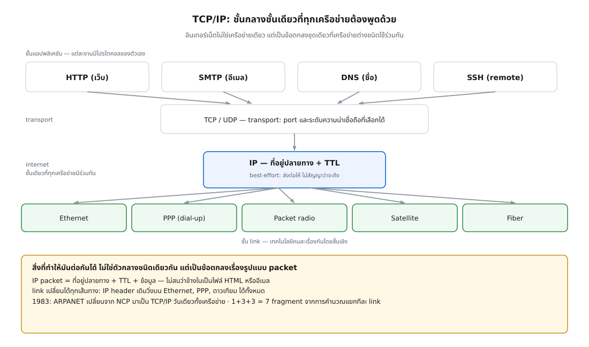
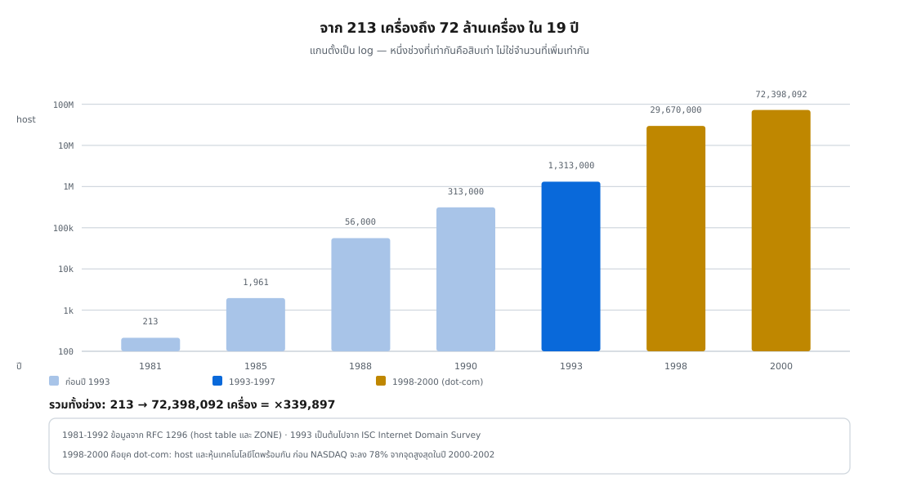
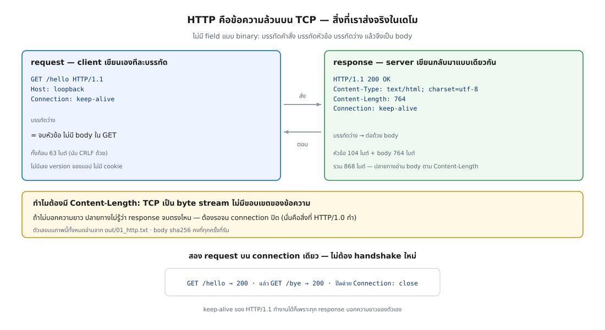

> 📅 เขียนเมื่อ: 14 พฤศจิกายน 2026 (เวลาไทย, UTC+7)
>
> **ผลรันทั้งหมดในบทนี้มาจากเครื่องเดียว** — Raspberry Pi 5, Debian GNU/Linux 13 (trixie), kernel 6.18.60+rpt-rpi-2712, aarch64
> **เวอร์ชันที่ใช้จริงในเดโม:** Go 1.24.4 · `gofmt` และ `go vet` ผ่านสะอาด (0 ไฟล์ที่ยังไม่ format)
> เดโมแตะ network **เฉพาะ loopback (127.0.0.1 — ที่อยู่ที่หมายถึง "เครื่องนี้เอง")** ไม่มี packet ออกจาก interface จริงแม้แต่ใบเดียว ไม่มีการยิงพอร์ตเครื่องอื่น
> เบอร์พอร์ตที่ server เปิดเป็น ephemeral (พอร์ตชั่วคราวที่ OS จัดให้) และ **ไม่ถูกพิมพ์ลงผลรัน** เพื่อให้ผลรันซ้ำได้ตรงทุกไบต์
>
> 🛡️ **จริยธรรม (ยังใช้กับทั้งซีรีส์):** ทุกคำสั่งและทุกการทดลองให้ทำกับ **เครื่องและเครือข่ายที่คุณควบคุมเอง** เท่านั้น — การดัก packet หรือสแกนระบบของคนอื่นโดยไม่ได้รับอนุญาตผิดกฎหมายในแทบทุกประเทศ

---

## 0. วันที่ทั้งเครือข่ายต้องเปลี่ยนพร้อมกัน

วันที่ 1 มกราคม 1983 เครือข่าย ARPANET ทั้งเครือข่ายเปลี่ยนโปรโตคอลหลักในวันเดียว — จาก NCP (Network Control Protocol ตัวเก่า ที่อยู่กับ ARPANET มาตั้งแต่ปี 1969) มาเป็น TCP/IP ทุกเครื่องที่ต่ออยู่ต้องเปลี่ยนให้เสร็จก่อนเที่ยงคืน ถ้าเครื่องไหนไม่เปลี่ยน มันจะคุยกับใครไม่ได้เลย

การเปลี่ยนแบบนี้เรียกว่า **flag day** (วันธง — วันที่ทุกคนต้องเปลี่ยนพร้อมกัน ไม่มีช่วงเปลี่ยนผ่าน) และมันผ่านไปได้อย่างน่าประหลาดใจ จนมีปุ่มกลม ๆ พิมพ์ว่า **"I survived the TCP/IP transition"** แจกกันในหมู่คนที่รอดมาได้

แปดปีครึ่งต่อมา วันที่ 6 สิงหาคม 1991 ชายคนหนึ่งโพสต์ข้อความสั้น ๆ ในกลุ่มข่าว Usenet ชื่อ `alt.hypertext` ว่าเขาได้ทำระบบที่ให้เอกสารอ้างถึงกันข้ามเครื่องผ่าน internet ได้แล้ว และเชิญใครก็ตามที่สนใจลองใช้

สองวันนั้นคือสองครึ่งของบทนี้: **1983 คือวันที่ "เครือข่ายของเครือข่าย" กลายเป็นจริง** และ **1991 คือวันที่คนธรรมดาเริ่มมีเหตุผลจะสนใจมัน**

บทที่แล้วเราจบที่ Ethernet — เครือข่ายในอาคารเดียว บทนี้จะพาคุณขึ้นไปอีกชั้น: ทำไมการต่อเครือข่ายหลายพันใบเข้าด้วยกันจำเป็นต้องมี "ชั้นกลาง" ชั้นเดียว, ชั้นนั้นถูกออกแบบอย่างไร และเว็บเกิดขึ้นมาบนมันได้อย่างไรโดยไม่ต้องแก้มันเลย

---

## 1. ปัญหาที่ ARPANET แก้ไม่ได้

ARPANET ในปี 1980 เป็นเครือข่ายที่ทำงานได้ดี แต่มีข้อจำกัดเชิงโครงสร้างข้อหนึ่งที่ทำให้มันขยายไม่ได้: **มันเป็นเครือข่ายเดียว**

โปรโตคอลของมันคือ NCP ซึ่งมีสมมติฐานฝังอยู่สามข้อ:

1. **ความน่าเชื่อถือเป็นหน้าที่ของเครือข่าย** — ถ้า packet หาย NCP จะรอ แล้วหยุดรอไปเลย เพราะมันไม่มีการส่งซ้ำด้วยตัวเอง (มันฝากเรื่องนี้ไว้กับ IMP — เครื่องรับส่ง packet ของ ARPANET)
2. **ที่อยู่ปลายทางมีแค่ IMP** — NCP รู้จักเครื่องที่ต่ออยู่กับ IMP ตัวเอง ไม่มีแนวคิดเรื่อง "เครือข่ายอื่น"
3. **ทุกเครื่องใช้เทคโนโลยี link เดียวกัน** — leased line (วงจรเช่าเหมาจากผู้ให้บริการวงจรที่เรียกกันว่า carrier) ความเร็วเดียวกัน

ปี 1972 DARPA เริ่มสนับสนุนเครือข่าย packet มากกว่าหนึ่งชนิด — มี **packet radio** (วิทยุ packet ของ PRNET) สำหรับเครื่องเคลื่อนที่ และ **packet satellite** (SATNET) ที่เชื่อมข้ามมหาสมุทรด้วยดาวเทียม และตอนนี้ยังมี LAN อย่าง Ethernet จากบทที่แล้วโผล่มาอีกชนิด

ทั้งสามอย่างนี้เร็วช้าไม่เท่ากัน, ขนาด packet สูงสุดไม่เท่ากัน, และอัตราการหายของ packet ต่างกันเป็นสิบเท่า ถ้าจะทำให้ NCP ทำงานบนทั้งหมดนี้ คุณต้องแก้ NCP และแก้ **ทุกเครื่องที่ต่ออยู่** ทุกครั้งที่มีเทคโนโลยีใหม่ — นี่คืองานที่ไม่มีวันจบ

ทางออกที่ทีม DARPA เลือกกลับตรงกันข้ามกับสัญชาตญาณ: **แทนที่จะทำให้โปรโตคอลฉลาดขึ้น ให้เพิ่มชั้นที่โง่ที่สุดเท่าที่จะทำได้ลงไปแทน**

| | NCP (ก่อน 1983) | TCP/IP (หลัง 1983) |
|---|---|---|
| ขอบเขต | เครือข่ายเดียว (ARPANET) | หลายเครือข่ายต่อกัน ไม่จำกัดเทคโนโลยี |
| ความน่าเชื่อถือ | เครือข่ายรับประกันให้ | ปลายทางสองฝั่งจัดการกันเอง |
| ที่อยู่ | ถึงระดับ IMP | ที่อยู่ปลายทางระดับโลก (IP address) |
| เพิ่ม link ชนิดใหม่ | ต้องแก้ทุกเครื่อง | ไม่ต้องแก้อะไรเลย |
| ใครรับผิดชอบ packet หาย | IMP | TCP ที่ปลายทาง |

คำว่า **internetwork** (หรือ internet ตัวเล็ก) แปลตรงตัวว่า "ระหว่างเครือข่าย" — ไม่ใช่ชื่อเฉพาะของอะไรทั้งสิ้น มันคือคำสามัญที่แปลว่าเครือข่ายหลายใบต่อกัน[^2]

---

## 2. TCP/IP: ข้อตกลงที่เล็กพอจะอยู่ใต้ทุกอย่าง

### 2.1 สองคน สองกระดาษ และการแยกที่สำคัญที่สุด

พฤษภาคม 1974 Vint Cerf กับ Bob Kahn ตีพิมพ์บทความชื่อ **"A Protocol for Packet Network Intercommunication"** ใน *IEEE Transactions on Communications* บทความนี้เสนอสิ่งที่ตอนนั้นยังไม่มีใครทำ: วิธีให้เครือข่าย packet หลายใบที่ทำงานต่างกันส่งข้อมูลหากันได้ โดยมี **gateway** (เครื่องที่ต่ออยู่กับสองเครือข่ายขึ้นไป แล้วส่ง packet ข้ามระหว่างกัน — วันนี้เราเรียกมันว่า router) เป็นตัวกลาง

ในเวอร์ชันแรกนั้นมันเป็นโปรโตคอลเดียวชื่อ TCP · ปลายปี 1974 มีสเปคฉบับละเอียดออกมาเป็น RFC 675

RFC (Request for Comments) คือเอกสารมาตรฐานของ internet ที่ใครก็เขียนเสนอได้ และถูกนับเป็นมาตรฐานเมื่อชุมชนยอมรับ — ไม่มีองค์กรกลางที่ออกกฎให้ทุกคนต้องทำตาม

อีกสี่ปีต่อมา ทีมงานแยกมันเป็นสองชั้น เพราะงานวิจัยเสียงผ่าน packet ทำให้เห็นว่า **บางแอปพลิเคชันไม่ต้องการการส่งซ้ำ** — เสียงที่ขาดหายหนึ่งช่วงควรถูกข้ามไป ไม่ใช่รอให้ส่งใหม่จนกว่าจะครบ (รอเมื่อไรเสียงก็ขาดอยู่ดี)

การแยกปี 1978 นั้นคือการแยกที่ยังใช้อยู่จนถึงวันนี้:

| | IP (Internet Protocol) | TCP (Transmission Control Protocol) |
|---|---|---|
| หน่วยข้อมูล | packet (datagram) | stream ของไบต์ |
| สัญญาว่าอะไร | พยายามส่งต่อให้ดีที่สุด | ส่งครบ ถูกลำดับ หรือบอกว่าล้มเหลว |
| ที่อยู่ | ต้นทาง/ปลายทาง (32 บิตใน IPv4) | port ของโปรแกรมที่ปลายทาง[^6] |
| ถ้า packet หาย | ไม่สนใจ ไม่ส่งซ้ำ | ส่งซ้ำให้ |
| ถ้า packet มาสลับลำดับ | ไม่สนใจ | เรียงให้ใหม่ |
| ใครใช้ | ทุกอย่างที่วิ่งบน internet | HTTP, SSH, SMTP |
| ทางเลือกอื่น | — | UDP (ส่งเลย ไม่รับประกัน — ใช้กับ DNS, เกม, วิดีโอ) |

กันยายน 1981 สเปคทั้งสองออกมาเป็น **RFC 791 (IP)** และ **RFC 793 (TCP)** โดย Jon Postel เป็นบรรณาธิการ และพฤศจิกายนปีเดียวกัน **RFC 801** ก็กำหนดวันตายของ NCP ไว้ชัดเจน: 1 มกราคม 1983[^1]

### 2.2 hourglass: รูปที่อธิบายทุกอย่าง



ภาพนี้คือหัวใจของ internet และมันเรียกว่า **hourglass model** (รูปนาฬิกาทราย) เพราะของจริงหน้าตาเป็นนาฬิกาทรายตั้งตรง — บนกว้าง คอกลางแคบ ล่างกว้าง:

- **ด้านบนกว้าง** — แอปพลิเคชันมีได้ไม่จำกัด ใครจะเขียนโปรโตคอลใหม่บน TCP หรือ UDP ก็ได้ ไม่ต้องขออนุญาตใคร
- **ตรงคอ** — มีโปรโตคอลเดียว: IP
- **ด้านล่างกว้าง** — link มีได้ทุกเทคโนโลยี: Ethernet, สายโทรศัพท์, ไฟเบอร์, วิทยุ, ดาวเทียม, 5G

คุณค่าของมันอยู่ที่ **คอต้องเล็ก** ถ้าคอใหญ่ (เช่นถ้าต้องมีโปรโตคอลกลางหนึ่งตัวสำหรับ link แต่ละชนิด) ทุกอย่างจะต้องเชื่อมกันแบบ n×m (แอป n ตัว × link m ชนิด = ต้องเขียนตัวแปลง n×m ตัว) และไม่มีใครขยับได้

จุดที่ผมอยากให้สังเกตที่สุด: **IP ไม่ได้ทำอะไรเลยนอกจากบอกที่อยู่กับส่งต่อ** ไม่มีการรับประกัน ไม่มีการเรียงลำดับ ไม่มีการตรวจว่าปลายทางได้รับหรือไม่ ทั้งหมดนั้นไปอยู่ที่ปลายทางสองฝั่ง (ส่วน TTL ใน header มีไว้กัน packet วิ่งวน — ดูเชิงอรรถ[^5])

การตัดสินใจนี้มีชื่อเรียกว่า **end-to-end argument** (หลักการ "ปลายทางถึงปลายทาง") และมันมีเหตุผลเชิงวิศวกรรมที่คมมาก: ถ้าเครือข่ายตรงกลางไม่ต้องจำ state ของ connection ใด ๆ มันก็ไม่ต้องจำอะไรเลยตอนที่ link หนึ่งล่ม — มันแค่หยุดส่งต่อ แล้วไปใช้เส้นทางอื่น

ลองเทียบกับอีกทางเลือก: switch ที่ต้องจำว่า "flow นี้มีการรับประกันอะไร" จะต้องกู้ state ทั้งหมดเมื่อ reboot, ต้องประสานกับ switch ตัวอื่น และจะแพงขึ้นตามจำนวน flow — นี่คือเหตุผลที่เครือข่ายโทรศัพท์สเกลได้ช้ากว่า internet มาก

### 2.3 หลักฐานว่า IP เป็นตัวกลางจริง: MTU

คำถามที่คนมักไม่ถาม: ถ้า link แต่ละชนิดใส่ packet ได้ใหญ่ไม่เท่ากัน แล้ว IP จัดการอย่างไร

ทุก link มี **MTU (Maximum Transmission Unit)** — เพดานขนาด IP packet ที่ link นั้นพาไปได้ในหนึ่ง frame โดยนับรวม IP header ด้วย ตัวเลขที่ต่างกันมาก:

| link | MTU (ไบต์) | ที่มา |
|---|---|---|
| Ethernet | 1500 | ค่าที่เกือบทุกคนเจอในชีวิตจริง |
| PPPoE (DSL) | 1492 | 1500 ลบ PPPoE header 8 ไบต์ |
| FDDI (Fiber Distributed Data Interface — มาตรฐาน LAN ไฟเบอร์รุ่นเก่าที่ MTU ใหญ่ผิดปกติ) | 4352 | ค่า default ตาม RFC 2019 |
| IPv4 ขั้นต่ำที่ทุกเครื่องต้องรับได้ | 576 | RFC 791 |
| IPv6 ขั้นต่ำที่ทุก link ต้องรองรับ | 1280 | RFC 8200 |

ถ้า IP packet ใหญ่กว่า MTU ของ link ถัดไป มีสองทาง: **fragment** (หั่นเป็นชิ้นให้พอดี) หรือส่งข้อความแจ้งปัญหาของ IP (ICMP) กลับไปบอกต้นทางว่า "ใหญ่เกิน" แล้วให้ต้นทางลดขนาดเอง (Path MTU Discovery — จะเจออีกทีตอนที่เราคุยเรื่อง TCP กับ routing)

นี่คือสิ่งที่ทำให้ IP เป็น "ตัวกลาง" จริง ๆ: packet เดียวกันเดินข้าม link ที่ MTU ต่างกันได้ โดยที่แอปพลิเคชันข้างบนไม่ต้องรู้เรื่องนี้เลย เราจะวัดตัวเลขนี้ด้วยโค้ดในข้อ 6.5

---

## 3. ทศวรรษ 1980: จากงานวิจัยสู่โครงสร้างพื้นฐาน

TCP/IP ไม่ได้ชนะเพราะมันดีที่สุดในกระดาษ — มันชนะเพราะมีคนเอามันไปแจกฟรีพร้อม source code

**สิงหาคม–กันยายน 1983** มหาวิทยาลัยแคลิฟอร์เนีย เบิร์กลีย์ ออก **4.2BSD** ซึ่งเป็น Unix รุ่นแรกที่มี TCP/IP อยู่ในตัว พร้อม source code ทั้งหมด (คู่มือ 4.2BSD ของ Berkeley ลงวันที่ ส.ค. 1983 ส่วนตารางประวัติ Unix ลงเป็น ก.ย. 1983 — บทนี้จึงเขียนเป็นช่วง) มหาวิทยาลัยที่ซื้อ license Unix ราคาถูกได้โค้ดที่ใช้งานได้จริง (implementation) ไปด้วย — นี่คือเหตุผลที่ว่า ทำไม TCP/IP กลายเป็นมาตรฐานโดยพฤตินัยเร็วกว่าที่คณะกรรมการ (committee) ใด ๆ จะทำได้

### 3.1 NSFNET: เครือข่ายที่ทำให้มันเป็นของสาธารณะ

ปี 1985 มูลนิธิวิทยาศาสตร์แห่งชาติสหรัฐฯ (NSF) เริ่มโครงการเชื่อมศูนย์ supercomputer ห้าแห่ง (Princeton, Cornell, UC San Diego, UIUC, Pittsburgh) เข้าด้วยกัน

เดือนธันวาคม 1985 Dennis Jennings ผู้ดูแลโครงการตัดสินใจเรื่องที่เปลี่ยนประวัติศาสตร์: **ใช้ TCP/IP เป็นโปรโตคอลของ NSFNET** ทั้งที่ตอนนั้นกระแสของรัฐบาลสหรัฐฯ เอียงไปทางโปรโตคอล ISO (OSI — ชุดมาตรฐานคู่แข่งที่องค์กรมาตรฐานสากลผลักดันในยุคนั้น) มากกว่า

เมษายน 1986 link แรกที่ 56 kbit/s เปิดใช้งาน กรกฎาคมปีเดียวกัน backbone (เส้นทางหลักที่เครือข่ายย่อยทั้งหลายต่อเข้ามา) ทำงานเต็มรูปแบบ

มันไม่พออย่างรวดเร็ว กรกฎาคม 1988 backbone เปลี่ยนเป็น **T1 = 1.544 Mbit/s** (เพิ่มขึ้นราว 27.6 เท่า — เกือบ 28 เท่า) เชื่อม 13 จุด และรับ traffic 152 ล้าน packet ต่อเดือน ปี 1991 เปลี่ยนเป็น **T3 = 45 Mbit/s** เชื่อม 16 จุด

| ปี | เหตุการณ์ |
|---|---|
| 1983 (1 ม.ค.) | ARPANET เปลี่ยน NCP → TCP/IP (flag day) |
| 1983 (ส.ค.–ก.ย.) | 4.2BSD ออกพร้อม TCP/IP และ source code |
| 1985 (พ.ค.–พ.ย.) | NSF ประกาศแผน NSFNET และมอบทุนศูนย์ supercomputer 5 แห่ง |
| 1985 (ธ.ค.) | Jennings ตัดสินใจใช้ TCP/IP สำหรับ NSFNET |
| 1986 (ก.ค.) | NSFNET backbone 56 kbit/s เปิดเต็มรูปแบบ |
| 1988 (ก.ค.) | T1 1.544 Mbit/s · 13 จุด · 152 ล้าน packet/เดือน |
| 1990 (มี.ค.) | ARPANET ปิดตัว — NSFNET เป็นเครือข่ายวิจัยหลักแทน |
| 1991 (พ.ค.) | ANS (บริษัทที่รับช่วงดูแล backbone ของ NSFNET ตั้งแต่ปี 1990) ตั้งบริษัทย่อย ANS CO+RE ขาย traffic เชิงพาณิชย์บนโครงเดิม |
| 1991 (พ.ย.) | T3 45 Mbit/s ครบ 16 จุด |
| 1995 (30 เม.ย.) | NSFNET backbone ปิดตัว — traffic ย้ายไปผู้ให้บริการเอกชน |
| 1995 (24 ต.ค.) | Federal Networking Council ออกนิยามคำว่า "Internet" อย่างเป็นทางการ |

แถวสุดท้ายสำคัญกว่าที่ดู: **ปี 1995 คือปีที่ internet ไม่ได้เป็นของรัฐอีกต่อไป** ตั้งแต่นั้นมาไม่มีใคร "เป็นเจ้าของ" มัน มีแต่ผู้ให้บริการที่ใช้โปรโตคอลชุดเดียวกัน

### 3.2 การเติบโตที่ควรดูเป็น log scale



ตารางจำนวน host (เครื่องที่ต่ออยู่บน internet) อ่านจากผลรันของเดโมในบทนี้ — 1981-1992 จาก RFC 1296 (บันทึกจากเทปของ SRI-NIC) และ 1993 เป็นต้นไปจาก ISC Internet Domain Survey:

```text
จำนวน host ที่ต่ออยู่บน internet — หน่วยเป็นเครื่อง ไม่ใช่มนุษย์ (คนหนึ่งเครื่องใช้ร่วมกันได้หลายคน)
date     hosts       factor_vs_prev  source
----     -----       --------------  ------
1981-08  213         -               RFC 1296 (host table)
1985-10  1,961       9.2x            RFC 1296 (host table)
1988-10  56,000      28.6x           RFC 1296 (ZONE)
1990-10  313,000     5.6x            RFC 1296 (ZONE)
1993-01  1,313,000   4.2x            ISC domain survey
1998-01  29,670,000  22.6x           ISC domain survey
2000-01  72,398,092  2.4x            ISC domain survey

first=213 last=72398092 growth_factor=339897x
years=19
```

ตัวเลขที่ควรจำ: `growth_factor=339897` — เพิ่มขึ้นราว 339,897 เท่าใน 19 ปี

และตัวเลขนี้เป็น **จำนวนเครื่อง ไม่ใช่จำนวนคน** ในปี 2000 ผู้ใช้อินเทอร์เน็ตยังเป็นส่วนน้อยของประชากรโลก และเครื่องหนึ่งเครื่องมักมีคนใช้ร่วมกันหลายคน (ร้านอินเทอร์เน็ตคาเฟ่, ห้อง lab, เครื่องในบ้านทั้งครอบครัว)

---

## 4. 1989: บันทึกหนึ่งหน้าที่เขียนว่า "Vague but exciting"

ที่ CERN (องค์การวิจัยนิวเคลียร์แห่งยุโรป ใกล้เมืองเจนีวา) มีปัญหาที่ฟังดูไม่เกี่ยวกับเครือข่ายเลย: **นักวิจัยหาเอกสารของตัวเองไม่เจอ**

CERN มีระบบคอมพิวเตอร์หลายสิบระบบ แต่ละระบบมีวิธีเก็บเอกสารของตัวเอง มีคนเข้า-ออกตลอดเวลา และความรู้ที่ว่า "เอกสารนี้อยู่ที่ไหน ใครดูแล ใช้กับอะไร" มักอยู่ในหัวคน ไม่ได้อยู่ในระบบ

มีนาคม 1989 Tim Berners-Lee เขียนข้อเสนอสั้น ๆ ชื่อ **"Information Management: A Proposal"** เสนอระบบ hypertext (ข้อความที่ชี้ไปข้อความอื่นได้ — คำนี้มีมาตั้งแต่ทศวรรษ 1960) ที่ทำงานข้ามเครื่องและข้ามระบบปฏิบัติการได้

หัวหน้าเขา Mike Sendall เขียนความเห็นไว้บนปกว่า **"Vague, but exciting"** (คลุมเครือ แต่น่าตื่นเต้น) แล้วปล่อยให้ทำต่อ

ชื่อแรกที่เขาใช้คือ **Mesh** คำว่า **World Wide Web** เพิ่งเกิดขึ้นตอนเขียนโค้ดปี 1990

### 4.1 สี่ชิ้นส่วนที่ต้องมีพร้อมกัน

สิ่งที่ Berners-Lee ประกอบขึ้นมาคือชุดของสี่อย่าง ซึ่งทั้งสี่อย่างต้องมีพร้อมกันจึงจะทำงานได้:

1. **URL (Uniform Resource Locator)** — วิธีตั้งชื่อสิ่งที่อยู่บนเครือข่าย ให้ทุกคนชี้ไปที่เดียวกันได้
2. **HTML (HyperText Markup Language)** — รูปแบบเอกสารที่บอกว่า "ส่วนนี้เป็นลิงก์ไปที่ URL นี้"
3. **HTTP (HyperText Transfer Protocol)** — วิธีขอและรับเอกสารนั้น
4. **server และ browser** — โปรแกรมสองฝั่งที่พูดภาษานี้

ไทม์ไลน์ของมัน:

| เวลา | เหตุการณ์ |
|---|---|
| 1989 (มี.ค.) | ข้อเสนอ "Information Management: A Proposal" |
| 1990 (พ.ค.) | ยื่นข้อเสนอฉบับปรับปรุง |
| 1990 (ก.ย.) | Sendall อนุมัติให้ซื้อเครื่อง NeXT และเขียนระบบ |
| 1990 (พ.ย.) | server ตัวแรก `nxoc01.cern.ch` (ภายหลังคือ `info.cern.ch`) และหน้าเว็บหน้าแรก |
| 1990 (ธ.ค.) | browser/editor ตัวแรกชื่อ `WorldWideWeb` สาธิตได้จริงระหว่างเครื่องสองเครื่อง |
| 1991 (6 ส.ค.) | ประกาศในกลุ่มข่าว `alt.hypertext` — ถือเป็นวันเปิดเว็บให้สาธารณะ |
| 1993 (30 เม.ย.) | CERN ปล่อยซอฟต์แวร์เว็บให้ใช้ฟรีโดยไม่คิดค่าลิขสิทธิ์ (public domain) |
| 1993 | NCSA Mosaic — browser ตัวแรกที่คนทั่วไปติดตั้งได้ง่ายและเห็นรูปในหน้า จนคนนอกวงการหันมาสนใจ |

สองแถวหลังนี้ผมอยากเน้น เพราะคนมักเล่าถึงแต่การประดิษฐ์:

**การปล่อยให้ฟรีปี 1993 สำคัญพอ ๆ กับการประดิษฐ์ปี 1989** ถ้า CERN เก็บค่าลิขสิทธิ์ วันนี้เราคงมีเว็บของบริษัทหนึ่ง ไม่ใช่เว็บเดียวของโลก

**Mosaic ไม่ใช่ browser ตัวแรก** ก่อนหน้ามี Erwise, Viola, Midas แต่มันเป็นตัวแรกที่ "ติดตั้งง่ายและเห็นรูปในหน้า" และพอมีเวอร์ชัน Windows กับ Mac ออกมาในปีเดียวกัน จำนวนคนใช้ก็ระเบิด

### 4.2 HTTP: จากบรรทัดเดียวถึงหัวข้อสี่บรรทัด

HTTP รุ่นแรก (ภายหลังเรียกย้อนหลังว่า **HTTP/0.9**) เรียบง่ายจนน่าตกใจ — request คือบรรทัดเดียว:

```http
GET /my-page.html
```

ไม่มี header ไม่มี status code (รหัสตัวเลขบอกผลของ request เช่น 200 = สำเร็จ, 404 = ไม่พบ) ไม่มี content type (ชนิดของไฟล์ที่ส่ง) · response คือไฟล์ HTML ที่ตามมาเฉย ๆ ถ้ามีปัญหาก็ตอบ HTML ที่อธิบายปัญหาเป็นภาษาคน

HTTP/1.1 ที่คุณใช้ทุกวันนี้ยังเป็นภาษาตระกูลเดียวกัน — เพิ่ม header, เพิ่ม method (คำสั่งเช่น GET/POST), เพิ่มกลไก cache (สำเนาที่เก็บไว้ใช้ซ้ำ) และ connection ที่ใช้ซ้ำได้ แต่โครงยังเป็น "บรรทัดคำสั่ง + บรรทัดหัวข้อ + บรรทัดว่าง + body" เหมือนเดิม

| version | เอกสาร | สิ่งที่เพิ่ม |
|---|---|---|
| 0.9 | ไม่มีสเปค (1991) | GET บรรทัดเดียว ไม่มี header |
| 1.0 | RFC 1945 (พ.ค. 1996) | header, status code, Content-Type, method อื่น |
| 1.1 | RFC 2068 (ม.ค. 1997) · RFC 2616 (มิ.ย. 1999) | keep-alive เป็นค่าตั้งต้น, Host header บังคับ, chunked (ส่งเป็นก้อนพร้อมขนาดนำหน้า) |
| HTML 2.0 | RFC 1866 (พ.ย. 1995) | สเปค HTML ฉบับแรกที่มาตรฐานอ้างอิงได้ |

จุดที่ต้องเข้าใจให้ชัด: **เว็บไม่ได้แทนที่ internet และไม่ได้แก้ TCP/IP แม้แต่ไบต์เดียว** มันเป็นแอปพลิเคชันที่วิ่งอยู่บน TCP port 80 (และ 443 สำหรับ HTTPS) — หลักฐานเชิงประจักษ์ของ hourglass model ในข้อ 2.2

นี่คือเหตุผลที่คนทำงาน network ไม่ตกงานเมื่อเทคโนโลยีเปลี่ยน: ชั้นบนเปลี่ยนทุกห้าปี ชั้น IP เปลี่ยนทุกยี่สิบปี

---

## 5. dot-com: เมื่อชั้นบนกลายเป็นตลาด

คำว่า **dot-com** ในบทนี้หมายถึงยุค 1995–2000 ที่บริษัทซึ่งมีโดเมน `.com` พากันเข้าตลาดหุ้น แล้วหุ้นเทคโนโลยีก็พุ่งขึ้นจนหลุดจากพื้นฐานของธุรกิจจริง

9 สิงหาคม 1995 Netscape (บริษัทที่ทำ browser ซึ่งต่อยอดจาก Mosaic) เข้าตลาดหุ้น ราคาเสนอขาย 28 ดอลลาร์ต่อหุ้น แต่ปิดวันแรกที่ 58.25 ดอลลาร์ — บริษัทอายุ 16 เดือนที่ยังขาดทุน มีมูลค่าตลาดกว่า 2.5 พันล้านดอลลาร์ในวันเดียว

จากจุดนั้นดัชนี NASDAQ ซึ่งรวมหุ้นเทคโนโลยีสหรัฐฯ ไล่จาก 751 จุด (มกราคม 1995) ขึ้นไปถึง **5,048.62 จุด วันที่ 10 มีนาคม 2000** แล้วก็พัง ลงไปเหลือ 1,114.11 จุด วันที่ 9 ตุลาคม 2002 — หายไป **78%**

ระหว่างทางมีบริษัทที่ไม่มีรายได้เลยแต่มูลค่าหุ้นขึ้นหลายเท่า และมีบริษัทที่ล้มหายไปเป็นพัน

ทำไมผมเล่าเรื่องหุ้นในบท network? เพราะมันอธิบายสิ่งที่ทำให้ TCP/IP อยู่รอดมาได้:

**ชั้นที่อยู่ล่างสุดไม่เคยพัง** ระหว่างที่หุ้นเทคโนโลยีลง 78% และบริษัทหลายพันแห่งปิดตัว ตาราง host ในข้อ 3.2 ยังขึ้นต่อทุกปี เพราะ IP ยังต้องมี ของที่ตายคือ "แอปพลิเคชันที่ไม่มีใครอยากใช้" ไม่ใช่ท่อ

บทเรียนเชิงวิศวกรรมที่ผมอยากให้คุณถือไป: **เทคโนโลยีที่ทนคือเทคโนโลยีที่ถูกและเรียบง่ายพอจะอยู่ใต้ของอย่างอื่นได้** — เหตุผลเดียวกับที่ Ethernet ชนะในบทที่แล้ว และเหตุผลเดียวกับที่ IP ยังเป็นคอขวดเดียวของ internet มาจนถึงวันนี้

---

## 6. ลงมือทำ: คุย HTTP เองด้วย Go แล้ววัดว่ามันวิ่งบน TCP จริง

เดโมของตอนนี้อยู่ใน `network/code/ep04/` (นับจากโฟลเดอร์ `devto-drafts/`) และรันจบในไม่กี่วินาที

### 6.1 รันเองก่อน

```bash
cd network/code/ep04                 # โฟลเดอร์เดโมของตอนนี้
bash run_all.sh                      # build + รันทุก section + ตรวจ determinism + วาด SVG + ตรวจบท
go run . -section http               # ดูเฉพาะการแลกเปลี่ยน HTTP
go run . -section html               # ดูเฉพาะการสกัดลิงก์จาก HTML
go run . -section mtu                # ดูเฉพาะการหั่น datagram ตาม MTU
go run . -section growth             # ดูเฉพาะตารางจำนวน host
```

`run_all.sh` จะ build, รันทุก section เก็บผลลง `out/`, รัน fingerprint สองรอบเพื่อพิสูจน์ว่าผลซ้ำได้ แล้วสั่ง `gen_svgs.py` วาดภาพจากผลจริง และปิดท้ายด้วย `verify_article.py` ที่เทียบบล็อกผลรันในบทกับไฟล์ใน `out/` ทีละไบต์

### 6.2 request ที่เราประกอบเองทีละบรรทัด

คำถามแรกที่เดโมตอบ: **HTTP จริง ๆ แล้วเป็นข้อความหน้าตาอย่างไร**

โปรแกรมเปิด server บน loopback (`net.Listen("tcp", "127.0.0.1:0")` — เลข 0 แปลว่า "ให้ OS เลือกพอร์ตว่างให้") แล้วฝั่ง client ต่อเข้ามาด้วย `net.Dial` จากนั้น **เขียน request ด้วยตัวเองเป็น string** ไม่ใช้ `net/http` เลย:

```go
// serveHTTP ตอบ request หลายก้อนบน TCP connection เดียวจนกว่าฝั่ง client จะปิด
// (นี่คือ keep-alive ของ HTTP/1.1 — ต้องมี Content-Length ให้ปลายทางรู้ว่า response จบตรงไหน)
func serveHTTP(c net.Conn) connStat {
	defer c.Close()
	br := bufio.NewReader(c)
	st := connStat{closed: "client"}
	for {
		req, err := readRequest(br)
		if err != nil {
			return st
		}
		st.requests++
		body := []byte("not found\n")
		status, reason, ctype := 404, "Not Found", "text/plain; charset=utf-8"
		switch req.target {
		case "/hello":
			body, ctype = []byte(page), "text/html; charset=utf-8"
			status, reason = 200, "OK"
		case "/about":
			body, ctype = []byte(aboutPage), "text/html; charset=utf-8"
			status, reason = 200, "OK"
		case "/bye":
			body = []byte("bye\n")
			status, reason = 200, "OK"
		}
		keep := req.target != "/bye"
		connHdr := "keep-alive"
		if !keep {
			connHdr = "close"
		}
		var sb strings.Builder
		fmt.Fprintf(&sb, "HTTP/1.1 %d %s\r\n", status, reason)
		fmt.Fprintf(&sb, "Content-Type: %s\r\n", ctype)
		fmt.Fprintf(&sb, "Content-Length: %d\r\n", len(body))
		fmt.Fprintf(&sb, "Connection: %s\r\n\r\n", connHdr)
		if _, err := io.WriteString(c, sb.String()+string(body)); err != nil {
			return st
		}
		if !keep {
			st.closed = "server"
			return st
		}
	}
}
```

จุดที่ควรอ่านให้ช้าสองจุด:

- **`fmt.Fprintf(&sb, "Content-Length: %d\r\n", len(body))`** — ทุกบรรทัดของ HTTP จบด้วย CRLF (`\r\n` ไม่ใช่ `\n`) และ `Content-Length` ต้องเป็นความยาว **ไบต์** ของ body ที่จะตามมา ไม่ใช่จำนวนตัวอักษร
- **`if !keep { st.closed = "server"; return }`** — server ตอบได้หลาย request บน connection เดียว และเป็นฝั่งที่ปิดเมื่อ client ขอ `Connection: close`

ผลรันจริง:

```text
HTTP/1.1 บน TCP — ข้อความล้วน ไม่มี field แบบ binary (loopback 127.0.0.1 เท่านั้น)

## request 1
GET /hello HTTP/1.1
Host: loopback
Connection: keep-alive
(บรรทัดว่างปิดหัวข้อ)
req_bytes=63 method=GET target=/hello version=HTTP/1.1 headers=2
req_header_host=loopback

## response 1 — ทุกบรรทัดจบด้วย CRLF
HTTP/1.1 200 OK
Content-Type: text/html; charset=utf-8
Content-Length: 764
Connection: keep-alive
(บรรทัดว่าง)

resp_headers=3 status=200 body_bytes=764
body_first_line=<!DOCTYPE html>
body_sha256=8d5d2269684fd02d3f7238748692b3302e22bd20de3e8accb0f84e4ae66c1c29
header_block_bytes=104 total_bytes=868 framing=Content-Length
content_length=764

## request 2 (บน connection เดิม)
status=200 connection=close body="bye"

requests_on_one_connection=2 tcp_connections_opened=1 closed_by=server
reuse_note=connection เดียวรับได้หลาย request ต่อกัน — ไม่ต้อง handshake ใหม่ทุกครั้ง
```



สามบรรทัดที่ควรอ่านเป็นพิเศษ:

- **`req_bytes=63`** — request ทั้งก้อน 63 ไบต์ นับทุก CRLF แล้ว ถ้าคุณสงสัยว่า "ทำไม 63" ลองนับเอง: `GET /hello HTTP/1.1` (19) + CRLF + `Host: loopback` (14) + CRLF + `Connection: keep-alive` (22) + CRLF + CRLF
- **`body_bytes=764` กับ `content_length=764`** — ตัวเลขสองตัวนี้ต้องเท่ากันเสมอ เพราะ `Content-Length` คือคำสัญญาว่า body จะยาวเท่าไร
- **`requests_on_one_connection=2 tcp_connections_opened=1`** — สอง request วิ่งบน TCP connection เดียว request ที่สองไม่ต้องผ่านการจับมือสามจังหวะของ TCP (3-way handshake — เปิด connection ครั้งเดียว แล้วใช้ซ้ำได้อีกหลาย request) นี่คือ `keep-alive` ของ HTTP/1.1

### 6.3 Content-Length คือทั้งหมดของ "framing"

ถ้าคุณเคยสงสัยว่าทำไมบางทีหน้าเว็บโหลดค้าง ทั้งที่ข้อมูลมาครบแล้ว คำตอบมักอยู่ที่ข้อนี้

TCP ให้ **byte stream** แก่คุณ — ไม่มีขอบเขตของข้อความ ไม่มี "จุดจบของ response" ในตัวมันเอง ถ้า HTTP ไม่บอกความยาว ฝั่ง client ไม่มีทางรู้ว่า response จบตรงไหน มันทำได้แค่อ่านไปเรื่อย ๆ จน connection ปิด (ซึ่งคือวิธีของ HTTP/1.0) และนั่นหมายความว่าทุก response ต้องแลกมาด้วย connection ใหม่

ฟังก์ชันฝั่ง client ของเดโมจึงต้องอ่าน header ให้ครบก่อน แล้วอ่าน body ตามตัวเลขที่เจอ:

```go
// readResponse อ่าน status line + header ทุกบรรทัด แล้วอ่าน body ตาม Content-Length
// ตัวเลขใน Content-Length คือทั้งหมดของ "framing" ของ HTTP/1.1: ไม่มีมัน ปลายทางไม่รู้ว่า response จบตรงไหน
func readResponse(br *bufio.Reader) (*response, error) {
	line, err := br.ReadString('\n')
	if err != nil {
		return nil, err
	}
	r := &response{headerBytes: len(line)}
	fields := strings.Fields(strings.TrimRight(line, "\r\n"))
	if len(fields) < 2 || !strings.HasPrefix(fields[0], "HTTP/1.") {
		return nil, fmt.Errorf("status line ผิดรูปแบบ: %q", line)
	}
	r.version = fields[0]
	if _, err := fmt.Sscanf(fields[1], "%d", &r.status); err != nil {
		return nil, fmt.Errorf("status code อ่านไม่ได้: %q", fields[1])
	}
	if len(fields) > 2 {
		r.reason = strings.Join(fields[2:], " ")
	}
	length := -1
	for {
		h, err := br.ReadString('\n')
		if err != nil {
			return nil, err
		}
		r.headerBytes += len(h)
		h = strings.TrimRight(h, "\r\n")
		if h == "" {
			break
		}
		name, value, found := strings.Cut(h, ":")
		if !found {
			return nil, fmt.Errorf("header ผิดรูปแบบ: %q", h)
		}
		name, value = strings.TrimSpace(name), strings.TrimSpace(value)
		r.headers = append(r.headers, header{name: name, value: value})
		if strings.EqualFold(name, "Content-Length") {
			if _, err := fmt.Sscanf(value, "%d", &length); err != nil {
				return nil, fmt.Errorf("Content-Length อ่านไม่ได้: %q", value)
			}
		}
	}
	if length < 0 {
		return nil, errors.New("ไม่มี Content-Length — framing ไม่ชัด ต้องอ่านจน connection ปิด")
	}
	r.body = make([]byte, length)
	if _, err := io.ReadFull(br, r.body); err != nil {
		return nil, fmt.Errorf("อ่าน body %d ไบต์ไม่ครบ: %w", length, err)
	}
	return r, nil
}
```

จุดที่สำคัญคือ **`io.ReadFull(br, r.body)`** — อ่านให้ครบตามจำนวนไบต์ที่ระบุ ไม่มากไม่น้อย ถ้าเราอ่านแค่ "จนกว่าจะเจอข้อมูล" หรือ "จนกว่า buffer จะเต็ม" ก็จะพังทันทีที่ response สองอันติดกันใน buffer เดียว

มีสามวิธีมาตรฐานที่ใช้บอกจุดจบของ response และทั้งสามวิธีมี trade-off ต่างกัน (ดูเชิงอรรถ[^4])

### 6.4 HTML กับ URL: สองในสามสิ่งประดิษฐ์

ส่วนที่คนมักมองข้าม: **ลิงก์ในหน้าเว็บไม่ใช่ URL เต็ม** มันเป็น `about.html` หรือ `/hello` หรือ `#top` และ browser ต้องแปลงมันให้เป็น URL เต็มก่อนยิง request ทุกครั้ง

นี่คือสิ่งที่ `net/url` ทำ และเป็นทั้งหมดของ "การตั้งชื่อ" ในเว็บ:

```go
// classify บอกชนิดของ href: absolute (มี scheme), root-relative (ขึ้นต้นด้วย /),
// fragment (ขึ้นต้นด้วย #) หรือ relative (ที่เหลือ)
func classify(href string) string {
	switch {
	case strings.HasPrefix(href, "#"):
		return "fragment"
	case strings.HasPrefix(href, "/"):
		return "root-relative"
	case strings.Contains(href, "://"):
		return "absolute"
	default:
		return "relative"
	}
}
```

ก่อนจะสกัดลิงก์ได้ ต้องมีตัวจับแท็ก `<a href="...">ข้อความ</a>` ก่อน — เดโมใช้ regex ตัวเดียวประกาศไว้ระดับไฟล์ (`main.go` ก่อนฟังก์ชัน `extractLinks`) แล้วให้ `net/url` แปลง href ที่จับได้เป็น URL เต็ม:

```go
var anchorRE = regexp.MustCompile(`(?is)<a\s+[^>]*href\s*=\s*"([^"]*)"[^>]*>(.*?)</a>`)
```

```go
// extractLinks สกัดลิงก์ทั้งหมดแล้วแปลงเป็น URL เต็มด้วย net/url
// (บรรทัดที่สำคัญคือ base.ResolveReference — มันคือสิ่งที่ browser ทำก่อนยิง request ทุกครั้ง)
func extractLinks(doc, base string) ([]link, error) {
	baseURL, err := url.Parse(base)
	if err != nil {
		return nil, fmt.Errorf("base URL ผิด: %w", err)
	}
	var out []link
	for _, m := range anchorRE.FindAllStringSubmatch(doc, -1) {
		href := strings.TrimSpace(m[1])
		ref, err := url.Parse(href)
		if err != nil {
			return nil, fmt.Errorf("href ผิดรูปแบบ %q: %w", href, err)
		}
		out = append(out, link{
			href:     href,
			resolved: baseURL.ResolveReference(ref).String(),
			kind:     classify(href),
			text:     stripTags(m[2]),
		})
	}
	return out, nil
}
```

บรรทัดที่สำคัญที่สุดคือ **`baseURL.ResolveReference(ref)`** — มันคือสิ่งที่ browser ทำก่อนยิง request ทุกครั้ง และเป็นเหตุผลที่หน้าเว็บย้ายโดเมนแล้วลิงก์ภายในยังทำงาน

ผลรันจริง (เอกสารตั้งต้น + ลิงก์ที่สกัดได้):

```text
HTML + URL — สองในสามสิ่งประดิษฐ์ของเว็บ: เอกสารที่ชี้ไปเอกสารอื่นได้ และชื่อที่บอกว่าเอกสารอยู่ที่ไหน
base_url=http://example.invalid/hello (URL สมมติ — ไม่มีการต่อ network)

## เอกสารตั้งต้น (HTML ที่ server ส่งไป)
<!DOCTYPE html>
<html lang="th">
<head>
<meta charset="utf-8">
<title>The Project</title>
</head>
<body>
<h1>World Wide Web</h1>
<p>หน้าเดียวนี้อ้างถึงเอกสารอื่นได้สี่แบบ</p>
<ul>
<li><a href="about.html">เกี่ยวกับโปรเจกต์</a> — ลิงก์สัมพัทธ์</li>
<li><a href="/hello">หน้าเดิมอีกครั้ง</a> — ลิงก์จาก root</li>
<li><a href="https://info.cern.ch/hypertext/WWW/TheProject.html">ต้นฉบับที่ CERN</a> — URL เต็ม</li>
<li><a href="#top">ขึ้นบนสุด</a> — fragment ในหน้าเดียวกัน</li>
</ul>
</body>
</html>

## ลิงก์ที่สกัดได้: href → URL เต็ม
idx  href                                                resolved                                            kind
---  ----                                                --------                                            ----
1    about.html                                          http://example.invalid/about.html                   relative
2    /hello                                              http://example.invalid/hello                        root-relative
3    https://info.cern.ch/hypertext/WWW/TheProject.html  https://info.cern.ch/hypertext/WWW/TheProject.html  absolute
4    #top                                                http://example.invalid/hello#top                    fragment

links_total=4 absolute=1 fragment=1 relative=1 root-relative=1
resolved_host_same=3 resolved_host_other=1
```

อ่านตารางนี้สี่แถวแล้วจะเห็นสี่กติกาที่ browser ใช้:

- **`about.html` → `http://example.invalid/about.html`** — relative ถูกแทนที่จาก path ปัจจุบัน (`/hello` → `/about.html`)
- **`/hello` → `http://example.invalid/hello`** — ขึ้นต้นด้วย `/` แปลว่า "จาก root ของ host นี้" ไม่ใช่จาก path ปัจจุบัน
- **`https://info.cern.ch/...`** — มี scheme อยู่แล้ว จึงไม่ถูกแตะ ตัวนี้ชี้คนละ host (`resolved_host_other=1`)
- **`#top` → `http://example.invalid/hello#top`** — fragment ไม่เคยถูกส่งไปให้ server เลย มันอยู่ฝั่ง browser

ข้อสุดท้ายคือรายละเอียดที่คนพลาดบ่อย: fragment ไม่เคยเดินทางบนสาย ทุกอย่างหลัง `#` ถูกตัดทิ้งก่อนยิง request (ดูเชิงอรรถ[^3])

### 6.5 MTU: หลักฐานว่า IP ต้องเป็นชั้นกลาง

ทีนี้กลับมาที่คำถามในข้อ 2.3 ด้วยตัวเลขจริง: datagram 4,000 ไบต์เดินผ่าน link ที่ MTU ต่างกันจะเกิดอะไรขึ้น

```go
// fragment แบ่ง IP datagram ตาม MTU ของ link: header 20 ไบต์ทุกชิ้น
// และ data ของทุกชิ้นที่ไม่ใช่ชิ้นสุดท้ายต้องเป็นจำนวนเท่าของ 8 ไบต์ (RFC 791)
func fragment(total, mtu int) ([]frag, error) {
	const ipHeader = 20
	if total <= ipHeader {
		return nil, fmt.Errorf("datagram %d ไบต์ สั้นกว่า header %d", total, ipHeader)
	}
	if total <= mtu {
		return []frag{{total: total, data: total - ipHeader, last: true}}, nil
	}
	per := (mtu - ipHeader) / 8 * 8
	if per <= 0 {
		return nil, fmt.Errorf("MTU %d เล็กเกินกว่าจะใส่ header %d ได้", mtu, ipHeader)
	}
	var out []frag
	left := total - ipHeader
	for left > 0 {
		n := per
		if left < n {
			n = left
		}
		out = append(out, frag{total: n + ipHeader, data: n, last: left-n == 0})
		left -= n
	}
	return out, nil
}
```

ผลรันจริง (สาม link + ทางเลี่ยงด้วย MSS):

```text
MTU — เพดานขนาด IP packet ของ link แต่ละเส้น (ไม่ใช่ของทั้งเส้นทาง)
link      mtu   max_data_per_fragment  note
----      ---   ---------------------  ----
FDDI      4352  4328                   4352 ตาม RFC 2019
Ethernet  1500  1480                   ค่าที่เกือบทุกคนเจอในชีวิตจริง
PPPoE     1492  1472                   1500 ลบ PPPoE header 8 ไบต์

## datagram หนึ่งก้อน total=4000 (IP header 20 + data 3980) — คำนวณแยกทีละ link (ผลรวม fragment ของทั้งสาม link = 7)
link      mtu   fragments  sizes
----      ---   ---------  -----
FDDI      4352  1          4000
Ethernet  1500  3          1500 + 1500 + 1040
PPPoE     1492  3          1492 + 1492 + 1056
fragments_total=7

## ทางเลี่ยง: TCP ตัด segment ตาม MSS (MTU − 20 IP − 20 TCP) จึงไม่ต้องพึ่ง IP fragmentation
link      mtu   mss   segments_for_4000B  sizes
----      ---   ---   -----------------   -----
FDDI      4352  4312  1                   4000
Ethernet  1500  1460  3                   1460 + 1460 + 1080
PPPoE     1492  1452  3                   1452 + 1452 + 1096
ip_fragments_when_mss_respected=0
หมายเหตุ: MSS ของ Ethernet = 1500-20-20 = 1460 ไบต์ คือตัวเลขที่โผล่ใน tcpdump บ่อยที่สุด
```

อ่านสามตารางนี้:

- **FDDI (MTU 4352) ไม่ต้องหั่นเลย** — 4,000 ไบต์พอดี
- **Ethernet (MTU 1500) เป็น 3 ชิ้น: 1500 + 1500 + 1040** — ชิ้นแรกสองชิ้นเต็มเพดาน ชิ้นสุดท้ายเก็บเศษ
- **PPPoE (MTU 1492) ก็ 3 ชิ้น แต่ขนาดต่างกัน** (1492 + 1492 + 1056) — link ที่ MTU ต่างกันแค่ 8 ไบต์ให้ผลต่างกัน

และตัวเลข **MSS (Maximum Segment Size) = MTU − 20 (IP header) − 20 (TCP header)** คือคำตอบว่าทำไมในโลกจริงเราไม่เห็น IP fragmentation บ่อย: TCP ตัด segment ให้พอดีตั้งแต่ต้นทาง MSS ของ Ethernet คือ 1460 ไบต์ — ตัวเลขที่โผล่ในโปรแกรมดักดู packet (tcpdump) บ่อยที่สุดในชีวิตคุณ

สังเกตว่า **`ip_fragments_when_mss_respected=0`** — เมื่อ TCP ทำหน้าที่ของมัน IP ก็ไม่ต้องหั่นเลย นี่คือการแบ่งงานที่ดี: ชั้นบนรู้ขนาดที่ชั้นล่างรับได้ แล้วส่งให้พอดีตั้งแต่แรก

### 6.6 พิสูจน์ว่าเดโมเชื่อได้

```text
runs=2
identical=1
fingerprint_lines=8
fingerprint_sha256=c157290f35066d64362f9a4588addd68d4d506eec45322e827ac091768999244
```

`run_all.sh` รัน fingerprint สองรอบแล้วเทียบ — ถ้าต่างกันแม้ไบต์เดียว script จะ exit 1 ทันที วิธีนี้ทำให้ตัวเลขในบทกับในภาพไม่สามารถ "เพี้ยนกันเงียบ ๆ" ได้

---

## 7. โจทย์

### 7.1 Drill — 30 นาที ลงมือกับโค้ด

ทุกข้อให้รันจริงแล้วตอบจากผลใน `out/` ไม่ใช่จากการเดา

1. **เพิ่ม header ของตัวเอง** — เพิ่ม `X-Course: network-04` เข้าไปใน request ที่ client ส่ง แล้วปรับ `req_bytes` ที่พิมพ์ออกมาให้ตรง (ข้อนี้บังคับให้คุณนับ CRLF เอง) จากนั้นตอบว่า server ของเราเห็น header นั้นไหม และจะทำให้เห็นได้ต้องแก้ตรงไหน
2. **ทำให้ client พังแบบตั้งใจ** — เปลี่ยน `io.ReadFull(br, r.body)` เป็น `br.ReadString('\n')` แล้วรัน `-section http` สังเกตว่าเกิดอะไรขึ้น และอธิบายว่าทำไมการอ่าน "จนเจอบรรทัดใหม่" ใช้ไม่ได้กับ body ที่เป็น HTML
3. **ตอบ 404** — เพิ่ม request ที่สาม `GET /nope HTTP/1.1` ก่อน `/bye` แล้วดูว่า `readResponse` จัดการ status 404 ได้หรือไม่ และ `Connection` header ที่ server ส่งกลับมาคืออะไร (ใบ้: server ของเราตัดสิน keep-alive จาก path ไม่ใช่จาก status — นี่คือจุดที่โค้ดที่ใช้งานได้จริง (implementation) ทำละเอียดกว่านี้)
4. **ลิงก์ที่ resolve ผิด** — เปลี่ยน base URL ใน `runHTML` เป็น `http://example.invalid/a/b/page.html` แล้วรันใหม่ ตอบว่า `about.html` กลายเป็นอะไร และทำไม `../up.html` (ถ้าเพิ่มเข้าไป) ต้องได้ `/a/up.html`
5. **บีบ MTU** — เพิ่ม link ที่ MTU 576 (ค่าขั้นต่ำของ IPv4) เข้าไปในตาราง แล้วรัน `-section mtu` ตอบว่า datagram 4,000 ไบต์ถูกหั่นเป็นกี่ชิ้น และ MSS ของ link นั้นคือเท่าไร (ระวัง: MSS ต้องไม่ติดลบ)

### 7.2 Mini-project — `websnap`: crawler ตัวจิ๋วที่คุณไว้ใจได้

เขียน CLI ชื่อ `websnap` ที่ต่อยอดจากเดโมนี้ เป็นเครื่องมือที่คุณใช้จริงเวลาต้องตรวจเว็บของตัวเองว่า "ลิงก์เสียกี่อัน"

**ขอบเขตขั้นต่ำ**

- รับ URL เริ่มต้นหนึ่งอัน **แต่ยอมให้วิ่งเฉพาะ host ที่อยู่ใน allowlist ของตัวเอง** (127.0.0.1 หรือไฟล์ static ที่รันในเครื่อง) — ถ้าเจอลิงก์ออกนอก allowlist ให้รายงานแต่ **ห้ามตามไป**
- ตามลิงก์ได้ลึกไม่เกิน N ชั้น (`-depth`), dedupe ด้วย URL ที่ normalize แล้ว (ตัด fragment, เรียง query) และมีเพดานจำนวนหน้า (`-max-pages`)
- รายงาน: จำนวนหน้าที่ดึงสำเร็จ, status code ที่เจอ, ลิงก์ที่ชี้ไปหน้าเดียวกันซ้ำ, ลิงก์ที่ตอบ 404
- ทุก request มี timeout และ context ที่ยกเลิกได้ — ห้ามค้างเพราะปลายทางไม่ตอบ

**เกณฑ์ผ่าน**

- `go vet ./...` ผ่าน, `gofmt -l .` ไม่พิมพ์อะไร
- มี `go test` ที่ (ก) `classify` แยกชนิด href ถูกทั้งสี่แบบ (ข) `ResolveReference` ให้ผลตรงกับตารางในข้อ 6.4 (ค) crawler ไม่วิ่งออกนอก allowlist แม้หน้าเว็บจะมีลิงก์ external
- รันกับเว็บ static ของตัวเอง (สร้าง 5-6 หน้า มีลิงก์วนกันและมีลิงก์เสียหนึ่งอัน) แล้วรายงานผลได้ตรงกับที่เตรียมไว้
- ไม่ panic ไม่ว่า HTML จะผิดรูปแบบแค่ไหน

**ต่อยอด (ถ้ามีเวลา)**

- เคารพ `robots.txt` แบบง่าย (อ่าน `Disallow` ด้วย regex, ไม่ต้องเต็มสเปค) แล้วรายงานว่าโดนห้ามกี่ path
- ทำ `-concurrency N` ที่มี worker pool และสรุปว่าเวลาเปลี่ยนไปทางไหน (แต่ต้องไม่ยิงถี่จนปลายทางที่ตัวเองรันอยู่ล้ม)
- เพิ่มการรายงานว่าแต่ละหน้ามี `Content-Length` เท่าไร และรวมแล้วกี่ไบต์ — แล้วเทียบกับค่า `header_block_bytes` ใน `out/01_http.txt`

**ข้อห้าม:** `websnap` วิ่งได้เฉพาะ URL ที่คุณเป็นเจ้าของหรือได้รับอนุญาต — crawler ที่ไล่ตามลิงก์เองเป็นเครื่องมือที่สร้าง traffic ได้มากกว่าที่คุณคิด และการยิงเว็บคนอื่นโดยไม่ได้รับอนุญาตไม่ใช่การทดลอง

---

## 8. สรุป

สามสิ่งที่ผมอยากให้คุณถือออกจากบทนี้:

1. **internet ไม่ใช่เครือข่าย แต่เป็นข้อตกลง** — TCP/IP ไม่ได้ทำให้ link ทุกชนิดเหมือนกัน มันทำให้ link ที่ต่างกันโดยสิ้นเชิง "โปร่งใส" ต่อชั้นบน ด้วยการยอมให้ชั้นกลางโง่ที่สุด: ส่งต่อ packet ตามที่อยู่ แล้วไม่รับประกันอะไรเลย
2. **การแยก TCP กับ IP คือการตัดสินใจเชิงสถาปัตยกรรมที่ยังส่งผลถึงวันนี้** — ความน่าเชื่อถืออยู่ที่ปลายทาง ไม่ใช่ที่เครือข่าย ทำให้ router ไม่ต้องจำ state ของใคร และทำให้เครือข่ายขยายได้แบบที่เครือข่ายโทรศัพท์ทำไม่ได้
3. **เว็บคือแอปพลิเคชัน ไม่ใช่ internet** — Berners-Lee ประกอบ URL + HTML + HTTP บน TCP ที่มีอยู่แล้ว และ CERN ปล่อยมันให้ฟรีในปี 1993 สิ่งที่ทำให้มันระเบิดคือการเปิดให้ทุกคนใช้ ไม่ใช่ความฉลาดของโปรโตคอล

และมีอีกหนึ่งบทเรียนที่ผมอยากฝากไว้: **ตัวเลข `content_length=764` กับ `body_bytes=764` ในข้อ 6.2** คือตัวอย่างที่ชัดที่สุดของสิ่งที่บทนี้พูดทั้งบท — ระบบที่ทำงานได้ไม่ใช่ระบบที่ทุกชั้นฉลาด แต่เป็นระบบที่แต่ละชั้น **บอกความจริงเกี่ยวกับตัวเอง** ชัดเจนพอให้ชั้นอื่นทำงานต่อได้

ตอนหน้าเราจะออกจากโต๊ะทำงานไปข้างนอก: **เครือข่ายมือถือจาก 1G ถึง 5G** — วันที่เสียงกลายเป็น packet, การ handoff ระหว่างเสาสัญญาณ และกำเนิด WiFi ที่ทำให้ LAN หลุดจากสาย

---

**← ตอนก่อน: [Ethernet (1973): สายเส้นเดียวที่ทำให้ LAN ทั้งโลกพูดภาษาเดียวกัน](/blog/post.html?slug=2026-11-13-network-03-ethernet-lan)**

---

## เชิงอรรถ

[^1]: **TCP กับ IP แยกกันทำไม** — IP คือชั้นที่ส่ง packet จากปลายทางหนึ่งไปอีกปลายทางหนึ่งแบบ best-effort (ไม่รับประกัน ไม่เรียงลำดับ ไม่ส่งซ้ำ) ส่วน TCP คือชั้นที่สร้าง "สายท่อ" ของไบต์ที่เชื่อถือได้บน IP อีกที โดยใช้ sequence number, ACK และการส่งซ้ำ เทียบง่าย ๆ: IP คือระบบไปรษณีย์ที่รับส่งซองตามที่อยู่ (ซองอาจหายได้) ส่วน TCP คือคนที่ส่งจดหมายเป็นชุดพร้อมเลขกำกับหน้า และโทรตามทุกครั้งที่ปลายทางไม่ได้รับ

[^2]: **"internet" ตัวเล็ก กับ "Internet" ตัวใหญ่** — ตัวเล็กคือคำสามัญ แปลว่า "เครือข่ายหลายใบต่อกัน" (internetwork) ซึ่งมีได้หลายอันในโลก ตัวใหญ่คือชื่อเฉพาะของเครือข่ายเดียวที่เราใช้กันอยู่ Federal Networking Council ออกนิยามอย่างเป็นทางการเมื่อ 24 ตุลาคม 1995 ว่าเป็นระบบสารสนเทศทั่วโลกที่ใช้ TCP/IP, มีที่อยู่ไม่ซ้ำกัน globally และให้บริการระดับ application ได้ — นิยามนี้เขียนขึ้นมาเพื่อกันความสับสนในเอกสารราชการ

[^3]: **URL หนึ่งอันมีอะไรบ้าง** — `scheme://user@host:port/path?query#fragment` โดย `scheme` (http, https, mailto) บอกวิธีเข้าถึง, `host` บอกเครื่อง, `path` บอกตำแหน่งเอกสารในเครื่องนั้น, `query` คือพารามิเตอร์ที่ส่งไปให้โปรแกรม, และ `fragment` คือตำแหน่งในหน้าเว็บที่อยู่ฝั่ง browser เท่านั้น — **ไม่เคยถูกส่งไปให้ server** นี่คือเหตุผลที่หน้าเว็บที่พึ่ง fragment ในการแสดงเนื้อหาต่างกันจะใช้ SEO ไม่ได้เต็มที่

[^4]: **สามวิธีบอกจุดจบของ response** — (ก) `Content-Length` บอกจำนวนไบต์ล่วงหน้า ง่ายและแม่นยำ แต่ต้องรู้ขนาดก่อนส่ง (ข) `Transfer-Encoding: chunked` ส่งเป็นก้อน แต่ละก้อนมีขนาดนำหน้า ปิดท้ายด้วย chunk ขนาด 0 เหมาะกับข้อมูลที่เกิดสด ๆ (ค) ปิด connection เมื่อจบ (วิธีของ HTTP/1.0) ใช้ได้เสมอ แต่ต้องเสียค่า handshake ใหม่ทุกครั้ง HTTP/1.1 จึงกำหนดให้ `Content-Length` หรือ `chunked` อย่างใดอย่างหนึ่งต้องมี

[^5]: **ทำไมต้องมี TTL ใน IP header** — TTL (Time To Live) คือตัวนับที่ลดลงหนึ่งทุกครั้งที่ packet ผ่าน router ถ้าถึง 0 จะถูกทิ้งและส่ง ICMP กลับไปหาเจ้าของ มันมีไว้กัน packet วิ่งวนเป็นวง (routing loop) ไม่ให้เต็มเครือข่าย ใน IPv6 เปลี่ยนชื่อเป็น Hop Limit เพราะชื่อเดิมทำให้คนเข้าใจผิดว่าเป็นหน่วยวินาที

[^6]: **ทำไม port ถึงเป็นเลข 16 บิต** — port ใน TCP/UDP เป็นเลข 16 บิต (0–65535 รวม 65,536 ค่า) ใช้แยกโปรแกรมที่อยู่บนเครื่องเดียวกันออกจากกัน เพราะ IP address บอกแค่ "เครื่องไหน" ไม่ได้บอกว่า "โปรแกรมไหน" การจับคู่ (IP, port, protocol) เรียกว่า socket และคู่นี้คือสิ่งที่ทำให้เครื่องเดียวรัน web server กับ SSH พร้อมกันได้

---

## แหล่งอ้างอิง (ตรวจ ณ 14 พฤศจิกายน 2026)

- V. Cerf & R. Kahn — "A Protocol for Packet Network Intercommunication", *IEEE Transactions on Communications* 22(5), พ.ค. 1974, หน้า 637–648
- RFC 675 — [Specification of Internet Transmission Control Program](https://www.rfc-editor.org/info/rfc675) (ธ.ค. 1974)
- RFC 791 — [Internet Protocol](https://www.rfc-editor.org/info/rfc791) และ RFC 793 — [Transmission Control Protocol](https://www.rfc-editor.org/info/rfc793) (ก.ย. 1981) · RFC 801 — [NCP/TCP Transition Plan](https://www.rfc-editor.org/info/rfc801) (พ.ย. 1981, กำหนด 1 ม.ค. 1983)
- TUHS (The Unix Tree) — [4.2BSD](https://www.tuhs.org/cgi-bin/utree.pl?file=4.2BSD) (คู่มือและ source: ส.ค. 1983) · ตารางประวัติ Unix ใน TUHS ลง 4.2BSD เป็น `1983-09` — บทนี้จึงระบุ "ส.ค.–ก.ย. 1983" ให้ตรงกับทั้งสองแหล่ง
- Internet Society — [A Brief History of the Internet](https://www.internetsociety.org/internet/history-internet/brief-history-internet/) (flag day, ปุ่ม "I survived the TCP/IP transition", MILNET)
- Internet Society — [New Year's Day Marks 30th Anniversary](https://www.internetsociety.org/news/press-releases/2013/new-years-day-marks-30th-anniversary-of-major-milestone-for-global-internet) (1 ม.ค. 1983)
- NSF — [NSFNET Timeline](https://nsf.net/timeline) และ [Internet Backbone](https://nsf.net/projects/backbone) (56 kbit/s, T1 1.544 Mbit/s ก.ค. 1988, 152 ล้าน packet/เดือน, T3 45 Mbit/s 1991, ปิด 30 เม.ย. 1995, นิยาม FNC 24 ต.ค. 1995)
- Merit Network — [NSFNET: A Partnership for High-Speed Networking, Final Report 1987–1995](https://www.merit.edu/wp-content/uploads/2024/10/Merit-Network_NSFNET-A-Partnership-for-High-Speed-Networking.pdf)
- RFC 1296 — [Internet Growth (1981–1991)](https://www.rfc-editor.org/info/rfc1296) · ISC — [Internet Domain Survey](https://downloads.isc.org/www/survey/reports/2019/01/) (จำนวน host 1993–2018)
- W3C — [Information Management: A Proposal](https://www.w3.org/History/1989/proposal.html) (มี.ค. 1989 / พ.ค. 1990) และ [A Little History of the World Wide Web](https://www.w3.org/History.html) (NeXT, `nxoc01.cern.ch`, หน้าแรก พ.ย. 1990)
- CERN — [World Wide Web born at CERN 25 years ago](https://home.cern/news/news/computing/world-wide-web-born-cern-25-years-ago) และ [Web at 30](https://web30.web.cern.ch/web-history.html) (public domain 30 เม.ย. 1993)
- BBC News — [The World Wide Web turns 15 (again)](http://news.bbc.co.uk/2/hi/technology/7375703.stm) ("Vague but exciting", 30 เม.ย. 1993)
- W3C/Berners-Lee — [ประกาศใน alt.hypertext 6 ส.ค. 1991](https://www.w3.org/People/Berners-Lee/1991/08/art-6484.txt)
- MDN — [Evolution of HTTP](https://developer.mozilla.org/en-US/docs/Web/HTTP/Guides/Evolution_of_HTTP) (HTTP/0.9 one-line, RFC 1945, RFC 2068, RFC 2616) · RFC 1945 — [HTTP/1.0](https://www.rfc-editor.org/rfc/rfc1945.txt) (พ.ค. 1996)
- RFC 1866 — [Hypertext Markup Language 2.0](https://www.rfc-editor.org/info/rfc1866) (พ.ย. 1995)
- NCSA — [NCSA Mosaic](https://www.ncsa.illinois.edu/about/history/ncsa-mosaic) (alpha 23 ม.ค. 1993, 1.0 เม.ย. 1993, รูปในเนื้อหา, Windows/Mac ปลายปีเดียวกัน)
- International Banker — [The Dotcom Bubble Burst (2000)](https://internationalbanker.com/history-of-financial-crises/the-dotcom-bubble-burst-2000) (NASDAQ 751 → 5,048.62 วันที่ 10 มี.ค. 2000; Netscape IPO 9 ส.ค. 1995 ที่ 28 ดอลลาร์ ปิด 58.25) · FRED/NBER (1,114.11 วันที่ 9 ต.ค. 2002)
- RFC 2019 — [Transmission of IPv6 Packets over FDDI](https://www.rfc-editor.org/info/rfc2019) (MTU 4352) · RFC 8200 (IPv6 minimum MTU 1280) · RFC 791 §3.2 (576 ไบต์) · RFC 8900 — [IP Fragmentation Considered Fragile](https://www.rfc-editor.org/info/rfc8900)

> **หมายเหตุเรื่องภาพและตัวเลข:** ภาพประกอบทั้งสามภาพวาดเองด้วยสคริปต์ `gen_svgs.py` ในโฟลเดอร์ `code/ep04/` โดยตัวเลขบนภาพอ่านจาก `out/` ทุกตัว — ไม่มีภาพจากแหล่งภายนอก และ `gen_svgs.py` มี assert กันค่าที่เพี้ยน (ทั้ง `content_length`, `fragments_total` และตัวเลข host ทุกแถวถูกเทียบกับผลรันก่อนวาด และต้องโผล่ในบทนี้ด้วย)
