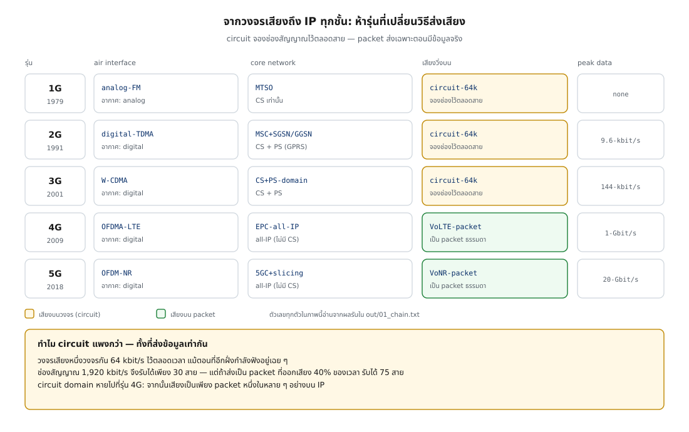
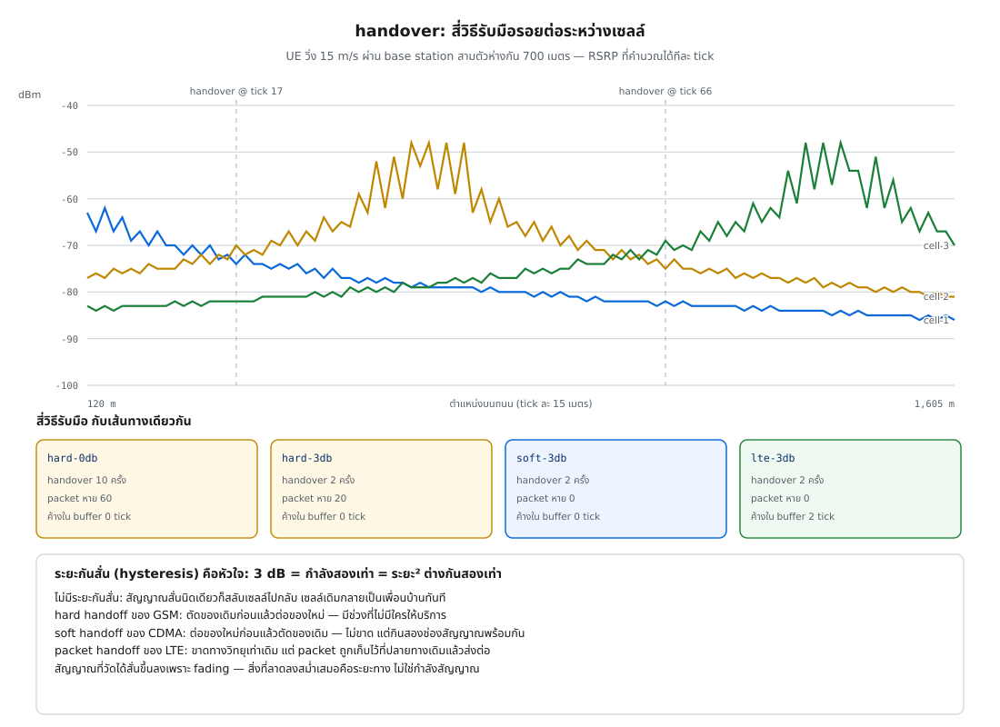
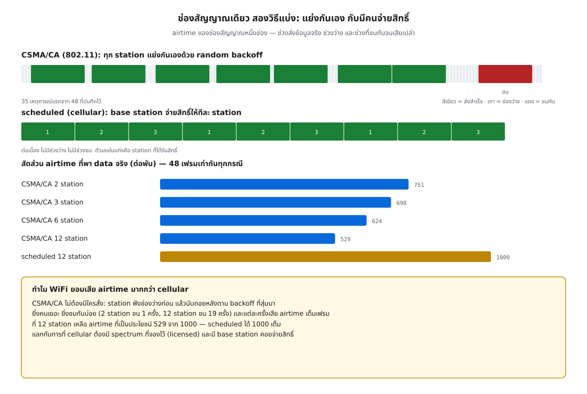

> 📅 เขียนเมื่อ: 15 พฤศจิกายน 2026 (เวลาไทย, UTC+7)
>
> **ผลรันทั้งหมดในบทนี้มาจากเครื่องเดียว** — Raspberry Pi 5, Debian GNU/Linux 13 (trixie), kernel 6.18.60+rpt-rpi-2712, aarch64
> **เวอร์ชันที่ใช้จริงในเดโม:** Go 1.24.4 · `gofmt` และ `go vet` ผ่านสะอาด (0 ไฟล์ที่ยังไม่ format) · ภาพตรวจด้วย `check_svg_readability.py` (วัดกรอบข้อความจากพิกัดจริงในไฟล์ SVG) แล้วเรนเดอร์เป็น PNG ด้วย `rsvg-convert` 2.60.0 เพื่อดูด้วยตาซ้ำ
> **เดโมของตอนนี้เป็นแบบจำลองล้วน** — ไม่มีวิทยุ ไม่มีการส่งคลื่น ไม่มี network I/O แม้แต่ไบต์เดียว ไม่มีการอ่านเวลาจริง และไม่มีการสุ่มที่ไม่มี seed ตัวเลขทุกตัวจึงซ้ำได้ตรงทุกครั้งที่รัน
>
> 🛡️ **จริยธรรม (ยังใช้กับทั้งซีรีส์):** ทุกคำสั่งและทุกการทดลองให้ทำกับ **เครื่องและเครือข่ายที่คุณควบคุมเอง** เท่านั้น — การดัก packet การสแกนเครือข่าย หรือการวัดสัญญาณรอบบ้านคนอื่นโดยไม่ได้รับอนุญาต ผิดกฎหมายในแทบทุกประเทศ การวัดสัญญาณของมือถือตัวเองบนเครื่องตัวเองคือสิ่งที่บทนี้สอน และเป็นขอบเขตที่ปลอดภัย

---

## 0. สายที่ไม่หลุด

คุณขับรถอยู่บนทางด่วน ความเร็วประมาณห้าสิบสี่กิโลเมตรต่อชั่วโมง (15 เมตรต่อวินาที — ความเร็วเดียวกับที่เดโมในข้อ 9 ใช้) คุยโทรศัพท์กับอีกฝั่งหนึ่ง เสียงขาดหายเป็นช่วงสั้น ๆ สองสามครั้งตลอดทาง แต่สายไม่หลุดเลย

ในสี่สิบนาทีนั้น คุณวิ่งผ่านเขตครอบคลุมของ base station (สถานีฐาน — เสาที่มีเสาอากาศและอุปกรณ์วิทยุอยู่ข้างล่าง) ไปหลายสิบตัว แต่ละตัวรับส่งได้ไกลไม่กี่กิโลเมตร เพราะถ้าไกลกว่านั้น วิทยุที่ใช้ร่วมกันกับคนอื่นจะรับไม่ไหว

ทุกครั้งที่คุณออกจากเขตรับส่งของตัวหนึ่งและเข้าสู่เขตของอีกตัว มีคนทำงานหนึ่งให้คุณโดยที่คุณไม่ต้องทำอะไรเลย: **handover** (การโอนสายข้ามเซลล์ — วงการมาตรฐานโทรคมนาคมเรียก handover วงการเครือข่ายคอมพิวเตอร์เรียก handoff; บทนี้ใช้ทั้งสองคำตามที่แต่ละมาตรฐานใช้) มันคือการย้ายเส้นทางของเสียงจากเสาหนึ่งไปอีกเสา **ในขณะที่เสียงยังไหลอยู่**

นั่นคือโจทย์ที่เครือข่ายคอมพิวเตอร์ไม่เคยต้องแก้: Ethernet ในบทที่แล้วไม่สนใจว่าเครื่องจะย้ายที่ เพราะสายไม่ได้ย้ายตามใคร

บทนี้ไล่สองเส้นทางที่วิ่งสวนกัน แล้วมาบรรจบที่เดียวกัน:

1. **เครือข่ายมือถือ** เริ่มจากวงจรเสียงที่จองช่องสัญญาณไว้ตลอดสาย (circuit-switched) แล้วค่อย ๆ เปลี่ยนเป็น packet ทีละชั้น จนถึงรุ่น 4G ที่ **ไม่มี circuit เหลืออยู่เลย** — เสียงกลายเป็น packet ธรรมดาตัวหนึ่ง
2. **WiFi** เกิดมาทีหลังและเลือกทางตรงกันข้ามตั้งแต่แรก: ไม่จองอะไรเลย ปล่อยให้ทุกคนแย่งกันใช้ช่องสัญญาณ และเกิดมาเป็น packet ตั้งแต่ต้น

ปลายทางของทั้งสองเส้นทางคือสิ่งเดียวกัน: **IP** และนั่นคือเหตุผลที่โทรศัพท์เครื่องเดียวคุยผ่าน WiFi แล้วเปลี่ยนไปใช้ 4G ได้โดยที่แอปไม่ต้องแก้โค้ด — เพราะชั้นล่างยังเป็น IP เหมือนกัน (แต่ connection ที่เปิดค้างไว้อาจต้องต่อใหม่เมื่อที่อยู่ IP เปลี่ยน)

---

## 1. cellular ไม่ได้เกิดจาก packet — เกิดจากการจอง

คำว่า **cellular** มาจาก cell (เซลล์ — พื้นที่ให้บริการเล็ก ๆ ที่มีเสาของตัวเองหนึ่งต้น) มาจากโครงสร้างของเครือข่ายที่แบ่งพื้นที่ออกเป็นช่อง ๆ เหมือนรังผึ้ง ไม่ใช่จากความหมายว่า "โทรศัพท์มือถือ"

เหตุผลที่ต้องแบ่งเป็นเซลล์เป็นเรื่องฟิสิกส์ล้วน ๆ: คลื่นวิทยุหนึ่งช่วงความถี่รับส่งข้อมูลได้จำกัด และใช้ซ้ำที่เดิมไม่ได้ถ้าสองคนอยู่ใกล้กัน (จะรบกวนกัน) แต่ใช้ซ้ำได้ถ้าอยู่ห่างกันพอ

ดังนั้นผู้ให้บริการจึงแบ่งพื้นที่ตามแนวคิด **frequency reuse** (การใช้ความถี่ซ้ำ): จัดกลุ่มเซลล์เป็นชุด ชุดละ 7 เซลล์ แล้วให้แต่ละเซลล์ในชุดใช้ความถี่ต่างกัน เซลล์ที่ 8 ซึ่งอยู่ห่างออกไปมากพอ ใช้ความถี่ตัวเดียวกับเซลล์แรกได้อีก

ผลลัพธ์เชิงตัวเลขที่สวยมาก: **ความจุของเครือข่ายโตตามจำนวนเซลล์ ไม่ใช่ตามปริมาณ spectrum (ช่วงความถี่วิทยุที่รัฐให้สิทธิ์ผู้ให้บริการใช้ — แต่ละย่านมีจำกัด) ที่มี** ถ้าคุณมี spectrum เท่าเดิมแต่แบ่งพื้นที่ละเอียดขึ้นเป็นสี่เท่า คุณก็รับสายได้ประมาณสี่เท่า (แลกกับเสาที่ต้องสร้างเพิ่มและค่าเช่าที่)

แต่การแบ่งพื้นที่แบบนี้สร้างปัญหาใหม่ที่บทก่อน ๆ ไม่เคยเจอ: **ผู้ใช้เคลื่อนที่ข้ามเส้นแบ่งตลอดเวลา**

### 1.1 สายเสียงหนึ่งสายในโลกของวงจร

ในรุ่น 1G และ 2G การโทรหนึ่งครั้งคือ **วงจรเดียวที่ถูกจองไว้** ตั้งแต่ต้นทางถึงปลายทาง:

- บนอากาศ: คลื่นความถี่หนึ่งคู่ (ขาขึ้น/ขาลง) หรือ timeslot (ช่องเวลา — เศษเสี้ยวเวลาที่เครื่องหนึ่งได้ใช้ความถี่นั้น) หนึ่งช่องของความถี่นั้น
- ใน core network (เครือข่ายแกนกลาง — ส่วนที่รวมศูนย์ของผู้ให้บริการ ที่เชื่อมทุกเสาเข้าหากัน): ช่องวงจร 64 kbit/s หนึ่งช่องในสวิตช์ที่ชื่อ MSC (Mobile Switching Center — สวิตช์วงจรที่ทำหน้าที่ต่อสายเสียง)
- ปลายทาง: ช่อง 64 kbit/s อีกช่องหนึ่ง

64 kbit/s คืออัตราของเสียงคุณภาพโทรศัพท์แบบ PCM (Pulse Code Modulation — วิธีแปลงเสียงเป็นตัวเลข 8,000 ตัวอย่างต่อวินาที ตัวอย่างละ 8 บิต) และมัน **ถูกจองไว้ตลอดเวลาที่โทร** ไม่ว่าคุณจะพูดหรือกำลังฟังอีกฝั่งเงียบ ๆ

นี่ฟังดูสิ้นเปลือง และมันสิ้นเปลืองจริง — แต่ในปี 1979 มันเป็นทางเลือกที่สมเหตุสมผลที่สุด เพราะ:

- ฮาร์ดแวร์สวิตช์วงจรง่ายกว่ามาก: ต่อสายเข้า-ออกแล้วปล่อยไว้ ไม่ต้องมี buffer ไม่ต้องมี header ไม่ต้องมีคนจัดการคิว
- เสียงเป็น traffic ที่ไหลสม่ำเสมอ (constant bitrate) ไม่ต้องเดา ไม่ต้องแบ่งปัน
- การคิดเงินง่าย: จ่ายตามนาทีที่ใช้สาย ซึ่งตรงกับต้นทุนที่จองไว้จริง ๆ

คุณจะเห็นว่ามันคือ **ตรรกะเดียวกับที่แพ้ให้ packet switching ในบทที่แล้ว** — แต่ในโลกมือถือ มันอยู่ต่อมาอีกยี่สิบปี เพราะข้อได้เปรียบของ circuit (ความง่ายของฮาร์ดแวร์และการรับประกันคุณภาพเสียง) สำคัญกว่าความสิ้นเปลือง ตราบใดที่คนยังใช้มือถือคุยกันอย่างเดียว

---

## 2. 2G: ดิจิทัลแล้ว แต่ยังเป็นวงจร

ปี 1991 เครือข่าย GSM (Global System for Mobile Communications — มาตรฐาน 2G ที่ ETSI ซึ่งเป็นองค์กรมาตรฐานของยุโรป พัฒนา) เปิดให้บริการเชิงพาณิชย์ครั้งแรกที่ฟินแลนด์โดยผู้ให้บริการชื่อ Radiolinja และกลายเป็นมาตรฐานที่ประเทศอื่นทำตามจนกลายเป็นภาษากลางของมือถือทั้งโลก

GSM เปลี่ยนสิ่งที่วิ่งบนอากาศจากคลื่นเสียงอนาล็อกเป็นบิต แต่ **ไม่ได้เปลี่ยนว่าเสียงถูกส่งอย่างไร** — เสียงยังเป็นวงจรที่จองไว้ตลอดสาย

โครงสร้างบนอากาศของ GSM น่าจดจำเพราะเป็นตัวเลขที่วิศวกรรุ่นนั้นจำได้ขึ้นใจ:

| ระดับ | ค่า | ความหมาย |
|---|---|---|
| carrier (คลื่นพาหะ — ช่องความถี่หนึ่งช่อง) | 200 kHz | ความกว้างคลื่นหนึ่งช่อง |
| timeslot | 8 ช่องต่อ carrier | แต่ละช่องเป็นของมือถือหนึ่งเครื่องในขณะหนึ่ง |
| TDMA frame | 4.615 ms | หนึ่งรอบที่ทั้ง 8 ช่องได้ส่งครบ |
| อัตรารวมของ carrier | 270.833 kbit/s | 270.833 kbit/s ÷ 200 kHz ≈ 1.35 บิตต่อวินาที ต่อเฮิรตซ์ |
| data ต่อ timeslot | 9.6 kbit/s | ความเร็วที่ได้ถ้าจองช่องนั้นไว้ส่ง data |

การแบ่งเวลาแบบนี้เรียกว่า **TDMA** (Time Division Multiple Access — หลายคนใช้ความถี่เดียวกันโดยแบ่งเวลาให้ผลัดกันส่ง) และมันคือรูปแบบของ circuit บนอากาศตรง ๆ: มือถือของคุณได้ timeslot หนึ่งของทุก ๆ 4.615 ms ตลอดเวลาที่โทร

ผลพลอยได้ที่ไม่มีใครวางแผนไว้คือ **SMS** เพราะระบบต้องมีช่องสัญญาณควบคุม (signalling channel) สำหรับบอกเครื่องว่า "ถึงตาส่งแล้ว" วิศวกรจึงใช้ช่องว่างนั้นส่งข้อความสั้น ๆ ได้ ไม่กี่ปีต่อมา SMS ก็กลายเป็นธุรกิจที่ใหญ่กว่าที่วิศวกรผู้เขียนสเปกนั้นคาดไว้มาก

และมันมีข้อเสียที่ชัดเจนสำหรับ data: ถ้าคุณอยากส่งข้อมูลด้วย GSM คุณต้อง **จองวงจร** (circuit-switched data) จ่ายเป็นนาที และได้ 9.6 kbit/s ตลอดเวลาที่ต่อ — แม้ในช่วงนั้นคุณจะไม่ได้ส่งอะไรเลย

คำว่า **GPRS** (General Packet Radio Service) จึงเกิดขึ้นมาทีหลังเพื่อแก้จุดนี้: มันเพิ่ม **packet domain** เข้าไปข้าง ๆ circuit domain เดิม โดยมีโหนดใหม่สองตัวคือ SGSN (Serving GPRS Support Node) และ GGSN (Gateway GPRS Support Node) ที่ทำหน้าที่เหมือน router ในเครือข่ายมือถือ

นี่คือครั้งแรกที่โทรศัพท์มีที่อยู่ IP เป็นของตัวเอง และเป็นจุดเริ่มของคำว่า "ออนไลน์ตลอดเวลา" — แต่เสียงยังไม่ย้ายไปไหน

---

## 3. ห้ารุ่นในตารางเดียว และเศรษฐศาสตร์ของ circuit

ก่อนลงลึกในรุ่นที่เหลือ มองภาพรวมก่อน ตารางนี้คือโครงของทั้งบท:

```text
## ห้ารุ่น — เรียงตามปีที่เปิดให้บริการเชิงพาณิชย์
gen  year  air-interface  core            voice-path      peak-data    cs-domain
1G   1979  analog-FM      MTSO            circuit-64k     none         yes
2G   1991  digital-TDMA   MSC+SGSN/GGSN   circuit-64k     9.6-kbit/s   yes
3G   2001  W-CDMA         CS+PS-domain    circuit-64k     144-kbit/s   yes
4G   2009  OFDMA-LTE      EPC-all-IP      VoLTE-packet    1-Gbit/s     no
5G   2018  OFDM-NR        5GC+slicing     VoNR-packet     20-Gbit/s    no
1G เสียงอนาล็อก ไม่มี data เลย: สิ่งที่ส่งได้มีอย่างเดียวคือคลื่นเสียง
2G ดิจิทัลแล้ว แต่เสียงยังเป็นวงจร: GPRS มาเพิ่ม packet domain ไว้ข้าง ๆ
3G มีสองโดเมนพร้อมกัน: CS domain สำหรับเสียง และ PS domain สำหรับ data
4G ไม่มี CS domain เลย: เสียงต้องกลายเป็น packet (VoLTE) หรือโทรไม่ได้
5G เกิดมาแบบ all-IP ตั้งแต่ต้น: ไม่มี circuit ให้รื้อ และมี slicing ตั้งแต่ Rel-15

## หนึ่งชั่วโมงของสายเสียงหนึ่งสาย — circuit กับ packet
mode     kbit_per_call_hour  kB_per_call_hour  calls_on_1920kbit
circuit              230400             28800                 30
packet                92160             11520                 75
voice_activity_permille=400
voice_calls_circuit=30
voice_calls_packet=75
capacity_gain_permille=2500
circuit กัน 64 kbit/s ไว้ตลอดเวลาที่โทร แม้ตอนที่อีกฝั่งกำลังฟังเฉย ๆ
packet ส่งเฉพาะตอนมีเสียงจริง: ช่วงที่เงียบไม่กินช่องสัญญาณเลย
นี่คือเหตุผลเชิงเศรษฐศาสตร์ที่ทำให้ผู้ให้บริการยอมรื้อ circuit ทิ้งทั้งระบบ
```

ศัพท์ในตารางนี้จะอธิบายในหัวข้อถัด ๆ ไป — ที่ควรรู้ก่อนมีห้าตัว: MTSO (Mobile Telephone Switching Office — สวิตช์วงจรของรุ่น 1G), OFDM/OFDMA (เทคนิคแบ่งช่องความถี่กว้างออกเป็นคลื่นย่อยแคบ ๆ จำนวนมากแล้วส่งพร้อมกัน), VoNR (Voice over New Radio — เสียงบน 5G คู่กับ VoLTE แต่คนละวิทยุ), 5GC (core network ของ 5G) และ Rel-15 (3GPP Release 15 ฉบับมาตรฐานที่นิยาม 5G ครั้งแรก)

สามบรรทัดที่ควรอ่านให้ช้า:

- **`voice_calls_circuit=30` กับ `voice_calls_packet=75`** — ช่องสัญญาณ 1,920 kbit/s (ตัวเลขสมมติของแบบจำลอง = 30 × 64) รับสายเสียงได้ 30 สายถ้าจองวงจรไว้ตลอด (1,920 ÷ 64) แต่ถ้าส่งเป็น packet โดยสมมติว่าคนพูดจริงประมาณ 40% ของเวลา (1,920 ÷ (64 × 0.4)) ช่องเดียวกันจะรับได้ 75 สาย แทนที่จะเป็น 30 สาย — นี่คือ **กำไรจากการใช้สถิติ** (statistical multiplexing) ที่คุณเห็นในบทที่แล้ว ในเวอร์ชันที่ผู้ให้บริการมือถือเอาไปคิดเป็นเงินได้จริง
- **`capacity_gain_permille=2500`** — คือ 75/30 = 2.5 เท่า ในหน่วยต่อพัน ตัวเลขนี้คือเหตุผลที่ผู้ให้บริการยอมลงทุนรื้อ core network ทั้งระบบ: spectrum เท่าเดิม รับลูกค้าได้มากกว่าสองเท่าครึ่ง
- **คอลัมน์ `cs-domain` กลายเป็น `no` ที่รุ่น 4G** — นี่คือการเปลี่ยนแปลงที่สำคัญที่สุดของทั้งบท และมันเกิดก่อนที่ใครจะพูดถึง 5G เสียอีก

คอลัมน์ `peak-data` ในตารางคือ **ตัวเลขสูงสุดตามสเปกของรุ่นนั้น** ไม่ใช่ความเร็วที่ผู้ใช้ได้รับจริง — อ่านทีละรุ่น:

- **2G** — 9.6 kbit/s คือช่องวงจร (CSD — Circuit-Switched Data คือ data ที่จองวงจรเหมือนเสียง) ไม่ใช่ GPRS หรือ EDGE (EDGE คือ GPRS ที่เปลี่ยนวิธี modulate ให้เร็วขึ้น)
- **3G** — 144 kbit/s คือขั้นต่ำของ IMT-2000 ไม่ใช่ HSPA (ชื่อรวมของ HSDPA/HSUPA ที่ต่อยอด W-CDMA)
- **4G** — ค่า peak ตาม IMT-Advanced (สเปก 4G ที่ ITU กำหนด)
- **5G** — ค่า peak ตาม IMT-2020

สองค่าหลังต้องวัดในเงื่อนไขเหมาะที่สุดเท่านั้น (ไม่มีคนแชร์ช่องสัญญาณ ไม่มีมือถือคนอื่นในเซลล์เดียวกัน)

ตัวเลข 40% ที่ผมใช้เป็นการ **สมมติฐานของแบบจำลอง** ไม่ใช่ค่าที่วัดจากสายจริง (งานวิจัยด้านความจุของ CDMA ใช้ค่าประมาณนี้กันมานาน แต่ค่าจริงขึ้นกับภาษา อารมณ์ และคุณภาพการตัดเสียง) ผมบอกไว้ชัดเพราะตัวเลขทุกตัวหลังจากนี้จะต่อยอดจากมัน



สังเกตกล่องสีเหลือง (circuit) ที่ค่อย ๆ ถูกแทนด้วยกล่องสีเขียว (packet) จากบนลงล่าง — และสังเกตคอลัมน์ `cs-domain`: 1G ถึง 3G ยังมีวงจรเสียงอยู่ ส่วน 4G กับ 5G ไม่มีแล้ว ทุกอย่างที่ส่งจึงเป็น packet หมด

---

## 4. 3G: สองโดเมนในเครือข่ายเดียว

ปี 2001 เครือข่าย 3G เชิงพาณิชย์เครือข่ายแรกของโลกเปิดให้บริการที่ญี่ปุ่น (บริการ FOMA ของ NTT DoCoMo บนเทคโนโลยี W-CDMA) ตามด้วยยุโรปที่ใช้มาตรฐาน **UMTS** (Universal Mobile Telecommunications System) ซึ่ง 3GPP (องค์กรที่รวมผู้ให้บริการและผู้ผลิตจากทั่วโลกไว้กำหนดมาตรฐานมือถือ) พัฒนาต่อจาก GSM

เป้าหมายเชิงตัวเลขของรุ่นนี้ถูกกำหนดโดย ITU (องค์กรโทรคมนาคมของ UN ที่เป็นคนกำหนดว่าอะไรนับเป็น 4G/5G) ในชื่อ **IMT-2000**: อย่างน้อย 144 kbit/s สำหรับผู้ใช้ที่เคลื่อนที่เร็ว และสูงกว่านั้นสำหรับคนที่เดินหรืออยู่กับที่

เทคโนโลยีวิทยุเปลี่ยนจาก TDMA มาเป็น **W-CDMA** (Wideband Code Division Multiple Access — หลายคนส่งพร้อมกันบนความถี่เดียวกันโดยใช้รหัสแยกกัน ไม่ใช่แบ่งเวลา) ซึ่งให้ความจุสูงกว่าเดิมมาก

แต่สิ่งที่ผมอยากให้จำเกี่ยวกับ 3G ไม่ใช่ความเร็ว — มันคือ **ความจริงที่ว่า 3G มีสองโดเมนอยู่ในเครือข่ายเดียว**:

| ส่วน | ใช้กับ | เทคโนโลยี |
|---|---|---|
| CS domain (circuit-switched — วงจรเสียงที่จองไว้ตลอดสาย) | เสียง และวิดีโอคอลแบบวงจร | MSC เดิมที่สืบทอดจาก GSM |
| PS domain (packet-switched — data ที่ส่งเป็นก้อน) | data ทั้งหมด | SGSN/GGSN เดิมที่สืบทอดจาก GPRS |

แปลว่าถ้าโทรด้วย 3G ในปี 2005 เสียงของคุณยังเดินบนวงจร 64 kbit/s เหมือน GSM ในปี 1991 ทุกประการ สิ่งที่เปลี่ยนคือมันวิ่งบนวิทยุที่ทันสมัยกว่า — และนี่คือเหตุผลที่คนใช้ 3G ยุคนั้นรู้สึกว่า "โทรก็เหมือนเดิม แต่เน็ตเร็วขึ้น"

### 4.1 soft handoff: ทางเลือกที่เกิดจาก CDMA

CDMA เปิดความเป็นไปได้ใหม่ที่ TDMA ทำไม่ได้: **มือถือหนึ่งเครื่องคุยกับหลายเซลล์พร้อมกันได้** เพราะการแยกสัญญาณด้วยรหัสไม่ได้ผูกกับช่องความถี่หรือ timeslot ใด ๆ

จึงเกิดวิธีเปลี่ยนเซลล์แบบ **soft handoff** (make-before-break — ต่อของใหม่ให้เสร็จก่อนแล้วค่อยตัดของเดิม) มือถือจะอยู่ในสภาวะ "มีสองเซลล์เป็นเจ้าของพร้อมกัน" ชั่วระยะหนึ่ง แล้วค่อยปล่อยเซลล์เก่าเมื่อสัญญาณอ่อนลงจริง ๆ

GSM ทำแบบนี้ไม่ได้ เพราะเครื่อง GSM รับส่งได้ทีละช่องความถี่ และการเปลี่ยนช่องต้องตัดก่อนต่อ (break-before-make) ซึ่งเรียกว่า **hard handoff**

ราคาของ soft handoff คือ interference (การรบกวน — พลังงานวิทยุส่วนเกินที่ไปกวนคนอื่น): ช่วงรอยต่อ มือถือกินช่องสัญญาณสองช่อง และปล่อยพลังงานออกมาสองทาง รบกวนคนอื่นมากกว่าปกติ นี่คือเหตุผลที่ LTE เลือกกลับไปใช้ hard handoff (แต่ชดเชยด้วยการเก็บ packet ไว้ส่งต่อ — เดี๋ยวเจอในข้อ 7)

---

## 5. 4G: รุ่นแรกที่ไม่มี circuit ให้พลาด

มาตรฐาน LTE (Long Term Evolution) ของ 3GPP สรุปเสร็จเดือนธันวาคม 2008 และเปิดให้บริการเชิงพาณิชย์ครั้งแรกเมื่อ **14 ธันวาคม 2009** ที่สตอกโฮล์มและออสโลโดย TeliaSonera — เป็นการเชื่อมต่อ **data อย่างเดียว** ผ่าน USB modem ยังโทรไม่ได้เลยในวันนั้น

สิ่งที่ LTE เปลี่ยนไม่ใช่ความเร็ว (แม้จะเร็วขึ้นมาก) แต่เป็น **สถาปัตยกรรม**: EPC (Evolved Packet Core) ที่ใช้แทน core เดิม **เป็น IP ทั้งหมด ไม่มี CS domain อยู่ในนั้นเลย**

ผลที่ตามมาทันทีและตรงที่สุด: **ถ้าเครือข่ายไม่มีวงจรเสียง การโทรก็ต้องเป็น packet** จึงเกิด VoLTE (Voice over LTE) ที่ส่งเสียงเป็น packet ผ่าน IMS (IP Multimedia Subsystem — สถาปัตยกรรมที่ใช้ SIP ซึ่งเป็นโปรโตคอลเปิด/ปิดสายสนทนา ทำหน้าที่แทน MSC ในโลก IP)

แต่การเปลี่ยนผ่านไม่ได้เกิดขึ้นในวันเดียว และจุดนี้สำคัญมากสำหรับคนที่ทำงานกับระบบจริง:

> ผู้ให้บริการส่วนใหญ่ใช้ **CS fallback** ระหว่างเปลี่ยนผ่าน — เวลาโทร มือถือจะกระโดดลงไปใช้ 2G/3G เพื่อใช้วงจรเสียง แล้วกลับขึ้น 4G เมื่อวางสาย

แปลว่า circuit ไม่ได้ตายเพราะมีคนสั่งให้ตาย มันตายเพราะ **มันไม่เหลือที่ให้อยู่**: เมื่อ core เป็น IP ทั้งหมด วงจรเสียงก็ไม่มีสวิตช์ให้ต่อ

### 5.1 ทำไม LTE ถึงแบนราบ

เทียบจำนวนโหนดในเส้นทางเสียง:

| รุ่น | เส้นทางของเสียง | จำนวนโหนด |
|---|---|---|
| 2G | มือถือ → BTS → BSC → MSC → MSC → BSC → BTS | 6-7 |
| 3G | มือถือ → NodeB → RNC → MSC → … | 5-6 |
| 4G | มือถือ → eNB → (SGW) → PGW → IMS | 3-4 และเป็น IP ล้วน |

อ่านชื่อโหนดในตารางทีละตัว:

- **BTS** (สถานีฐานวิทยุ) — ตัวที่อยู่บนเสา
- **BSC** — ตัวควบคุมสถานีฐาน (มีใน 2G)
- **NodeB** — สถานีฐานของ 3G
- **RNC** — ตัวควบคุมวิทยุของ 3G
- **eNB** — สถานีฐานของ LTE
- **SGW/PGW** — gateway สองชั้นใน core ของ 4G (SGW ฝั่งเสา, PGW ฝั่งที่ต่อออกนอกเครือข่าย)

คอลัมน์ 'จำนวนโหนด' เป็นช่วงเพราะนับได้หลายวิธี — เช่น MSC ใน 2G ปรากฏสองครั้ง (เรียก-ปลายทาง), ส่วน 4G มี SGW หรือไม่ก็ได้

LTE ยุบ BSC/RNC หายไปเลย: base station (เรียกว่า eNB — evolved Node B) ต่อตรงเข้ากับ core ผ่าน IP และคุยกับ eNB ตัวข้าง ๆ ผ่าน interface ที่ชื่อ **X2** เพื่อโอน packet ของผู้ใช้ระหว่างกันตอน handover

การที่ทุกอย่างเป็น IP หมายความว่า **โครงสร้างแบบนาฬิกาทรายจากบทที่แล้วขยายลงมาถึงชั้นวิทยุแล้ว**: ด้านบนเป็นแอป (VoLTE ก็เป็นแอปหนึ่ง) คอกลางเป็น IP และด้านล่างเป็น link ชนิดใดก็ได้ รวมถึงคลื่นวิทยุ — และเมื่อทุกอย่างเป็น IP แล้ว คำถามของรุ่นถัดไปก็ไม่ใช่ "จะส่งเสียงอย่างไร" อีกต่อไป แต่เป็น "จะตัดเครือข่ายกายเดียวให้พอดีกับงานที่ต่างกันได้อย่างไร" ซึ่งเป็นคำถามที่ 5G ตอบ

---

## 6. 5G: เกิดมาเป็น IP ตั้งแต่ต้น และตัดเครือข่ายเป็นชิ้นได้

5G NR (New Radio) ถูกกำหนดครั้งแรกใน 3GPP Release 15 ที่ประกาศครบชุดในปี 2018 — ปี 2018 ในตารางคือปีที่ 5G NR เปิดเชิงพาณิชย์ครั้งแรกของโลก (Ooredoo ที่กาตาร์ เดือนพฤษภาคม 2018) ส่วนการขยายเป็นวงกว้างเริ่มปี 2019 (เกาหลีใต้เปิดทั้งประเทศเป็นประเทศแรก ๆ)

เป้าหมายของมันมาจาก **IMT-2020** ของ ITU ซึ่งกำหนดตัวเลขที่สูงจนต้องเปลี่ยนวิธีคิด:

| ตัวชี้วัด | เป้าหมาย IMT-2020 |
|---|---|
| peak data rate ขาลง | 20 Gbit/s |
| peak data rate ขาขึ้น | 10 Gbit/s |
| latency ของ user plane (URLLC) | ประมาณ 1 ms |
| ความหนาแน่นของอุปกรณ์ | 1 ล้านเครื่องต่อตารางกิโลเมตร |

ตัวเลข 20 Gbit/s ไม่ได้มาจากช่องสัญญาณกว้างขึ้นอย่างเดียว แต่มาจากสองอย่างที่คุณจะเห็นบนเสา 5G จริง ๆ:

1. **คลื่นความถี่สูงขึ้น** — 5G ใช้ได้ทั้ง FR1 (410 MHz – 7.125 GHz ช่วงเดียวกับ 4G) และ FR2 (24.25 – 71 GHz ซึ่งเรียกกันว่า millimeter wave หรือ mmWave — คลื่นที่ความยาวระดับมิลลิเมตร) คลื่นยิ่งสูงยิ่งพาแบนด์วิดท์กว้างได้มาก แต่ยิ่งเดินทางได้สั้นและทะลุกำแพงได้แย่
2. **เสาอากาศหลายต้น (massive MIMO)** — เสา 5G หนึ่งต้นมี antenna element เป็นสิบเป็นร้อยตัว ใช้ beamforming ยิงลำคลื่นแคบ ๆ ไปหาผู้ใช้แต่ละคน แทนการกระจายพลังงานออกเป็นวงกว้าง

ข้อเสียที่ตามมาจึงตรงไปตรงมา: คลื่น mmWave ถูกใบไม้ ฝน และกระจกบังได้ง่าย ระยะครอบคลุมจึงสั้นมาก จนต้องติดตั้งเสาถี่กว่า 4G หลายเท่าในพื้นที่เดียวกัน

### 6.1 network slicing: เครือข่ายหนึ่งกาย หลายนิสัย

สิ่งที่ 5G เปลี่ยนในเชิงสถาปัตยกรรม (และเป็นของใหม่จริง ๆ ไม่ใช่แค่เร็วขึ้น) คือ **network slicing**: ผู้ให้บริการสามารถตัดเครือข่ายกายเดียวออกเป็นเครือข่ายเสมือนหลายอัน แต่ละอันจูนค่าให้ต่างกัน

- slice หนึ่งสำหรับมือถือทั่วไป (แบนด์วิดท์สูง)
- slice หนึ่งสำหรับงานที่ต้องการ latency ต่ำมาก เช่นควบคุมเครื่องจักรในโรงงาน
- slice หนึ่งสำหรับเซนเซอร์จำนวนมากที่ส่งข้อมูลนิดเดียวแต่มีเป็นล้านตัว

แต่ละ slice ระบุด้วยตัวระบุที่ชื่อ **S-NSSAI** (ตัวเลขที่บอก core ว่า slice ไหน — ชุดของ SST (Slice/Service Type คือชนิดของ slice) กับ SD (Slice Differentiator คือตัวแยก slice ชนิดเดียวกันออกจากกัน)) และผู้ใช้จะถูกจัดเข้า slice ตั้งแต่ตอน attach (ขั้นตอนที่เครื่องแจ้งตัวเองกับเครือข่ายเป็นครั้งแรก)

ทั้งหมดนี้ทำได้ก็เพราะ core ของ 5G (5GC) ถูกออกแบบมาเป็น **ชิ้นส่วนซอฟต์แวร์ที่แยกจากกัน** ตั้งแต่ต้น — ซึ่งเป็นเรื่องเดียวกับที่ตอนหน้าจะพูดถึงในชื่อ SDN และ NFV

และเช่นเดิม การเปลี่ยนผ่านไม่เกิดขึ้นในวันเดียว: 5G ช่วงแรกเป็น **NSA** (Non-Standalone — ใช้ 4G เป็นสมอ แล้วเอา 5G มาช่วยส่ง data) ซึ่งหมายความว่าเครือข่าย 5G รุ่นแรกยังต้องพึ่ง 4G อยู่ ต้องรอ **SA** (Standalone) จึงจะมี core 5G จริง

---

## 7. handoff: งานที่ต้องทำทุกวินาที

กลับมาที่คำถามจากต้นบท: ทำไมสายถึงไม่หลุด

กระบวนการ handover ในเครือข่ายจริงมีลำดับที่ค่อนข้างตายตัว (ผมใช้ LTE เป็นตัวอย่างเพราะอ่านง่ายที่สุด):

1. **วัด** — มือถือวัดกำลังสัญญาณของเซลล์รอบข้าง ตัววัดชื่อ **RSRP** (Reference Signal Received Power — กำลังของสัญญาณอ้างอิง) ในหน่วย dBm ซึ่งคือกำลังเทียบกับ 1 มิลลิวัตต์บนสเกลลอการิทึม ยิ่งติดลบมากยิ่งอ่อน — วัดซ้ำอย่างต่อเนื่อง
2. **รายงาน** — เมื่อเซลล์เพื่อนบ้านแรงกว่าเซลล์ปัจจุบันเกินเกณฑ์หนึ่ง มือถือส่ง measurement report ไปให้ eNB ที่ดูแลอยู่
3. **ตัดสินใจ** — เครือข่าย (ไม่ใช่มือถือ) เป็นคนตัดสินใจว่าจะย้ายหรือไม่
4. **เตรียม** — eNB ใหม่เตรียม resource และยืนยันกลับมาผ่าน interface X2 (หรือ S1 ซึ่งเป็น interface ระหว่าง eNB กับ core ถ้าไม่มี X2 ที่ต่อ eNB ตรงถึงกัน)
5. **สั่งย้าย** — eNB เดิมสั่งมือถือให้ไปเกาะเซลล์ใหม่ แล้ว **ส่ง packet ที่ค้างอยู่ต่อไปให้ eNB ใหม่** (packet forwarding)
6. **เสร็จ** — eNB ใหม่แจ้ง core ให้เปลี่ยนเส้นทาง data มาที่ตัวเอง

จุดที่ต้องเข้าใจให้ลึกคือข้อ 5: **packet ที่ค้างอยู่ไม่หาย** เพราะมันถูกส่งต่อผ่าน X2 จากปลายทางเดิมไปปลายทางใหม่ ในขณะที่ทางวิทยุขาดไปชั่วขณะ

นี่คือความต่างเชิงโครงสร้างระหว่าง circuit กับ packet ที่ลึกที่สุดในทั้งบท:

> **วงจรซ่อนรอยต่อไม่ได้ เพราะไม่มีอะไรให้เก็บ** — ช่วงที่ไม่มีเสาให้เกาะ เสียงก็เงียบไปเลย ไม่มีที่ให้พักข้อมูลเพราะไม่มีข้อมูลที่เป็นก้อน
>
> **packet ซ่อนรอยต่อได้ เพราะมันมีก้อนให้เก็บ** — เก็บไว้ใน buffer ที่ปลายทางเดิม แล้วส่งต่อเมื่อปลายทางใหม่พร้อม ผู้ใช้ได้ยินเสียงช้าลงไม่กี่สิบมิลลิวินาที

### 7.1 ระยะกันสั่น (hysteresis) และทำไมต้องมี

ถ้าเปลี่ยนเซลล์ทันทีที่เซลล์อื่นแรงกว่าแม้แต่นิดเดียว มือถือที่อยู่ตรงรอยต่อจะสลับไปกลับหลายครั้งในหนึ่งวินาที (สัญญาณสั่นตลอดเวลาเพราะ fading — การที่คลื่นหลายทางมาบวก/หักกัน) ปรากฏการณ์นี้เรียกว่า **ping-pong** และมันกิน resource ทั้งเครือข่ายโดยไม่ได้อะไรกลับมา

ทางแก้คือ **hysteresis** (ระยะกันสั่น): เซลล์ใหม่ต้องดีกว่าเซลล์เดิมเกินเกณฑ์หนึ่ง เช่น 3 dB ก่อนจึงจะย้าย

เลข 3 dB หมายถึงกำลังสัญญาณต่างกันสองเท่า และเพราะกำลังแปรผกผันกับระยะ² การเทียบนี้จึงเทียบเท่ากับ **ระยะทางยกกำลังสอง (d²) ถึงเซลล์ใหม่ต้อง ≤ ครึ่งหนึ่งของ d² ถึงเซลล์เดิม** — แปลว่า d ใหม่สั้นกว่าเดิมแค่ราว 0.71 เท่า ไม่ใช่ครึ่งหนึ่ง เป็นการคำนวณจำนวนเต็มที่ทำได้เป๊ะ ๆ ซึ่งคือสิ่งที่เดโมของเราทำ

---

## 8. WiFi: LAN ที่หลุดจากสาย

cellular กับ WiFi ตอบคำถามเดียวกัน — เคลื่อนที่ได้โดยไม่หลุด — ด้วยเครื่องมือคนละชุด แต่ที่มาของมันกลับต่างกันคนละทาง: WiFi เริ่มจากกฎหมาย ไม่ใช่จากวิศวกรรม

ย้อนไปปี 1985 ที่สหรัฐอเมริกา คณะกรรมการ FCC (Federal Communications Commission — องค์กรกำกับคลื่นวิทยุของสหรัฐฯ) ออกกฎเมื่อวันที่ **9 พฤษภาคม** ให้ใช้เทคนิค **spread spectrum** (การกระจายสัญญาณให้กว้างกว่าข้อมูลจริง เพื่อทนการรบกวน) ในย่าน ISM (Industrial, Scientific and Medical — แถบความถี่ที่เปิดให้ใช้ฟรี) ได้ **โดยไม่ต้องขอใบอนุญาต** (unlicensed)

ข้อเสนอนี้มาจาก Michael Marcus ของ FCC ตั้งแต่ปี 1980 และใช้เวลาห้าปีจึงผ่าน — ตอนนั้นผู้ผลิตอุปกรณ์วิทยุส่วนใหญ่คัดค้าน เพราะกลัวว่าเครื่องใช้ในบ้านจะรบกวนกันจนใช้งานไม่ได้

การตัดสินใจเชิงกฎหมายครั้งนั้นให้ผลสองอย่างที่ยังใช้อยู่ถึงวันนี้:

- คุณซื้อ access point (AP — กล่องรับส่งคลื่น WiFi ที่เครื่องในบ้านเกาะ) มาวางที่บ้านได้โดยไม่ต้องขอใบอนุญาตใคร
- และมันคือความต่างเชิงโครงสร้างที่สำคัญที่สุดระหว่าง WiFi กับ cellular: ฝั่งหนึ่งได้คลื่นมาฟรีแต่ออกแบบให้ทุกคนแย่งกันใช้ อีกฝั่งจ่ายเงินประมูลคลื่นแล้วมีคนคอยจ่ายสิทธิ์ให้

### 8.1 มาตรฐาน 802.11 และชื่อ "WiFi"

ปี 1997 IEEE (Institute of Electrical and Electronics Engineers — องค์กรมาตรฐานที่ดูแลชุดมาตรฐาน LAN) ออกมาตรฐาน **802.11** ตัวแรก (มาตรฐาน LAN ไร้สายของ IEEE — เลข 802 คือชุดมาตรฐาน LAN ส่วน .11 คือฉบับ WiFi) ความเร็ว 2 Mbit/s บนย่าน 2.4 GHz — ช้ากว่า Ethernet สมัยนั้นหลายเท่า และสินค้ารุ่นแรกก็ซื้อข้ามยี่ห้อกันใช้ไม่ได้

ปี 1999 มีสองอย่างเกิดขึ้นพร้อมกันและทำให้มันรอด:

- **802.11b** ความเร็ว 11 Mbit/s บน 2.4 GHz (และ 802.11a ความเร็ว 54 Mbit/s บน 5 GHz ในปีเดียวกัน)
- **WECA** (Wireless Ethernet Compatibility Alliance) กลุ่มบริษัทที่รวมตัวกันตั้งโปรแกรมทดสอบว่าอุปกรณ์ต่างยี่ห้อคุยกันได้ แล้วติดยี่ห้อรับรองว่า **Wi-Fi** (เปลี่ยนชื่อองค์กรเป็น Wi-Fi Alliance ในปี 2002)

บทเรียนเดียวกับที่ Ethernet สอนในบทที่แล้ว: **มาตรฐานที่ชนะคือมาตรฐานที่มีคนรับรองว่ามันใช้ด้วยกันได้** ไม่ใช่มาตรฐานที่เร็วที่สุด

### 8.2 ทำไม WiFi ใช้ CSMA/CA ไม่ใช่ CSMA/CD

Ethernet ใช้ CSMA/CD (Carrier Sense Multiple Access with **Collision Detection**) — ฟังช่องว่างก่อน ถ้าส่งพร้อมกันแล้วชน ก็ตรวจเจอการชน แล้วหยุดส่งทันที

WiFi ทำแบบนั้นไม่ได้ด้วยเหตุผลทางฟิสิกส์ง่าย ๆ: **วิทยุรับส่งพร้อมกันบนความถี่เดียวไม่ได้** (half duplex) ตอนที่กำลังส่ง คุณไม่ได้ยินว่ามีคนอื่นส่งทับอยู่ เพราะสัญญาณที่ตัวเองส่งแรงกว่ามาก

จึงต้องใช้ **CSMA/CA** (Collision **Avoidance**) — เลี่ยงการชนแทนการตรวจจับ:

1. ฟังช่องสัญญาณว่างต่อเนื่องอย่างน้อยช่วง **DIFS** (DCF Interframe Space — เวลารอขั้นต่ำหลังช่องว่าง เพียงพอให้เฟรมก่อนหน้าจบจริง)
2. นับถอยหลังตามค่า **backoff** ที่สุ่มมาจากช่วง [0, CW] โดย CW (contention window — หน้าต่างการรอที่นับถอยหลัง) เริ่มที่ 15
3. ถ้าช่องสัญญาณไม่ว่างระหว่างนับ ให้หยุดนับไว้ก่อน แล้วนับต่อเมื่อว่าง
4. นับถึงศูนย์แล้วส่ง — แล้วรอ **ACK** (ใบตอบรับจากปลายทางว่าฮับเฟรมครบ) ถ้าไม่ได้ ACK แปลว่าชน ให้ขยาย CW เป็นสองเท่าแล้วเริ่มใหม่

ยังมีปัญหาอีกข้อที่การฟังอย่างเดียวแก้ไม่ได้: **hidden node** — สถานี A กับ B อาจไม่เห็นกัน (มีกำแพงกั้น) แต่ทั้งคู่เห็น access point กลาง จึงส่งพร้อมกันและชนที่ access point โดยที่ทั้งคู่ไม่รู้ตัว 802.11 แก้ด้วยกลไก RTS/CTS (ขอจองช่องสัญญาณก่อนส่ง) ซึ่งเป็นทางเลือก ไม่ได้เปิดใช้ทุกเครือข่าย

โครงสร้างพื้นฐานของ WiFi คือ **beacon frame**: access point ประกาศตัวเองทุกช่วงประมาณ 100 ms (ค่า default 100 TU โดย 1 TU = 1.024 ms) พร้อมชื่อเครือข่าย (**SSID**) และพารามิเตอร์ที่ต้องใช้ในการเชื่อมต่อ มือถือที่เปิด WiFi จึง "เห็น" เครือข่ายรอบตัวได้โดยไม่ต้องส่งอะไรออกไปเลย

### 8.3 WiFi กับ cellular ต่างกันตรงไหน

| | cellular (4G/5G) | WiFi (802.11) |
|---|---|---|
| spectrum | licensed — ผู้ให้บริการประมูลซื้อขาด | unlicensed — ใครก็ใช้ได้ภายใต้กฎกำลังส่ง |
| การเข้าถึงช่องสัญญาณ | scheduled — base station จ่ายสิทธิ์ทีละคน | contention — ทุกคนแย่งกันเอง |
| ขอบเขต | หลายกิโลเมตรต่อเซลล์ | หลายสิบเมตรต่อ AP |
| การเคลื่อนที่ | handover ระดับเครือข่าย มี packet forwarding | roaming (การย้ายจาก AP หนึ่งไปอีก AP ในเครือข่ายเดียวกัน) ระดับ layer 2 ไม่รับประกันว่า session จะรอด |
| คุณภาพเสียง | การันตีด้วย resource ที่จองให้ | ไม่มีการันตี ขึ้นกับคนใช้รอบข้าง |
| ตัวตนผู้ใช้ | SIM/eSIM (การพิสูจน์ตัวตนฝังในฮาร์ดแวร์) | password · 802.1X (การพิสูจน์ตัวตนผ่านตัวควบคุมกลางก่อนได้เข้าพอร์ต) · certificate |
| ใครจ่าย | เจ้าของซิม | เจ้าของ AP |

แต่จุดที่คนมักไม่ทันสังเกต: **ทั้งสองอย่างบรรจบกันที่ IP** เพราะ 802.11 พา frame แบบ 802.2 LLC/SNAP (หัวเฟรมมาตรฐานที่ทำให้ WiFi ถูกมองเป็น Ethernet ต่อชั้น IP) ซึ่งหน้าตาเหมือน Ethernet ทุกประการ

นั่นคือเหตุผลที่โทรศัพท์เครื่องเดียวสลับระหว่าง WiFi กับ 4G ได้โดยไม่ต้องแก้แอป — ชั้นบนไม่เคยรู้ว่าข้างล่างเป็นคลื่นแบบไหน ตั้งแต่บทที่แล้วจนถึงบทนี้

แต่ต้องพูดให้ตรง: ที่ไม่ต้องแก้คือ **โค้ด** เพราะชั้นล่างยังเป็น IP เหมือนกัน ส่วน connection ที่เปิดค้างไว้ ต้องต่อใหม่เมื่อที่อยู่ IP เปลี่ยน และ "IP เดิมยังใช้ได้" ก็จริงเฉพาะตอนที่ยังอยู่ในเครือข่ายเดิม ไม่ใช่ตอนย้ายจาก WiFi ไป 4G

---

## 9. ลงมือทำ: จำลอง handover และการแย่งช่องสัญญาณ

เดโมของตอนนี้อยู่ใน `network/code/ep05/` (นับจากโฟลเดอร์ `devto-drafts/`) และรันจบในไม่กี่วินาที

### 9.1 รันเองก่อน

```bash
cd network/code/ep05              # โฟลเดอร์เดโมของตอนนี้
bash run_all.sh                   # build + รันทุก section + ตรวจ determinism + วาด SVG + ตรวจบท
go run . -section chain           # ตารางห้ารุ่น + เศรษฐศาสตร์ของ circuit
go run . -section handoff         # จำลอง handover สี่วิธีบนเส้นทางเดียวกัน
go run . -section wifi            # CSMA/CA เทียบ scheduled access
go run . -section fingerprint     # ค่าคงที่ทั้งหมด (ใช้ตรวจว่าผลซ้ำได้)
```

`run_all.sh` จะ build, รันทุก section เก็บผลลง `out/`, ตรวจว่าบัญชี packet ครบ (sent = delivered + lost ทุกโหมด), รัน fingerprint สองรอบเพื่อพิสูจน์ว่าผลซ้ำได้ แล้วสั่ง `gen_svgs.py` วาดภาพจากผลจริง ปิดท้ายด้วย `verify_article.py` ที่เทียบบล็อกผลรันในบทกับไฟล์ใน `out/` ทีละไบต์

### 9.2 ตารางห้ารุ่นมาจากข้อมูล ไม่ได้พิมพ์มือ

ตารางในข้อ 3 เกิดจาก Go slice นี้ (Go slice — ลิสต์ความยาวยืดหยุ่นได้) — แก้ปีหรือแก้ชื่อเทคโนโลยีที่นี่ที่เดียว ภาพกับบทจะเปลี่ยนตามทั้งหมด:

```go
var generations = []generation{
	{"1G", 1979, "analog-FM", "MTSO", "circuit-64k", "none", true},
	{"2G", 1991, "digital-TDMA", "MSC+SGSN/GGSN", "circuit-64k", "9.6-kbit/s", true},
	{"3G", 2001, "W-CDMA", "CS+PS-domain", "circuit-64k", "144-kbit/s", true},
	{"4G", 2009, "OFDMA-LTE", "EPC-all-IP", "VoLTE-packet", "1-Gbit/s", false},
	{"5G", 2018, "OFDM-NR", "5GC+slicing", "VoNR-packet", "20-Gbit/s", false},
}
```

แต่ละฟิลด์ใน Go slice นี้คือหนึ่งคอลัมน์ของตาราง: {ชื่อรุ่น, ปี, air interface, core, เส้นทางเสียง, peak data, มี CS domain ไหม}

และตัวเลขเศรษฐศาสตร์ของ circuit คำนวณจาก:

```go
// writeChain พิมพ์ตารางห้ารุ่น แล้วคำนวณว่า circuit แพงกว่า packet แค่ไหน
// ในแง่ของ "กันที่ไว้ให้สายที่ส่วนใหญ่เงียบ"
func writeChain(b *strings.Builder) {
	fmt.Fprintln(b, "## ห้ารุ่น — เรียงตามปีที่เปิดให้บริการเชิงพาณิชย์")
	fmt.Fprintln(b, "gen  year  air-interface  core            voice-path      peak-data    cs-domain")
	for _, g := range generations {
		cs := "yes"
		if !g.cs {
			cs = "no"
		}
		fmt.Fprintf(b, "%-4s %4d  %-13s  %-15s %-15s %-12s %s\n",
			g.name, g.year, g.air, g.core, g.voice, g.data, cs)
	}
	fmt.Fprintln(b, "1G เสียงอนาล็อก ไม่มี data เลย: สิ่งที่ส่งได้มีอย่างเดียวคือคลื่นเสียง")
	fmt.Fprintln(b, "2G ดิจิทัลแล้ว แต่เสียงยังเป็นวงจร: GPRS มาเพิ่ม packet domain ไว้ข้าง ๆ")
	fmt.Fprintln(b, "3G มีสองโดเมนพร้อมกัน: CS domain สำหรับเสียง และ PS domain สำหรับ data")
	fmt.Fprintln(b, "4G ไม่มี CS domain เลย: เสียงต้องกลายเป็น packet (VoLTE) หรือโทรไม่ได้")
	fmt.Fprintln(b, "5G เกิดมาแบบ all-IP ตั้งแต่ต้น: ไม่มี circuit ให้รื้อ และมี slicing ตั้งแต่ Rel-15")
	fmt.Fprintln(b)

	fmt.Fprintln(b, "## หนึ่งชั่วโมงของสายเสียงหนึ่งสาย — circuit กับ packet")
	circuitKbit := voiceKbit * secondsPerHour
	packetKbit := circuitKbit * activityPermille / 1000
	circuitCalls := linkKbit / voiceKbit
	packetCalls := linkKbit * 1000 / (voiceKbit * activityPermille)
	fmt.Fprintln(b, "mode     kbit_per_call_hour  kB_per_call_hour  calls_on_1920kbit")
	fmt.Fprintf(b, "%-8s %18d %17d %18d\n", "circuit", circuitKbit, circuitKbit/8, circuitCalls)
	fmt.Fprintf(b, "%-8s %18d %17d %18d\n", "packet", packetKbit, packetKbit/8, packetCalls)
	fmt.Fprintf(b, "voice_activity_permille=%d\n", activityPermille)
	fmt.Fprintf(b, "voice_calls_circuit=%d\n", circuitCalls)
	fmt.Fprintf(b, "voice_calls_packet=%d\n", packetCalls)
	fmt.Fprintf(b, "capacity_gain_permille=%d\n", packetCalls*1000/circuitCalls)
	fmt.Fprintln(b, "circuit กัน 64 kbit/s ไว้ตลอดเวลาที่โทร แม้ตอนที่อีกฝั่งกำลังฟังเฉย ๆ")
	fmt.Fprintln(b, "packet ส่งเฉพาะตอนมีเสียงจริง: ช่วงที่เงียบไม่กินช่องสัญญาณเลย")
	fmt.Fprintln(b, "นี่คือเหตุผลเชิงเศรษฐศาสตร์ที่ทำให้ผู้ให้บริการยอมรื้อ circuit ทิ้งทั้งระบบ")
}
```

จุดที่ควรอ่านให้ช้าคือบรรทัดที่คิด `packetCalls`:

- **`voiceKbit * activityPermille`** — packet ไม่ได้จอง 64 kbit/s ไว้ตลอด แต่จ่ายเท่ากับสัดส่วนเวลาที่มีเสียงจริง
- **การหารด้วยจำนวนเต็ม** — `linkKbit * 1000 / (voiceKbit * activityPermille)` คูณก่อนหารเพื่อไม่ให้เศษหายไป และเพราะทุกอย่างเป็นจำนวนเต็ม ผลจึงไม่ขึ้นกับ floating point

### 9.3 จำลอง handover: สี่วิธี บนเส้นทางเดียว

ทุกอย่างในแบบจำลองนี้เดินเป็น **tick** — 1 tick = 1 วินาที และ UE (User Equipment — มือถือ/อุปกรณ์ปลายทางที่ผู้ใช้ถือ) วิ่ง 15 เมตรต่อ tick

ฟังก์ชันช่วยที่พูดถึงในโค้ดข้างล่าง: `distanceM` (ระยะจาก UE ถึงเสาหนึ่งต้น), `effectiveDistance` (ระยะทางที่ถูกบวกด้วยค่าความแกว่ง (fading) ของ tick นั้น — ตัวที่ใช้ตัดสินใจจริง), `bestCell` (เซลล์ที่แรงที่สุด ณ tick นั้น), `secondWithinDB` (มีเซลล์ที่สองใกล้พอที่จะนับเป็น soft handoff หรือยัง) และ `marginDB` (ส่วนต่าง dB ที่พิมพ์ในตารางเหตุการณ์)

แกนของการจำลองคือ **การตัดสินใจด้วยจำนวนเต็ม** ไม่ใช่ dB แบบทศนิยม:

```go
// betterEnough ตอบว่าเซลล์ใหม่ "ดีพอ" ที่จะเปลี่ยนหรือยัง
//
// ใช้การเทียบระยะ² แทนการเทียบ dB: กำลังสัญญาณแปรผกผันกับระยะ²
// ดังนั้น 3 dB (กำลังสองเท่า) เท่ากับ distance² ของเซลล์ใหม่ต้องน้อยกว่า
// ครึ่งหนึ่งของเซลล์เดิม — คูณด้วยจำนวนเต็มแทน 10^(3/10)=1.995 ก็พอ
func betterEnough(x, tick, cand, serv, hystDB int) bool {
	factor := 1
	switch {
	case hystDB >= 6:
		factor = 4
	case hystDB >= 3:
		factor = 2
	}
	dc := effectiveDistance(x, tick, cand)
	ds := effectiveDistance(x, tick, serv)
	return dc*dc*factor <= ds*ds
}
```

ฟังก์ชันนี้เทียบ **ระยะ²** แทนการเทียบกำลังสัญญาณโดยตรง เพราะกำลังแปรผกผันกับระยะ² — การคูณด้วย `factor` (=1 สำหรับ 0 dB, =2 สำหรับ 3 dB, =4 สำหรับ 6 dB) จึงเทียบเท่ากับการเทียบ dB โดยไม่ต้องมีทศนิยมเลย

โหมดที่จำลองมีสี่แบบ ต่างกันที่: ระยะกันสั่น (`hystDB`) · เก็บ packet หรือทิ้ง (`buffer`) · ช่วงขาดสัญญาณกี่ tick (`gapTicks`) · ถือสองเซลล์พร้อมกันหรือไม่ (`soft`)

```go
// handoffMode คือวิธีเปลี่ยนเซลล์แบบหนึ่ง
type handoffMode struct {
	name     string
	hystDB   int  // ระยะกันสั่น (hysteresis) หน่วย dB
	buffer   bool // เก็บ packet ระหว่างเปลี่ยนเซลล์แล้วส่งต่อ (packet handoff)
	gapTicks int  // จำนวน tick ที่ยังไม่มีเซลล์ไหนให้บริการ
	soft     bool // make-before-break: สองเซลล์ให้บริการพร้อมกัน
}
```

```go
// runHandoff จำลองการเดินทางหนึ่งรอบด้วยวิธีเปลี่ยนเซลล์หนึ่งวิธี
func runHandoff(m handoffMode) handoffResult {
	res := handoffResult{mode: m.name}
	res.sent = tickCount * packetsPerTick
	serving := 0
	pending := 0
	gapLeft := 0

	for tick := 0; tick < tickCount; tick++ {
		x := startM + tick*stepM
		// วัดสัญญาณทุก tick แม้อยู่ในช่วงเปลี่ยนเซลล์ (เครื่องวัดเพื่อนบ้านได้ตลอด)
		best := bestCell(x, tick)
		if best != serving && betterEnough(x, tick, best, serving, m.hystDB) {
			res.events = append(res.events, handoffEvent{
				tick: tick, from: serving, to: best,
				margin: marginDB(x, tick, best, serving),
			})
			res.handovers++
			serving = best
			gapLeft = m.gapTicks
		}
		if m.soft && res.handovers > 0 && secondWithinDB(x, tick, serving, m.hystDB) {
			res.dualTicks++
		}

		noRadio := gapLeft > 0
		if noRadio {
			gapLeft--
			res.gapTicks++
		}
		switch {
		case noRadio && m.buffer:
			pending += packetsPerTick
			if m.gapTicks > res.maxDelay {
				res.maxDelay = m.gapTicks
			}
		case noRadio:
			res.lost += packetsPerTick
		default:
			res.delivered += packetsPerTick + pending
			pending = 0
		}
	}
	if pending > 0 { // เผื่อ buffer ค้างตอนจบ
		res.delivered += pending
	}
	return res
}
```

อ่านสามจุดนี้ให้ดี:

- **`noRadio` กับ `lost` เป็นคนละเรื่อง** — `noRadio` ไม่ใช่ตัวนับ แต่เป็นธงที่มาจาก `gapLeft > 0` (tick ที่ยังไม่มีเซลล์ไหนให้บริการ) ส่วน `lost` คือ packet ที่หายจริง ในโค้ดนี้ `case noRadio:` บวก `packetsPerTick` เข้า `lost` ตรง ๆ — การขาดสัญญาณจึงกลายเป็น packet หายเฉพาะโหมดที่ไม่เก็บ buffer (soft ได้ `lost` = 0 เพราะ `gapTicks` เป็น 0 จึงไม่เคยขาดเลย ส่วน lte ได้ 0 เพราะเก็บของไว้)
- **`case noRadio && m.buffer: pending += packetsPerTick`** — โหมด packet เก็บของไว้ แล้วในรอบถัดไปที่สัญญาณกลับมา `res.delivered += packetsPerTick + pending` ส่งทั้งหมดออกไปทีเดียว
- **`gapLeft` ลดลงทุก tick** — ช่วงเปลี่ยนเซลล์ยาวสอง tick ตามค่าคงที่ `handoffGapTicks` ซึ่งเป็นสมมติฐานของแบบจำลอง ไม่ใช่ค่าที่วัดจากเครือข่ายจริง

ก่อนอ่านผลรัน: **1 tick = 1 วินาที** ในแบบจำลองนี้ — UE วิ่ง 15 เมตรต่อ tick ดังนั้น 100 tick คือ 99 ช่วง × 15 เมตร = 1,485 เมตร จากตำแหน่งเริ่มต้น 120 เมตรไปจบที่ 1,605 เมตร

อีกเรื่องที่ควรรู้ก่อนดูกราฟ: แบบจำลองยึดระยะต่ำสุดไว้ที่ 20 เมตร (`minDistanceM`) เพราะถ้าปล่อยให้ระยะเข้าใกล้ศูนย์ กำลังสัญญาณที่คำนวณได้จะพุ่งจนถูกตัดเป็นแท่งแบนที่ขอบกราฟ — ค่าที่พุ่งแบบนั้นเป็น artefact ของการ clamp ไม่ใช่สัญญาณที่วัดได้จริง

ผลรันจริง:

```text
## UE วิ่งผ่านสามเซลล์ (base station ที่ 0, 700, 1400 เมตร)
cells=3 spacing_m=700 ticks=100 step_m=15 packets_per_tick=5

## trace ทุก 10 tick (rsrp ของเซลล์ที่แรงที่สุด)
tick   x_m  best     rsrp_dbm  cells_in_range
   0   120  cell-1      -63              3
  10   270  cell-1      -70              3
  20   420  cell-2      -72              3
  30   570  cell-2      -66              3
  40   720  cell-2      -58              3
  50   870  cell-2      -68              3
  60  1020  cell-3      -72              3
  70  1170  cell-3      -67              3
  80  1320  cell-3      -54              3
  90  1470  cell-3      -51              3

## เหตุการณ์เปลี่ยนเซลล์ (โหมด hard-3db)
tick  from    to      margin_db  gap_ticks
  17  cell-1  cell-2         4          2
  66  cell-2  cell-3         6          2

## สี่วิธีรับมือ กับเส้นทางเดียวกัน
mode      handovers  gap_ticks  sent  delivered  lost  max_delay_ticks  dual_cells
hard-0db          10         12   500        440    60                0           0
hard-3db           2          4   500        480    20                0           0
soft-3db           2          0   500        500     0                0          11
lte-3db            2          4   500        500     0                2           0

handovers_hard_0db=10
handovers_hard_3db=2
handovers_soft_3db=2
lost_hard_3db=20
lost_soft_3db=0
lost_lte_3db=0
max_delay_ticks_lte=2
dual_cells_soft=11
hard-0db ไม่มีระยะกันสั่น: สัญญาณสั่นนิดเดียวก็เปลี่ยนเซลล์ไปมา
hard-3db ระยะกันสั่น 3 dB ทำให้เหลือการเปลี่ยนเซลล์เท่าที่จำเป็น
soft-3db รับสองเซลล์พร้อมกันช่วงรอยต่อ: ไม่ขาดสัญญาณ แต่กินช่องสัญญาณเพิ่ม
lte-3db  ขาดสัญญาณทางวิทยุเท่าเดิม แต่ packet ถูกเก็บไว้แล้วส่งต่อ: ไม่หาย
```

เจ็ดบรรทัดที่ควรอ่านเป็นพิเศษ:

- **ตาราง trace** — RSRP ไม่ได้ลดลงสม่ำเสมอตามระยะ เพราะ `fadePattern` จำลอง fading แกว่ง ±50 เมตร สิ่งที่ลดลงสม่ำเสมอคือระยะทาง ไม่ใช่กำลังสัญญาณ นี่คือเหตุผลที่เครือข่ายจริงต้องวัดซ้ำ ๆ ไม่ใช่ตัดสินจากตัวเลขครั้งเดียว
- **`handovers_hard_3db=2`** — เมื่อมีระยะกันสั่น 3 dB การเปลี่ยนเซลล์ทั้งหมด 2 ครั้งตลอดเส้นทาง ~1.5 กิโลเมตร
- **`handovers_hard_0db=10`** — ไม่มีระยะกันสั่น สัญญาณสั่นจนเปลี่ยนเซลล์ไปมา 10 ครั้งในบริเวณรอยต่อเดียวกัน (เทียบกับ 2 ครั้งเมื่อมีระยะกันสั่น)
- **`lost_hard_3db=20`** — hard handoff ที่ไม่เก็บ packet หายไป 20 packet เพราะช่วงสอง tick ที่ขาดสัญญาณ ไม่มีที่ให้พักข้อมูล
- **`max_delay_ticks_lte=2`** — โหมด packet ยอมให้ packet ค้างใน buffer 2 tick แล้วส่งต่อเมื่อเกาะเซลล์ใหม่ได้ ผู้ใช้จึงได้ยินเสียงช้าลงเล็กน้อย ไม่ใช่เสียงขาด
- **`lost_soft_3db=0` และ `lost_lte_3db=0`** — สองวิธีที่แก้ปัญหาคนละทาง: soft รับสองเซลล์พร้อมกัน (ไม่ขาดเลย) ส่วน lte ขาดทางวิทยุเท่าเดิมแต่เก็บ packet ไว้ส่งต่อ
- **`dual_cells_soft=11`** — ราคาของ soft handoff คือ 11 tick ที่ต้องกินสองเซลล์พร้อมกัน คลื่นที่ปล่อยออกมาจึงรบกวนคนอื่นมากกว่าปกติ



ภาพนี้วาดจาก `out/03_trace.txt` (เส้น RSRP ทั้ง 100 tick) และ `out/02_handoff.txt` (จุด handover และผลของสี่โหมด) — เส้นที่ตัดกันกลางภาพคือรอยต่อระหว่างเซลล์ และเส้นประคือจุดที่โหมด hard-3db เปลี่ยนเซลล์จริง

### 9.4 จำลอง CSMA/CA: ทำไม WiFi ยอมเสีย airtime

ส่วนสุดท้ายจำลอง station หลายตัวแย่งช่องสัญญาณเดียวด้วย DCF (Distributed Coordination Function — กลไกการเข้าถึงช่องสัญญาณพื้นฐานของ 802.11) ทั้งหมดวัดด้วย **airtime** (เวลาที่ช่องสัญญาณถูกใช้ไป — ทั้งส่งข้อมูล รอ และชน):

```go
// simulateContention จำลอง DCF: carrier sense + random backoff + binary
// exponential backoff — ทุก station แย่งช่องสัญญาณกันเองโดยไม่มีคนสั่ง
func simulateContention(stations, framesPer int, seed uint64) accessResult {
	r := newRNG(seed)
	st := make([]staState, stations)
	for i := range st {
		st[i] = staState{left: framesPer, cw: cwMin, backoff: r.intn(cwMin + 1)}
	}
	res := accessResult{access: "contention", stations: stations, frames: stations * framesPer}

	for {
		pending := 0
		var ready []int
		for i := range st {
			if st[i].left == 0 {
				continue
			}
			pending++
			if st[i].backoff == 0 {
				ready = append(ready, i)
			}
		}
		if pending == 0 {
			return res
		}

		switch len(ready) {
		case 0:
			// ไม่มีใครพร้อมส่ง: ทุกคนนับถอยหลังหนึ่ง slot
			res.slots++
			res.idleSlots++
			res.events = append(res.events, slotEvent{kind: "idle", station: -1, slots: 1})
			for i := range st {
				if st[i].left > 0 && st[i].backoff > 0 {
					st[i].backoff--
				}
			}
		case 1:
			i := ready[0]
			res.slots += frameSlots + difsSlots
			res.successes++
			res.events = append(res.events, slotEvent{kind: "send", station: i, slots: frameSlots})
			st[i].left--
			st[i].retries = 0
			st[i].cw = cwMin
			st[i].backoff = 0
			if st[i].left > 0 {
				st[i].backoff = r.intn(cwMin + 1)
			}
		default:
			// ชนกัน: เสียเวลาทั้งเฟรม แล้วทุกคนที่ชนต้องขยายหน้าต่างรอเป็นสองเท่า
			res.slots += frameSlots + difsSlots
			res.collisionSlots += frameSlots + difsSlots
			res.collisions++
			res.events = append(res.events, slotEvent{kind: "collision", station: -1, slots: frameSlots})
			for _, i := range ready {
				st[i].retries++
				if st[i].retries > retryLimit {
					st[i].left--
					st[i].retries = 0
					res.drops++
				}
				st[i].cw = st[i].cw*2 + 1
				if st[i].cw > cwMax {
					st[i].cw = cwMax
				}
				st[i].backoff = r.intn(st[i].cw + 1)
			}
		}
	}
}
```

จุดที่ควรอ่านให้ช้า:

- **`case 0` (ไม่มีใครพร้อมส่ง)** — ทุกคนนับถอยหลังหนึ่ง slot ต่อรอบ ช่วงนั้นช่องสัญญาณจึงว่างไปหนึ่ง slot (airtime ที่ไม่ได้พา data) ตัวเลขจริงจากตาราง: idle เพิ่มจาก 220 เป็น 396 slot — **เพิ่มขึ้น ไม่ได้ลดลง** เพราะยิ่งมี station มาก หลังการชนแต่ละครั้งก็ยิ่งมีคนขยาย CW แล้วนับถอยหลังกันนานขึ้น · แต่ตัวที่โตจนทำให้ประสิทธิภาพตกคือ `default` (ชนกัน): slot ที่เสียให้การชนโตจาก 32 เป็น 608 slot · นั่นคือเหตุผลที่ 2 station ทำได้ 751 ส่วนในพัน แต่ 12 station เหลือเพียง 529
- **`case 1` (ส่งได้)** — ได้ `frameSlots + difsSlots` slot คือ 28 + 4 (เฟรม 1,500 ไบต์ ที่ 54 Mbit/s ≈ 222 µs บวก preamble และ ACK ≈ 28 slot, DIFS 34 µs ≈ 4 slot)
- **`default` (ชนกัน)** — เสีย airtime เต็มเฟรมโดยไม่มีใครได้อะไร แล้วทุก station ที่ชนขยาย CW เป็นสองเท่า (`cw*2+1`) ตามอัลกอริทึม binary exponential backoff

ผลรันจริง (48 เฟรมเท่ากันทุกกรณี เพื่อให้เทียบเวลาที่ใช้ได้ตรง ๆ):

```text
## CSMA/CA (DCF) — ทุก station แย่งช่องสัญญาณกันเอง
slot_us=9 difs_us=34 cw_min=15 frame_slots=28 total_frames=48
stations  per_sta  collisions  drops  slots_total  useful_slots  eff_permille  idle_slots  collision_slots
       2       24           1      0         1788          1344           751         220               32
       3       16           5      0         1925          1344           698         229              160
       6        8          12      0         2152          1344           624         232              384
      12        4          19      0         2540          1344           529         396              608

## scheduled access (แบบ cellular) — base station จ่ายสิทธิ์ทีละตัว
stations  per_sta  collisions  drops  slots_total  useful_slots  eff_permille  idle_slots  collision_slots
       2       24           0      0         1344          1344          1000           0                0
       3       16           0      0         1344          1344          1000           0                0
       6        8           0      0         1344          1344          1000           0                0
      12        4           0      0         1344          1344          1000           0                0

wifi_eff_permille_2=751
wifi_collisions_3=5
wifi_collisions_12=19
wifi_eff_permille_3=698
wifi_eff_permille_12=529
wifi_idle_slots_2=220
wifi_idle_slots_12=396
wifi_collision_slots_2=32
wifi_collision_slots_12=608
scheduled_eff_permille=1000
CSMA/CA ไม่ต้องมีคนสั่ง แต่ยิ่งคนเยอะ ยิ่งชนกันมาก และช่องสัญญาณยิ่งเสียเวลา
scheduled ใช้ช่องสัญญาณได้เต็ม แต่ต้องมีคนจ่ายสิทธิ์ (base station) และต้องมี spectrum ที่จองไว้
```

อ่านสองตารางนี้เทียบกัน:

- **contention** — 2 station ใช้ 1,788 slot, 12 station ใช้ 2,540 slot สำหรับข้อมูลจำนวนเท่ากัน ประสิทธิภาพตกลงจาก 751 เหลือ 529 ส่วนในพัน เพราะยิ่งคนเยอะยิ่งชนกันบ่อย (1 ครั้ง → 19 ครั้ง) · สองคอลัมน์ท้ายของตาราง (`idle_slots` กับ `collision_slots`) แยกให้เห็นว่า airtime ที่หายไปเป็นของ idle หรือของ collision — ที่ 12 station เป็น 608 กับ 396 ตามลำดับ
- **scheduled** — 1,344 slot เท่ากันทุกกรณี ประสิทธิภาพ 1000 เต็ม เพราะ base station จ่ายสิทธิ์ให้ทีละ station ไม่มีใครต้องเดา และไม่มีใครชน · ต้องบอกสมมติฐานไว้ด้วย: 1000 นี้เป็นจริงโดยนิยามของการนับ (by construction) เพราะฝั่ง scheduled นับเฉพาะ `frameSlots` ที่ได้ส่งจริง ไม่มี DIFS และไม่มี guard time ให้หัก ขณะที่ฝั่ง contention ถูกบวก `frameSlots + difsSlots` ทุกครั้งที่ส่งหรือชน — สองฝั่งจึงไม่ได้หักต้นทุนชุดเดียวกัน

ตัวเลข `wifi_eff_permille_12=529` คือคำตอบเชิงปริมาณของคำถามที่ว่า "ทำไม WiFi ถึงช้ากว่าเมื่อคนเยอะ" — ไม่ใช่เพราะคลื่นแรงไม่พอ แต่เพราะ **airtime ถูกใช้ไปกับการรอและการชน**



### 9.5 พิสูจน์ว่าเดโมเชื่อได้

```text
runs=2
identical=1
fingerprint_lines=14
fingerprint_sha256=a3d749eb91e732d9d4540a0a532c50a7043719c41520c6d851b1c0a87de095cc
```

`run_all.sh` รัน fingerprint สองรอบแล้วเทียบ ถ้าต่างกันแม้ไบต์เดียว script จะ exit 1 ทันที — วิธีนี้ทำให้ตัวเลขในบท ในภาพ และใน `out/` ไม่สามารถเพี้ยนกันเงียบ ๆ ได้

หมายเหตุเรื่องตัวเลขที่ **ไม่คงที่**: เดโมนี้ไม่พิมพ์เวลาจริง ไม่พิมพ์พอร์ต และไม่ใช้ `math/rand` เลย (ใช้ xorshift ที่ seed คงที่) เพราะลำดับตัวเลขของ `math/rand` เปลี่ยนตามเวอร์ชันของ Go — ถ้าใช้ มันจะทำให้ `out/` เปลี่ยนเมื่ออัปเกรด Go แล้วบทจะเพี้ยนโดยไม่มีใครรู้

---

## 10. โจทย์

### 10.1 Drill — 30 นาที ลงมือกับโค้ด

ทุกข้อให้รันจริงแล้วตอบจากผลใน `out/` ไม่ใช่จากการเดา

1. **เพิ่มเซลล์ที่สี่** — เปลี่ยน `cellPos` เป็น `[4]int{0, 700, 1400, 2100}` แล้วทำนายก่อนรันว่า handover จะเพิ่มเป็นกี่ครั้ง เพราะเหตุใด แล้วรันพิสูจน์
   - คำตอบคือ **ยัง 2 ครั้งเท่าเดิม** ไม่ใช่ 3: รอยต่อใหม่ระหว่าง cell-3 กับ cell-4 อยู่ที่ราว 1,750 เมตร แต่เส้นทางจบที่ 1,605 เมตร (เริ่ม 120 + 99 × 15) มือถือจึงไปไม่ถึงรอยต่อนั้น
   - ถ้าอยากเห็นครั้งที่สามจริง ๆ ให้เพิ่ม `tickCount` (เดินทางไกลขึ้น) หรือลด `cellSpacingM` (รอยต่อเข้ามาใกล้ขึ้น)
   - ระวังกับดักเวลาแก้: `writeHandoff` พิมพ์หัวตารางว่า "base station ที่ 0, 700, 1400 เมตร" แบบ hardcode และ `writeTrace` พิมพ์แค่ `rsrp1..rsrp3` — ต้องแก้สองจุดนั้นด้วยภาพจึงจะตรงกับข้อมูลใหม่ (ถ้าแก้ `writeTrace` ต้องแก้ `gen_svgs.py` ด้วย — regex 6 คอลัมน์/ลูป 3 เซลล์ — หรือตอบคำถามนี้ด้วย `go run . -section handoff` โดยไม่ต้องรัน `run_all.sh`)
2. **ระยะกันสั่น 6 dB** — เพิ่มโหมด `hard-6db` (factor = 4) แล้วรัน ตอบว่า handover ลดลงไหม และเพราะเหตุใด margin ที่วัดได้จริงในตารางเหตุการณ์จึงไม่เท่ากันทุกครั้ง (ได้ 6 กับ 9 dB — คำใบ้: การเปลี่ยนเกิดที่ tick ซึ่งเป็นหน่วยเวลาที่หยาบกว่าระยะทาง)
   - เพิ่มใน `modes` แล้วไม่ต้องแก้อะไรในบรรทัด key=value: ตัวเลข `handovers_*`/`lost_*` เลือกผลด้วย **ชื่อโหมด** (`pick("hard-3db")`) ไม่ได้อ่านจากลำดับ index ของ Go slice ตารางผลรันจะยาวขึ้นหนึ่งแถวโดยค่าของโหมดเดิมไม่เลื่อน
   - ถ้าแก้เป็นแบบ index เอง (เช่น `results[3]`) ตัวเลขจะชี้ผิดโหมดทันที และ `run_all.sh` จะไม่ผ่านประตู `max_delay_ticks_lte` เพราะอ่านค่าจากแถวที่เลื่อนไปแล้ว
   - ตารางเหตุการณ์ยัง hardcode `ref := pick("hard-3db")` — ถ้าจะตอบ margin ของ `hard-6db` ต้องสลับ `ref` เป็นโหมดที่ถามก่อน ไม่งั้นจะได้ margin ของ 3 dB มาเป็นคำตอบ
3. **ขยายช่วงขาดสัญญาณ** — เปลี่ยน `handoffGapTicks` เป็น 5 แล้วรันใหม่ ตอบว่า `max_delay_ticks_lte` เปลี่ยนเป็นเท่าไร และเพราะเหตุใด VoLTE จึงยังฟังรู้เรื่องตอนที่ gap ยาวขึ้น
   - หน่วยให้ตรงก่อนตอบ: **1 tick = 1 วินาที ไม่ใช่มิลลิวินาที** — gap 5 tick คือขาดสัญญาณ 5 วินาที · รันด้วย `go run . -section handoff` (อย่ารัน `run_all.sh` — ตัวเลขในบทจะไม่ตรงกับ `out/` ชั่วคราว)
   - ของจริง VoLTE ขาดสัญญาณราว **50 มิลลิวินาที** และ jitter buffer ที่ปลายทางรอได้หลายสิบมิลลิวินาที จึงกลบรอยต่อนั้นได้ — แต่ buffer ระดับสิบมิลลิวินาทีกลบ gap 5 วินาทีไม่ได้เลย
   - คำถามที่ต้องตอบจริง ๆ คือ: แบบจำลองนี้ overstate ช่วงขาดสัญญาณไปกี่เท่า เทียบกับของจริงราว 50 มิลลิวินาที
4. **station 24 ตัว** — เพิ่ม 24 เข้าไปใน `stationCounts` แล้วดูว่าประสิทธิภาพลดลงต่อเนื่องหรือไม่ แล้วอธิบายว่าทำไมตัวเลขที่ได้จึงไม่เป็นไปตามสัญชาตญาณ (คำใบ้: อ่านโค้ด `simulateContention` ว่ามันหยุดเมื่อใด — จำนวนเฟรมต่อ station ลดลงเมื่อ station เพิ่ม)
   - เพิ่ม 24 เข้าไปได้เลย: `gen_svgs.py` วาดแท่งแค่ 2/3/6/12 station ตามลิสต์ของมัน (แถวใหม่ไม่ทำให้ภาพพัง) ส่วนตัวเลขของ 24 station ดูจาก `go run . -section wifi`
5. **นับ packet ที่หายในโหมดสั่น** — ในตารางโหมด `hard-0db` หายไป 60 packet แต่ gap รวมเพียง 12 tick (12 × 5 = 60) จงอธิบายว่าทำไม gap รวมจึงน้อยกว่าจำนวน handover คูณสอง (คำใบ้: อ่าน `gapLeft` — การเปลี่ยนเซลล์ซ้อนกันในช่วงที่กำลังขาดสัญญาณอยู่แล้ว ไม่ได้เพิ่มช่วงขาดสัญญาณใหม่)

### 10.2 Mini-project — `celllog`: เครื่องมืออ่านบันทึกสัญญาณของตัวเอง

เขียน CLI ชื่อ `celllog` ที่ต่อยอดจากเดโมนี้ เป็นเครื่องมือที่คุณใช้จริงเวลาสงสัยว่า "ทำไมมือถือฉันถึงชอบตัดสายตรงจุดนั้น"

**ขอบเขตขั้นต่ำ**

- อ่าน CSV ของการวัดสัญญาณที่บันทึกจากเครื่องตัวเอง โดยมีคอลัมน์ `timestamp_ms,cell_id,rsrp_dbm` (หนึ่งแถวต่อหนึ่งการวัดต่อหนึ่งเซลล์ — เรียงตามเวลา)
- คำนวณ serving cell ตามเวลา แล้วรายงาน: จำนวน handover, ช่วงที่ไม่มีเซลล์ใดเลย (outage), และเวลา (มิลลิวินาที) ที่สลับไปกลับภายในหน้าต่าง N วินาที (ping-pong)
- รับ flag `-hysteresis-db` และ `-time-to-trigger-ms` แล้วทำ **sweep** ค่าทั้งช่วง (0–6 dB × 0–500 ms) ออกมาเป็นตารางว่าค่าไหนทำให้ handover น้อยที่สุดโดย outage ไม่เพิ่มขึ้น
- ต้องไม่ panic ไม่ว่า CSV จะมีแถวขาด ค่าซ้ำ หรือ cell หายไปกลางไฟล์

**เกณฑ์ผ่าน**

- `go vet ./...` ผ่าน, `gofmt -l .` ไม่พิมพ์อะไร
- มี `go test` ที่ (ก) ตัวเลือก serving cell ให้ผลตรงกับกรณีที่เขียนมือไว้อย่างน้อยห้าเคส (ข) `-hysteresis-db 0` ให้ handover มากกว่าหรือเท่ากับ `-hysteresis-db 3` เสมอ (ค) ไฟล์ที่มี cell เดียวต้องรายงาน handover = 0 ไม่ใช่ panic
- รันกับไฟล์ที่คุณบันทึกเองอย่างน้อยหนึ่งไฟล์ (เดินรอบบ้านหรือนั่งรถสายเดิมสองรอบ) แล้วอธิบายผลที่ได้เป็นภาษาคน
- ประมวลผล 1 ล้านแถวได้ในเวลาไม่กี่วินาที และไม่กินหน่วยความจำเกินสองเท่าของขนาดไฟล์

**ต่อยอด (ถ้ามีเวลา)**

- วาดไทม์ไลน์ RSRP ของทุกเซลล์เป็น SVG (ใช้รูปแบบเดียวกับ `gen_svgs.py` ในเดโมนี้) แล้วทำเครื่องหมายจุด handover
- เพิ่มการอ่านค่า `cell_id` แบบ `MCC-MNC-CI` (MCC = รหัสประเทศ, MNC = รหัสผู้ให้บริการ, CI = รหัสเซลล์) และจัดกลุ่มว่า handover เกิดข้ามผู้ให้บริการหรือไม่ (จะเจอเคส roaming ข้ามเครือข่าย ที่คนละเรื่องกับ handover ปกติ)
- คำนวณ "ความเร็วที่ประมาณได้" จากระยะห่างของ handover ที่เกิดซ้ำ ๆ ตามแนวถนน แล้วเทียบกับความเร็วที่บันทึกไว้

**ข้อห้าม:** เก็บข้อมูลเฉพาะอุปกรณ์ที่คุณเป็นเจ้าของ และลบข้อมูลตำแหน่งออกก่อนแชร์ไฟล์ให้ใคร — บันทึก RSRP บอกได้ว่าคุณอยู่ที่ไหนเมื่อไร และนั่นเป็นข้อมูลส่วนบุคคลของคนอื่นด้วยถ้าคุณเดินไปกับใคร

---

## 11. สรุป

สามสิ่งที่ผมอยากให้คุณถือออกจากบทนี้:

1. **circuit ไม่ได้แพ้เพราะช้า แต่แพ้เพราะมันกันที่ว่างไว้** — วงจรเสียงจอง 64 kbit/s ตลอดเวลา ในขณะที่ packet จ่ายเท่าที่ใช้จริง ตัวเลข `capacity_gain_permille=2500` คือกำไรทางเศรษฐศาสตร์ที่ทำให้ผู้ให้บริการยอมรื้อ core network ทั้งระบบ — และเป็นเหตุผลเดียวกับที่ ARPANET เลือก packet ในบทที่แล้ว
2. **การที่ทุกอย่างเป็น IP ทำให้ voice กลายเป็นแอป** — เมื่อ LTE ไม่มี CS domain เสียงก็ต้องเป็น packet และเมื่อเสียงเป็น packet มันก็อยู่ใต้กฎเดียวกับ data ทั้งหมด: วัดได้ ปรับได้ พังแบบเดียวกัน และถูกโจมตีแบบเดียวกัน (นี่คือเหตุผลที่เสียงบน 4G และ 5G ต้องมีชั้นเข้ารหัสของตัวเอง เช่น SRTP (เสียงที่เข้ารหัสบน RTP) และ IPsec (เข้ารหัสระดับ IP) — TLS ที่ปกป้องเว็บไม่ได้ปกป้อง VoLTE ให้)
3. **WiFi กับ cellular เลือกทางตรงกันข้าม แต่จบที่เดียวกัน** — WiFi ไม่จองอะไรเลยและยอมเสีย airtime กับการแย่งกัน (เหลือ 529 ส่วนในพันที่ 12 station) cellular จองทุกอย่างและได้ประสิทธิภาพเต็ม 1000 แลกกับ spectrum ที่ต้องประมูลซื้อ แต่ทั้งคู่ส่ง IP packet เหมือนกัน ชั้นบนจึงไม่เคยต้องรู้ว่าข้างล่างเป็นอะไร

และมีอีกบทเรียนหนึ่งที่ผมอยากฝากไว้: **ระบบที่ทนทานคือระบบที่รู้ว่าตัวเองมีรอยต่อ** — handover ไม่ได้พยายามทำให้รอยต่อหายไป มันยอมรับว่ารอยต่อมีอยู่ แล้วออกแบบให้ผลกระทบของมันเล็กพอที่ผู้ใช้จะไม่รู้ตัว

ตอนหน้าเราจะออกจากเรื่อง "คลื่น" ไปสู่เรื่องที่ทำให้เครือข่ายสมัยใหม่หน้าตาเปลี่ยนไปทั้งหมด: **Cloud, IoT และ SDN** — วันที่ network ถูกสร้างด้วยซอฟต์แวร์, control plane แยกจาก data plane, และฟังก์ชันเครือข่ายกลายเป็นโปรแกรมที่ติดตั้งได้เหมือนแอป

---

**← ตอนก่อน: [Internet (1983) → WWW (1991): วันที่เครือข่ายหลายใบกลายเป็นเครือข่ายเดียว](/blog/post.html?slug=2026-11-14-network-04-internet-www)**

---

## แหล่งอ้างอิง (ตรวจ ณ 15 พฤศจิกายน 2026)

- 1G — analog cellular เริ่มปลายทศวรรษ 1970; AMPS เปิดให้บริการเชิงพาณิชย์ที่สหรัฐฯ ปี 1983 (Ameritech, Motorola DynaTAC) · [1G](https://en.wikipedia.org/wiki/1G)
- 2G/GSM — เปิดให้บริการเชิงพาณิชย์ครั้งแรกที่ฟินแลนด์โดย Radiolinja ปี 1991 (GSM ระบุเดือนธันวาคม 1991); GSM พัฒนาภายใต้ ETSI และโอนให้ 3GPP ปี 2000 · [2G](https://en.wikipedia.org/wiki/2G) · [GSM](https://en.wikipedia.org/wiki/GSM)
- โครงสร้าง TDMA ของ GSM — 8 timeslot ต่อ carrier, TDMA frame 4.615 ms, อัตรารวม 270.833 kbit/s · [GSM](https://en.wikipedia.org/wiki/GSM)
- 3G/UMTS — W-CDMA พัฒนาโดย 3GPP ปี 2001; FOMA ของ NTT DoCoMo เป็นบริการ 3G เชิงพาณิชย์ครั้งแรกของโลก (2001) · ข้อกำหนด IMT-2000 ขั้นต่ำ 144 kbit/s · [3G](https://en.wikipedia.org/wiki/3G) · [NTT Docomo](https://en.wikipedia.org/wiki/NTT_DoCoMo)
- 4G/LTE — มาตรฐานสรุปเดือนธันวาคม 2008 (3GPP Release 8); TeliaSonera เปิดบริการ LTE เชิงพาณิชย์ครั้งแรกที่สตอกโฮล์มและออสโล 14 ธันวาคม 2009 (data-only); LTE-Advanced มาตรฐานเดือนมีนาคม 2011 · [LTE](https://en.wikipedia.org/wiki/LTE_(telecommunication))
- 5G/NR — Release 15 ประกาศในปี 2018; FR1 410 MHz–7,125 MHz และ FR2 24,250–71,000 MHz; IMT-2020 กำหนด peak 20 Gbit/s ขาลง / 10 Gbit/s ขาขึ้น; Ooredoo ที่กาตาร์เปิด 5G NR เชิงพาณิชย์ครั้งแรกของโลกเมื่อ 14 พฤษภาคม 2018; การขยายเป็นวงกว้างเริ่มปี 2019; NSA/SA · [5G NR](https://en.wikipedia.org/wiki/5G_NR) · [5G](https://en.wikipedia.org/wiki/5G) · [Ooredoo 5G launch](https://prnewswire.com/news-releases/ooredoo-first-in-the-world-to-launch-5g-commercial-network-300647659.html)
- Handover — นิยาม hard (break-before-make) และ soft (make-before-break); GSM/UMTS ใช้คำว่า handover, IEEE/ANSI ใช้ handoff; เทคโนโลยี CDMA ทั้ง 2G และ 3G มี soft handover · [Handover](https://en.wikipedia.org/wiki/Handover)
- WiFi — FCC เปิดให้ใช้ spread spectrum แบบไม่ต้องใบอนุญาตในย่าน ISM เมื่อ 9 พฤษภาคม 1985 (เสนอโดย Michael Marcus ปี 1980 ใช้เวลาห้าปีกว่าจะผ่าน); 802.11 ตัวแรกปี 1997; 802.11b และ 802.11a ปี 1999; 802.11g 54 Mbit/s ปี 2003; 802.11ac ธันวาคม 2013; WECA ก่อตั้งปี 1999 และเปลี่ยนชื่อเป็น Wi-Fi Alliance ปี 2002 · [ISM radio band](https://en.wikipedia.org/wiki/ISM_radio_band) · [IEEE 802.11](https://en.wikipedia.org/wiki/IEEE_802.11) · [Wi-Fi Alliance](https://en.wikipedia.org/wiki/Wi-Fi_Alliance)
- DCF/CSMA/CA — DIFS + random backoff + binary exponential backoff; DCF เป็นกลไกพื้นฐานของ 802.11 · [Distributed coordination function](https://en.wikipedia.org/wiki/Distributed_coordination_function)
- ค่าคงที่ของ OFDM PHY ที่ใช้ในเดโม (slot 9 µs, DIFS 34 µs, CWmin 15) อ้างอิงโครงสร้างจาก IEEE 802.11 (OFDM PHY) — ตัวเลขในเดโมคือค่าที่ใช้คำนวณจริงใน `main.go` ไม่ใช่ค่าที่วัดจากอุปกรณ์

> **หมายเหตุเรื่องภาพและตัวเลข:** ภาพประกอบทั้งสามภาพวาดเองด้วยสคริปต์ `gen_svgs.py` ในโฟลเดอร์ `code/ep05/` โดย**ตัวเลขที่มาจากผลรัน**อ่านจาก `out/` ทุกตัว ไม่มีภาพจากแหล่งภายนอก และ `gen_svgs.py` มี assert กันค่าที่เพี้ยน (จำนวนแถวของตารางที่ parse ได้, จำนวน handover, ประสิทธิภาพของ CSMA/CA ถูกเทียบกับ `out/` ก่อนวาด และต้องโผล่ในบทนี้ด้วย) — ข้อยกเว้นที่ไม่ได้มาจาก `out/` มีสองที่: พิกัด 1,920 kbit/s ของช่องสัญญาณในภาพแรกเป็นค่าคงที่ของแบบจำลองที่เขียนไว้ในโค้ด และแท่งเวลาสองแถวในภาพที่สาม (9 แท่งฝั่ง scheduled) เป็นภาพประกอบเชิง schematic ไม่ได้วาดครบทุก slot จริง
