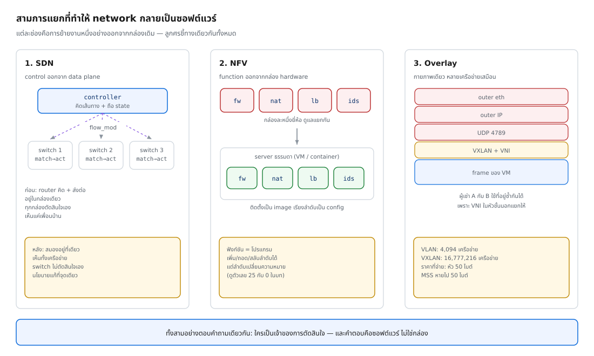
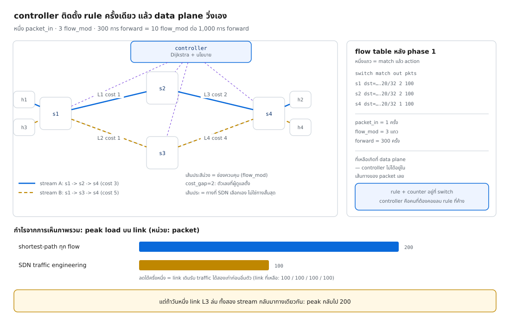
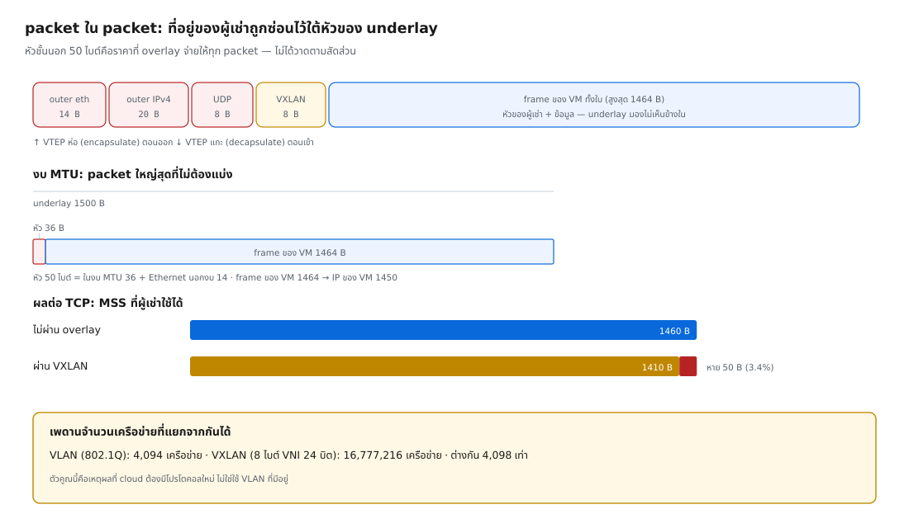

> 📅 เขียนเมื่อ: 16 พฤศจิกายน 2026 (เวลาไทย, UTC+7)
>
> **ผลรันทั้งหมดในบทนี้มาจากเครื่องเดียว** — Raspberry Pi 5, Debian GNU/Linux 13 (trixie), kernel 6.18.60+rpt-rpi-2712, aarch64
> **เวอร์ชันที่ใช้จริงในเดโม:** Go 1.24.4 · `gofmt` และ `go vet` ผ่านสะอาด · ภาพวาดด้วย `gen_svgs.py` แล้วตรวจด้วย `check_svg_readability.py` (วัดกรอบข้อความจากพิกัดจริงในไฟล์ SVG) และเรนเดอร์ด้วย `rsvg-convert` 2.60.0 เพื่อดูด้วยตาซ้ำ
> **เดโมของตอนนี้เป็นแบบจำลองล้วน** — ไม่มี network I/O ไม่มีการอ่านเวลาจริง ไม่มีการสุ่มที่ไม่มี seed และไม่มี packet ออกนอกโปรเซสแม้แต่ไบต์เดียว ตัวเลขทุกตัวจึงซ้ำได้ตรงทุกครั้งที่รัน
> **ข้อเท็จจริงทุกตัวในบทนี้ตรวจจากแหล่งปฐมภูมิตามที่ระบุท้ายบท** (RFC, สเปกของ 3GPP, เอกสาร ETSI, paper ACM SIGCOMM) ไม่ได้เขียนจากความจำ
>
> 🛡️ **จริยธรรม (ยังใช้กับทั้งซีรีส์):** ทุกคำสั่งและทุกการทดลองให้ทำกับ **เครื่องและเครือข่ายที่คุณควบคุมเอง** เท่านั้น — การดัก packet การสแกนเครือข่าย หรือการแตะ control plane ขององค์กรโดยไม่ได้รับอนุญาต ผิดกฎหมายในแทบทุกประเทศ เดโมของบทนี้ไม่แตะเครือข่ายจริงเลย จึงปลอดภัยโดยโครงสร้าง และนั่นคือเหตุผลที่ผมเลือกจำลองแทนที่จะต่อ lab จริง

---

## 0. เครือข่ายที่ไม่มีกล่องให้ชี้

ห้าตอนที่ผ่านมา เราเดินผ่าน hardware มาตลอด

ตอนที่ 01 ให้คุณรัน `ip` และ `ss` ดูการ์ดเน็ตเวิร์กของเครื่องตัวเอง ตอนที่ 02 เล่าเรื่อง IMP ซึ่งเป็นกล่องขนาดเท่าตู้เย็นที่ต้องขนขึ้นรถบรรทุก ตอนที่ 03 พาไปดู switch ที่มีพอร์ตให้เสียบ สาย coaxial ที่ต้องใช้ T-connector และ repeater ที่ทวนสัญญาณ ตอนที่ 04 พาไปดู router ที่ต่อเครือข่ายหลายใบเข้าด้วยกัน ตอนที่ 05 พาไปดูเสา base station ที่มีตู้วิทยุอยู่ข้างล่าง

ทุกตอนมีสิ่งหนึ่งที่เหมือนกัน: **ถ้าเครือข่ายมีปัญหา คุณเดินไปชี้ที่กล่องได้**

บทนี้จะพาคุณไปที่ที่ไม่มีกล่องให้ชี้

ลองนึกถึงคำถามนี้: บริษัทหนึ่งเช่า cloud อยู่ สองทีมสร้าง "เครือข่าย" ของตัวเองขึ้นมา ทีมละหนึ่งใบ แต่ละใบมี subnet ของตัวเอง มี firewall ของตัวเอง มี route table ของตัวเอง สองใบนี้ใช้ fiber เส้นเดียวกัน ใช้ switch ตัวเดียวกัน ใช้ server เครื่องเดียวกัน — แต่ ping ข้ามกันไม่ถึง และไม่เห็น traffic ของกันและกันเลย

เครือข่ายสองใบนั้น **ไม่มีอยู่จริง** ในความหมายทางกายภาพ มันเป็นชุดของ rule ที่บังเอิญรันอยู่บน hardware ที่ใช้ร่วมกัน

และถ้าคุณอยากได้เครือข่ายใบที่สาม คุณไม่ได้โทรหาช่างไฟ คุณเรียก API

> ในปี 2011 Amazon เปิดให้ลูกค้าสร้างเครือข่ายของตัวเองใน cloud แบบนี้ได้ — VPC (Virtual Private Cloud — เครือข่ายส่วนตัวเสมือนที่ผู้เช่ากำหนด subnet และ firewall เอง) เปิดให้ใช้ทั่วไปเมื่อ 3 สิงหาคม 2011 ตอนนั้นมันดูเหมือนฟีเจอร์ของบริษัทเดียว แต่สิบห้าปีต่อมา มันกลายเป็นวิธีที่เครือข่ายส่วนใหญ่ในโลกถูกสร้าง

บทนี้ปิดระยะที่ 1 ของซีรีส์ (ประวัติศาสตร์) ด้วยคำถามเดียว: **network ที่เป็นซอฟต์แวร์หน้าตาเป็นอย่างไร** และมันต่างจาก network ที่เป็นกล่องตรงไหน — ไม่ใช่ในแง่ที่ว่า "ดีกว่า" แต่ในแง่ที่ว่ามัน**ย้ายข้อจำกัด**ไปไว้ที่อื่น

เราจะไล่สี่เรื่องที่มาด้วยกันเสมอในโลกจริง แต่แยกกันได้ในบทนี้:

1. **network virtualization** — แยก "เครือข่ายที่ผู้ใช้เห็น" ออกจาก "สายไฟที่เป็นจริง"
2. **SDN** — แยกสมอง (control plane) ออกจากกล้ามเนื้อ (data plane)
3. **NFV** — เปลี่ยน network function จากกล่อง hardware เป็นโปรแกรม
4. **cloud + IoT** (IoT = Internet of Things — อุปกรณ์ฝังตัวที่ต่อเน็ตเอง ไม่มีคนกด) — สองปลายที่ทำให้เรื่องข้างบนกลายเป็นเรื่องปกติ: ฝั่งหนึ่งคือดาต้าเซ็นเตอร์ที่ทุกอย่างเป็นซอฟต์แวร์ อีกฝั่งคือเซนเซอร์ล้านตัวที่ไม่มีใครไปนั่งดูแล

---

## 1. virtualization: สิ่งที่ถูกทำให้เป็นเสมือน

คำว่า **virtualization** ในวงการนี้ไม่ได้แปลว่า "ของปลอม" หรือ "จำลองเฉย ๆ" — มันแปลว่า **มีชั้นหนึ่งคั่นกลางระหว่างสิ่งที่ผู้ใช้เห็น กับสิ่งที่ hardware เป็น** ชั้นนั้นทำให้ของหนึ่งชิ้นดูเหมือนของหลายชิ้น (หรือของหลายชิ้นดูเหมือนของหนึ่งชิ้น)

virtual machine คือตัวอย่างที่คุณรู้จักแล้ว: hypervisor แบ่ง CPU/RAM/disk ของเครื่องหนึ่งให้ VM หลายตัว โดยที่แต่ละ VM คิดว่าตัวเองมีเครื่องทั้งเครื่อง

network virtualization ทำแบบเดียวกันกับเครือข่าย: **แยก logical network (เครือข่ายที่ผู้ใช้เห็น) ออกจาก physical network (สายและ switch ที่มีจริง)** แล้วให้หลาย logical network ใช้ physical network อันเดียวกันได้โดยไม่ปนกัน

### 1.1 VLAN — virtualization รุ่นแรกที่คุณใช้อยู่แล้ว

ก่อนจะไปถึง cloud ต้องรู้ก่อนว่าคุณเคยใช้ virtualization ระดับนี้มาแล้ว

มาตรฐาน **IEEE 802.1Q** (ปี 1998) เพิ่ม tag 4 ไบต์เข้าไปใน Ethernet frame ตรงช่องที่เดิมเป็น EtherType — ใน tag นั้นมี **VID** (VLAN Identifier) กว้าง 12 บิต

12 บิตคือ 4,096 ค่า และเพราะ 0 กับ 4095 ถูกกันไว้ จึงใช้ได้ **4,094 VLAN**

ผลลัพธ์: switch ตัวเดียวที่ต่อสายเส้นเดียว สามารถพา traffic ของ 4,094 เครือข่ายที่แยกจากกันสนิทได้ — frame ของ VLAN 10 ไม่มีทางไปโผล่ที่พอร์ตของ VLAN 20 เพราะ switch ตัดสินใจจาก tag

นี่คือ virtualization ในความหมายที่ชัดที่สุด: **เครือข่ายหนึ่งใบ (physical) กลายเป็นหลายใบ (logical)** และการเพิ่มเครือข่ายใบใหม่ไม่ต้องเดินสายใหม่แม้แต่เส้นเดียว

ข้อจำกัดของมันก็ชัดเจนและจะกลับมาเป็นประเด็นในข้อ 4: **4,094 ใบคือเพดาน** และเพดานนี้ผูกกับจำนวนบิตใน tag ซึ่งแก้ไม่ได้เพราะ frame มีที่จำกัด

### 1.2 สามการแยกที่ไม่เหมือนกัน

คนมักพูดสามคำนี้ปนกัน ทั้งที่มันแยกคนละแกน ผมจะแยกให้ชัดตั้งแต่ต้น เพราะบทที่เหลือจะอ้างถึงแกนพวกนี้ตลอด

| สิ่งที่ถูกแยก | ชื่อที่เรียก | คำถามที่มันตอบ |
|---|---|---|
| สมอง กับ กล้ามเนื้อ | SDN | ใครตัดสินใจ และใครลงมือ |
| hardware กับ software | NFV | ฟังก์ชันนี้ต้องเป็นกล่อง หรือเป็นโปรแกรมก็ได้ |
| physical กับ logical | network virtualization | เครือข่ายที่ผู้ใช้เห็น ต่างจากสายที่มันวิ่งทับได้แค่ไหน |

สามอย่างนี้**ไม่ต้องมีกันและกัน** คุณทำ NFV ได้โดยไม่มี SDN (เอา firewall เป็น VM แล้วตั้งค่าด้วยมือ) คุณทำ overlay ได้โดยไม่มี SDN (VXLAN แบบเดิมเรียนรู้ MAC เองด้วย multicast) และคุณทำ SDN ได้โดยไม่ต้องมี virtualization (Google ทำ B4 แบบนั้น — switch จริง สายจริง แต่สมองอยู่ที่ส่วนกลาง)

แต่ในทางปฏิบัติ ทั้งสามอย่างมาด้วยกันเพราะเหตุผลเดียวกัน: **เมื่อ network เป็นซอฟต์แวร์ คุณก็เขียนโปรแกรมจัดการมันได้** และเมื่อเขียนโปรแกรมได้ สิ่งที่เคยใช้คนสองร้อยคนจัดการ ก็ใช้คนสิบบวกสคริปต์ได้



ภาพนี้คือแผนที่ของทั้งบท — ทั้งสามช่องพูดเรื่องเดียวกันจากคนละมุม: จาก "ของหนึ่งชิ้นที่ทำทุกอย่าง" ไปเป็น "ชิ้นเล็ก ๆ ที่ถูกจัดเรียงด้วยซอฟต์แวร์"

### 1.3 สิ่งที่ virtualization เปลี่ยน และสิ่งที่มันไม่เปลี่ยน

ผมอยากให้ชัดเรื่องหนึ่ง เพราะมันจะช่วยคุณอ่านข่าว technology ได้ตรงขึ้น: **virtualization ไม่ได้ทำให้ packet เร็วขึ้น**

มันทำให้ **network เปลี่ยนได้เร็วขึ้น** และนั่นคือคุณค่าทั้งหมดของมัน:

- **จากสัปดาห์เป็นวินาที** — เดิม การเพิ่มเครือข่ายใหม่คือการเดินสาย + ตั้งค่าทีละกล่อง + รอ change window (ช่วงเวลาที่อนุญาตให้แก้ระบบ) กลางคืน ตอนนี้คือ API call หนึ่งครั้ง
- **จาก "ตั้งค่าด้วยมือ" เป็น "ประกาศความต้องการ"** — คุณบอกว่า "ฉันต้องการเครือข่ายที่มี subnet นี้ มี firewall แบบนี้" แล้วระบบไปสร้างให้ (declarative — ประกาศผลลัพธ์ที่ต้องการ ไม่ได้สั่งทีละขั้นตอน)
- **จาก "หนึ่งเครือข่ายต่อหนึ่งชิ้น hardware" เป็น "หลายเครือข่ายต่อชิ้นเดียว"** — ซึ่งลดต้นทุนต่อเครือข่ายลงมาก

และราคาที่ต้องจ่ายนั้นจริงและมักถูกมองข้าม:

- **มีชั้นซอฟต์แวร์เพิ่มขึ้น** ซึ่งหมายถึง overhead, latency ที่เพิ่มขึ้นเล็กน้อย และชิ้นส่วนที่พังได้เพิ่มขึ้น
- **debug ยากขึ้น** — เพราะคุณมองไม่เห็นสาย และ packet ที่ออกจาก VM ใบหนึ่งอาจถูกห่อสามชั้นก่อนออกจากเครื่อง
- **abstraction รั่ว** — overlay (เครือข่ายที่ซ้อนทับอยู่ชั้นบน) ที่ดีแค่ไหนก็ยังต้องพึ่ง underlay (เครือข่ายจริงชั้นล่าง) ที่ดี ถ้า underlay ทิ้ง packet หรือ MTU (ขนาด packet ใหญ่สุดที่ link รับได้) ไม่พอ overlay ก็พังทั้งใบ

ประโยคที่ผมอยากให้คุณจำจากข้อนี้: **ทุก abstraction มีราคา และราคานั้นจ่ายที่ชั้นล่างเสมอ** (ในข้อ 4.2 เราจะเห็นราคานั้นเป็นตัวเลข 50 ไบต์)

---

## 2. SDN: สมองออกจากกล้ามเนื้อ

ตอนที่ 04 เราพูดถึง router ว่าเป็นกล่องที่ต่อเครือข่ายหลายใบเข้าด้วยกัน แต่เรายังไม่ได้แยกให้เห็นว่าข้างในมันทำสองอย่างที่ต่างกันโดยสิ้นเชิง

### 2.1 router เดิมทำงานสองอย่างในกล่องเดียว

- **ชั้นควบคุม (control plane)** — ส่วนที่ตัดสินใจ: รัน routing protocol คุยกับ router ข้าง ๆ คำนวณว่า "ปลายทางนี้ควรออกพอร์ตไหน" แล้วเขียนผลลงตาราง
- **ชั้นส่งข้อมูล (data plane)** — ส่วนที่ลงมือ: รับ packet มาหนึ่งใบ เปิดตารางดู แล้วส่งออกพอร์ตที่ตารางบอก **งานนี้ต้องเร็วมาก** เพราะเกิดกับทุก packet

ใน router รุ่นก่อน ทั้งสองอย่างอยู่กล่องเดียวกัน รันบน CPU ตัวเดียวกัน (จริง ๆ data plane มักย้ายไปอยู่บน ASIC — chip เฉพาะทาง — แต่ยังอยู่ในกล่องเดียวกัน)

ผลที่ตามมาคือข้อจำกัดสามข้อที่วิศวกรเครือข่ายอยู่กับมันมาสามสิบปี:

1. **แต่ละกล่องตัดสินใจเอง เห็นแค่เพื่อนบ้าน** — router ตัวหนึ่งไม่รู้ว่า link อีกฝั่งของเครือข่ายกำลังจะเต็ม มันรู้แค่ cost ที่เพื่อนบ้านบอก
2. **นโยบายกระจัดกระจาย** — "ห้าม subnet นี้คุยกับ subnet นั้น" ต้องไปตั้งที่กล่องทุกตัวในเส้นทาง และเมื่อมีกล่องสี่พันตัว ก็มีที่ให้ตั้งค่าผิดสี่พันที่
3. **ทดลองอะไรใหม่ยากมาก** — จะเปลี่ยนวิธีเลือกเส้นทางต้องรอ vendor ออก firmware ใหม่

### 2.2 flow table: match แล้วทำ action

SDN ตอบโจทย์นี้ด้วยการย้ายส่วนที่ตัดสินใจออกไปไว้ที่อื่น แล้วเหลือไว้ในกล่องแค่ส่วนที่ลงมือ

กล่องที่เหลือนี้เรียกว่า **switch** (ในบริบท SDN บางทีเรียก forwarding element) ข้างในมี **flow table** — ตารางที่แต่ละแถวมีสองส่วน:

- **match** — เงื่อนไขที่ packet ต้องตรง เช่น `dst=10.6.2.20/32` (ปลายทางคือเครื่องนี้)
- **action** — สิ่งที่ต้องทำเมื่อตรง เช่น `output port 2` (ส่งออกพอร์ต 2)

ส่วนที่ตัดสินใจกลายเป็นโปรแกรมตัวหนึ่งที่เรียกว่า **controller** ซึ่งรันอยู่บน server ธรรมดา และสั่ง switch ผ่านโปรโตคอล

โปรโตคอลที่ทำให้ไอเดียนี้เป็นจริงได้ชื่อ **OpenFlow** และมันเกิดที่ Stanford ในวงวิจัย ไม่ใช่ในห้อง lab ของ vendor:

- ปี 2007 มีงานชื่อ **Ethane** (Casado, Freedman, Pettit, Luo, McKeown, Shenker — SIGCOMM 2007) ซึ่งเป็นต้นแบบ: ตัดสินใจที่ศูนย์กลาง สั่ง switch ให้ส่งตาม
- ปี 2008 ทีมเดิมตีพิมพ์ **"OpenFlow: Enabling Innovation in Campus Networks"** ใน ACM SIGCOMM CCR — เป็น paper ที่เสนอ interface เปิดระหว่าง control plane กับ data plane โดยตรง
- 31 ธันวาคม 2009 ออก **OpenFlow Switch Specification 1.0.0** ฉบับแรกที่ vendor รับรอง
- 21 มีนาคม 2011 หกบริษัทที่ดูแลเครือข่ายใหญ่ที่สุดในโลก (Deutsche Telekom, Facebook, Google, Microsoft, Verizon, Yahoo) ตั้ง **ONF** (Open Networking Foundation) ขึ้นมาดูแลมาตรฐานนี้
- ปี 2013 Google ตีพิมพ์ **B4** ใน SIGCOMM — เครือข่าย WAN ส่วนตัวที่เชื่อมดาต้าเซ็นเตอร์ทั่วโลกด้วย SDN และ OpenFlow และรายงานว่าใช้ link ได้เกือบ 100% (เทียบกับที่เคยเหลือเยอะเพราะกลัว peak)

คำว่า software-defined networking เองก็เริ่มใช้กันในวงกว้างราวปี 2009 — สังเกตว่ามันเกิด**หลัง** paper และ**ก่อน**สเปก 1.0 คือมันเป็นชื่อที่ตั้งให้กับแนวคิดที่กำลังเกิดขึ้น ไม่ใช่แนวคิดที่เกิดพร้อมชื่อ

### 2.3 controller ไม่ได้ฉลาดกว่า มันเห็นมากกว่า

จุดนี้สำคัญและคนเข้าใจผิดบ่อย: controller ไม่ได้คำนวณเก่งกว่า router ในกล่อง

สิ่งที่มันมีคือ **ภาพรวม** — มันรู้ topology ทั้งหมด รู้ว่า link ไหนโหลดเท่าไร และรู้ว่าจะเกิดอะไรขึ้นถ้า link หนึ่งล่ม เพราะข้อมูลทั้งหมดมาจากที่เดียว

ลองนึกภาพตามนี้: router แบบเดิมเหมือนคนขับรถที่เห็นแค่ทางข้างหน้า สองร้อยเมตร — แต่ละคันตัดสินใจเองตามสิ่งที่เห็น ซึ่งทำงานได้ดีจนกระทั่งทุกคันเลือกทางเดียวกันหมดแล้วติด

controller คือศูนย์ควบคุมจราจรที่เห็นทั้งเมือง แล้วสั่งเป็นรายคันว่า "คันนี้ไปทางด่วน คันนั้นไปทางเลี่ยงเมือง" — มันสั่งได้เพราะมันเห็น

และนี่คือที่มาของกำไรเชิงตัวเลขที่เราจะวัดในเดโมข้อ 6.5: ถ้าปล่อยให้ทุก flow ไปตามเส้นทางที่สั้นที่สุด ทุกคนจะไปกองที่ link เดียวกัน แต่ถ้ามีคนดูภาพรวม มันแบ่งครึ่งได้ — และ peak load ที่ลดลงครึ่งหนึ่งแปลว่า link เดิมรองรับ traffic ได้เป็นสองเท่าก่อนจะอิ่มตัว

### 2.4 สามโหมดการทำงาน (และราคาของแต่ละโหมด)

controller กับ switch คุยกันได้สามแบบ และความต่างของมันคือความต่างของ **ว่าใครจ่ายค่า setup**:

| โหมด | เกิดอะไร | ราคา |
|---|---|---|
| **reactive** | switch เจอ packet ที่ไม่มี rule → ส่งขึ้น controller (packet_in) → controller คิด → ติดตั้ง rule → packet เดินต่อ | packet แรกของทุก flow ช้า (ต้องรอ round trip ไป controller) |
| **proactive** | controller ติดตั้ง rule ล่วงหน้าทั้งหมดก่อนมี traffic | ต้องรู้ล่วงหน้าว่าจะมี flow อะไร และกินที่ใน flow table |
| **hybrid** | rule พื้นฐานติดไว้ล่วงหน้า rule ที่แปลกค่อยถาม | ซับซ้อนกว่า ต้องมีนโยบายว่าอะไรถือว่า "แปลก" |

ของจริงเกือบทั้งหมดเป็น hybrid เพราะตาราง flow table มีขนาดจำกัด (switch ราคาถูกมีไม่กี่พันแถว) และเพราะ packet แรกที่ช้านั้นผู้ใช้รู้สึกได้



สามคำที่ภาพนี้ใช้ และจะโผล่ในผลรันจริงตลอดบท: **`packet_in`** คือข้อความที่ switch ส่งขึ้น controller เมื่อเจอ packet ที่ไม่มี rule ตรง, **`flow_mod`** คือข้อความที่ controller ส่งไปติดตั้งหรือแก้ rule ใน flow table, และ **การ forward** คือการที่ switch ส่ง packet ออกพอร์ตหนึ่งครั้ง

### 2.5 แล้ว OpenFlow หายไปไหน

ตรงนี้ผมต้องพูดตรง ๆ เพราะบทความ technology ชอบเล่าเรื่องที่จบสวยเกินจริง

**ไอเดียของ SDN ชนะ แต่ OpenFlow ในฐานะโปรโตคอลไม่ได้เป็นผู้ชนะ**

เหตุผลเชิงเทคนิคข้อแรกอยู่ใน paper ชื่อ **P4** (SIGCOMM CCR 2014) ซึ่งเขียนโดยคนกลุ่มเดียวกับ OpenFlow: OpenFlow ระบุฟิลด์ที่ match ได้ตายตัว และจำนวนฟิลด์นั้นโตจาก **12 เป็น 41 ฟิลด์ในไม่กี่ปี** — สเปกใหญ่ขึ้นเรื่อย ๆ แต่ก็ยัง**เพิ่มหัวแบบใหม่ไม่ได้** ถ้าอยาก match อะไรที่สเปกไม่รู้จัก ก็ทำไม่ได้

ทางออกที่วงการเลือกคือ:

- **P4** — ภาษาที่ให้คุณเขียนได้ว่า switch จะประมวลผล packet อย่างไร (programmable data plane) แทนที่จะรอสเปกเพิ่มฟิลด์
- **Segment routing / EVPN** — **Segment routing** เอา label (หมายเลขสั้น ๆ ที่ฝังใน packet) มาใช้ตัดสินใจแทนการ match หลายฟิลด์ ส่วน **EVPN** ประกาศที่อยู่ของผู้เช่าให้ switch ปลายทางรู้ผ่าน routing protocol แทนการเรียนรู้ MAC เอง — ทั้งคู่ลด flow table ที่ต้อง sync กันทั้งเครือข่าย (เพราะ flow table ที่ต้อง sync คือ state ที่ต้องคุม)
- **eBPF + XDP** — **eBPF** คือการเขียนโปรแกรม data plane ลงไปใน kernel ของ Linux ตรง ๆ (ส่วน **XDP** คือจุดเข้าใน kernel ที่ใช้ดัก packet ก่อนถึง network stack) · ในยุคนี้ Kubernetes (ระบบจัดการ container) หลายที่เลิกใช้ `kube-proxy` แล้วหันไปใช้ Cilium ซึ่งทำงานด้วยโปรแกรม eBPF ที่คอมไพล์ลง kernel · Cilium แทนที่ทั้ง `kube-proxy` และ `iptables` (ตารางกฎไฟร์วอลล์ใน kernel ที่ Kubernetes ใช้) — GKE Dataplane V2 ของ Google ก็ใช้แนวเดียวกัน
- **cloud API** — และนี่คือ SDN ที่คนใช้มากที่สุดในโลกโดยไม่รู้ตัว: ตอนคุณสร้าง VPC, security group, route table ใน AWS/GCP คุณกำลังสั่ง controller ตัวใหญ่ตัวหนึ่งให้ติดตั้ง rule ให้คุณ

ประโยคที่ผมอยากให้คุณถือออกไปคือ: **SDN ในปี 2026 ไม่ใช่ผลิตภัณฑ์ มันเป็นวิธีที่เครือข่ายถูกสร้าง** ถ้าคุณเปิด config ของ switch ในองค์กรทั่วไป คุณจะไม่เจอ `ovs-ofctl` (คำสั่ง CLI ของ Open vSwitch ที่ใช้ยิง flow_mod ตรง ๆ) แต่คุณจะเจอ API ที่ประกาศความต้องการ แล้วมีซอฟต์แวร์ตัวหนึ่งแปลงเป็น rule ให้

---

## 3. NFV: กล่องกลายเป็นโปรแกรม

ถ้า SDN ย้าย**การตัดสินใจ**ออกจากกล่องได้ คำถามถัดไปก็ตรงเข้ามา: แล้วทำไมตัว**ฟังก์ชัน**ทั้งตัวต้องอยู่ในกล่องด้วย

ปี 2012 ผู้ให้บริการโทรคมนาคมเจ็ดรายเขียนเอกสารร่วมกันฉบับหนึ่ง เปิดตัวที่งาน SDN and OpenFlow World Congress ที่ดาร์มสตัดท์ ประเทศเยอรมนี ระหว่าง **22–24 ตุลาคม 2012** เจ็ดรายนั้นคือ:

- AT&T, BT, Deutsche Telekom, Orange, Telecom Italia, Telefónica, Verizon

ในเดือนพฤศจิกายนปีเดียวกัน **ETSI** (องค์กรมาตรฐานโทรคมนาคมของยุโรป) ก็ตั้ง **ISG NFV** ขึ้นมาทำงานนี้ต่อ — ISG ย่อจาก Industry Specification Group คือกลุ่มทำงานที่ ETSI ตั้งขึ้นเฉพาะเรื่อง ประชุมครั้งแรกที่ Sophia Antipolis เดือนมกราคม 2013

ชื่อเอกสารคือ **Network Functions Virtualisation** และปัญหาที่มันพูดถึงตรงมาก:

> ผู้ให้บริการต้องซื้อกล่องใหม่ทุกครั้งที่อยากเพิ่มบริการใหม่ กล่องพวกนี้ proprietary แต่ละยี่ห้อมีวิธี manage ของตัวเอง กินพื้นที่ กินไฟ และเมื่อมันหมดอายุก็ต้องรอรอบเปลี่ยน

**network function** คือฟังก์ชันที่เคยเป็นกล่อง: firewall, load balancer, NAT, IDS/IPS (ระบบตรวจจับการบุกรุก), CPE (Customer Premises Equipment — กล่องที่ผู้ให้บริการวางไว้ที่บ้านหรือสำนักงานลูกค้า), DPI (การตรวจ traffic เชิงลึก) — และในโลกโทรคมนาคมก็มีอีกเยอะ เช่น EPC ของ 4G ที่บทที่แล้วเพิ่งพูดถึง

**NFV** บอกว่า: ฟังก์ชันพวกนี้ไม่จำเป็นต้องเป็นกล่อง มันเป็นโปรแกรมที่รันบน server ธรรมดาได้ (VM หรือ container) และเมื่อเป็นโปรแกรม มันก็ได้คุณสมบัติของโปรแกรม: scale ด้วยการก๊อปปี้, ติดตั้งด้วย image, ย้ายที่ได้, และ**จัดเรียงลำดับได้**

### 3.1 NFV ต่างจาก SDN ตรงไหน

สองคำนี้อยู่ในย่อหน้าเดียวกันตลอดจนคนอ่านสับสน ผมจะวางเทียบให้เห็นชัด:

| | SDN | NFV |
|---|---|---|
| แยกอะไร | control plane ออกจาก data plane | network function ออกจาก hardware เฉพาะทาง |
| ปัญหาที่แก้ | ตัดสินใจกระจัดกระจาย แก้ยาก | ต้องซื้อกล่องใหม่ทุกครั้ง ดูแลแพง |
| หน่วยที่ย้าย | การตัดสินใจ | ตัวฟังก์ชันทั้งตัว |
| ตัวอย่าง | switch ที่มีแค่ match/action + controller | firewall ที่รันเป็น VM บน x86 |

และประเด็นที่คนชอบลืม: **NFV ทำให้ฟังก์ชันหลายตัวรันอยู่บนเครื่องเดียวกันได้** ซึ่งหมายความว่าคุณเพิ่ม firewall ให้ traffic ที่เคยข้ามกล่องสองกล่อง ได้โดยไม่ต้องเดินสายใหม่ — แค่ใส่ฟังก์ชันเข้าไปใน **service chain** (ลำดับของฟังก์ชันที่ packet ต้องผ่าน)

### 3.2 ลำดับของ chain คือส่วนหนึ่งของความหมาย

นี่คือประเด็นที่ผมอยากให้คุณจำจากบทนี้มากที่สุดในส่วน NFV และเดโมของเราจะพิสูจน์มันด้วยตัวเลข

ในโลก hardware ถ้าคุณมี firewall → NAT → load balancer คุณก็มีกล่องสามใบต่อกันเป็นเส้น ผู้ใช้ปลายทางไม่เคยเห็นมัน

ในโลก NFV ทั้งสามเป็นฟังก์ชันในรายการเดียว และรายการนั้นคือ config ที่แก้ได้ — เขียนเป็น `chain: fw -> nat -> ids -> lb` แล้วระบบไปต่อให้

ทีนี้คำถามที่สำคัญ: **ถ้าสลับ ids ขึ้นมาก่อน nat เป็น `fw -> ids -> nat -> lb` ผลลัพธ์ยังเหมือนเดิมไหม**

คำตอบคือ **ไม่เหมือน** และไม่ใช่เพราะโค้ดของ ids เปลี่ยน — โค้ดเหมือนเดิมทุกไบต์ แต่เพราะ **NAT เขียนทับ field ที่ ids ใช้ตัดสินใจ**

ถ้า ids มี rule ว่า "เครื่อง 10.6.1.7 ถูกกักกัน ห้ามออกพอร์ต 443" แล้ว:
- ids อยู่**ก่อน** nat → มันเห็น source IP จริง `10.6.1.7` → จับได้
- ids อยู่**หลัง** nat → มันเห็น source IP ที่ถูกแปลงเป็น `198.51.100.x` แล้ว → จับไม่ได้เลย

ผู้ป่วยรายเดียวกัน โรคเดียวกัน แต่ตรวจไม่เจอ เพราะถูกเปลี่ยนชื่อก่อนถึงห้องแล็บ

ในเดโมข้อ 6.7 ตัวเลขจะเป็น 25 กับ 0 — และนั่นคือเหตุผลว่าทำไม "ลำดับของ chain" ในเอกสารของ NFV ถูกจัดเป็นส่วนหนึ่งของ service definition ไม่ใช่รายละเอียดการติดตั้ง

---

## 4. Cloud: เครือข่ายที่ผู้เช่าแต่ละคนมีของตัวเอง

ตอนนี้เรามีชิ้นส่วนครบแล้ว: virtualization (หลายเครือข่ายบนกายภาพเดียว), SDN (สมองอยู่ที่อื่น), NFV (ฟังก์ชันเป็นโปรแกรม) — cloud เอาทั้งสามมาประกอบเป็นผลิตภัณฑ์

ใน cloud ผู้เช่าแต่ละรายได้ **VPC** (Virtual Private Cloud) ของตัวเอง ซึ่งมี:

- **CIDR block** ที่ตัวเองเลือก (`10.0.0.0/16` เป็นต้น) — ตัวเลขหลัง `/` คือจำนวนบิตส่วน network ยิ่งมาก ที่อยู่ยิ่งน้อย: `/16` = 65,536 ที่อยู่
- **subnet** ที่แบ่งเอง
- **route table** ที่เขียนเอง
- **security group** ที่เป็น firewall ประจำเครื่อง
- และ traffic ทั้งหมดนี้วิ่งบน underlay ที่ผู้เช่าไม่เคยเห็นและไม่ควรเห็น

ปัญหาที่ต้องแก้คือ: ผู้เช่าสองรายอาจเลือก CIDR เดียวกัน (ทั้งคู่เลือก `10.0.0.0/16` ได้ เพราะไม่มีใครห้าม) แล้วถ้า traffic ของทั้งคู่วิ่งบน underlay เดียวกัน จะแยกได้อย่างไร

### 4.1 overlay: packet ใน packet

คำตอบคือ **overlay network** (เครือข่ายที่ซ้อนทับอยู่บนอีกเครือข่ายหนึ่ง) และเทคนิคที่มันใช้คือ encapsulation (การห่อ)

หลักการนั้นง่ายมาก: **เอา packet ของผู้เช่าทั้งใบ (รวมหัวของมันทั้งหมด) มาเป็น payload ของ packet ใหม่** ที่มีหัวของตัวเอง แล้วส่ง packet ใหม่นั้นผ่าน underlay



กำเนิดของเทคนิคนี้บนมาตรฐานเปิดคือ **VXLAN** ซึ่งตีพิมพ์เป็น **RFC 7348 เมื่อสิงหาคม 2014** โดยกลุ่มผู้เขียนจากหลายบริษัท ตัวเลขที่สำคัญที่สุดใน RFC ฉบับนั้นคือ **VNI** (VXLAN Network Identifier) กว้าง **24 บิต**

24 บิตคือ **16,777,216** เครือข่ายที่แยกจากกันได้ — เทียบกับ 4,094 ของ VLAN ก็ประมาณ **4,098 เท่า** (RFC 7348 ไม่ได้กันค่า VNI ตัวใดไว้เป็นค่าสงวน ตัวที่ถูกบังคับให้เป็นศูนย์คือ 7 บิต R ใน flags, 24 บิต reserved ก่อน VNI และ 8 บิต reserved ท้ายหัว (รวม 39 บิตจากหัว 64 บิต) ฉะนั้นเพดานจึงเป็น 24 บิตเต็ม)

ตัวคูณนี้คือเหตุผลที่ cloud เป็นไปได้ ถ้าเพดานยังอยู่ที่สี่พันกว่าของ VLAN การให้ผู้เช่าแต่ละรายมีเครือข่ายของตัวเองจะทำไม่ได้ตั้งแต่ลูกค้ารายที่ห้าพันเป็นต้นไป

ต่อมามี **Geneve** (RFC 8926, พฤศจิกายน 2020) ซึ่งแก้ข้อจำกัดที่หัว VXLAN มีขนาดตายตัว (ไม่มีที่ใส่ metadata เพิ่ม): หัวของ Geneve มี **options ที่ยาวแปรได้** — ยาวสุด 252 ไบต์ (ช่อง Opt Len กว้าง 6 บิต นับหน่วยละ 4 ไบต์) หัวรวมทั้งสิ้น 8–260 ไบต์ ทำให้ใส่ metadata ชนิดใหม่ได้โดยไม่ต้องเปลี่ยนรูปแบบ packet

และมัน**ไม่ผูกกับ control plane ใด ๆ** — RFC เขียนไว้ชัดว่า VXLAN เคยฝัง multicast learning มาในสเปก แต่ของจริงมี control plane หลายแบบสร้างบน packet format เดียวกัน

### 4.2 ราคาที่ต้องจ่าย: 50 ไบต์กับ MTU

ทีนี้มาดูราคาที่ผมสัญญาไว้ในข้อ 1.3

หัวที่ต้องเพิ่มเข้าไปมีสี่ชั้น:

| ชั้น | ไบต์ | คืออะไร |
|---|---|---|
| outer Ethernet | 14 | MAC ของ VTEP (tunnel endpoint — ปลายอุโมงค์ที่ห่อ/แกะ packet) |
| outer IPv4 | 20 | ที่อยู่ของ VTEP ทั้งสองฝั่ง (underlay) |
| outer UDP | 8 | source = hash (การย่อข้อมูลให้เป็นตัวเลขสั้น ๆ) ของ packet ข้างใน, dest = 4789 (พอร์ต UDP มาตรฐานของ VXLAN) |
| VXLAN header | 8 | flags + VNI 24 บิต |

รวม **50 ไบต์** และเพราะ underlay มี MTU 1,500 ไบต์ตามปกติ (MTU คือขนาด packet ใหญ่สุดที่ link หนึ่งรับได้โดยไม่ต้องแบ่ง) frame ข้างในจึงเหลือ 1,464 ไบต์ และเมื่อหักหัว Ethernet ของผู้เช่าอีก 14 ไบต์ ก็เหลือ IP packet ของผู้เช่า 1,450

ผลที่ตามมาตรงถึงผู้ใช้: **MSS** (Maximum Segment Size — ขนาด payload ใหญ่สุดของ TCP หนึ่ง segment) ลดจาก 1,460 เหลือ 1,410 ไบต์ คือหายไป 50 ไบต์ หรือราว 3.4%

ตัวเลข 3.4% ฟังดูเล็ก แต่ผลของมันไม่เล็ก เพราะ:
- ถ้าไม่ลด MSS ของ VM, packet ขนาดเต็มจะใหญ่เกิน underlay → ถูก fragment (แบ่ง) หรือถูกทิ้ง — และการทิ้งแบบเงียบ ๆ คือสาเหตุคลาสสิกของ "เน็ตช้าแต่ ping ปกติ"
- การแก้คือตั้ง MTU ของ overlay ให้ถูก (1,450) หรือเปิด **jumbo frame** (frame ที่ใหญ่กว่า 1,500 ไบต์) บน underlay (MTU 9,000) ซึ่งแก้ได้สวยแต่ใช้ได้เฉพาะเมื่อ**ทุก** hop ใน underlay รองรับ — hop เดียวที่ไม่รองรับก็พังทั้งเส้น

นี่คือ abstraction ที่รั่วตามที่ผมบอกไว้ในข้อ 1.3: ผู้ใช้ overlay ไม่ควรต้องรู้เรื่อง MTU ของ underlay แต่ในทางปฏิบัติเขาต้องรู้

### 4.3 ผู้เช่าสองราย ที่อยู่ซ้ำกันได้

อีกอย่างที่ overlay ให้และ VLAN ให้ไม่ได้ในทางปฏิบัติ: **สองผู้เช่ามีที่อยู่ซ้ำกันได้สนิท**

ผู้เช่า A กับ B ต่างมี VM ที่ IP `10.0.0.10` และ MAC เดียวกันด้วยซ้ำ — และมันไม่ชนกัน เพราะสิ่งที่แยกคือหัวชั้นนอก:

| ผู้เช่า | VNI | ที่อยู่ข้างใน | UDP source port | ปลายทาง (VTEP ฝั่งรับ) |
|---|---|---|---|---|
| acme | 1001 | 10.0.0.10:443 | 50153 | 192.0.2.22 |
| beta | 1002 | 10.0.0.10:443 | 50154 | 192.0.2.22 |

จุดที่ควรสังเกตคือคอลัมน์ **UDP source port** มันไม่ใช่ค่าที่สำคัญต่อการส่ง packet เลย — ปลายทางอ่าน VNI จากหัว VXLAN ไม่ได้อ่านจาก port

แต่ RFC แนะนำให้คำนวณมันจาก **hash ของหัว packet ข้างใน** เพราะ underlay ทำ **ECMP** (Equal-Cost Multi-Path — กระจาย traffic ไปหลาย link ที่ cost เท่ากันโดยดูจาก hash ของหัว packet) ถ้า source port เป็นค่าคงที่ ทุก flow จะถูก hash ไปลง link เดียวกัน และ link นั้นจะเต็มทั้งที่ link อื่นว่าง

นี่คือตัวอย่างที่สวยของ "abstraction ที่ต้องเปิดช่องให้ชั้นล่างเห็นของข้างใน" — overlay ต้องแอบส่งข้อมูล entropy (ความไม่ซ้ำของหัว packet ที่ใช้เป็นเมล็ดสุ่มให้กระจายได้) ลงไปให้ underlay เพื่อให้ underlay กระจาย load ได้

---

## 5. IoT: ปลายทางที่เป็นล้านเครื่อง

อีกปลายหนึ่งของสเปกตรัมนี้คืออุปกรณ์ที่ไม่ใช่มนุษย์ ไม่มีหน้าจอ ไม่มีคนกด และมีเป็นล้าน

คำว่า IoT ถูกใช้จนพร่าม แต่ปัญหาทาง network ของมันคมมากและต่างจากปัญหาที่เราเจอมาในห้าตอนก่อน:

- **จำนวน connection สูงมาก** เทียบกับปริมาณข้อมูลที่น้อยมาก
- **อุปกรณ์เปิดค้างไว้ตลอด** ไม่ได้ต่อเมื่อมีคนใช้
- **ใช้ battery** จึงจ่ายไฟให้วิทยุได้จำกัด
- **อยู่ที่ที่คนไปไม่ถึง** จึงต้องอัปเดตและแก้ปัญหาจากระยะไกล

### 5.1 MQTT เกิดจากท่อน้ำมัน

โปรโตคอลที่กลายเป็นภาษากลางของ IoT คือ **MQTT** และประวัติของมันอธิบายดีไซน์ของมันได้ทั้งหมด

ปี 1999 Andy Stanford-Clark (IBM) กับ Arlen Nipper เขียนเวอร์ชันแรกขึ้นมาเพื่อ **ตรวจท่อน้ำมัน** ผ่านดาวเทียม สองข้อจำกัดของตอนนั้นคือ bandwidth แพงมาก และอุปกรณ์กินไฟได้น้อย

ดีไซน์ที่ออกมาจึงเป็นแบบ **publish/subscribe** (ผู้ส่งส่งเข้าหัวข้อ ผู้รับบอกรับหัวข้อ ไม่ต้องรู้จักกัน) แทน request/response เพราะ:

- อุปกรณ์ไม่ต้อง poll ("มีอะไรใหม่ไหม" ซ้ำ ๆ) ซึ่งเปลืองทั้ง bandwidth และไฟ
- ผู้รับหลายรายรับข้อมูลชุดเดียวกันได้โดยไม่ต้องส่งซ้ำ
- connection ค้างไว้ได้นาน — MQTT มี keepalive ในตัว (ข้อความเล็ก ๆ ที่ส่งเป็นจังหวะเพื่อยืนยันว่าคู่ยังอยู่)

MQTT กลายเป็นมาตรฐานเปิดเมื่อ OASIS (องค์กรที่ดูแลมาตรฐานของซอฟต์แวร์ฝั่ง enterprise) ออก **3.1.1 เมื่อ 29 ตุลาคม 2014** และ **5.0 เมื่อ 7 มีนาคม 2019**

### 5.2 LPWAN: เครือข่ายที่ยอมช้าเพื่อประหยัดไฟ

เซนเซอร์ที่ฝังในดินหรืออยู่บนหลังคาไม่มีทางได้ WiFi และไม่คุ้มที่จะมี 4G modem (กินไฟ, ค่า subscription แพง)

จึงมีกลุ่มเทคโนโลยีที่ชื่อ **LPWAN** (Low-Power Wide-Area Network — เครือข่ายวงกว้างที่กินไฟต่ำ) ซึ่งแลกความเร็วกับอย่างอื่น:

- **NB-IoT** — มาตรฐานของ 3GPP ที่เสร็จใน Release 13 เมื่อ **มิถุนายน 2016** ออกแบบมาสำหรับอุปกรณ์ที่ส่งข้อมูลนิดเดียว แต่รองรับได้อย่างน้อย **50,000 เครื่องต่อเซลล์** และออกแบบให้ battery 5 Wh อยู่ได้ราวสิบปี
- **LTE-M** (eMTC) — มาจาก LTE โดยตรง เร็วกว่า NB-IoT (ถึงระดับ 1 Mbit/s) และรองรับ handover จึงเหมาะกับของที่เคลื่อนที่
- **LoRaWAN** — ฝั่ง unlicensed (เหมือน WiFi ในบทที่แล้ว) สเปก 1.0 ออกในปี 2015 · ข้อจำกัดของมันคือ **duty cycle** — ในย่านความถี่ที่ใช้ อุปกรณ์ส่งได้เพียง **1% ของเวลา** · หนึ่งเปอร์เซ็นต์ของเวลาคือ 36 วินาทีต่อชั่วโมง ซึ่งบังคับให้ payload ต้องเล็กและส่งไม่บ่อย

ตัวเลข 36 วินาทีต่อชั่วโมงฟังดูขัดกับภาพ "IoT ส่งข้อมูลตลอดเวลา" ที่คนจินตนาการ — และนั่นคือประเด็น: IoT ที่ใช้จริงส่วนใหญ่**ส่งไม่บ่อย** อุณหภูมิดินเปลี่ยนช้า มาตรวัดน้ำอ่านทุกชั่วโมงก็พอ

### 5.3 ทำไมต้อง cloud

คำถามที่ดูโง่แต่สำคัญ: ทำไมเซนเซอร์ต้องส่งขึ้น cloud ไม่เก็บไว้ในเครื่องแล้วให้คนไปเก็บทีหลัง

คำตอบมีสามข้อ และข้อที่สามคือข้อที่คนมองข้าม:

1. **compute กับ storage แพงกว่าที่ปลายทางมาก** — การวิเคราะห์ว่าอุณหภูมิผิดปกติไหมต้องเทียบกับค่าฐานของทั้งฟาร์ม ซึ่งมีเป็นพันจุดและต้องเก็บย้อนหลังเป็นปี
2. **การอัปเดต** — เซนเซอร์ที่ฝังในกำแพงอัปเดตโค้ดเองไม่ได้ ต้องมีคนสั่งจากที่เดียว
3. **state** — และนี่คือข้อที่เดโมของเราจะวัด: การมี connection ค้างไว้หนึ่งล้านเส้น **มีราคาเป็นหน่วยความจำ** ไม่ใช่แค่ bandwidth

**broker** — ตัวกลางที่รับข้อความจากผู้ส่งแล้วส่งต่อให้ผู้รับที่บอกรับหัวข้อ — คือที่ที่ state ทั้งหมดกองอยู่ ในข้อ 6.9 เราจะเห็นว่าอุปกรณ์หนึ่งล้านตัวที่ส่งทุก 60 วินาที ใช้ bandwidth เฉลี่ยแค่ราว 12.5 Mbit/s ซึ่งน้อยมาก — แต่ state ของ broker ที่ต้องจำทุก connection คือหลาย gigabyte

**คอขวดของ IoT ไม่ใช่ bandwidth แต่คือจำนวน connection ที่ต้องจำ และสัญญาณที่ต้องแลกเพื่อรักษามันไว้**

---

## 6. ลงมือทำ: controller, chain และ overlay ที่วัดได้

เดโมของตอนนี้อยู่ใน `network/code/ep06/` (นับจากโฟลเดอร์ `devto-drafts/`) และรันจบในไม่กี่วินาที

### 6.1 รันเองก่อน

```bash
cd network/code/ep06
bash run_all.sh                 # build + รันทุก section + ตรวจ determinism + วาด SVG + ตรวจบท

go run . -section topo          # topology: สี่ switch สี่ link
go run . -section sdn           # controller ติดตั้ง rule, data plane forward, link ล่ม
go run . -section nfv           # service chain สองลำดับ เทียบกัน
go run . -section vxlan         # บัญชีไบต์ของ overlay
go run . -section iot           # เซนเซอร์ 1,000 → 1,000,000 ตัว
```

`run_all.sh` จะ build, รันทุก section เก็บผลลง `out/`, ตรวจประตูเชิงตัวเลข (เช่น data plane ต้อง forward ครบ 300 ครั้ง, `ids` ก่อน `nat` ต้องจับได้ และหลัง `nat` ต้องจับไม่ได้, บัญชีไบต์ของ overlay ต้องบวกกันได้), รัน fingerprint สองรอบเทียบกัน แล้วสั่ง `gen_svgs.py` วาดภาพจากผลจริง ปิดท้ายด้วย `verify_article.py` ที่เทียบบล็อกผลรันในบทกับไฟล์ใน `out/` ทีละไบต์

topology ที่ใช้ทั้งบทมีสี่ switch สี่ link และ host สี่ตัว:

```text
host  ip            mac                 switch:port
h1    10.6.1.10/24  02:00:00:00:01:0a   s1:1
h3    10.6.1.11/24  02:00:00:00:01:0b   s1:4
h2    10.6.2.20/24  02:00:00:00:02:14   s4:1
h4    10.6.2.21/24  02:00:00:00:02:15   s4:4
```

และ link สี่เส้นมี cost ไม่เท่ากันโดยตั้งใจ — เพราะ cost ในเครือข่าย**ไม่ใช่ความยาวสาย ไม่ใช่ความเร็ว** มันคือค่าที่ผู้ดูแลตั้งให้เป็นตัวแทนของ "ความพอใจ" และแก้ได้ตามนโยบาย

```text
link  a:port  b:port  cost  state
L1    s1:2    s2:1       1  up
L2    s1:3    s3:1       1  up
L3    s2:2    s4:2       2  up
L4    s3:2    s4:3       4  up
```

เส้นทางหลักจาก h1 ไป h2 คือ `s1 -> s2 -> s4` (cost 3, สอง hop) และเส้นทางสำรองคือ `s1 -> s3 -> s4` (cost 5)

ผลรันของ section `topo` ในส่วนนี้ (ยกจาก `out/01_topo.txt`):

```text
path  hops  cost  switches
short       2     3  s1 -> s2 -> s4
alt         2     5  s1 -> s3 -> s4
cost_gap=2
```

`short` คือเส้นทางที่ถูกที่สุด และ `alt` คือเส้นทางที่ถูกที่สุดเมื่อ**ห้ามใช้ลิงก์แรกของ `short`** — นิยามนี้อยู่ใน `writeTopo` และจะได้ใช้ในโจทย์ข้อ 1

ทุก section รับธงเดียวกันนี้ (ผลจริงจาก `./bin/net06 -h` ซึ่ง `run_all.sh` เก็บไว้ใน `out/07_flags.txt`):

```text
Usage of ./bin/net06:
  -devices int
    	จำนวนเซนเซอร์ IoT (default 1000)
  -flows int
    	จำนวน flow ที่ยิงผ่าน service chain (default 5000)
  -interval int
    	วินาทีระหว่างการอ่านค่าของเซนเซอร์ตัวเดียว (default 60)
  -nat-pool int
    	จำนวน public IP ใน NAT pool (default 4)
  -s24-cost int
    	cost ของ link s2-s4 (ค่าเริ่มต้น 2) (default 2)
  -section string
    	sections: topo, sdn, nfv, vxlan, iot, fingerprint (default "sdn")
  -underlay-mtu int
    	MTU ของ underlay (default 1500)
```

### 6.2 controller: หาเส้นทางแล้วติดตั้ง rule

สมองของ controller ในเดโมคือ Dijkstra ธรรมดา ๆ — ไม่มีอะไรพิเศษ และนั่นคือประเด็น: **ความฉลาดไม่ได้อยู่ที่อัลกอริทึม อยู่ที่การที่มันเห็น topology ทั้งหมด**

บล็อกโค้ดในข้อนี้ยกมาจาก `main.go` จริง ไม่ได้ตัดต่อ — สองชนิดข้อมูลที่ต้องรู้ก่อนอ่าน: **`step`** คือคำสั่งหนึ่งบรรทัดของเส้นทาง (switch ต้นทาง + พอร์ตขาออก) และ **`flowEntry`** คือหนึ่งแถวของ flow table (priority, match, out, counter)

```go
// shortest หาเส้นทางที่ cost ต่ำสุดด้วย Dijkstra
//
// คืน step ของทุก switch ยกเว้นตัวปลายทาง (ปลายทางยังไม่รู้ว่าจะออกพอร์ตไหน
// จนกว่าจะรู้ว่า host เกาะอยู่พอร์ตใด — pathToHost เติมให้)
func (s *sim) shortest(from, to string) ([]step, int, bool) {
	const inf = 1 << 30
	dist := make(map[string]int, len(s.order))
	prev := make(map[string]step, len(s.order))
	done := make(map[string]bool, len(s.order))
	for _, name := range s.order {
		dist[name] = inf
	}
	dist[from] = 0

	for {
		cur := ""
		best := inf
		// ไล่ตามลำดับ s1..s4 เพื่อให้ผลเสมอตัวเมื่อ cost เท่ากัน
		for _, name := range s.order {
			if !done[name] && dist[name] < best {
				cur, best = name, dist[name]
			}
		}
		if cur == "" || cur == to {
			break
		}
		done[cur] = true
		for _, e := range s.neighbors(cur) {
			if done[e.to] {
				continue
			}
			if nd := dist[cur] + e.cost; nd < dist[e.to] {
				dist[e.to] = nd
				prev[e.to] = step{sw: cur, out: e.port}
			}
		}
	}
	if dist[to] == inf {
		return nil, 0, false
	}

	var rev []step
	for cur := to; cur != from; {
		p := prev[cur]
		rev = append(rev, p)
		cur = p.sw
		if len(rev) > len(s.order) {
			return nil, 0, false // กันวงวนที่ไม่ควรเกิด
		}
	}
	path := make([]step, 0, len(rev))
	for i := len(rev) - 1; i >= 0; i-- {
		path = append(path, rev[i])
	}
	return path, dist[to], true
}
```

สองจุดที่ควรอ่านให้ช้า:

- **`// ไล่ตามลำดับ s1..s4`** — เวลา cost เท่ากัน มีสองเส้นทางที่ "ดีที่สุด" พร้อมกัน ถ้าเลือกตามลำดับของ map ของ Go ผลจะเปลี่ยนทุกครั้งที่รัน (เพราะ Go สุ่มลำดับการวน map) ผมจึงวนบน slice ที่เรียงไว้แล้ว ทั้งเพื่อความถูกต้องและเพื่อให้ผลซ้ำได้ — บทเรียนเดียวกับตอนที่ 05 ที่ต้องใช้ xorshift แทน `math/rand`
- **`if len(rev) > len(s.order)`** — กันวงวนในกรณีที่ topology เปลี่ยนระหว่างคำนวณ ทางออกคือบอกว่า "หาไม่ได้" ไม่ใช่ค้าง

จากนั้น controller เขียนผลลง switch:

```go
func (s *sim) install(path []step, match string) int {
	changed := 0
	for _, p := range path {
		sw := s.sw[p.sw]
		old := sw.lookup(match)
		if old != nil && old.out == p.out {
			continue
		}
		if old != nil {
			old.out = p.out
			s.log = append(s.log, fmt.Sprintf("flow_mod modify %s %s out=%d prio=100",
				p.sw, match, p.out))
		} else {
			sw.entries = append(sw.entries, &flowEntry{priority: 100, match: match, out: p.out})
			s.log = append(s.log, fmt.Sprintf("flow_mod add %s %s out=%d prio=100",
				p.sw, match, p.out))
		}
		changed++
		s.c.flowMods++
	}
	return changed
}
```

บรรทัด `if old != nil && old.out == p.out { continue }` คือส่วนที่ทำให้เดโมนี้ไม่โกหก: **rule ที่ไม่ได้เปลี่ยนอะไรไม่ถูกเขียนซ้ำ** เพราะในระบบจริงทุก flow_mod คือข้อความที่ต้องส่ง ต้องตรวจ และต้อง sync — มันมีราคา

### 6.3 data plane: แค่ทำตาม rule

ฝั่ง switch ทั้งหมดมีอยู่สิบกว่าบรรทัด และความสั้นของมันคือประเด็น:

```go
// walk คือ data plane ทั้งหมด: อ่าน rule แล้วส่งต่อ ไม่ตัดสินใจอะไรเอง
func (s *sim) walk(inSw, match string, nbytes int) walkResult {
	res := walkResult{}
	cur := inSw
	for hop := 0; hop < len(s.order)+2; hop++ {
		e := s.sw[cur].lookup(match)
		if e == nil {
			res.missAt = cur
			return res
		}
		if !s.portUp(cur, e.out) {
			res.deadAt = fmt.Sprintf("%s port %d", cur, e.out)
			return res
		}
		e.packets++
		e.bytes += nbytes
		s.c.forwards++
		res.hops++
		next, ok := s.nextSwitch(cur, e.out)
		if !ok {
			res.delivered = true
			return res
		}
		cur = next
	}
	res.deadAt = "loop"
	return res
}
```

ไม่มีส่วนไหนในฟังก์ชันนี้ที่ "ตัดสินใจ" — มันเปิดตาราง ดูว่า match ไหม ถ้าไม่ match ก็บอกว่าต้องถามคนอื่น (`missAt`) ถ้าพอร์ตตายก็บอกว่าส่งไม่ได้ (`deadAt`) ที่เหลือคือส่งต่อ

และเพราะมันไม่ตัดสินใจ มันจึงเร็วได้ — และใน hardware มันเร็วได้ถึงระดับที่ CPU ไม่เคยเห็น packet เลย

### 6.4 ผลรัน: 300 forward ต่อ 1 packet_in

นี่คือผลรันจริงของ phase แรก — flow หนึ่ง flow, 100 packet:

```text
## phase 1 — packet แรกถึง s1 แล้ว rule ยังไม่มี: control plane ถูกเรียก
packet_in s1 dst=10.6.2.20/32 reason=table-miss
path s1 -> s2 -> s4 cost=3 hops=2
flow_mod add s1 dst=10.6.2.20/32 out=2 prio=100
flow_mod add s2 dst=10.6.2.20/32 out=2 prio=100
flow_mod add s4 dst=10.6.2.20/32 out=1 prio=100

## 100 packet ของ flow แรก
phase_1_packet_ins=1
phase_1_flow_mods=3
phase_1_forwards=300
phase_1_drops=0
phase_1_control_per_1000_forwards=10
```

อ่านห้าบรรทัดนี้ให้ครบ เพราะมันคือคำตอบเชิงตัวเลขของคำถามที่ว่า "แล้ว controller ไม่กลายเป็นคอขวดหรือ":

- **`phase_1_packet_ins=1`** — หนึ่ง flow เรียก controller **ครั้งเดียว** ไม่ใช่หนึ่งครั้งต่อ packet นี่คือความต่างที่ทำให้ SDN ใช้ได้จริง ถ้าเป็นแบบที่ต้องถาม controller ทุก packet (มีระบบที่ทำแบบนั้นจริง ในงานวิจัยและใน switch รุ่นแรก ๆ) throughput จะถูกจำกัดด้วยกำลังของ controller ไม่ใช่ของ link
- **`phase_1_flow_mods=3`** — เขียน rule สามแถว หนึ่งแถวต่อ switch หนึ่งตัวบนเส้นทาง (`s1 -> s2 -> s4` มีสามตัวพอดี)
- **`phase_1_forwards=300`** — 100 packet × 3 switch ที่ packet ต้องผ่าน = 300 การ forward ทั้งหมดนี้เกิดที่ data plane ไม่มี controller เกี่ยวข้อง
- **`phase_1_control_per_1000_forwards=10`** — สัดส่วน **flow_mod** ต่อการ forward คือ 10 ต่อ 1,000 (นับเฉพาะ flow_mod — ถ้าเอาหนึ่ง packet_in มารวมด้วยจะเป็นราว 13.3 ต่อ 1,000) นี่คือตัวเลขที่อธิบายว่าทำไม design นี้ scale: งานหนักอยู่ที่กล้ามเนื้อ งานคิดเกิดไม่บ่อย
- **`phase_1_drops=0`** — ไม่มี packet หาย แม้ packet แรกจะต้องรอ controller คิด (เพราะเดโมนี้ถือ packet แรกไว้ก่อน ไม่ได้ทิ้ง)

และตารางที่ตามมาแสดงให้เห็นว่า counter อยู่ที่ switch ไม่ใช่ที่ controller:

```text
## flow table หลังติดตั้ง (counter มาจาก data plane)
switch  prio  match              out  packets   bytes
s1       100  dst=10.6.2.20/32     2      100    50000
s2       100  dst=10.6.2.20/32     2      100    50000
s4       100  dst=10.6.2.20/32     1      100    50000
```

`packets=100` เท่ากันทุกตัวเพราะ packet ทุกใบผ่านทั้งสามตัว — และตัวเลขนี้คือสิ่งที่ผู้ให้บริการใช้คิดเงิน และสิ่งที่คุณใช้ debug เวลามีคนบอกว่า "เน็ตช้า"

### 6.5 traffic engineering: กำไรที่มาจากการเห็นภาพรวม

ตอนนี้เพิ่ม stream ที่สอง (h3 → h4) แล้วดูว่าสองนโยบายให้ผลต่างกันแค่ไหน

```text
## โหลดบน link: สอง stream สองทางเลือก
link  cost  shortest_only  sdn_te
L1       1            200     100
L2       1              0     100
L3       2            200     100
L4       4              0     100
peak_link_load_shortest=200
peak_link_load_sdn_te=100
headroom_gain_permille=2000
```

อ่านตารางนี้ทีละคอลัมน์:

- **`shortest_only`** — ทั้งสอง stream วิ่งบนเส้นทางที่สั้นที่สุดเหมือนกัน จึงกองที่ L1 กับ L3 ข้างละ 200 ส่วน L2 กับ L4 ว่างเปล่า นี่คือสิ่งที่ router แบบเดิมทำ: **แต่ละตัวทำถูก แต่ผลรวมไม่ดี** (ทุกตัวเลือกเส้นทางที่ถูกที่สุดสำหรับตัวเอง ซึ่งบังเอิญเป็นเส้นทางเดียวกันหมด)
- **`sdn_te`** — controller สั่งให้ stream ที่สองไปทาง `s1 -> s3 -> s4` ซึ่ง cost 5 (แพงกว่า 3) ผลคือ L1/L3 เหลือ 100 และ L2/L4 ได้ 100

ประโยคสำคัญที่ควรได้จากตารางนี้: **เส้นทางที่ "ดีที่สุด" สำหรับ flow หนึ่ง ไม่ใช่เส้นทางที่ดีที่สุดสำหรับทุก flow พร้อมกัน** และการรู้ว่าควรทำอะไรต้องมีคนที่เห็นทั้งกระดาน

`headroom_gain_permille=2000` คือ 2 เท่าในหน่วยต่อพัน — peak load ที่ลดจาก 200 เหลือ 100 แปลว่า link เดิมรองรับ traffic ได้เป็นสองเท่าก่อนอิ่มตัว

แต่ผมต้องบอกขอบเขตของตัวเลขนี้ให้ตรง: **มันเป็น 2 เท่าเพราะมีสองเส้นทางที่แยกจากกันได้จริงและแบ่งได้พอดีครึ่ง** ถ้ามีสามเส้นทางก็ได้ไม่เกิน 3 เท่า และถ้า stream หนึ่งใหญ่กว่าอีก stream มาก การแบ่งที่ทำได้ก็ไม่เต็มเม็ดเต็มหน่วย นี่คือเหตุผลที่ traffic engineering ในของจริงเป็นงานที่ต้องคำนวณซ้ำเมื่อ traffic เปลี่ยน ไม่ใช่ตั้งครั้งเดียว

### 6.6 เมื่อ link ล่ม: ราคาของ state

ส่วนที่ผมชอบที่สุดของเดโมนี้คือ phase สุดท้าย เพราะมันโชว์ด้านที่บทความ SDN ส่วนใหญ่ไม่ค่อยเล่า

เราทำให้ link L3 (s2 ↔ s4) ล่ม ระหว่างที่ flow A ยังมี packet เดินอยู่:

```text
## phase 3 — link L3 ล่ม: controller ต้องแก้ state ที่ค้างอยู่
packet_in s2 dst=10.6.2.20/32 reason=no-port
link L3 s2:2-s4:2 down: คำนวณเส้นทางใหม่จาก ingress
flow_mod delete s2 dst=10.6.2.20/32 (out=2 down)
flow_mod modify s1 dst=10.6.2.20/32 out=3 prio=100
flow_mod add s3 dst=10.6.2.20/32 out=2 prio=100
path s1 -> s3 -> s4 cost=5 hops=2

phase_3_flow_mods=3
phase_3_forwards=301
phase_3_drops=1
```

สามอย่างที่ควรเห็น:

1. **`packet_in s2 ... reason=no-port`** — switch รู้ว่าพอร์ตตาย แต่มันไม่รู้จะทำอะไรต่อ เพราะมันไม่เคยรู้ topology มันจึงทำสิ่งที่ทำได้อย่างเดียว: ถามคนที่รู้
2. **`flow_mod delete` มาก่อน `add`** — controller ต้องลบ rule ที่ชี้ไปพอร์ตที่ตายแล้ว ไม่ใช่ปล่อยค้างไว้ ถ้าลืมทำข้อนี้ rule เก่าจะยังกินที่ในตารางและจะทำให้ packet หายต่อไปแม้ link อื่นว่าง
3. **`phase_3_drops=1`** — packet ที่ทำให้เรารู้ว่า link ล่ม **หายไปหนึ่งใบ** เพราะตอนที่มันมาถึง ไม่มีใครรู้ว่าจะส่งต่อไปทางไหน นี่คือราคาของ state ที่กระจายอยู่: ระหว่างที่ controller กำลังคิด (แม้จะใช้เวลาไม่กี่มิลลิวินาที) packet ที่วิ่งเข้ามาก็ต้องถูกทิ้ง

และ `phase_3_forwards=301` คือ 300 ของ 100 packet ที่ผ่าน หลังติดตั้ง rule ใหม่ บวก 1 hop ที่ packet ตกหล่นใบนั้นเดินไปได้ก่อนเจอพอร์ตตาย

ของจริงแก้ข้อ 3 ด้วยการติดตั้ง **backup path ล่วงหน้า** (OpenFlow มี group type ชื่อ fast-failover ที่ให้ switch สลับไปใช้พอร์ตสำรองเองได้ทันทีโดยไม่ต้องรอ controller) — คือยอมจ่ายที่หน่วยความจำของ switch เพื่อซื้อเวลา และเมื่อ failover เกิดเร็วขึ้น packet ที่หายก็ลดลง

ปิดท้าย section ด้วยตารางสุดท้ายที่โชว์ผลข้างเคียง:

```text
## flow table สุดท้าย — สอง stream กลับมาใช้ทางเดียวกัน
switch  prio  match              out  packets   bytes
s1       100  dst=10.6.2.20/32     3      201   100500
s1       100  dst=10.6.2.21/32     3      100    50000
s3       100  dst=10.6.2.21/32     2      100    50000
s3       100  dst=10.6.2.20/32     2      100    50000
s4       100  dst=10.6.2.20/32     1      200   100000
s4       100  dst=10.6.2.21/32     4      100    50000
post_failover_peak_load=200
failover คืนการเชื่อมต่อ ไม่ได้คืนแผนกระจายโหลด — สองอย่างคนละเรื่องกัน
```

`post_failover_peak_load=200` คือ 2 เท่าของตอนที่ยังแยกทาง เพราะตอนนี้ทั้งสอง stream วิ่งบน L2/L4 ด้วยกัน — การกู้เส้นทางให้กลับมาใช้ได้กับการจัดสรรโหลดใหม่เป็นคนละงานกัน และในระบบจริงมักเป็นคนละทีมด้วยซ้ำ

### 6.7 NFV: สลับลำดับแล้วผลเปลี่ยน

เดโม NFV ยิง 5,000 flow ผ่าน chain เดียวกันสองลำดับ แต่ก่อนดูผล ขอดูโค้ดของ NAT ก่อน เพราะมันคือตัวอย่างที่ดีที่สุดของคำว่า "ฟังก์ชันที่มี state":

```go
// natState คือหัวใจของข้อสังเกตที่ว่า "function ที่ stateful คือ state ไม่ใช่โค้ด"
//
// natOctetBase คือ octet สุดท้ายตัวแรกที่ NAT แจกจาก 198.51.100.0/24
// octet ใช้ได้ 10..254 ⇒ มากสุด 245 IP ต่อ pool (.255 เป็น broadcast ของ /24 แจกไม่ได้)
// เกินกว่านี้จะได้ octet ที่ไม่ใช่ที่อยู่จริง (เช่น .255 หรือ .260) จึงถูกปฏิเสธตั้งแต่ -nat-pool
const (
	natOctetBase = 10
	maxNATPool   = 254 - natOctetBase + 1
)

type natState struct {
	poolIPs, portsPerIP int
	used                int
}

func (n *natState) translate(f flow5) (flow5, bool) {
	if n.used >= n.poolIPs*n.portsPerIP {
		return f, false // pool เต็ม: flow ใหม่ถูกปฏิเสธ ไม่ใช่รอ
	}
	idx := n.used
	n.used++
	out := f
	// 10+idx/1024 → IP สี่ตัว .10 .11 .12 .13 (pool 4 IP)
	out.srcIP = fmt.Sprintf("198.51.100.%d", natOctetBase+idx/n.portsPerIP)
	out.srcPort = 1024 + idx%n.portsPerIP
	return out, true
}
```

บรรทัด `if n.used >= n.poolIPs*n.portsPerIP` คือทั้งหมดของปัญหา: ฟังก์ชันนี้ไม่ได้ทำงานกับ flow ที่เข้ามาอย่างเดียว — มันทำงานกับ **flow ทั้งหมดที่เข้ามาก่อนหน้านี้** ด้วย เลข `idx` ที่ใช้แปลงพอร์ตมาจากประวัติ ไม่ได้มาจาก packet ใบนั้น

อีกบรรทัดที่ควรอ่านคือ `198.51.100.%d`: octet สุดท้ายคำนวณจาก `natOctetBase + idx/portsPerIP` ซึ่งมีได้ถึง 254 เท่านั้น (.255 เป็น broadcast ของ /24 แจกให้ใครไม่ได้) โปรแกรมจึงปฏิเสธ `-nat-pool` ที่เกิน 245 ตั้งแต่ต้น (`maxNATPool` ในโค้ด) — ถ้าปล่อยผ่าน มันจะพิมพ์ที่อยู่ที่ไม่มีจริงออกมาเงียบ ๆ

นี่คือสิ่งที่ทำให้ network function ต่างจาก router: router เป็น stateless (packet ใบหนึ่งตัดสินใจได้จากใบนั้น) แต่ firewall ที่ track connection, NAT, load balancer และ IDS ล้วนมี state และ state ที่มีขนาดจำกัดเสมอ

ผลรันจริงของ 5,000 flow ผ่าน chain เดียวกันสองลำดับ:

```text
flows=5000 nat_pool_ips=4 nat_ports_per_ip=1024
nat_slots=4096

## chain A: fw -> ids -> nat -> lb
function     in    out  dropped  rewritten
fw          5000   4500      500          0
ids         4500   4475       25          0
nat         4475   4096      379       4096
lb          4096   4096        0          0

## chain B: fw -> nat -> ids -> lb
function     in    out  dropped  rewritten
fw          5000   4500      500          0
nat         4500   4096      404       4096
ids         4096   4096        0          0
lb          4096   4096        0          0

ids_drops_before_nat=25
ids_drops_after_nat=0
```

อ่านทีละฟังก์ชัน:

- **`fw` ทิ้ง 500** — flow ที่ยิงพอร์ต 22 (SSH) ไม่ผ่านนโยบาย นี่คือ "ของที่ควรถูกทิ้ง" และมันถูกทิ้งเร็ว (อยู่หน้าสุด) ซึ่งดีเพราะงานที่เหลือไม่ต้องเสียแรงทำ
- **`ids` ทิ้ง 25 ใน chain A แต่ 0 ใน chain B** — rule เหมือนกันทุกไบต์ ต่างกันแค่ตำแหน่ง
- **`nat` ทิ้ง 379 (หรือ 404)** — และนี่คือจุดที่ผมอยากให้อ่านช้า `nat_slots=4096` คือจำนวนการแปลงพร้อมกันที่ pool รับได้ (public IP 4 ตัว × 1,024 port ต่อตัว) เมื่อ flow เข้ามา 4,475 รายในเวลาเดียวกัน NAT จึงรับได้แค่ 4,096 ราย **ที่เหลือถูกปฏิเสธ ไม่ใช่ต่อคิว** — เพราะ NAT เป็นฟังก์ชันที่มี state (ตารางแปลง) และ state ที่เต็มก็คือเต็ม
- **`lb` ไม่ทิ้งอะไร แต่กระจาย 4,096 flow ไปสาม backend** (เครื่องปลายทางที่รับงานจริงข้างหลัง load balancer) ด้วย hash ของ 5-tuple (ห้าค่าที่ระบุ flow หนึ่ง flow: proto, source IP, source port, dest IP, dest port)

และประเด็นที่ผมสัญญาไว้ในข้อ 3.2 ก็โผล่มาตรง ๆ: **ตัวเลขของ ids เปลี่ยนจาก 25 เป็น 0 เพราะ nat อยู่ข้างหน้า ไม่ใช่เพราะ rules เปลี่ยน** ลำดับของ chain เป็นส่วนหนึ่งของความหมาย ไม่ใช่เรื่องของความสวยงามในการจัดวาง

อีกอย่างที่ตารางนี้โชว์: **การวางฟังก์ชันไว้หน้าสุดช่วยประหยัด** ถ้าเอา nat ไว้หน้าสุด (chain B) มันต้องแปลง 4,500 flow แล้วทิ้ง 404 — คือทำงานแปลงไป 4,096 ครั้งเพื่ออะไรก็ไม่รู้ งานที่ทำฟรีไม่มีใครจ่ายให้ แต่มีคนจ่ายค่า CPU

### 6.8 overlay: บัญชีไบต์

ส่วน overlay เป็นเลขคณิตล้วน ๆ แต่เลขคณิตนี้คือสาเหตุของปัญหาที่คนเจอจริงมากที่สุดในระบบ cloud:

```text
## งบ MTU
overhead_bytes=50
underlay_mtu=1500
inner_frame_max=1464
inner_mtu=1450
plain_mss=1460
inner_mss=1410
mss_loss_bytes=50
mss_loss_permille=34
```

สังเกตว่า `mss_loss_bytes=50` กับ `overhead_bytes=50` เท่ากันโดยบังเอิญ ไม่ได้มาจากการบวกชุดเดียวกัน: overhead นับ outer Ethernet ด้วย (14 + 20 + 8 + 8) ส่วน MSS ที่หายคิดจากงบ 1,500 ที่ outer Ethernet ไม่ได้อยู่ในนั้น — `1,500 − 36 − 14 = 1,450` (outer IP 20 + UDP 8 + VXLAN 8 = 36 และ Ethernet ข้างใน 14) แล้ว `1,450 − 20 − 20 = 1,410` (หัว IP 20 + หัว TCP 20)

สองเลข 50 นี้จึงเท่ากันเพราะหัว Ethernet สองชั้นมีขนาดเท่ากัน ไม่ใช่เพราะมันคือค่าเดียวกัน

และ VNI ที่ทำให้ทุกอย่างเป็นไปได้:

```text
vni_count=16777216
vlan_count=4094
vni_per_vlan=4098
```

`vni_per_vlan=4098` คือคำตอบเชิงตัวเลขของคำถาม "ทำไม cloud ต้องประดิษฐ์โปรโตคอลใหม่แทนที่จะใช้ VLAN ที่มีอยู่แล้ว" — เพราะเพดานของ VLAN คือ 4,094 เครือข่าย ซึ่งน้อยกว่าจำนวนลูกค้าของผู้ให้บริการรายใหญ่ และเพราะ 24 บิตนั้น**ใหญ่พอที่จะให้ทุกคนมีของตัวเอง**

### 6.9 IoT: ตัวเลขที่บอกว่าคอขวดไม่ใช่ bandwidth

ส่วนสุดท้ายของเดโมตอบคำถามที่ผมตั้งไว้ในข้อ 5.3

```text
## เซนเซอร์ตัวหนึ่งส่งอะไรขึ้น cloud
devices=1000 interval_s=60 payload_bytes=24 topic_bytes=26
messages_per_device_per_day=1440
wire_bytes_mqtt_tcp=94
wire_bytes_mqtt_tls=123
payload_share_permille=255
```

`payload_share_permille=255` แปลว่าข้อมูลจริงที่คุณอยากได้มีแค่ **25.5%** ของไบต์ที่วิ่งบนสาย — ที่เหลือเป็นหัวของ TCP/IP, MQTT และ TLS นี่คือ overhead ที่หลีกเลี่ยงไม่ได้ของ "การคุยกันอย่างมีระเบียบ"

แล้วขยายเป็นล้านเครื่อง:

```text
## ขยายเป็นกี่ล้านเครื่อง
devices    messages_per_day   MB_per_day  avg_kbit_per_s  broker_state_mb
1000                 1440000          135              12                8
100000             144000000        13536            1253              819
1000000           1440000000       135360           12533             8192
broker_state_bytes_per_million=8192000000
```

อ่านคอลัมน์ขวาสุดเทียบกับคอลัมน์กลาง:

- อุปกรณ์หนึ่งล้านตัวส่ง 1.44 พันล้านข้อความต่อวัน = 135 GB ต่อวัน ซึ่งเฉลี่ยแล้วคือ **12,533 kbit/s** หรือประมาณ 12.5 Mbit/s — น้อยกว่าการดูวิดีโอความละเอียดสูงหนึ่งเรื่อง
- แต่ broker ต้องจำ connection หนึ่งล้านเส้น ถ้าสมมติฐานของผมคือ 8 KB ต่อ connection (socket buffer — บัฟเฟอร์ของ connection ที่ kernel ถือไว้, state ของ session, ดัชนีของ topic) ก็คือ **8,192 MB** หรือราว 8 GB

และนี่คือข้อสรุปของทั้งบทในรูปตัวเลข: **12.5 Mbit/s กับ 8 GB คือตัวเลขสองตัวที่บอกว่าปัญหาของ IoT อยู่คนละที่กับที่คนคิด** คุณไม่ต้องเพิ่ม bandwidth คุณต้องลดจำนวน state ที่ต้องถือ หรือกระจายมันออกไป (ซึ่งคือเหตุผลที่ MQTT broker กระจายเป็น cluster และเหตุผลที่ LPWAN พยายามไม่ให้ทุกเครื่องมี connection ค้างไว้)

ปิดท้ายด้วยตัวเลขของสองเทคโนโลยี LPWAN ที่บอกว่าทำไมมันถึงมีที่ยืน:

```text
nbiot_devices_per_cell=50000
nbiot_cells_for_1m=20
lora_duty_cycle_permille=10
lora_airtime_s_per_hour=36
```

`nbiot_cells_for_1m=20` คือหนึ่งล้านเครื่องใช้เซลล์ยี่สิบเซลล์เท่านั้น — เทียบกับ WiFi ที่หนึ่ง access point รับได้ราว 100 เครื่อง: 50,000 เครื่องต่อเซลล์เทียบกับ 100 ต่อ AP ต่างกันราว 500 เท่า ตัวคูณนี้คือสิ่งที่ทำให้ NB-IoT ถูกกว่าในงานระดับเมือง

### 6.10 พิสูจน์ว่าผลรันซ้ำได้

บรรทัดสุดท้าย `fingerprint_sha256` คือ hash ของผลรันทั้งชุด (ทุก section ต่อกัน) — ค่าเดียวที่เปลี่ยนทันทีถ้าผลรันเปลี่ยนแม้ไบต์เดียว นี่คือ "fingerprint" ของ build นี้

```text
runs=2
identical=1
section=topo     lines=20
section=sdn      lines=69
section=nfv      lines=23
section=vxlan    lines=26
section=iot      lines=19
fingerprint_lines=157
fingerprint_bytes=7168
fingerprint_sha256=87ff37ce3b9b993b2fd8a78ba23e4dc53e667044b8668516d8ffdcfabcedcda5
```

`run_all.sh` รัน fingerprint สองรอบแล้วเทียบ ถ้าต่างกันแม้ไบต์เดียว script จะ exit 1 — วิธีนี้ทำให้ตัวเลขในบท ในภาพ และใน `out/` เพี้ยนกันไม่ได้เงียบ ๆ

และเช่นเดียวกับตอนที่ 05: **เดโมนี้ไม่พิมพ์เวลาจริง ไม่พิมพ์พอร์ต และไม่ใช้ `math/rand`** เพราะทั้งสามอย่างนั้นทำให้ผลรันเปลี่ยนโดยที่ไม่มีใครรู้

ข้อควรรู้เวลาดู `out/`: ตัวเดโมไม่พิมพ์เวลาจริง แต่ `run_all.sh` เขียนบรรทัด `date:` ลง `out/00_env.txt` เอง เพื่อบันทึกว่า build นี้ทำจากเครื่องไหน — ถ้าคุณ diff `out/` สองรอบ จะเห็นไฟล์นี้เปลี่ยนทุกครั้ง และนั่นคือบรรทัดเดียวที่ตั้งใจให้เปลี่ยน

---

## 7. ห้าตัวเลขที่ควรถือออกไป

ถ้าคุณลืมทุกอย่างในบทนี้ ยกเว้นห้าบรรทัดนี้ ผมก็พอใจ:

| ตัวเลข | มาจากไหน | มันบอกอะไร |
|---|---|---|
| **10 ต่อ 1,000** | `phase_1_control_per_1000_forwards=10` | flow_mod เป็นเศษเสี้ยวของการ forward — นี่คือเหตุผลที่ SDN scale ได้ |
| **200 → 100** | `peak_link_load_shortest` / `sdn_te` | การเห็นภาพรวมลด peak load ได้ครึ่งหนึ่ง = link เดิมรับได้สองเท่า |
| **25 กับ 0** | `ids_drops_before_nat` / `after_nat` | ลำดับของ chain เป็นส่วนหนึ่งของความหมาย ไม่ใช่เรื่องจัดวาง |
| **50 ไบต์** | `overhead_bytes=50` | ทุก abstraction มีราคา และราคาจ่ายที่ชั้นล่างเสมอ (MSS หายไป 50 ไบต์ = 3.4%) |
| **12.5 Mbit/s กับ 8 GB** | ตาราง IoT | คอขวดของ IoT คือ state ไม่ใช่ bandwidth |

---

## 8. โจทย์

### 8.1 Drill — 30 นาที ลงมือกับโค้ด

ทุกข้อให้รันจริงแล้วตอบจากผลที่เห็น ไม่ใช่จากการเดา และทุกข้อใช้ flag ที่มีอยู่แล้ว (ไม่ต้องแก้โค้ด — รายการเต็มอยู่ท้ายข้อ 6.1) — **อย่ารัน `run_all.sh` ระหว่างทำโจทย์** เพราะตัวเลขในบทจะไม่ตรงกับ `out/` ชั่วคราว

1. **ทำให้เส้นทางหลักพลิก** — `go run . -section topo -s24-cost 5` แล้วตอบ: เส้นทางหลักเปลี่ยนเป็นอะไร และ `cost_gap` เปลี่ยนจาก 2 เป็นเท่าไร
   - คำตอบ: เส้นทางหลักกลายเป็น `s1 -> s3 -> s4` (cost 5) และ `cost_gap` เหลือ **1** เพราะทางสำรองของรอบนี้คือ `s1 -> s2 -> s4` (cost 6) ซึ่งเคยเป็นทางหลัก
   - จุดที่ควรเข้าใจคือ `alt` ไม่ได้แปลว่า "อีกทางที่แพงกว่า" ตลอดไป — `writeTopo` หาเส้นทางสำรองด้วยการ **ห้ามใช้ลิงก์แรกของเส้นทางหลัก** แล้วคำนวณใหม่ พอเส้นทางหลักย้ายข้าง ทางสำรองจึงย้ายตาม
2. **กำไรของ traffic engineering หายไปไหน** — `go run . -section sdn -s24-cost 5` แล้วดู `headroom_gain_permille`
   - คำตอบ: ลดจาก 2000 เหลือ **1000** เพราะเมื่อ L3 แพงขึ้นเป็น 5 เส้นทางที่สั้นที่สุดของ stream A ก็คือ `s1 -> s3 -> s4` อยู่แล้ว และ stream B ก็ถูกบังคับให้ไปทางเดียวกัน ทั้งสอง stream จึงกองบน L2/L4 ข้างละ 200 เท่ากับกรณี shortest-path — ไม่เหลือทางที่สองให้แยกไป
   - นี่คือเหตุผลที่ประโยค "กำไร 2 เท่าเมื่อมีสองทางที่แยกกันได้จริง" ต้องมีคำว่า *แยกกันได้จริง*: ทางที่มีอยู่แต่แพงจนไม่มีใครเลือกใช้ ไม่นับเป็นทาง
3. **NAT pool ใหญ่ขึ้นแก้ปัญหาได้จริงไหม** — `-nat-pool 8` แล้วดูว่า `nat` ทิ้งกี่ flow และเพราะอะไรตัวเลขของ `ids` ไม่เปลี่ยน
   - ต่อยอด: ถ้า pool ใหญ่พอจนไม่มีใครถูกปฏิเสธ **ปัญหาจะหายไปจริงหรือแค่มันไปโผล่ที่อื่น** (คำใบ้: ตารางแปลงของ NAT ต้องเก็บอะไร และใครจำมัน)
4. **ทำ MTU ให้ใหญ่ขึ้น** — `-underlay-mtu 9000` แล้วดู `inner_mss`
   - สังเกตว่า `mss_loss_bytes` ยังเป็น 50 เท่าเดิม (หัวชั้นนอกไม่ได้หดลงตาม) แต่ `mss_loss_permille` ลดลง เพราะต้นทุนคงที่ก้อนหนึ่งมีน้ำหนักน้อยลงเมื่อ packet ใหญ่ขึ้น
   - ตอบ: ทำไมผู้ให้บริการ cloud จำนวนมาก**ไม่**เปิด jumbo frame ให้ลูกค้าทุกคน แม้มันจะแก้ปัญหา MSS ได้สวย (คำใบ้: jumbo frame ต้องจริงตลอดเส้นทาง และเส้นทางใน cloud ไม่ได้อยู่ในมือเดียว)
5. **ส่งถี่ขึ้น 5 เท่า** — `-interval 12` แล้วดูตาราง IoT
   - ตอบ: `avg_kbit_per_s` ของหนึ่งล้านเครื่องเปลี่ยนเป็น **62,666** (5 เท่าของ 12,533 — ตรงตามสัดส่วน) และเพราะเหตุใด `broker_state_mb` **ไม่เปลี่ยนเลย** (ยังเป็น 8192) ทั้งที่ traffic เพิ่มขึ้นห้าเท่า

### 8.2 Mini-project — `flowcheck`: เครื่องมือตรวจ flow table ที่จัดการได้เอง

เขียน CLI ชื่อ `flowcheck` ที่ต่อยอดจากเดโมนี้ เป็นเครื่องมือที่คุณใช้จริงเวลาสงสัยว่า "rule ที่ตั้งไว้ ยังตรงกับที่คิดอยู่ไหม"

**ขอบเขตขั้นต่ำ**

- อ่านไฟล์ JSON ที่อธิบาย topology (`switches`, `links` พร้อม cost, `hosts`) และไฟล์ที่สองที่อธิบาย flow table ของแต่ละ switch (`match`, `action`, `priority`, `packets`)
- ตรวจสามอย่างแล้วรายงานเป็นตาราง: (ก) rule ที่ `match` ชนกันแต่ `priority` เท่ากัน (ambiguity), (ข) rule ที่ `action` ชี้ไปพอร์ตที่ไม่มี link ต่ออยู่ (dangling), (ค) host คู่ใดที่ **ไม่มีเส้นทาง** ถึงกันเมื่อ link บางเส้นล่ม (`-fail L3`)
- รับ flag `-fail` ได้หลายครั้ง และต้องรายงานว่าถ้า link พวกนั้นล่มพร้อมกัน มี host คู่ใดขาดการเชื่อมต่อ
- ต้องไม่ panic ไม่ว่าไฟล์จะมี switch ที่ไม่มี rule, link ที่ชี้ไป switch ที่ไม่มีอยู่, หรือ host ที่เกาะพอร์ตซ้ำกัน

**เกณฑ์ผ่าน**

- `go vet ./...` ผ่าน, `gofmt -l .` ไม่พิมพ์อะไร
- มี `go test` ที่ (ก) topology ตัวอย่างใน README ให้ผลตรงกับที่เขียนมือไว้ (ข) การลบ link ที่ไม่ทำให้เกิดการขาดการเชื่อมต่อ ต้องรายงานว่าไม่มีคู่ไหนขาด (ค) ไฟล์ที่มี switch เดียวต้องไม่ panic
- รันกับ topology สี่ switch ของเดโมนี้แล้วได้ผลตรงกับ `out/02_sdn.txt` (เช่น เมื่อ `-fail L3` ต้องรายงานว่า h1 ถึง h2 ยังถึงกันได้ แต่ผ่าน `s3` เท่านั้น)
- ประมวลผล topology พัน switch ได้ในเวลาไม่กี่วินาที

**ต่อยอด (ถ้ามีเวลา)**

- เพิ่มคำสั่ง `simulate` ที่จำลองการส่ง packet ตาม flow table แล้วรายงานว่า packet ไปจบที่ไหน (แบบเดียวกับ `walk` ในเดโม) — จะเจอเคสที่ rule ถูกต้องทุกแถวแต่ประกอบกันแล้ววนลูป
- เพิ่มการอ่าน flow table จาก `ovs-ofctl dump-flows` ของ **สวิตช์จำลองที่คุณรันเอง** (เช่น Mininet บนเครื่องตัวเอง) แล้วแปลงให้อยู่ในรูปแบบเดียวกัน — นี่คือทักษะที่ใช้จริงในงาน
- วาดกราฟ topology จากผลตรวจเป็น SVG ด้วยวิธีเดียวกับ `gen_svgs.py`

**ข้อห้าม:** ต่อกับสวิตช์หรือเครือข่ายที่คุณไม่ได้เป็นเจ้าของหรือไม่ได้รับอนุญาตให้ทดสอบ และถ้าจะรัน Mininet ให้รันในเครื่องตัวเองหรือ VM ที่แยกออกมา — การทดลอง topology ในเครือข่ายองค์กรโดยไม่แจ้ง เป็นเรื่องที่ทำให้คนถูกไล่ออกได้จริง

---

## 9. สรุป: จากสายไฟเส้นเดียว ถึง network ที่ประกาศได้

ระยะที่ 1 ของซีรีส์นี้จบตรงนี้ และมันจบด้วยการกลับด้านของสิ่งที่เราเริ่ม

ตอนที่ 01 เราเริ่มจาก **สายไฟเส้นเดียว** — สาย coax เส้นหนึ่งที่ต่อสองเครื่องเข้าด้วยกัน และคำถามว่า "จะส่ง bit จากที่นี่ไปที่นั่นได้อย่างไร"

ตอนที่ 06 เราจบที่ **เครือข่ายที่ไม่มีสายไฟของตัวเอง** — ผู้เช่าใน cloud สร้างเครือข่ายที่มันไม่เคยเห็น hardware, firewall ที่ไม่มีกล่อง, และ controller ที่ส่ง packet ไปในที่ที่มันไม่เคยไปยืนดู

สามสิ่งที่เปลี่ยนไปตลอดหกตอน และผมอยากให้คุณถือออกไป:

1. **ข้อจำกัดไม่ได้หายไป มันย้ายที่** — packet switching ชนะ circuit เพราะ statistical multiplexing แต่ก็แลกกับ buffer, jitter และ congestion ที่ circuit ไม่มี overlay แก้ปัญหา "เครือข่ายไม่พอ" แต่สร้างปัญหา MTU ขึ้นมาแทน ทุกครั้งที่วงการแก้ปัญหาหนึ่ง มันย้ายปัญหาไปที่อื่น ซึ่งหมายความว่าคุณจะไม่มีวันเจอระบบที่ไม่มีข้อจำกัด — คุณจะเจอแต่ระบบที่ข้อจำกัดของมันอยู่ที่ที่คุณรับได้

2. **state คือสิ่งที่แพงที่สุด** — ทั้งบทนี้พูดถึง state สามรอบ: SDN ที่ต้องลบ rule ที่ค้าง, NAT ที่เต็ม pool, และ broker ที่ต้องจำ connection ล้านเส้น ถ้าคุณจำอะไรได้อย่างเดียวจากบทนี้ ให้จำว่า **ระบบที่ไม่มี state จะ scale ได้ง่ายกว่าระบบที่มี state เสมอ** และการออกแบบ network สมัยใหม่เกือบทั้งหมดคือศิลปะของการเลือกว่าจะเก็บ state ไว้น้อยที่สุดที่ไหน

3. **network สมัยใหม่คือระบบ distributed ที่ถูกเขียนไว้อย่างดี** — controller, SDN, overlay, orchestration ทั้งหมดนี้คือระบบ distributed ที่มี consensus, failure detection, และ consistency problem เหมือน database นั่นคือเหตุผลที่คนที่ผ่าน [ตลอด 33 ตอนของซีรีส์ CS Fundamentals](/blog/post.html?slug=2026-09-05-cs-fundamentals-01-why-foundations) มาแล้ว มีข้อได้เปรียบในงานนี้มากกว่าคนที่จำคำสั่ง CLI ได้

ระยะที่ 2 จะพาเราลงไปชั้นล่าง: **ภาษาที่เครื่องใช้คุยกันจริง ๆ** เริ่มจาก OSI กับ TCP/IP model แล้วไล่ลงไปทีละชั้น — Ethernet frame, ARP, IP, TCP, UDP — จนถึง HTTP

เพราะตอนนี้คุณรู้แล้วว่าเครือข่าย "ควร" เป็นอย่างไร ถึงเวลาดูว่ามัน "เป็น" อย่างไรจริง ๆ ทีละ header

---

**← ตอนก่อน: [จากเสาแรกถึง 5G: วันที่เสียงกลายเป็น packet และ WiFi ที่หลุดจากสาย](/blog/post.html?slug=2026-11-15-network-05-mobile-1g-to-5g)**

**ตอนถัดไป →** ยังไม่มี (ระยะที่ 2 เริ่มด้วย OSI/TCP-IP model — จะมาในตอนที่ 07)

---

## แหล่งอ้างอิง (ตรวจ ณ 16 พฤศจิกายน 2026)

- **IEEE 802.1Q** — tag 4 ไบต์, VID 12 บิต, ใช้ได้ 4,094 VLAN (0 และ 4095 สงวนไว้) · [VLAN tagging](https://en.wikipedia.org/wiki/VLAN_tagging)
- **Ethane** — Casado, Freedman, Pettit, Luo, McKeown, Shenker, "Ethane: Taking Control of the Enterprise", ACM SIGCOMM 2007 · อ้างใน [OpenFlow whitepaper](https://web.stanford.edu/class/cs244/papers/openflow.pdf)
- **OpenFlow paper** — McKeown et al., "OpenFlow: Enabling Innovation in Campus Networks", ACM SIGCOMM CCR 2008 · [PDF](https://web.stanford.edu/class/cs244/papers/openflow.pdf)
- **OpenFlow Switch Specification 1.0.0** — 31 ธันวาคม 2009, ONF TS-001 · [PDF](https://opennetworking.org/wp-content/uploads/2013/04/openflow-spec-v1.0.0.pdf)
- **ONF** — ก่อตั้ง 21 มีนาคม 2011 โดย Deutsche Telekom, Facebook, Google, Microsoft, Verizon, Yahoo · [press release](https://opennetworking.org/news-and-events/press-releases/onf-formed-to-speed-network-innovation/)
- **Google B4** — Jain et al., "B4: Experience with a Globally-Deployed Software Defined WAN", ACM SIGCOMM 2013 · [PDF](https://conferences.sigcomm.org/sigcomm/2013/papers/sigcomm/p3.pdf)
- **P4** — Bosshart et al., "P4: Programming Protocol-Independent Packet Processors", ACM SIGCOMM CCR 2014; ระบุว่า OpenFlow โตจาก 12 เป็น 41 ฟิลด์ · [PDF](https://cs.princeton.edu/~jrex/papers/P4-ccr14.pdf)
- **NFV** — "Network Functions Virtualisation" white paper, เปิดตัวที่ SDN and OpenFlow World Congress, ดาร์มสตัดท์ 22–24 ตุลาคม 2012 · [PDF](https://docbox.etsi.org/isg/nfv/open/Publications_pdf/White%20Papers/NFV_White_Paper1_2012.pdf); ETSI NFV ISG ก่อตั้งพฤศจิกายน 2012 โดยผู้ให้บริการ 7 ราย · [ETSI 10 years of NFV](https://www.etsi.org/newsroom/press-releases/2198-10-years-of-etsi-nfv-its-network-operators-council-s-perspective-on-the-past-present-and-future)
- **AWS VPC** — เปิดให้ใช้ทั่วไป (GA) 3 สิงหาคม 2011 พร้อมกันหลาย Availability Zone ในทุก Region · [announcement](http://aws.amazon.com/about-aws/whats-new/2011/08/03/Announcing-VPC-GA)
- **VXLAN** — RFC 7348, สิงหาคม 2014; VNI 24 บิต → 16 ล้าน segment; UDP port 4789 · [RFC 7348](https://datatracker.ietf.org/doc/rfc7348)
- **Geneve** — RFC 8926, พฤศจิกายน 2020 (Proposed Standard); หัวแบบ extensible ด้วย options (ยาวสุด 252 ไบต์ หัวรวม 8–260 ไบต์) และไม่ผูกกับ control plane · [RFC 8926](https://www.rfc-editor.org/rfc/rfc8926)
- **MQTT** — เขียนครั้งแรกปี 1999 โดย Andy Stanford-Clark (IBM) และ Arlen Nipper สำหรับตรวจท่อน้ำมันผ่านดาวเทียม; OASIS ออก 3.1.1 เมื่อ 29 ตุลาคม 2014 และ 5.0 เมื่อ 7 มีนาคม 2019 · [MQTT](https://en.wikipedia.org/wiki/MQTT)
- **NB-IoT** — เสร็จใน 3GPP Release 13, ประกาศ 21 มิถุนายน 2016; รองรับอย่างน้อย 50,000 อุปกรณ์ต่อเซลล์ และ battery 5 Wh ราวสิบปี · [3GPP news](https://www.3gpp.org/news-events/3gpp-news/nb-iot-complete) · [GSMA](https://www.gsma.com/solutions-and-impact/technologies/internet-of-things/news/gsma-welcomes-3gpp-completion-lpwa-technologies/)
- **LoRaWAN** — สเปก 1.0 ปี 2015 · [LoRaWAN 1.0 specification](https://lora-alliance.org/wp-content/uploads/2020/11/2015_-_lorawan_specification_1r0_611_1.pdf); LoRa Alliance ประกาศแผนจัดตั้ง 6 มกราคม 2015 (information session ที่ CES 7 มกราคม 2015), ประกาศการก่อตั้งอย่างเป็นทางการ 19 กุมภาพันธ์ 2015, เปิดตัวอย่างเป็นทางการที่ MWC บาร์เซโลนา 4 มีนาคม 2015 · [press release 19 ก.พ. 2015](https://www.tmcnet.com/usubmit/2015/02/19/8148487.htm) · [LoRa Alliance](https://lora-alliance.org/about-lora-alliance/)
- **eBPF ใน Kubernetes** — Cilium แทน `kube-proxy` ได้ · [Cilium docs](https://docs.cilium.io/en/stable/network/kubernetes/kubeproxy-free)
- ค่าคงที่ในเดโม (MTU 1,500, MSS 1,460, UDP 4789, NAT pool 1,024 port ต่อ IP, 8 KB ต่อ connection, TLS record 29 ไบต์) เป็น **สมมติฐานของแบบจำลองที่เขียนไว้ในโค้ด** ไม่ใช่ค่าที่วัดจากเครือข่ายจริง — ตัวเลขที่คำนวณจากมันจึงเป็นของแบบจำลอง ไม่ใช่ของ cloud ของใครจริง ๆ

> **หมายเหตุเรื่องภาพและตัวเลข:** ภาพประกอบทั้งสามภาพวาดเองด้วยสคริปต์ `gen_svgs.py` ในโฟลเดอร์ `code/ep06/` โดยตัวเลขที่มาจากผลรันอ่านจาก `out/` ทุกตัว และ `gen_svgs.py` มี assert กันค่าที่เพี้ยน (จำนวนแถวของ flow table ที่ parse ได้, ผลรวมไบต์ของหัว overlay, และตรวจว่าค่าที่วาดโผล่ในบทนี้จริง) ไม่มีภาพจากแหล่งภายนอกแม้แต่ภาพเดียว
