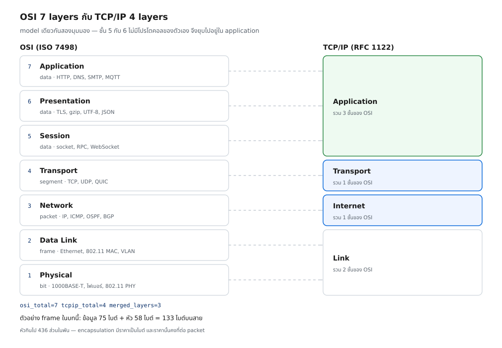
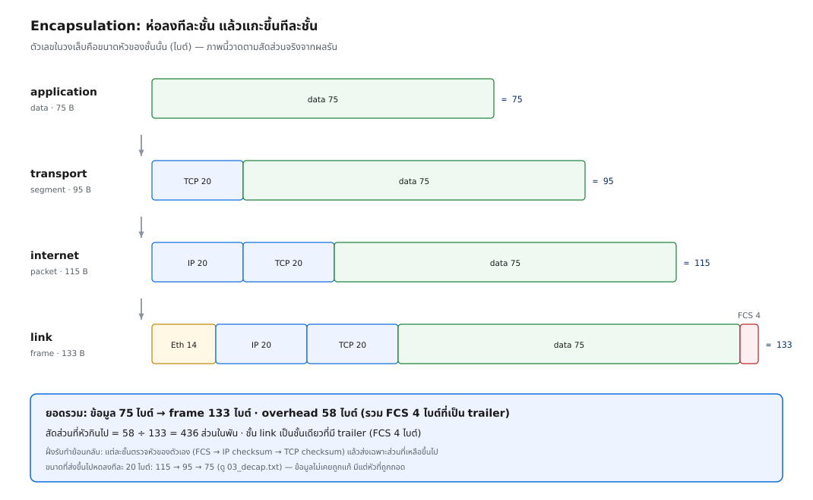
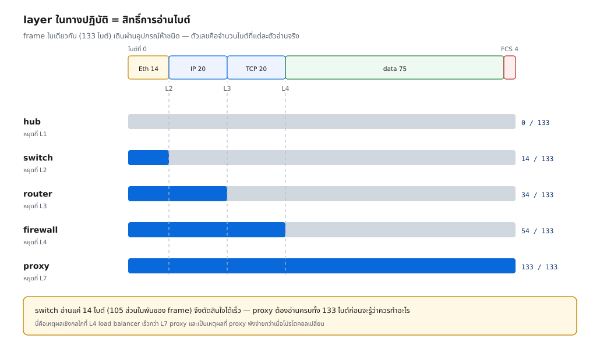

> 📅 เขียนเมื่อ: 17 พฤศจิกายน 2026 (เวลาไทย, UTC+7)
>
> **ผลรันทั้งหมดในบทนี้มาจากเครื่องเดียว** — Raspberry Pi 5, Debian GNU/Linux 13 (trixie), kernel 6.18.60+rpt-rpi-2712, aarch64
> **เวอร์ชันที่ใช้จริงในเดโม:** Go 1.24.4 · `gofmt` และ `go vet` ผ่านสะอาด · ภาพวาดด้วย `gen_svgs.py` แล้วตรวจด้วย `check_svg_readability.py` (วัดกรอบข้อความจากพิกัดจริงในไฟล์ SVG) และเรนเดอร์ด้วย `rsvg-convert` 2.60.0 เพื่อดูด้วยตาซ้ำ
> **เดโมของตอนนี้ไม่แตะเครือข่ายเลย** — ไม่มี socket ไม่มี packet ออกนอกโปรเซส ไม่มีการอ่านเวลาจริง ไม่มีการสุ่ม ทุกไบต์ที่เห็นในบทประกอบขึ้นในหน่วยความจำ แต่ **checksum ทั้งสามตัวคำนวณจริงจากไบต์เหล่านั้น** (ไม่ใช่ค่าคงที่ที่พิมพ์ไว้ให้ดูสวย) และทุกตัวเลขซ้ำได้ตรงทุกครั้งที่รัน
> **ข้อเท็จจริงเชิงประวัติศาสตร์ทุกตัวในบทนี้ตรวจจากแหล่งปฐมภูมิ (ISO, RFC, paper, เอกสารราชการ)** ตามที่ระบุท้ายบท ไม่ได้เขียนจากความจำ
>
> 🛡️ **จริยธรรม (ยังใช้กับทั้งซีรีส์):** การดัก packet การสแกน และการอ่านข้อมูลบนเครือข่าย ให้ทำกับ **เครื่องและเครือข่ายที่คุณควบคุมเอง** เท่านั้น เดโมของบทนี้ไม่แตะเครือข่ายจริงแม้แต่ไบต์เดียว จึงปลอดภัยโดยโครงสร้าง — และนั่นคือเหตุผลที่ผมเลือกประกอบ frame ขึ้นมาเองในหน่วยความจำ แทนที่จะดักของจริงมาโชว์

---

## 0. ประโยคที่ช่วยประหยัดเวลาหนึ่งชั่วโมง

มีประโยคหนึ่งที่ผมได้ยินในห้องประชุมตอนตีสอง แล้วรู้ทันทีว่าอีกสิบนาทีจะได้นอน

> "ping ผ่าน แต่ curl ไม่ผ่าน — ไม่ใช่ปัญหาชั้นล่างแล้ว ไปดูชั้น 7"

ประโยคนั้นยาวสิบห้าคำ และมันตัดสิ่งที่ต้องตรวจออกไปครึ่งหนึ่งทันที คนที่พูดกับคนที่ฟังเข้าใจตรงกันโดยไม่ต้องอธิบายเพิ่ม ทั้งที่ทั้งคู่ไม่เคยเห็น packet ลูกนั้นด้วยตา ไม่รู้ว่า switch ยี่ห้ออะไร ไม่รู้ว่าสายเส้นไหน

**บทนี้คือบทที่อธิบายว่าคำเหล่านั้นหมายถึงอะไร และทำไมมันถึงใช้ได้**

> ถ้ายังไม่คุ้นสองคำนั้น: **ping** คือโปรแกรมที่ยิง ICMP echo ไปถามเครื่องปลายทางว่าตอบไหม ส่วน **curl** คือโปรแกรมที่ส่ง HTTP request ไปขอหน้าเว็บ — ประโยคข้างบนจึงแปลว่า "ชั้น 1–3 ยังดี แต่ชั้น 7 (แอป) พัง"

แต่ผมจะไม่หยุดที่การท่องเจ็ดชั้น เพราะการท่องเจ็ดชั้นไม่ทำให้คุณ debug เก่งขึ้น สิ่งที่ทำให้ debug เก่งขึ้นคือการเข้าใจสามอย่างนี้:

1. **layer คือข้อตกลงว่าใครมีสิทธิ์อ่านไบต์ช่วงไหน** — และข้อตกลงนั้นคือทั้งหมดของสถาปัตยกรรม
2. **encapsulation คือกลไกที่ทำให้ข้อตกลงนั้นทำงาน** — ข้อมูลถูกห่อซ้ำ ๆ และแต่ละชั้นอ่านแค่หัวของตัวเอง
3. **model ไม่ใช่ความจริง** — มันเป็นแผนที่ที่ดีพอสำหรับการคุยกัน แต่ของจริงมีชั้นที่รั่ว และมีอุปกรณ์ที่แอบอ่านลึกกว่าที่ควร

และเพราะนี่คือตอนแรกของระยะที่ 2 (Protocol) ผมจะปูฐานให้แน่นหน่อย เพราะตอนที่ 08 ถึง 16 จะอ้างคำว่า "layer 2", "layer 3", "encapsulation" กันตลอด — ถ้าวันนี้เข้าใจผิด ที่เหลือทั้งซีรีส์จะพังตาม

---

## 1. ทำไมต้องมี model

### 1.1 ปัญหาของปี 1975: ภาษาใครภาษามัน

ก่อนจะมีมาตรฐานใด ๆ เครือข่ายในโลกพูดกันคนละภาษา และไม่ได้พูดต่างกันนิดเดียว — ต่างกันตั้งแต่ความคิดตั้งต้นว่า "การส่งข้อมูล" คืออะไร

ช่วงกลางทศวรรษ 1970 ภูมิทัศน์หน้าตาแบบนี้

| ปี | ระบบ | ใครทำ | ลักษณะ |
|---|---|---|---|
| 1969 | ARPANET (ลิงก์แรก ต.ค. 1969; NCP เริ่มใช้ ธ.ค. 1970) | ARPA (มหาวิทยาลัยสหรัฐฯ) | เครือข่ายงานวิจัย ต่อเครื่อง mainframe (คอมฯ ขนาดใหญ่ระดับองค์กร) ไม่กี่เครื่อง |
| 1974 | **SNA** (Systems Network Architecture) | IBM | stack (ชุดโปรโตคอลที่ซ้อนกันเป็นชั้นในเครื่องเดียว — ไม่ใช่ call stack ในหน่วยความจำ) ของบริษัทเดียว ออกแบบให้เครื่อง IBM คุยกับเครื่อง IBM |
| 1975 | **DECnet** | Digital Equipment Corporation | stack ของ DEC ออกแบบรอบ minicomputer (คอมฯ ขนาดกลางยุคก่อน PC) ของตัวเอง |
| 1976 | **X.25** | กลุ่มผู้ให้บริการโทรคมนาคม (PTT) หลายประเทศ | มาตรฐานสำหรับ public data network (เครือข่ายข้อมูลที่ผู้ให้บริการโทรคมนาคมขายให้คนทั่วไป) |

ลองนึกถึงบริษัทหนึ่งในปีนั้นที่มี mainframe ของ IBM อยู่ชั้นหนึ่ง และ minicomputer ของ DEC อยู่อีกชั้นหนึ่ง ทั้งสองเครื่องมีข้อมูลที่อีกเครื่องต้องการ

ปัญหาคือ SNA กับ DECnet **ไม่ได้ออกแบบมาให้คุยกัน** ไม่ใช่เพราะวิศวกรเก่งไม่พอ แต่เพราะไม่มีใครกำหนดว่า "การคุยกัน" ควรมีหน้าตาอย่างไร จึงไม่มีใครผิด — และเมื่อไม่มีใครผิด ทุกคนก็ทำของตัวเอง

ทางออกชั่วคราวที่ธุรกิจใช้ตอนนั้นคือ **gateway** (กล่องที่แปลงโปรโตคอลหนึ่งเป็นอีกโปรโตคอลหนึ่ง ไม่ใช่ประตูออก internet ของเราเตอร์บ้าน) ต่อคู่: SNA↔DECnet ตัวหนึ่ง SNA↔X.25 อีกตัว DECnet↔X.25 อีกตัว และเมื่อมี stack ที่สี่ที่ห้า จำนวนตัวแปลงก็เพิ่มแบบไม่เป็นเส้นตรง

และปัญหาไม่ได้อยู่แค่จำนวนกล่อง แต่อยู่ที่ **ทุกแอปต้องรู้ว่าเครือข่ายข้างล่างเป็นอะไร** โปรแกรมส่งไฟล์ต้องมีโค้ดสำหรับ SNA มีโค้ดสำหรับ DECnet มีโค้ดสำหรับ X.25 — ถ้ามีแอปแปดตัวและเทคโนโลยีเครือข่ายหกแบบ ก็มีโค้ดที่ต้องเขียนและดูแลสี่สิบแปดชุด

คำตอบที่หลายคนคิดขึ้นมาพร้อมกัน (และนี่คือจุดที่ควรสังเกต: มันเกิดหลายที่พร้อมกัน ไม่ใช่มีคนเดียวคิด) คือ **แบ่งปัญหาออกเป็นชั้น แล้วให้แต่ละชั้นคุยกับชั้นที่อยู่ติดกันเท่านั้น**

- ทีม CYCLADES ของ Louis Pouzin ในฝรั่งเศสใช้ **functional layering** และ **end-to-end principle** (งานที่ต้องเชื่อถือได้ให้ทำที่ปลายทางสองฝั่ง ตัวกลางไม่ต้องรู้) เป็นแกนตั้งแต่ปี 1972–1973
- ทีม NPL ในอังกฤษพูดถึง "levels of data transmission" ตั้งแต่ปี 1968
- และฝั่ง ISO ก็หยิบความคิดนี้มาทำเป็นมาตรฐานสากล

แนวคิดเดียวกันนี้ในระดับสถาปัตยกรรม มีชื่อเรียกว่า **layering** (การจัดเป็นชั้น) และผลลัพธ์ของมันคือตัวเลขที่ผมจะให้เดโมพิสูจน์ในข้อ 6.2[^1]

### 1.2 เลขคณิตที่อธิบายทุกอย่าง: M×N กลายเป็น M+N

ถ้าไม่มี layer: แอป M ตัว × เทคโนโลยีเครือข่าย N แบบ = **M×N** ชุดโค้ด
ถ้ามี layer: แอป M ตัวเขียนครั้งเดียว + ตัวแปลง N ตัวเขียนครั้งเดียว = **M+N** ชุดโค้ด

เดโมของเราตั้ง M = 8 แอป และ N = 6 เทคโนโลยี (Ethernet, WiFi, 4G, ไฟเบอร์, PPP = โปรโตคอลต่อสายจุดต่อจุด, LoRa = วิทยุคลื่นต่ำระยะไกล) ผลรันจริงคือ:

```text
## ทำไม layer ถึงคุ้ม: M แอป × N เทคโนโลยี ไม่ต้องเขียน M×N ตัว
apps=8 links=6
monolithic_adapters=48
layered_adapters=14
adapters_saved=34
saved_permille=708
```

`monolithic_adapters=48` กับ `layered_adapters=14` — ต่างกัน **34 ชุดโค้ด** หรือลดลง 708 ส่วนในพัน

และตัวเลขนี้**ไม่ได้โตเป็นเส้นตรง** ซึ่งคือจุดที่คนมักมองข้าม: ถ้าแอปเพิ่มเป็น 20 ตัวและเทคโนโลยีเป็น 10 แบบ แบบไม่มี layer คือ 200 ชุด แต่แบบมี layer คือ 30 ชุด ตัวคูณของปัญหาโตขึ้น แต่ต้นทุนของทางแก้โตแบบบวก

ตัวเลข 48 กับ 14 เป็นตัวเลขของแบบจำลอง (ผมตั้งขึ้นมาให้เห็นภาพ) แต่รูปของมันตรงกับประวัติศาสตร์: สิ่งที่ทำให้ TCP/IP ชนะไม่ใช่ความสวยงามทางทฤษฎี แต่คือการที่มันทำให้ **แอปใหม่หนึ่งตัวไม่ต้องเขียนโค้ดใหม่หกชุด**

### 1.3 สองปรัชญา: ออกแบบให้ครบ กับ ปล่อยให้รันก่อน

เมื่อโลกตกลงว่าต้องมี layer แล้ว คำถามถัดไปคือ **ใครกำหนดว่ามีกี่ชั้น และชั้นไหนทำอะไร** — และตรงนี้มีสองคำตอบที่ต่างกันโดยปรัชญา ไม่ใช่โดยเทคนิค

**สายที่หนึ่ง: ISO (International Organization for Standardization) — มาตรฐานก่อน แล้วค่อยสร้างของ**

เส้นเวลาที่ตรวจได้จากเอกสาร:

- **มีนาคม 1977** — การประชุม ISO ที่นครซิดนีย์ ประเทศออสเตรเลีย มีข้อเสนอจากสหราชอาณาจักร (มาจากงานศึกษาของ National Computing Centre ชื่อ *Why Distributed Computing*) ให้ตั้งคณะกรรมการมาตรฐานระหว่างประเทศด้านนี้
- **1977** — ISO เริ่มโปรแกรมพัฒนามาตรฐานเครือข่ายอย่างเป็นทางการ (คณะทำงาน TC97/SC16) โดยมีกระทรวงการค้าและอุตสาหกรรมของอังกฤษทำหน้าที่เลขานุการ
- **กุมภาพันธ์ 1978** — โครงร่างแรกถูกเขียนขึ้นที่กรุงวอชิงตัน ดี.ซี. โดย **Hubert Zimmermann** วิศวกรซอฟต์แวร์ชาวฝรั่งเศส (คนเดียวกันกับที่ทำงานในทีม CYCLADES ของ Pouzin — สังเกตว่าความคิดไหลจากงานวิจัยไปสู่มาตรฐานอย่างไร)
- **1980** — ฉบับร่างที่ขัดเกลาแล้วถูกตีพิมพ์
- **พฤษภาคม 1983** — เอกสารของ ISO กับ CCITT (องค์กรมาตรฐานโทรคมนาคม) ถูกหลอมรวมเป็นฉบับเดียว
- **1984** — ตีพิมพ์เป็นมาตรฐาน **ISO 7498** และในชื่อ **X.200** ของ CCITT/ITU-T

แนวคิด "แยกเป็นชั้น" ไม่ได้เกิดในที่ประชุมนั้น — มันมาจากงานของ **Charles Bachman** ที่ Honeywell Information Systems ซึ่งเสนอแบบจำลองที่แบ่งระบบเครือข่ายเป็นชั้นก่อนหน้านั้นแล้ว

ชื่อ **OSI** ย่อจาก Open Systems Interconnection — "ระบบเปิดที่ต่อถึงกัน" คำว่า open ในที่นี้ไม่ได้แปลว่า open source มันหมายถึง **เปิดสเปกให้ใครก็ทำได้** ตรงข้ามกับ SNA/DECnet ที่สเปกอยู่ในลิ้นชักบริษัท

**สายที่สอง: DARPA — สร้างของก่อน แล้วเขียนสเปกจากของที่รันอยู่**

- **ธันวาคม 1974** — RFC 675 (*Internet Transmission Control Program*) เขียนโดย Vint Cerf กับ Yogen Dalal และ Carl Sunshine เป็นดีไซน์ **ชั้นเดียว** (monolithic): โปรโตคอลตัวเดียวทำทุกอย่าง[^2]
- **กรกฎาคม 1977** — สาธิตการเชื่อมสามเครือข่าย (ARPANET, SATNET, PRNET) ด้วย TCP เวอร์ชันนั้นได้สำเร็จ
- **กันยายน 1978** — ใน TCP เวอร์ชัน 4 **Jon Postel** แตกโปรโตคอลออกเป็นสองตัว: **TCP** (reliable, connection-oriented) กับ **IP** (connectionless) หลังการหารือกับ Yogen Dalal, Bob Metcalfe และ John Shoch — และเพิ่ม **UDP** สำหรับแอปที่ไม่ต้องการบริการของ TCP
- **ธันวาคม 1978** — เริ่มเรียกชุดนี้ว่า **TCP/IP**
- **มีนาคม 1982** — กลายเป็นมาตรฐานสำหรับเครือข่ายคอมพิวเตอร์ทางทหารของสหรัฐฯ ทั้งหมด
- **1 มกราคม 1983** — ติดตั้ง TCP/IP บน ARPANET ทั้งเครือข่ายในวันเดียว (วันที่รู้จักกันในชื่อ **flag day**) — เราเล่าเรื่องนี้ไว้ใน[ตอนที่ 04](/blog/post.html?slug=2026-11-14-network-04-internet-www)

ความต่างเชิงปรัชญาอยู่ตรงนี้: **OSI ออกแบบทั้ง stack พร้อมกัน** และคาดหวังให้โลกเปลี่ยนมาใช้ทั้งชุด (แนวทางที่เอกสารวิชาการเรียกว่า forklift upgrade — ยกของเก่าออกทั้งชั้นแล้ววางของใหม่ลงไป) ส่วน **TCP/IP ออกแบบแค่ "เอว" ตรงกลาง** และปล่อยให้สองข้างทำอะไรก็ได้

คำวิจารณ์นี้ไม่ได้มาจากปากคนนอกวงการ — มันมาจากเอกสารของ IETF เอง ชื่อ **RFC 3439** (ธันวาคม 2002, R. Bush และ D. Meyer) ซึ่งมีหัวข้อหนึ่งชื่อตรง ๆ ว่า *"Layering Considered Harmful"* (หัวข้อที่แปลได้ว่า "การจัดชั้นที่เข้มงวดคือโทษ") ใจความคือ: การจัดชั้นที่เข้มงวดเกินไปทำให้ optimize ไม่ได้ และทำให้เกิดชั้นซ้อนชั้นจน debug ไม่ได้ — เอกสารนี้เขียนโดยคนที่ดูแล backbone (แกนหลักของ internet) เอง ไม่ใช่คนที่เกลียด OSI

### 1.4 แล้วอะไรชนะ และอะไรยังอยู่

สงครามมาตรฐานระหว่าง TCP/IP กับ OSI (ที่เอกสารทางประวัติศาสตร์เรียกว่า **Protocol Wars**) ไม่ได้จบด้วยการเปรียบเทียบทางวิศวกรรม แต่มันจบด้วยจำนวนเครื่องที่รันอยู่จริง

ฝั่ง OSI มีแรงสนับสนุนจากรัฐบาลที่หนักมาก:

- **1988** — สหราชอาณาจักรออก **GOSIP** (Government Open Systems Interconnection Profile) โดย CCTA และเริ่มทำงานร่วมกับฝรั่งเศสและเยอรมนีตะวันตกในโครงการ EPHOS
- **1990** — สหรัฐฯ ออก **FIPS 146-1** ซึ่งกำหนดให้หน่วยงานรัฐซื้อผลิตภัณฑ์ที่รองรับ OSI
- **1995** — **FIPS 146-2** ผ่อนกฎให้ยอมรับสเปกอื่นที่เป็นมาตรฐานเปิดได้ "เช่นที่พัฒนาโดย IETF" — และตั้งแต่ปีนั้นความสนใจใน OSI implementation ก็ลดลงเรื่อย ๆ

สาเหตุที่ OSI แพ้ มีสามข้อที่ผมอยากให้จำ เพราะมันเกี่ยวกับงานคุณทุกวันนี้:

1. **มันสายเกินไป** — ตอนที่ ISO 7498 ตีพิมพ์ปี 1984 นั้น TCP/IP ผ่านการใช้งานบนเครือข่ายจริงมาหลายปีแล้ว (สาธิตการเชื่อมสามเครือข่ายตั้งแต่กรกฎาคม 1977) และแจกฟรีมากับ BSD Unix ซึ่งมหาวิทยาลัยทั่วโลกติดตั้งได้โดยไม่ต้องขออนุมัติใคร
2. **มันซับซ้อนเกินจะทำได้ครบ** — สเปก OSI มี option มากมายจนผู้ผลิตแต่ละรายเลือกไม่เหมือนกัน และผลลัพธ์ที่เกิดขึ้นจริงก็น่าขัน: **มาตรฐานที่สร้างมาเพื่อให้ต่างค่ายคุยกันได้ กลับทำให้ต่างค่ายคุยกันไม่ได้** เพราะต่างคนต่าง implement คนละ subset
3. **มันเปลี่ยนทุกอย่างพร้อมกัน** — การจะใช้ OSI ต้องเปลี่ยนทั้ง stack ซึ่งหมายถึงทิ้งของที่ลงทุนไปแล้ว

**แต่นี่คือจุดที่ผมจะไม่พูดว่า "OSI แพ้ เพราะมันแย่"** เพราะมันไม่จริง และคนที่พูดแบบนั้นมักจะไม่รู้ว่าตัวเองกำลังใช้ OSI อยู่ทุกวันในสองความหมาย:

**ความหมายแรก: OSI ชนะการเป็นภาษา** ทุกวันนี้เวลาวิศวกรพูดว่า "ปัญหา layer 2", "ดู layer 4 หน่อย", "ยิง packet ที่ layer 3" ทุกคนเข้าใจตรงกัน และคำเหล่านั้นมาจาก OSI ไม่ใช่จาก TCP/IP (ใน TCP/IP layer 2 กับ 1 รวมกันเป็น link layer เดียว — ไม่มีคำว่า "layer 2" เลยถ้าพูดตามสเปก) ผมจะกลับมาเรื่องนี้ในข้อ 5.4

**ความหมายที่สอง: มีโปรโตคอล OSI ตัวหนึ่งที่ยังรันอยู่ใน backbone ของ internet จนถึงวันนี้** — มันชื่อ **IS-IS** (Intermediate System to Intermediate System) มาตรฐาน ISO/IEC 10589 (ฉบับร่าง ISO DP 10589 ถูก republish เป็น **RFC 1142**) และรูปแบบที่ใช้กับ TCP/IP คือ Integrated IS-IS ใน **RFC 1195** และวันนี้เป็น interior routing protocol (โปรโตคอลหาเส้นทางภายในเครือข่ายของผู้ให้บริการรายเดียว) ที่ผู้ให้บริการรายใหญ่ทั่วโลกใช้ (เราจะเจอมันอีกครั้งในตอนที่ 18 เมื่อพูดถึง OSPF ซึ่งเป็นคู่แข่งที่เกิดมาทีหลัง) — คือ OSI แพ้สงคราม แต่ทหารของมันยังยืนอยู่ในสนาม

---

## 2. OSI 7 layers: แต่ละชั้นตอบคำถามอะไร

ก่อนเข้าเนื้อหา ผมขอเตือนเรื่องหนึ่งที่สำคัญกว่าตารางทั้งเจ็ดแถว

**อย่าท่องชื่อ layer — ให้จำคำถามที่แต่ละชั้นตอบ** เพราะชื่อมันบอกอะไรไม่ค่อยได้ ("presentation" ฟังดูเหมือนทำสไลด์) แต่คำถามบอกได้ทันทีว่าปัญหาที่คุณเจอเป็นของใคร

และก่อนจะไล่ทีละชั้น ต้องเข้าใจแนวคิด **peer layer** ก่อน เพราะมันคือหัวใจของ encapsulation:

> ชั้นที่ 4 ของเครื่องคุณคุยกับชั้นที่ 4 ของเครื่องปลายทาง **ในเชิงตรรกะ** — มันเหมือนคุยกันตรง ๆ แต่การเดินทางจริงคือ: ชั้น 4 เขียนหัวของตัวเองแล้ว **ส่งลงไปให้ชั้น 3** ชั้น 3 ใส่อีกหัวหนึ่งแล้วส่งลงไปชั้น 2 ... จนถึงชั้น 1 ที่ส่ง bit ออกสาย

ภาพที่ควรมีในหัวคือ **สองตึกที่มีบันไดเจ็ดชั้น บันไดของสองตึกไม่ได้ต่อถึงกัน** จดหมายจากชั้น 7 ของตึกซ้ายต้องเดินลงบันไดทั้งหมด ผ่านอุโมงค์ที่ชั้น 1 แล้วเดินขึ้นบันไดอีกตึกหนึ่งถึงชั้น 7 — แต่คนที่ชั้น 7 ทั้งสองฝั่งอ่านจดหมายเหมือนคุยกันตรง ๆ



### 2.1 layer 1: Physical — ส่งสัญญาณ

**คำถามของชั้นนี้:** จะเอา 0 กับ 1 ออกไปในสายได้อย่างไร

ชั้นนี้ไม่รู้จัก "ไบต์" ไม่รู้จัก "ที่อยู่" ไม่รู้จัก "packet" ด้วยซ้ำ มันรู้แค่เรื่องไฟฟ้า/แสง/คลื่น: แรงดันเท่าไรถึงแทน 1, เปลี่ยนระดับสัญญาณบ่อยแค่ไหน, ขาไหนคือขาที่ 1 ของ connector (หัวต่อ), สายต้องยาวไม่เกินเท่าไร, ใช้ modulation (วิธีฝัง 0/1 ลงในคลื่น) แบบไหน

ตัวอย่างจริง: `1000BASE-T` (Ethernet กิกะบิตบนสาย twisted pair — สายคู่บิดเกลียว) กำหนดระดับแรงดันและวิธี encode สัญญาณ ส่วน `802.11ax` ฝั่ง PHY กำหนดว่า subcarrier (คลื่นย่อยในช่องสัญญาณเดียว) กี่ตัวในย่าน 5 GHz — ทั้งสองอยู่ชั้น 1 ทั้งคู่

อุปกรณ์: hub, repeater, สาย, connector, ชิป PHY (ส่วนที่จัดการสัญญาณจริง มาจาก physical) ใน NIC (Network Interface Card — การ์ดเน็ตเวิร์ก)

จุดที่ควรเข้าใจ: **hub คืออุปกรณ์ชั้น 1 ที่ไม่รู้อะไรเลย** มันรับสัญญาณไฟฟ้าจากพอร์ตหนึ่งแล้วทวนออกทุกพอร์ตที่เหลือ มันไม่รู้ว่า frame ข้างในคืออะไร ไม่รู้ว่าใครส่งถึงใคร และนี่คือเหตุผลที่เดโมของเราให้ hub อ่านไป 0 ไบต์ในข้อ 6.5

### 2.2 layer 2: Data Link — ส่ง frame ระหว่างสองเครื่องที่ต่อกันตรง ๆ

**คำถามของชั้นนี้:** จะส่งก้อนข้อมูลไปให้เพื่อนบ้านที่อยู่ปลายสายเดียวกันได้อย่างไร และรู้ได้อย่างไรว่ามันพังระหว่างทาง

งานของมันมีสามอย่าง:

1. **Framing** — ตัดสาย bit ที่ไหลมาไม่หยุดให้เป็นก้อน (frame) ที่มีหัวบอกว่าก้อนนี้เริ่มตรงไหน จบตรงไหน
2. **Addressing ในระดับท้องถิ่น** — ใส่ MAC address ของการ์ดปลายทาง (ที่อยู่ 48 บิตที่โรงงานฝังมาในการ์ดแต่ละใบ)[^3] เพื่อให้อุปกรณ์กลางรู้ว่าก้อนนี้ควรออกพอร์ตไหน
3. **Error detection + medium access** — ใส่ checksum ท้าย frame (ใน Ethernet คือ FCS 4 ไบต์) เพื่อให้ปลายทางรู้ว่ามี bit กลับด้านระหว่างทางไหม และจัดการว่าใครมีสิทธิ์พูดเมื่อมีหลายเครื่องใช้สายร่วมกัน (Ethernet ใช้ CSMA/CD ในยุค hub, WiFi ใช้ CSMA/CA — CSMA/CD = แย่งสิทธิ์ใช้สายโดยตรวจจับการชน, CSMA/CA = แย่งสิทธิ์โดยหลบหลีกการชน)

อุปกรณ์: switch, bridge (ตัวเชื่อมสองส่วนของเครือข่ายชั้น 2 ให้เป็นวงเดียว), การ์ดเน็ตเวิร์ก (ฝั่ง MAC), access point (จุดเชื่อมต่อ Wi-Fi ที่เครื่องไร้สายเข้ามาเกาะ)
โปรโตคอล: Ethernet, 802.11 MAC, PPP, VLAN tag (802.1Q) — VLAN คือการแบ่ง switch ตัวเดียวเป็นหลายวงเสมือน ด้วยการติดป้าย 802.1Q ที่หัว frame

ตอนที่ 03 เราลงรายละเอียด frame ของ Ethernet ไว้แล้ว ([อ่านย้อนได้ที่นี่](/blog/post.html?slug=2026-11-13-network-03-ethernet-lan)) และตอนที่ 08 จะลงลึกกว่านี้อีก — รวมถึง ARP ซึ่งเป็นโปรโตคอลที่ **อยู่ระหว่างชั้น 2 กับชั้น 3** จนไม่มีใครตอบได้ว่ามันอยู่ชั้นไหน (ผมจะกลับมาเรื่องนี้ในข้อ 5.3)

### 2.3 layer 3: Network — หาเส้นทางข้ามเครือข่าย

**คำถามของชั้นนี้:** จะส่ง packet จากเครือข่ายหนึ่งไปอีกเครือข่ายหนึ่งที่อยู่ไกลออกไปได้อย่างไร โดยไม่ต้องรู้เส้นทางทั้งหมด

คำว่า "ไม่ต้องรู้เส้นทางทั้งหมด" คือหัวใจ — และมันคือเหตุผลที่ชั้นนี้ต้องมี **logical address** ที่เป็นอิสระจาก hardware: IP address ไม่ผูกกับ MAC address ของการ์ด ถ้าคุณย้ายเครื่องไปอีกเครือข่าย MAC ยังเหมือนเดิมแต่ IP เปลี่ยน

งานของมัน: addressing แบบ logical, routing (เลือกเส้นทาง), และ fragmentation (แบ่ง packet เมื่อมันใหญ่เกินที่ link ปลายทางรับได้)

อุปกรณ์: router, L3 switch
โปรโตคอล: IP, ICMP, และ routing protocol อย่าง OSPF/BGP (ซึ่งน่าสนใจเพราะมันเป็นโปรโตคอลที่ "วิ่งอยู่บนชั้น 3 แต่ทำหน้าที่ตัดสินใจให้ชั้น 3" — ชั้นซ้อนชั้นที่ RFC 3439 บ่นถึง)

### 2.4 layer 4: Transport — ส่งถึงโปรเซส ไม่ใช่แค่ส่งถึงเครื่อง

**คำถามของชั้นนี้:** packet นี้ควรไปให้โปรแกรมไหนในเครื่องปลายทาง และต้องส่งซ้ำไหมถ้าหาย

จุดนี้คนมักข้าม: IP ส่งถึง **เครื่อง** แต่ในเครื่องหนึ่งมีหลายโปรแกรมที่รอรับข้อมูลอยู่ (web server, SSH, DNS resolver) การจะรู้ว่าข้อมูลนี้เป็นของใครต้องมีตัวเลขอีกชุดหนึ่งคือ **port** (หมายเลข 16 บิต ที่บอกว่าโปรเซสไหนเป็นผู้รับ)[^4] — งานนี้เป็นของชั้น 4

และที่นี่เองที่เกิดการแบ่งปรัชญาที่สำคัญที่สุดของทั้งซีรีส์:

- **TCP** — การันตีว่าถึง ลำดับถูก และไม่มีอะไรขาด (แลกกับ state — state คือข้อมูลที่ต้องจำไว้ตลอดการเชื่อมต่อ — การส่งซ้ำ และความหน่วง)
- **UDP** — ส่งแล้วจบ ไม่การันตีอะไร (แลกกับความเรียบง่ายและความเร็ว)

ทั้งหมดนี้อยู่ที่ปลายทางเท่านั้น (process-to-process) ไม่มี router ตัวไหนเกี่ยวข้อง — และนั่นคือเหตุผลที่คำว่า end-to-end มีความหมาย

อุปกรณ์: ไม่มี "อุปกรณ์ชั้น 4" ในความหมายของกล่องกลางทาง — ชั้นนี้อยู่ในเครื่องปลายทาง (ยกเว้น load balancer (เครื่องกระจาย request ไปหลายเครื่อง) กับ firewall (ตัวกรองว่า packet ไหนผ่านได้) ที่ **แอบ** อ่านขึ้นมาถึงชั้นนี้ — และ proxy (ตัวกลางที่รับ request แทนปลายทาง แล้วคุยกับปลายทางเอง) ก็อ่านลึกกว่านี้อีก ซึ่งเป็นเรื่องของข้อ 5)

### 2.5 layer 5: Session — คุยกันเป็นช่วง ๆ

**คำถามของชั้นนี้:** จะเปิดบทสนทนาหนึ่งบาน คุมจังหวะของมัน และปิดให้เรียบร้อยได้อย่างไร

ตัวอย่างที่สเปกยกมา: การ checkpoint (บันทึกจุดพักเพื่อให้ทำต่อได้ถ้าขาดกลางคัน เช่น transfer ไฟล์ใหญ่ที่ resume ได้), การคุมว่าใครพูดเมื่อไร (full-duplex = ส่ง-รับพร้อมกันได้ / half-duplex = ผลัดกันส่ง), การ authenticate ตอนเปิด session

**ความจริงที่ควรรู้ตั้งแต่ต้น: ชั้นนี้แทบไม่มีอยู่จริงในฐานะโปรโตคอลแยก** ในโลก TCP/IP การเปิด/ปิด "session" ถูกยัดไปอยู่ที่ TCP (การเปิด connection ด้วย 3-way handshake — การจับมือตกลงพารามิเตอร์ก่อนเริ่มส่งข้อมูล — และปิดด้วย FIN ซึ่งเป็นธงที่บอกว่าขอปิดฝั่งนี้) หรือไปอยู่ที่ application (cookie, token, WebSocket) — ไม่มีใครเขียนโปรโตคอลชั้น 5 แยกออกมาใช้จริงจังในปี 2026

### 2.6 layer 6: Presentation — แปลงรูปแบบข้อมูล

**คำถามของชั้นนี้:** สองเครื่องที่เก็บข้อมูลต่างรูปแบบกันจะแลกเปลี่ยนข้อมูลอย่างไร (และจะบีบอัด/เข้ารหัสตรงไหน)

งานในทางทฤษฎี: character encoding (ASCII ↔ EBCDIC — ระบบเก่าของ IBM ที่ใช้กันจริงในยุค mainframe), การบีบอัด, การเข้ารหัส/ถอดรหัส, การแปลงโครงสร้างข้อมูล

ในทางปฏิบัติ งานพวกนี้กระจายไปหมด: encoding อยู่ที่แอป (UTF-8 ใน HTTP header), การบีบอัดอยู่ที่ HTTP (`Content-Encoding: gzip`) หรือที่ TLS, การเข้ารหัสอยู่ที่ TLS

**และ TLS คือตัวอย่างที่ดีที่สุดว่าทำไมการจัดชั้นแบบ OSI อธิบายของจริงไม่ได้** — TLS ไม่ได้อยู่ชั้น 4 (มันไม่รู้จัก port และไม่ส่งข้อมูลเอง) และไม่ได้อยู่ชั้น 6 ล้วน ๆ (มันทำ handshake ที่มี state เหมือน session) มันคาบเกี่ยวทั้งสอง และในทางปฏิบัติมันถูกวาง "ระหว่าง" ชั้น 4 กับชั้น 7 ในฐานะ library ที่แอปเรียก — Wikipedia ถึงกับเขียนตรง ๆ ว่า TLS ไม่ได้เข้ากับ model นี้พอดี เดี๋ยวเราจะคุยเรื่อง TLS จริง ๆ ในตอนที่ 16

### 2.7 layer 7: Application — สิ่งที่ผู้ใช้เรียกใช้

**คำถามของชั้นนี้:** ข้อมูลที่ห่อมาถึงแล้วหมายความว่าอะไร

นี่คือชั้นเดียวที่ผู้ใช้เห็น และเป็นชั้นที่โปรแกรมเมอร์ส่วนใหญ่ทำงานด้วย: HTTP, DNS, SMTP (เมล), SSH, MQTT, และโปรโตคอลเฉพาะทางอีกนับพัน

จุดที่ทำให้คนสับสนบ่อย: **HTTP ไม่ใช่ "เว็บ"** — HTTP คือรูปแบบข้อความที่ตกลงกันว่า request/response หน้าตาอย่างไร ซึ่งเป็นเรื่องของชั้น 7 ทั้งหมด ส่วน "เว็บ" คือระบบที่ประกอบจาก HTTP + HTML + URL + browser

### 2.8 สรุปสามกลุ่ม

ถ้าจะจำให้เหลือน้อยที่สุด ให้แบ่งเจ็ดชั้นเป็นสามกลุ่มตาม **ชนิดของที่อยู่ที่มันใช้**:

| กลุ่ม | ชั้น | ที่อยู่ที่ใช้ | ใครตัดสินใจ |
|---|---|---|---|
| media | 1–2 | MAC address (48 บิต, ฝังมากับการ์ด) | hub (ชั้น 1) / switch (ชั้น 2) |
| network | 3 | IP address (logical, เปลี่ยนได้) | router |
| host | 4–7 | port + ชื่อโปรโตคอล | ปลายทางเท่านั้น |

การแบ่งนี้มีประโยชน์เวลา debug เพราะมันบอกลำดับที่ควรตรวจ: ถ้า MAC ถึงกันได้แต่ IP ไปไม่ถึง ปัญหาอยู่ชั้น 3 ถ้า IP ถึงแต่โปรแกรมไม่ได้อะไร ปัญหาอยู่ชั้น 4 ขึ้นไป

---

## 3. TCP/IP 4 layers: model ที่ใช้จริง

### 3.1 นิยามจากเอกสารจริง

คำอธิบายที่เป็นทางการที่สุดของ TCP/IP model ไม่ได้อยู่ในหนังสือเรียน แต่อยู่ใน **RFC 1122** (*Requirements for Internet Hosts — Communication Layers*, ตุลาคม 1989, บรรณาธิการ Robert Braden) ข้อ 1.1.3 ซึ่งเขียนไว้ว่า host ต้อง implement อย่างน้อยหนึ่งโปรโตคอลจากแต่ละ layer และไล่สี่ชั้นดังนี้:

- **Application layer** — ชั้นบนสุด และเอกสารเขียนไว้ชัดว่า "Internet suite ไม่ได้แบ่ง application layer ลงไปอีก" (ถึงแม้โปรโตคอลบางตัวจะมีการแบ่งชั้นภายในของตัวเอง)
- **Transport layer** — TCP, UDP
- **Internet layer** — IP, ICMP, และกลไก routing
- **Link layer** — ทุกอย่างที่ทำให้ IP วิ่งบนสื่อจริงได้ (Ethernet, WiFi, PPP, ชุมสาย, ไฟเบอร์)

สังเกตคำที่หายไป: ไม่มี session, ไม่มี presentation, และไม่มี physical แยกออกมา — เพราะ TCP/IP **ไม่สนใจว่าสื่อคืออะไร** ขอให้มันส่ง octet (กลุ่ม 8 บิต) ได้ก็พอ นี่คือการออกแบบที่จงใจ: มันคือเหตุผลที่ IP วิ่งบนอะไรก็ได้ตั้งแต่วง LAN ในบ้านยันลิงก์ดาวเทียม

### 3.2 ตารางเทียบ และตัวเลขที่เดโมรายงาน

การเทียบที่ตรงที่สุดคือ: **application ของ TCP/IP = ชั้น 7+6+5 ของ OSI**, **transport = 4**, **internet = 3**, **link = 2+1**

มีจุดที่ต้องระวัง: RFC 1122 เขียนว่า application layer ของ TCP/IP ครอบ "the top two layers — Presentation and Application" คือชั้น 6 กับ 7 เท่านั้น ส่วนการนับ session (ชั้น 5) เข้าไปด้วยเป็นการปฏิบัติและตำราสมัยใหม่ (รวมถึงตารางในเดโมนี้) — ถ้าอาจารย์ของคุณนับ 7+6+5 เขาไม่ได้ผิด แต่กำลังใช้คำว่า application ในความหมายที่กว้างกว่าสเปกปี 1989

ตารางในเดโมของเรานับให้เห็นเป็นตัวเลข (ผลจริงจาก `01_stack.txt`):

```text
## TCP/IP 4 layers — นับจากตารางข้างบนว่ามี OSI กี่ชั้นยุบไปอยู่ด้วย
Application  osi_layers=3
Transport    osi_layers=1
Internet     osi_layers=1
Link         osi_layers=2
osi_total=7 tcpip_total=4 merged_layers=3
```

อ่านตารางนี้: OSI มี 7 ชั้น TCP/IP มี 4 และมี **3 ชั้นที่ถูกยุบรวม** (ชั้น 5, 6 หายไปใน application และชั้น 1 รวมกับ 2 เป็น link) — `Application osi_layers=3` คือหลักฐานว่า application ของ TCP/IP ครอบสามชั้นของ OSI ไม่ใช่ชั้นเดียว

### 3.3 ทำไม 4 ไม่ใช่ 7

เหตุผลไม่ใช่ "4 ดีกว่า 7" แต่เป็นเรื่องของ **ขอบเขตความรับผิดชอบ (scope)**: TCP/IP แบ่งชั้นตามว่าโค้ดส่วนนั้นดูแลอะไร

| ชั้น TCP/IP | ขอบเขต |
|---|---|
| Application | โปรเซสในเครื่องเดียว (ไม่รู้จัก network เลย) |
| Transport | ระหว่างสองโปรเซส (process-to-process) |
| Internet | ระหว่างสองโฮสต์ (host-to-host) แม้จะอยู่คนละเครือข่าย (internetworking) |
| Link | ระหว่างสองเครื่องที่ต่อกันตรง ๆ (local link) |

การแบ่งแบบนี้ทำให้แต่ละชั้นมี "เจ้าของ" ชัดเจน: application เป็นของนักพัฒนาแอป, transport กับ internet เป็นของ kernel (แกนกลางระบบปฏิบัติการ), link เป็นของ driver (โค้ดที่คุยกับฮาร์ดแวร์) + hardware

ในทางกลับกัน OSI แบ่งตาม **หน้าที่ (function)** ซึ่งละเอียดกว่า และทำให้เกิดชั้นที่ไม่มีเจ้าของชัด ๆ อย่าง session กับ presentation

และมีข้อสังเกตหนึ่งที่ผมชอบ: **ตำราหลายเล่มใช้ 5 ชั้น** (เพิ่ม physical แยกออกจาก link) เพื่อการสอน — เป็นการประนีประนอมระหว่างสอง model เพราะนักศึกษาต้องเข้าใจว่าสายไฟเป็นเรื่องแยกจาก frame แต่ในสเปกจริง TCP/IP มี 4 ชั้น ถ้าอาจารย์ของคุณพูด 5 ชั้น เขาไม่ได้ผิด เขากำลังสอนด้วย model ที่ปรับให้อธิบายของจริงได้สะดวกขึ้น

### 3.4 รูปร่างของ stack: hourglass

มีภาพหนึ่งที่อธิบาย TCP/IP model ได้ดีกว่าตารางสี่แถว นั่นคือ **hourglass** (นาฬิกาทราย):

- ชั้นบนกว้าง: แอปนับพัน (HTTP, SMTP, DNS, SSH, ...)
- **เอวแคบ: IP ตัวเดียว**
- ชั้นล่างกว้าง: เทคโนโลยีนับพัน (Ethernet, WiFi, 4G, ไฟเบอร์, ดาวเทียม)

เอวที่แคบคือความสำเร็จทั้งหมดของ internet: **มันเป็นจุดเดียวที่ทุกอย่างต้องตกลงกัน** และเพราะมีจุดเดียว การเปลี่ยนชั้นบนหรือล่างจึงไม่ต้องประสานกันทั้งโลก เราเคยวาดภาพนี้ไว้ใน[ตอนที่ 04](/blog/post.html?slug=2026-11-14-network-04-internet-www) ตอนเล่าเรื่องราวก่อน WWW

---

## 4. encapsulation: ห่อลง แล้วแกะขึ้น

ตอนนี้เรามีแผนที่แล้ว ถึงเวลาดู **กลไก** ที่ทำให้แผนที่นี้ทำงาน

คำว่า **encapsulation** (การห่อหุ้ม) ในเครือข่ายหมายถึง: **เอาข้อมูลของชั้นบนทั้งก้อน (รวมหัวของมันด้วย) มาเป็น "เนื้อ" ของชั้นล่าง แล้วเติมหัวของชั้นล่างเข้าไปข้างหน้า**

ทำซ้ำลงไปเรื่อย ๆ จนถึงชั้นล่างสุดที่ส่ง bit ออกสาย — และฝั่งรับทำกลับกัน เรียกว่า **de-encapsulation**

### 4.1 ชื่อของก้อนข้อมูลเปลี่ยนตามชั้น

นี่คือศัพท์ที่ทำให้คนใหม่สับสนมากที่สุดใน networking และมันมีเหตุผล: **ก้อนข้อมูลเดียวกันถูกเรียกคนละชื่อเมื่ออยู่คนละชั้น**

| ชั้น | เรียกก้อนนี้ว่า | ประกอบด้วย |
|---|---|---|
| 7–5 | data / message | สิ่งที่แอปอยากส่ง |
| 4 | **segment** (TCP) หรือ datagram (UDP) | TCP header + data |
| 3 | **packet** / datagram | IP header + segment |
| 2 | **frame** | Ethernet header + packet + FCS |
| 1 | bit / symbol | สัญญาณไฟฟ้า/แสง |

คำว่า **datagram** (ก้อนข้อมูลที่ส่งออกได้เลยโดยไม่ต้องเปิด connection ก่อน) จึงโผล่ทั้งสองชั้น: UDP เรียกก้อนของตัวเองว่า datagram เพราะมันไม่มีการเปิด connection และ IP ก็เรียก packet ของตัวเองว่า datagram ด้วยเหตุผลเดียวกัน

ศัพท์พวกนี้ไม่ใช่ของประดับ — มันบอกคุณว่า **คุณกำลังพูดถึงข้อมูลในมุมของชั้นไหน** เวลาวิศวกรพูดว่า "segment นี้ถูก retransmit" เขากำลังพูดถึงมุมของ TCP (ชั้น 4) ถ้าเขาพูดว่า "frame นี้ถูก drop ที่ switch" เขากำลังพูดถึงมุมของชั้น 2 — และคนละปัญหากันคนละแบบ

### 4.2 ตัวเลขจริง: 75 + 20 + 20 + 14 + 4

เดโมของเราประกอบ HTTP request หนึ่งใบขึ้นมาใหม่ทั้งใบ เริ่มจากข้อความ 75 ไบต์ แล้วห่อลงไปทีละชั้น ผลจริงจาก `02_encap.txt`:

```text
## ลำดับการห่อ: ข้อมูลไหลลงจากบนลงล่าง
layer         add_bytes  payload_after  total  pdu
application           0             75     75  data
transport            20             75     95  segment
internet             20             95    115  packet
link                 18            115    133  frame
```

อ่านคอลัมน์ `add_bytes` จากบนลงล่าง: 0, 20, 20, 18 — ชั้น application ไม่เติมอะไร (มันคือข้อมูลดิบ) ชั้น transport เติม 20 (TCP header) ชั้น internet เติม 20 (IPv4 header) ชั้น link เติม 18 (Ethernet header 14 + FCS 4)

รวมแล้ว **75 ไบต์ของข้อมูล กลายเป็น 133 ไบต์บนสาย** — หัวกินไป 58 ไบต์ หรือ 436 ส่วนในพันของทั้งหมด

(ในผลรัน ชื่อตัวแปรคือ `header_bytes` และมันนับ FCS 4 ไบต์เข้าไปด้วย เพราะสิ่งที่เราสนใจคือ **overhead ทั้งหมดที่ชั้น 2 เติม** ถ้านับเฉพาะหัวจริง ๆ คือ 54 ไบต์ และอีก 4 ไบต์เป็น trailer — ผมจะย้ำเรื่องนี้ในข้อ 6.3)

และนี่คือเหตุผลเชิงตัวเลขของสิ่งที่เราพูดในตอนที่ 06 ว่า "ทุก abstraction มีราคา": **การที่เครื่องสองเครื่องคุยกันได้อย่างมีระเบียบ มีราคา 58 ไบต์ต่อ request หนึ่งใบ** ถ้า payload เล็กลง ราคานี้จะกินสัดส่วนที่ใหญ่ขึ้น (ข้อ 6.7 จะโชว์ตาราง)



### 4.3 หัวของแต่ละชั้นเป็นสัญญา ไม่ใช่แค่ข้อมูล

นี่คือความคิดที่ผมอยากให้คุณได้จากบทนี้มากที่สุด

หัว (header) ของแต่ละชั้นไม่ได้มีไว้ "บอกข้อมูล" เฉย ๆ — มันมีไว้ **บอกว่าชั้นถัดไปควรทำอะไรกับส่วนที่เหลือ** นี่คือสัญญาสามข้อที่ทุกชั้นทำ:

1. **"ส่วนที่เหลือหลังจากฉันคือของชั้นบน"** — ชั้นล่างไม่ต้องรู้ว่าข้างในคืออะไร
2. **"ถ้าฉันพัง ให้ทิ้งทั้งใบ"** — checksum ของแต่ละชั้นทำงานอิสระจากกัน
3. **"ฉันเปิดเผยแค่ฟิลด์ที่ฉันประกาศไว้"** — นี่คือสิ่งที่ทำให้ layer เป็นเรื่องของ **สิทธิ์การอ่าน** ไม่ใช่แค่การจัดหมวดหมู่

ข้อ 3 คือข้อที่สำคัญที่สุดในทางปฏิบัติ เพราะมันคือสิ่งที่กำหนดว่า **อุปกรณ์แต่ละตัวทำอะไรได้** และเราจะวัดมันเป็นไบต์ในข้อ 6.5

### 4.4 de-encapsulation: แกะขึ้นทีละชั้น

ฝั่งรับทำย้อนกลับ แต่มีจุดที่ต่างจากฝั่งส่งอย่างมีนัยสำคัญ: **แต่ละชั้นตรวจของตัวเองก่อนส่งต่อ** และถ้าไม่ผ่านก็ทิ้งทันที ไม่ส่งขึ้นไปให้ชั้นบนเสียเวลา

ผลจริงจาก `03_decap.txt`:

```text
## de-encapsulation: ทีละชั้น แกะหัวของตัวเองแล้วส่งที่เหลือขึ้นไป
L1 physical   bits=1064 medium=copper
L2 data link  dst=02:00:00:00:00:07 src=02:00:00:00:00:01 ethertype=0x0800 fcs=ok hand_up=115
L3 internet   ver=4 ihl=5 proto=6 ttl=64 src=10.7.1.10 dst=203.0.113.7 len=115 cksum=ok hand_up=95
L4 transport  sport=49152 dport=80 flags=ACK,PSH doff=5 cksum=ok hand_up=75
L7 application 75 ไบต์ → "GET /net07 HTTP/1.1"

## ตัวเลขที่ควรจำ
header_bytes_total=58
payload_bytes=75
headers_checked=3
layers_that_read_an_address=3
```

อ่านทีละบรรทัดให้เห็นการหดตัว: `hand_up=115` → `95` → `75` ตัวเลขนี้คือขนาดของ "ส่วนที่เหลือ" ที่แต่ละชั้นส่งขึ้นไป และมันหดลงทีละ 20 ทุกครั้ง — คือขนาดหัวของชั้นนั้น

และมีสองจุดที่ "กระโดด" ซึ่งต้องอธิบาย: บรรทัดแรก `bits=1064` คือ 133 ไบต์ × 8 เพราะชั้น 1 นับเป็นบิต ไม่ใช่ไบต์ และชั้นสุดท้ายกระโดดจาก L4 ไป L7 — ไม่มี L5/L6 เพราะ TCP/IP ยุบสองชั้นนั้นไปรวมใน application (ดูข้อ 3.2)

`headers_checked=3` คือจำนวน checksum ที่ถูกตรวจในเส้นทางนี้ (FCS, IP header checksum, TCP checksum) และ **ทั้งสามทำงานแยกกัน**: FCS ตรวจว่าสายมี noise ไหม, IP checksum ตรวจว่าหัว IP ถูกแก้ผิดไหม, TCP checksum ตรวจว่าข้อมูลทั้งก้อนมาครบไหม

ความแตกต่างของการตรวจสามชั้นนี้สำคัญมาก และเป็นเรื่องที่คนเข้าใจผิดบ่อย: **FCS เป็นการตรวจระหว่างสองเครื่องที่ต่อกันตรง ๆ (hop-by-hop)** ไม่ใช่ end-to-end — switch ทิ้ง frame ที่ FCS ผิดได้ แต่ถ้า switch เองเขียน bit ผิดลงไปตอนส่งต่อ FCS ใหม่ก็ยังถูก และปลายทางก็ไม่รู้ ส่วน **TCP checksum เป็น end-to-end**: มันตรวจว่าข้อมูลที่ออกจากโปรเซสต้นทางมาถึงโปรเซสปลายทางครบและถูกต้องหรือไม่ นี่คือความหมายของ "การแบ่งหน้าที่ตามชั้น" ที่เป็นจริงในทางปฏิบัติ


---

## 5. โมเดลไม่ใช่ความจริง: ที่ที่ชั้นรั่ว

ถึงตรงนี้ผมเล่าเรื่องที่ดูเรียบร้อย: เจ็ดชั้น สี่ชั้น แต่ละชั้นอ่านหัวของตัวเอง แล้วส่งต่อขึ้นไป

ของจริงไม่ได้เรียบร้อยขนาดนั้น และส่วนที่สำคัญที่สุดของบทนี้คือการเห็น **ที่ที่มันไม่เรียบร้อย** เพราะนั่นคือส่วนที่คุณจะเจอตอนตีสอง

### 5.1 layer ในทางปฏิบัติ = สิทธิ์การอ่าน ไม่ใช่กล่องใน packet

ถ้า layer เป็นแค่การจัดหมวดหมู่ คำถาม "switch อยู่ layer 2 หรือ layer 3" จะเป็นคำถามเชิงปรัชญา

แต่ถ้า layer คือ **สิทธิ์การอ่าน** คำถามนั้นกลายเป็นคำถามเชิงวิศวกรรมที่ตอบด้วยตัวเลขได้: อุปกรณ์ตัวนี้ **อ่านได้กี่ไบต์จาก frame หนึ่งใบ**

และตัวเลขนั้นก็กำหนดทุกอย่างที่เหลือ — ราคา, ความเร็ว, ความสามารถในการถูกโจมตี, และว่าเมื่อมันพังคุณจะ debug ได้แค่ไหน

เดโมของเราตอบคำถามนี้ด้วย frame ใบเดียว (133 ไบต์) ที่ผ่านอุปกรณ์ห้าชนิด:

```text
## frame เดียวกัน: อุปกรณ์แต่ละชนิดอ่านได้ลึกแค่ไหน
device    stops_at  bytes_read  bytes_unread  sees
hub             L1           0           133  ไม่ดูอะไรเลย แค่ทวนสัญญาณไฟฟ้าออกทุกพอร์ต
switch          L2          14           119  dst MAC + ethertype (ตัดสินใจส่งออกพอร์ตไหน)
router          L3          34            99  + src/dst IP + TTL (ตัดสินใจข้ามเครือข่าย)
firewall        L4          54            79  + port + TCP flags (ตัดสินใจว่าอนุญาตไหม)
proxy           L7         133             0  ทั้งหมด รวม HTTP request (ตัดสินใจแทนปลายทาง)

frame_bytes=133
deepest_read_bytes=133
switch_reads_share_permille=105
```

อ่านคอลัมน์ `bytes_unread` ให้ดี เพราะมันคือด้านที่คนไม่ค่อยคิด:

- **hub อ่าน 0 ไบต์** — และนั่นคือเหตุผลที่มันเร็วและราคาถูกที่สุด: มันไม่ต้องตัดสินใจอะไรเลย แค่ทวนสัญญาณออกทุกพอร์ต (แต่ผลข้างเคียงคือทุกเครื่องในวงแย่ง bandwidth กัน ซึ่งเป็นปัญหาเดียวกับที่ตอนที่ 03 เล่าเรื่อง CSMA/CD)
- **switch อ่าน 14 ไบต์** (`switch_reads_share_permille=105` คือราว 10.5% ของ frame) — พอจะรู้ว่า frame นี้ควรออกพอร์ตไหน และไม่ต้องอ่านที่เหลือเลย นี่คือเหตุผลเชิงกลไกที่ switch รับส่งได้หลายพันล้าน frame ต่อวินาที: **มันอ่านน้อย**
- **router อ่าน 34 ไบต์** — เพิ่มหัว IP เข้ามา 20 ไบต์ เพื่อดูปลายทางและ TTL[^5]
- **firewall อ่าน 54 ไบต์** — เพิ่ม port กับ TCP flags เพื่อตัดสินใจว่า "อนุญาตหรือไม่" (ซึ่งเป็นนโยบาย ไม่ใช่การส่งต่อ)
- **proxy อ่าน 133 ไบต์** — ทั้งหมด เพราะมันต้องเข้าใจ HTTP เพื่อตัดสินใจ *แทน* ปลายทาง



ตัวเลขชุดนี้ตอบคำถามที่เจอบ่อยที่สุดในสัมภาษณ์งาน network ได้ในประโยคเดียว: **"ทำไม L7 load balancer ช้ากว่า L4"** — เพราะมันต้องรอให้ได้ request ครบทั้งใบ (ไม่ใช่แค่หัว) ก่อนตัดสินใจได้ และเพราะมันต้องประกอบข้อมูลกลับด้วย

### 5.2 ที่ที่ชั้นรั่ว (1): NAT เขียนของของชั้น 3 ที่ชั้น 4 ใช้ตรวจ

นี่คือตัวอย่างที่ผมชอบที่สุด เพราะมันเป็น bug ที่เกิดจริงในระบบจริง และมันพิสูจน์ว่า "ชั้น" ไม่ใช่กำแพง แต่เป็นข้อตกลงที่บางครั้งก็มีข้อยกเว้นที่เขียนไว้ในสเปกตั้งแต่แรก

ความจริงที่ต้องรู้ก่อน: **TCP checksum ไม่ได้คำนวณจากข้อมูลอย่างเดียว** มันคำนวณจาก pseudo-header ที่บรรจุ source IP และ destination IP ลงไปด้วย (RFC 793 §3.1) เหตุผลคือเพื่อให้ตรวจได้ว่า segment นี้ถูกส่งไปผิดที่หรือไม่

ผลคือ: **ชั้น 4 ขึ้นตรงกับชั้น 3** — และทุกอุปกรณ์ที่แก้ IP address (เช่น NAT) จึงต้องแก้ TCP checksum ด้วย ไม่ใช่แค่ IP checksum

เดโมของเราจำลองกรณีที่ NAT "คิดว่าตัวเองทำงานชั้น 3" ผลจริงจาก `05_rewrite.txt`:

```text
## NAT เขียน source IP ใหม่ (ชั้น 3 แก้ข้อมูลที่ชั้น 4 ใช้ตรวจ)
before src=10.7.1.10 ip_cksum=0x572c tcp_cksum=0x2602
after  src=198.51.100.9 ip_cksum=0x3800 tcp_cksum=0x2602 (ไม่ถูกแก้)

## ตรวจที่ปลายทาง: หัว IP ผ่าน แต่ TCP ไม่ผ่าน
ip_cksum_after_rewrite=ok
tcp_cksum_after_rewrite=bad
packet_dropped_by_receiver=1

## ทางที่ RFC 1624 แนะนำ: อัปเดต checksum ด้วยการบวกทดแทน
incremental_equals_full_ip_cksum=1
tcp_cksum_after_fix=0x06d6
tcp_cksum_verify_after_fix=ok

full_scan_bytes=107
incremental_steps=2
```

อ่านสามบรรทัดแรกให้ครบ: `ip_cksum` เปลี่ยนจาก `0x572c` เป็น `0x3800` (ถูกต้อง เพราะ NAT คำนวณหัว IP ใหม่) แต่ `tcp_cksum` **ยังเป็น `0x2602` เท่าเดิม** — แล้วบรรทัดถัดมาคือคำตัดสิน: `ip_cksum_after_rewrite=ok` แต่ `tcp_cksum_after_rewrite=bad`

นั่นแปลว่า packet นี้ **ผ่านหัว IP แต่ตายที่ TCP** และปลายทางจะทิ้งมันเงียบ ๆ (`packet_dropped_by_receiver=1`) — คุณจะเห็นอาการ "ต่อไม่ติด แต่ ping ผ่าน" ซึ่งเป็นอาการที่คนใช้เวลาเป็นวันหาสาเหตุ

ทางแก้มีสองแบบ และเดโมทำทั้งคู่:

**แบบที่หนึ่ง: คำนวณ checksum ใหม่ทั้งก้อน** — อ่านทุกไบต์ของ segment ใหม่ (`full_scan_bytes=107` = pseudo-header 12 + segment 95) วิธีนี้ถูกต้องแต่แพง เพราะ NAT ต้องทำกับทุก packet

**แบบที่สอง: อัปเดตแบบบวกทด** — มีสมการใน **RFC 1624** ที่บอกว่าถ้าคุณรู้ค่า checksum เดิมกับคำที่เปลี่ยน คุณหาค่าใหม่ได้โดยไม่ต้องอ่านทั้งก้อน:

```go
// rfc1624Update อัปเดต checksum เมื่อแก้ 16 บิตหนึ่งตำแหน่ง (RFC 1624 §3 สมการ 3)
//
// HC' = ~(~HC + ~m + m') — ไม่ต้องอ่านทั้งหัวใหม่ จึงถูกใช้ใน NAT และใน router
// ที่เขียน TTL ใหม่ทุก hop
func rfc1624Update(hc, oldWord, newWord uint16) uint16 {
	s := uint32(^hc) + uint32(^oldWord) + uint32(newWord)
	for s>>16 != 0 {
		s = (s & 0xffff) + (s >> 16)
	}
	return ^uint16(s)
}
```

`incremental_steps=2` คือจำนวนครั้งที่ต้องใช้สมการนี้ (เปลี่ยน 2 คำ = source IP สอง word) และ `incremental_equals_full_ip_cksum=1` คือหลักฐานว่ามันให้ผลตรงกับวิธีคำนวณใหม่ทั้งหัว — ไม่ใช่ "ใกล้เคียง" แต่เท่ากันทุกบิต

บทเรียนจากข้อนี้: **ชั้นที่ประกาศว่าตัวเองเป็นอิสระจากชั้นอื่น มักจะไม่เป็น** (TCP ต้องรู้ IP) และนี่ไม่ใช่ข้อบกพร่อง — มันคือการแลกที่ตั้งใจ: ถ้า TCP checksum ไม่ผูกกับ IP address packet ที่ถูกส่งผิดเครื่องก็จะดู "ถูกต้อง" ที่ปลายทาง

### 5.3 ที่ที่ชั้นรั่ว (อีกสี่ที่ ที่คุณจะเจอแน่)

**หนึ่ง: TLS อยู่ชั้นไหน** (สรุปจากข้อ 2.6) — ไม่มีคำตอบที่สะอาด TLS มี handshake ที่มี state (เหมือน session), มี encryption (เหมือน presentation), และส่งข้อมูลผ่าน TCP (เหมือน transport) สเปก OSI ไม่มีที่ให้วางมัน ในทางปฏิบัติมันจึงเป็น library ที่แอปเรียก และในสเปกของ TCP/IP มันถูกนับเป็น "application layer" ไปเลย ทั้งที่มันทำหน้าที่ที่ OSI ให้นิยามไว้ที่ชั้น 6

**สอง: ARP อยู่ชั้น 2.5** — ARP แปลง IP address เป็น MAC address มันจำเป็นต้องรู้ทั้งสองชั้นพร้อมกัน จึงไม่มีที่อยู่ที่สะอาดใน model (คนในวงการเรียกมันว่า "layer 2.5" กันติดปาก) เราจะลงลึกเรื่องนี้ในตอนที่ 08 ซึ่งทั้งตอนจะวนอยู่กับคำถามนี้

**สาม: MTU และ fragmentation** — MTU (Maximum Transmission Unit — ขนาด frame ใหญ่สุดที่ link หนึ่งรับได้)[^6] เป็นข้อจำกัดของชั้น 2 แต่ผลของมันบังคับให้ชั้น 3 แบ่ง packet และทำให้ชั้น 4 ต้องระวังขนาด segment (นั่นคือเหตุผลที่ TCP มี MSS — Maximum Segment Size — ซึ่งตกลงกันตั้งแต่ handshake) อีกครั้ง: ชั้นที่คิดว่าตัวเองอิสระ กลับถูกจำกัดโดยชั้นล่าง

**สี่: tunnel ทำให้จำนวนชั้นไม่คงที่** — ในตอนที่ 06 เราเห็น VXLAN ห่อ frame ทั้งใบไว้ใน UDP packet ซึ่งหมายความว่า **packet ใบเดียวมี Ethernet สองหัว, IP สองหัว, TCP หนึ่งหัว และ UDP หนึ่งหัว** ถ้าคุณนับตาม OSI มันมี 8-9 ชั้นเรียงกัน ไม่ใช่ 7 — และ "layer 3" ในไบต์ที่ 14 กับ "layer 3" ในไบต์ที่ 64 เป็นคนละเครือข่ายกันโดยสิ้นเชิง

### 5.4 แล้ว OSI มีค่าตรงไหน (คำตอบที่ไม่ใช่ "เอาไว้สอน")

ผมจะตอบตรง ๆ เพราะบทความ technology ชอบเขียนว่า "OSI ตายแล้ว ใช้ TCP/IP เถอะ" ซึ่งทั้งจริงและไม่จริงในเวลาเดียวกัน

**OSI ตายในฐานะชุดโปรโตคอล และมีชีวิตในฐานะภาษา** และสองอย่างนี้แยกกันได้สนิท:

**หนึ่ง: OSI ให้ศัพท์ที่ทุกคนใช้** — เวลามี incident แล้วมีคนพูดว่า "layer 2 flapping" (link ชั้น 2 ขึ้น-ลงสลับกันไปมา) หรือ "looks like an L4 issue" ทั้งห้องประชุมเข้าใจตรงกันทันที และคำพวกนี้ **ไม่มีในสเปก TCP/IP** (ดูข้อ 1.4) นี่คือคุณค่าที่จับต้องได้ทุกวัน: ภาษากลางที่ทำให้คนสิบคนตรวจคนละที่ได้โดยไม่ต้องประชุมกันก่อน

**สอง: OSI ให้ลำดับการตรวจ** — การแบ่ง 1-7 บอกใบ้ว่าควรถอดอะไรออกจากสมการก่อน เริ่มจากล่าง (สายเสียบไหม → link up ไหม → MAC ถึงกันไหม → IP ถึงกันไหม → port เปิดไหม → แอปตอบไหม) ลำดับนี้ทำให้ debug เป็นงานที่มีขอบเขต ไม่ใช่การเดาสุ่ม

**สาม: OSI ให้ checklist ตอนออกแบบ** — คำถามว่า "ที่อยู่นี้ควรอยู่ชั้นไหน" และ "error นี้ควรถูกตรวจที่ชั้นไหน" เป็นคำถามที่ยังมีประโยชน์มากในปี 2026 เพราะมันบังคับให้คุณตอบว่า **ใครรับผิดชอบเมื่อมันพัง**

**และหลักฐานที่ตรงที่สุดว่า OSI ชนะในฐานะภาษา:** ผลิตภัณฑ์ที่ขายดีที่สุดในโลกทุกวันนี้ถูกตั้งชื่อตามเลขชั้นของ OSI ไม่ใช่ตามชื่อชั้นของ TCP/IP — "L4 load balancer", "L7 proxy", "layer 3 switch" ทั้งหมดนี้คือการขายด้วยคำศัพท์ของ OSI ให้คนที่ใช้ TCP/IP

สรุปให้สั้น: **OSI คือแผนที่ TCP/IP คือถนน** แผนที่ไม่ได้พาคุณไปไหน แต่คนที่อ่านแผนที่ไม่เป็นจะขับหลงทุกครั้ง — และคนที่เชื่อแผนที่มากเกินไปจะ crash ที่จุดที่แผนที่ไม่ตรงกับถนน (ซึ่งคือข้อ 5.2 และ 5.3 ทั้งหมด)

---

## 6. ลงมือทำ: ประกอบ frame ขึ้นมาเองทั้งใบ

เดโมของตอนนี้อยู่ที่ `network/code/ep07/` (นับจากโฟลเดอร์ `devto-drafts/`) และรันจบในไม่กี่วินาที

### 6.1 รันเองก่อน

```bash
cd network/code/ep07
bash run_all.sh                 # build + รันทุก section + ตรวจประตูตัวเลข + วาด SVG + ตรวจบท

go run . -section stack         # สอง model เทียบกัน + เลขคณิต M×N
go run . -section encap         # ห่อ HTTP request ลงไปสี่ชั้น แล้ว hexdump
go run . -section decap         # แกะกลับขึ้นมา ทีละชั้น
go run . -section devices       # อุปกรณ์ห้าชนิดอ่าน frame เดียวกันได้กี่ไบต์
go run . -section rewrite       # NAT เขียน IP แล้ว checksum พัง
go run . -section budget        # งบไบต์: payload เท่าไรถึงจะคุ้ม
```

`run_all.sh` จะ build, รันทุก section เก็บผลลง `out/`, ตรวจประตูเชิงตัวเลข (เช่น `app_bytes + header_bytes` ต้องเท่ากับ `frame_bytes` พอดี, checksum ทั้งสามต้อง `ok`, `bytes_read` ของอุปกรณ์ต้องเพิ่มขึ้นตามชั้น, และ NAT ที่ไม่แก้ TCP checksum **ต้อง** ทำให้ตรวจไม่ผ่าน), รัน fingerprint สองรอบเทียบกัน แล้วสั่ง `gen_svgs.py` วาดภาพจากผลจริง ปิดท้ายด้วย `verify_article.py` ที่เทียบบล็อกผลรันในบทกับไฟล์ใน `out/` ทีละไบต์

ทุก section รับธงเดียวกันนี้ (ผลจริงจาก `./bin/net07 -h` ซึ่งเก็บไว้ใน `out/10_flags.txt`):

```text
Usage of ./bin/net07:
  -extra int
    	ไบต์ที่เติมให้ HTTP request ด้วย header X-Pad (ขั้นต่ำ 10, 0 = ไม่เติม)
  -mtu int
    	MTU ของ link (ใช้ในงบไบต์ของ section budget) (default 1500)
  -nat-ip string
    	ที่อยู่ใหม่ที่ NAT เขียนทับ source IP (ใช้ใน section rewrite) (default "198.51.100.9")
  -section string
    	sections: stack, encap, decap, devices, rewrite, budget, fingerprint (default "stack")
```

ธง `-extra` มีไว้ให้โจทย์ท้ายบททดลองเรื่องสัดส่วนของหัวได้โดยไม่ต้องแก้โค้ด — ค่าเริ่มต้นคือ 0 (ไม่เติมอะไร) และถ้าใส่น้อยกว่า 10 โปรแกรมจะปฏิเสธตั้งแต่ต้น เพราะชื่อ header กับ CRLF กินไป 9 ไบต์ จึงต้องเหลือค่าอย่างน้อย 1 ไบต์ รวมขั้นต่ำ 10

### 6.2 stack: เจ็ดชั้นในรูปข้อมูล ไม่ใช่ในรูปข้อความ

ส่วนแรกของเดโมเก็บตาราง OSI ไว้เป็น **ข้อมูล** ไม่ใช่ string ที่พิมพ์ไว้ตายตัว — เพราะถ้าเป็นข้อมูล มันจะนับได้

```go
// osi คือตาราง OSI 7 layers เรียงจากบน (7) ลงล่าง (1)
//
// ข้อสังเกตที่ตั้งใจให้เห็นจากตารางนี้: ชั้น 5 และ 6 ไม่มีโปรโตคอลของตัวเอง
// ในทางปฏิบัติ ส่วนใหญ่จึงถูกยุบไปอยู่ใน application layer ของ TCP/IP
var osi = []osiLayer{
	{7, "Application", "data", "Application",
		"บริการที่ผู้ใช้เรียกใช้: ดึงหน้าเว็บ ส่งเมล แปลชื่อเป็น IP",
		"HTTP, DNS, SMTP, SSH, MQTT"},
	{6, "Presentation", "data", "Application",
		"แปลงรูปแบบข้อมูล: encoding, บีบอัด, เข้ารหัส/ถอดรหัส",
		"TLS, gzip, UTF-8, JSON, MIME"},
	{5, "Session", "data", "Application",
		"เปิด-ปิด dialog ระหว่างสองแอป และจุดพักเพื่อทำต่อ (checkpoint)",
		"socket, RPC, WebSocket, TLS session resumption"},
	{4, "Transport", "segment", "Transport",
		"ส่งข้อมูลถึงโปรเซสปลายทางด้วย port, แบ่ง segment, การันตี/ไม่การันตี",
		"TCP, UDP, QUIC, SCTP"},
	{3, "Network", "packet", "Internet",
		"หาเส้นทางข้ามเครือข่ายด้วย logical address และแบ่ง packet เมื่อใหญ่เกิน",
		"IP, ICMP, OSPF, BGP"},
	{2, "Data Link", "frame", "Link",
		"ส่ง frame ระหว่างสองเครื่องที่ต่อกันตรง ๆ ตรวจ error และแย่งสิทธิ์ใช้สาย",
		"Ethernet, 802.11 MAC, PPP, VLAN, switch"},
	{1, "Physical", "bit", "Link",
		"ส่ง 0/1 ออกไปเป็นแรงดัน แสง หรือคลื่นวิทยุ พร้อมกำหนดขาและความเร็ว",
		"1000BASE-T, ไฟเบอร์, 802.11 PHY, hub, สาย"},
}
```

แต่ละแถวมีหกฟิลด์: `n` (เลขชั้น) กับ `name` แล้วอีกสี่ตัวคือคำถามที่ผมบอกให้จำในข้อ 2 — `pdu` (ก้อนข้อมูลชื่ออะไร), `tcpip` (ไปอยู่ชั้นไหนใน TCP/IP), `duty` (ทำอะไร), `proto` (ใครทำงานในชั้นนั้น)

เพราะ `tcpip` เป็นข้อมูล การนับว่ามีกี่ชั้นยุบรวมกันจึงเป็นการ `len()` ไม่ใช่การพิมพ์เลข 3 ลงไป — และนั่นคือเหตุผลที่ผลรันในข้อ 3.2 เชื่อถือได้: มันนับจากตารางเดียวกับที่บทนี้ใช้บรรยาย

### 6.3 encap: ประกอบหัวจริง แล้วคำนวณ checksum จริง

นี่คือหัวใจของบทนี้ — ทั้ง stack อยู่ในฟังก์ชันเดียว

```go
// buildFrame คือทั้ง stack ในสามบรรทัด: application → transport → internet → link
// คืนทั้งสามชั้นที่ประกอบจริง เพื่อให้ผู้เรียกวัดขนาดหัวได้จากความยาวจริง
// (ไม่ต้องมีใครพิมพ์เลข 20/34/54 ไว้ — ถ้าขนาดหัวเปลี่ยน ตัวเลขก็เปลี่ยนตาม)
func buildFrame() (frame, pkt, seg []byte) {
	seg = tcpSegment(clientIP, serverIP, 49152, 80, 0x11223344, 0x55667788, 0x18, []byte(appPayload))
	pkt = ipv4Packet(clientIP, serverIP, 6, 64, 0x9c40, seg)
	frame = ethernetFrame(serverMAC, clientMAC, 0x0800, pkt)
	return
}
```

สามบรรทัดนี้อ่านจากในสุดออกมา: `tcpSegment` คืน segment, `ipv4Packet` ห่อ segment เป็น packet, `ethernetFrame` ห่อ packet เป็น frame

และนี่คือการประกอบ TCP header จริง ๆ — สังเกตว่า checksum คำนวณจาก `pseudoHeader` ที่มี IP address อยู่ข้างใน (นี่คือจุดที่ข้อ 5.2 พูดถึง):

```go
// tcpSegment ประกอบ TCP header 20 ไบต์ (ไม่มี option) แล้วต่อ payload
func tcpSegment(src, dst ip4, sport, dport uint16, seq, ack uint32, flags uint8, payload []byte) []byte {
	seg := make([]byte, 20+len(payload))
	binary.BigEndian.PutUint16(seg[0:2], sport)
	binary.BigEndian.PutUint16(seg[2:4], dport)
	binary.BigEndian.PutUint32(seg[4:8], seq)
	binary.BigEndian.PutUint32(seg[8:12], ack)
	seg[12] = 5 << 4 // data offset = 5 words = 20 ไบต์ (4 บิตบน) ที่เหลือ reserved
	seg[13] = flags
	binary.BigEndian.PutUint16(seg[14:16], 64240) // window: ขนาดที่รับได้ (ไม่ย่อ)
	copy(seg[20:], payload)
	binary.BigEndian.PutUint16(seg[16:18], checksum(append(pseudoHeader(src, dst, 6, len(seg)), seg...)))
	return seg
}
```

หัวทั้งหมดถูกเติมด้วย `binary.BigEndian` ทุกฟิลด์ เพราะ **network byte order คือ big-endian** ซึ่งไม่ตรงกับซีพียูส่วนใหญ่ที่เราใช้ (x86 และ ARM เป็น little-endian) — ถ้าคุณลืมข้อนี้ ฟิลด์ตัวเลขจะกลายเป็นค่าที่อ่านไม่รู้เรื่อง และนี่คือ bug คลาสสิกของคนที่เขียนโปรโตคอลครั้งแรก

แล้ว checksum ที่ใช้ทั้ง IPv4 และ TCP ก็คือฟังก์ชันเดียวกัน:

```go
// sum16 บวกทีละ 16 บิตแบบ one's complement แล้วพับทดกลับ (end-around carry)
func sum16(b []byte) uint32 {
	var s uint32
	for i := 0; i+1 < len(b); i += 2 {
		s += uint32(b[i])<<8 | uint32(b[i+1])
	}
	if len(b)%2 == 1 {
		s += uint32(b[len(b)-1]) << 8
	}
	for s>>16 != 0 {
		s = (s & 0xffff) + (s >> 16)
	}
	return s
}

// checksum คือ one's complement ของผลบวก — ใช้ทั้งหัว IPv4 และ TCP
func checksum(b []byte) uint16 {
	return ^uint16(sum16(b))
}
```

มันคือ **one's complement sum**: บวกทีละ 16 บิต แล้วพับบิตทดที่เกิน 16 บิตกลับไปบวกที่หลักล่าง (end-around carry) — การกลับบิตทั้งคำอยู่ที่ `checksum()` บรรทัดเดียว ซึ่งเป็นฟังก์ชันที่ทั้ง IPv4 และ TCP เรียกใช้ร่วมกัน ตอนตรวจ ปลายทางใช้ฟังก์ชันเดียวกันทั้งก้อน (รวมค่าที่เก็บไว้) แล้วผลต้องเป็น `0xffff`[^7] — ซึ่งในโค้ดเราเขียนว่า `checksum(...) == 0` เพราะ `^uint16(0xffff) == 0`

ผลรันของ section นี้ (ตัดมาเฉพาะตารางกับหัว เพราะ hexdump เต็มอยู่ในข้อ 6.3.1):

```text
## ลำดับการห่อ: ข้อมูลไหลลงจากบนลงล่าง
layer         add_bytes  payload_after  total  pdu
application           0             75     75  data
transport            20             75     95  segment
internet             20             95    115  packet
link                 18            115    133  frame
```

`add_bytes` ของชั้น link คือ 18 ไม่ใช่ 14 เพราะมันรวม FCS 4 ไบต์ที่อยู่ **ท้าย** frame ไม่ใช่หัว — และนี่คือชั้นเดียวในทั้งสี่ชั้นที่มี trailer (คำว่า encapsulation จึงพูดถึง "หัว" เป็นหลัก แต่ของจริงมีหางด้วย)

#### 6.3.1 อ่าน hexdump ให้เป็น

hexdump 96 ไบต์แรกของ frame (จากทั้งหมด 133) มีหน้าตาแบบนี้:

```text
## frame ที่ออกจาก NIC จริง ๆ (hex)
0000  02 00 00 00 00 07 02 00  00 00 00 01 08 00 45 00  |..............E.|
0010  00 73 9c 40 40 00 40 06  57 2c 0a 07 01 0a cb 00  |.s.@@.@.W,......|
0020  71 07 c0 00 00 50 11 22  33 44 55 66 77 88 50 18  |q....P."3DUfw.P.|
0030  fa f0 26 02 00 00 47 45  54 20 2f 6e 65 74 30 37  |..&...GET /net07|
0040  20 48 54 54 50 2f 31 2e  31 0d 0a 48 6f 73 74 3a  | HTTP/1.1..Host:|
0050  20 65 78 61 6d 70 6c 65  2e 74 65 73 74 0d 0a 55  | example.test..U|
hexdump_shown_bytes=96 of frame_bytes=133
```

ถ้าคุณอ่านมันจากซ้ายไปขวา คุณจะเห็นการห่อซ้อนกันด้วยตา:

- ไบต์ 0–5 คือ destination MAC `02:00:00:00:00:07`
- ไบต์ 6–11 คือ source MAC
- ไบต์ 12–13 คือ EtherType `08 00` (0x0800 = IPv4) — **นี่คือป้ายบอกว่าข้างในคืออะไร** และมันคือจุดที่ชั้น 2 ส่งต่อให้ชั้น 3
- ไบต์ 14 คือ `45` = version 4 + header length 5 words (20 ไบต์)
- ไบต์ 23 คือ `06` = โปรโตคอลหมายเลข 6 คือ TCP — **ป้ายบอกของชั้น 3 ว่าข้างในคืออะไร**
- ไบต์ 15–22 คือ TOS, ความยาวรวม, IP ID, flags/fragment offset และ TTL; ไบต์ 24–29 คือ IP checksum กับ source IP, ไบต์ 30–33 คือ destination IP — ข้ามได้ เพราะที่เราสนใจคือป้ายบอกชนิด
- ไบต์ 34–35 คือ source port `c0 00` = 49152, ไบต์ 36–37 คือ `00 50` = 80
- และตั้งแต่ไบต์ 54 เป็นต้นไปคือ `47 45 54 20 2f 6e 65 74 30 37` ซึ่งอ่านเป็น ASCII ได้ว่า `GET /net07`

เลข seq/ack/IP ID ในเดโมนี้เป็น **ค่าตั้งให้จำง่าย** (`0x11223344`, `0x55667788`, `0x9c40`) ไม่ได้มาจาก connection จริง — และ `0x18` ในหัว TCP คือ flag PSH+ACK (0x10 + 0x08), TTL 64, protocol 6 (TCP)

นี่คือสิ่งที่ผมหมายถึงตอนพูดว่า "หัวคือสัญญา": **ทุกชั้นมีป้ายของตัวเองที่บอกชั้นถัดไปว่าข้างในคืออะไร** — EtherType, protocol number, port number ทั้งสามตัวนี้ทำหน้าที่เดียวกันในระดับที่ลึกขึ้นเรื่อย ๆ

และบรรทัดสุดท้ายของผลรันยืนยันว่าไม่มีอะไรถูกกุ:

```text
## checksum ทั้งสามคำนวณจากไบต์ข้างบน ไม่ได้ใส่ค่าคงที่
tcp_cksum_verify=ok
ip_cksum_verify=ok
fcs_verify=ok
```

หมายเหตุเรื่องขนาด: hexdump ที่พิมพ์คือ 96 ไบต์แรกของ 133 ไบต์ (โปรแกรมพิมพ์บรรทัด `hexdump_shown_bytes=96 of frame_bytes=133` ไว้เอง) ที่เหลืออีก 37 ไบต์เป็น HTTP request 33 ไบต์ กับ FCS 4 ไบต์ ซึ่งไม่มีความลับอะไร — แต่การตัดที่ 96 ทำให้บล็อกในบทอ่านได้จบในหน้าจอเดียว

#### 6.3.2 บัญชีไบต์

```text
## ไบต์ที่หัวกินไป
app_bytes=75
tcp_header=20
ip_header=20
eth_header=14
eth_fcs=4
header_bytes=58
frame_bytes=133
header_share_permille=436
```

`header_bytes=58` คือ 20 + 20 + 14 + 4 และ `header_share_permille=436` คือสัดส่วนที่หัวกินไปใน frame นี้ — ตัวเลขนี้จะเปลี่ยนถ้าข้อความยาวขึ้น (ข้อ 8.1 ข้อ 5 ให้ทดลองเรื่องนี้)

### 6.4 decap: แต่ละชั้นอ่านแค่หัวของตัวเอง

ฝั่งรับเริ่มจากฟังก์ชันสองตัวนี้ ซึ่งเป็นตัวอย่างที่ตรงที่สุดของประโยค "แต่ละชั้นอ่านแค่หัวของตัวเอง":

```go
func parseEthernet(f []byte) (ethView, error) {
	if len(f) < 18 {
		return ethView{}, errShort
	}
	var v ethView
	copy(v.dst[:], f[0:6])
	copy(v.src[:], f[6:12])
	v.typ = binary.BigEndian.Uint16(f[12:14])
	v.payload = f[14 : len(f)-4]
	return v, nil
}

func parseIPv4(b []byte) (ipView, error) {
	if len(b) < 20 {
		return ipView{}, errShort
	}
	v := ipView{ihl: int(b[0]&0x0f) * 4, proto: b[9], ttl: b[8], total: int(binary.BigEndian.Uint16(b[2:4]))}
	// หัวที่ประกาศตัวเองผิด (ihl ต่ำกว่า 20 หรือยาวเกินข้อมูล, total_len สั้นกว่าหัว)
	// ต้องคืน error ไม่ใช่ปล่อยให้ slice ออกนอกขอบแล้ว panic
	if v.ihl < 20 || v.ihl > len(b) {
		return ipView{}, errShort
	}
	if v.total < v.ihl || v.total > len(b) {
		return ipView{}, errShort
	}
	copy(v.src[:], b[12:16])
	copy(v.dst[:], b[16:20])
	v.cksumOK = checksum(b[:v.ihl]) == 0
	v.payload = b[v.ihl:v.total]
	return v, nil
}
```

สังเกตสามอย่าง:

1. **`errShort` แทนการ panic** — ถ้าข้อมูลสั้นกว่าหัวที่ต้องอ่าน มันคืน error และผู้เรียกตัดสินใจต่อ — รวมถึงหัวที่ประกาศขนาดตัวเองผิด (`ihl` ต่ำกว่า 20 หรือชี้เกินข้อมูล, `total_len` สั้นกว่าหัว) ซึ่งถ้าไม่ดักไว้จะ slice ออกนอกขอบแล้ว panic นี่คือวิธีที่ทำให้ "frame ที่ถูกตัดกลาง" เป็นเรื่องที่จัดการได้ ไม่ใช่ crash
2. **`v.payload = f[14 : len(f)-4]`** — ชั้น 2 ตัดหัว 14 ไบต์กับท้าย 4 ไบต์ออก แล้วส่ง **ทุกอย่างที่เหลือ** ขึ้นไปโดยไม่สนใจว่ามันคืออะไร นี่คือ encapsulation ในหนึ่งบรรทัด
3. **`v.cksumOK = checksum(b[:v.ihl]) == 0`** — ตรวจแล้วแต่ไม่ตัดสินใจทิ้งเองใน parser (ผู้เรียกดู `cksumOK` แล้วเลือก) การแยก "ตรวจ" กับ "ตัดสินใจ" แบบนี้ทำให้ test ง่ายขึ้นมาก

อีกสองตัวเลขในโค้ดที่ควรอ่านให้ออก: `len(f) < 18` คือ 14 ไบต์หัว Ethernet + 4 ไบต์ FCS — frame ที่สั้นกว่านี้ไม่ใช่ frame ที่สมบูรณ์ และ `int(b[0]&0x0f) * 4` คือ IHL ซึ่งนับเป็นหน่วย word ละ 4 ไบต์ (ค่า 5 จึงหมายถึงหัว 20 ไบต์)

ผลรัน (แสดงไปแล้วในข้อ 4.4) มีตัวเลขที่ผมอยากให้สังเกตอีกครั้ง: `hand_up=115` → `95` → `75` ทุกครั้งที่ส่งขึ้นไป 20 ไบต์หายไป และ 20 ไบต์นั้นคือหัวที่ถูกถอดออก — **ข้อมูลไม่เคยถูกแก้ มีแต่หัวที่ถูกถอด**

### 6.5 devices: ห้าอุปกรณ์ ห้าคำตอบ

ส่วนนี้ไม่ได้คำนวณอะไรใหม่ มันแค่เอา frame ใบเดิมมาเดินผ่านอุปกรณ์ห้าชนิดแล้วรายงานว่าแต่ละตัวอ่านถึงไบต์ที่เท่าไร — ผลรันเต็มอยู่ในข้อ 5.1 และมีประตูใน `run_all.sh` ที่บังคับว่าค่าต้องเพิ่มขึ้นตามชั้น (0 < 14 < 34 < 54 < 133) และ proxy ต้องอ่านครบ frame

การมีประตูข้อนี้สำคัญเพราะมันกันความผิดพลาดประเภทที่พบบ่อยที่สุดในบทความเทคนิค: **ตารางที่พิมพ์มือแล้วไม่ตรงกับโค้ด** ตัวเลขในตารางคำนวณจากความยาวจริงของแต่ละชั้น (`len(frame)-len(pkt)-ethFCS`, `len(pkt)-len(seg)`, `len(seg)-len(appPayload)`) ไม่ใช่เลขที่พิมพ์ไว้ — ถ้ามีคนแก้ขนาดหัว Ethernet ในอนาคต ตัวเลขจะขยับตามเอง และประตูใน `run_all.sh` จะฟ้องถ้าลำดับความลึกเพี้ยน

### 6.6 rewrite: เมื่อชั้น 3 แก้ของที่ชั้น 4 ใช้

ผลรันเต็มอยู่ในข้อ 5.2 ประเด็นที่อยากเน้นในที่นี้คือ **การทดสอบ** เพราะ bug ชนิดนี้ไม่โผล่ในการทดสอบปกติ

ถ้าคุณทดสอบ NAT บนเครื่องเดียวกัน (เช่นใน lab ที่มี Linux เป็น router) packet มักจะ "ผ่าน" เพราะ checksum offload ของ NIC — การ์ดเน็ตเวิร์กคำนวณ checksum ให้เองตอนส่ง/รับ แทนซอฟต์แวร์ — มันคำนวณ TCP checksum ให้ตอนส่งออก และรับตอนเข้า ผลคือ **layer ที่คุณกำลังทดสอบไม่ได้ทำงานจริง** และ bug จะโผล่ที่เครื่องลูกค้าซึ่งใช้ฮาร์ดแวร์ต่างกัน

เดโมของเราจึงไม่พึ่ง NIC เลย: มันประกอบไบต์เอง คำนวณเอง ตรวจเอง ทั้งหมดในหน่วยความจำ — และนั่นทำให้มันเป็น unit test ที่แน่นอนของกฎที่เราต้องการตรวจ

### 6.7 budget: ราคาของหัวในรูปเปอร์เซ็นต์

```text
## งบไบต์: ข้อมูลจริงกินพื้นที่กี่ส่วนของที่วิ่งบนสาย
mtu=1500
max_tcp_payload=1460
max_udp_payload=1472
udp_gain_bytes=12

payload   tcp_frame tcp_eff_permille  udp_frame udp_eff_permille
1                59               16         47               21
8                66              121         54              148
40               98              408         86              465
100             158              632        146              684
536             594              902        582              920
1460           1518              961       1506              969

## ชั้นที่ซ้อนเพิ่ม (จากตอนที่ 06): VXLAN เติมหัวชั้นนอกอีก 50 ไบต์
vxlan_frame_at_max=1568
vxlan_eff_permille=931
```

อ่านคอลัมน์ `tcp_eff_permille` จากบนลงล่าง: 16, 121, 408, 632, 902, 961

ตัวเลขชุดนี้บอกอะไรที่ลึกกว่าที่เห็น: **ต้นทุนของหัวเป็นค่าคงที่ แต่ผลกระทบของมันไม่คงที่** — ที่ payload 1 ไบต์ (เช่น keystroke ของ telnet — โปรแกรมล็อกอินระยะไกลสมัยเก่า) หัวกินไป 58 จาก 59 ไบต์ คือเกือบทั้งหมด (ไม่คิด padding ของ Ethernet ขั้นต่ำ — frame จริงที่สั้นกว่า 60 ไบต์จะถูกเติมให้ครบ 64 ไบต์รวม FCS) แต่ที่ payload 1460 ไบต์ หัวกินไปแค่ 58 จาก 1,518 ไบต์ (ราว 38 ส่วนในพัน)

และเพราะ TCP header ใหญ่กว่า UDP header 12 ไบต์ (20 กับ 8) `udp_gain_bytes=12` คือกำไรของ UDP ต่อ packet หนึ่งใบ — ฟังดูเล็ก แต่ที่ payload 1 ไบต์ มันเปลี่ยนประสิทธิภาพจาก 16 เป็น 21 ส่วนในพัน (เพิ่มขึ้นเกือบหนึ่งในสาม) นี่คือเหตุผลเชิงตัวเลขที่ DNS ใช้ UDP เป็นค่าเริ่มต้น

และสองบรรทัดสุดท้ายของผลรันข้างบนคือการต่อยอดจากตอนที่ 06 — overlay ที่ห่อ packet ซ้อน packet:

`vxlan_eff_permille=931` เทียบกับ 961 คือราคาของ overlay ที่เราคำนวณไว้ตอนนั้น แต่ระวังการอ่าน: **931 คือกรณีที่ดีที่สุด ไม่ใช่ค่าปกติ** เพราะมันคิดที่ payload เต็ม 1460 ไบต์ ถ้า payload เล็กลง สัดส่วนที่ overlay กินจะแย่ลงทันที (ที่ payload 1 ไบต์ หัว 108 ไบต์จาก 109 ไบต์ = เกือบ 99%) — นี่คือเหตุผลที่ overlay ไม่เหมาะกับงานที่ส่งข้อมูลนิดเดียวบ่อย ๆ และเป็นเหตุผลที่ผู้ให้บริการ cloud ตั้ง MTU ของ overlay ให้ใหญ่ที่สุดเท่าที่ underlay (เครือข่ายชั้นล่างที่ overlay วิ่งทับ) ยอม (ข้อ 8.1 ข้อ 4 ให้ทดลองกับ MTU 9000)

### 6.8 พิสูจน์ว่าผลรันซ้ำได้

```text
runs=2
identical=1
fingerprint_lines=141
fingerprint_bytes=7614
fingerprint_sha256=f4882b0c777523981b0dd0fdcefd83f3090ad085ceac4cbc3cf8f377679da508
```

`fingerprint_sha256` คือ hash ของผลรันทุก section ต่อกัน — ถ้าไบต์ไหนเปลี่ยน แม้แต่ตัวเดียว ค่านี้เปลี่ยน และ `run_all.sh` จะ exit 1 เพราะมันรัน fingerprint สองรอบแล้วเทียบกันก่อนเขียนไฟล์

เช่นเดียวกับตอนที่ 05 และ 06: **เดโมนี้ไม่พิมพ์เวลาจริง ไม่พิมพ์พอร์ต และไม่ใช้ `math/rand`** เพราะทั้งสามอย่างทำให้ผลรันเปลี่ยนโดยที่ไม่มีใครรู้

ข้อควรรู้เวลาดู `out/`: ตัวเดโมไม่พิมพ์เวลาจริง แต่ `run_all.sh` เขียนบรรทัด `date:` ลง `out/00_env.txt` เอง — ถ้าคุณ diff `out/` สองรอบ จะเห็นไฟล์นี้เปลี่ยนทุกครั้ง และนั่นคือบรรทัดเดียวที่ตั้งใจให้เปลี่ยน

---

## 7. ห้าตัวเลขที่ควรถือออกไป

| ตัวเลข | มาจากไหน | มันบอกอะไร |
|---|---|---|
| **7 → 4** | `osi_total=7` / `tcpip_total=4` / `merged_layers=3` | สอง model อธิบายของเดียวกัน สามชั้นของ OSI ถูกยุบไปอยู่ใน application |
| **48 → 14** | `monolithic_adapters` / `layered_adapters` | เหตุผลเชิงเศรษฐกิจของ layering: ต้นทุนโตแบบบวก ไม่ใช่แบบคูณ |
| **75 + 58 = 133** | `app_bytes` / `header_bytes` / `frame_bytes` | encapsulation มีราคาเป็นไบต์ และราคานั้นคงที่ต่อ packet |
| **0 / 14 / 34 / 54 / 133** | ตารางอุปกรณ์ใน `04_devices.txt` | layer ในทางปฏิบัติ = สิทธิ์การอ่านไบต์ ไม่ใช่กล่องใน packet |
| **`0x2602` ที่ค้าง** | `tcp_cksum` ก่อน/หลัง NAT | ชั้นที่ประกาศว่าอิสระ มักขึ้นกับชั้นอื่น — และความผิดพลาดตรงนั้นเงียบ |

---

## 8. โจทย์

### 8.1 Drill — 30 นาที ลงมือกับโค้ด

ทุกข้อให้รันจริงแล้วตอบจากผลที่เห็น ไม่ใช่จากการเดา และ **อย่ารัน `run_all.sh` ระหว่างทำโจทย์** เพราะตัวเลขในบทจะไม่ตรงกับ `out/` ชั่วคราว

1. **MTU ใหญ่ขึ้นแก้อะไรได้จริง** — `go run . -section budget -mtu 9000` แล้วตอบ: `max_tcp_payload` เปลี่ยนเป็นเท่าไร และทำไม `tcp_eff_permille` ของ payload 8960 ถึงสูงถึง 993
   - คำตอบ: `8960` (9000 − 20 − 20) และ 993 เพราะหัว 58 ไบต์กลายเป็นสัดส่วนที่เล็กลงมากเมื่อเทียบกับ 9,018 — นี่คือเหตุผลที่ jumbo frame (frame ราว 9,000 ไบต์ที่ใช้ใน data center) คุ้ม แต่ไม่คุ้มบน internet ที่ MTU ถูกกำหนดโดย hop ที่เล็กที่สุดในเส้นทาง
2. **NAT ที่เขียนทับด้วยที่อยู่ปลายทาง** — `go run . -section rewrite -nat-ip 203.0.113.7` แล้วตอบ: `ip_cksum` ใหม่คือเท่าไร และ TCP checksum ยังพังไหม
   - คำตอบ: `0x2635` และยังพัง (`tcp_cksum_after_rewrite=bad`) — เพราะ checksum ขึ้นกับ **ค่า** ที่เปลี่ยน ไม่ได้ขึ้นกับว่าค่านั้น "สมเหตุสมผล" หรือไม่ นี่คือจุดที่คนมักเข้าใจผิดคิดว่า "ถ้าแก้ให้เป็นที่อยู่ที่ถูกต้อง checksum ก็น่าจะถูก"
3. **เลขคณิตของ layering** — แก้ `apps` กับ `links` ใน `main.go` เป็น 12 กับ 4 แล้วรัน `-section stack`
   - คำตอบ: `monolithic_adapters=48` (เท่าเดิม เพราะ 12×4 = 8×6) แต่ `layered_adapters=16` (เพิ่มจาก 14 เพราะ 12+4 = 16) — ประเด็นคือ **ผลคูณเท่ากันไม่ได้แปลว่าต้นทุนเท่ากัน** เพราะฝั่ง layered ขึ้นกับผลบวก ไม่ใช่ผลคูณ การเปลี่ยนจำนวนแอปกับจำนวนเทคโนโลยีในทิศตรงกันข้ามจึงให้ผลต่างกันได้
4. **ราคาของ overlay เป็นสัดส่วนเท่าไร** — เปิด `out/06_budget.txt` กับ `out/08_drill_mtu9000.txt` แล้วเทียบ `961` กับ `931` (ที่ payload 1460) และ `993` กับ `988` (ที่ payload 8960)
   - คำตอบ: overlay ราคา 30 ส่วนในพันที่ payload 1460 แต่เหลือ 5 ส่วนในพันที่ payload 8960 ทั้งที่มันเติม 50 ไบต์เท่ากันทั้งสองกรณี — เพราะ **ต้นทุนคงที่ตัวเลขไม่เปลี่ยน แต่ส่วนแบ่งของมันเจือจางลงเมื่อก้อนข้อมูลใหญ่ขึ้น** นี่คือเหตุผลที่ data center ยอมจ่าย overlay แต่ยอมก็ต่อเมื่อ frame ใหญ่ (หรือ MTU ใหญ่)
5. **หัวไม่เปลี่ยน แต่สัดส่วนเปลี่ยน** — `go run . -section encap -extra 10` (ธงนี้เติม header `X-Pad:` ให้ request ยาวขึ้น 10 ไบต์)
   - คำตอบ: `app_bytes` เป็น 85, `frame_bytes` เป็น 143, แต่ `header_bytes` **ยังเป็น 58** และ `header_share_permille` ลดลง (จาก 436 เหลือ 405) — นี่คือคำตอบว่าทำไมการเพิ่ม throughput ที่ได้ผลที่สุดคือการส่งข้อมูลให้ใหญ่ขึ้นต่อ packet ไม่ใช่การลดหัว

### 8.2 Mini-project — `layerprobe`: เครื่องมือตอบว่า "อุปกรณ์ตัวนี้อ่านถึงไหน"

เขียน CLI ชื่อ `layerprobe` ที่รับ hex dump ของ frame (จาก `xxd` หรือจากไฟล์ที่คุณบันทึกเอง) แล้วรายงานเป็นตารางว่ามีชั้นอะไรบ้าง แต่ละชั้นจบที่ไบต์ไหน และอุปกรณ์แต่ละชนิดจะเห็นอะไร

**ขอบเขตขั้นต่ำ**

- อ่าน hex dump จาก stdin หรือไฟล์ (รองรับทั้งแบบมี offset/ASCII ของ `xxd` และแบบ hex ล้วน)
- ไล่ parse ตั้งแต่ชั้น 2 ขึ้นไป: Ethernet (รวม VLAN tag 802.1Q ถ้ามี — EtherType `0x8100`), IPv4 (รวม option ที่ทำให้ header ยาวเกิน 20), TCP หรือ UDP
- รายงานตาราง: ชื่อชั้น, ช่วงไบต์ของหัว (เช่น `14..34`), ฟิลด์สำคัญ, และผลตรวจ checksum/FCS
- รับ flag `-device switch|router|firewall|proxy` แล้วรายงานว่า **อุปกรณ์ชนิดนั้นอ่านถึงไบต์ไหน และตัดสินใจจากอะไรได้**
- รับ flag `-cut N` ที่ตัด frame ให้เหลือ N ไบต์ แล้วรายงานว่า **ชั้นลึกสุดที่ยัง parse ได้** — ต้องไม่ panic ทุกกรณี

**เกณฑ์ผ่าน**

- `go vet ./...` ผ่าน, `gofmt -l .` ไม่พิมพ์อะไร
- มี `go test` ที่ (ก) frame ที่ประกอบจากเดโมนี้ parse ได้ครบสี่ชั้นและ checksum ผ่านทุกตัว (ข) การ `-cut` ที่ 40 ไบต์ต้องได้ถึงชั้น 3 แต่ไม่ถึงชั้น 4 (ค) hex dump ที่มีช่องว่างแปลก ๆ หรือบรรทัดขาดต้องคืน error ไม่ใช่ panic
- ทำงานกับ frame ที่มี VLAN tag ได้ (สร้างเองด้วย เพราะเดโมนี้ไม่ผลิต VLAN)
- รายงานผลต่างระหว่าง TCP กับ UDP ได้ (UDP header ยาว 8 ไม่ใช่ 20 และมี `length` field ของตัวเอง)

**ต่อยอด (ถ้ามีเวลา)**

- เพิ่ม `-tunnel` ที่รู้จัก VXLAN (UDP port 4789) แล้วรายงาน **สองชั้นที่ซ้อนกัน** — ชั้นนอกกับชั้นใน — ซึ่งจะทำให้เห็นด้วยตาว่า "8-9 headers" ในข้อ 5.3 หน้าตาเป็นอย่างไร
- เพิ่มโหมด `-explain` ที่พิมพ์ว่าฟิลด์แต่ละตัวมีผลต่อพฤติกรรมของอุปกรณ์อะไร (เช่น TTL ถูกแก้โดย router, source port ถูกแก้โดย NAT)
- เขียน fuzz test ที่สุ่มตัดไบต์ใน frame แล้ว assert ว่าไม่มี panic — Go มี `testing.F` ให้ใช้ฟรี

**ข้อห้าม:** อ่านเฉพาะ frame ที่คุณสร้างเองหรือบันทึกจากเครื่อง/เครือข่ายที่คุณควบคุม — การดัก traffic ของคนอื่น (แม้ในองค์กรเดียวกัน) ต้องมีหนังสืออนุญาตเป็นลายลักษณ์อักษร และในหลายประเทศเป็นความผิดทางอาญา

---

## 9. สรุป: แผนที่กับถนน

หกตอนแรกของซีรีส์นี้เล่า **ประวัติศาสตร์** — กล่อง สายไฟ มาตรฐาน และสงครามมาตรฐาน

ตอนนี้เราลงมาถึงชั้นที่ลึกที่สุดของคำศัพท์ และสิ่งที่ผมอยากให้คุณถือออกไปมีสามข้อ:

1. **layer คือข้อตกลงเรื่องสิทธิ์การอ่านไบต์ และข้อตกลงนั้นมีราคาเป็นไบต์** — 58 ไบต์ต่อ request หนึ่งใบในเดโมนี้ ไม่มีอะไรฟรี และตัวเลขนั้นควรอยู่ในหัวคุณเวลาออกแบบโปรโตคอลหรือเลือกจะซ้อนชั้นอีกชั้น

2. **encapsulation คือกลไกเดียวที่ทำให้ทั้งระบบทำงาน** — ข้อมูลไม่เคยถูกแก้ มันถูกห่อและถูกแกะ หัวทุกชั้นมีป้ายบอกชั้นถัดไปว่าข้างในคืออะไร (EtherType → protocol number → port) และการเปลี่ยนชั้นล่างจึงไม่ต้องแตะชั้นบน — นี่คือเหตุผลที่ WiFi, ไฟเบอร์ และ 5G ใช้แอปเดียวกันได้หมด ซึ่งเป็นประโยคที่เราเขียนไว้ตั้งแต่[ตอนที่ 01](/blog/post.html?slug=2026-11-11-network-01-why-networking-matters) — วันนี้คุณมีตัวเลขมาพิสูจน์มันแล้ว

3. **model คือแผนที่ ไม่ใช่ดินแดน** — และคุณจะใช้แผนที่ได้ดีก็ต่อเมื่อรู้ว่ามันโกหกตรงไหน: TCP ผูกกับ IP address, TLS คาบเกี่ยวสองชั้น, ARP ไม่มีชั้นเป็นของตัวเอง, MTU ของชั้น 2 บังคับรูปร่างของชั้น 4 และ tunnel ทำให้จำนวนชั้นไม่คงที่ คนที่เก่งที่สุดในวงการนี้ไม่ใช่คนที่จำเจ็ดชั้นได้ แต่เป็นคนที่รู้ว่าเมื่อไหร่ควรเลิกเชื่อแผนที่

ตอนต่อไปเราจะเริ่มลงจากชั้น 2 จริง ๆ — **Ethernet frame, MAC address และ ARP** ซึ่งเป็นตอนที่คำถาม "ARP อยู่ชั้นไหน" จะกลายเป็นเรื่องที่ต้องตอบให้ได้จริง ๆ ไม่ใช่แค่บอกว่า "2.5"

และถ้าคุณผ่าน[ตลอด 33 ตอนของ CS Fundamentals](/blog/post.html?slug=2026-09-05-cs-fundamentals-01-why-foundations) กับ[Software Security](/blog/post.html?slug=2026-10-09-software-security-01-why-security-matters) มาแล้ว บทนี้จะทำให้เห็นว่าสองคอร์สนั้นพูดถึงเรื่องเดียวกันจากคนละมุม: layering ใน CS Fundamentals คือ "อย่าให้รายละเอียดของ hardware รั่วขึ้นไปถึง algorithm" และใน Software Security คือ "ทุกชั้นที่คุณเชื่อ มีชั้นที่โจมตีได้" (การโจมตีแบบ smuggling ในตอนที่ 15 ของซีรีส์นั้นคือการทำให้สองชั้นอ่าน packet ไม่ตรงกัน — ซึ่งก็คือ encapsulation ที่ถูกใช้เป็นอาวุธ)

---

**← ตอนก่อน: [Cloud, IoT และ SDN: วันที่ network กลายเป็นซอฟต์แวร์](/blog/post.html?slug=2026-11-16-network-06-cloud-iot-sdn)**

**ตอนถัดไป → Ethernet frame, MAC address และ ARP: ชั้น 2 ทำงานอย่างไรจริง ๆ** (ตอนที่ 08 จะมาในชื่อ `network-08-ethernet-mac-arp`)

---

## แหล่งอ้างอิง (ตรวจ ณ 17 พฤศจิกายน 2026)

- **ISO 7498 / ITU-T X.200** — *Information technology — Open Systems Interconnection — Basic Reference Model* ตีพิมพ์ปี 1984 (ISO กับ CCITT หลอมเอกสารรวมกันในเดือนพฤษภาคม 1983); แก้ไขเป็น ISO/IEC 7498-1:1994 · [ISO/IEC 7498-1:1994](https://www.iso.org/standard/20269.html) · [ITU-T X.200](https://www.itu.int/rec/T-REC-X.200)
- **ที่มาของแบบจำลองเจ็ดชั้น** — แนวคิดการแบ่งเป็นชั้นมาจากงานของ Charles Bachman ที่ Honeywell; ข้อเสนอจากสหราชอาณาจักรยื่นต่อที่ประชุม ISO ที่ซิดนีย์ เดือนมีนาคม 1977 (มาจากรายงาน *Why Distributed Computing* ของ National Computing Centre); โครงร่างแรกเขียนที่วอชิงตัน ดี.ซี. เดือนกุมภาพันธ์ 1978 โดย Hubert Zimmermann; ฉบับร่างตีพิมพ์ปี 1980 · [OSI model](https://en.wikipedia.org/wiki/OSI_model)
- **Zimmermann (1980)** — "OSI Reference Model — The ISO Model of Architecture for Open Systems Interconnection", *IEEE Transactions on Communications* 28(4): 425–432 · [doi:10.1109/TCOM.1980.1094702](https://doi.org/10.1109/TCOM.1980.1094702)
- **RFC 675** — Cerf, Dalal, Sunshine, *Internet Transmission Control Program*, ธันวาคม 1974 (ดีไซน์ชั้นเดียว) · [RFC 675](https://www.rfc-editor.org/rfc/rfc675)
- **การแตก TCP/IP** — ใน TCP เวอร์ชัน 4 (ร่างแรก กันยายน 1978) Jon Postel แตกออกเป็น TCP กับ IP และเพิ่ม UDP; เริ่มเรียก "TCP/IP" ธันวาคม 1978; เป็นมาตรฐานทหาร มีนาคม 1982; ติดตั้งบน ARPANET 1 มกราคม 1983 · [Protocol Wars](https://en.wikipedia.org/wiki/Protocol_Wars)
- **RFC 791** — *Internet Protocol*, กันยายน 1981 (หัว IPv4, checksum, fragmentation) · [RFC 791](https://www.rfc-editor.org/rfc/rfc791)
- **RFC 793** — *Transmission Control Protocol*, กันยายน 1981 (§3.1 pseudo-header ของ checksum) · [RFC 793](https://www.rfc-editor.org/rfc/rfc793)
- **RFC 1122** — Braden (ed.), *Requirements for Internet Hosts — Communication Layers*, ตุลาคม 1989 (§1.1.3 นิยามสี่ชั้น; §1.3.3 นิยาม frame/packet/datagram/segment และ MTU) · [RFC 1122](https://www.rfc-editor.org/rfc/rfc1122)
- **RFC 1624** — Rijsinghani, *Computation of the Internet Checksum via Incremental Update*, พฤษภาคม 1994 (สมการอัปเดต checksum แบบบวกทด) · [RFC 1624](https://www.rfc-editor.org/rfc/rfc1624)
- **RFC 3439** — Bush, Meyer, *Some Internet Architectural Guidelines and Philosophy*, ธันวาคม 2002 (§3 "Layering Considered Harmful") · [RFC 3439](https://www.rfc-editor.org/rfc/rfc3439)
- **RFC 1142** — Oran, *OSI IS-IS Intra-domain Routing Protocol*, กุมภาพันธ์ 1990 (ฉบับ republish ของ ISO DP 10589 — ตัวมาตรฐาน IS-IS ไม่ใช่ตัวที่ใช้กับ TCP/IP) · [RFC 1142](https://www.rfc-editor.org/rfc/rfc1142)
- **RFC 1195** — Callon, *Use of OSI IS-IS for Routing in TCP/IP and Dual Environments*, ธันวาคม 1990 (Integrated IS-IS — ตัวที่ adapt IS-IS มาใช้กับ TCP/IP) · [RFC 1195](https://www.rfc-editor.org/rfc/rfc1195)
- **GOSIP และ FIPS 146** — อังกฤษออก GOSIP ปี 1988 (CCTA); สหรัฐฯ ออก FIPS 146-1 ปี 1990 ซึ่งบังคับให้ซื้อผลิตภัณฑ์ที่รองรับ OSI; FIPS 146-2 (1995) ยอมรับสเปกของ IETF ด้วย และความสนใจ OSI ลดลงตั้งแต่ปี 1995 · [GOSIP](https://en.wikipedia.org/wiki/Government_Open_Systems_Interconnection_Profile)
- **Russell (2006)** — "'Rough Consensus and Running Code' and the Internet–OSI Standards War", *IEEE Annals of the History of Computing* 28(3): 48–61 · [PDF](https://www.cs.utexas.edu/~lorenzo/corsi/cs380d/papers/russell.pdf)
- **RFC 6761** — โดเมน `.test` สงวนไว้สำหรับการทดสอบ (ใช้เป็น Host ในเดโมนี้) · [RFC 6761](https://www.rfc-editor.org/rfc/rfc6761)
- **RFC 5737** — ช่วงที่อยู่ `192.0.2.0/24`, `198.51.100.0/24`, `203.0.113.0/24` สงวนไว้สำหรับเอกสาร (ใช้เป็นที่อยู่ในเดโมนี้) · [RFC 5737](https://www.rfc-editor.org/rfc/rfc5737)
- **RFC 7348** — VXLAN (อ้างในข้อ 5.3 และ 6.7) · [RFC 7348](https://www.rfc-editor.org/rfc/rfc7348)
- ค่าคงที่ในเดโม (ขนาดหัว TCP 20, IPv4 20, Ethernet 14 + FCS 4, window 64240, TTL 64, MTU 1,500) เป็น **ค่ามาตรฐานที่เขียนไว้ในโค้ด** ไม่ใช่ค่าที่วัดจากเครือข่ายจริง — ตัวเลขที่คำนวณจากมันจึงเป็นของแบบจำลอง ไม่ใช่ของ network ของใคร

> **หมายเหตุเรื่องภาพและตัวเลข:** ภาพประกอบทั้งสามภาพวาดเองด้วยสคริปต์ `gen_svgs.py` ในโฟลเดอร์ `code/ep07/` โดยตัวเลขที่มาจากผลรันอ่านจาก `out/` ทุกตัว และ `gen_svgs.py` มี assert กันค่าที่เพี้ยน (จำนวนแถวของตารางที่ parse ได้, ผลรวมไบต์ของหัวทุกชั้น, จำนวนชั้นที่ยุบรวมกัน และตรวจว่าค่าที่วาดโผล่ในบทนี้จริง) ไม่มีภาพจากแหล่งภายนอกแม้แต่ภาพเดียว

[^1]: **layer** ในความหมายของ OSI คือกลุ่มของหน้าที่ที่มี **ขอบเขตความรับผิดชอบชัดเจน** และคุยกับ layer ที่อยู่ติดกันผ่าน interface ที่นิยามไว้ ชื่อหน่วยข้อมูลของแต่ละชั้น (PDU — Protocol Data Unit) คือคำที่ใช้เรียก "ก้อนข้อมูลตอนที่มันอยู่ชั้นนั้น" การเรียกให้ตรงชั้นจึงไม่ใช่เรื่อง formalism แต่เป็นการบอกว่าคุณกำลังดูข้อมูลในมุมของใคร (segment = มุมของ TCP, frame = มุมของ Ethernet)

[^2]: **RFC (Request for Comments)** คือเอกสารมาตรฐานของ internet เขียนโดยวิศวกรใน IETF และเผยแพร่ฟรีที่ rfc-editor.org ตั้งแต่ RFC 1 ในปี 1969 เอกสารพวกนี้ไม่ได้ "อนุมัติ" โดยองค์กรกลางแบบ ISO — มันมีสถานะ (Proposed Standard, Internet Standard, Informational, Best Current Practice) และความศักดิ์สิทธิ์ของมันมาจากการที่ implementation ทำตาม เพราะงั้นเวลาอ่าน RFC ให้ดูหัวก่อนว่าเป็นมาตรฐานหรือแค่ข้อมูล (RFC 3439 ที่อ้างในบทนี้เป็น Informational คือความเห็นของผู้เขียน ไม่ใช่กฎ)

[^3]: **MAC address** คือที่อยู่ 48 บิตที่โรงงานฝังลงในการ์ดแต่ละใบ โครงสร้างคือ 24 บิตแรกเป็น **OUI** (Organizationally Unique Identifier — รหัสของผู้ผลิต ที่ IEEE แจกให้บริษัท) และ 24 บิตหลังเป็นหมายเลขที่ผู้ผลิตกำหนดเอง สองบิตแรกของไบต์แรกมีความหมายพิเศษ: bit I/G บอกว่าเป็น unicast หรือ multicast และ bit U/L บอกว่าเป็นที่อยู่ที่โรงงานตั้งมา (0) หรือที่คนตั้งเอง (1) — ที่อยู่ในเดโมนี้ขึ้นต้นด้วย `02` ซึ่งหมายถึง local + unicast โดยตั้งใจ เพื่อไม่ให้ไปตรงกับการ์ดจริงของใคร

[^4]: **port** คือหมายเลข 16 บิต (0–65535) ที่บอกว่าโปรเซสไหนในเครื่องเป็นผู้รับ แบ่งหยาบ ๆ เป็น well-known (0–1023 เช่น 80 = HTTP, 443 = HTTPS, 22 = SSH), registered (1024–49151) และ ephemeral/dynamic (49152–65535) ซึ่งเป็นฝั่ง client ที่ kernel เลือกให้ชั่วคราว — ในเดโมเราใช้ `49152` เป็น source port ซึ่งเป็นค่าแรกของช่วง ephemeral โดยตั้งใจให้จำง่าย ชุดที่ระบุ "การเชื่อมต่อหนึ่งเส้น" เรียกว่า **5-tuple** คือ (protocol, source IP, source port, dest IP, dest port) และนี่คือสิ่งที่ firewall/NAT/load balancer ใช้ระบุ flow

[^5]: **TTL (Time To Live)** คือเลข 8 บิตในหัว IPv4 ที่ลดลงหนึ่งทุกครั้งที่ packet ผ่าน router ถ้าถึง 0 จะถูกทิ้งและ router จะส่ง ICMP Time Exceeded กลับไปหาต้นทาง เจตนาเดิมคือกัน packet วนในวง (loop) ตลอดกาล แต่ผลข้างเคียงที่ทุกคนใช้คือ **มันกลายเป็นเครื่องมือตรวจเส้นทาง** — `traceroute` ทำงานโดยการส่ง packet ที่ TTL = 1, 2, 3, ... แล้วอ่านว่า router ตัวไหนตอบกลับมา ค่าเริ่มต้นที่พบบ่อยคือ 64 (Linux) และ 128 (Windows) ซึ่งทำให้เดาจำนวน hop จากผลต่างได้ แต่เดาไม่แม่นถ้าไม่รู้ค่าเริ่มต้นของปลายทาง

[^6]: **MTU กับ MSS ต่างกันอย่างไร** — MTU (Maximum Transmission Unit) เป็นข้อจำกัดของ **ชั้น 2**: frame ใหญ่สุดที่ link หนึ่งรับได้ (Ethernet ปกติ 1,500 ไบต์ นับเฉพาะ payload ของ frame) ส่วน MSS (Maximum Segment Size) เป็นข้อตกลงของ **ชั้น 4**: payload ใหญ่สุดที่ TCP จะใส่ใน segment หนึ่ง ๆ โดยปกติ MSS = MTU − 40 (หัว IP 20 + หัว TCP 20) และถ้ามีการห่อชั้นเพิ่ม (เช่น VXLAN) MSS ต้องลดลงอีก — และเฉพาะ MSS เท่านั้นที่ตกลงกันใน handshake; MTU เป็นคุณสมบัติของ link (path MTU ค้นพบได้ทาง ICMP frag-needed หรือ PLPMTUD) และถ้า ICMP ถูกบล็อก packet ที่ใหญ่เกินจะถูกทิ้งเงียบ ๆ — ซึ่งเป็นสาเหตุของอาการ "เน็ตช้าแต่ ping ปกติ"

[^7]: **checksum แบบ one's complement** คือวิธีตรวจ error ที่เก่าแก่และเรียบง่าย: บวกทุก 16 บิตเข้าด้วยกัน พับบิตทดที่เกินกลับไปบวกซ้ำ แล้วกลับบิตทั้งคำ ตอนตรวจ ผู้รับบวกทุกอย่างรวมค่าที่เก็บไว้ด้วย ถ้าผลเป็น `0xffff` แปลว่าข้อมูลไม่เปลี่ยน ข้อจำกัดของมันคือ **จับได้เฉพาะ error ที่ทำให้ผลบวกเปลี่ยน** — ถ้าไบต์สองตัวสลับกันในแบบที่ผลบวกเท่าเดิม มันจับไม่ได้ นี่คือเหตุผลที่ TCP/IP ใช้ CRC-32 (แรงกว่า) ในชั้น 2 และใช้ checksum ง่าย ๆ ในชั้น 3/4 ซึ่งเร็วกว่ามากและพอสำหรับ error ที่เหลืออยู่
