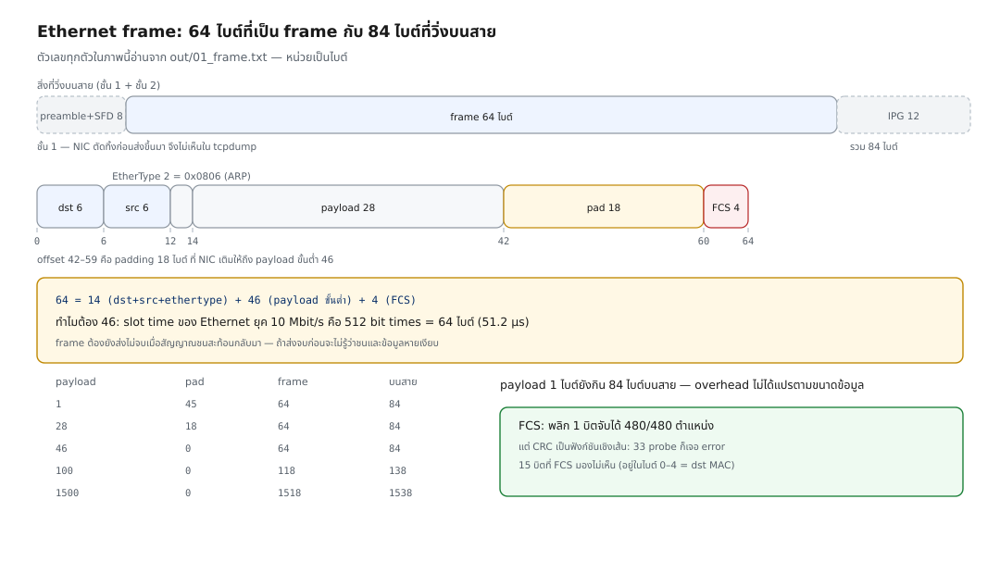
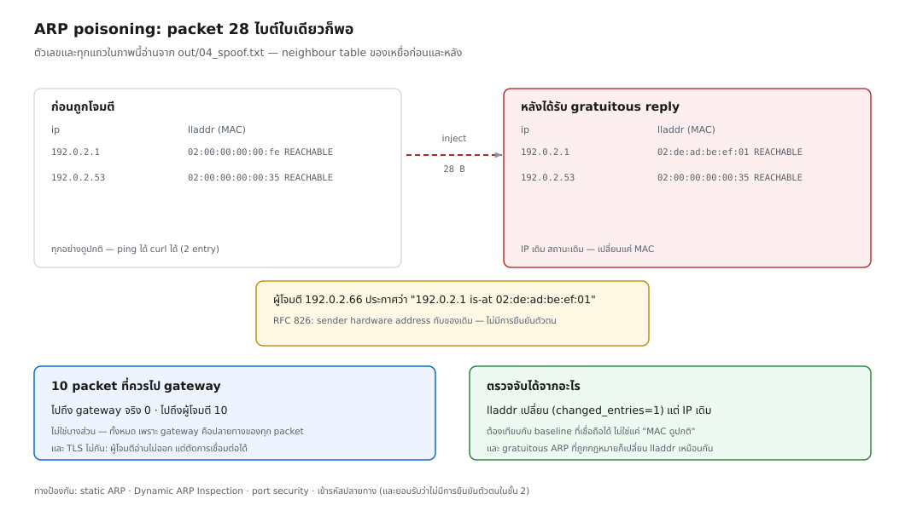
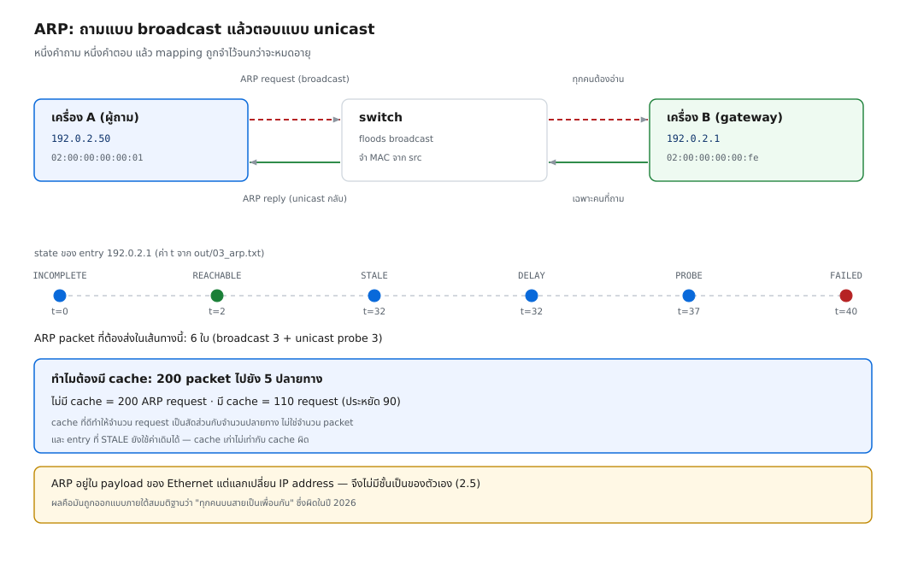

> 📅 เขียนเมื่อ: 18 พฤศจิกายน 2026 (เวลาไทย, UTC+7)
>
> **เครื่องที่รันบทนี้:** Raspberry Pi 5, Debian GNU/Linux 13 (trixie), kernel 6.18.60+rpt-rpi-2712, aarch64 · Go 1.24.4 · iproute2 6.15.0 · ภาพวาดด้วย `gen_svgs.py` และเรนเดอร์ด้วย `rsvg-convert` 2.60.0 — อะไรที่ซ้ำได้ทุกครั้งกับอะไรที่ตั้งใจให้เป็น snapshot ของจริง อธิบายไว้ในข้อ 5.7
>
> 🛡️ **จริยธรรม (ใช้กับทั้งซีรีส์):** การดัก packet การสแกน และการอ่านตาราง neighbour ของเครือข่าย ให้ทำกับ **เครื่องและเครือข่ายที่คุณควบคุมเอง** เท่านั้น ส่วน ARP poisoning ในบทนี้เป็น **การจำลองในหน่วยความจำ** ไม่มี packet ออกนอกโปรเซสแม้แต่ไบต์เดียว — และ `out/07_neigh.txt` ปิด MAC ของเพื่อนบ้านเหลือสามไบต์แรก (OUI) เพื่อไม่ให้บทความกลายเป็นที่เปิดเผยฮาร์ดแวร์ของคนอื่นในบ้าน

---

## 0. อาการที่ทำให้คนเสียเวลาครึ่งวัน: "Destination Host Unreachable"

มี incident ชนิดหนึ่งที่เกิดบ่อยจนผมเรียกได้ว่าเป็นคลาสสิกของ network: สายเสียบอยู่ การ์ดขึ้น `UP` (ธง `IFF_UP` ที่ผู้ดูแลเปิด interface ไว้) ที่อยู่ IP ก็ถูกต้อง แต่พอ `ping` ไปที่ gateway กลับได้ข้อความ `Destination Host Unreachable`

และข้อความนั้นเป็นสิ่งที่คนอ่านผิดบ่อยมาก: **มันไม่ใช่ข้อความจาก router ปลายทาง** มันคือประโยคที่ kernel ของเครื่องคุณส่งกลับมาเอง แปลว่า "ฉันหาคนที่จะเขียนชื่อบนซองไม่เจอ"

เรื่องนี้พาเราไปถึงจุดที่ต้องแม่นเรื่องคำตั้งแต่ต้น — และนี่คือสถานะจริงของเครื่องที่เขียนบท (เป็นเคสข้าง ๆ ที่เห็นความต่างของสองคอลัมน์ชัดกว่าอาการข้างบน: สายไม่ได้เสียบ)

```text
## สองคอลัมน์ที่คนอ่านสลับกันบ่อย: link state กับ IFF_UP
$ ip -brief link show eth0
eth0             DOWN           2c:cf:67:3a:37:88 <NO-CARRIER,BROADCAST,MULTICAST,UP> 
$ ip -brief link show wlan0
wlan0            UP             2c:cf:67:3a:37:89 <BROADCAST,MULTICAST,UP,LOWER_UP> 
$ ip -brief addr show wlan0
wlan0            UP             192.168.101.134/24 fe80::dd92:c603:4454:16bf/64 
```

เคสในตาราง: `eth0` ขึ้น `DOWN` ทั้งที่ในวงเล็บเหลี่ยมมี `UP` อยู่ ส่วน `wlan0` ขึ้น `UP` และมี `LOWER_UP` เพิ่มมา (ธง `IFF_RUNNING` ที่บอกว่ามี carrier) คอลัมน์ที่สองของ `ip -br link` คือ **link state** (มี carrier จริงไหม — carrier คือสัญญาณที่บอกว่าอีกฝั่งยังส่งสัญญาณมาอยู่) ไม่ใช่ `IFF_UP` (ผู้ดูแลเปิด interface ไว้ไหม) — สองอย่างนี้ไม่เหมือนกัน และคนที่อ่านผิดจะเสียเวลาไล่หาสาเหตุผิดที่ไปทั้งวัน (เราเคยพลาดจุดนี้มาก่อนในซีรีส์นี้ และกลับมาแก้ในข้อ 5.6)

นั่นคือคำตอบของทั้งบทนี้ในประโยคเดียว: **เครื่องคุณรู้ IP ปลายทาง แต่ไม่รู้ว่าจะเขียนชื่อใครหน้าซอง** และชื่อนั้นคือ MAC address ซึ่งได้มาจากโปรโตคอลที่เรียบง่ายที่สุดตัวหนึ่งในประวัติศาสตร์ — **ARP (Address Resolution Protocol)** โปรโตคอลที่มีหน้าที่เดียว: ถามทั้งวงว่า "ใครถือ IP นี้" แล้วจำ MAC ของคนที่ตอบไว้ใช้ครั้งต่อไป

ตอนที่แล้ว ([OSI กับ TCP/IP](/blog/post.html?slug=2026-11-17-network-07-osi-tcpip-model)) เราพูดถึง encapsulation ในระดับแนวคิด: ข้อมูลถูกห่อลงทีละชั้น และแต่ละชั้นอ่านแค่หัวของตัวเอง บทนี้เราจะเปิดหัวของชั้น 2 ออกมาดูทีละไบต์ และตอบสามคำถาม:

1. **frame ของ Ethernet ประกอบจากอะไร** — และทำไมมันมีขนาดขั้นต่ำที่ดูไม่สมเหตุสมผล (64 ไบต์) พร้อมคำอธิบายเชิงประวัติศาสตร์ที่ทำให้ตัวเลขนั้นสมเหตุสมผลทันที
2. **MAC address 48 บิตบอกอะไรได้** — สองบิตแรกของมันคืออะไร ทำไม `ff:ff:ff:ff:ff:ff` หมายถึง "ทุกคน" และทำไมที่อยู่ชนิดนี้ถึงเป็นปัญหาเชิงสถาปัตยกรรมเมื่อเครือข่ายใหญ่ขึ้น
3. **ARP แก้ปัญหาอะไร** — และทำไมโปรโตคอลที่ไม่มี authentication เลยสักไบต์ ถึงยังเป็นมาตรฐานที่ใช้อยู่จนถึงวันนี้ พร้อมช่องโหว่ที่มาพร้อมกับมัน

> ถ้ายังไม่คุ้นคำว่า **frame**: มันคือ "ก้อนข้อมูลของชั้น 2" — เหมือน packet ของชั้น 3 แต่คนละมุมมอง ([ตอนที่ 07](/blog/post.html?slug=2026-11-17-network-07-osi-tcpip-model) อธิบายเรื่องชื่อก้อนข้อมูลไว้ในข้อ 4.1) ส่วน **MAC address** คือที่อยู่ 48 บิตที่โรงงานฝังมากับการ์ดเน็ตเวิร์กแต่ละใบ

---

## 1. Ethernet frame: ชื่อบนซองจดหมาย

### 1.1 สิ่งที่ชั้น 2 ต้องทำได้มีสามอย่าง

ก่อนจะไล่ฟิลด์ ขอทวนงานของชั้น 2 จากตอนที่แล้วให้แน่นขึ้น เพราะฟิลด์ทุกตัวใน frame มีอยู่เพื่อทำงานสามอย่างนี้:

1. **Framing** — บอกว่า "ก้อนนี้เริ่มตรงไหน จบตรงไหน" บนสายที่ข้อมูลไหลต่อเนื่องไม่มีช่องว่าง
2. **Addressing ในระดับท้องถิ่น** — บอกว่า "ก้อนนี้เป็นของใคร" ด้วยที่อยู่ที่ไม่ต้องมีใครช่วยแปล
3. **Error detection** — บอกว่า "ก้อนนี้มาถึงครบและไม่เพี้ยนใช่ไหม"

และมีงานที่สี่ที่แอบอยู่ในข้อแรก: **บอกว่าข้างในคืออะไร** — เพราะ payload ของ frame หนึ่งใบอาจเป็น IPv4, IPv6, ARP หรือโปรโตคอลอื่นที่ไม่มีใครเคยได้ยินก็ได้

ฟิลด์ทั้งห้าชนิดใน Ethernet frame ครอบงานสี่ข้อนี้พอดี — และนั่นคือเหตุผลที่ frame ไม่มีฟิลด์ที่ "ไม่จำเป็น" เลย

### 1.2 สิ่งที่ไม่อยู่ใน frame: preamble, SFD และ IPG

ก่อนดูตารางฟิลด์ มีจุดที่ทำให้คนสับสนมากที่สุดเวลาอ่าน packet capture: **สองสิ่งแรกกับสิ่งสุดท้ายที่วิ่งบนสาย ไม่ได้เป็นส่วนของ frame** — preamble กับ SFD ที่นำหน้า และ IPG ที่ปิดท้าย

| ส่วน | ขนาด | ทำอะไร | เป็นของชั้นไหน |
|---|---|---|---|
| **preamble** | 7 ไบต์ (`55` × 7) | ให้การ์ดฝั่งรับจับจังหวะ clock ให้ตรงกับฝั่งส่ง (บิตสลับ 1/0) | ชั้น 1 |
| **SFD** (start frame delimiter) | 1 ไบต์ (`d5`) | บอกว่า "จบ preamble แล้ว เฟรมจริงเริ่มตรงนี้" | ชั้น 1 |
| **frame** | 64–1518 ไบต์ | สิ่งที่บทนี้พูดถึง | ชั้น 2 |
| **IPG** (interpacket gap) | 12 ไบต์ (96 bit times) | เว้นวรรคให้การ์ดอีกฝั่งหายใจก่อนเฟรมถัดไป | ชั้น 1 |

ผลที่ตามมาที่คุณเจอทุกวัน: **`tcpdump` และ Wireshark ไม่เคยแสดง preamble กับ SFD** เพราะการ์ดเน็ตเวิร์กตัดสองอย่างนั้นทิ้งตั้งแต่ก่อนส่งข้อมูลขึ้นมาชั้น 2 (มันเอาไปใช้จับ clock แล้วก็จบหน้าที่) การจะเห็นมันต้องใช้ hardware วิเคราะห์สัญญาณโดยเฉพาะ ซึ่งราคาต่างกันหลายหลัก

> ถ้าสงสัยว่าทำไม preamble ต้องมี: การ์ดฝั่งรับไม่ได้รู้ล่วงหน้าว่าอีกฝั่งจะเริ่มส่งเมื่อไร และ clock ของสองการ์ดไม่ตรงกันเป๊ะ ข้อมูล 56 บิตที่สลับ 1/0 ถี่ ๆ จึงทำหน้าที่เป็น "เสียงนับจังหวะ" ให้วงจรฝั่งรับล็อกความถี่ได้ก่อนไบต์แรกของ frame จะมาถึง[^1]

### 1.3 ทีละฟิลด์: frame ของ ARP request หนึ่งใบ

พอลงมือประกอบจริง ทุกอย่างชัดกว่าอ่านสเปก เดโมของบทนี้สร้าง ARP request หนึ่งใบขึ้นมาในหน่วยความจำ (เป็น frame ที่สั้นที่สุดชนิดหนึ่งที่คุณจะเจอบนเครือข่ายจริง) แล้วรายงานทุกฟิลด์พร้อม offset:

```text
## Ethernet II frame: ทีละฟิลด์ (ขนาดเป็นไบต์, offset นับจากต้น frame)
field       offset  bytes  value
preamble         -      7  55 55 55 55 55 55 55  (ชั้น 1 — ไม่นับเป็น frame)
sfd              -      1  d5                     (ชั้น 1 — ไม่นับเป็น frame)
dst              0      6  ff:ff:ff:ff:ff:ff
src              6      6  02:00:00:00:00:01
ethertype       12      2  0x0806 (ARP)
payload         14     28  ARP request: who-has 192.0.2.1 tell 192.0.2.50
pad             42     18  00 × 18 (เติมให้ถึง payload ขั้นต่ำ 46)
fcs             60      4  0x4afbdbda (ส่งแบบ little-endian: da db fb 4a)
```

อ่านทีละบรรทัด:

- **dst (6 ไบต์)** — MAC ของปลายทาง ในเคสนี้เป็น broadcast เพราะเรายังไม่รู้ว่าใครถือ IP `192.0.2.1`
- **src (6 ไบต์)** — MAC ของคนส่ง
- **ethertype (2 ไบต์)** — `0x0806` = ARP นี่คือ "ป้ายบอกว่าข้างในคืออะไร" ที่ผมพูดถึง — และมันคือจุดเดียวที่ชั้น 2 ยอมรับว่ามีชั้น 3 อยู่ข้างบน
- **payload** — ARP packet 28 ไบต์ (โครงสร้างอยู่ในข้อ 3)
- **pad (18 ไบต์)** — เติม `00` ให้ payload ถึง 46 ไบต์ เพราะ frame ต้องยาวอย่างน้อย 64 ไบต์ (เหตุผลในข้อ 1.4)
- **fcs (4 ไบต์)** — CRC-32 ของทุกไบต์ก่อนหน้า

ค่า EtherType ที่คุณจะเจอบ่อยมีไม่กี่ตัว: `0x0800` (IPv4), `0x0806` (ARP), `0x86dd` (IPv6), `0x8100` (VLAN tag — VLAN = virtual LAN, การแบ่งวงเสมือนบน switch เดียว) — ตัวสุดท้ายคือมาตรฐาน **802.1Q**: switch ใส่หัวเพิ่ม 4 ไบต์ — 2 ไบต์ TPID (tag protocol identifier — ค่าที่บอกว่าหัวนี้เป็น VLAN tag) ซึ่งก็คือ `0x8100` บวกอีก 2 ไบต์ที่บอก VLAN ID — เพื่อบอกว่า frame นี้เป็นของ VLAN ไหน เพราะ frame ยังต้องยาวอย่างน้อย 64 ไบต์เท่าเดิม payload ขั้นต่ำจึงลดจาก 46 เหลือ **42** (= 64 − 14 − 4 − 4) ตามที่มาตรฐานกำหนด

จุดที่ควรสังเกตในตาราง: **ฟิลด์ `pad` ไม่ใช่ฟิลด์จริงในมาตรฐาน** มันคือ "ไบต์ที่เติมเข้าไป" ซึ่ง NIC ฝั่งส่งเติมให้ และ NIC ฝั่งรับ **ไม่ตัดออก**[^14] — ผู้รับรู้ความยาวจริงของข้อมูลจากชั้นบน (IPv4 มี `total_length` ในหัวของตัวเอง) ไม่ใช่จากความยาว frame นี่คือตัวอย่างแรกของ "แต่ละชั้นอ่านแค่หัวของตัวเอง" ในบทนี้

### 1.4 ทำไม payload ต้องมีอย่างน้อย 46 ไบต์ (คำตอบอยู่ที่ปี 1980)

ตัวเลข 64 ไบต์ (และ 46 = 64 − 14 − 4) ไม่ได้มาจากความสวยงามทางวิศวกรรม มันมาจาก **ข้อจำกัดทางฟิสิกส์ของ Ethernet ยุคแรกที่ทุกเครื่องแชร์สายเส้นเดียวกัน** และมันเป็นตัวอย่างที่ดีของคำว่า "มาตรฐานคือการประนีประนอมที่แข็งตัว"

เรื่องมีอยู่ว่า Ethernet ยุคแรกใช้สาย coaxial ยาวเส้นเดียวร่วมกันทั้งวง และใช้วิธีแย่งสิทธิ์ส่งที่เรียกว่า **CSMA/CD** (Carrier Sense Multiple Access with Collision Detection — ฟังสายก่อนว่าว่าง ถ้าว่างจึงส่ง แล้วฟังต่อไปว่ามีใครส่งชนไหม) หัวใจของมันคือ: **คนส่งต้องยังส่งไม่จบ เมื่อสัญญาณชนเดินทางไปถึงอีกฝั่งแล้วสะท้อนกลับมา** — ถ้าส่งจบไปแล้วก่อนรู้ว่าชน เครื่องนั้นจะไม่รู้ว่าต้องส่งซ้ำ และข้อมูลจะหายเงียบ ๆ

ที่ 10 Mbit/s หนึ่งบิตกินเวลา 0.1 ไมโครวินาที (เรียกว่า **bit time**) มาตรฐานจึงกำหนด **slot time** ไว้ที่ 512 bit times = **51.2 ไมโครวินาที** — เป็นเพดานที่คิดเผื่อเวลาเดินทางไป-กลับบน coaxial ที่ใหญ่ที่สุดในยุคนั้นไว้แล้ว (ราว 2.5 กิโลเมตรเมื่อต่อ repeater (ตัวทวนสัญญาณ ที่รับบิตแล้วส่งต่อให้สดใหม่) ครบ รวม delay ของ repeater ด้วย) ไม่ใช่เวลาที่วัดได้จากสายเส้นใดเส้นหนึ่ง และ 512 บิตก็คือ **64 ไบต์** พอดี

ดังนั้น: **frame ต้องยาวอย่างน้อย 64 ไบต์ เพื่อให้ใช้เวลาส่งไม่น้อยกว่า slot time** และเมื่อหักหัว 14 ไบต์กับ FCS 4 ไบต์ออก payload จึงต้องมีอย่างน้อย **46 ไบต์** (หรือ 42 ไบต์ถ้ามี VLAN tag)

ขอบบนก็มี: **MTU** (Maximum Transmission Unit) คือ payload ใหญ่สุดที่ frame หนึ่งใบพาได้ — 1500 ไบต์สำหรับ Ethernet ปกติ เมื่อบวกหัว 14 กับ FCS 4 frame จึงยาวได้ถึง 1518 ไบต์

frame ที่สั้นกว่านี้ถูกเรียกว่า **runt frame** และส่วนใหญ่เกิดจากการชนกันกลางทาง — ซึ่งก็คือสิ่งที่กลไกนี้ถูกออกแบบมาให้จับได้นั่นเอง

ผลข้างเคียงที่คุณเจอจริงในชีวิต: **ทุกอย่างที่เล็กกว่า 46 ไบต์ต้องจ่าย 64 ไบต์** ส่งข้อมูล 1 ไบต์ก็ยังได้ frame 64 ไบต์ (และ 84 ไบต์เมื่อนับ preamble/SFD/IPG ที่วิ่งบนสายจริงด้วย) นี่คือเหตุผลเชิงตัวเลขที่ VoIP (Voice over IP — โทรศัพท์ที่วิ่งมาเป็น packet) ยุคแรกต้องรวมเสียงหลายตัวอย่าง (20 ms ต่อ packet) แทนที่จะส่งทีละ 1 ms — ไม่ใช่เพราะคุณภาพเสียง แต่เพราะ overhead ต่อ packet มันคงที่

```text
## padding: payload เล็กนิดเดียวก็ยังต้องกิน 64 ไบต์
payload_bytes pad_bytes frame_bytes on_wire_bytes
1                    45          64            84
28                   18          64            84
46                    0          64            84
100                   0         118           138
1500                  0        1518          1538
```

อ่านคอลัมน์ `pad_bytes`: payload 1 ไบต์ต้องเติม 45 ไบต์ — คิดเป็นราว 70% ของ frame 64 ไบต์ (หรือ 98% ของช่อง payload 46 ไบต์), 28 ไบต์เติม 18, และ 46 ไบต์ขึ้นไปไม่ต้องเติมเลย แต่สังเกตว่า frame ยังคง 64 ไบต์เท่ากันทั้งสามแถวแรก — **การเติมไม่ได้ทำให้ frame ใหญ่ขึ้น มันทำให้ frame ไม่เล็กเกินไป** ส่วน `on_wire_bytes` คือจำนวนไบต์ที่วิ่งบนสายจริงซึ่งมากกว่า frame เสมอ 20 ไบต์ (preamble 8 + IPG 12)

### 1.5 FCS: การตรวจที่พิสูจน์ได้ด้วยคณิตศาสตร์ ไม่ใช่ด้วยความเชื่อ

ช่อง 4 ไบต์ท้าย frame นี้เรียกว่า **FCS** (Frame Check Sequence) และค่าที่เก็บในนั้นคือ **CRC-32** (Cyclic Redundancy Check — การหารพหุนาม 32 บิตบน GF(2) ซึ่งเป็นฟิลด์เลขคณิตที่มีแค่ 0 กับ 1 — บวกคือ XOR) ทุกไบต์ของ frame ถูกนำไปคำนวณ CRC-32 แล้วเก็บผลไว้ท้าย frame 4 ไบต์ ผู้รับคำนวณใหม่แล้วเทียบ — ถ้าไม่ตรงก็ทิ้ง frame นั้น (ไม่มีการขอส่งซ้ำที่ชั้น 2; การส่งซ้ำเป็นงานของ TCP ที่ชั้น 4 ซึ่งเป็นเหตุผลที่ TCP ยังต้องมีแม้ Ethernet จะตรวจ error แล้ว)

เดโมของเราไม่ได้ "เชื่อ" ว่า CRC ทำงาน มัน**วัด**:

```text
## FCS: CRC-32 คำนวณจากไบต์จริง แล้วตรวจด้วย residue (ไม่ใช่เทียบค่าที่จำมา)
fcs=0x4afbdbda
residue=0x2144df1c
fcs_verify=ok
single_bit_positions=480
single_bit_caught=480
```

สามบรรทัดสำคัญ:

- `fcs=0x4afbdbda` — ค่าที่คำนวณได้จากไบต์จริงของ frame ใบนี้
- `residue=0x2144df1c` — ถ้าคุณคำนวณ CRC ของ (frame + FCS ที่ถูกต้อง) ผลจะได้ **ค่าคงที่ค่าหนึ่งเสมอ ไม่ว่าจะเป็น frame อะไร** นี่คือวิธีที่ผู้รับตรวจโดยไม่ต้องรู้ว่า FCS ที่ถูกต้องควรเป็นเท่าไร: คำนวณใหม่ทั้งใบ ถ้าได้ `0x2144df1c` แปลว่าผ่าน[^2]
- `single_bit_positions=480` กับ `single_bit_caught=480` — เดโมพลิกหนึ่งบิต **ทุกตำแหน่งที่เป็นไปได้** (60 ไบต์ × 8 บิต = 480 ตำแหน่ง โดย 60 = frame 64 หัก FCS 4 ไบต์ เพราะ FCS เองไม่ใช่ข้อมูลที่ถูกตรวจ) แล้วนับว่าจับได้กี่ตำแหน่ง ผลคือจับได้ทั้งหมด ไม่ใช่ "ส่วนใหญ่"

และเมื่อพลิกหนึ่งบิตจริง ๆ ผลลัพธ์หน้าตาแบบนี้:

```text
## พลิกหนึ่งบิต: frame ที่ได้ยังยาวเท่าเดิม แต่ FCS ไม่ผ่าน
flipped_bit=byte 30 bit 3
fcs_after_flip=0x4afbdbda
residue_after_flip=0xde2750ed
fcs_verify_after_flip=bad
```

`fcs_after_flip` ยังเป็น `0x4afbdbda` เท่าเดิม (เพราะเราไม่ได้แก้ FCS) แต่ `residue_after_flip` เปลี่ยนไปเป็นค่าที่ไม่ใช่ `0x2144df1c` → `fcs_verify_after_flip=bad` ผู้รับจึงทิ้ง frame นี้ทันที

นี่คือทั้งหมดที่ FCS ทำ และมันทำได้ดีมากในราคา 4 ไบต์ — **แต่มีอีกครึ่งหนึ่งของเรื่องที่คนมักเข้าใจผิด** ซึ่งจะทำให้คุณมอง security ของชั้น 2 ต่างออกไปทั้งหมด

### 1.6 FCS ไม่ใช่ลายเซ็น (และนี่คือช่องที่คนร้ายใช้)

ถ้า CRC จับ error ได้ทุกบิต แล้วทำไมเรายังต้องมี checksum ที่ชั้น 3 กับชั้น 4 อีก? เพราะ FCS เป็นการตรวจ **hop-by-hop** ไม่ใช่ end-to-end: switch แบบ store-and-forward รับ frame ครบก่อน **ตรวจ FCS แล้วทิ้ง frame ที่เสียไปเลย** (มันไม่คำนวณ FCS ใหม่ ยกเว้นกรณีที่ตัวมันเองแก้หัว frame เช่น ใส่หรือถอด VLAN tag ซึ่งทำให้ต้องคำนวณใหม่ทั้งใบ) ส่วน switch แบบ cut-through เริ่มส่งต่อทันทีที่อ่านหัวเสร็จ **โดยไม่ตรวจ FCS เลย** — frame ที่เสียจึงลามไปถึง hop ถัดไปได้ก่อนที่ใครจะทิ้งมัน

จุดที่ FCS เอาไม่อยู่จริง ๆ คือ **router**: มันถอด frame ชั้น 2 ออกทั้งใบ (FCS หายไปพร้อมกัน) แล้วประกอบ frame ใหม่สำหรับ hop ถัดไป ถ้าบิตเพี้ยนตอนข้อมูลอยู่ในหน่วยความจำของ router frame ใหม่ก็คำนวณ FCS จากข้อมูลที่เพี้ยนแล้ว — FCS ของ hop ใหม่จึง **ถูกต้อง** และปลายทางก็ไม่รู้เรื่อง นี่คือเหตุผลจริงที่ต้องมี checksum ชั้น 3/4 ไว้ตรวจแบบ end-to-end

แต่มีเหตุผลที่ลึกกว่านั้น และมันสำคัญต่อความปลอดภัย: **CRC เป็นฟังก์ชันเชิงเส้น** แปลว่ามันจับ error แบบสุ่มได้ดีมาก แต่ไม่สามารถต้านทานคนที่**เลือก** error เองได้เลย

เดโมพิสูจน์ข้อนี้ด้วยการหา "จุดบอด" ของ FCS ด้วยพีชคณิตเชิงเส้น:

```go
func findBlindSpot(frame []byte) (mask []byte, probes int, err error) {
	// 1) n = จำนวนบิตที่ CRC ครอบคลุม (frame ทั้งใบหัก FCS 4 ไบต์) และ CRC ของข้อมูลตั้งต้น
	n := (len(frame) - ethFCSLen) * 8
	base := crc32.ChecksumIEEE(frame[:len(frame)-ethFCSLen])
	type basis struct {
		vec  uint32
		mask []byte
	}
	var bs [32]*basis
	mask = make([]byte, len(frame))
	// 2) probe ทีละตำแหน่งบิต: พลิกบิต pos แล้วดูว่า CRC เปลี่ยนไปเท่าไร
	//    ผลต่างคือ CRC(เดิม) XOR CRC(ที่พลิก) — บน GF(2) การบวกคือ XOR ไม่มีตัวทด
	for pos := 0; pos < n; pos++ {
		probes++
		v := base
		cp := append([]byte(nil), frame[:len(frame)-ethFCSLen]...)
		cp[pos/8] ^= 1 << (pos % 8)
		v ^= crc32.ChecksumIEEE(cp)
		m := make([]byte, len(frame))
		m[pos/8] = 1 << (pos % 8)
		// 3) Gaussian elimination: เก็บเวกเตอร์ไว้ที่ pivot = บิตสูงสุดของมัน (bs[piv])
		//    ถ้ามี pivot ซ้ำก็ XOR กับตัวที่เก็บไว้ แล้วไล่ลงไปจนเจอ pivot ใหม่หรือเหลือศูนย์
		for v != 0 {
			piv := bitsLen32(v) - 1
			if bs[piv] == nil {
				bs[piv] = &basis{vec: v, mask: m}
				v = 0
				m = nil
				break
			}
			v ^= bs[piv].vec
			for i := range m {
				m[i] ^= bs[piv].mask[i]
			}
		}
		// 4) m ยังไม่เป็น nil = เวกเตอร์ลดเหลือศูนย์ → บิตชุดนี้คือ error ที่ CRC มองไม่เห็น
		//    (คืน mask เป็นไบต์ เพื่อรายงานด้วยว่าไปโดนไบต์ไหนของ frame)
		if m != nil {
			return m, probes, nil
		}
	}
	return nil, probes, errors.New("ไม่พบ blind spot — เป็นไปไม่ได้ทางคณิตศาสตร์สำหรับ frame ที่ยาวกว่า 4 ไบต์")
}
```

โค้ดแบ่งเป็นสี่บล็อกตามคอมเมนต์เลขในฟังก์ชัน:

1. **`n := (len(frame)-ethFCSLen) * 8`** — จำนวนบิตที่ CRC ครอบคลุม (frame ทั้งใบหัก FCS 4 ไบต์) พร้อม `base` = CRC ของข้อมูลตั้งต้น
2. **ลูป `pos`** — พลิกบิตเดียวที่ตำแหน่ง `pos` (`cp[pos/8] ^= 1 << (pos % 8)`) แล้วเอา `v ^= crc32.ChecksumIEEE(cp)` เป็นผลต่างของ CRC: เวกเตอร์ 32 บิตหนึ่งตัวต่อหนึ่งตำแหน่ง
3. **`bs[piv]`** — Gaussian elimination: เก็บเวกเตอร์ไว้ที่ pivot (บิตสูงสุดของมัน) ถ้า pivot ซ้ำก็ XOR กับตัวที่เก็บไว้แล้วไล่ลงไปจนเหลือศูนย์หรือเจอ pivot ใหม่
4. **`if m != nil`** — `m` ไม่ถูกทำให้เป็น nil แปลว่าเวกเตอร์ลดเหลือศูนย์: บิตชุดนั้นคือ error ที่ CRC มองไม่เห็น และ `m` ถูกคืนกลับมาเป็น mask ระดับไบต์เพื่อรายงานว่าจุดบอดไปโดนไบต์ไหน

หลักการมีสามขั้น:

1. **CRC เป็นฟังก์ชันเชิงเส้น** จากข้อมูล n บิตไปยังผลลัพธ์ 32 บิต — ในทางคณิตศาสตร์มันจึง**ต้องมี**ทิศทางที่ถูกทำให้เป็นศูนย์ เรียกว่า null space (คนละคำกับ kernel ของ OS) ขนาด n − 32 บิต
2. **วัดทีละบิต**: พลิกบิตเดียวที่ตำแหน่ง i แล้วคำนวณ CRC ใหม่ ผลต่างจากค่าเดิมคือเวกเตอร์ 32 บิตหนึ่งตัวต่อหนึ่งตำแหน่ง — เดินให้ครบก็ได้เวกเตอร์ n ตัว
3. **ทำ Gaussian elimination** บนเวกเตอร์เหล่านั้น โดย "บวก" ในพีชคณิตนี้คือ **XOR** (ไม่มีตัวทดเหมือนเลขฐานสิบ) — พอมีเวกเตอร์มากกว่า 32 ตัว มันต้องมีชุดที่รวมกันได้ศูนย์ และชุดนั้นคือ error pattern ที่ FCS มองไม่เห็น

```text
## CRC ไม่ใช่ลายเซ็น: หา error ที่ FCS มองไม่เห็นด้วยพีชคณิตเชิงเส้น
crc_bits=32
probes_used=33
undetected_error_bits=15
undetected_error_bytes=5
undetected_byte_span=0..4
forged_fcs_ok=ok
fcs_before=0x4afbdbda
fcs_after_forgery=0x4afbdbda
bytes_changed=5
dst_mac_changed=1
payload_changed=0
```

`probes_used=33` คือจำนวน**ตำแหน่งบิต**ที่ถูก probe ไม่ใช่จำนวนครั้งที่คำนวณ CRC — โค้ดคำนวณ CRC หนึ่งครั้งเป็นฐานก่อนเข้าลูป แล้วอีกหนึ่งครั้งต่อ probe รวม 34 ครั้ง และ `undetected_error_bits=15` คือ error ที่แก้ไป 15 บิตกระจายใน 5 ไบต์ โดยที่ `fcs_after_forgery` **เท่ากับค่าเดิมทุกหลัก**

และบรรทัดที่ผมชอบที่สุดคือ `undetected_byte_span=0..4` — จุดบอดที่อัลกอริทึมหาเจอ **อยู่ในห้าไบต์แรกของ frame** ซึ่งคือห้าไบต์แรกของ **destination MAC** (ฟิลด์นี้ยาว 6 ไบต์ — ไบต์ที่หกไม่ถูกแตะ) นั่นแปลว่าคนที่ตั้งใจสามารถเปลี่ยน frame ใบนี้ให้ไปหาเครื่องอื่น โดยที่ FCS ยังตรวจผ่านทุกประการ (และถ้าคุณสงสัยว่าทำไมมันไปตกที่ฟิลด์แรก: เพราะอัลกอริทึมหา dependency ตัวแรกจากบิตต้น ๆ ของ frame เสมอ — บิตที่อยู่ใกล้จุดเริ่มต้นจึงเป็นที่ที่มันเจอก่อน)

อ่านสามบรรทัดสุดท้ายให้ดี: `forged_fcs_ok=ok` — frame ที่ถูกแก้แล้วผ่านการตรวจ FCS อย่างสมบูรณ์ · `dst_mac_changed=1` — ไบต์ที่ถูกแก้อยู่ใน dst MAC จริง · `payload_changed=0` — ข้อมูลข้างในไม่ถูกแตะเลย (ทั้งสามค่าวัดจากไบต์จริงของ frame ไม่ได้พิมพ์เป็นค่าคงที่)

นี่ไม่ใช่ช่องโหว่ของ Ethernet (มันไม่ได้ถูกออกแบบมาเพื่อกันคนร้าย) แต่เป็นบทเรียนที่สำคัญมาก: **การตรวจ error กับการพิสูจน์ตัวตนเป็นคนละเรื่อง** และคนที่อ่านสเปกไม่ครบมักสับสนสองอย่างนี้[^3] เราจะกลับมาเรื่องนี้ในข้อ 4 เมื่อพูดถึง ARP poisoning ซึ่งใช้หลักการเดียวกันในอีกระดับ

ก่อนขึ้นชั้นถัดไป คำถามที่ค้างอยู่มีข้อเดียว: ถ้าเปลี่ยน MAC ปลายทางได้โดยที่ FCS ไม่รู้เรื่อง **MAC address คืออะไรกันแน่ และทำไมมันถึงปลอมได้ง่ายขนาดนั้น**



---

## 2. MAC address: 48 บิตที่ซ่อนป้ายไว้ในไบต์แรก

### 2.1 กายวิภาคของที่อยู่

MAC address คือเลข 48 บิต (6 ไบต์) ที่โรงงานฝังมากับการ์ดแต่ละใบ และมันถูกออกแบบให้ **ไม่ต้องมีใครช่วยแปล** — การ์ดอ่านหัว frame แล้วตัดสินใจได้เองว่าจะรับหรือทิ้ง โดยไม่ต้องถามใคร

โครงสร้างของมันแบ่งเป็นสองซีก:

| ส่วน | บิต | ใครกำหนด | ใช้ทำอะไร |
|---|---|---|---|
| **OUI** (Organizationally Unique Identifier) | 24 บิตแรก | IEEE แจกให้ผู้ผลิต | บอกว่า "การ์ดนี้มาจากใคร" |
| **NIC specific** | 24 บิตหลัง | ผู้ผลิตกำหนดเอง | บอกว่า "ใบไหนของผู้นั้น" |

แต่ความจริงที่คนมักไม่รู้คือ **24 บิตแรกไม่ใช่ OUI เต็ม ๆ** — สองบิตล่างของไบต์แรกถูกใช้เป็น "ป้าย" และผู้ผลิตไม่ได้ใช้มันฟรี:

- **bit 0 (I/G — Individual/Group)**: `0` = ที่อยู่ของเครื่องเดียว (unicast), `1` = ที่อยู่ของกลุ่ม (multicast หรือ broadcast)
- **bit 1 (U/L — Universal/Local)**: `0` = ที่อยู่ที่ IEEE แจกมา (โรงงานตั้ง), `1` = ที่อยู่ที่คนตั้งเอง (software ตั้งทับได้)

เพราะสองบิตนี้อยู่ในไบต์แรก และ Ethernet ส่งบิตในไบต์จากบิตล่างขึ้นบน (LSB first) มันจึงเป็น **สองบิตแรกที่การ์ดฝั่งรับเห็น** — การ์ดสามารถตัดสินใจได้ตั้งแต่ยังอ่านที่อยู่ไม่ครบ 48 บิต ซึ่งเป็นรายละเอียดที่วิศวกรฮาร์ดแวร์ออกแบบไว้ให้เร็วขึ้นจริง ๆ[^4]

### 2.2 อ่านป้ายจากเลขฐาน 16 หลักเดียว

เพราะสองบิตนั้นอยู่ที่ตำแหน่งบิต 0 และ 1 ของไบต์แรก คุณจึงดู **เลขฐาน 16 หลักสุดท้ายของไบต์แรก** ตัวเดียวก็รู้ประเภทแล้ว:

```text
## ไบต์แรกบอกประเภทได้จากเลขฐาน 16 หลักสุดท้ายหลักเดียว
first_octet_low_nibble I/G        U/L       kind
0,4,8,c                individual universal unicast
1,5,9,d                group      universal multicast
2,6,a,e                individual local     unicast
3,7,b,f                group      local     multicast
```

ตารางนี้คำนวณจากบิตจริงในโค้ด ไม่ได้พิมพ์ไว้ (`0,4,8,c` คือเลขที่บิต 0 กับ 1 เป็น `00` นั่นเอง) และมันเป็นเครื่องมือ debug ที่ใช้บ่อยกว่าที่คิด: เห็น `01:00:5e:...` ก็รู้ทันทีว่าเป็น multicast โดยไม่ต้องเปิดอะไร

ทีนี้ดูที่อยู่หกใบที่เดโมจำแนก — ของจริงมีสองใบ: MAC ของการ์ด Wi-Fi ในเครื่องที่เขียนบท (`2c:cf:67:3a:37:89`) และ `01:00:5e:00:00:fb` ซึ่งเป็น multicast ที่อุปกรณ์ในบ้านใช้จริง (mDNS, 224.0.0.251) ที่เหลืออีกสี่ใบเป็นค่าสมมติกับกรณีพิเศษ: MAC ที่เดโมสร้างเอง (`02:00:00:00:00:01`), IPv6 all-nodes multicast (`33:33:00:00:00:01`), MAC ของผู้โจมตีในข้อ 4 (`de:fe:de:ea:8f:b8`) และ broadcast

```text
## MAC address 48 บิต: ไบต์แรกคือป้ายที่บอกทุกอย่างที่เหลือ
address             octet0  I/G         U/L        kind        oui
02:00:00:00:00:01   0x02    individual  local      unicast     02:00:00
2c:cf:67:3a:37:89   0x2c    individual  universal  unicast     2c:cf:67
01:00:5e:00:00:fb   0x01    group       universal  multicast   01:00:5e
33:33:00:00:00:01   0x33    group       local      multicast   33:33:00
de:fe:de:ea:8f:b8   0xde    individual  local      unicast     de:fe:de
ff:ff:ff:ff:ff:ff   0xff    group       local      broadcast   ff:ff:ff
```

อ่านสามแถวที่ควรสนใจ:

- `02:00:00:00:00:01` — `0x02` = `00000010` → I/G=0 (unicast), U/L=1 (**local**) นี่คือ MAC ที่เดโมใช้ และมันเป็น local โดยตั้งใจ: ที่อยู่ในช่วงนี้ไม่ตรงกับการ์ดจริงของใครบนโลก และ MAC แบบ local คือสิ่งที่ hypervisor (ชั้นซอฟต์แวร์ที่รัน VM) สร้างให้ VM — QEMU/KVM ขึ้นต้นด้วย `52:54:00`, Docker ขึ้นต้นด้วย `02:42:` (แต่ละเจ้าเลือก OUI ของตัวเอง ไม่ใช่ค่าเดียวกันทั้งโลก)
- `2c:cf:67:3a:37:89` — นี่คือ MAC จริงของการ์ด Wi-Fi ในเครื่องที่เขียนบท (U/L=0 คือ IEEE แจกมา) เราใช้มันในข้อ 2.5
- `ff:ff:ff:ff:ff:ff` — `0xff` = `11111111` → group + local + **ทุกบิตเป็น 1** นี่คือ broadcast: ที่อยู่กลุ่มที่ **ทุกการ์ดในวงต้องรับ** ไม่มีใครกรองได้

### 2.3 broadcast และ multicast ต่างกันตรงไหน

ทั้งสองอย่างเป็น "group address" (I/G = 1) แต่พฤติกรรมต่างกัน:

- **broadcast** (`ff:ff:ff:ff:ff:ff`) — ส่งถึงทุกคนใน **broadcast domain** (วงที่ frame วิ่งถึงกันได้โดยไม่ผ่าน router) ไม่มีใครเลือกไม่รับได้ นี่คือเหตุผลที่ broadcast เยอะเกินไปทำให้ทั้งวงช้า และเป็นเหตุผลที่ ARP request ต้องเป็น broadcast
- **multicast** (ที่อยู่กลุ่มอื่น ๆ) — ส่งถึงเฉพาะคนที่ "สมัคร" รับกลุ่มนั้น การ์ดกรองได้ด้วย hardware filter (รายการ MAC กลุ่มที่ต้องการรับ) ส่วนที่เหลือตัดทิ้งก่อนถึง CPU

multicast ของ IPv4 มีรูปแบบการแปลงที่ตายตัว: เอา **23 บิตล่าง** ของ IP ไปต่อท้าย prefix `01:00:5e` — ในทางปฏิบัติคือเอาไบต์ที่ 2, 3, 4 ของ IP มาต่อ แต่ **ตัดบิตบนสุดของไบต์ที่สองทิ้ง** เพราะ 23 = 7 + 8 + 8 (โค้ดอยู่ข้อ 5.3: `b[1] & 0x7f`)

```text
## IPv4 multicast จับลง MAC แบบ 01:00:5e + 23 บิตล่างของ IP
ipv4             mac
224.0.0.1        01:00:5e:00:00:01
224.0.0.251      01:00:5e:00:00:fb
239.255.255.250  01:00:5e:7f:ff:fa
```

สังเกตว่า IP multicast มี 28 บิตที่แปรได้ (224.0.0.0/4) แต่ MAC มีที่ให้แค่ 23 บิต แปลว่า **IP 32 ตัวใช้ MAC เดียวกัน** — การ์ดจึงต้องรับมาแล้วให้ซอฟต์แวร์กรองซ้ำอีกรอบ นี่คือตัวอย่างที่ดีของคำว่า "ที่อยู่สองชั้นไม่ได้ map กันแบบหนึ่งต่อหนึ่ง" และเป็นเหตุผลที่เครื่องหนึ่งสามารถเห็น multicast packet ที่ไม่ได้ขอได้[^5]

### 2.4 ทำไม MAC ถึงไม่ scalable (และนี่คือเหตุผลที่ต้องมี ARP)

ถึงตรงนี้ MAC ดูเป็นที่อยู่ที่สมบูรณ์แบบ: ไม่ต้องมีใครช่วยแปล, การ์ดตัดสินใจเองได้, มีเจ้าของชัดเจน แต่มีปัญหาเชิงสถาปัตยกรรมหนึ่งข้อที่ใหญ่พอจะอธิบายทั้ง internet:

**MAC address ไม่มีลำดับชั้น (flat)** — มันไม่บอกอะไรเลยว่าอยู่ที่ไหนในโลก เลข 48 บิตนั้นสุ่มกระจายตามผู้ผลิต ไม่ได้เรียงตามภูมิศาสตร์หรือโครงสร้างเครือข่าย

ผลที่ตามมาคือ อุปกรณ์ที่ต้องส่งต่อ frame ต้อง**จำทุกที่อยู่ที่เคยเห็น** ไม่มีทางสรุปเป็นกลุ่มได้:

```text
## MAC เป็นที่อยู่แบบแบน (flat) — ไม่มีลำดับชั้นให้สรุปเหมือน IP
hosts_in_lan=254
switch_forwarding_entries=254
router_prefix_entries=1
```

`switch_forwarding_entries=254` กับ `router_prefix_entries=1` คือตัวเลขของแบบจำลอง (ผมตั้งให้เห็นภาพ) แต่รูปของมันตรงกับของจริง: เครื่อง 254 เครื่องในวงเดียวทำให้ switch ต้องจำ 254 รายการ แต่ router ที่ดูแลเครือข่ายเดียวกันนั้นจำแค่ **หนึ่ง prefix** (`192.168.1.0/24`) เพราะ IP address **มีลำดับชั้น** — บิตซ้ายบอกเครือข่าย บิตขวาบอกเครื่อง

และนี่คือคำตอบของคำถามที่ว่า "ทำไม internet ไม่ใช้ MAC address หาที่อยู่กันไปเลย": ถ้าใช้ MAC เป็นที่อยู่ปลายทาง router ทั่วโลกต้องจำ MAC ของทุกเครื่องบนโลก (หลายพันล้านรายการ) และเมื่อการ์ดเสียแล้วเปลี่ยนใบ ที่อยู่ปลายทางก็เปลี่ยนตามจนระบบพัง — IP address แก้ปัญหานี้ด้วยการเป็น **ที่อยู่เชิงตรรกะที่ผูกกับเครือข่าย ไม่ผูกกับฮาร์ดแวร์**

ส่วน MAC ยังทำงานของมันในขอบเขตที่มันเหมาะ: **ภายในวงเดียว (local scope)** และนี่คือข้อความที่ควรจำ: **IP address มีความหมายทั้งโลก, MAC address มีความหมายแค่ในวงที่ frame วิ่งถึง** — สองเครื่องคนละทวีปใช้ MAC ซ้ำกันได้โดยไม่มีปัญหาใด ๆ เพราะ frame ไม่เคยข้าม ocean โดยตรง

### 2.5 MAC จริงของเครื่องนี้ และสิ่งที่มันบอก

เดโมของบทนี้อ่าน MAC ของการ์ดจริงในเครื่อง (ผ่าน `net.Interfaces` ของ Go ซึ่งอ่านจาก kernel โดยตรง ไม่ต้องมีสิทธิ์พิเศษ):

```text
## MAC จริงของการ์ดในเครื่องนี้ (net.Interfaces — อ่านค่า ไม่ต้อง root)
iface=wlan0
mac=2c:cf:67:3a:37:89
octet0=0x2c
ig=individual
ul=universal
oui=2c:cf:67
mtu=1500
flags=up|broadcast|multicast|running
```

`octet0=0x2c` = `00101100` → I/G=0, U/L=0 คือ **unicast + universal** และ `oui=2c:cf:67` คือรหัสผู้ผลิตที่ IEEE แจก

และต่อไปนี้คือสิ่งที่ควรทำให้คุณหยุดคิดสักครู่: MAC address **ไม่ใช่ข้อมูลที่เชื่อถือได้** เพราะมันถูกเปลี่ยนได้ด้วยคำสั่งเดียว:

```bash
sudo ip link set dev wlan0 address 02:00:00:00:00:99
```

⚠️ ถ้าลองเอง: คำสั่งนี้ทำให้ **Wi-Fi หลุดการเชื่อมต่อทันที** เพราะการ์ดต้อง associate (จับคู่กับ access point) ใหม่ด้วย MAC ใหม่ และถ้า MAC ที่ตั้งซ้ำกับเครื่องอื่นในวง ทั้งคู่จะแย่งกันจนใช้งานไม่ได้ วิธีเปลี่ยนคืนคือสั่งคำสั่งเดิมด้วย MAC เดิมของตัวเอง (`sudo ip link set dev wlan0 address 2c:cf:67:3a:37:89`) หรือรีบูตเพื่อให้ไดรเวอร์กลับไปใช้ค่าจากฮาร์ดแวร์

ไม่มี auth ไม่มี signature ไม่มีใครตรวจว่าคุณเป็นเจ้าของ OUI นั้นหรือเปล่า และนี่ไม่ใช่ช่องโหว่ — มันเป็นคุณสมบัติ: มันมีไว้ให้ VM, container และเครื่องที่ต้องย้าย MAC ตาม failover ใช้งานได้ ในปี 2026 มือถือส่วนใหญ่สุ่ม MAC แยกตามแต่ละเครือข่าย (per-SSID) และเปลี่ยนเป็นครั้งคราว ไม่ใช่ค่าคงที่จากฮาร์ดแวร์อีกต่อไป ([RFC 9797](https://www.rfc-editor.org/rfc/rfc9797) อธิบายหลักการนี้ไว้) ซึ่งทำให้ "MAC บอกว่าเป็นอุปกรณ์อะไร" กลายเป็นข้อสันนิษฐานที่อันตรายขึ้นทุกปี[^6]

จำสามข้อนี้ไว้ เพราะมันจะกลับมาในข้อ 4: **MAC ปลอมได้, MAC ไม่มีลำดับชั้น, และไม่มีอะไรในชั้น 2 ยืนยันตัวตน**

---

## 3. ARP: จาก IP ไป MAC

### 3.1 ปัญหาที่ต้องแก้: ชั้น 3 รู้ปลายทาง แต่ชั้น 2 ต้องได้ชื่อ

ลองไล่เส้นทางการส่ง packet ของคุณเอง:

1. คุณสั่ง `curl https://example.test` → kernel ตัดสินใจว่า packet นี้ต้องออกทาง `wlan0`
2. kernel เปิดดูตาราง route → เจอ `default via 192.0.2.1` → **next hop คือ IP ของ router**
3. kernel สร้าง IPv4 packet ที่มี `dst=203.0.113.7` (ปลายทางจริง) แต่ **ต้องส่ง frame ใบนี้ไปหา MAC ของ 192.0.2.1** (router)
4. และตรงนี้เองที่ปัญหาอยู่: kernel รู้ IP ของ next hop แต่ **ไม่รู้ MAC ของมัน**

ทำไมต้องเป็น MAC ของ router ไม่ใช่ MAC ของปลายทาง? เพราะ **MAC มีความหมายแค่ในวงเดียว** — ปลายทางจริงอยู่คนละวง frame ที่ใส่ MAC ของปลายทางจึงไม่มีความหมายกับใครที่อยู่ระหว่างทาง ส่วน MAC ของ router คือที่อยู่ของ "คนที่รับช่วงต่อ" ในวงนี้ packet จึงถูกส่งไปที่ router ก่อน แล้ว router ค่อยประกอบ frame ใหม่สำหรับวงถัดไป (นี่คือข้อสรุปของข้อ 2.4 ที่ว่า MAC มีความหมายแค่ local scope)

```text
## ปัญหา: รู้ IP แต่เขียน frame ไม่ได้
dst_ip=192.0.2.1
dst_mac=? (ตารางยังว่าง)
frame_buildable=0
```

`frame_buildable=0` คือสถานะที่โปรแกรมเมอร์ network ทุกคนเคยเจอในรูปแบบใดรูปแบบหนึ่ง: ข้อมูลครบทุกอย่างยกเว้นชื่อที่จะเขียนบนซอง

ARP (Address Resolution Protocol) แก้ปัญหานี้ด้วยไอเดียที่เรียบง่ายจนน่าตกใจ: **ถามทั้งวงว่า "ใครถือ IP นี้" แล้วรอคนที่ใช่ตอบกลับมา** — ไม่มี server, ไม่มี hierarchy, ไม่มี authentication

### 3.2 รูปร่างของ ARP packet: 28 ไบต์ที่เปลี่ยนทุกอย่าง

ARP packet บน Ethernet + IPv4 มี 28 ไบต์ ตาม **RFC 826** (RFC = Request for Comments — เอกสารมาตรฐานของ IETF ที่ระบุว่าโปรโตคอลหนึ่งทำงานอย่างไร; เลข 826 คือลำดับของเอกสาร ไม่ใช่เลขมาตรฐาน ISO) และฟิลด์ของมันออกแบบมาให้ขยายไปใช้กับเครือข่ายอื่นได้ (เช่น ATM (เทคโนโลยีเครือข่ายแบบ cell ความเร็วสูง — ไม่ใช่ตู้ ATM) หรือ packet radio ในยุคนั้น):

ชื่อฟิลด์ในตารางใช้สัญกรณ์ของสเปกเป๊ะ ๆ — `ar$hrd`, `ar$spa` ฯลฯ โดย `ar$` เป็น **ส่วนหนึ่งของชื่อ** (ar = ARP, `$` เป็นตัวคั่นที่เอกสารต้นฉบับใช้) ไม่ใช่ตัวแปรหรือที่อยู่ในโค้ด

| ฟิลด์ | ไบต์ | ค่าในเดโม | ความหมาย |
|---|---|---|---|
| `ar$hrd` (hardware type) | 2 | 1 | 1 = Ethernet |
| `ar$pro` (protocol type) | 2 | `0x0800` | โปรโตคอลที่ต้องการแปลงที่อยู่ (IPv4) |
| `ar$hln` | 1 | 6 | ความยาว hardware address |
| `ar$pln` | 1 | 4 | ความยาว protocol address |
| `ar$op` | 2 | 1 = request, 2 = reply | คำสั่ง |
| `ar$sha` | 6 | `02:00:00:00:00:01` | MAC ของคนส่ง |
| `ar$spa` | 4 | `192.0.2.50` | IP ของคนส่ง |
| `ar$tha` | 6 | `00:00:00:00:00:00` | MAC เป้าหมาย (ศูนย์ = ยังไม่รู้) |
| `ar$tpa` | 4 | `192.0.2.1` | IP เป้าหมาย |

รวม 28 ไบต์พอดี และเมื่อห่อด้วยหัว Ethernet 14 ไบต์ + padding 18 + FCS 4 ก็ได้ frame 64 ไบต์ที่เราเห็นในข้อ 1.3

โค้ดที่ประกอบมันคือการเขียนไบต์ลงสไลซ์ตามลำดับ — และจุดที่ต้องระวังคือ **big-endian ทุกฟิลด์** เพราะ network byte order ไม่ตรงกับ CPU ที่เราใช้:

```go
func (a arpPacket) marshal() ([]byte, error) {
	if a.HLen != 6 || a.PLen != 4 {
		return nil, fmt.Errorf("%w: hlen=%d plen=%d (ต้องเป็น 6/4)", errARPShape, a.HLen, a.PLen)
	}
	if !a.SPA.Is4() || !a.TPA.Is4() {
		return nil, fmt.Errorf("%w: spa=%s tpa=%s ต้องเป็น IPv4", errARPShape, a.SPA, a.TPA)
	}
	b := make([]byte, arpIPv4Len)
	// offset ตรงกับตารางในบทความ: b[0:2]=hrd, b[2:4]=pro, b[4]=hln, b[5]=pln, b[6:8]=op,
	// b[8:14]=sha (6 ไบต์), b[14:18]=spa (4), b[18:24]=tha (6), b[24:28]=tpa (4)
	binary.BigEndian.PutUint16(b[0:2], a.HType)
	binary.BigEndian.PutUint16(b[2:4], a.PType)
	b[4] = a.HLen
	b[5] = a.PLen
	binary.BigEndian.PutUint16(b[6:8], a.Op)
	copy(b[8:14], a.SHA[:])
	spa := a.SPA.As4()
	copy(b[14:18], spa[:])
	copy(b[18:24], a.THA[:])
	tpa := a.TPA.As4()
	copy(b[24:28], tpa[:])
	return b, nil
}
```

offset ในโค้ดตรงกับตารางข้างบนทีละช่อง: `b[0:2]`=hrd, `b[2:4]`=pro, `b[4]`=hln, `b[5]`=pln, `b[6:8]`=op, `b[8:14]`=sha, `b[14:18]`=spa, `b[18:24]`=tha, `b[24:28]`=tpa — และทุกฟิลด์ตัวเลขเขียนแบบ big-endian เพราะนั่นคือ network byte order

สังเกตว่าฟังก์ชันนี้ **ตรวจรูปร่างก่อนเขียนทุกครั้ง** (`hlen=6 plen=4` และ IP ต้องเป็น IPv4) แล้วคืน error แทนที่จะปล่อยให้เขียนผิดสเปกออกไปเงียบ ๆ — เป็นนิสัยที่ควรติดไว้เวลาเขียนโค้ดโปรโตคอล เพราะ packet ที่ "รูปร่างผิด" มักทำให้ปลายทางตีความผิดแบบคาดเดาไม่ได้ ซึ่งแย่กว่า error

### 3.3 request ออกอากาศ, reply ส่งตรง

ARP request ถูกส่งเป็น **broadcast** เพราะคนส่งยังไม่รู้ว่าใครถือ IP เป้าหมาย — ต้องให้ทุกคนในวงเห็นและคนที่ใช่ตอบ:

```text
## ARP request: broadcast ออกไปถามทั้งวง
0000  ff ff ff ff ff ff 02 00  00 00 00 01 08 06 00 01 |................|
0010  08 00 06 04 00 01 02 00  00 00 00 01 c0 00 02 32 |...............2|
0020  00 00 00 00 00 00 c0 00  02 01 00 00 00 00 00 00 |................|
0030  00 00 00 00 00 00 00 00  00 00 00 00 da db fb 4a |...............J|
opcode=1 (request)
dst_mac=ff:ff:ff:ff:ff:ff (broadcast — ทุกเครื่องในวงต้องรับและอ่าน)
arp_hardware=1 arp_protocol=0x0800 hlen=6 plen=4
who_has=192.0.2.1 tell=192.0.2.50
arp_payload_bytes=28 frame_bytes=64
is_gratuitous=0
```

ถ้าคุณเคยเห็น `tcpdump` พิมพ์ `who-has 192.0.2.1 tell 192.0.2.50` — นั่นคือวิธีที่ tcpdump ย่อ ARP request ทั้งใบเป็นประโยคเดียว (`who-has` = `ar$tpa`, `tell` = `ar$spa`)

อ่าน hexdump สี่บรรทัดให้เป็น (มันคือ frame ทั้งใบ 64 ไบต์):

- ไบต์ 0–5: `ff ff ff ff ff ff` → broadcast
- ไบต์ 6–11: `02 00 00 00 00 01` → MAC ผู้ถาม
- ไบต์ 12–13: `08 06` → EtherType ARP
- ไบต์ 14–15: `00 01` → hardware type 1 (Ethernet)
- ไบต์ 16–17: `08 00` → protocol type IPv4
- ไบต์ 18: `06` → hlen, ไบต์ 19: `04` → plen
- ไบต์ 20–21: `00 01` → opcode 1 = **request**
- ไบต์ 22–27: MAC ผู้ถาม, ไบต์ 28–31: `c0 00 02 32` = 192.0.2.50
- ไบต์ 32–37: `00 00 00 00 00 00` → target MAC ยังไม่รู้ (ศูนย์ทั้งหกไบต์)
- ไบต์ 38–41: `c0 00 02 01` = 192.0.2.1 → "ใครถือ IP นี้"
- ไบต์ 42–59: padding 18 ไบต์, ไบต์ 60–63: FCS

ส่วน reply เป็น **unicast** กลับไปหาคนถามโดยตรง เพราะคนตอบรู้แล้วว่าใครถาม (อยู่ใน `ar$spa`/`ar$sha` ของ request):

```text
## ARP reply: unicast กลับมาหาคนถามเท่านั้น
opcode=2 (reply) dst_mac=02:00:00:00:00:01
sender_mac=02:00:00:00:00:fe sender_ip=192.0.2.1
target_mac=02:00:00:00:00:01 target_ip=192.0.2.50
is_gratuitous=0
frame_bytes=64
```

การที่ reply เป็น unicast ไม่ใช่แค่การประหยัด bandwidth — มันหมายความว่า **เครื่องอื่นในวงไม่เห็นคำตอบ** และนี่คือรายละเอียดที่ทำให้การโจมตีแบบ poisoning ทำงานได้ผลดีกว่าที่คิด (ข้อ 4.2)

### 3.4 ARP cache: ทำไมไม่ถามทุกครั้ง

ถ้าไม่มี cache ทุก packet ที่ออกจากเครื่องจะต้อง broadcast request หนึ่งใบก่อน — ฟังดูไม่แย่จนกว่าจะคิดเป็นตัวเลข:

```text
## ARP cache: ทำไมต้องมี (packet 200 ใบ ปลายทาง 5 เครื่อง 1 ใบต่อวินาที)
base_reachable_time_s=30
requests_without_cache=200
requests_with_cache=110
requests_saved=90
saved_permille=450
lookups_without_mapping=25
```

`requests_without_cache=200` กับ `requests_with_cache=110` — นั่นคือส่วนต่าง **90 ใบ** หรือ 450 ส่วนในพันของ ARP packet ที่ไม่ต้องส่ง เพราะ kernel จำคำตอบไว้

ทำไม 110 ไม่ใช่ 5? เพราะ mapping หมดอายุระหว่างทาง — 200 packet ใช้เวลา 200 วินาที ในขณะที่ `base_reachable_time` ของเครื่องนี้คือ 30 วินาที แต่ละ entry จึงถูกยืนยันซ้ำหลายรอบ ตัวเลขทั้งชุดมาจากโค้ดจำลอง `trafficModel` ใน `arp.go` ที่ยิง packet 200 ใบจริงทีละวินาทีแล้วนับ ARP ที่เกิดขึ้น — ไม่ได้มาจากสูตรลัด

และนี่คือค่าที่ควรจำ: **cache ที่ดีไม่ได้ทำให้จำนวน request เป็นศูนย์ มันทำให้เป็นสัดส่วนกับจำนวนปลายทาง ไม่ใช่จำนวน packet**

`lookups_without_mapping=25` คือจำนวนครั้งที่ `lookup()` ตอบว่า "ไม่รู้ MAC" ตลอด 200 วินาที — แม้จะมีปลายทางแค่ 5 ราย แต่ mapping หมดอายุระหว่างทางแล้วถูกถามซ้ำ รวมเป็น 25 ครั้ง นี่คือตัวเลขที่บอก "ความสด" ของ cache: ยิ่งสูงแปลว่า entry เก่าเกินกว่าจะใช้ได้ในตอนที่ต้องใช้

### 3.5 ตาราง ARP ไม่ได้มีแค่ "จำได้/จำไม่ได้" — มันมี state

จุดที่คนเข้าใจผิดบ่อยที่สุด: ARP cache ใน Linux (และในสเปก IPv6 neighbour discovery ซึ่ง Linux ใช้แบบเดียวกันกับ IPv4) ไม่ใช่ตารางง่าย ๆ ที่มีแค่ "มี/ไม่มี" แต่เป็น **state machine**[^8] ที่เรียกกันว่า **NUD** (Neighbor Unreachability Detection — การตรวจจับว่าเพื่อนบ้านยัง reachable อยู่ไหม) ซึ่งพยายามตอบคำถามว่า "mapping นี้ยังใช้ได้อยู่ไหม" โดยไม่ต้องถามให้รกวง

เดโมของเราจำลอง state machine นี้ด้วย **ค่าตั้งเวลาจริงจาก sysctl ของเครื่องนี้**: `run_all.sh` เรียก `sysctl` เก็บผลลง `out/14_sysctl.txt` ก่อน แล้วโปรแกรมอ่านไฟล์นั้นตอนเริ่มทำงาน (`loadNUD` ใน `main.go`) — ไม่มีตัวเลขตั้งเวลา**ที่ใช้จริง**ถูกฝังในโค้ด ค่าตั้งต้นที่มีอยู่มีไว้เป็น fallback ตอนอ่านไฟล์ sysctl ไม่ได้เท่านั้น — และมี gate (ด่านตรวจ) ใน `run_all.sh` เทียบค่าที่ state machine ใช้กับค่าที่ `sysctl` พิมพ์ ถ้าเครื่องเปลี่ยนค่าแล้วบทไม่ตาม gate จะตกทันที

```text
## NUD state machine: เดินเวลาทีละวินาที
base_reachable_time=30s delay_first_probe_time=5s retrans_time=1s ucast_solicit=3 mcast_solicit=3
nud_timings_source=out/14_sysctl.txt
t=0   INCOMPLETE  192.0.2.1: broadcast request 1/3
t=1   INCOMPLETE  192.0.2.1: broadcast request 2/3
t=2   INCOMPLETE  192.0.2.1: broadcast request 3/3
t=2   REACHABLE   192.0.2.1: ยืนยันด้วย reply (lladdr 02:00:00:00:00:fe)
t=32  STALE       192.0.2.1: ไม่ได้ยืนยันมานาน 30 วินาที
t=32  DELAY       192.0.2.1: ใช้ entry ที่ยังไม่ยืนยัน → รอ 5 วินาทีก่อนถาม
t=37  PROBE       192.0.2.1: unicast probe 1/3
t=38  PROBE       192.0.2.1: unicast probe 2/3
t=39  PROBE       192.0.2.1: unicast probe 3/3
t=40  FAILED      192.0.2.1: 3 probe ไม่มีใครตอบ → ทิ้ง mapping
final_state=FAILED
arp_packets_sent=6
```

ผลรันสรุปจำนวน packet ที่ทั้งเส้นทางต้องใช้ไว้ที่ `arp_packets_sent=6` — คือ broadcast request สามใบตอน `INCOMPLETE`
บวก unicast probe สามใบตอน `PROBE` (การได้ reply ไม่ต้องส่งอะไรเพิ่ม)

ชื่อค่าตั้งในตารางอ่านอย่างนี้: `base_reachable_time` = นานแค่ไหนถึงถือว่า mapping ยังสด, `delay_first_probe_time` = รอกี่วินาทีก่อนเริ่มถาม, `retrans_time` = ระยะห่างระหว่างการถามแต่ละครั้ง และ `solicit` (ทั้ง `ucast_solicit` กับ `mcast_solicit`) = **จำนวนครั้งที่ยิงคำถามก่อนยอมแพ้** โดย `ucast` คือถามตรงไปที่ MAC เดิม ส่วน `mcast` คือ broadcast ทั้งวง

อ่านเส้นเวลาให้ครบ เพราะทุกช่วงเวลามีเหตุผล:

| เวลา | state | เกิดอะไรขึ้น | ค่าที่ควบคุม |
|---|---|---|---|
| t=0–2 | `INCOMPLETE` | ยังไม่รู้ MAC → broadcast request 3 ครั้ง ห่างกัน 1 วินาที | `mcast_solicit=3`, `retrans_time_ms=1000` |
| t=2 | `REACHABLE` | ได้ reply → ใช้ค่านี้ได้จนครบเวลา | `base_reachable_time_ms=30000` |
| t=32 | `STALE` | ครบ 30 วินาทีโดยไม่มีการยืนยัน → **ยังใช้ค่าเดิมได้** แต่ไม่มั่นใจ | `base_reachable_time_ms` |
| t=32 | `DELAY` | มี packet จะส่ง → ให้เวลา 5 วินาทีก่อนถาม (เผื่อมีอะไรยืนยันเข้ามาเอง) | `delay_first_probe_time=5` |
| t=37 | `PROBE` | ครบ 5 วินาที → ถาม **ตรงไปที่ MAC เดิม** (unicast ไม่รบกวนทั้งวง) 3 ครั้ง | `ucast_solicit=3` |
| t=40 | `FAILED` | ไม่มีใครตอบ → ทิ้ง mapping และ packet ที่ค้างอยู่ถูก drop | `ucast_solicit` |

ตารางนี้มาจากผลรันจริง และมีจุดที่ต้องพูดให้ตรง: **ห้าสถานะแรกมาจาก RFC 4861 §7.3.2** (INCOMPLETE, REACHABLE, STALE, DELAY, PROBE) แต่ **`FAILED` ไม่ได้อยู่ใน RFC 4861** — เป็นสถานะที่ Linux เพิ่มเอง (kernel ทิ้ง mapping เมื่อ probe ครบแล้วไม่มีใครตอบ) และ iproute2 ก็พิมพ์มันออกมาใน `ip neigh` ลำดับทั้งหกในตารางจึงเป็น "ลำดับของ Linux" ไม่ใช่ "ลำดับตาม RFC" — ถ้าคุณเปิดสเปกแล้วนับสถานะได้ไม่ครบ นั่นคือเหตุผล

สองจุดที่ควรสังเกต:

1. **`STALE` ไม่ได้แปลว่าใช้ไม่ได้** — มันแปลว่า "ใช้ได้ แต่ถ้าจะใช้จริงให้ยืนยันก่อน" นี่คือความต่างที่สำคัญจาก cache ทั่วไป และเป็นเหตุผลที่เครื่องของคุณยังสื่อสารได้ทันทีหลังกลับมาจาก sleep
2. **`PROBE` เป็น unicast** — เมื่อ mapping เคยมีค่า Linux จะถามตรงไปที่ MAC เดิมก่อน ไม่ broadcast ทั้งวง นี่คือการออกแบบที่ลด noise และมันมีผลข้างเคียงด้าน security ที่เราจะเห็นในข้อ 4.4

ค่าเหล่านี้ไม่ได้อยู่ในโค้ดของเรา[^9] — `run_all.sh` เรียก `sysctl` เก็บผลลง `out/14_sysctl.txt` ทุกครั้งที่รัน แล้วเดโมอ่านไฟล์นั้นมาทั้งชุด (บรรทัด `nud_timings_source=` ในบล็อกข้างบนบอกว่าอ่านจากไฟล์ไหน) ถ้าไม่มีไฟล์นั้น โปรแกรมจะเตือนและใช้ค่าตั้งต้นในโค้ดแทน — บทความจึงไม่อ้างว่าค่าพวกนี้เป็นค่าคงที่ของมาตรฐาน:

```text
## ค่าตั้งเวลาของ neighbour state machine ในเครื่องนี้ (sysctl)
$ sysctl net.ipv4.neigh.default.base_reachable_time_ms net.ipv4.neigh.default.delay_first_probe_time \
         net.ipv4.neigh.default.retrans_time_ms net.ipv4.neigh.default.gc_stale_time \
         net.ipv4.neigh.default.ucast_solicit net.ipv4.neigh.default.mcast_solicit
net.ipv4.neigh.default.base_reachable_time_ms = 30000
net.ipv4.neigh.default.delay_first_probe_time = 5
net.ipv4.neigh.default.retrans_time_ms = 1000
net.ipv4.neigh.default.gc_stale_time = 60
net.ipv4.neigh.default.ucast_solicit = 3
net.ipv4.neigh.default.mcast_solicit = 3
```

และทั้งหมดนี้ดูได้ด้วยคำสั่งเดียว — `ip neigh`[^10] (ชื่อเต็มคือ neighbour table ซึ่งเป็นชื่อที่ตรงกับความจริงมากกว่า "ARP table"):

```text
## ip neigh (snapshot จากเครื่องที่เขียนบท — 3 ไบต์ท้ายของ lladdr ถูกปิด)
192.168.101.48 dev wlan0 lladdr cc:f4:11:xx:xx:xx REACHABLE 
172.20.0.5 dev br-af6fdc106489 lladdr ae:fa:5f:xx:xx:xx STALE 
192.168.101.52 dev wlan0 lladdr a4:77:33:xx:xx:xx REACHABLE 
192.168.101.70 dev wlan0 lladdr de:fe:de:xx:xx:xx STALE 
192.168.101.39 dev wlan0 lladdr 80:2b:f9:xx:xx:xx REACHABLE 
172.19.0.2 dev br-edd30e7bc00f lladdr ea:b2:26:xx:xx:xx STALE 
192.168.101.22 dev wlan0 lladdr 1c:ea:ac:xx:xx:xx REACHABLE 
192.168.101.46 dev wlan0 lladdr 88:a2:9e:xx:xx:xx STALE 
192.168.101.64 dev wlan0 lladdr ce:c8:9a:xx:xx:xx STALE 
192.168.101.1 dev wlan0 lladdr c4:16:c8:xx:xx:xx REACHABLE 
192.168.101.68 dev wlan0 lladdr da:06:39:xx:xx:xx STALE 
172.18.0.2 dev br-5a61f2026633 lladdr 66:81:73:xx:xx:xx STALE 
192.168.101.41 dev wlan0 lladdr 60:10:9e:xx:xx:xx STALE 
192.168.101.20 dev wlan0 lladdr c4:93:bb:xx:xx:xx REACHABLE 
fe80::101 dev wlan0 lladdr c4:16:c8:xx:xx:xx router STALE 
```

อ่านทีละคอลัมน์: คอลัมน์แรกคือ IP, `dev` คือ interface ที่ใช้ reach (ในภาพนี้มี `wlan0` ซึ่งเป็นการ์ด Wi-Fi และ `br-...` ซึ่งเป็น bridge ที่ Docker สร้างขึ้น), `lladdr` = **link-layer address คือ MAC ของเพื่อนบ้านรายนั้น**, `fe80::...` คือ IPv6 link-local (ที่อยู่ที่ใช้ได้เฉพาะในวงเดียวกัน) และคำอย่าง `router` ที่ต่อท้ายบรรทัดคือ flag ที่ iproute2 ใส่ไว้

แล้วอ่านคอลัมน์ขวาสุด: `REACHABLE` คือยืนยันแล้ว, `STALE` คือยังใช้ได้แต่ต้องยืนยันก่อนใช้ — สองสถานะที่เห็นในภาพนี้คือสองสถานะของ state machine ข้างบนที่เครื่องนี้ใช้อยู่จริง ณ รอบที่เขียนนี้เห็น REACHABLE กับ STALE ส่วน `DELAY` จะโผล่เมื่อมี packet จะส่งตอน entry ยัง `STALE` — ถ้ารันใหม่แล้วเห็น `DELAY` โผล่ในตาราง นั่นคือจังหวะที่มี packet ค้าง (ตารางนี้เป็น snapshot สดที่เปลี่ยนได้ ตามที่บอกไว้ในข้อ 5.7)

(ผมปิดสามไบต์ท้ายของทุก `lladdr` ในภาพนี้ เพราะ MAC ที่สมบูรณ์คือรหัสฮาร์ดแวร์ของคนอื่นในบ้าน — ส่วน OUI สามไบต์แรกคงไว้เพราะมันคือสิ่งที่มีประโยชน์เชิงการสอน)

และเมื่อเชื่อมกับข้อ 2.5 จะเห็นภาพรวม: Go อ่าน MAC ของตัวเองได้ (จาก kernel) และ `ip neigh` อ่าน MAC ของเพื่อนบ้านได้ — **ทั้งสองอย่างมาจาก kernel เหมือนกัน แต่เป็นคนละตาราง**: MAC ของการ์ดตัวเองอยู่ในรายการ interface (`net.Interfaces`) ส่วน MAC ของเพื่อนบ้านอยู่ใน neighbour table — และนี่คือคำตอบว่าทำไมบทนี้ต้องมีทั้งสองส่วน:

```text
## เทียบกับ ip neigh จริง (out/07_neigh.txt — OUI คงไว้ 3 ไบต์ท้ายถูกปิด)
neigh_lines=15
gateway_ip=192.168.101.1
gateway_line=192.168.101.1 dev wlan0 lladdr c4:16:c8:xx:xx:xx REACHABLE
gateway_lladdr=c4:16:c8:xx:xx:xx
gateway_ig=individual
gateway_ul=universal
gateway_oui=c4:16:c8
gateway_state=REACHABLE
```

`gateway_oui=c4:16:c8` คือรหัสผู้ผลิตของการ์ด router ที่เครื่องนี้คุยด้วย — และ `gateway_ul=universal` ยืนยันว่ามันเป็น MAC จากโรงงาน ไม่ใช่ MAC ที่ใครตั้งเอง (ถ้าเป็น `local` ในตำแหน่ง gateway ของคุณ ควรถามคำถามหนึ่งข้อ: ใครตั้งมัน และทำไม)

### 3.6 ARP ไม่มีชั้นของตัวเอง (และทำไมนั่นถึงสำคัญ)

ตอนที่แล้วเราบอกว่า ARP อยู่ "ชั้น 2.5" และบทนี้คือที่ที่เราต้องตอบให้ตรง:

- ARP ถูกส่ง **ใน payload ของ Ethernet** (payload ข้างในคืออะไรก็ได้ที่ EtherType บอก) → ในมุมนี้มันเป็นผู้โดยสารของชั้น 2
- แต่ข้อมูลที่มันแลกเปลี่ยนคือ **IP address** ซึ่งเป็นที่อยู่ของชั้น 3 → ในมุมนี้มันเป็นเครื่องมือของชั้น 3
- และมันไม่ใช่ทั้งสองอย่าง: มันเป็นโปรโตคอลที่ทำหน้าที่ **เชื่อมสองชั้น** ซึ่งสเปก OSI ไม่มีที่ให้วาง

ผลที่ตามมาที่จับต้องได้: ARP ถูกออกแบบก่อนที่ใครจะคิดเรื่อง layer อย่างเป็นระบบ (RFC 826, พฤศจิกายน 1982 เขียนโดย David Plummer ที่ MIT) และมันถูกออกแบบภายใต้สมมติฐานว่า **ทุกคนบนสายเป็นเพื่อนกัน** — สมมติฐานที่สมเหตุสมผลมากในปี 1982 เมื่อเครือข่ายคือเครื่อง 10 เครื่องในห้องแลปเดียว และผิดอย่างสิ้นเชิงในปี 2026 เมื่อ "สายเดียวกัน" หมายถึง Wi-Fi ในร้านกาแฟ

---

## 4. เมื่อ ARP กลายเป็นอาวุธ (บทต่อจาก Software Security)

### 4.1 กฎที่สเปกสั่งไว้เอง

นี่คือประโยคที่สำคัญที่สุดของบทนี้ และมันอยู่ใน RFC 826 ตรง ๆ: เมื่อได้รับ ARP packet ถ้า `<protocol type, sender protocol address>` มีอยู่ในตารางแล้ว **ให้ใช้ sender hardware address ทับของเดิม**

ในภาษาโค้ด มันสั้นมาก:

```go
func (n *neighTable) receive(a arpPacket) {
	n.resolve(a.SPA, a.SHA)
}
```

ไม่มี "ถามกลับว่าแน่ใจไหม" ไม่มีการตรวจว่า packet นี้ตอบคำถามที่เราเคยถามหรือเปล่า ไม่มีการตรวจว่า MAC ที่ประกาศมาเคยเป็นของ IP นั้นมาก่อนไหม — **แค่ทับ**

เหตุผลที่สเปกเขียนแบบนั้นก็สมเหตุสมผล: ในปี 1982 การยืนยันทุกครั้งจะทำให้ต้นทุนของ ARP สูงขึ้นมาก และไม่มีอะไรจะยืนยันได้อยู่ดี (ไม่มี certificate ไม่มี shared secret ไม่มีอะไรเลย) การออกแบบที่ซื่อตรงที่สุดคือยอมรับว่ามันเป็นโปรโตคอลของคนที่ไว้ใจกัน

### 4.2 packet เดียวเปลี่ยนเส้นทางทั้งวง

การโจมตีที่ตามมาจากกฎข้อนั้นเรียกว่า **ARP spoofing** หรือ **ARP poisoning** และมันใช้ความรู้แค่สองอย่าง: (ก) ARP ทับของเดิมเสมอ (ข) เครื่องอื่นในวงจะเชื่อ packet ที่มาจาก "gateway" โดยไม่ตรวจ

เดโมจำลองสถานการณ์: ตาราง neighbour ของเหยื่อมี gateway อยู่แล้ว ผู้โจมตีส่ง **gratuitous ARP** หนึ่งใบ — ARP ที่ประกาศคู่ IP–MAC ของตัวเองออกไปโดยไม่มีใครถาม (`sender IP = target IP`) — ในรูป **reply** ที่บอกว่า "IP ของ gateway อยู่ที่ MAC ของฉัน"

```text
## ARP poisoning: packet เดียวก็เปลี่ยนเส้นทางทั้งวง
baseline   192.0.2.1 → 02:00:00:00:00:fe  REACHABLE
inject     gratuitous reply 28 ไบต์: 192.0.2.1 is-at 02:de:ad:be:ef:01 (target=192.0.2.1)
after      192.0.2.1 → 02:de:ad:be:ef:01  REACHABLE
rfc826_supersede=1
poison_is_gratuitous=1 (RFC 5227: sender IP = target IP)
attacker_host_ip=192.0.2.66 (ARP ไม่ตรวจว่าคนส่งเป็นเจ้าของ IP หรือเปล่า)
```

อ่านสามบรรทัดแรกเทียบกัน: `baseline` คือค่าที่ถูกต้อง, `inject` คือ packet ที่ผู้โจมตีส่งมา (28 ไบต์ — เล็กกว่าข้อความที่คุณกำลังอ่านย่อหน้านี้), และ `after` คือตารางที่ถูกเขียนทับแล้ว `rfc826_supersede=1` คือการยืนยันว่ากฎของ RFC 826 ทำงานตามที่ควรทำ — และนั่นคือปัญหา

ผลลัพธ์ในแง่การรับส่ง:

```text
## ผลลัพธ์: packet ทุกใบวิ่งไปหาเครื่องที่ประกาศตัว
packets=10
to_real_gateway=0
to_attacker=10
mitm_share_permille=1000

changed 192.0.2.1: lladdr 02:00:00:00:00:fe → 02:de:ad:be:ef:01 (IP เดิมทุกไบต์)
entries=2
changed_entries=1
watch_field=lladdr
```

`to_attacker=10` จาก 10 packet — **ทั้งหมด** ไม่ใช่บางส่วน เพราะทุก packet ที่ออกนอกวงต้องผ่าน gateway และตอนนี้ "gateway" คือผู้โจมตี ผู้โจมตีจึงอยู่ตรงกลางของการสื่อสารทั้งหมด (man-in-the-middle) โดยไม่ต้องแตะ switch หรือ router เลย

`mitm_share_permille=1000` คือสัดส่วนเดียวกันในหน่วยต่อพัน (permille): 1000 = ทั้งพันส่วน = ทั้งหมด ตัวเลขนี้มีไว้ให้เทียบข้ามการรันที่จำนวน packet ต่างกันได้โดยไม่ต้องหารเอง — การรันด้วย `packets=10` ให้ 1000 เสมอไม่ว่าจะตั้งค่าอะไร เพราะทุก lookup คืน MAC ของผู้โจมตี

และเมื่อดูในมุมของคนที่ต้องเฝ้าระบบ สามบรรทัดท้ายของบล็อกข้างบนคือคำตอบทั้งหมด:

`watch_field=lladdr` คือคำตอบของคำถาม "จะเห็นได้จากไหน": **IP ไม่เปลี่ยน สถานะไม่เปลี่ยน มีแต่ MAC ที่เปลี่ยน** — ถ้าคุณเฝ้าดู IP หรือ uptime หรือ ping คุณจะไม่เห็นอะไรเลย



### 4.3 ปัญหาที่ทำให้การตรวจจับยาก: gratuitous ARP เป็นของถูกกฎหมาย

ถ้าแก้ปัญหาง่าย ๆ ด้วยการ "เตือนเมื่อ lladdr เปลี่ยน" คุณจะได้ alert ปลอมทุกวัน เพราะ **gratuitous ARP คือกลไกมาตรฐานที่ระบบจริงใช้** — ทวนนิยามจากข้อ 4.2: gratuitous ARP คือ ARP ที่ประกาศคู่ IP–MAC ของตัวเองโดยไม่มีใครถาม ส่งได้ทั้ง request และ reply สิ่งที่ทำให้มัน "gratuitous" คือ `sender IP = target IP` ไม่ใช่ opcode:

```text
## gratuitous ARP ไม่ได้ผิดกฎหมายเสมอ
announce_is_gratuitous=1 (RFC 5227: sender IP = target IP)
legit_uses=dhcp-claim,vip-failover,address-conflict-detection
legit_change_looks_identical_in_ip_neigh=1
```

`announce_is_gratuitous=1` — packet ที่ประกาศตัวเองนี้เป็น ARP request ที่ `sender IP = target IP` ซึ่งเป็นนิยามของ **ARP Announcement** ใน [RFC 5227](https://www.rfc-editor.org/rfc/rfc5227) §1.1 (สเปกกำหนดรูปมาตรฐานเป็น ARP Request — เดโมเรานับ reply ที่ `SPA = TPA` เป็น gratuitous ด้วย เพราะนั่นคือความหมายดั้งเดิมที่ใช้กันมา) และมันถูกใช้ในงานปกติทุกวัน:

- **DHCP**: เครื่องที่เพิ่งได้ IP ใหม่ประกาศตัวเองให้ทั้งวงรู้ (และตรวจด้วยว่ามีคนใช้ IP นี้อยู่ก่อนไหม — address conflict detection)
- **VIP failover**: เครื่องสำรองที่รับ IP ลอยมาเป็นของตัวเอง (VIP = virtual IP — ที่อยู่ที่ย้ายจากเครื่องหนึ่งไปอีกเครื่องได้โดยไม่ผูกกับฮาร์ดแวร์) **ต้อง**ส่ง gratuitous ARP เพื่อบอกทั้งวงว่า "MAC ที่ถือ IP นี้เปลี่ยนแล้ว ส่งมาที่ฉัน" ถ้าไม่มีกลไกนี้ HA cluster (กลุ่มเครื่องที่ทำงานแทนกันเมื่อตัวหนึ่งล่ม) จะทำงานไม่ได้เลย[^13]
- **Wi-Fi roaming**: เมื่อมือถือย้าย access point มันอาจประกาศตัวเองใหม่

แปลว่าการเปลี่ยน `lladdr` ของ gateway **เป็นสิ่งที่ถูกต้องตามปกติ** ในหลายสถานการณ์ และการแยก "ปกติ" กับ "ถูกโจมตี" ต้องอาศัยข้อมูลที่ไม่ใช่ ARP เอง — เช่น inventory ว่า gateway ตัวนี้ควรมี MAC อะไร, ใครเป็นเจ้าของ switch port นั้น, และ MAC นั้นเคยอยู่ port ไหนมาก่อน

### 4.4 สี่ชั้นป้องกันที่ได้ผลจริง (และข้อจำกัดของแต่ละชั้น)

ผมจะไม่เขียนว่า "ใช้ static ARP entry แล้วจบ" เพราะมันไม่จริงในทางปฏิบัติ นี่คือสิ่งที่ทำได้และราคาของมัน:

| มาตรการ | ทำอะไร | ข้อจำกัด |
|---|---|---|
| **Static ARP entry** | ตั้ง mapping ของ gateway แบบถาวร (`ip neigh add ... nud permanent`) | ต้องตั้งทุกเครื่อง เปลี่ยน router ทีต้องไปแก้ทุกเครื่อง — ใช้ได้กับ server ไม่กี่ตัว ไม่ใช่ทั้งองค์กร |
| **Dynamic ARP Inspection (DAI)**[^11] | switch ตรวจ ARP ทุกใบเทียบกับตาราง DHCP snooping (switch ดักฟัง DHCP เพื่อจดว่า IP/MAC ไหนควรมาจาก port ไหน) ว่ามาจาก port ที่ควรหรือไม่ | ต้องเป็น switch ที่รองรับ และต้องเปิด DHCP snooping ให้ครบก่อน ไม่งั้นเครื่องที่ตั้ง IP เองจะพัง |
| **Port security / MAC limiting** | จำกัดจำนวน MAC ต่อ port และล็อก MAC ที่อนุญาต | กันการยึด port ได้ แต่กันการปลอม MAC ที่อนุญาตแล้วไม่ได้ |
| **การเข้ารหัสปลายทาง (TLS, SSH, WireGuard)** | ทำให้สิ่งที่ผู้โจมตีได้ไปคือ ciphertext | **ไม่กัน MITM** — แต่ทำให้มันอ่านอะไรไม่ได้ และถ้าฝ่ายหนึ่งยอมลดระดับเป็น plaintext (downgrade) ก็จบ |

จุดที่คนมักประเมินต่ำ: แม้ TLS จะทำให้ผู้โจมตีอ่าน content ไม่ได้ แต่ MITM ยังได้ **metadata** (ใครคุยกับใคร เมื่อไร บ่อยแค่ไหน) และยัง **ตัดการเชื่อมต่อ** ได้ (นี่คือเหตุผลที่บางองค์กรบังคับ HSTS และ certificate pinning) การ poisoning จึงยังเป็นเครื่องมือที่ใช้ **denial of service** ได้เสมอ แม้ปลายทางจะเข้ารหัส

และมีอีกชั้นที่คนลืม: **เตือนเมื่อมันเกิดขึ้น** ซึ่งเป็นงานของ mini-project ท้ายบท — เพราะการป้องกันที่ดีที่สุดในเครือข่ายที่คุณไม่ได้ควบคุม switch คือการรู้ให้เร็ว

### 4.5 สรุปเชิงโครงสร้าง: ชั้น 2 ไม่มี authentication โดยการออกแบบ

รวมสิ่งที่เราเห็นในบทนี้เข้าด้วยกัน:

1. **MAC ปลอมได้** ด้วยคำสั่งเดียว (ข้อ 2.5)
2. **FCS กันคนร้ายไม่ได้** (ข้อ 1.6) — และแม้จะกันได้ มันก็ตรวจแค่ error ระหว่างทาง ไม่ได้บอกว่าใครส่ง
3. **ARP ทับของเดิมเสมอ** ตามที่สเปกสั่ง (ข้อ 4.1) และไม่มีกลไกยืนยันตัวตนเลย

สามข้อนี้ไม่ใช่ bug ที่รอวันแก้ — มันคือผลของการออกแบบที่สมเหตุสมผลในปี 1982 และมันคือเหตุผลที่ทุกวันนี้มีมาตรฐานใหม่ ๆ เกิดขึ้นที่ชั้น 2 เพื่อปิดช่องนี้ (802.1X สำหรับพิสูจน์ตัวตนของ port, MACsec 802.1AE สำหรับเข้ารหัส frame ทั้งใบ) แต่ทั้งหมดต้องมี hardware ที่รองรับ[^12] และนั่นคือเหตุผลที่ใน network บ้านคุณ — และใน network ของบริษัทจำนวนมาก — ยังไม่มีอะไรป้องกัน ARP poisoning เลย



---

## 5. ลงมือทำ: ประกอบ frame, อ่าน MAC, และจำลอง ARP

เดโมของตอนนี้อยู่ที่ `network/code/ep08/` (นับจากโฟลเดอร์ `devto-drafts/`) และรันจบในไม่กี่วินาที

### 5.1 รันเองก่อน

```bash
cd network/code/ep08
bash run_all.sh                 # build + รันทุก section + ตรวจ gate ตัวเลข + วาด SVG + ตรวจบท

go run . -section frame         # ประกอบ frame ทีละฟิลด์ + padding + FCS + จุดบอดของ CRC
go run . -section mac           # จำแนก MAC 6 ใบ + ตาราง hex + multicast mapping
go run . -section arp           # ARP request/reply + cache + state machine
go run . -section spoof         # ARP poisoning + gratuitous ARP + การตรวจจับ
go run . -section host -neigh out/07_neigh.txt   # MAC จริงของการ์ดในเครื่อง + อ่าน ip neigh
go run . -section fingerprint   # hash ของผลรันทุก section (ใช้พิสูจน์ determinism)
```

`run_all.sh` ทำสี่อย่างตามลำดับ:

1. **build แล้วรันทุก section** เก็บผลลง `out/` — ก่อนหน้านั้นมันเก็บ `sysctl` ลง `out/14_sysctl.txt` ให้เดโมอ่านเป็นค่าตั้งเวลา
2. **ตรวจ gate เชิงตัวเลข** — `on_wire_bytes` ต้องเท่ากับ `frame_bytes + 20`, พลิกหนึ่งบิตต้องจับได้ **ทุก** ตำแหน่ง, จำนวน ARP request ที่มี cache ต้องน้อยกว่าแบบไม่มี cache, ลำดับ state ต้องเป็นลำดับที่ Linux ใช้ (ห้าสถานะแรกตาม RFC 4861 + `FAILED` ที่ Linux เพิ่มเอง), ค่าตั้งเวลาใน state machine ต้องตรงกับ `sysctl`, และ `undetected_error_bits` ต้องเท่ากันทุกขนาด payload
3. **พิสูจน์ determinism** — รัน fingerprint สองรอบแล้วเทียบ hash
4. **วาดภาพและตรวจบท** — `gen_svgs.py` วาดภาพจากผลจริง ปิดท้ายด้วย `verify_article.py` ที่เทียบบล็อกผลรันในบทกับไฟล์ใน `out/` ทีละไบต์

ธงทั้งหมดของโปรแกรม (ผลจริงจาก `./bin/net08 -h`):

```text
Usage of ./bin/net08:
  -gateway string
    	IP ของ gateway ที่จะหาบรรทัดใน section host (default "192.168.101.1")
  -gateway-mac string
    	MAC ของ gateway ในตารางตั้งต้นของ section spoof (default "02:00:00:00:00:fe")
  -iface string
    	interface ที่จะอ่าน MAC ใน section host (default "wlan0")
  -neigh string
    	ไฟล์ผลของคำสั่ง ip neigh ที่จะอ่านใน section host (ว่าง = ข้าม)
  -payload int
    	ขนาด payload ของ frame ทดลองใน section frame (ไบต์, สูงสุด 1500) (default 28)
  -reachable int
    	base_reachable_time (วินาที) ที่ใช้ใน section arp (default 30)
  -section string
    	sections: frame, mac, arp, spoof, host, fingerprint (default "frame")
```

สองธงที่ไว้ให้โจทย์ท้ายบททดลอง: `-payload` (ขนาด payload ของ frame ทดลอง) และ `-reachable` (เปลี่ยน `base_reachable_time` ของ state machine) — ทั้งคู่ไม่ต้องแก้โค้ดเลย

### 5.2 frame: ประกอบ frame ตั้งแต่ไบต์แรก

ฟังก์ชันที่ประกอบ frame คือหัวใจของส่วนนี้ และมันสั้นพอจะอ่านจบในหน้าจอเดียว:

```go
func buildEthernet(dst, src mac, etherType uint16, payload []byte) (ethFrame, error) {
	if len(payload) > ethMaxPayload {
		return ethFrame{}, fmt.Errorf("%w: %d > %d", errTooBig, len(payload), ethMaxPayload)
	}
	f := ethFrame{
		Dst:       dst,
		Src:       src,
		EtherType: etherType,
		Payload:   append([]byte(nil), payload...),
	}
	if len(payload) < ethMinPayload {
		f.Pad = ethMinPayload - len(payload)
	}
	return f, nil
}
```

สามอย่างที่ควรสังเกต:

1. **`len(payload) > ethMaxPayload` ถูกปฏิเสธก่อนทำอะไรทั้งสิ้น** — `-payload 1501` ไม่ได้สร้าง frame 1519 ไบต์ที่การ์ดจะทิ้งเงียบ ๆ ทีหลัง (1518 ไบต์คือ frame ที่ใหญ่ที่สุดที่ Ethernet ปกติรับได้ เพราะ 1500 + หัว 14 + FCS 4) แต่คืน error ออกมาทันที นี่คือ "ตรวจที่ขอบ" ซึ่งเป็นหลักที่ใช้ได้กับทุกโปรโตคอล — ขอบล่างก็ถูกตรวจเหมือนกัน: `-payload -5` คืน error ที่อ่านรู้เรื่อง ไม่ใช่ปล่อยให้ `bytes.Repeat` panic (เช็คขอบล่างอยู่ที่ `main.go` ก่อนเรียก `bytes.Repeat` เพราะ `len()` ติดลบไม่ได้ — `buildEthernet` เห็นแค่สไลซ์ที่สร้างเสร็จแล้ว)
2. **`Payload: append([]byte(nil), payload...)`** — copy ไม่ใช่ยืมสไลซ์ของคนเรียก เพราะถ้าผู้เรียกแก้สไลซ์เดิมทีหลัง frame ที่เราสร้างจะเปลี่ยนตามแบบเงียบ ๆ (bug คลาสสิกของ Go ที่โผล่เฉพาะตอนที่ข้อมูลถูกใช้ทีหลัง)
3. **`f.Pad` ถูกคำนวณ ไม่ได้ถูกกำหนด** — ถ้าวันหนึ่งมาตรฐานเปลี่ยน (หรือคุณทำ frame สำหรับ VLAN ที่ payload ขั้นต่ำ 42) แก้ที่ค่าคงที่ตัวเดียว

และส่วนที่ทำให้ frame กลายเป็นไบต์จริง:

```go
func (f ethFrame) body() []byte {
	b := make([]byte, 0, ethHeaderLen+len(f.Payload)+f.Pad)
	b = append(b, f.header()...)
	b = append(b, f.Payload...)
	b = append(b, make([]byte, f.Pad)...)
	return b
}

func (f ethFrame) fcs() uint32 { return crc32.ChecksumIEEE(f.body()) }

// bytes คือ frame เต็มใบรวม FCS — FCS ถูกส่งแบบ little-endian
// เพราะ Ethernet ส่งบิตในแต่ละไบต์จากบิตล่างขึ้นบน (LSB first) แล้ว CRC เป็นพหุนามแบบ reflected
func (f ethFrame) bytes() []byte {
	b := f.body()
	v := f.fcs()
	return append(b, byte(v), byte(v>>8), byte(v>>16), byte(v>>24))
}

// wireBytes คือจำนวนไบต์ที่วิ่งบนสายจริง: preamble + SFD + frame + IPG
func (f ethFrame) wireBytes() int {
	return preambleLen + sfdLen + len(f.bytes()) + ipgLen
}
```

`body()` คือฟังก์ชันที่ตอบคำถาม "อะไรถูก CRC ครอบคลุม" — คำตอบคือ header + payload + padding เท่านั้น (ไม่รวม FCS เอง เพราะถ้ารวมจะแก้ไม่ได้) และ `wireBytes()` คืออีกมุมมองที่คนมักลืม: **frame ที่คุณเห็นใน Wireshark ไม่ใช่สิ่งที่วิ่งบนสายจริง** ยังมี preamble 8 ไบต์กับ IPG 12 ไบต์ที่ไม่โผล่ที่ไหนเลย

### 5.3 mac: การจำแนกที่อิงบิต ไม่ใช่การเดาจากตาราง

การจำแนก MAC ทั้งหมดมาจากสองฟังก์ชันสั้น ๆ ที่อ่านบิตตรง ๆ:

```go
func (m mac) group() bool { return m[0]&0x01 != 0 }

// local รายงานบิต U/L (bit 1 ของไบต์แรก): 1 = ที่อยู่ที่คนตั้งเอง ไม่ได้มาจาก IEEE
func (m mac) local() bool { return m[0]&0x02 != 0 }

// oui คือ 24 บิตแรก — รหัสผู้ผลิตที่ IEEE แจก (Organizationally Unique Identifier)
func (m mac) oui() string { return fmt.Sprintf("%02x:%02x:%02x", m[0], m[1], m[2]) }

func (m mac) broadcast() bool {
	return m == mac{0xff, 0xff, 0xff, 0xff, 0xff, 0xff}
}

// kind คือคำที่วิศวกรใช้เรียกที่อยู่นี้ — broadcast เป็น group address ชนิดพิเศษ
func (m mac) kind() string {
	switch {
	case m.broadcast():
		return "broadcast"
	case m.group():
		return "multicast"
	default:
		return "unicast"
	}
}
```

`m[0]&0x01` คือบิต I/G และ `m[0]&0x02` คือบิต U/L — ไม่มี magic number ไม่มี lookup table และ `kind()` ตัดสิน broadcast ก่อน group เพราะ broadcast **เป็น** group address ชนิดหนึ่ง (ทุกบิตเป็น 1) การเรียงลำดับการตรวจแบบนี้สำคัญ: ถ้าเช็ค group ก่อน `ff:ff:ff:ff:ff:ff` จะถูกรายงานเป็น "multicast" ซึ่งไม่ผิดทางเทคนิคแต่ทำให้คนอ่านสับสน

ส่วนการแปลง multicast ใช้การ mask 23 บิตล่าง:

```go
// multicastMAC แปลง IPv4 multicast เป็น MAC แบบ 01:00:5e + 23 บิตล่าง (RFC 1112)
func multicastMAC(a netip.Addr) (mac, error) {
	if !a.Is4() || !a.IsMulticast() {
		return nilMAC, fmt.Errorf("%s ไม่ใช่ IPv4 multicast", a)
	}
	b := a.As4()
	return mac{0x01, 0x00, 0x5e, b[1] & 0x7f, b[2], b[3]}, nil
}
```

`b[1] & 0x7f` คือการตัดบิตบนสุดของไบต์ที่สองทิ้ง — นั่นคือ "23 บิต" ในทางปฏิบัติ และมันคือเหตุผลที่ IP หลายตัว map ลง MAC เดียวกัน (ข้อ 2.3)

### 5.4 arp: cache และ state machine ในโค้ดเดียว

การ lookup ในตารางคือที่ที่ทุกอย่างบรรจบกัน — มันตอบคำถาม "จะส่ง frame ไปหา IP นี้ต้องใช้ MAC อะไร" และเดิน state ไปพร้อมกัน:

```go
func (n *neighTable) lookup(ip netip.Addr) (mac, bool) {
	e := n.entry(ip)
	switch e.state {
	case nudReachable:
		return e.hw, true
	case nudStale:
		e.state = nudDelay
		e.since = n.now
		n.logf("t=%-3d %-11s %s: ใช้ entry ที่ยังไม่ยืนยัน → รอ %d วินาทีก่อนถาม", n.now, e.state, ip, n.t.delayFirstProbe)
		return e.hw, true
	case nudDelay:
		return e.hw, true
	case nudProbe:
		return e.hw, e.probes < n.t.ucastSolicit
	}
	// NONE / INCOMPLETE / FAILED — ต้องถามใหม่ตั้งแต่ต้น
	e.state = nudIncomplete
	e.since = n.now
	e.probes = 1
	e.nextProbe = n.now + n.t.retransTime
	n.requests++
	n.logf("t=%-3d %-11s %s: broadcast request %d/%d", n.now, e.state, ip, e.probes, n.t.mcastSolicit)
	return nilMAC, false
}
```

อ่าน `switch` ให้ครบ เพราะแต่ละ case คือพฤติกรรมที่เราอธิบายในข้อ 3.5:

- `nudReachable` → คืน MAC ทันที ไม่ถามใคร (นี่คือกรณีที่เกิดเกือบทุกครั้ง)
- `nudStale` → **เปลี่ยนเป็น DELAY แล้วยังคืน MAC เดิม** — นี่คือจุดที่คนส่วนใหญ่อ่านข้าม: entry ที่ STALE ยังใช้ได้ การที่มัน "เก่า" ไม่ได้แปลว่า "ผิด"
- `nudProbe` → คืนค่าเดิมตราบใดที่ยัง probes ไม่ครบ (`e.probes < n.t.ucastSolicit`) — คือยอมให้ packet ไหลระหว่างที่กำลังยืนยัน
- `NONE`/`INCOMPLETE`/`FAILED` → เริ่มถามใหม่ตั้งแต่ต้น และ **คืน `nilMAC, false`** ให้ผู้เรียกตัดสินใจ (drop หรือ queue) ไม่ใช่เดา

จุดสุดท้ายนี้คือการออกแบบที่ผมอยากให้สังเกต: ฟังก์ชัน **ไม่ตัดสินใจแทนผู้เรียก** ว่าควรทำอะไรกับ packet ที่ยังส่งไม่ได้ บางระบบเลือก queue (นี่คือสิ่งที่ `unres_qlen` ใน sysctl ควบคุม[^7]) บางระบบเลือก drop การแยกแบบนี้ทำให้โค้ดทดสอบได้ และเป็นเหตุผลที่เดโมของเราจำลองทั้งสองพฤติกรรมได้โดยไม่ต้องแก้ logic

### 5.5 spoof: วัดผลของการโกหกหนึ่ง packet

ส่วนนี้ไม่ได้คำนวณอะไรใหม่ — มันใช้ `neighTable` ตัวเดียวกับข้อ 5.4 ป้อน ARP reply ที่ผู้โจมตีสร้าง แล้วนับว่า packet 10 ใบถัดไปไปที่ไหน ผลคือ `to_attacker=10` และ `to_real_gateway=0` (ผลเต็มอยู่ในข้อ 4.2)

ประเด็นที่อยากเน้น: **ตัวเลข 10/10 ไม่ได้มาจากการคำนวณว่าผู้โจมตีน่าจะได้ไปกี่เปอร์เซ็นต์** — มันมาจากการที่โค้ดเรียก `lookup()` สิบครั้งจริง ๆ แล้วนับว่าได้ MAC ใคร นี่คือความต่างระหว่าง "บทความที่อ้างว่า ARP poisoning ได้ผล" กับ "บทความที่มีหลักฐานว่าโค้ดของเราทำอย่างนั้นจริง"

### 5.6 host: ของจริงจากเครื่องนี้

ส่วนนี้เป็นส่วนเดียวที่แตะ hardware และมันทำแค่ **อ่าน**:

```text
## MAC จริงของการ์ดในเครื่องนี้ (net.Interfaces — อ่านค่า ไม่ต้อง root)
iface=wlan0
mac=2c:cf:67:3a:37:89
octet0=0x2c
ig=individual
ul=universal
oui=2c:cf:67
mtu=1500
flags=up|broadcast|multicast|running
```

`flags=up|broadcast|multicast|running` มีจุดที่ควรรู้ (และเราเคยพลาดมาก่อนในซีรีส์นี้): `up` คือ `IFF_UP` (ผู้ดูแลเปิด interface ไว้) ส่วน `running` คือ `IFF_RUNNING` (มี carrier จริง — สายเสียบ/เชื่อมต่อได้) สองอย่างนี้ไม่เหมือนกัน และ `ip -br link` แสดงคอลัมน์ที่สองซึ่งก็คือ link state ไม่ใช่ `IFF_UP` — ถ้าคุณเขียนโปรแกรมที่รายงานแค่ `FlagUp` แล้วเทียบกับ `ip` คุณจะเห็น "Go ขัดกับ ip" ทั้งที่จริง ๆ คืออ่านคนละคอลัมน์

### 5.7 พิสูจน์ว่าผลรันซ้ำได้

```text
runs=2
identical=1
fingerprint_lines=170
fingerprint_bytes=8499
fingerprint_sha256=2f5292d7aedea5d210c6681003659cac8fcd11d449ecbd5e7406ec05a0772267
```

`fingerprint_sha256` คือ hash ของผลรันสี่ section ต่อกัน (frame, mac, arp, spoof) — ถ้าไบต์ไหนเปลี่ยน แม้แต่ตัวเดียว ค่านี้เปลี่ยน และ `run_all.sh` จะ exit 1 เพราะมันรัน fingerprint สองรอบแล้วเทียบกันก่อนเขียนไฟล์

สิ่งที่ทำให้ตัวเลขในบทนี้ตรวจสอบได้: frame ทุกใบถูกประกอบขึ้นในหน่วยความจำ checksum คำนวณจากไบต์จริง (ไม่ใช่ค่าที่พิมพ์ไว้ให้ดูสวย) และเช่นเดียวกับตอนที่ 05–07 **เดโมนี้ไม่พิมพ์เวลาจริง ไม่พิมพ์พอร์ต ไม่ใช้ `math/rand` และไม่เปิด socket** เพราะทั้งสี่อย่างทำให้ผลรันเปลี่ยนโดยที่ไม่มีใครรู้

ข้อยกเว้นที่ตั้งใจมีสองที่ และผมอยากให้เห็นว่ามันถูกจัดการอย่างไรแทนที่จะถูกซ่อน: `out/05_host.txt` กับ `out/07_neigh.txt` เป็น **snapshot** ของเครื่องนี้ — MAC ของการ์ด จำนวน entry และสถานะ neighbour ล้วนเปลี่ยนได้ตามเวลา ทั้งสองไฟล์จึงอยู่นอก gate determinism บทนี้อ้างจากมันเฉพาะค่าที่ตีความได้โดยไม่ขึ้นกับเวลา (MAC ของการ์ดตัวเอง, OUI ของ gateway, รูปแบบบรรทัดของ `ip neigh`) ส่วนตัวเลขอย่าง `neigh_lines` หรือคำว่า `REACHABLE` ที่โผล่ในบล็อกข้อ 3.5 เป็นภาพ ณ วินาทีที่รัน ไม่ใช่ค่าที่คุณควรคาดหวังให้เท่ากันบนเครื่องคุณ

---

## 6. หกตัวเลขที่ควรถือออกไป

| ตัวเลข | มาจากไหน | มันบอกอะไร |
|---|---|---|
| **64 / 46** | `frame_bytes` / `min_payload_bytes` | ขนาดขั้นต่ำไม่ใช่ความสวยงาม — มันคือ 512 bit times ของ slot time ที่กลายเป็นข้อกำหนดของ payload |
| **84** | `on_wire_bytes` | สิ่งที่วิ่งบนสายจริงมากกว่า frame เสมอ 20 ไบต์ (preamble 8 + IPG 12) และไม่มีใครเห็นใน Wireshark |
| **480/480** | `single_bit_caught` / `single_bit_positions` | CRC-32 จับ error หนึ่งบิตได้ทุกตำแหน่ง — วัดจริงทุกตำแหน่ง ไม่ได้อ้างจากทฤษฎี |
| **33 → 15 บิต** | `probes_used` / `undetected_error_bits` | CRC เป็นฟังก์ชันเชิงเส้น: 33 ตำแหน่งบิตก็พอหา error ที่ FCS มองไม่เห็น (และ frame ยังผ่านการตรวจ) |
| **200 → 110** | `requests_without_cache` / `requests_with_cache` | ต้นทุนจริงของ ARP cache ในหน่วย ARP packet และมันเป็นสัดส่วนกับจำนวนปลายทาง ไม่ใช่จำนวน packet |
| **10 → 0** | `to_attacker` / `to_real_gateway` | ARP poisoning ไม่ได้ได้ผลบางส่วน — มันได้ทั้งหมด และไม่มีอะไรในชั้น 2 ตรวจได้ |

---

## 7. โจทย์

### 7.1 Drill — 40 นาที ลงมือกับโค้ด

ทุกข้อให้รันจริงแล้วตอบจากผลที่เห็น **อย่ารัน `run_all.sh` ระหว่างทำโจทย์** เพราะมันเขียนทับ `out/` ทั้งโฟลเดอร์ด้วยผลของค่าตั้งต้น — ผลที่คุณเพิ่งสั่งด้วยธงของตัวเองจะหายไป และบล็อกผลรันในบทจะไม่ตรงกับ `out/` ชั่วคราว (ถ้าเผลอรัน ก็แค่สั่งคำสั่งของโจทย์ซ้ำอีกครั้ง) — ผลรันของทั้งห้าข้อที่ผมเก็บไว้อยู่ท้ายหัวข้อนี้ เพื่อให้เทียบคำตอบได้โดยไม่ต้องเดา

1. **payload เท่าไรถึงไม่ต้อง pad** — `go run . -section frame -payload 46` แล้วตอบ: `pad_bytes` เป็นเท่าไร และ frame ยังยาวเท่าเดิมไหม
   - คำตอบ: `pad_bytes=0` แต่ `frame_bytes=64` — เพราะ 46 คือ payload ที่ทำให้ frame พอดี 64 ไบต์อยู่แล้ว การเติมจึงไม่จำเป็น **แต่ frame ก็ไม่เล็กลง** (frame ที่เล็กกว่า 64 ถูกเติมให้ถึง 64 เสมอ) นี่คือจุดที่คนมักเข้าใจผิดว่า "payload เล็กลง = frame เล็กลง" ซึ่งจริงเฉพาะเมื่อ payload ยัง ≥ 46
2. **ขอบบนของ payload** — `go run . -section frame -payload 1501` แล้วตอบ: เกิดอะไรขึ้น และทำไมโปรแกรมไม่ยอมสร้าง frame
   - คำตอบ: โปรแกรมคืน error `payload ใหญ่เกิน MTU ของ Ethernet: 1501 > 1500` และ exit code เป็น 1 — เพราะ `buildEthernet` ตรวจที่ขอบ ไม่ปล่อยให้สร้าง frame ที่การ์ดจะทิ้งเงียบ ๆ ถ้าลอง 1500 จะได้ frame 1518 ไบต์ (payload เต็ม MTU) ซึ่งเป็น frame ที่ใหญ่ที่สุดที่ Ethernet ปกติรับได้
3. **cache ที่แย่กว่าไม่มี cache** — `go run . -section arp -reachable 5` แล้วเทียบกับ `out/03_arp.txt` (ค่าเริ่มต้น 30 วินาที)
   - คำตอบ: `requests_with_cache=247` ซึ่ง **มากกว่า** `requests_without_cache=200` (`requests_saved=-47`) — เมื่อ `base_reachable_time` สั้นกว่าช่วงเวลาที่แต่ละปลายทางถูกใช้งาน mapping จะหมดอายุก่อนถูกใช้ครั้งถัดไปทุกครั้ง เครื่องจึงต้อง probe ใหม่ตลอดเวลา และ probe กิน 3 ใบต่อรอบแทนที่จะเป็น 1 ใบเหมือน broadcast request แรก นี่คือเหตุผลที่ค่า 30 วินาทีไม่ใช่ค่าที่สุ่มมา: มันต้องยาวกว่า interval การใช้งานจริงของปลายทางนั้น
4. **baseline ที่เปลี่ยน = ผลลัพธ์เดิม** — `go run . -section spoof -gateway-mac 00:1c:42:aa:bb:cc`
   - คำตอบ: `after` คือ MAC ของผู้โจมตีเหมือนเดิมทุกไบต์ และ `to_attacker=10` เท่าเดิม — **ผลลัพธ์ไม่ขึ้นกับว่า gateway เดิมมี MAC อะไร** เพราะสิ่งที่ถูกโจมตีคือกลไก "ทับของเดิม" ไม่ใช่ค่าใดค่าหนึ่ง สิ่งที่เปลี่ยนคือ `lladdr` ในบรรทัด `baseline` และนั่นคือบทเรียนสำหรับการตรวจจับ: ตัวตรวจต้องรู้ว่า **ค่าที่ถูกต้องคืออะไร** จากแหล่งที่เชื่อถือได้ (inventory, DHCP lease, switch port) ไม่ใช่จาก ARP เอง
5. **จุดบอดของ CRC ไม่ขึ้นกับความยาว frame** — `go run . -section frame -payload 100` แล้วดูบรรทัด `probes_used`
   - คำตอบ: `probes_used=33` เท่าเดิม และ `undetected_byte_span=0..4` เท่าเดิมด้วย — เพราะ dependency ตัวแรกที่อัลกอริทึมหาเจอ อยู่ใน 33 บิตแรกของ frame เสมอ ไม่ว่า frame จะยาวแค่ไหน จำนวน probe จึงขึ้นกับ **จำนวนมิติของ CRC (32)** ไม่ใช่ความยาวข้อมูล
   - `undetected_error_bits` ก็คงที่ **15 บิต** เช่นกัน: `run_all.sh` วัดซ้ำกับ payload 8 ขนาด (1, 10, 28, 46, 100, 250, 700, 1500) แล้วได้ 15 ทุกครั้ง เพราะ mask ขึ้นกับว่า elimination เลือกตำแหน่งบิตไหน ไม่ขึ้นกับความยาวหรือเนื้อหาของ frame (นี่คือผลตรง ๆ ของการที่ CRC เป็นฟังก์ชันเชิงเส้น)
   - ข้อควรเข้าใจให้ถูก: จำนวนจุดบอด **มีมากขึ้น** เมื่อ frame ยาวขึ้น (null space มีขนาด n − 32 ซึ่งโตตาม n) แต่อัลกอริทึมแบบ greedy จะเจอตัวที่อยู่ต้น frame ก่อนเสมอ
   - ถ้าอยากเห็นจุดบอดที่อยู่ลึกกว่านั้น ต้องบังคับให้ elimination ข้ามบิตช่วงต้นไปก่อน (ลองแก้ `findBlindSpot` ให้เริ่มจาก `pos = 32` ดู)

#### ผลรันของทั้งห้าข้อ

ข้อ 1 — `out/08_drill_payload46.txt`

```text
## frame ทดลองตามธง -payload (EtherType 0x88b5 = Local Experimental)
payload_bytes=46 pad_bytes=0 frame_bytes=64 on_wire_bytes=84
```

ข้อ 2 — `out/09_drill_payload1501.txt` (exit code 1 และข้อความผิดพลาดอยู่ท้ายไฟล์)

```text
## frame ทดลองตามธง -payload (EtherType 0x88b5 = Local Experimental)
payload_bytes=1501
accepted=0
ผิดพลาด: payload ใหญ่เกิน MTU ของ Ethernet: 1501 > 1500
```

ข้อ 3 — `out/10_drill_reachable5.txt`

```text
## ARP cache: ทำไมต้องมี (packet 200 ใบ ปลายทาง 5 เครื่อง 1 ใบต่อวินาที)
base_reachable_time_s=5
requests_without_cache=200
requests_with_cache=247
requests_saved=-47
saved_permille=-235
lookups_without_mapping=50
```

ข้อ 4 — `out/11_drill_baseline.txt`

```text
## ARP poisoning: packet เดียวก็เปลี่ยนเส้นทางทั้งวง
baseline   192.0.2.1 → 00:1c:42:aa:bb:cc  REACHABLE
inject     gratuitous reply 28 ไบต์: 192.0.2.1 is-at 02:de:ad:be:ef:01 (target=192.0.2.1)
after      192.0.2.1 → 02:de:ad:be:ef:01  REACHABLE
rfc826_supersede=1
poison_is_gratuitous=1 (RFC 5227: sender IP = target IP)
attacker_host_ip=192.0.2.66 (ARP ไม่ตรวจว่าคนส่งเป็นเจ้าของ IP หรือเปล่า)
```

ข้อ 5 — `out/13_drill_payload100.txt`

```text
## CRC ไม่ใช่ลายเซ็น: หา error ที่ FCS มองไม่เห็นด้วยพีชคณิตเชิงเส้น
crc_bits=32
probes_used=33
undetected_error_bits=15
undetected_error_bytes=5
undetected_byte_span=0..4
forged_fcs_ok=ok
fcs_before=0x4afbdbda
fcs_after_forgery=0x4afbdbda
bytes_changed=5
dst_mac_changed=1
payload_changed=0
```

### 7.2 Mini-project — `neighwatch`: ระบบเฝ้า ARP table ที่ไม่ตื่นตูม

เขียน CLI ชื่อ `neighwatch` ที่เฝ้า neighbour table ของเครื่องตัวเอง แล้วรายงานการเปลี่ยนแปลงที่ **ควรสงสัย** โดยแยกให้ออกจากความเปลี่ยนแปลงปกติ

**ขอบเขตขั้นต่ำ**

- อ่านตารางด้วยคำสั่ง `ip neigh show` (เรียกผ่าน `os/exec` หรืออ่าน `/proc/net/arp` สำหรับ IPv4) ทุก N วินาที แล้วเก็บเป็น snapshot
- เทียบ snapshot ใหม่กับ snapshot เก่า แล้วรายงานเฉพาะ: `ip` เดิมที่ `lladdr` เปลี่ยน, `ip` ที่ไม่เคยเห็นมาก่อน, และ `ip` ที่หายไป
- เก็บ **baseline ที่เชื่อถือได้** ไว้ในไฟล์ (เช่น `baseline.json`) ที่ผู้ใช้ยืนยันเอง (`neighwatch --trust 192.168.101.1=02:aa:bb:cc:dd:01` — ค่าตัวอย่างแบบ local ที่ไม่ใช่ MAC จริงของใคร) — รายงานระดับความรุนแรงต่างกันระหว่าง "เปลี่ยนจาก baseline" (น่าสงสัย) กับ "เปลี่ยนจาก snapshot ก่อนหน้า" (ปกติ)
- รับ flag `--once` ที่พิมพ์ตารางปัจจุบันแล้วจบ (สำหรับใช้ใน cron) และ `--json` ที่พิมพ์ผลเป็น JSON บรรทัดเดียวต่อเหตุการณ์
- ตรวจ MAC ที่ผิดรูปหรือน่าสงสัย: multicast ที่โผล่มาเป็น lladdr ของ unicast entry, `00:00:00:00:00:00`, หรือ MAC ที่ I/G=1 ซึ่งไม่ควรอยู่ในตาราง ARP เลย

**เกณฑ์ผ่าน**

- `go vet ./...` ผ่าน, `gofmt -l .` ไม่พิมพ์อะไร
- มี `go test` ที่ (ก) เปรียบเทียบ snapshot สองชุดที่เตรียมไว้เป็น fixture แล้วได้เหตุการณ์ตรงตามที่คาด (ข) `ip neigh` output ที่บรรทัดเพี้ยน/ขาด field ต้องคืน error ไม่ panic (ค) gateway ที่ lladdr เปลี่ยนแล้วกลับมาเหมือนเดิมภายในสองรอบ ต้องไม่รายงานซ้ำ
- ไม่เรียกคำสั่ง shell ด้วยการต่อสตริงจาก input ผู้ใช้ (`exec.Command("ip", "neigh", "show")` แบบแยก argument — ไม่ใช่ `sh -c`) เพราะนี่คือช่อง command injection ที่ตรงไปตรงมาที่สุดในเครื่องมือชนิดนี้
- อ่านเฉพาะเครื่องตัวเอง และไม่ส่งข้อมูลออกเครือข่ายเลย (ถ้าจะมี alert ให้เขียนลง log/stdout ก่อน — การส่งออกไปที่อื่นเป็นฟีเจอร์ที่ต้องออกแบบเรื่อง credential แยก)

**ต่อยอด (ถ้ามีเวลา)**

- เพิ่ม `--watch-state` ที่เฝ้าดู state ด้วย: entry ที่วน `INCOMPLETE → FAILED` ซ้ำ ๆ คือสัญญาณของ IP conflict หรือเครื่องที่ตายไปแล้ว (นี่คือสิ่งที่ `arping` ใช้ตรวจ)
- เพิ่ม OUI lookup จากไฟล์ `oui.txt` ของ IEEE แล้วรายงานเมื่อ MAC ที่ประกาศตัวเป็น gateway มี OUI ที่ไม่เคยเห็นในวงนี้มาก่อน — ระวัง: นี่เป็นสัญญาณอ่อน ไม่ใช่หลักฐาน (ผู้โจมตีเลือก OUI ได้ตามใจ)
- เขียน integration test ที่รันใน network namespace แยก (`ip netns`) แล้วจำลองการ poisoning ด้วย `arpspoof` — ทำในเครื่องตัวเองเท่านั้น และเก็บไว้เป็น test ที่ต้อง opt-in (`-tags integration`) ไม่ใช่ test ที่รันทุกครั้ง

**ข้อห้าม:** อย่าใช้เครื่องมือนี้กับเครือข่ายที่คุณไม่ได้รับอนุญาตให้ตรวจ และอย่า "ทดสอบ" ARP poisoning ใน network ขององค์กร แม้จะเพื่อพิสูจน์ว่ามีช่องโหว่ — การกระทำนั้นผิดกฎหมายในหลายประเทศ และในทางเทคนิคมันทำให้ทั้งวงขาดการเชื่อมต่อทันที

---

## 8. สรุป: ชั้นที่ทุกคนไว้ใจ และไม่มีใครตรวจ

ตอนที่แล้วเราสร้างแผนที่ (ตอนที่ 07) และตอนนี้เราเปิดไบต์ของชั้นล่างสุดที่ยังมี "โปรโตคอล" ให้ดู — และสิ่งที่เจอคือระบบที่เรียบง่ายจนน่าทึ่งกับช่องโหว่ที่มาพร้อมกัน

สามข้อที่ผมอยากให้คุณถือออกไป:

1. **frame คือสัญญาที่ตรวจสอบได้บางส่วน** — มันบอกว่าข้อมูลมาจากไหน ไปไหน ยาวเท่าไร และมาครบไหม (FCS) แต่ **มันไม่บอกว่าใครส่ง** และไม่บอกว่าข้อมูลนั้นจริงหรือไม่ สองอย่างหลังเป็นงานของชั้นบน และนั่นคือเหตุผลที่ TLS ไม่ได้อยู่ชั้น 2

2. **ตัวเลขทุกตัวในมาตรฐานมีประวัติศาสตร์อยู่ในตัว** — 64 ไบต์มาจาก slot time ของ coaxial ปี 1980, 46 ไบต์คือ 64 ลบหัว, 28 ไบต์ของ ARP มาจากการออกแบบให้ขยายไปใช้กับเครือข่ายอื่นได้ และ MAC 48 บิตมาจากยุคที่บริษัทเดียวผลิตการ์ดทั้งโลก การรู้ที่มาทำให้คุณเถียงกับมาตรฐานได้อย่างมีเหตุผล — และรู้ว่าตรงไหนควรเลิกใช้มัน

3. **ARP คือตัวอย่างที่สมบูรณ์แบบของ "ความเรียบง่ายที่แลกมาด้วยความเปราะบาง"** — มันแก้ปัญหาที่ยากด้วยกลไกที่อธิบายได้ในสองประโยค และมันทำแบบนั้นโดยไม่มีการยืนยันตัวตนเลยสักไบต์ ผลคือการโจมตีที่ใช้ packet 28 ไบต์ใบเดียว และการป้องกันที่ต้องไปพึ่ง switch, DHCP snooping และ inventory ซึ่งทั้งหมดอยู่นอกโปรโตคอล

ตอนต่อไปเราจะขึ้นไปชั้น 3 อย่างจริงจัง — **IP address และ CIDR**: ทำไม `192.168.1.0/24` ถึงหมายถึงสิ่งที่มันหมายถึง, classful addressing พังอย่างไร, และการแบ่ง subnet ที่คนทำผิดกันบ่อยที่สุดคืออะไร นี่คือตอนที่ตัวเลขจะเริ่มเยอะกว่าเดิมมาก และมันจะทำให้คุณอ่านตาราง route ได้อย่างที่เคยอ่านโค้ด

---

**← ตอนก่อน: [OSI กับ TCP/IP: สองแผนที่ของเครือข่ายใบเดียวกัน](/blog/post.html?slug=2026-11-17-network-07-osi-tcpip-model)**

**ตอนถัดไป → IP address และ CIDR: ตัวเลขที่บอกว่าคุณอยู่ตรงไหนของเครือข่าย** (ตอนที่ 09 จะมาในชื่อ `network-09-ip-address-cidr`)

---

## แหล่งอ้างอิง (ตรวจ ณ 18 พฤศจิกายน 2026)

- **RFC 826** — Plummer, D., *An Ethernet Address Resolution Protocol*, พฤศจิกายน 1982 (รูปแบบ packet 28 ไบต์, opcode 1/2, และกฎ "sender hardware address ทับของเดิม") · [RFC 826](https://www.rfc-editor.org/rfc/rfc826)
- **RFC 894** — Hornig, C., *A Standard for the Transmission of IP Datagrams over Ethernet Networks*, เมษายน 1984 (การห่อ IPv4 ใน Ethernet frame) · [RFC 894](https://www.rfc-editor.org/rfc/rfc894)
- **RFC 5227** — Cheshire, S., *IPv4 Address Conflict Detection*, กรกฎาคม 2008 (§1.1 นิยาม ARP Probe กับ ARP Announcement: sender IP = target IP; §1.2 ความสัมพันธ์กับ RFC 826; §2.3 การประกาศที่อยู่บนสายจริง) · [RFC 5227](https://www.rfc-editor.org/rfc/rfc5227)
- **RFC 4861** — Narten et al., *Neighbor Discovery for IP version 6 (IPv6)*, กันยายน 2007 (§7.3.2 state machine ของ Neighbor Unreachability Detection ซึ่งเป็นต้นแบบของ state ในบทนี้) · [RFC 4861](https://www.rfc-editor.org/rfc/rfc4861)
- **RFC 1112** — Deering, S., *Host Extensions for IP Multicasting*, สิงหาคม 1989 (การ map IPv4 multicast ลง MAC แบบ `01:00:5e` + 23 บิต) · [RFC 1112](https://www.rfc-editor.org/rfc/rfc1112)
- **RFC 9797** — *Randomized and Changing Media Access Control (MAC) Addresses: Context, Network Impacts, and Use Cases* (อ้างในข้อ 2.5 เรื่อง MAC สุ่มบนมือถือ) · [RFC 9797](https://www.rfc-editor.org/rfc/rfc9797)
- **RFC 9542** — *IANA Considerations and IETF Protocol and Documentation Usage for IEEE 802 Parameters* (§2.1.1 บิต M (I/G) และ X (U/L) ในไบต์แรกของ MAC) · [RFC 9542](https://www.rfc-editor.org/rfc/rfc9542)
- **IEEE 802.3** — *CSMA/CD Access Method* (โครงสร้าง frame, preamble 7 ไบต์ + SFD, payload ขั้นต่ำ 46 ไบต์เมื่อไม่มี tag และ 42 ไบต์เมื่อมี 802.1Q, FCS 4 ไบต์, IPG 96 bit times) · [IEEE 802.3](https://standards.ieee.org/ieee/802.3/7071/)
- **IEEE 802 MAC address tutorial** — *Standard Group MAC Addresses: A Tutorial Guide* (การอ่านบิต I/G และ U/L จากไบต์แรก, ลำดับการส่งบิตแบบ LSb-first) · [PDF](https://standards.ieee.org/wp-content/uploads/import/documents/tutorials/macgrp.pdf)
- **iproute2 `ip-neighbour(8)`** — นิยาม state `permanent`, `noarp`, `reachable`, `stale`, `delay`, `probe`, `failed` (ตรวจจาก man page บนเครื่องนี้ ไม่ใช่จากความจำ)
- **ค่าตั้งเวลาในบท** — อ่านจาก `sysctl` ของเครื่องที่เขียนบท: `net.ipv4.neigh.*.base_reachable_time_ms=30000`, `delay_first_probe_time=5`, `gc_stale_time=60`, `ucast_solicit=3`, `mcast_solicit=3`, `retrans_time_ms=1000` — ค่าเหล่านี้**ขึ้นกับ kernel และ sysctl ของแต่ละเครื่อง** ไม่ใช่ค่าคงที่ของมาตรฐาน
- **Wikipedia: Ethernet frame** — ใช้ยืนยันขนาดฟิลด์และเหตุผลของ payload ขั้นต่ำ (512-bit slot time) และค่า TPID `0x8100`/`0x88a8` · [Ethernet frame](https://en.wikipedia.org/wiki/Ethernet_frame)
- ค่าคงที่ในเดโม (ขนาดหัว Ethernet 14, FCS 4, payload ขั้นต่ำ 46, preamble 7, SFD 1, IPG 12, MTU 1500) เป็น **ค่าที่เขียนไว้ในโค้ดตามมาตรฐาน** ไม่ใช่ค่าที่วัดจากเครือข่ายจริง — ที่อยู่ทั้งหมดในเดโมหลักเลือกจากช่วงที่สงวนไว้สำหรับเอกสาร (RFC 5737: `192.0.2.0/24`, `198.51.100.0/24`, `203.0.113.0/24`) และ MAC ทั้งหมดเป็น MAC แบบ local หรือ MAC สมมติ

> **หมายเหตุเรื่องภาพและตัวเลข:** ภาพประกอบทั้งสามภาพวาดเองด้วยสคริปต์ `gen_svgs.py` ในโฟลเดอร์ `code/ep08/` โดยตัวเลขที่มาจากผลรันอ่านจาก `out/` ทุกตัว และ `gen_svgs.py` มี assert กันค่าที่เพี้ยน (ขนาดฟิลด์ของ frame, จำนวนบิตที่ถูกแก้ใน error ที่ FCS มองไม่เห็น, จำนวน ARP packet ที่ cache ประหยัดได้ และตรวจว่าค่าที่วาดโผล่ในบทนี้จริง · ภาพที่ 3 อ่านตาราง neighbour before/after จาก `out/04_spoof.txt` และ assert ว่าจำนวนแถวที่วาดเท่ากับ `entries` ในไฟล์เดียวกัน) ไม่มีภาพจากแหล่งภายนอกแม้แต่ภาพเดียว

[^1]: **preamble กับ line coding** — ใน Ethernet ยุคแรก (10 Mbit/s) สาย coaxial แบ่ง bandwidth ด้วยการเข้ารหัสแบบ Manchester ซึ่งฝัง clock ไปกับข้อมูล ทำให้ฝั่งรับล็อกจังหวะได้จากทุก transition แต่ในยุค 100 Mbit/s ขึ้นไป การเข้ารหัสเปลี่ยนเป็น 4B/5B, 8B/10B หรือ PAM-16 ที่มี transition น้อยลง และ preamble ยังคงทำหน้าที่เดิม: ให้ DSP/SerDes ฝั่งรับปรับ gain, กู้ clock และจัดแนว symbol boundary ก่อนไบต์แรกของ frame — นี่คือเหตุผลที่ preamble ไม่ได้หายไปแม้ความเร็วจะเพิ่มขึ้นพันเท่า

[^2]: **residue ของ CRC** — ค่าคงที่ `0x2144df1c` ไม่ได้มาจากการสุ่ม: มันคือ CRC-32 ของ "ข้อมูล + CRC ที่ถูกต้อง" ซึ่งทางคณิตศาสตร์เท่ากับ CRC ของส่วนที่เหลือที่มีดีกรีต่ำกว่าพหุนามตัวหาร (ดูเอกสารเรื่อง CRC residue/magic check) ตัวเลขนี้เป็นค่าของ CRC-32/ISO-HDLC ในรูป reflected ซึ่งเป็นตัวเดียวกับที่ใช้ใน zlib/gzip/PNG — เครื่องมือบางตัวเรียกมันว่า "magic number" และใช้ตรวจทั้ง frame ในราคาการคำนวณครั้งเดียว (แทนที่จะคำนวณใหม่แล้วเทียบทีละไบต์) — และเอกสารเรื่อง CRC หลายฉบับ quote ค่าคงที่ตัวเดียวกันนี้เป็น `0xdebb20e3` ซึ่งเป็นค่า**ก่อน** XOR รอบสุดท้าย (`0x2144df1c` = `0xdebb20e3` XOR `0xffffffff`) ถ้าเห็นเลขนั้นอย่าคิดว่าคนละค่า

[^3]: **การตรวจ error กับการพิสูจน์ตัวตน** — ทั้งสองอย่างตอบคำถามต่างกัน: error detection ตอบว่า "ข้อมูลเปลี่ยนไประหว่างทางหรือไม่" (สมมติฐาน: ผู้ส่งไม่ได้ตั้งใจให้เปลี่ยน) ส่วน authentication ตอบว่า "ข้อมูลนี้มาจากคนที่อ้างจริงหรือไม่" (สมมติฐาน: ผู้ส่งอาจเป็นศัตรู) CRC, checksum, parity ทั้งหมดอยู่ในกลุ่มแรก และการออกแบบที่ใช้มันแทนกลุ่มที่สองคือที่มาของช่องโหว่จำนวนมาก — ตั้งแต่ CRC32 ใน ZIP ที่ทำให้ไฟล์เสียหายโดยไม่รู้ตัว ไปจนถึง HMAC ที่ต้องมี secret เพราะ checksum ธรรมดาไม่พอ

[^4]: **ทำไมสองบิตนั้นถึงสำคัญต่อฮาร์ดแวร์** — การ์ดเครือข่ายต้องตัดสินใจ "รับหรือทิ้ง" ให้เร็วที่สุด เพราะมี frame เข้ามาตลอดเวลาและ CPU แพงกว่ามาก การที่ I/G เป็นบิตแรกที่รับ (เพราะ Ethernet ส่งบิตในไบต์จากบิตล่างขึ้นบน) ทำให้วงจรกรองสามารถทิ้ง frame ที่ไม่ใช่ของตัวเองได้ตั้งแต่ยังอ่านที่อยู่ไม่ครบ 48 บิต — และเป็นเหตุผลว่าทำไม `ff:ff:ff:ff:ff:ff` (ทุกบิตเป็น 1) จึงผ่านการกรองของทุกการ์ดเสมอโดยไม่ต้องมีกฎพิเศษ

[^5]: **23 บิต และผลข้างเคียงที่คนไม่ค่อยรู้** — IPv4 multicast (`224.0.0.0/4`) มี 28 บิตที่แปรได้ แต่ MAC mapping เก็บได้แค่ 23 บิต (ตัด 5 บิตบนทิ้ง) แปลว่า IP 32 ตัวใช้ MAC เดียวกัน เครื่องที่สมัครรับ multicast กลุ่มหนึ่งจึงอาจได้ packet ของอีก 31 กลุ่มมาด้วย แล้วต้องกรองซ้ำในซอฟต์แวร์ — นี่คือเหตุผลที่ `setsockopt(IP_ADD_MEMBERSHIP)` ไม่ได้ทำให้ทุกอย่างจบที่การ์ด และเป็นเหตุผลที่ multicast ใน LAN ไม่ได้ "ฟรี" อย่างที่คิด

[^6]: **MAC แบบ local และการสุ่ม** — ที่อยู่ที่ขึ้นต้นด้วย `02`, `06`, `0a`, `0e` (หรือไบต์แรกใดที่บิต U/L เป็น 1) คือ locally administered address ซึ่ง **ไม่ต้องจดทะเบียนกับใคร** จึงเหมาะกับ VM, container, และ MAC randomization บนมือถือ (iOS/Android ทำมาเกือบทศวรรษแล้ว) ผลข้างเคียงที่ทีม network ต้องรับมือ: MAC ที่ใช้ระบุตัวเครื่องใน DHCP reservation หรือ firewall rule จะไม่นิ่งอีกต่อไป และระบบที่ใช้ MAC เป็นตัวตน (captive portal, MAC-based VLAN) กำลังพังลงเรื่อย ๆ

[^7]: **`unres_qlen` และสิ่งที่เกิดขึ้นระหว่างที่ยังไม่รู้ MAC** — ระหว่างที่ entry อยู่ใน `INCOMPLETE` kernel ไม่ได้ทิ้ง packet ที่รออยู่แต่เก็บไว้ในคิวต่อ neighbour (`unres_qlen=101` packet หรือ `unres_qlen_bytes=212992` ไบต์บนเครื่องนี้) ถ้าคิวเต็ม packet ใหม่จะถูกทิ้ง — นี่คือเหตุผลที่เวลา gateway ตาย คุณจะเห็นอาการ "ping ค้างแล้ว timeout" แทนที่จะได้ error ทันที เพราะ kernel กำลังรอ ARP reply ที่จะไม่มีวันมา

[^8]: **NUD มาจาก IPv6 ไม่ใช่ IPv4 — และ `FAILED` มาจาก Linux** — RFC 4861 §7.3.2 (2007) นิยาม state machine ของ Neighbor Unreachability Detection ไว้ **ห้าสถานะ**: INCOMPLETE, REACHABLE, STALE, DELAY, PROBE — ไม่มี `FAILED` ส่วน ARP ของ IPv4 ตาม RFC 826 ไม่มี state เลย Linux จึงใช้ engine ตัวเดียวกันกับทั้งสองโปรโตคอล แล้วเพิ่ม `FAILED` เองเมื่อ probe ครบโดยไม่มีใครตอบ และ iproute2 พิมพ์สถานะนั้นออกมาใน `ip neigh` เหมือนสถานะอื่น บทนี้จึงแยกให้ชัดว่า "ห้าสถานะแรกตาม RFC, สถานะที่หกเป็นของ Linux" — คำอธิบายที่บอกว่าทั้งหกสถานะอยู่ใน RFC 4861 จึงคลาดเคลื่อนตรงจุดนี้

[^9]: **sysctl ที่ควรรู้จัก** — `base_reachable_time_ms` (นานแค่ไหนถึงถือว่า mapping ยังสด), `gc_stale_time` (นานแค่ไหนก่อนเก็บ STALE ทิ้ง), `gc_thresh1/2/3` (ขนาดตารางที่ทำให้เริ่มเก็บกวาดและเริ่มปฏิเสธ entry ใหม่ — บนเครื่องนี้คือ 128/512/1024) และ `mcast_solicit`/`ucast_solicit` (จำนวนครั้งที่ถามก่อนยอมแพ้) การปรับ `gc_thresh3` สูงขึ้นเป็นเรื่องจำเป็นในเครื่องที่คุยกับเพื่อนบ้านหลายพันราย (เช่น router ใน data center) ไม่งั้นตารางจะเต็มและ ARP ใหม่จะถูกปฏิเสธเงียบ ๆ

[^10]: **ครอบครัวคำสั่ง `ip neigh`** — `ip neigh show` (ดูทั้งหมด), `ip neigh show dev wlan0` (กรองตาม interface), `ip neigh get <ip> dev <dev>` (ถาม entry เดียว — ใช้ในสคริปต์ได้สะดวก), `ip neigh add/del/replace`, `ip neigh flush all` (ล้างทั้งหมด — ระวังในเครื่องที่กำลังทำงาน), และ `ip neigh show proxy` (ดู proxy ARP entry ซึ่ง router ใช้ตอบแทนเครื่องในอีกวง) ทางเลือกเก่าคือ `arp -n` จาก net-tools ซึ่งเลิกพัฒนาแล้วแต่ยังมีในระบบเก่า

[^11]: **Dynamic ARP Inspection ทำงานอย่างไร** — switch สร้างตาราง "IP นี้ควรมาจาก MAC ไหน และอยู่ port ไหน" จาก DHCP snooping (ดักฟัง DHCP reply) แล้วตรวจ ARP ทุกใบที่เข้ามาว่าตรงกับตารางไหม ถ้าไม่ตรงก็ทิ้ง ปัญหาคือมันพึ่ง DHCP: เครื่องที่ตั้ง IP เอง (static) จะถูกทิ้งจนกว่าจะใส่ trust/ACL ให้ port นั้น ซึ่งเป็นงานที่คนมักลืมทำ แล้วเจออาการ "เครื่องนี้ต่อไม่ได้เฉพาะบาง port"

[^12]: **มาตรฐานที่พยายามปิดช่องนี้** — **802.1X** พิสูจน์ตัวตนก่อนให้ port เปิด (ใช้ EAP, ต้องมี RADIUS) และ **802.1AE (MACsec)** เข้ารหัส frame ทั้งใบพร้อมตรวจว่ามาจากใคร — MACsec แก้ปัญหา ARP poisoning ได้จริงเพราะผู้โจมตีไม่สามารถปลอม frame ที่มี authenticate tag ถูกต้อง แต่ต้องมี switch/hardware ที่รองรับทั้งเส้นทาง ซึ่งในปี 2026 ยังพบได้มากใน data center และเครือข่ายองค์กรขนาดใหญ่ ไม่ใช่ใน network บ้านหรือ Wi-Fi ทั่วไป (WPA3 ทำหน้าที่คล้ายกันในระดับ air interface แต่ไม่ครอบคลุมถึงเครื่องอื่นในวงเดียวกัน)

[^13]: **VIP failover กับ gratuitous ARP** — เมื่อเครื่องสำรองรับ IP ลอย (VIP) มาเป็นของตัวเอง มันต้องส่ง gratuitous ARP เพื่อบอกทั้งวงว่า "MAC ที่ถือ IP นี้เปลี่ยนแล้ว" ถ้าไม่ส่ง switch และเครื่องอื่นจะยังส่ง frame ไปที่ MAC ของเครื่องเก่า (ซึ่งอาจยัง alive อยู่แต่วางงาน) อาการที่เห็นคือ "failover ทำงานแต่ traffic ยังไปที่เครื่องเก่า 30–60 วินาที" ซึ่งเป็นเวลาเดียวกับที่ ARP cache ของทุกคนหมดอายุ — นี่คือเหตุผลที่ HA cluster ทุกตัวมี option เรื่อง gratuitous ARP และเป็นเหตุผลที่การแยก "ARP ประกาศตัวเอง" ออกจาก "ARP poisoning" ด้วยสายตาคนเดียวเป็นไปไม่ได้

[^14]: **ทำไม NIC ไม่ตัด padding ออก** — เพราะมันไม่รู้ว่าข้อมูลข้างในคืออะไร (นั่นคืองานของชั้นบน) และเพราะ Ethernet มีสองมาตรฐานที่ใช้ฟิลด์ 2 ไบต์เดียวกันต่างกัน: Ethernet II ใช้เป็น EtherType (ค่าตั้งแต่ `0x0600` ขึ้นไป) ส่วน IEEE 802.3 ใช้เป็นความยาว payload (ค่าต่ำกว่า `0x0600`) การ์ดจึงไม่สามารถอนุมานความยาวจริงได้เองในทุกกรณี — ผู้รับที่เป็น IPv4 จะตัดสินจาก `total_length` ในหัว IP และผู้รับที่เป็น ARP รู้ว่าตัวเองยาว 28 ไบต์เสมอ นี่คือตัวอย่างของ "เลเยอร์ที่ตัดสินใจแทนไม่ได้" ที่ดีที่สุดในชั้น 2
