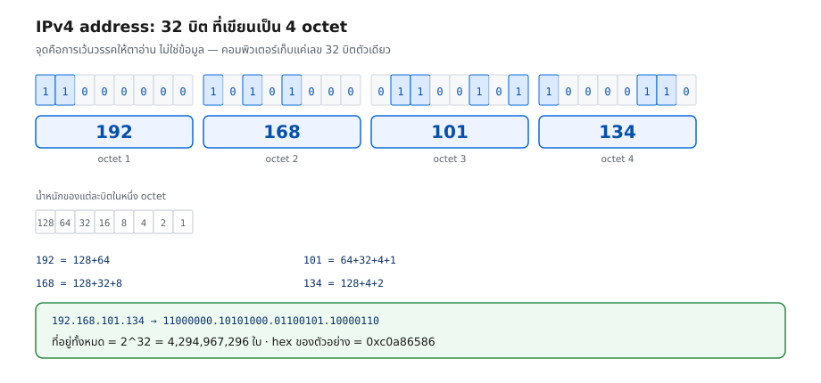
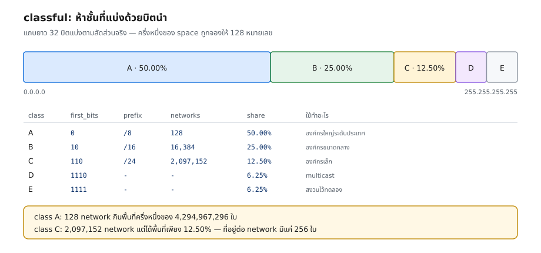
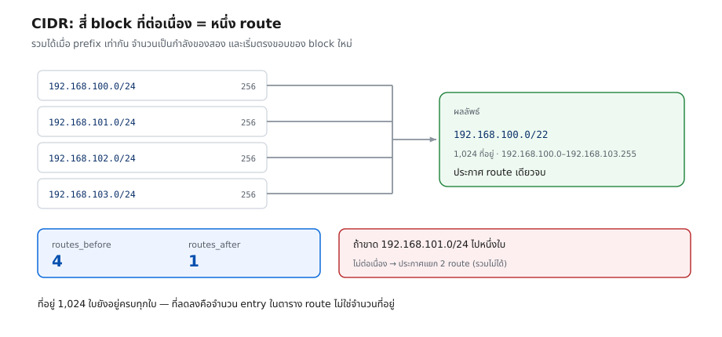

> 📅 เขียนเมื่อ: 19 พฤศจิกายน 2026 (เวลาไทย, UTC+7)
>
> **เครื่องที่รันบทนี้:** Raspberry Pi 5, Debian GNU/Linux 13 (trixie), kernel 6.18.60+rpt-rpi-2712, aarch64 · Go 1.24.4 · iproute2 6.15.0 · ภาพวาดด้วย `gen_svgs.py` แล้วเรนเดอร์ด้วย `rsvg-convert` 2.60.0 · ทุกตัวเลขในบทมาจากไฟล์ใน `out/` ที่สร้างด้วย `bash run_all.sh` ไม่มีตัวเลขใดพิมพ์ด้วยมือ
>
> 🛡️ **จริยธรรม (ใช้กับทั้งซีรีส์):** การสแกน การดัก packet และการอ่านตาราง neighbour ให้ทำกับ **เครื่องและเครือข่ายที่คุณควบคุมเอง** เท่านั้น บทนี้ไม่มีการยิง packet ออกนอกเครื่องแม้แต่ใบเดียว — โปรแกรมทั้งหมดคำนวณจากตัวเลขในหน่วยความจำ และที่อยู่ตัวอย่าง**ส่วนใหญ่**เป็นที่อยู่สำหรับเอกสาร (RFC 5737) หรือ private range ตาม RFC 1918 — ส่วนที่เหลือนอกนั้น (`8.8.8.8`, `172.32.0.1`, `100.64.0.7`, `255.255.255.255`) ใช้เพียงสาธิตการจำแนกช่วง ไม่ได้ชี้ไปที่เครื่องใด

---

## 0. อาการที่ทำให้คนเสียเวลาครึ่งวัน: "อยู่ switch เดียวกัน แต่ ping กันไม่ถึง"

มีเคสหนึ่งที่เกิดบ่อยจนผมใช้เป็นโจทย์เปิดบทได้ทุกครั้ง: เครื่องสองเครื่องเสียบ switch ตัวเดียวกัน สายคนละเส้น การ์ดขึ้น `UP` ทั้งคู่ แต่ `ping` กันไม่ติด

คนส่วนใหญ่จะเริ่มจากสิ่งที่มองเห็น — เปลี่ยนสาย สลับพอร์ต ปิด firewall วนไปมา แล้วก็ไม่เจออะไร เพราะปัญหาอยู่ในสิ่งที่มองไม่เห็น: **สองเครื่องนั้นคิดว่าตัวเองอยู่คนละ network**

ยกตัวอย่างให้เห็นชัด: เครื่อง A ตั้งไว้ `192.168.1.10/24` เครื่อง B ตั้งไว้ `192.168.2.10/24` บน switch เดียวกัน สายเดียวกัน วงเดียวกันทางกายภาพ — แต่เครื่อง A จะ **ไม่ถามหา MAC ของ B ด้วย ARP เลย** เพราะเมื่อโปรแกรมจะส่ง packet ไป `192.168.2.10` สิ่งแรกที่ kernel ทำไม่ใช่การเขียน frame แต่คือการตอบคำถามว่า "ปลายทางนี้อยู่ใน network เดียวกับฉันไหม"

คำตอบมาจากเลขตัวเดียว: `/24` แปลว่า 24 บิตแรกของที่อยู่คือ **network** และ 8 บิตหลัง (octet สุดท้าย) คือ **host** ดังนั้น `192.168.1.10/24` อยู่ใน network `192.168.1.0/24` ส่วน `192.168.2.10` อยู่ใน network `192.168.2.0/24` — คนละ network ตามความเห็นของ kernel

และเมื่อปลายทางอยู่คนละ network กฎคือ: **ส่งให้ default gateway** ถ้าไม่มี gateway ที่รู้ทางไป `192.168.2.0/24` packet ก็จบอยู่ตรงนั้น เครื่อง A จะได้ข้อความผิดพลาดที่ดูเหมือนปัญหา layer 2 แต่จริง ๆ เป็นปัญหา layer 3 ที่เกิดจากตัวเลขหลังเครื่องหมาย slash

นี่คือเหตุผลที่บทที่แล้ว ([Ethernet frame, MAC และ ARP](/blog/post.html?slug=2026-11-18-network-08-ethernet-mac-arp)) พูดถึง ARP ไว้ครบแล้ว แต่ยังไม่พอ: ARP ตอบคำถาม "IP นี้เป็นของ MAC ไหน" ได้ก็ต่อเมื่อ **เรารู้แล้วว่า IP นี้อยู่ในวงของเรา** ใครเป็นคนตัดสินว่าอยู่ในวงไหม? คำตอบคือ subnet mask หรือเจ้า `/24` ที่เราเพิ่งเห็น — และนั่นคือเรื่องของบทนี้

สามคำถามที่บทนี้จะตอบให้จบ:

1. **IPv4 address คืออะไรในระดับบิต** — ทำไมมันเขียนเป็นสี่ก้อน และเราอ่านมันเป็นเลขฐานสองได้เร็วได้อย่างไร
2. **ทำไมระบบเดิม (classful) พัง** — ที่อยู่ 4.3 พันล้านใบไม่ได้น้อยขนาดนั้นในปี 1981 แต่ทำไมมันหมดเร็วกว่าที่คิดมาก
3. **CIDR (วิธีบอกขนาด network ด้วย `/n` แทนการดู class) แก้อะไร** — prefix notation ต่างจาก subnet mask ตรงไหน และทำไมมันช่วยทั้งเรื่องที่อยู่หมดและเรื่องตาราง route บวมพร้อมกัน

> ถ้ายังไม่คุ้นคำว่า **octet**: มันคือ "กลุ่ม 8 บิต" เราเรียกแบบนี้เพราะในยุคที่ TCP/IP ถูกออกแบบ คำว่า byte ยังไม่ได้แปลว่า 8 บิตเสมอทุกสถาปัตยกรรม[^1] วันนี้สองคำนี้หมายถึงสิ่งเดียวกันในทางปฏิบัติ แต่เอกสารมาตรฐานยังเขียนว่า octet — และเราจะใช้คำนี้ตลอดบทเพื่อความตรงกับ RFC

---

## 1. IPv4 address คือเลข 32 บิต ไม่ใช่ข้อความสี่ก้อน

### 1.1 จาก 32 บิตถึง dotted-quad

IPv4 address คือเลขจำนวนเต็ม **32 บิต** ตัวเดียว ไม่มีอะไรซับซ้อนไปกว่านั้น สิ่งที่ทำให้มันดูซับซ้อนคือวิธีการเขียน: เราแบ่ง 32 บิตออกเป็น 4 กลุ่ม กลุ่มละ 8 บิต แล้วเขียนแต่ละกลุ่มเป็นเลขฐานสิบ คั่นด้วยจุด รูปแบบนี้เรียกว่า **dotted-quad** (หรือ dotted-decimal)

การแบ่งเป็น 4 กลุ่มเป็นเพียง **การเว้นวรรคเพื่อให้ตาอ่านได้** — คอมพิวเตอร์ไม่ได้เก็บ "จุด" ไว้ที่ไหนเลย มันเก็บแค่เลข 32 บิตและรู้ว่าเมื่อจะพิมพ์ออกมาให้คนอ่านก็ใส่จุดทุก 8 บิต นี่คือความคิดเดียวกับที่เราเจอใน MAC address (48 บิต เขียนเป็น 6 กลุ่ม) ต่างกันแค่ขนาด

เดโมของบทนี้เริ่มจากที่อยู่ของเครื่องที่เขียนบท แล้วแสดงมันในทุกรูปแบบที่มันมี:

```text
## IPv4 address = 32 บิต เขียนเป็น 4 octet ฐานสิบ
address          192.168.101.134
binary           11000000.10101000.01100101.10000110
bits32           11000000101010000110010110000110
hex              0xc0a86586
decimal          3232261510
addresses_total  4,294,967,296
```

อ่านทีละบรรทัด:

- **binary** — 32 บิตเต็ม เขียนเป็น 4 กลุ่มเพื่อให้เห็นว่าแต่ละกลุ่มคือ 8 บิต การเว้นจุดตรงนี้ **ตรงกับจุดใน dotted-quad เป๊ะ** ซึ่งเป็นเหตุผลว่าทำไมเราจัดกลุ่มแบบนี้ ולאแบบอื่น
- **bits32** — บิตเดียวกันโดยไม่เว้นจุด (สิ่งที่โปรแกรมจริงเก็บ)
- **hex** — เลขฐาน 16 แบบ 8 หลัก แต่ละหลักแทน 4 บิต นี่คือรูปแบบที่คุณจะเจอใน log ของ firewall และใน packet capture
- **decimal** — เลขฐานสิบของทั้ง 32 บิต ค่านี้อยู่ในช่วง 0 ถึง 4,294,967,295 ซึ่งก็คือ `2^32 − 1`

จุดที่ต้องเข้าใจให้แน่น: **hex 8 หลัก × 4 บิต = 32 บิต = 4 octet พอดี** การแปลงระหว่าง dotted-quad กับ hex จึงไม่ต้องคำนวณอะไรเลย แค่มองทีละ octet เช่น `192` = `c0`, `168` = `a8` (คุณจะเห็นในตาราง `ip route` และใน header ของ IPv4 packet ที่เก็บค่าเป็น hex) ที่อยู่ในตัวอย่างนี้จึงเขียนเป็น hex ได้ว่า `0xc0a86586` — สังเกตว่า 8 หลักพอดีไม่ขาดไม่เกิน



### 1.2 อ่านบิตให้ออกในสองวินาที

ความสามารถหนึ่งที่แยกคนที่ "ใช้ network เป็น" กับคนที่ "ท่องคำสั่งเป็น" คือการมองเลขหนึ่ง octet แล้วเห็นบิตของมัน นี่คือตารางน้ำหนักที่ควรจำได้ขึ้นใจ — มันมีแค่แปดค่า และเป็นเลขที่เราผ่านตามาแล้วในซีรีส์ CS Fundamentals ตอนที่ว่าด้วยเลขฐานสอง[^2]

| ตำแหน่งบิตใน octet | 8 | 7 | 6 | 5 | 4 | 3 | 2 | 1 |
|---|---|---|---|---|---|---|---|---|
| น้ำหนัก | 128 | 64 | 32 | 16 | 8 | 4 | 2 | 1 |
| ตัวอย่าง `192` | 1 | 1 | 0 | 0 | 0 | 0 | 0 | 0 |
| ตัวอย่าง `168` | 1 | 0 | 1 | 0 | 1 | 0 | 0 | 0 |

อ่าน `192` จากตาราง: `128 + 64 = 192` จบ ไม่ต้องคิดต่อ อ่าน `168`: `128 + 32 + 8` (ข้าม 64 เพราะบิตนั้นเป็น 0, ข้าม 16 เพราะเป็น 0, เอา 8 เพราะเป็น 1) เดโมย่อยนี้ให้โปรแกรมทำแทนตา แล้วพิมพ์น้ำหนักที่บวกกันได้ค่าจริงของแต่ละ octet:

```text
## octet หนึ่งตัวคือ 8 บิต: น้ำหนัก 128 64 32 16 8 4 2 1
octet  value  bits      weights ที่บวกกันได้ค่านี้
1      192    11000000  128+64
2      168    10101000  128+32+8
3      101    01100101  64+32+4+1
4      134    10000110  128+4+2
```

บรรทัด `weights ที่บวกกันได้ค่านี้` คือคำตอบของคำถาม "ทำไม 134 ถึงเป็น 10000110" — เพราะ `128 + 4 + 2 = 134` เมื่อคุณเห็นรูปแบบนี้บ่อย ๆ การอ่าน `192.168.1.1` จะไม่ใช่การอ่านตัวเลขสี่ตัวอีกต่อไป แต่มันคือ "network ที่ขึ้นต้นด้วย 11000000 10101000" ซึ่งเป็นสิ่งที่คนที่ฝึกตามาจะเห็นทันที

> **เทคนิคที่ใช้บ่อยในห้องแล็บ:** เวลาต้องเดาว่า IP อยู่ใน subnet ไหม (subnet = block ย่อยที่แบ่งออกมาจาก block ใหญ่ — เขียนเป็น `/n` ที่ตัวเลขยาวขึ้น) ให้ดูเฉพาะ octet ที่ "ตัด" กลางทาง เช่น `/26` ตัดกลาง octet ที่ 4 ที่น้ำหนัก 64 ดังนั้น subnet จะเปลี่ยนทุก 64 ตัว (0, 64, 128, 192) — เลข 77 จึงตกอยู่ในช่วง 64–127 ไม่ใช่ 0–63 นี่คือการอ่านบิต ไม่ใช่การคำนวณ

### 1.3 ที่อยู่คือเลข ไม่ใช่ข้อความ (และนี่คือกับดักของ parser)

มีรายละเอียดที่ทำให้โปรแกรมเมอร์พลาดกันมานับครั้งไม่ถ้วน: `192.168.1.010` ดูเหมือนที่อยู่ปกติ แต่ถ้าคุณส่งให้ `inet_aton` (ฟังก์ชันแปลงข้อความเป็น IP รุ่นเก่าในภาษา C) มันจะตีความ `010` เป็น **เลขฐานแปด** (octal) ซึ่งเท่ากับ 8 ในฐานสิบ — ที่อยู่ที่ได้จึงกลายเป็น `192.168.1.8` ไม่ใช่ `192.168.1.10` — และถ้าคุณส่ง `10.1` มันจะเติมให้เป็น `10.0.0.1` ให้เองด้วยซ้ำ

นี่คือเหตุผลที่ตัวอ่านของเราเข้มกว่าที่คิด: ต้องมี 4 octet เท่านั้น, octet ต้องเป็นเลขฐานสิบ 0–255, ห้ามมีศูนย์นำหน้า, ห้ามมีช่องว่าง และเราเทียบผลกับ `net.ParseIP` ของ stdlib (standard library — ชุดโค้ดที่มาพร้อมภาษา Go) ทุกเคสเพื่อพิสูจน์ว่าไม่ได้คิดไปเอง:

```text
## ตัวอ่านของเราเทียบกับ net.ParseIP ของ stdlib (12 เคส)
input              ours  stdlib  เหตุผล
"192.168.101.134"  ok    ok      ปกติ
"0.0.0.0"          ok    ok      ศูนย์ทั้งสี่ octet
"255.255.255.255"  ok    ok      ค่าสูงสุดที่แทนได้
"10.0.0.1"         ok    ok      octet น้อยแต่ถูกต้อง
"192.168.1"        err   err     มี 3 octet
"192.168.1.1.1"    err   err     มี 5 octet
"256.1.1.1"        err   err     octet เกิน 255
"192.168.1.-1"     err   err     มีเครื่องหมายลบ
"192.168.01.1"     err   err     ศูนย์นำหน้า (aton แบบเก่าตีเป็น octal)
"010.1.1.1"        err   err     ศูนย์นำหน้าแบบ octal
"1.2.3.4 "         err   err     มีช่องว่างท้าย
" 1.2.3.4"         err   err     มีช่องว่างหน้า
agreement=12/12
```

บรรทัดสุดท้าย `agreement=12/12` คือทั้งหมดที่ต้องรู้: ตัวอ่านของเราให้คำตอบเดียวกับ stdlib ทุกกรณี รวมถึงการ **ปฏิเสธ** `192.168.01.1` และ `010.1.1.1` ซึ่งเป็นสิ่งที่ parser รุ่นใหม่ทุกตัวทำ (Go ปฏิเสธศูนย์นำหน้าตั้งแต่รุ่น 1.17)

ทำไมเรื่องนี้สำคัญกับ network engineering?: เพราะเครื่องมือที่คุณเขียนจะรับ input จากคน และคนพิมพ์ `192.168.1.010` ได้ตลอด ถ้าโปรแกรมคุณรับมันเข้าไปแล้วตีความเป็น octal คุณจะ debug อยู่ครึ่งวันกับ "ทำไม config นี้ใช้ไม่ได้" ที่จริงปัญหาอยู่ที่เลขบรรทัดเดียว

โค้ดที่ทำสิ่งนี้คือฟังก์ชันเดียว ยาวไม่ถึง 40 บรรทัด และไม่ต้องใช้ library ใด ๆ:

```go
func ParseAddr(s string) (Addr, error) {
	parts := strings.Split(s, ".")
	if len(parts) != 4 {
		return 0, fmt.Errorf("ต้องมี 4 octet คั่นด้วยจุด (ได้ %d): %q", len(parts), s)
	}
	var v uint32
	for i, p := range parts {
		if p == "" {
			return 0, fmt.Errorf("octet ที่ %d ว่าง: %q", i+1, s)
		}
		if len(p) > 3 {
			return 0, fmt.Errorf("octet ที่ %d ยาวเกิน 3 หลัก: %q", i+1, p)
		}
		for _, c := range p {
			if c < '0' || c > '9' {
				return 0, fmt.Errorf("octet ที่ %d มีอักขระที่ไม่ใช่เลขฐานสิบ: %q", i+1, p)
			}
		}
		if len(p) > 1 && p[0] == '0' {
			return 0, fmt.Errorf("octet ที่ %d มีศูนย์นำหน้า (inet_aton แบบเก่าตีความเป็น octal): %q", i+1, p)
		}
		n, err := strconv.Atoi(p)
		if err != nil {
			return 0, fmt.Errorf("octet ที่ %d อ่านเป็นตัวเลขไม่ได้: %q", i+1, p)
		}
		if n > 255 {
			return 0, fmt.Errorf("octet ที่ %d เกิน 255: %d", i+1, n)
		}
		v = v<<8 | uint32(n)
	}
	return Addr(v), nil
}
```

จุดที่ควรสังเกต: การประกอบค่าทำด้วย `v = v<<8 | uint32(n)` ทีละ octet — นี่คือการเลื่อนบิตซ้าย 8 ตำแหน่งแล้ว OR ค่าใหม่เข้าไป ผลคือ octet แรกไปอยู่บิต 31–24, octet ที่สองอยู่ 23–16 และต่อไปเรื่อย ๆ ซึ่งตรงกับลำดับที่เราเห็นใน dotted-quad พอดี นี่คือ **big-endian ในความหมายที่มนุษย์อ่าน** (big-endian = เก็บไบต์ที่สำคัญที่สุดไว้ต้น) และเป็นเหตุผลว่าทำไม `Addr(0xc0a80101)` พิมพ์ออกมาเป็น `192.168.1.1`

สามเช็คที่อยู่ในลูปด้านบนมีเหตุผลของมันเอง:

- **`len(p) > 3`** — octet หนึ่งตัวแทนค่าได้แค่ 0–255 ซึ่งเขียนยาวสุด 3 หลัก (`255`) ตัวเลข 4 หลักจึงไม่ใช่ที่อยู่ที่ถูกต้อง และการปฏิเสธตั้งแต่ตรงนี้ทำให้เราไม่ต้องไปเดาว่าเลขใหญ่ ๆ ควรถูกตีความอย่างไร
- **`len(p) > 1 && p[0] == '0'`** — ห้ามศูนย์นำหน้า (ยกเว้น `"0"` ตัวเดียว) เพราะ `inet_aton` รุ่นเก่าตีความ `010` เป็น octal = 8 ซึ่งคือ bug ที่ยกมาข้างบน — stdlib ของ Go ก็ปฏิเสธมาตั้งแต่รุ่น 1.17 ด้วยเหตุผลเดียวกัน
- **`n > 255`** — เช็คก่อน `v = v<<8 | uint32(n)` เพราะการ shift จะดันบิตที่เกิน 8 ออกไปทางซ้าย แล้วไปทับ octet ก่อนหน้าเงียบ ๆ: `256` จะกลายเป็น `1` ในตำแหน่ง octet ถัดไปโดยไม่มี error ถ้าไม่เช็คที่ตรงนี้ ก็ต้องไปเช็คซ้ำทุกจุดที่เรียกฟังก์ชัน

### 1.4 4.3 พันล้านใบ — มากหรือน้อย?

`2^32 = 4,294,967,296` ใบ ในปี 1981 ที่เครื่องซึ่งต่อกันเป็นเครือข่ายยังมีไม่ถึงพันเครื่อง (ARPANET ในปีนั้นมี host อยู่ราวสองร้อยเครื่อง) ตัวเลขนี้ดูเหมือนจะใช้ได้ตลอดกาล คนออกแบบจึงแบ่งมันอย่างหยาบ ๆ ตามขนาดองค์กรที่คิดว่ามีอยู่จริงในยุคนั้น — และนั่นคือที่มาของระบบที่เราเรียกว่า classful — แปลว่าแบ่งที่อยู่เป็นชั้น (class) ตายตัวตามเลขตัวแรก

ก่อนไปต่อ ขอให้จำเลขสามตัวนี้ไว้: **4.3 พันล้าน (ที่อยู่ทั้งหมด), 128 (network ของ class A), 2,097,152 (network ของ class C)** — บทนี้จะอธิบายว่าทำไมเลขสามตัวนี้อยู่ด้วยกันไม่ได้ในโลกที่โตขึ้น

---

## 2. classful addressing (1981): ระบบที่สมเหตุสมผลในยุคของมัน

### 2.1 ห้าชั้นที่กำหนดด้วยบิตนำ

ในโมเดลเดิม สิ่งที่กำหนดว่า "ที่อยู่นี้มี network ยาวแค่ไหน" คือ **ค่า octet แรก** เพียงอย่างเดียว ไม่ต้องมีใครบอก ไม่ต้อง config อะไร: ดูบิตนำของ octet แรกก็รู้ทันทีว่าอยู่ class ไหน และ class นั้นกำหนด mask ไว้ตายตัวแล้ว

คอลัมน์ `prefix` ในตารางข้างล่างคือ **จำนวนบิตนับจากซ้ายที่เป็นส่วน network** เขียนเป็น `/n`: `/8` แปลว่า 8 บิตแรกเป็น network ที่เหลือ 24 บิตเป็น host

| class | บิตนำ | ช่วง octet แรก | mask มาตรฐาน | จำนวน network | ที่อยู่ต่อ network | ใช้ทำอะไร |
|---|---|---|---|---|---|---|
| **A** | `0` | 0–127 | `/8` | 128 | 16,777,216 | องค์กรใหญ่ระดับประเทศ |
| **B** | `10` | 128–191 | `/16` | 16,384 | 65,536 | องค์กรขนาดกลาง |
| **C** | `110` | 192–223 | `/24` | 2,097,152 | 256 | องค์กรเล็ก |
| **D** | `1110` | 224–239 | — | — | — | multicast |
| **E** | `1111` | 240–255 | — | — | — | สงวนไว้ทดลอง |

ตัวเลขในตารางนี้มาจากไหน? จากจำนวนบิตที่เหลือหลังหักบิตนำ: class A มีบิตนำ 1 บิต เหลือ 7 บิตสำหรับหมายเลข network → `2^7 = 128` network และเหลือ 24 บิตเป็น host → `2^24 = 16,777,216` ที่อยู่ ส่วน class C มีบิตนำ 3 บิต เหลือ 21 บิต → `2^21 = 2,097,152` network และเหลือ 8 บิตเป็น host → 256 ที่อยู่

> หมายเหตุเล็ก ๆ ที่ทำให้ตัวเลข "128" กับ "126" ในเอกสารเก่าไม่ขัดกัน: 128 คือจำนวนหมายเลขที่บิตนำเปิดไว้ แต่ `0.0.0.0/8` (this network) และ `127.0.0.0/8` (loopback — ที่อยู่ที่หมายถึงตัวเครื่องเอง) ถูกจองไปตั้งแต่แรก ที่ใช้งานได้จริงจึงเหลือ **126** — และนี่คือเหตุผลที่ RFC 1519 §3.1 (Present Allocation Figures) บันทึกว่า ณ 13 มกราคม 1993 มีหมายเลข class A ถูกจัดสรรไปแล้ว 52 หมายเลข จาก 126 หมายเลขที่ใช้งานได้

โปรแกรมของเราพิมพ์ตารางเดียวกันนี้พร้อม **สัดส่วนของ address space** ซึ่งเป็นคอลัมน์ที่ทำให้ปัญหาโผล่ขึ้นมาทันที:

```text
## classful addressing (RFC 791, 1981): ห้าชั้นที่กำหนดด้วยบิตนำ
class  first_bits  range                         prefix  networks   share
A      0           0.0.0.0–127.255.255.255       /8      128        50.00%
B      10          128.0.0.0–191.255.255.255     /16     16,384     25.00%
C      110         192.0.0.0–223.255.255.255     /24     2,097,152  12.50%
D      1110        224.0.0.0–239.255.255.255     -       -          6.25%
E      1111        240.0.0.0–255.255.255.255     -       -          6.25%
```

อ่านคอลัมน์ `share` ให้ดี: class A กินพื้นที่ **50%** ของทั้งหมดเพื่อรองรับ 128 network เท่านั้น ขณะที่ class C กิน **12.5%** แต่ถูกแบ่งเป็นสองล้าน network ที่แต่ละอันมีแค่ 256 ที่อยู่ และ class B ซึ่งเป็นที่นิยมที่สุด (เพราะ "ใหญ่กำลังดี" สำหรับองค์กรทั่วไป) มีแค่ 16,384 ใบ

พูดอีกแบบ: **ระบบนี้ไม่ได้ออกแบบมาให้ประหยัดที่อยู่ มันออกแบบมาให้ "เดา size องค์กรจากเลขตัวแรก" ได้** ซึ่งเป็นความคิดที่สมเหตุสมผลมากในปี 1981 เพราะไม่ต้อง config อะไรเลย — ซื้อเครื่องมา เสียบสาย ตั้งเลขอะไรก็ได้ที่ขึ้นต้นด้วย 128 แล้วทุกคนรู้ว่ามันคือ /16



### 2.2 ที่อยู่เดียวกัน อ่านด้วยตา classful แล้วได้ network ไม่เหมือน CIDR

จุดที่คนมักเข้าใจผิดคือคิดว่า classful เป็นเรื่องประวัติศาสตร์ที่ไม่เกี่ยวกับวันนี้ ความจริงคือ **มันยังฝังอยู่ในเครื่องมือและในนิสัยของคน** — และมันให้คำตอบที่ผิดเมื่อคุณใช้กับที่อยู่ที่ถูกแบ่งย่อยไปแล้ว

ดูตารางนี้: ที่อยู่ห้าตัวเดียวกัน ถูกอ่านด้วยกฎ classful ล้วน ๆ — คอลัมน์ `broadcast` คือที่อยู่สุดท้ายของ block (ยิงแล้วถึงทุกเครื่องในวง)

```text
## ที่อยู่เดียวกัน อ่านด้วยตา classful แล้วได้ network ไม่เหมือน CIDR
address           class  prefix  network           broadcast         hosts_usable
10.1.2.3          A      /8      10.0.0.0          10.255.255.255    16777214
172.20.5.9        B      /16     172.20.0.0        172.20.255.255    65534
192.168.101.134   C      /24     192.168.101.0     192.168.101.255   254
224.0.0.251       D      -       -                 -                 multicast
255.255.255.255   E      -       -                 -                 reserved
```

บรรทัดที่สองคือกับดักคลาสสิก: `172.20.5.9` ขึ้นต้นด้วย 172 ซึ่งอยู่ในครึ่งแรกของ class B (128–191) เครื่องมือรุ่นเก่าจึงสรุปทันทีว่า network คือ `172.20.0.0/16` และ broadcast คือ `172.20.255.255` — ทั้งที่ในโลกจริงที่อยู่นี้อาจถูกแบ่งเป็น `/28` สองร้อยช่วงก็ได้ และถ้าคุณ ping broadcast ตามที่ classful บอก คุณจะปลุกทั้ง network ที่ไม่ใช่ของคุณ

ส่วน `255.255.255.255` ถูกจัดเป็น class E (reserved) ตามบิตนำ `1111` ซึ่งถูกต้องตามกฎ แต่ในทางปฏิบัติมันคือ **limited broadcast** ที่หมายถึง "ทุกเครื่องในวงท้องถิ่นนี้" (RFC 919) — อีกตัวอย่างว่ากฎที่ดูเรียบง่ายให้คำตอบที่ไม่ตรงกับความหมายจริง

> ถ้าสังเกตว่าทำไม `224.0.0.251` ขึ้นว่า multicast และไม่มี network/broadcast: เพราะ class D ไม่ได้แบ่งเป็น network กับ host เลย มันเป็นกลุ่ม (group) ตรง ๆ — และ `224.0.0.251` คือ mDNS ที่คุณเห็นใน `ip neigh` ของบทที่แล้ว

### 2.3 ที่อยู่ที่ถูกจองให้แต่ใช้ไม่ได้

นี่คือหัวใจของคำว่า "หมดเร็ว" — ไม่ใช่เพราะที่อยู่ถูกใช้หมด แต่เพราะ **ที่อยู่ถูกจองในก้อนที่ใหญ่เกินความจำเป็นแล้วใช้ไม่ได้**

ลองนึกถึงองค์กรที่ต้องการ 300 ที่อยู่ (เครื่อง 250 + เครื่องพิมพ์ + server + เผื่อโต) ในโลก classful ตัวเลือกมีแค่: เอา class C (256 ที่อยู่) ซึ่งไม่พอ หรือเอา class B (65,536 ที่อยู่) ซึ่งใหญ่กว่า class C 256 เท่า — ไม่มีอะไรตรงกลาง

เดโมคำนวณต้นทุนนี้ให้เห็นเป็นตัวเลข:

```text
## ต้นทุนของ classful: ที่อยู่ที่ถูกจองให้แต่ใช้ไม่ได้
hosts_needed  class  class_pfx cidr    cidr_hosts   class_hosts  ratio
10            C      /24       /28     14           254          18.1x
30            C      /24       /27     30           254          8.5x
300           B      /16       /23     510          65534        128.5x
1000          B      /16       /22     1022         65534        64.1x
```

คอลัมน์ `ratio` คือจำนวนเท่าที่ที่อยู่ถูกจองเกิน **block ที่ CIDR จะให้กับความต้องการเดียวกัน**: องค์กรที่ต้องการ 300 ที่อยู่ได้ 65,534 ที่อยู่ที่ใช้ได้ (หัก network กับ broadcast) เทียบกับ `/23` ที่ CIDR ให้ (510 ที่ใช้ได้) — จองเกิน **128.5 เท่า** และถ้าเทียบกับตัวเลข 300 ที่ต้องการจริง ๆ ก็ยังเกินราว 218 เท่า และที่อยู่ที่เกินมานั้น **ใช้ไม่ได้และให้คนอื่นก็ไม่ได้** เพราะมันถูกผูกกับ network หมายเลขนั้นไปแล้ว

ผลรวมทั้งโลกคือ: class A 128 ใบ × 16.7 ล้าน = ครึ่งหนึ่งของ space ถูกจองให้องค์กรไม่ถึง 130 แห่งตั้งแต่ต้น และ class B 16,384 ใบก็เป็นที่ต้องการของทุกองค์กรขนาดกลาง — ซึ่งมีมากกว่า 16,384 แห่งในโลก

### 2.4 ปัญหาที่สองที่มาพร้อมกัน: ตาราง route บวม

ถ้าปัญหามีแค่ "ที่อยู่หมด" เราอาจแก้ด้วยการแจก class C ให้เล็กลง — แต่มีปัญหาที่สองที่ทำให้วิธีนั้นใช้ไม่ได้: **router ต้องจำ network ทุกอันที่มันต้องส่ง packet ไป**

ในโลก classful การประกาศ route คือการบอกว่า "ฉันเข้าถึง network หมายเลขนี้ได้" ทีละหมายเลข ถ้าคุณมีที่อยู่ 65,536 ใบที่ต่อเนื่องกัน (เท่ากับ `/16` หนึ่งอัน) ในโลก classful คุณต้องประกาศ **256 route** (เพราะ 65,536 = 256 × 256) และถ้าเป็นที่อยู่ 16.7 ล้านใบ (`/8`) คุณต้องประกาศ **65,536 route**

```text
## ตาราง route: ที่อยู่ก้อนเดียว ต่างกันที่จำนวน entry ที่ router ต้องจำ
addresses         cidr    cidr_routes class   classful_routes
4,096             /20     1           C       16
65,536            /16     1           C       256
16,777,216        /8      1           C       65,536
```

คอลัมน์สุดท้ายคือระเบิดเวลาของ internet ยุคต้น: ตาราง route ของ backbone (เครือข่ายแกนหลักของ internet) โตในอัตราเดียวกับจำนวน network ไม่ใช่จำนวนที่อยู่ และในปี 1993 ตารางเริ่มโตเร็วกว่าฮาร์ดแวร์จะตามทัน

และนี่คือหลักฐานจากเอกสารจริง ไม่ใช่คำเล่า — RFC 1519 §3.1 บันทึกสถานะ ณ 13 มกราคม 1993 ไว้ว่า:

> "As of 1/13/93, 52 class A network numbers have been allocated and 7133 class B's have been allocated." — RFC 1519, กันยายน 1993

แปลว่าจาก Class B ทั้งหมด 16,382 ใบ (ตัวเลขที่ RFC นับ — ตาราง classful ข้างบนนับ 16,384 เพราะคิดจาก 2^14 ตรง ๆ) ถูกใช้ไปแล้ว 7,133 ใบ และก่อนหน้านั้นเอกสารเดียวกันประเมินจากข้อมูล ณ 25 กุมภาพันธ์ 1992 ว่า ถ้าอัตราการใช้ยังเป็นแบบเดิม (เพิ่มขึ้นปีละประมาณเท่าตัว) **class B จะหมดภายในประมาณ 15 เดือน** — ไม่ใช่ 15 ปี นั่นคือความเร่งด่วนที่ทำให้ CIDR ถูกผลักดันให้ใช้จริงภายในปีเดียวกัน

### 2.5 สิ่งที่ classful ทำถูก (และเรายังใช้อยู่ทุกวัน)

ก่อนจะทิ้งระบบนี้ ขอพูดถึงสิ่งที่ดีของมัน เพราะมันคือมรดกที่เรายังใช้ทุกวัน: **แนวคิดที่ว่า ที่อยู่หนึ่งประกอบด้วย network part กับ host part** และการส่ง packet ภายใน network เดียวกันทำได้โดยไม่ต้องพึ่ง router เลย

แนวคิดนี้ยังถูกต้อง 100% สิ่งที่ CIDR เปลี่ยนคือ **ใครเป็นคนกำหนดว่ากี่บิตเป็น network** — classful บอกว่า "ดูเลขตัวแรกสิ" ส่วน CIDR บอกว่า "เขียนมาสิ ว่ากี่บิต" และการเปลี่ยนแค่จุดนี้จุดเดียวนำไปสู่ทุกอย่างที่เหลือของบทนี้

---


## 3. CIDR (1993): จาก "ดูเลขตัวแรก" เป็น "เขียนมาว่ากี่บิต"

### 3.1 prefix notation: คำตอบเดียวที่เหลืออยู่

CIDR (Classless Inter-Domain Routing) ถูกเสนอในปี 1993 พร้อมกันสองฉบับ: RFC 1518 ว่าด้วยสถาปัตยกรรมการจัดสรรที่อยู่ และ RFC 1519 ว่าด้วยกลยุทธ์การจัดสรรกับการรวม route[^3] ทั้งสองฉบับพูดเรื่องเดียวกันจากคนละมุม และข้อความใน RFC 1519 §4.1 ก็บอกการเปลี่ยนแปลงแกนกลางไว้สั้น ๆ ว่า "the concept of network "class" needs to be deprecated"

สิ่งที่มาแทนคือ **prefix**: ตัวเลขหลังเครื่องหมาย slash ที่บอกว่า **กี่บิตนับจากซ้ายสุดคือส่วนของ network** ที่เหลือเป็น host

- `/24` = 24 บิตแรกเป็น network, 8 บิตหลังเป็น host
- `/26` = 26 บิตแรกเป็น network, 6 บิตหลังเป็น host
- `/12` = 12 บิตแรกเป็น network, 20 บิตหลังเป็น host

และเมื่อไรก็ตามที่คุณเห็นที่อยู่เดียวไม่มี slash (เช่นใน config เก่า ๆ หรือในผลของ `ip addr` บางรุ่น) แปลว่าคุณยังไม่รู้ขนาดของ network — ซึ่งแปลว่าคุณยังตอบไม่ได้ว่าปลายทางอยู่ในวงเดียวกันหรือไม่ นั่นคือเหตุผลที่เราจะเขียน `/24` ต่อท้ายเสมอ ไม่ใช่เพื่อความสวยงาม

### 3.2 subnet mask กับ prefix คือของสิ่งเดียวกัน

นี่คือจุดที่คนสับสนมากที่สุด และมันง่ายกว่าที่คิด: **mask กับ prefix เป็นการเขียนตัวเดียวกันด้วยสองภาษา**

- **subnet mask** เขียนเป็นเลข 32 บิตที่บิต 1 หมายถึง "บิตนี้เป็นของ network" และบิต 0 หมายถึง "บิตนี้เป็นของ host" — เขียนเป็น dotted-quad เช่น `255.255.255.192`
- **prefix** นับว่ามีบิต 1 ติดกันจากซ้ายกี่ตัว — `255.255.255.192` มีบิต 1 อยู่ 26 ตัว จึงเขียนว่า `/26`

สองอย่างนี้แปลงไปมาได้ตรง ๆ ไม่มีข้อมูลหาย เพราะ mask ที่ถูกต้องของ IPv4 **ต้องเป็นบิต 1 ติดกันจากซ้ายแล้วตามด้วย 0 ทั้งหมด** เท่านั้น (นี่คือเหตุผลว่าทำไม `255.255.0.255` ไม่ใช่ mask ที่ถูกต้อง — มันมี 1 ขาดตอน) ถ้า mask มี 1 ขาดตอนเมื่อไร มันไม่ใช่ mask อีกต่อไป แต่เป็นแค่ตัวเลข

ตารางนี้คือส่วนที่คุณจะใช้บ่อยที่สุดในชีวิตจริง — และมันคือการนับบิตในหัวข้อ 1.2 นำมาใช้ซ้ำ:

```text
## CIDR (RFC 1518/1519, 1993): prefix คือจำนวนบิตที่ใช้ระบุ network
prefix  mask             hex          addresses   host_bits hosts_usable
/8      255.0.0.0        0xff000000 16,777,216  24        16777214
/12     255.240.0.0      0xfff00000 1,048,576   20        1048574
/16     255.255.0.0      0xffff0000 65,536      16        65534
/20     255.255.240.0    0xfffff000 4,096       12        4094
/22     255.255.252.0    0xfffffc00 1,024       10        1022
/24     255.255.255.0    0xffffff00 256         8         254
/26     255.255.255.192  0xffffffc0 64          6         62
/27     255.255.255.224  0xffffffe0 32          5         30
/28     255.255.255.240  0xfffffff0 16          4         14
/30     255.255.255.252  0xfffffffc 4           2         2
/31     255.255.255.254  0xfffffffe 2           1         2  /31 = point-to-point (RFC 3021 ใช้ทั้งสองที่อยู่)
/32     255.255.255.255  0xffffffff 1           0         1  /32 = host route (ที่อยู่เดียว)
```

อ่านคอลัมน์ `mask` เทียบกับ `prefix`: ทุกครั้งที่ prefix เพิ่ม 1 บิต จำนวนที่อยู่จะลดครึ่งหนึ่ง และขนาด block ก็ลดครึ่งตาม (256 → 128 → 64 → 32) ขณะที่ mask จะมีบิต 1 เพิ่มขึ้นอีกหนึ่งตัว ต่อจากบิต 1 ตัวก่อนหน้า (`.0` → `.128` → `.192` → `.224`) — `/24` = `255.255.255.0`, `/25` = `255.255.255.128`, `/26` = `255.255.255.192`, `/27` = `255.255.255.224` นี่คือเหตุผลที่ subnet ในวง `/24` มีขนาด 64, 32, 16 ได้ แต่ขนาด 100 ไม่ได้ — เพราะขนาดต้องเป็นกำลังของสองเสมอ

คอลัมน์ `hosts_usable` คือจำนวนที่อยู่ที่ใช้เป็น host ได้ ซึ่งโดยทั่วไปคือ `2^(32−prefix) − 2` เพราะที่อยู่แรก (network address) กับที่อยู่สุดท้าย (broadcast address) ถูกจองไว้[^4] — แต่มีข้อยกเว้นสองข้อที่ต้องรู้ และเดโมของเราพิมพ์มันออกมาด้วยหมายเหตุกำกับ:

- **`/31` ใช้ได้ 2 ที่อยู่** ตาม RFC 3021 (2000) — สำหรับ link แบบ point-to-point ที่มีปลายทางสองเครื่องตายตัว ไม่มีใครต้อง broadcast จึงใช้ทั้งสองที่อยู่ได้
- **`/32` ใช้ได้ 1 ที่อยู่** — เรียกว่า **host route** คือ route ที่ชี้ไปเครื่องเดียวจริง ๆ (ใช้มากใน firewall และใน route ที่ตั้งใจให้เจาะจงสุด)[^10]

ถ้าคุณใช้สูตร `−2` กับ `/31` คุณจะได้ 0 ซึ่งผิด — และนี่คือ bug ที่เจอได้จริงในสคริปต์ provision (สคริปต์ที่ใช้ตั้งค่าเครื่องหรือวงให้พร้อมใช้) ที่คนเขียนขึ้นเองบ่อยมาก

### 3.3 aggregation: เหตุผลที่ CIDR ช่วยเรื่องตาราง route ด้วย

ถ้า CIDR มีดีแค่เรื่อง "กำหนดขนาด network ได้อิสระ" มันก็ยังไม่แก้ปัญหาตาราง route บวม ปัญหานั้นแก้ด้วยความสามารถที่สองของมัน: **การรวม route (route aggregation หรือ supernetting)**[^5]

แนวคิดง่ายมาก: ถ้าคุณมี 4 network ที่ต่อเนื่องกันและเรียงตรงขอบ (เริ่มต้นที่ตำแหน่งซึ่งหารด้วยขนาด block ลงตัว) การประกาศ route เดียวที่ครอบทั้งสี่ก็ให้ผลเหมือนประกาศสี่ route — และ router ปลายทางก็ส่ง packet ถูกทุกใบ เพราะที่อยู่ทั้ง 1,024 ใบอยู่ใน block ที่ประกาศไว้

เดโมของเราทดลองกับ `/24` สี่อันที่ต่อเนื่องกัน:

```text
## aggregate: สี่ /24 ที่ต่อเนื่องและตรงขอบ = หนึ่ง /22
input
192.168.100.0/24
192.168.101.0/24
192.168.102.0/24
192.168.103.0/24
result          192.168.100.0/22
covers          192.168.100.0–192.168.103.255
addresses       1,024
routes_before   4
routes_after    1
alignment       ok (192.168.100.0 อยู่ตรงขอบของ /22)
```

ผลคือ `192.168.100.0/22` ใบเดียว ครอบ `192.168.100.0–192.168.103.255` — และบรรทัด `routes_before 4` กับ `routes_after 1` คือตัวเลขที่อธิบายว่าทำไม CIDR ถึงถูกผลักดันให้ใช้ทั้ง internet ภายในไม่กี่ปี: **ตาราง route เล็กลง 4 เท่าในเคสเล็ก ๆ นี้ และเล็กลงกว่านั้นมากในเคสจริง**



แต่การรวมไม่ใช่เวทมนตร์ที่ทำได้ทุกกรณี มีกฎสามข้อที่ต้องผ่านพร้อมกัน:

1. **prefix เท่ากัน** — รวม `/24` กับ `/26` เป็น `/23` ไม่ได้ตรง ๆ (ต้องแปลงให้เป็นชุด block ขนาดเดียวกันก่อน)
2. **จำนวนเป็นกำลังของสอง** — 4 block รวมได้, 3 block รวมไม่ได้ (3 ไม่ใช่กำลังของสอง)
3. **ต่อเนื่องและตรงขอบ** — block แรกต้องเริ่มตรงขอบของ block ใหม่ นี่คือข้อที่คนลืมบ่อยที่สุด

เดโมทดสอบข้อ 3 สองแบบ: แบบที่ขาด block กลางทาง และแบบที่ block เริ่มไม่ตรงขอบของตัวเอง

```text
## ที่รวมไม่ได้: block ไม่ต่อเนื่องกัน
input
192.168.100.0/24
192.168.102.0/24
result          (รวมไม่ได้)
reason          ไม่ต่อเนื่อง: 192.168.100.0/24 จบที่ 192.168.100.255 แต่ block ถัดไปเริ่มที่ 192.168.102.0
routes_before   2
routes_after    2 (ต้องประกาศแยกกัน)
```

```text
## block ที่ไม่ตรงขอบของตัวเองไม่มีอยู่จริง
strict_block    ปฏิเสธ: 192.168.101.0 ไม่ใช่จุดเริ่มต้นของ /22 (ที่ถูกคือ 192.168.100.0/22)
```

สองบรรทัด `reason` กับ `strict_block` คือสิ่งที่ทำให้บทนี้ต่างจากการท่องจำ: **block ที่ไม่ตรงขอบของตัวเองไม่มีอยู่จริง** `192.168.101.0/22` ไม่ใช่ block เพราะ block ของ `/22` ต้องมี 10 บิตท้ายเป็นศูนย์ (พูดอีกแบบคือ network address ต้องหารด้วย 1,024 ลงตัว) — `192.168.100.0` ผ่านข้อนี้ ส่วน `192.168.101.0` ไม่ผ่าน

นี่คือเหตุผลที่เวลาใครขอ "block ขนาด 1,000 ที่อยู่" คุณต้องปัดขึ้นเป็น 1,024 (`/22`) และจัดให้มันเริ่มตรงขอบ — และนั่นคือสิ่งที่ทำให้การวางแผนเลขหมายเป็นงานที่ต้องคิดล่วงหน้า ไม่ใช่การแจกเลขตามใจ

> **Longest prefix match**: เมื่อ router มี route หลายอันที่ตรงกับปลายทาง มันเลือกอันที่ prefix ยาวที่สุด (เฉพาะเจาะจงที่สุด) กฎนี้ถูกเขียนไว้ใน RFC 1519 §4.1 และเป็นกฎเดียวกับที่ทำให้ aggregation ปลอดภัย — เราจะลงรายละเอียดตอนที่ 17 (routing) เพราะมันต้องอาศัยตาราง route จริงถึงจะเห็นภาพ[^6]

### 3.4 สเปกที่ใช้อยู่ทุกวันนี้คือ RFC 4632 ไม่ใช่ RFC 1519

เรื่องเล็กที่มีประโยชน์เวลาไปอ่านเอกสาร: ถ้าคุณเปิด RFC 1519 วันนี้ คุณจะเห็นว่า RFC 4632 (สิงหาคม 2006) มาแทนที่แล้ว เนื้อหาแกนเดิมยังถูกต้องทั้งหมด สิ่งที่ต่างคือการเรียบเรียงใหม่ให้จบในฉบับเดียว: §11 ของ RFC 4632 บอกว่าตาราง subnet mask จาก **RFC 1878** ("Variable Length Subnet Table For IPv4") ถูกย้ายเข้ามาเป็นส่วนหนึ่งของ §3.1 ของฉบับนี้ จึงไม่ต้องเก็บตารางไว้ใน RFC แยกอีก — ตารางที่คุณเห็นในข้อ 3.2 ของบทนี้คือตระกูลเดียวกันกับที่ RFC 1878 เคยรวบรวมไว้ (คำว่า VLSM ไม่ได้ถูกใช้เป็นคำนิยามใน RFC 4632 — สิ่งที่มันให้คือ prefix ยาวเท่าไรก็ได้ ไม่จำกัดแค่ /8 /16 /24)

พูดง่าย ๆ: CIDR บอกว่า "เขียนมาว่า mask ยาวเท่าไร" และ VLSM (คำที่ตำราตั้งให้กับการใช้ prefix หลายขนาดใน network เดียวกัน) คือการใช้สิทธิ์นั้นกับ network เดียวกันหลายขนาด (/26 ที่หนึ่ง /28 ที่หนึ่ง) — ซึ่งเป็นเรื่องของตอนหน้า

---

## 4. จาก IP + prefix ไปเป็น network, broadcast และจำนวน host (เบา ๆ ก่อน)

### 4.1 network address = IP AND mask

ถ้าเข้าใจข้อนี้ข้อเดียว ที่เหลือของ subnetting ทั้งหมดจะกลายเป็นการคำนวณเลขฐานสองธรรมดา: **network address คือผลของ AND ระหว่าง IP กับ mask** (AND แบบบิต: 1 AND 1 = 1, นอกนั้นเป็น 0)

ทำไมมันได้ผล? เพราะ mask มี 1 ตรงไหน ผลลัพธ์ก็เอา IP ตรงนั้นมาใช้ทั้งค่า และ mask มี 0 ตรงไหน ผลลัพธ์ก็เป็น 0 ตรงนั้น — คือ "ล้างบิต host ทิ้ง" นั่นเอง

เดโมแสดงการคำนวณให้เห็นทีละบรรทัด:

```text
## network address = IP AND mask (/26)
input     203.0.113.77/26
ip        11001011.00000000.01110001.01001101
mask      11111111.11111111.11111111.11000000
AND       11001011.00000000.01110001.01000000
network   203.0.113.64/26
split     บิต network = 26 บิต, บิต host = 6 บิต
```

อ่านสามบรรทัด `ip`, `mask`, `AND` เทียบกัน: `203.0.113.77` กับ mask `/26` (`...11000000`) AND กันแล้วได้ `...01000000` ซึ่งก็คือ `203.0.113.64` — บิต 6 ตัวท้าย (host bits) ถูกทำให้เป็นศูนย์ทั้งหมด

และนี่คือเหตุผลที่คำถามยอดนิยม "ทำไม `203.0.113.77/26` ถึงอยู่ใน network `203.0.113.64` ไม่ใช่ `203.0.113.0`" มีคำตอบง่าย ๆ: เพราะ `/26` หมายความว่า block เริ่มทุก 64 ตัว (0, 64, 128, 192) ไม่ใช่ทุก 256 ตัว — ถ้าเป็น `/24` มันจะเริ่มที่ 0 และจบที่ 255

**broadcast address** คือปลายอีกด้าน: เอา network address มา OR กับบิต host ที่เป็น 1 ทั้งหมด (หรือเทียบเท่าคือ `network OR ^mask` — ใน Go `^x` คือ **กลับบิตทุกตัว** (bitwise NOT) ไม่ใช่ XOR) มันคือที่อยู่สุดท้ายของ block และเป็นที่อยู่ที่ทุกเครื่องใน block รับฟัง

| ค่า | สูตร | ความหมาย |
|---|---|---|
| network address | `ip & mask` | ที่อยู่แรกของ block — ใช้ระบุ "วง" ไม่ใช่ตัวเครื่อง |
| broadcast address | `network OR ^mask` | ที่อยู่สุดท้าย — ส่งถึงทุกเครื่องใน block |
| first host | `network + 1` | เครื่องแรกที่ตั้งค่าได้ |
| last host | `broadcast − 1` | เครื่องสุดท้ายที่ตั้งค่าได้ |
| จำนวน host | `2^(32−prefix) − 2` | ยกเว้น `/31` และ `/32` ตามข้อ 3.2 |

> หมายเหตุเรื่องสัญลักษณ์: `^` ในตารางนี้คือ bitwise NOT ของ Go (ใน C คือ `~`) — ไม่ใช่ XOR อย่างที่คนอ่านจาก C หรือ Python มักเข้าใจผิดตอนเห็นครั้งแรก

ตารางเต็มที่โปรแกรมคำนวณจากที่อยู่จริง:

```text
## network / broadcast / host: ห้าค่าที่ต้องตอบได้จาก IP + prefix
address           prefix  network          broadcast        first_host       last_host        hosts_usable
192.168.101.134   /24     192.168.101.0    192.168.101.255  192.168.101.1    192.168.101.254  254
10.1.2.3          /8      10.0.0.0         10.255.255.255   10.0.0.1         10.255.255.254   16777214
172.20.5.9        /12     172.16.0.0       172.31.255.255   172.16.0.1       172.31.255.254   1048574
203.0.113.77      /26     203.0.113.64     203.0.113.127    203.0.113.65     203.0.113.126    62
198.51.100.200    /27     198.51.100.192   198.51.100.223   198.51.100.193   198.51.100.222   30
10.0.0.5          /31     10.0.0.4         10.0.0.5         10.0.0.4         10.0.0.5         2  /31 = point-to-point (RFC 3021 ใช้ทั้งสองที่อยู่)
192.0.2.7         /32     192.0.2.7        192.0.2.7        192.0.2.7        192.0.2.7        1  /32 = host route (ที่อยู่เดียว)
```

สังเกตสองแถวสุดท้าย: `/31` แสดง first_host กับ last_host เป็น `10.0.0.4` และ `10.0.0.5` (ทั้งสองที่อยู่ใช้ได้) ส่วน `/32` แสดงที่อยู่เดียวทั้งสองคอลัมน์ — เพราะมันคือเครื่องเดียว ไม่มี "ช่วง" ให้แบ่ง

> **ขอบเขตของบทนี้:** เราเพิ่งทำแค่ "หา network/broadcast จาก IP + prefix หนึ่งอัน" ซึ่งพอสำหรับอ่าน config และ debug ได้แล้ว แต่ยังไม่พอสำหรับงานออกแบบจริงที่นั่งแบ่ง `/24` หนึ่งอันออกเป็น 6 subnet ที่มีขนาดต่างกัน แล้วต้องรู้ว่าแต่ละอันเหลือ host กี่ตัว — นั่นคือ **subnetting + VLSM** ซึ่งเป็นทั้งตอนหน้า และเป็นตอนที่เราจะเขียน subnet calculator เต็มตัวใน Go (พร้อม host range และการตรวจ plan ที่ทับกัน) บทนี้จึงจงใจไม่ทำ calculator เต็มรูปแบบ เพื่อให้ตอนหน้าได้ลงมือจริงตั้งแต่บรรทัดแรก

---

## 5. public กับ private: ที่อยู่ที่ใช้ซ้ำได้ทุกบ้าน

### 5.1 RFC 1918: ที่อยู่สามช่วงที่โลกตกลงว่าจะไม่ route

ถ้าทุกเครื่องในโลกต้องมีที่อยู่ไม่ซ้ำกันจริง ๆ เราจะเหลือที่อยู่ไม่พอตั้งแต่ยุค 90 — และนั่นคือปัญหาที่ RFC 1918 (กุมภาพันธ์ 1996, Best Current Practice 5) แก้ด้วยความคิดที่เรียบง่ายแต่ทรงพลัง: **กำหนดช่วงที่อยู่ซึ่งทุกคนใช้ซ้ำได้ (private address)[^7] โดยตกลงกันว่า router บน internet จะไม่ route ช่วงนี้เลย**

ช่วงที่ว่านั้นมีสามช่วง และตัวเลขที่ควรจำคือ **ขนาด**ของมัน เพราะมันบอกว่าทำไมช่วงเดียวใช้ได้ทั้งองค์กร:

```text
## public vs private: ช่วงที่ RFC 1918 (กุมภาพันธ์ 1996) จองไว้ให้ใช้ซ้ำ
block             prefix  addresses    range                              rfc
10.0.0.0          /8      16,777,216   10.0.0.0–10.255.255.255            RFC 1918
172.16.0.0        /12     1,048,576    172.16.0.0–172.31.255.255          RFC 1918
192.168.0.0       /16     65,536       192.168.0.0–192.168.255.255        RFC 1918
total           17,891,328 ใบ
private_total=17891328
private_share=0.42% ของที่อยู่ทั้งหมด 4,294,967,296 ใบ
```

อ่านตารางนี้ให้ครบทั้งสามช่วง:

- `10.0.0.0/8` — 16,777,216 ที่อยู่ กินพื้นที่เท่ากับ class A หนึ่ง network เต็ม ๆ นี่คือเหตุผลที่องค์กรใหญ่ใช้ 10.x กันทั่วไป และเป็นเหตุผลที่ข้อมูลจากบริษัทต่าง ๆ ดูคล้ายกันมากเมื่อ leak ออกมา
- `172.16.0.0/12` — 1,048,576 ที่อยู่ **ช่วงนี้ไม่ใช่ 172.16/16** — `/12` ครอบ `172.16.0.0` ถึง `172.31.255.255` ซึ่งเท่ากับ 16 class B ติดกัน — และนี่คือกับดักที่คนจำผิดบ่อยที่สุดในสามช่วงนี้ (จะเห็นผลชัดในข้อ 5.3)
- `192.168.0.0/16` — 65,536 ที่อยู่ ช่วงที่เราเห็นใน router บ้านทุกตัว

รวมกันได้ 17,891,328 ที่อยู่ หรือ **0.42%** ของ space ทั้งหมด — ตัวเลขนี้ฟังดูเล็ก แต่มันคือพื้นที่ที่อุปกรณ์ส่วนใหญ่ในบ้านและในองค์กรทั่วโลกใช้อยู่จริง โดยแลกกับค่าใช้จ่ายเดียว: เครื่องที่ใช้ที่อยู่พวกนี้ **ติดต่อกันข้าม internet ตรง ๆ ไม่ได้** ต้องมีคนกลางแปลที่อยู่ให้ ซึ่งก็คือ NAT ในข้อ 5.4

### 5.2 ช่วงพิเศษอื่นที่ต้องรู้ก่อนอ่านตาราง route ของใคร

RFC 1918 ไม่ใช่ช่วงเดียวที่ถูกจอง ถ้าคุณไม่รู้จักช่วงพวกนี้ คุณจะอ่าน log ผิดและ debug ผิดทาง:

```text
## ช่วงพิเศษอื่นที่ต้องรู้ก่อนอ่านตาราง route ของใคร
start             name           addresses   rfc
0.0.0.0           this-network   16,777,216  RFC 1122
100.64.0.0        shared         4,194,304   RFC 6598 (CGNAT)
127.0.0.0         loopback       16,777,216  RFC 1122
169.254.0.0       link-local     65,536      RFC 3927
192.0.2.0         documentation  256         RFC 5737 TEST-NET-1
198.51.100.0      documentation  256         RFC 5737 TEST-NET-2
203.0.113.0       documentation  256         RFC 5737 TEST-NET-3
224.0.0.0         multicast      268,435,456 RFC 5771
240.0.0.0         reserved       268,435,456 class E
```

สี่ช่วงที่เจอบ่อยที่สุดในงานจริง:

- **`127.0.0.0/8` (loopback)** — packet ที่ส่งไปช่วงนี้ไม่เคยออกจากการ์ด มันวนกลับมาที่เครื่องเอง `127.0.0.1` คือ "เครื่องนี้" เสมอ ไม่ว่าจะมี IP อะไรก็ตาม — นี่คือเหตุผลที่ service ที่ bind แค่ `127.0.0.1` เปิดให้คนนอกเข้ามาไม่ได้
- **`169.254.0.0/16` (link-local)** — ที่อยู่ที่เครื่องตั้งให้ตัวเองเมื่อขอ DHCP ไม่สำเร็จ (RFC 3927) ถ้าคุณเห็น `169.254.x.x` ในเครื่อง แปลว่า "ไม่ได้รับ DHCP" ไม่ใช่ "network เสีย"
- **`100.64.0.0/10` (shared address space)** — ช่วงที่ผู้ให้บริการ internet ใช้ทำ CGNAT (NAT ที่ผู้ให้บริการทำแทนลูกค้าหลายราย, RFC 6598) มัน **ไม่ใช่** private ตาม RFC 1918 และ **ไม่ใช่** public ที่ route ได้ — เป็นหมวดที่สามที่คนมักลืม[^9]
- **`192.0.2.0/24`, `198.51.100.0/24`, `203.0.113.0/24` (TEST-NET-1/2/3)** — ที่อยู่สำหรับเอกสาร (RFC 5737) ใช้ในตัวอย่างและในบทความเท่านั้น ไม่มีเครื่องจริงใช้ ที่อยู่ตัวอย่างในบทนี้ทั้งหมดจึงมาจากสามช่วงนี้เพื่อไม่ให้ไปชนกับเครื่องใคร

### 5.3 จำแนกที่อยู่: ชื่อช่วงสำคัญกว่าเลขตัวแรก

ตอนนี้เรามีข้อมูลพอจะตอบคำถามที่คนถามบ่อยที่สุดได้แล้ว: "ที่อยู่นี้ private หรือ public" — และคำตอบที่ถูกต้องไม่ใช่การดูว่า "ขึ้นต้นด้วย 192 ไหม" แต่คือการดูว่ามันอยู่ในช่วงใดช่วงหนึ่งหรือเปล่า

```text
## จำแนกที่อยู่: ชื่อช่วงสำคัญกว่าเลขตัวแรก
address           scope               prefix  ที่มา
192.168.101.134   private             /24     RFC 1918
10.1.2.3          private             /8      RFC 1918
172.20.5.9        private             /12     RFC 1918
172.32.0.1        public              /16     globally routable
100.64.0.7        shared              /10     RFC 6598 (CGNAT)
127.0.0.1         loopback            /8      RFC 1122
169.254.10.20     link-local          /16     RFC 3927
198.51.100.200    documentation       /27     RFC 5737 TEST-NET-2
8.8.8.8           public              /32     globally routable
255.255.255.255   limited-broadcast   /32     RFC 919
```

สามบรรทัดที่ควรอ่านช้า ๆ:

- `172.20.5.9` → **private** เพราะอยู่ใน `172.16.0.0/12`
- `172.32.0.1` → **public** เพราะ `172.32` อยู่นอก `/12` (ซึ่งจบที่ `172.31.255.255`) — ถ้าคุณจำว่า "172 อะไรก็ private" คุณจะจำผิด และนี่คือความผิดพลาดที่เจอใน firewall rule จริงบ่อยมาก: มีคนเปิด rule ให้ "172.16.0.0/12" โดยคิดว่าครอบทั้ง 172.x แล้วปล่อยให้ 172.32.x (ที่อาจเป็นเครื่องของคนอื่นบน internet) ทะลุเข้ามา
- `100.64.0.7` → **shared** ไม่ใช่ private และไม่ใช่ public — เป็นหมวดของ CGNAT ที่ต้องแยกออกมา เพราะนโยบาย firewall ที่เขียนไว้สำหรับ private อาจไม่ครอบคลุมช่วงนี้

และ `255.255.255.255` → **limited-broadcast** ตาม RFC 919 ซึ่งไม่ใช่ class E แบบที่กฎ classful บอก — อีกครั้งที่ "กฎที่ดูเรียบง่าย" ให้คำตอบที่ไม่ตรงกับความหมายจริง

### 5.4 NAT ในหนึ่งย่อหน้า (รายละเอียดเต็มอยู่ตอนที่ 22)

ถ้า private address ติดต่อโลกภายนอกไม่ได้ แล้วเราใช้ internet กันได้อย่างไร? คำตอบคือ **NAT (Network Address Translation)** โดยเฉพาะรูปแบบที่เรียกว่า NAPT/PAT ซึ่งแปลที่อยู่และ **port** ไปพร้อมกัน

กลไกสั้น ๆ: router บ้านคุณมี public address หนึ่งใบ (หรือน้อยกว่านั้น) และมีเครื่องในบ้าน 20 เครื่อง เมื่อเครื่องไหนส่ง packet ออกไป router จะเขียนที่อยู่ต้นทางใหม่เป็น public address ของตัวเอง แล้วจำไว้ว่า "flow นี้เป็นของเครื่องไหน" โดยใช้ **source port** เป็นป้ายแยก แต่ละ flow จึงได้ port ไม่ซ้ำกัน และเมื่อคำตอบกลับมา router ดู port ปลายทางแล้วส่งกลับเครื่องที่ถูก

เดโมคำนวณตัวเลขที่ทำให้เห็นว่าทำไมวิธีนี้ถึงเวิร์กในระดับบ้าน แต่ไม่พอในระดับประเทศ:

```text
## NAT ในหนึ่งย่อหน้า: ทำไมบ้านหนึ่งหลังอยู่ได้ด้วย public IP ใบเดียว
hosts=1000
without_nat     ต้องมี public address 1,000 ใบ (block /22 ใช้ได้ 1,022 ใบ)
with_nat        public_addresses=1
ports_per_protocol=65535
note            NAT แยก flow ด้วย port คู่ (source port, protocol) — รายละเอียดอยู่ตอนที่ 22
```

บรรทัด `without_nat` คือคำตอบของคำถาม "ถ้าไม่มี NAT ต้องใช้ที่อยู่อย่างน้อยเท่าไร": 1,000 host ต้องใช้ `/22` (1,022 ที่อยู่ที่ใช้ได้) เพราะไม่มี block ขนาด 1,000 พอดี — และส่วนเกิน 24 ใบ (1,024 − 1,000) คือต้นทุนของการปัดขึ้นเป็นกำลังของสองตามข้อ 3.2

บรรทัด `with_nat` คือฝั่งตรงข้าม: public address **1 ใบ** ก็พอสำหรับ 1,000 host เพราะสิ่งที่แยก flow ไม่ใช่ address แต่เป็น port ซึ่งมี 65,535 ค่าต่อโปรโตคอล (65,536 ลบ port 0) — นี่คือเหตุผลเชิงตัวเลขว่าทำไม NAT ยืดอายุ IPv4 ได้อีกหลายสิบปี[^8] แต่ก็มีข้อจำกัดที่ชัดเจน: เครื่องภายนอก **เริ่ม** การเชื่อมต่อเข้ามาหาเครื่องภายในไม่ได้ (เพราะไม่มี flow ให้ดู port) นั่นคือเหตุผลที่ต้องมี port forwarding และเป็นหัวข้อเต็มของตอนที่ 22

> NAT ยังมีผลข้างเคียงที่คนมักลืม: มันทำให้ internet ไม่ได้ "end-to-end" อีกต่อไป การที่ peer-to-peer ต้องใช้ STUN/TURN (เทคนิคช่วยให้สองเครื่องหลัง NAT ต่อกันได้) หรือการที่ VoIP ต้องมีเทคนิคพิเศษ ล้วนเป็นลูกหลานของ NAT ทั้งสิ้น — และเป็นเหตุผลหนึ่งที่ IPv6 ถูกออกแบบให้มีที่อยู่มากพอจะไม่ต้องใช้มัน

---

## 6. ลงมือทำ: รันเองแล้วอ่านผลจริง

### 6.1 รันเองก่อน

ทุกอย่างในบทนี้อยู่ในโฟลเดอร์ `code/ep09` ของ repo บทความ และ reproduce ได้ด้วยคำสั่งเดียว:

```bash
cd code/ep09
bash run_all.sh
```

สคริปต์จะคอมไพล์ `bin/net09`, รันทุก section เก็บผลลง `out/`, ตรวจประตูตัวเลขทั้งหมด, แล้วประกอบบทกับภาพใหม่ ถ้าอยากลองเฉพาะส่วน:

```bash
cd code/ep09
go run . -section bits
go run . -section classful
go run . -section cidr
go run . -section block -cidr 198.51.100.200/27
go run . -section scope -cidr 172.32.0.1/16
go run . -section fingerprint
```

ทุก section ไม่มีการอ่านเวลา ไม่มีการสุ่ม และไม่มีการส่ง packet ออกนอกเครื่อง — ผลจึงซ้ำได้ทุกไบต์ ซึ่งข้อ 6.7 พิสูจน์ให้ดู

### 6.2 bits: ที่อยู่คือเลข 32 บิต

ส่วนนี้ทำงานสองอย่าง: แสดงที่อยู่ในทุกรูปแบบ และพิสูจน์ว่าตัวอ่านของเราเห็นด้วยกับ stdlib ทุกเคส (ผลรันเต็มอยู่ในข้อ 1.1 กับ 1.3)

โค้ดที่เปลี่ยนเลขเป็นบิตมีแค่ลูปเดียว:

```go
func (a Addr) Bits() string {
	var b strings.Builder
	for i := addrBits - 1; i >= 0; i-- {
		if a&(1<<uint(i)) != 0 {
			b.WriteByte('1')
		} else {
			b.WriteByte('0')
		}
	}
	return b.String()
}
```

สังเกตว่าเราเดินจากบิต 31 ลงไปบิต 0 (ลูป `i--`) ไม่ใช่จาก 0 ขึ้นไป — เพราะคนอ่านบิตจากซ้ายไปขวา และบิตซ้ายสุดคือบิตที่ค่า 2^31 ถ้าเขียนลูปกลับทาง ตัวเลขที่พิมพ์ออกมาจะกลับด้านทั้งหมด (`192` จะกลายเป็น `00000011`) ซึ่งเป็น bug ที่หายากเพราะ "ดูเหมือนเลขฐานสองปกติ" ทุกประการ

### 6.3 classful: จำนวน network มาจากไหน

ส่วนนี้คำนวณตาราง classful จากค่าคงที่ในโค้ด ไม่ได้พิมพ์ตัวเลขลงไป:

```go
func classNetworks(c Class) uint64 {
	if c.Prefix < 0 {
		return 0
	}
	return uint64(1) << uint(c.Prefix-c.Fixed)
}
```

`Prefix - Fixed` คือจำนวนบิตที่เหลือให้หมายเลข network: class A = 8−1 = 7, class B = 16−2 = 14, class C = 24−3 = 21 และ `1 << n` คือ 2^n — เขียนแบบนี้แทนการฝังตัวเลข 128/16,384/2,097,152 ลงในโค้ดตรง ๆ (hardcode) ทำให้ตัวเลขทั้งสามในบทพิสูจน์ได้จากกฎข้อเดียว (และถ้าใครแก้ `Fixed` ผิด ตารางทั้งตารางจะเปลี่ยนพร้อมกัน ไม่ใช่แค่ช่องเดียว)

### 6.4 cidr: mask จาก prefix และการรวม block

สี่ฟังก์ชันสั้น ๆ ที่ทำงานหนักที่สุดในโปรแกรม: แปลง prefix เป็น mask, ตรวจช่วง, และ AND/OR กับ mask

```go
func maskFor(prefix int) Addr {
	if prefix == 0 {
		return 0
	}
	return Addr(^uint32(0) << uint(addrBits-prefix))
}

// MaskFor เป็นเวอร์ชันที่ตรวจช่วงให้ (ใช้ที่ขอบของโปรแกรม)
func MaskFor(prefix int) (Addr, error) {
	if prefix < 0 || prefix > addrBits {
		return 0, fmt.Errorf("prefix ต้องอยู่ 0–32 (ได้ %d)", prefix)
	}
	return maskFor(prefix), nil
}

// Network = a AND mask
func (a Addr) Network(prefix int) (Addr, error) {
	m, err := MaskFor(prefix)
	if err != nil {
		return 0, err
	}
	return a & m, nil
}

// Broadcast = network OR (บิต host ทั้งหมดเป็น 1)
func (a Addr) Broadcast(prefix int) (Addr, error) {
	m, err := MaskFor(prefix)
	if err != nil {
		return 0, err
	}
	return a | ^m, nil
}
```

`maskFor` สร้าง mask ด้วยการเลื่อนบิต: `^uint32(0)` คือ 32 บิตที่เป็น 1 ทั้งหมด แล้วเลื่อนซ้าย `32-prefix` ตำแหน่ง เติม 0 ทางขวา — `/26` จึงได้ `11111111 11111111 11111111 11000000` และ `Network` กับ `Broadcast` ก็เป็น AND กับ OR ตามที่อธิบายในข้อ 4.1 ไม่มีอะไรมากกว่านั้น (จำไว้อีกครั้งว่า `^m` ใน Go คือกลับบิตทุกตัว ไม่ใช่ XOR)

ส่วนการรวม block คือฟังก์ชันที่ยาวที่สุด แต่ทุกบรรทัดคือการตรวจกฎสามข้อจากข้อ 3.3:

```go
func Aggregate(bs []Block) (Block, string) {
	if len(bs) == 0 {
		return Block{}, "ไม่มี block ให้รวม"
	}
	sorted := make([]Block, len(bs))
	copy(sorted, bs)
	sort.Slice(sorted, func(i, j int) bool { return sorted[i].Base < sorted[j].Base })

	p := sorted[0].Prefix
	for _, b := range sorted {
		if b.Prefix != p {
			return Block{}, fmt.Sprintf("prefix ไม่เท่ากัน (%d กับ %d)", p, b.Prefix)
		}
	}
	n := len(sorted)
	if n&(n-1) != 0 {
		return Block{}, fmt.Sprintf("จำนวน block ต้องเป็นกำลังของสอง (ได้ %d)", n)
	}
	for i := 1; i < n; i++ {
		if sorted[i].Base != sorted[i-1].Last()+1 {
			return Block{}, fmt.Sprintf("ไม่ต่อเนื่อง: %s จบที่ %s แต่ block ถัดไปเริ่มที่ %s",
				sorted[i-1], sorted[i-1].Last(), sorted[i].Base)
		}
	}
	shift := 0
	for 1<<shift < n {
		shift++
	}
	np := p - shift
	if np < 0 {
		return Block{}, fmt.Sprintf("รวมแล้ว prefix ติดลบ (%d)", np)
	}
	base := sorted[0].Base
	if m := maskFor(np); base&m != base {
		return Block{}, fmt.Sprintf("%s ไม่อยู่ตรงขอบของ /%d (ที่ถูกคือ %s/%d)",
			base, np, base&m, np)
	}
	return Block{Base: base, Prefix: np}, ""
}
```

สี่จุดในฟังก์ชันนี้ที่ควรอ่านเป็นพิเศษ:

- **`sorted := make([]Block, len(bs))` + `copy(sorted, bs)`** — ก๊อปก่อนอย่างอื่น เพราะ `sort.Slice` เรียง "ในที่" (แก้ slice ตัวที่รับมาเลย) ถ้าเราเรียง `bs` ตรง ๆ ลำดับ block ของผู้เรียกก็ถูกสลับไปด้วยทั้งที่เขาไม่ได้ขอ — ฟังก์ชันที่แค่ตอบคำถามจึงต้องไม่ไปแก้ของที่รับเข้ามา
- **`sort.Slice(sorted, ...)`** — เรียง block ตาม `Base` ก่อน เพราะการตรวจ "ต่อเนื่อง" คือการเทียบ `sorted[i].Base != sorted[i-1].Last()+1` ซึ่งไร้ความหมายถ้าลำดับใน slice (ชุดข้อมูลเรียงลำดับของ Go) ไม่เรียง (ผู้เรียกส่งมาแบบไหนก็ได้) เรียงก่อนแล้วกฎข้อ 3 จึงตรวจได้ด้วยการเดินครั้งเดียว
- **`if n&(n-1) != 0`** — ทริคตรวจกำลังของสอง: ถ้า `n` เป็นกำลังของสอง บิต 1 จะมีตัวเดียว ดังนั้น `n & (n−1)` จึงตัดบิตนั้นทิ้งจนเหลือ 0 (`8 & 7 = 0` แต่ `6 & 5 = 4` ซึ่งไม่ใช่ 0)
- **`shift++` กับ `np := p - shift`** — `shift` คือ log₂(n) นั่นคือจำนวนบิตที่ต้อง "คืน" ให้ส่วน network เพื่อยุบ `n` block เป็นก้อนเดียว: 4 block → คืน 2 บิต (`/26` สี่ block รวมเป็น `/24`) เพราะ `n` ถูกตรวจไปแล้วว่าเป็นกำลังของสอง log₂(n) จึงเป็นจำนวนเต็มพอดี ลูป `for 1<<shift < n { shift++ }` หาค่านั้นด้วยการเลื่อนบิต ไม่ต้องเรียก `math.Log2` แล้วปัดเศษ

จุดที่ควรอ่านต่อคือ `if m := maskFor(np); base&m != base` — การตรวจ "อยู่ตรงขอบไหม" ไม่ต้องคำนวณเลขมหาศาล แค่ AND กับ mask ของ prefix ใหม่แล้วเทียบว่าค่าไม่เปลี่ยน ถ้าเปลี่ยนแปลว่ามันไม่ใช่จุดเริ่มต้นของ block (และนี่คือการตรวจเดียวกับที่ `NewBlock` ทำตอนสร้าง block)

```go
func NewBlock(base Addr, prefix int) (Block, error) {
	if prefix < 0 || prefix > addrBits {
		return Block{}, fmt.Errorf("prefix ต้องอยู่ 0–32 (ได้ %d)", prefix)
	}
	m := maskFor(prefix)
	if base&m != base {
		return Block{}, fmt.Errorf("%s ไม่ใช่จุดเริ่มต้นของ /%d (ที่ถูกคือ %s/%d)",
			base, prefix, base&m, prefix)
	}
	return Block{Base: base, Prefix: prefix}, nil
}
```

การที่ `NewBlock` ปฏิเสธ block ที่ไม่ตรงขอบเป็น **การออกแบบ ไม่ใช่ความเข้มงวดเกินจำเป็น** — เพราะ block ที่ไม่ตรงขอบจะทำให้การคำนวณ network/broadcast ข้างในผิดเงียบ ๆ และเป็น bug ที่โผล่เป็น subnet ที่ดูเหมือนทำงานได้ แต่มีบางเครื่องในนั้นที่ติดต่อใครไม่ได้

### 6.5 block: จำนวน host และข้อยกเว้นสองข้อ

```go
func UsableHosts(prefix int) (uint64, string) {
	switch prefix {
	case 32:
		return 1, "/32 = host route (ที่อยู่เดียว)"
	case 31:
		return 2, "/31 = point-to-point (RFC 3021 ใช้ทั้งสองที่อยู่)"
	}
	return BlockSize(prefix) - 2, ""
}
```

สามบรรทัดแรกของฟังก์ชันคือทั้งหมดของข้อยกเว้น: `/32` คืน 1 (host route), `/31` คืน 2 พร้อมหมายเหตุ RFC 3021, ที่เหลือใช้ `2^(32−prefix) − 2` ตามปกติ

การวางเช็คนี้ไว้ที่ฟังก์ชันเดียว (แทนที่จะกระจายไปในจุดที่เรียก) มีผลจริง: ทุกส่วนของโปรแกรมที่ถามจำนวน host — ตาราง block, ตาราง CIDR, ตารางต้นทุน classful, และ drill — ได้คำตอบเดียวกันเสมอ และถ้าวันหนึ่งมีข้อยกเว้นใหม่ เพิ่มที่เดียว

### 6.6 scope: จำแนกด้วยช่วง ไม่ใช่ด้วยเลขตัวแรก

การจำแนกที่อยู่ในโปรแกรมนี้ทำด้วยตารางช่วง (`specialSpans`) แล้วเดินหาทีละช่วง ซึ่งช้ากว่า switch บน octet แรกมาก — แต่ **ถูกต้องกว่า** เพราะช่วงของ RFC 1918 ตัดกลาง octet (นี่คือประเด็นของ `172.16/12`) และเพราะเราเพิ่มช่วงใหม่ได้โดยไม่ต้องแก้ logic

ผลลัพธ์ที่ได้คือตารางในข้อ 5.3 ซึ่งรวมกรณีที่คนพลาดบ่อยที่สุดไว้แล้ว: `172.32.0.1` เป็น public, `100.64.0.7` เป็น shared, `255.255.255.255` เป็น limited-broadcast

### 6.7 พิสูจน์ว่าผลรันซ้ำได้

ค่าเดียวที่ผูกทุก section เข้าด้วยกันคือ fingerprint ซึ่งคำนวณจากค่าคงที่ทั้งหมดของบท:

```text
## fingerprint: ค่าคงที่ทั้งหมดของบท (ใช้พิสูจน์ว่ารันซ้ำได้ผลเท่าเดิม)
addresses_total=4294967296
class_a_networks=128
class_b_networks=16384
class_c_networks=2097152
private_total=17891328
aggregate_blocks=4
aggregate_prefix=22
sample_prefix=26
fingerprint=70A3B1C75E1E4D11
```

`run_all.sh` รัน section นี้สองรอบแล้วเทียบทีละไบต์ ถ้าไม่เท่ากันสคริปต์จะหยุดทันที — และเพราะไม่มีเวลา ไม่มีการสุ่ม และไม่มี network I/O ค่าจึงคงที่ข้ามเครื่อง ข้ามวัน (ตัวเลขทั้งหมดคำนวณจาก 2^32 กับค่าคงที่ในสเปก ไม่ได้อ่านจากเครื่องนี้)

---

## 7. หกตัวเลขที่ควรถือออกไป

| ตัวเลข | มาจากไหน | มันบอกอะไร |
|---|---|---|
| **4,294,967,296** | `addresses_total` | พื้นที่ทั้งหมดของ IPv4 — และ 0.42% ของมันคือ private ที่ใช้ซ้ำได้ทุกบ้าน |
| **128 / 16,384 / 2,097,152** | ตาราง classful | ครึ่งหนึ่งของ space ถูกจองให้ 128 หมายเลข ขณะที่ 12.5% ถูกแบ่งเป็นสองล้าน network — ความไม่สมดุลนี้คือสาเหตุที่ระบบเดิมพัง |
| **17,891,328** | `private_total` | ที่อยู่ RFC 1918 รวมกัน — รองรับอุปกรณ์ส่วนใหญ่ของโลก ด้วยการแลกกับการไม่มี end-to-end |
| **4 → 1** | `routes_before` / `routes_after` | aggregation ของสี่ `/24` ที่ต่อเนื่องและตรงขอบ — เหตุผลที่ CIDR ช่วยทั้งที่อยู่และตาราง route พร้อมกัน |
| **62 / 30 / 254** | `hosts_usable` | จำนวน host ของ `/26` / `/27` / `/24` — สูตร `2^(32−prefix) − 2` ยกเว้น `/31` (2) และ `/32` (1) |
| **65,535** | `ports_per_protocol` | จำนวน flow ต่อ public address หนึ่งใบต่อโปรโตคอล — เหตุผลเชิงตัวเลขที่ NAT ยืดอายุ IPv4 ได้ |

---

## 8. โจทย์

### 8.1 Drill — 40 นาที ลงมือกับโค้ด

ทุกข้อให้รันจริงแล้วตอบจากผลที่เห็น **อย่ารัน `run_all.sh` ระหว่างทำโจทย์** เพราะมันเขียนทับ `out/` ทั้งโฟลเดอร์ด้วยผลของค่าตั้งต้น — ผลที่คุณเพิ่งสั่งด้วยธงของตัวเองจะหายไป และบล็อกผลรันในบทจะไม่ตรงกับ `out/` ชั่วคราว (ถ้าเผลอรัน ก็แค่สั่งคำสั่งของโจทย์ซ้ำอีกครั้ง) ผลรันของทั้งหกข้อที่ผมเก็บไว้อยู่ท้ายหัวข้อนี้ เพื่อให้เทียบคำตอบได้โดยไม่ต้องเดา

1. **ที่อยู่หนึ่งตัวในระดับบิต** — `go run . -section bits -addr 172.16.0.1` แล้วตอบ: octet แรกคือ `10101100` ซึ่งเท่ากับ 128+32+8+4 หรือเปล่า และ hex ของทั้งที่อยู่คืออะไร
   - คำตอบ: ใช่ `172 = 128 + 32 + 8 + 4` และ hex คือ `0xac100001` — สังเกตว่า `172` = `ac` ใน hex ซึ่งยืนยันว่าแต่ละ octet คือ 2 หลัก hex พอดี ส่วน `172.16.0.1` เป็น **host แรก** ของ block `172.16.0.0/12` (network address คือ `172.16.0.0` ซึ่งตั้งเป็นที่อยู่ของเครื่องไม่ได้) — เลข `.1` ที่ octet สุดท้ายจึงเป็น host ที่ถูกต้อง และ `16` ใน octet ที่สองคือจุดเริ่มต้นของ block นี้พอดี
2. **classful ให้คำตอบที่แคบกว่าความจริง** — `go run . -section classful -addr 172.20.5.9` แล้วตอบ: classful บอกว่า network คืออะไร และถ้าคุณใช้ค่านี้ ping broadcast จะเกิดอะไรขึ้น
   - คำตอบ: `172.20.0.0/16` (class B) และ broadcast คือ `172.20.255.255` — ถ้าคุณ ping ที่อยู่นั้นจริงในองค์กรที่แบ่ง `/12` เป็น subnet ย่อย คุณจะปลุกเครื่องทุกเครื่องใน 256 network ขนาด /24 ที่ติดกัน (รวม 65,536 ที่อยู่) ไม่ใช่แค่ subnet ของคุณ นี่คือตัวอย่างว่าทำไมต้องรู้ prefix จริง ไม่ใช่เดาจาก class
3. **network address ไม่ได้เริ่มที่ .0 เสมอ** — `go run . -section block -cidr 198.51.100.200/27` แล้วตอบ: network กับ broadcast คืออะไร และทำไม network ไม่ใช่ `198.51.100.0`
   - คำตอบ: network `198.51.100.192`, broadcast `198.51.100.223`, host 30 ตัว — เพราะ `/27` แบ่ง octet สุดท้ายทุก 32 ตัว (0, 32, 64, ..., 192, 224) และ 200 ตกอยู่ในช่วง 192–223 การอ่านแบบ "octet สุดท้ายเป็น 200 ก็ต้องเป็น .0" ใช้ได้เฉพาะกับ `/24`
4. **สูตร −2 ใช้ไม่ได้กับ /31** — `go run . -section block -cidr 10.0.0.5/31` แล้วตอบ: มี host กี่ตัว และที่อยู่ไหนใช้ได้บ้าง
   - คำตอบ: 2 ตัว คือ `10.0.0.4` และ `10.0.0.5` ทั้งคู่ — ตาม RFC 3021 link แบบ point-to-point ไม่มีใครต้อง broadcast จึงไม่ต้องเสียที่อยู่ให้ network/broadcast เลย ถ้าคุณใช้ `2^1 − 2 = 0` คุณจะสรุปผิดว่าลิงก์นี้ใช้ไม่ได้
5. **ที่อยู่ที่ "ดู private" แต่ไม่ใช่** — `go run . -section scope -cidr 100.64.0.7/10` แล้วตอบ: มันเป็น private ไหม และถ้าไม่ใช่ มันคืออะไร
   - คำตอบ: ไม่ใช่ private — เป็น **shared** ตาม RFC 6598 (`100.64.0.0/10`) ซึ่งผู้ให้บริการใช้ทำ CGNAT มันไม่ routable บน internet เหมือน private แต่ก็ไม่ใช่ช่วงที่คุณเอาไปใช้ในบ้านได้ตามอิสระ เพราะอาจชนกับ address ที่ผู้ให้บริการกำหนดให้ลูกค้าคนอื่น
6. **กับดัก 172** — `go run . -section scope -cidr 172.32.0.1/16` แล้วตอบ: private หรือ public และเพราะอะไร
   - คำตอบ: **public** — `172.16.0.0/12` จบที่ `172.31.255.255` ดังนั้น `172.32.0.1` อยู่นอกช่วง ถ้าคุณเขียน firewall rule ว่า "172.16.0.0/12 คือภายใน" แล้วมีเครื่องจริงใช้ `172.32.x.x` เครื่องนั้นจะถูกจัดเป็นภายนอก (ซึ่งถูกต้อง) แต่ถ้าคุณเขียนว่า "172.0.0.0/8 คือภายใน" คุณจะเปิดช่องให้ที่อยู่ของคนอื่นบน internet ผ่านเข้ามา — และนี่คือ rule ที่ผิดพลาดจริงที่พบบ่อยในองค์กร

#### ผลรันของทั้งหกข้อ

ข้อ 1 — `out/07_drill_bits_172_16_0_1.txt`

```text
## IPv4 address = 32 บิต เขียนเป็น 4 octet ฐานสิบ
address          172.16.0.1
binary           10101100.00010000.00000000.00000001
bits32           10101100000100000000000000000001
hex              0xac100001
decimal          2886729729
addresses_total  4,294,967,296
```

ข้อ 2 — `out/08_drill_classful_172_20_5_9.txt`

```text
## classful addressing (RFC 791, 1981): ห้าชั้นที่กำหนดด้วยบิตนำ
class  first_bits  range                         prefix  networks   share
A      0           0.0.0.0–127.255.255.255       /8      128        50.00%
B      10          128.0.0.0–191.255.255.255     /16     16,384     25.00%
C      110         192.0.0.0–223.255.255.255     /24     2,097,152  12.50%
D      1110        224.0.0.0–239.255.255.255     -       -          6.25%
E      1111        240.0.0.0–255.255.255.255     -       -          6.25%
```

```text
## ที่อยู่เดียวกัน อ่านด้วยตา classful แล้วได้ network ไม่เหมือน CIDR
address           class  prefix  network           broadcast         hosts_usable
10.1.2.3          A      /8      10.0.0.0          10.255.255.255    16777214
172.20.5.9        B      /16     172.20.0.0        172.20.255.255    65534
192.168.101.134   C      /24     192.168.101.0     192.168.101.255   254
224.0.0.251       D      -       -                 -                 multicast
255.255.255.255   E      -       -                 -                 reserved
```

ข้อ 3 — `out/09_drill_block_27.txt`

```text
## network address = IP AND mask (/27)
input     198.51.100.200/27
ip        11000110.00110011.01100100.11001000
mask      11111111.11111111.11111111.11100000
AND       11000110.00110011.01100100.11000000
network   198.51.100.192/27
split     บิต network = 27 บิต, บิต host = 5 บิต
```

```text
## network / broadcast / host: ห้าค่าที่ต้องตอบได้จาก IP + prefix
address           prefix  network          broadcast        first_host       last_host        hosts_usable
198.51.100.200    /27     198.51.100.192   198.51.100.223   198.51.100.193   198.51.100.222   30
```

ข้อ 4 — `out/10_drill_block_31.txt`

```text
## network / broadcast / host: ห้าค่าที่ต้องตอบได้จาก IP + prefix
address           prefix  network          broadcast        first_host       last_host        hosts_usable
10.0.0.5          /31     10.0.0.4         10.0.0.5         10.0.0.4         10.0.0.5         2  /31 = point-to-point (RFC 3021 ใช้ทั้งสองที่อยู่)
```

ข้อ 5 — `out/11_drill_scope_shared.txt` (ตัดมาเฉพาะตารางจำแนก)

```text
## จำแนกที่อยู่: ชื่อช่วงสำคัญกว่าเลขตัวแรก
address           scope               prefix  ที่มา
100.64.0.7        shared              /10     RFC 6598 (CGNAT)
```

ข้อ 6 — `out/12_drill_scope_172_32.txt` (ตัดมาเฉพาะตารางจำแนก)

```text
## จำแนกที่อยู่: ชื่อช่วงสำคัญกว่าเลขตัวแรก
address           scope               prefix  ที่มา
172.32.0.1        public              /16     globally routable
```

### 8.2 Mini-project — `ipscope`: เครื่องมือตรวจ plan เลขหมายก่อนใครจะตั้งค่า

เขียน CLI ชื่อ `ipscope` ที่อ่าน **แผนเลขหมาย** (ไฟล์ข้อความหรือ JSON ที่มีบรรทัดแบบ `name address/prefix`) แล้วตอบคำถามที่ทีม network ต้องตอบก่อนตั้งค่าเครื่องจริง

**ขอบเขตขั้นต่ำ**

- อ่าน plan จากไฟล์ (หรือ stdin) ทุกบรรทัดรูปแบบ `ชื่อ address/prefix` และปฏิเสธบรรทัดที่ผิดรูปด้วย error ที่บอกเลขบรรทัดและสาเหตุ (ใช้ `ParseAddr` จากบทนี้ ไม่ใช่ `net.ParseIP` ตรง ๆ เพื่อให้ข้อความ error เป็นของเรา)
- พิมพ์ตารางต่อ block: network, broadcast, first/last host, จำนวน host ที่ใช้ได้, และ scope (private/shared/public/loopback/link-local/documentation)
- **ตรวจการทับกัน (overlap)**: สอง block ทับกันเมื่อ block หนึ่งมี network address ของอีก block อยู่ข้างใน — รายงานคู่ที่ทับกันพร้อมช่วงที่ทับ ถ้าไม่มีให้พิมพ์ว่าผ่าน
- **จัดกลุ่มที่รวมได้**: หา block ที่มี prefix เท่ากัน ต่อเนื่อง และตรงขอบ แล้วรายงานว่าจัดกลุ่มได้กี่กลุ่ม และแต่ละกลุ่มรวมเป็น prefix อะไรได้ (ใช้ `Aggregate` จากบทนี้)
- รับ flag `--json` ที่พิมพ์ผลเป็น JSON บรรทัดเดียวต่อ block เพื่อให้เอาไปต่อใน pipeline ได้ และ flag `--strict` ที่ทำให้ exit code เป็น 1 ถ้ามี overlap หรือมี block ที่ไม่ตรงขอบ
- เขียน test แบบ table-driven อย่างน้อย: `/31`, `/32`, block ที่ไม่ตรงขอบ, `172.32.0.1` (ต้องเป็น public), `100.64.0.7` (ต้องเป็น shared), และ plan ที่มี overlap หนึ่งคู่

**โจทย์ท้าทาย (ทำถ้ามีเวลา)**

- เพิ่มคำสั่ง `ipscope free` ที่รับ block ใหญ่หนึ่งอันกับรายการ block ที่ใช้ไปแล้ว แล้วพิมพ์ **ช่วงที่ยังว่าง** (นี่คือการบ้านของตอนหน้าที่จะทำ VLSM — การหารูที่พอดีกับความต้องการคือปัญหาเดียวกัน)
- เพิ่มการเตือนเมื่อ plan มี private block ที่จะถูกประกาศออก internet (ซึ่งจะไม่มีใคร route ให้) และเมื่อมี block ที่เป็น documentation range หลุดเข้ามาใน plan จริง

---

## สรุป

IP address ไม่ใช่ข้อความสี่ก้อน — มันคือเลข 32 บิตที่เราแบ่งเป็นสองส่วนด้วย mask และคำถามทั้งหมดของ subnetting คือคำถามเดียว: **ส่วนไหนเป็น network ส่วนไหนเป็น host**

classful ตอบคำถามนี้ด้วย "ดูเลขตัวแรก" ซึ่งทำให้โลกจองที่อยู่เป็นก้อนใหญ่เกินจำเป็นและประกาศ route กันทีละ network จนตารางบวม CIDR ตอบด้วย "เขียนมาว่ากี่บิต" แล้วโลกก็ได้ทั้ง block ขนาดพอดีและการรวม route ในกลไกเดียว — และมันยังทำงานอยู่ทุกวันนี้ ทั้งใน `/24` ที่คุณตั้งบนเครื่อง และใน route หลายแสนเส้นที่ประกอบกันเป็น internet

ส่วน private กับ public คือการตกลงกันว่าบางที่อยู่จะใช้ซ้ำได้ ถ้าแลกด้วยการยอมให้ NAT มาเป็นคนกลาง — ซึ่งเป็นทางเลือกที่ทำให้ IPv4 อยู่ต่อได้อีกหลายสิบปี และเป็นเหตุผลที่ IPv6 ต้องมีที่อยู่มากพอจะเลิกใช้มัน

ตอนหน้าเราจะเอาเครื่องมือทั้งชุดนี้ไปใช้จริง: แบ่ง block เป็น subnet, หา host range, จัดสรรแบบ VLSM และเขียน subnet calculator เต็มตัวใน Go — เริ่มจาก drill ข้อ 3 กับ 4 ของบทนี้ให้คล่องก่อน เพราะมันคือพื้นฐานตรง ๆ ของตอนนั้น

---

← ตอนก่อน: [Ethernet frame, MAC address และ ARP: ชั้น 2 ทำงานอย่างไรจริง ๆ](/blog/post.html?slug=2026-11-18-network-08-ethernet-mac-arp)

ตอนถัดไป: **Subnetting ลงมือทำ** — แบ่ง network เป็น subnet ย่อย, หา network/broadcast/host range ของแต่ละอัน, จัดสรรแบบ VLSM และเขียน subnet calculator เต็มตัวใน Go

---

[^1]: **octet** คือกลุ่ม 8 บิต คำนี้ถูกใช้ในเอกสาร internet เพราะในยุคที่ TCP/IP ถูกออกแบบ (ต้นทศวรรษ 1980) บางสถาปัตยกรรมใช้ byte ที่ไม่ใช่ 8 บิต (เช่น 9 บิต หรือ 36 บิต) การเขียนว่า octet จึงไม่กำกวม — วันนี้ byte กับ octet หมายถึง 8 บิตเหมือนกันในทางปฏิบัติ แต่ RFC ยังใช้คำว่า octet

[^2]: **เลขฐานสองแบบมีตำแหน่ง (positional)** — ค่าของแต่ละหลักคูณกับน้ำหนักของตำแหน่งนั้น ในฐานสิบหลักคือ 1, 10, 100, ... ในฐานสองหลักคือ 1, 2, 4, 8, 16, 32, 64, 128 (อ่านจากขวาไปซ้าย) ดังนั้น octet หนึ่งตัวจึงแทนค่าได้ 0–255 = 256 ค่า

[^3]: **RFC 1518** ("An Architecture for IP Address Allocation with CIDR") และ **RFC 1519** ("Classless Inter-Domain Routing (CIDR): an Address Assignment and Aggregation Strategy") ทั้งคู่ลงเดือนกันยายน 1993 วันนี้สเปกที่ใช้คือ **RFC 4632** (สิงหาคม 2006) ซึ่งแทน RFC 1519

[^4]: **network address** คือที่อยู่แรกของ block (บิต host เป็น 0 ทั้งหมด) และ **broadcast address** คือที่อยู่สุดท้าย (บิต host เป็น 1 ทั้งหมด) ทั้งสองถูกจองเพราะความหมายทับซ้อนกับ "ตัวเครื่อง": ที่อยู่แรกใช้ระบุวงในตาราง route และที่อยู่สุดท้ายใช้ส่งถึงทุกเครื่องในวง — เครื่องหนึ่งเครื่องจึงตั้งค่าตัวเองเป็นสองค่านี้ไม่ได้ในทางปฏิบัติ — กฎ "host bits เป็น 0 ทั้งหมด = network, เป็น 1 ทั้งหมด = broadcast" มาจากเอกสารสามฉบับต่อกัน: RFC 791 §3.2 (ค่า 0 ใน network field = "this network"), RFC 919 §7 (host part ที่เป็น 1 ทั้งหมด = "all hosts" และที่อยู่ที่ field เป็น 0 ใช้เขียนแทนตัว network) และ RFC 950 §2.1 (หัวข้อ Special Addresses — all-zero = "this", all-one = "all" จึงห้ามใช้ subnet field ที่เป็น 0 ทั้งหมดหรือ 1 ทั้งหมด) ส่วนการยิงไปทุกเครื่องของ network ปลายทางที่ระบุ (directed broadcast) อยู่ใน RFC 922

[^5]: **supernetting** คือการรวม block ย่อยหลายอันเป็น block ใหญ่หนึ่งอัน (prefix สั้นลง) ต่างจาก **subnetting** ที่แบ่ง block ใหญ่เป็น block ย่อย (prefix ยาวขึ้น) — ทั้งสองอย่างเป็น CIDR เหมือนกัน ต่างกันแค่วิธีใช้

[^6]: **longest prefix match** — เมื่อ route หลายเส้นตรงกับปลายทาง router เลือกเส้นที่ prefix ยาวที่สุด (แคบที่สุด) กฎนี้ทำให้การประกาศ route แบบสรุป (aggregate) ปลอดภัย เพราะ route ที่เฉพาะเจาะจงกว่าจะชนะเสมอ และเป็นเหตุผลที่ multi-homed site ต้องประกาศ route ของตัวเองแยกจาก aggregate ของผู้ให้บริการ (RFC 1519 §4.2)

[^7]: **private address** ตาม RFC 1918 (กุมภาพันธ์ 1996, BCP 5) — ที่อยู่ที่ทุกองค์กรใช้ซ้ำได้ เพราะผู้ให้บริการ internet ตกลงกันว่าจะไม่ประกาศ route ของสามช่วงนี้ ต้นทุนคือต้องมี NAT หรือ proxy เพื่อออก internet

[^8]: **NAT (Network Address Translation)** แปลที่อยู่ในหัว packet; **NAPT/PAT** แปลที่อยู่และ port พร้อมกัน ทำให้หลายเครื่องใช้ public address เดียวได้ (RFC 3022 อธิบาย traditional NAT ไว้) ผลข้างเคียงสำคัญคือการเชื่อมต่อที่เริ่มจากภายนอกเข้ามาข้างในทำไม่ได้ถ้าไม่มี port forwarding

[^9]: **CGNAT (Carrier-Grade NAT)** คือ NAT ที่ผู้ให้บริการ internet ทำเพื่อให้ลูกค้าหลายรายใช้ public address ร่วมกัน ช่วง `100.64.0.0/10` ถูกจองไว้สำหรับกรณีนี้โดยเฉพาะ (RFC 6598) เพราะถ้าใช้ RFC 1918 อาจชนกับ network ในบ้านของลูกค้าเอง

[^10]: **host route** คือ route ที่ชี้ไปที่อยู่เดียว (`/32`) ใช้เมื่อต้องการส่ง packet ถึงเครื่องใดเครื่องหนึ่งโดยเฉพาะ เช่น route ไปยัง VPN peer หรือการบังคับเส้นทางใน firewall — ตรงข้ามกับ default route (`0.0.0.0/0`) ที่กว้างที่สุด
