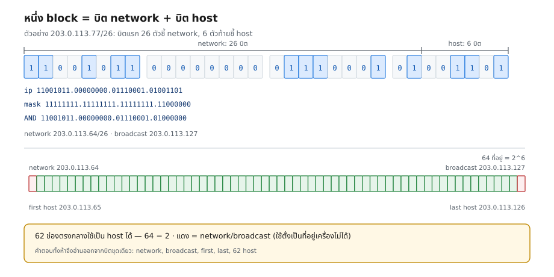
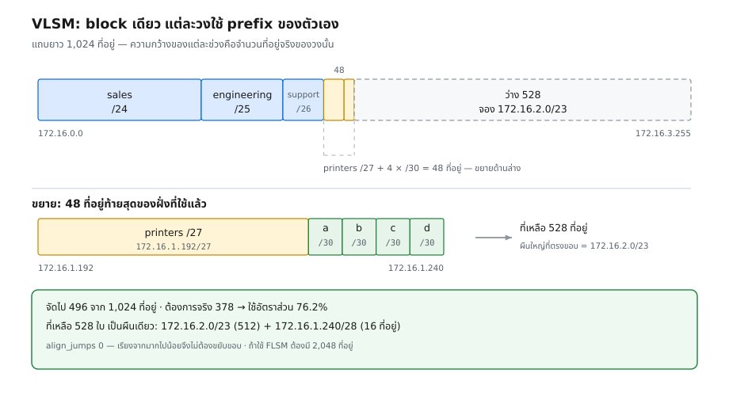
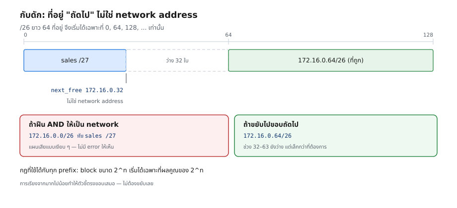

> 📅 เขียนเมื่อ: 20 พฤศจิกายน 2026 (เวลาไทย, UTC+7)
>
> **เครื่องที่รันบทนี้:** Raspberry Pi 5, Debian GNU/Linux 13 (trixie), kernel 6.18.60+rpt-rpi-2712, aarch64 · Go 1.24.4 · iproute2 6.15.0 · ภาพวาดด้วย `gen_svgs.py` แล้วเรนเดอร์ด้วย `rsvg-convert` 2.60.0 · ทุกตัวเลขในบทมาจากไฟล์ใน `out/` ที่สร้างด้วย `bash run_all.sh` ไม่มีตัวเลขใดพิมพ์ด้วยมือ
>
> 🛡️ **จริยธรรม (ใช้กับทั้งซีรีส์):** การสแกน การดัก packet และการอ่านตาราง neighbour ให้ทำกับ **เครื่องและเครือข่ายที่คุณควบคุมเอง** เท่านั้น บทนี้ไม่มีการยิง packet ออกนอกเครื่องแม้แต่ใบเดียว — โปรแกรมทั้งหมดคำนวณจากตัวเลขในหน่วยความจำ และที่อยู่ทุกตัวในบทเป็นที่อยู่สำหรับเอกสาร (RFC 5737: `192.0.2.0/24`, `198.51.100.0/24`, `203.0.113.0/24`) หรือ private range ตาม RFC 1918 (`10.0.0.0/8`, `172.16.0.0/12`, `192.168.0.0/16`)

---

## 0. ตั๋วงานที่ต้องตอบให้ได้ในสิบวินาที

ตั๋วงานแบบนี้ขึ้นมาบ่อยจนแทบไม่ต้องอ่านละเอียด: "สาขาใหม่ต้องการวงรองรับ 60 เครื่อง ขอ IP ด้วย" แล้วปลายสายก็รอคำตอบ

คำตอบที่ดีไม่ใช่ "เอา `192.168.10.0/24` ไปใช้สิ" เพราะ `/24` ให้ 254 ที่อยู่ ทั้งที่ต้องการ 60 — เปลืองไป 194 ใบ และถ้าวันหน้าต้องแบ่งวงใหม่อีกสามวง คุณจะเหลือที่ว่างไม่พอดีกับขนาดที่ต้องการอีกต่อไป คำตอบที่ดีคือ: network อะไร, broadcast อะไร, เครื่องแรกกับเครื่องสุดท้ายคืออะไร, ใช้ได้กี่เครื่อง, และเหลือที่ไว้ขยายอีกเท่าไร

ตอนที่แล้ว ([IP address และ CIDR](/blog/post.html?slug=2026-11-19-network-09-ip-address-cidr)) เราตั้งชื่อให้ทุกชิ้นส่วนแล้ว — network address, prefix, mask, private range — แต่ยังไม่ได้บวกลบอะไรกับมันเลย บทนี้คือการเปลี่ยนจาก "รู้จัก" เป็น "คำนวณ" สามเรื่อง:

1. **จาก IP + prefix ห้าค่าที่เหลือ** — network, broadcast, first host, last host, จำนวน host ที่ใช้ได้
2. **แบ่ง block เป็น subnet** — ยืมบิตจาก host part แล้วได้กี่วง วงละกี่เครื่อง เริ่มที่ไหน
3. **VLSM** — เมื่อแต่ละวงต้องการจำนวนเครื่องไม่เท่ากัน (และนี่คือกรณีจริงเกือบทั้งหมด)

จากนั้นเราจะเขียนเครื่องมือที่ตอบแทนเราได้ ใน Go ที่แกนคำนวณ (`ipv4.go` กับ `subnet.go`) ยาว 240 บรรทัด และทั้งโปรแกรม 854 บรรทัดเมื่อรวม CLI กับตัวจัดสรร

> ถ้ายังไม่คุ้นคำว่า **host part (ส่วน host)**: IPv4 address 32 บิตถูกแบ่งเป็นสองท่อนด้วย prefix — บิตซ้ายคือ network part ที่ทุกเครื่องในวงเดียวกันมีเหมือนกัน บิตขวาคือ host part ที่ต่างกันเป็นรายเครื่อง[^1] งาน subnetting ทั้งหมดคือการตัดสินใจว่า "เส้นแบ่งอยู่ตรงไหน" และทุกค่าที่เราจะคำนวณในบทนี้ตามมาจากเส้นนั้นเส้นเดียว

---

## 1. ห้าค่าที่ต้องตอบได้จาก IP + prefix

### 1.1 AND ครั้งเดียวจบ

ให้ที่อยู่ `203.0.113.77/26` มาจากตั๋วงาน แล้วเราต้องตอบว่ามันอยู่ในวงไหน

`/26` แปลว่า 26 บิตซ้ายเป็น network อีก 6 บิตขวาเป็น host ขนาดของ block (ช่วงที่อยู่ติดกันที่มี prefix เดียวกัน) คือ `2^6 = 64` ที่อยู่ — และนั่นหมายความว่าในเลข 32 บิตนั้น บิตที่ 27 ถึง 32 เท่านั้นที่เปลี่ยนได้ ที่เหลือถูกกำหนดตายตัวโดย prefix

การหา network address คือการ **บังคับให้บิต host เป็นศูนย์ทั้งหมด** ซึ่งในทางเลขฐานสองคือ `ip AND mask` — และเพราะ mask ของ `/26` คือ 26 ตัวแรกเป็น 1 ที่เหลือเป็น 0 การ AND จึงไม่ทำอะไรกับบิต network เลย มันแค่ล้างบิต host ทิ้ง

```text
## ห้าค่าที่ต้องตอบได้จาก IP + prefix
input            203.0.113.77/26
ip               11001011.00000000.01110001.01001101
mask             11111111.11111111.11111111.11000000
AND              11001011.00000000.01110001.01000000
network          203.0.113.64/26
broadcast        203.0.113.127
first_host       203.0.113.65
last_host        203.0.113.126
hosts_usable     62
block_size       64
host_bits        6
network_bits     26
wildcard         0.0.0.63
```

อ่านทีละบรรทัด:

- **ip / mask / AND** — สามบรรทัดนี้คือการคำนวณทั้งหมด เขียนให้เห็นว่า AND ทำงานเป็นรายบิต ไม่มีเลขฐานสิบเข้ามาเกี่ยวข้อง
- **network** — `203.0.113.64/26` เพราะ octet สุดท้าย `77 = 01001101` และ `01001101 AND 11000000 = 01000000` ซึ่งก็คือ 64
- **broadcast** — `203.0.113.127` คือ network + 63 หรือในทางบิตคือเปิดบิต host ทั้งหกเป็น 1 ที่อยู่นี้คือที่อยู่ที่ใช้ส่งถึงทุกเครื่องในวงพร้อมกัน ไม่ใช่ที่อยู่ของเครื่องใดเครื่องหนึ่ง
- **first_host / last_host** — `203.0.113.65` กับ `203.0.113.126` เพราะสองหัวท้ายถูกจอง
- **hosts_usable = 62** — 64 ลบ 2
- **host_bits = 6, network_bits = 26** — บวกกันได้ 32 เสมอ
- **wildcard** — `0.0.0.63` คือ mask กลับด้าน (บิตที่ไม่ต้องตรง) ใช้เขียนกฎ ACL ของ router: `203.0.113.64 0.0.0.63` หมายถึงทั้ง block นี้

จุดที่คนพลาดบ่อยที่สุดคือบรรทัด **first_host** กับ **last_host**: ที่อยู่แรกของ block ไม่ใช่ host แรก และที่อยู่สุดท้ายของ block ไม่ใช่ host สุดท้าย ระยะห่างระหว่างสองคู่นี้คือ 1 address ในแต่ละข้าง ซึ่งดูเล็กน้อยจนคนมักลืม — และการลืมมันคือสาเหตุที่เครื่องหนึ่งได้ IP ที่ชนกับ network address ของวงตัวเอง แล้ว debug กันเป็นชั่วโมง[^2]



### 1.2 ค่าทั้งห้าเกิดจากสามการดำเนินการ

ถ้าจำสูตรทั้งห้าไม่ได้ ไม่เป็นไร — มีแค่สามการดำเนินการที่ต้องจำ และที่เหลือคำนวณได้จากขนาด block:

| ค่า | สูตรจาก IP + prefix | สูตรจาก network + ขนาด |
|---|---|---|
| network | `ip AND mask` | — |
| broadcast | `network OR (NOT mask)` | `network + size − 1` |
| first host | `network + 1` | `network + 1` |
| last host | `broadcast − 1` | `network + size − 2` |
| จำนวน host | `2^(32 − prefix) − 2` | `size − 2` |

คอลัมน์ขวาคือสูตรที่คนทำงานจริงใช้ เพราะขนาด block อ่านออกจาก prefix ได้ในหัว: `/26` คือ 64, `/27` คือ 32, `/28` คือ 16, `/29` คือ 8 — แบ่งครึ่งไปเรื่อย ๆ ทุกครั้งที่เพิ่มบิต

ขนาด block คือ `2^(32 − prefix)`[^1] ที่อยู่ และมันมีคุณสมบัติหนึ่งที่สำคัญมากจนเราจะยกให้เป็นหัวข้อถัดไป: **มันเป็นกำลังของสองเสมอ**

---

## 2. block ต้องเริ่มตรงขอบ — กฎเดียวที่กันความผิดพลาดได้ทั้งชีวิต

ถ้า `/26` มีขนาด 64 ที่อยู่ และบิต host ของ network address ต้องเป็นศูนย์ทั้งหมด คำถามคือในเลข 32 บิต มีตำแหน่งไหนบ้างที่บิต 6 ตัวท้ายเป็นศูนย์พร้อมกัน

คำตอบ: ตำแหน่งที่หารด้วย 64 ลงตัว นั่นแปลว่าใน octet สุดท้าย network address ของ `/26` เกิดได้แค่สี่ค่า — `0, 64, 128, 192` เท่านั้น ส่วน `203.0.113.77/26` ที่เราคำนวณในหัวข้อที่แล้วจึงไม่ใช่ block แต่เป็นที่อยู่ของเครื่องที่อยู่ใน block `.64/26`

นี่คือเหตุผลที่เราพูดว่า block "เริ่มตรงขอบ" (aligned) และมันคือกฎที่ใช้กับทุก prefix:

> block ขนาด `2^n` เริ่มได้เฉพาะที่ผลคูณของ `2^n`

ลองกับ `/24` (ขนาด 256): บิต host คือ octet สุดท้ายทั้งแปดตัว network address จึงต้องลงท้ายด้วย `.0` เสมอ ส่วน octet ที่สามเป็นอะไรก็ได้ — ตรงกับที่เราคุ้นตาว่า network ของ `/24` ลงท้ายด้วย `.0`

ลองกับ `/22` (ขนาด 1,024 = 4 × 256): เหลือ host bit 10 ตัว ซึ่งก็คือ 2 บิตใน octet ที่สามบวก 8 บิตท้าย ช่วงจึงก้าวทีละ 4 ใน octet ที่สาม — octet ที่สามต้องหารด้วย 4 ลงตัวและ octet สุดท้ายเป็น `.0` → `.0`, `.4`, `.8`, ... ดังนั้น `172.16.0.0/22` ครอบ `172.16.0.0` ถึง `172.16.3.255` — ที่อยู่ถัดจากนั้นคือ block ใหม่ที่เริ่มตรงขอบของตัวเอง

กฎนี้ฟังดูเป็นรายละเอียดทางคณิตศาสตร์ แต่ผลของมันเป็นเรื่องจริงจัง: **block ที่ไม่ตรงขอบประกาศเป็น route ไม่ได้** — เครื่องและ router จะปฏิเสธตอนตั้งค่า (ข้อความ error ต่างกันไปตามระบบ) หรือแย่กว่านั้นคือ normalize (ปรับเลขให้เป็น network address ที่ถูกต้อง) ให้เงียบ ๆ แล้วคุณได้ block ที่ไม่ใช่ block ที่คิดไว้ และเครื่องที่ตั้งค่าไว้จะสื่อสารได้บ้างไม่ได้บ้างแบบที่หาสาเหตุยากมาก

เราจะกลับมาที่กฎนี้ในหัวข้อ 6 ซึ่งเป็นกับดักที่เกิดบ่อยที่สุดในชีวิตจริง

---

## 3. ยืมบิต: กี่วง กี่เครื่อง

Subnetting คือการยืมบิตจาก host part ไปเป็น network part ทุกบิตที่ยืมทำให้ block เล็กลงครึ่งหนึ่ง และทำให้ได้ block ย่อยเพิ่มเป็นสองเท่า

ตารางเดียวที่ควรจำได้ขึ้นใจคือตารางนี้ — เริ่มจาก `/24` แล้วยืมไปเรื่อย ๆ:

```text
## ยืมบิต host มาทำ subnet: ทุกบิตที่ยืมกินที่อยู่ไปสองใบ
base             192.168.10.0/24 (256 ที่อยู่)

borrow prefix  subnets  block  usable_each  usable_total note
0      /24     1        256    254          254          
1      /25     2        128    126          252          
2      /26     4        64     62           248          
3      /27     8        32     30           240          
4      /28     16       16     14           224          
5      /29     32       8      6            192          
6      /30     64       4      2            128          
7      /31     128      2      2            256          point-to-point (RFC 3021)
8      /32     256      1      1            256          host route (ที่อยู่เดียว)
```

อ่านแถว `/26` (ยืม 2 บิต): ได้ **4 subnet** วงละ **64 ที่อยู่** ใช้ได้ **62 เครื่อง** รวมทั้งสี่วงได้ 248 ที่อยู่ที่ใช้เป็น host

และนี่คือจุดที่ต้องเข้าใจให้ถูก: **248 ไม่เท่ากับ 254** ทั้งที่เราไม่ได้เพิ่มหรือลดอะไรเลย นับทีละขั้น:

1. `/24` ใบเดียวนับได้ 256 ที่อยู่ แต่ใช้เป็น host ได้ 254 เพราะ `.0` กับ `.255` ถูกจองเป็น network กับ broadcast ของวง
2. ยืม 2 บิตได้ 4 วง วงละ 64 ที่อยู่ และทุกวงต้องจอง 2 ใบให้ network กับ broadcast ของตัวเอง → 4 × 2 = 8 ใบ
3. สองใบในนั้นคือ `.0` กับ `.255` ของ block แม่ ซึ่งถูกหักไปแล้วในข้อ 1 — เป็น network/broadcast ของ subnet แรกกับ subnet สุดท้ายพอดี จึงไม่ถูกหักซ้ำ
4. ที่หายเพิ่มจริงคือ 8 − 2 = **6 ใบ** และ 254 − 6 = **248**

เราจะเรียกมันว่า **ภาษีของ subnetting**: ทุก subnet ที่คุณสร้างมีค่าธรรมเนียม 2 ที่อยู่ และค่าธรรมเนียมนี้จ่ายเป็นจำนวนที่อยู่ ไม่ใช่เป็นเงิน — ยิ่งแบ่งละเอียดยิ่งจ่ายมาก

ดูแถวสุดท้ายของตารางให้ดี:

- **`/31` (ยืม 7 บิต)** ใช้ได้ 2 ที่อยู่ ไม่ใช่ 0 — เพราะ link แบบ point-to-point (p2p — link ที่ต่อตรงสองปลาย ไม่มีเครื่องอื่นร่วม) ไม่มี notion ของ broadcast (ปลายอีกข้างรับทุกอย่างที่ส่งไปอยู่แล้ว) จึงไม่ต้องจอง[^3] ผลรวมทั้ง 128 วงกลับมาเป็น 256 เต็ม
- **`/32` (ยืม 8 บิต)** คือที่อยู่เดียว ใช้เป็น host route

สองแถวนี้คือข้อยกเว้นของสูตร `size − 2` และเป็นเหตุผลที่ในโค้ดเราต้องเขียน `switch` สองเคสแทนที่จะใช้สูตรเดียว

> **กับดักทางความคิด:** คนมักคิดว่า "ยืม 1 บิต = เสีย 1 บิต" แล้วสรุปว่ายืม 2 บิตเสียแค่ 2 ที่อยู่ ความจริงคือยืม 1 บิตได้ subnet เพิ่ม 1 วง และแต่ละวงมีค่าธรรมเนียม 2 ใบ → ยืม 3 บิตจาก `/24` จ่ายค่าธรรมเนียม 16 ใบ (8 วง × 2) — เทียบกับ 254 ของ block แม่คือหายไป 14 ใบ ไม่ใช่ 3 ใบ

---

## 4. แบ่งจริง: `/24` หนึ่งใบเป็นสี่วง

ถึงตอนนี้เรามีครบแล้ว: ขนาด, ขอบ, ภาษี ลงมือแบ่ง `192.168.10.0/24` เป็น 4 วงเท่า ๆ กัน

```text
## แบ่ง 192.168.10.0/24 เป็น 4 subnet (ยืม 2 บิต)
base             192.168.10.0/24 (256 ที่อยู่)
new_prefix       /26 (block 64, usable 62)

#   network             broadcast          first_host        last_host         usable
1   192.168.10.0/26     192.168.10.63      192.168.10.1      192.168.10.62     62
2   192.168.10.64/26    192.168.10.127     192.168.10.65     192.168.10.126    62
3   192.168.10.128/26   192.168.10.191     192.168.10.129    192.168.10.190    62
4   192.168.10.192/26   192.168.10.255     192.168.10.193    192.168.10.254    62

usable_total     248
base_usable      254
```

วิธีคิดที่เร็วกว่าเครื่องคิดเลขคือ **บวกขนาด block ไปเรื่อย ๆ**: ขนาด `/26` คือ 64 ดังนั้น network ของสี่วงคือ `0, 64, 128, 192` — และ broadcast คือ network + 63 ของแต่ละตัว นั่นคือทั้งหมด ไม่ต้อง AND อะไรเลยถ้าเริ่มจาก block ที่ตรงขอบแล้ว

ตรวจสามอย่างด้วยสายตา:

- **ต่อกันพอดี ไม่มีรู ไม่มีทับ** — `.0–.63`, `.64–.127`, `.128–.191`, `.192–.255`
- **broadcast ของวงสุดท้าย = broadcast ของ block แม่** — `192.168.10.255` ทั้งคู่ ถ้าไม่ตรงแปลว่ามีที่อยู่ตกหล่น
- **usable_total = 248** — ตรงกับแถว `/26` ในตารางหัวข้อ 3 ไม่ใช่ 254

ข้อสังเกตทางภาษาที่สำคัญ: ทั้งสี่วงนี้บางคนเรียกว่า "subnet" บางคนเรียกว่า "network" ทั้งสองคำหมายถึงสิ่งเดียวกันในบริบทนี้ — block ที่มี prefix ของตัวเองและมี network/broadcast ของตัวเอง

---

## 5. VLSM: เมื่อแต่ละวงไม่เท่ากัน

### 5.1 ปัญหาของ "ขนาดเดียวทั้งแผน"

ตารางหัวข้อ 3 สอนแบ่งแบบเท่ากัน (fixed-length subnet mask, FLSM) ซึ่งใช้ได้ดีเมื่อทุกวงต้องการจำนวนเครื่องเท่ากัน — แต่ในองค์กรจริงแทบไม่เคยเท่ากัน

ยกแผนจริงมาหนึ่งแผนจาก block `172.16.0.0/22` (1,024 ที่อยู่):

- sales 200 เครื่อง
- engineering 100 เครื่อง
- support 50 เครื่อง
- printers 20 เครื่อง
- link ระหว่าง router 4 เส้น เส้นละ 2 ปลาย

ถ้ายึด FLSM ต้องใช้ขนาดเท่ากับวงที่ใหญ่ที่สุดคือ `/24` (254 usable) กับทุกวง — และมีแปดวงที่ต้องรองรับ (สี่ LAN + สี่ link):

```text
## ถ้ายึดขนาดเดียวทั้งแผน (FLSM): ทุกวงได้เท่ากับวงที่ใหญ่ที่สุด
largest_need       200 host → /24 (254 usable)
subnets_needed     8
fixed_cost         2,048 (8 × 256)
base_size          1,024
fits               NO (ขาด 1,024 ที่อยู่)
flsm_block_needed  /21 (2,048 ที่อยู่)
vlsm_cost          496
saving             1,552 (75.8% ของที่ FLSM ต้องใช้)
```

`8 × 256 = 2,048` ที่อยู่ แต่ block ที่เรามีใหญ่แค่ 1,024 — **ไม่พอ** และไม่ใช่ไม่พอแบบเกือบ ๆ แต่ขาดไปครึ่งหนึ่ง ถ้าจะยึดวิธีนี้จริง ๆ ต้องขอ block ขนาด `/21` จากผู้ให้บริการ ซึ่งหมายถึงการขอที่อยู่เพิ่มเป็นสองเท่าเพื่อรองรับความต้องการเดิม

และนี่คือจุดที่ VLSM เข้ามาแก้: **ทำไมทุกวงต้องใช้ prefix เท่ากันด้วย ในเมื่อแต่ละวงต้องการจำนวนเครื่องไม่เท่ากัน** ข้อแม้ข้อเดียวคือ router ต้องได้รับ mask มาพร้อม route ไม่ใช่เดาเอาจาก class ของที่อยู่ — class คือการแบ่งที่อยู่ยุคเก่า A/B/C ที่บอก prefix ไปในตัว[^4]

### 5.2 จัดสรรจากมากไปน้อย

VLSM (variable-length subnet mask) ไม่มีกลไกวิเศษ — มันคือการยอมให้แต่ละ subnet ใช้ prefix ต่างกัน แล้วจัดสรรจาก block เดียวกันด้วยสามขั้น:

1. เรียงความต้องการจากมากไปน้อย
2. วางแต่ละ block ให้ตรงขอบของขนาดตัวเอง
3. เลื่อนตัวชี้ไปท้าย block ที่เพิ่งวาง

```text
## VLSM: จัดสรรจาก 172.16.0.0/22 ตามจำนวน host ของแต่ละวง
base             172.16.0.0/22 (1,024 ที่อยู่)
base_range       172.16.0.0–172.16.3.255
order            มากไปน้อย (descending)
p2p              /30 (classic: network + broadcast ถูกจอง)

name         need  prefix  block  network              range                            usable  waste
sales        200   /24     256    172.16.0.0/24        172.16.0.0–172.16.0.255          254     54
engineering  100   /25     128    172.16.1.0/25        172.16.1.0–172.16.1.127          126     26
support      50    /26     64     172.16.1.128/26      172.16.1.128–172.16.1.191        62      12
printers     20    /27     32     172.16.1.192/27      172.16.1.192–172.16.1.223        30      10
link-a       2     /30     4      172.16.1.224/30      172.16.1.224–172.16.1.227        2       0
link-b       2     /30     4      172.16.1.228/30      172.16.1.228–172.16.1.231        2       0
link-c       2     /30     4      172.16.1.232/30      172.16.1.232–172.16.1.235        2       0
link-d       2     /30     4      172.16.1.236/30      172.16.1.236–172.16.1.239        2       0

needed_total     378
allocated_total  496
usable_total     480
free_total       528
free_ranges      1
reserve          172.16.2.0/23 (512 ที่อยู่)
reserve_rest     172.16.1.240/28 (16 ที่อยู่)
align_jumps      0
efficiency       76.2% ของที่อยู่ที่จัดไปถูกใช้จริง
```

อ่านจากบนลงล่างจะเห็นว่าขนาดลดหลั่น: `/24` → `/25` → `/26` → `/27` แล้วปิดท้ายด้วย `/30` อีกสี่วง แต่ละวงได้ block ที่พอดีกับความต้องการของตัวเอง (คอลัมน์ waste คือจำนวนที่อยู่ที่จัดไปเกินความจำเป็น — 54 ใบสำหรับ sales, 26 สำหรับ engineering, และ 0 สำหรับ link)

ผลรวมคือ **496 จาก 1,024 ที่อยู่** เทียบกับ 2,048 ของ FLSM — ประหยัดไป 1,552 ใบ หรือ 75.8% และถ้าวัดอีกทางหนึ่ง — ที่อยู่ที่ต้องการจริง 378 ใบ เทียบกับที่จัดไป 496 — ประสิทธิภาพอยู่ที่ 76.2%

สิ่งที่ควรสังเกตที่สุดคือ `align_jumps 0`: การวางทั้งหมดเกิดขึ้นโดยไม่ต้องขยับตัวชี้เลยแม้แต่ครั้งเดียว และนี่ไม่ใช่ความบังเอิญ — มันเป็นทฤษฎีบท[^5] ข้อนี้:

> ถ้าเราเรียงจากขนาดมากไปน้อย ทุก block ที่วางไปก่อนหน้ามีขนาดเป็นกำลังของสองที่**ไม่เล็กกว่าขนาดปัจจุบัน** จึงเป็นพหุคูณของขนาดปัจจุบัน ผลรวมของมันจึงเป็นพหุคูณด้วย → ตัวชี้อยู่ตรงขอบเสมอ

พูดง่าย ๆ: block ใหญ่กินพื้นที่เป็นจำนวนเต็มของ block เล็กเสมอ การเรียงจากใหญ่ไปเล็กจึง "พอดีเป๊ะ" โดยธรรมชาติ — และนี่คือเหตุผลที่เครื่องมือ VLSM ทุกตัวในโลกเรียงจากมากไปน้อย

ย้อนดูประวัติสั้น ๆ: มาตรฐาน subnetting (RFC 950, สิงหาคม 1985) ให้แบ่ง network หนึ่งใบเป็นวงย่อยได้ แต่ทุกวงต้องใช้ mask เดียวกัน เพราะ routing protocol ยุคนั้นประกาศแค่ network number ผู้รับจึงเดา prefix จาก class ของที่อยู่ — VLSM ใช้ได้จริงก็ต่อเมื่อ protocol ส่ง mask มาพร้อม route (RIPv2, OSPF, BGP) และเมื่อ CIDR ในปี 1993 ทำให้การตีความแบบ classless เป็นเรื่องปกติ[^4]

### 5.3 ที่เหลือไม่ได้ทิ้ง — มันคือพื้นที่ขยาย

หลังจัดสรรครบ เหลือ 528 ที่อยู่ และมันไม่ใช่กองขยะ แต่เป็น **พื้นที่สำหรับขยาย** ที่ต้องรู้ว่าอยู่ตรงไหน

- `172.16.2.0/23` — 512 ที่อยู่ ผืนใหญ่ที่ตรงขอบ (ใช้เพิ่มอีก 2 วง `/24` ได้ทันที)
- `172.16.1.240/28` — 16 ที่อยู่ เศษที่ติดมากับการจัดวาง

ตัวเลข 528 กับ 512 ต่างกัน 16 และความต่างนี้คือสิ่งที่แยกคนที่ "จัดสรรเสร็จ" กับคนที่ "จัดสรรเสร็จแล้วบอกคนอื่นได้ว่าที่เหลือใช้ทำอะไรได้" — ที่อยู่ 16 ใบใช้กับ link เพิ่มได้อีก 4 เส้น (`/30`) หรือ 8 เส้น (`/31`)



---

## 6. กับดักที่เจอบ่อยที่สุด: "ที่อยู่ถัดไป" ไม่ใช่ network address

ในหัวข้อ 5 การจัดสรรดูง่ายเพราะเรียงขนาดถูก แต่ในมือคนที่ทำครั้งแรก สิ่งที่เกิดขึ้นจริงคือ: "sales จบที่ `.31` งั้น `.32` คือที่ว่างถัดไป เอามันเป็น network ของ `/26` เลย"

ตัวอย่างในหัวข้อนี้เป็น **แผนของอีกราย** ไม่ใช่แผนในหัวข้อ 5 — ที่นี่ sales มี 20 เครื่อง จึงได้ `/27` (32 ที่อยู่) และจบที่ `.31` ใช้ชื่อวงซ้ำกับหัวข้อ 5 แต่ขนาดต่างกัน เพื่อให้เห็นกับดักชัด ๆ

`172.16.0.32/26` เป็นข้อความที่อ่านออกเสียงได้และดูสมเหตุสมผลทุกประการ — แต่มันไม่ใช่ block เพราะ `/26` ต้องเริ่มที่ผลคูณของ 64

```text
## กับดัก: ที่อยู่ "ถัดไป" ไม่ใช่ network address
allocated        172.16.0.0/27 (sales, ใช้ 32 ที่อยู่)
next_free        172.16.0.32
try_26           ปฏิเสธ: 172.16.0.32 ไม่ใช่จุดเริ่มต้นของ /26 (ที่ถูกคือ 172.16.0.0)
if_normalized    172.16.0.0/26 → ทับ sales: true
correct          172.16.0.64/26
skipped          172.16.0.32–172.16.0.63 (32 ที่อยู่ — ยังว่าง แต่เล็กกว่าที่ต้องการ)
```

สองบรรทัดกลางคือสองความผิดพลาดที่ต่างกันโดยสิ้นเชิง:

**ความผิดพลาดที่หนึ่ง — ถูกปฏิเสธ (ดีแล้ว)** ถ้าเครื่องมือตรวจว่า "บิต host ของ network address ต้องเป็นศูนย์" มันจะบอกคุณทันทีว่า `172.16.0.32` ไม่ใช่จุดเริ่มต้นของ `/26` และที่ถูกคือ `172.16.0.0` — แต่สังเกตว่าคำตอบที่มันเสนอ (`172.16.0.0/26`) ก็ยังใช้ไม่ได้ เพราะ...

**ความผิดพลาดที่สอง — เงียบและอันตรายกว่า** ถ้าโปรแกรม (หรือคน) AND มันเข้ากับ mask เพื่อ "normalize" จะได้ `172.16.0.0/26` ซึ่ง **ทับกับ sales ที่จองอยู่แล้ว** ไม่มี error ไม่มีคำเตือน — แผนดูเรียบร้อยในสเปรดชีต แต่ตอนตั้งค่าเครื่อง/router จริง จะมีสองวงประกาศ route ทับกัน และอาการที่ได้คือ "บางเครื่องต่อได้ บางเครื่องต่อไม่ได้" ซึ่งเป็นอาการที่ใช้เวลา debug นานที่สุดในบรรดาอาการทั้งหมด

ทางที่ถูกคือขยับไป **ขอบถัดไป**: `172.16.0.64/26` และยอมรับว่าช่วง `172.16.0.32–.63` (32 ที่อยู่) ยังว่างแต่เล็กเกินกว่าจะใส่ `/26` ได้



> **บทเรียนที่ใช้ได้ทั้งอาชีพ:** ที่ว่างไม่เท่ากับ block ที่วางได้ การจัดสรรที่อยู่จึงไม่ใช่การหาช่องว่างถัดไป แต่คือการหา **ช่องว่างที่ใหญ่พอและตรงขอบ** — ต่างกันคนละเรื่อง และเป็นเหตุผลที่เครื่องมือจัดสรรทุกตัว (รวมถึง DHCP server — ตัวจ่ายที่อยู่ให้เครื่องในวงอัตโนมัติ) ทำงานด้วยการคิดเป็น block ไม่ใช่คิดเป็นทีละที่อยู่

## 7. เขียน subnet calculator ใน Go

ถึงตรงนี้เราคำนวณด้วยมือได้ครบแล้ว แต่การคำนวณด้วยมือคือที่มาของความผิดพลาดแบบหัวข้อ 6 — และในงานจริงเราไม่ได้ทำครั้งเดียว แต่ทำกับแผนที่มีสิบห้าวงและเปลี่ยนทุกสัปดาห์

เครื่องมือที่เราจะเขียนมีสองหน้าที่: ตอบคำถามห้าข้อจาก `address/prefix` และจัดสรร VLSM พร้อมตรวจแผนของตัวเองก่อนพิมพ์ออกมา ทั้งหมดอยู่ในสี่ไฟล์ `main.go`, `ipv4.go`, `subnet.go`, `vlsm.go` และรันได้ด้วย `go run .`

### 7.1 สามการดำเนินการ ห้าบรรทัด

หัวใจของทั้งโปรแกรมคือสี่ฟังก์ชันนี้ — ถ้าเข้าใจสี่ตัวนี้ ที่เหลือเป็นเรื่องการจัดรูปแบบข้อความ:

```go
func (a Addr) Network(prefix int) Addr { return a & maskFor(prefix) }

// Broadcast = network OR (NOT mask) คือเปิดบิต host ทั้งหมดเป็น 1
func (a Addr) Broadcast(prefix int) Addr { return a | ^maskFor(prefix) }

// blockSize = 2^(32-prefix) จำนวนที่อยู่ทั้งหมดในช่วง
func blockSize(prefix int) uint64 { return uint64(1) << uint(addrBits-prefix) }

// usableHosts นับที่อยู่ที่ตั้งเป็น host ได้
//
// สูตร 2^n − 2 ใช้กับ /0..30 เท่านั้น: /31 ใช้ได้ทั้งสองที่อยู่ (RFC 3021)
// และ /32 เป็น host route ที่มีที่อยู่เดียว
func usableHosts(prefix int) uint64 {
	switch prefix {
	case 32:
		return 1
	case 31:
		return 2
	}
	return blockSize(prefix) - 2
}
```

`Addr` เป็น `uint32` ตัวเดียว จึงใช้ operator ของเลขได้ตรง ๆ: `&` คือ AND, `|` คือ OR, `^` คือ NOT ในภาษา Go (หมายเหตุสำหรับคนที่มาจากภาษาอื่น: `^` ที่ใช้หน้า operand คือ bitwise NOT ไม่ใช่ XOR — XOR คือ `^` ที่ใช้ระหว่างสอง operand) · ค่าคงที่ `addrBits` ที่โผล่ใน `blockSize` คือ 32 (จำนวนบิตของ IPv4) และทุกสูตรในบทนี้อ้างถึงมันตัวเดียว

`maskFor` สร้าง mask จาก prefix ด้วยการเลื่อนบิต: `/26` คือ `^uint32(0) << 6` ซึ่งได้ 26 ตัวแรกเป็น 1 พอดี — ไม่ต้องมีตาราง lookup และไม่มีทางที่ mask กับ prefix จะไม่ตรงกัน

`usableHosts` มี `switch` สองเคสสำหรับ `/31` กับ `/32` เพราะสูตร `2^n − 2` ให้ค่าผิดในสองกรณีนั้น (ได้ 0 กับ −1) การเขียนข้อยกเว้นไว้ตรงจุดที่มันเกิดขึ้น ทำให้ทั้งโปรแกรมไม่ต้องมี `if prefix == 31` กระจัดกระจายอีก

### 7.2 Subnet ที่ตรวจขอบตัวเองตั้งแต่เกิด

ความผิดพลาดในหัวข้อ 6 ถูกกันได้ด้วยการทำให้ block ที่ไม่ตรงขอบ **สร้างไม่ได้** ตั้งแต่แรก:

```go
type Subnet struct {
	Base   Addr // network address: บิต host เป็นศูนย์ทั้งหมด
	Prefix int
}

func NewSubnet(base Addr, prefix int) (Subnet, error) {
	if prefix < 0 || prefix > addrBits {
		return Subnet{}, fmt.Errorf("prefix ต้องอยู่ 0–32 (ได้ %d)", prefix)
	}
	m := maskFor(prefix)
	if base&m != base {
		return Subnet{}, fmt.Errorf("%s ไม่ใช่จุดเริ่มต้นของ /%d (ที่ถูกคือ %s)",
			base, prefix, base&m)
	}
	return Subnet{Base: base, Prefix: prefix}, nil
}
```

บรรทัดที่ทำหน้าที่ทั้งหมดคือ `if base&m != base` — ถ้า AND แล้วค่าเปลี่ยน แปลว่ามีบิต host ที่ไม่ใช่ศูนย์อยู่ในตัวเลขนั้น แปลว่ามันไม่ใช่ network address ข้อความ error บอกทั้งค่าที่รับมาและค่าที่ควรเป็น เพื่อให้ผู้ใช้แก้ได้ทันทีโดยไม่ต้องเปิดเอกสาร

หลักการทั่วไปที่ควรจำ: **ตรวจที่ขอบโปรแกรม ไม่ใช่ที่จุดใช้งาน** ถ้า `NewSubnet` ปล่อยค่าที่ผิดผ่านไปได้สักครั้ง เดี๋ยวจะมี `if` ตรวจซ้ำอีกสามที่ในฟังก์ชันอื่น แล้วสักวันหนึ่งจะมีที่ที่ลืม

ส่วน `First`/`Last` มีเงื่อนไขเดียวที่ต้องจำ — `/31` ขึ้นไปไม่มี network/broadcast อยู่ข้างในให้หัก:

```go
func (s Subnet) First() Addr {
	if s.Prefix >= 31 {
		return s.Base
	}
	return s.Base + 1
}

func (s Subnet) Last() Addr {
	if s.Prefix >= 31 {
		return s.Broadcast()
	}
	return s.Broadcast() - 1
}
```

### 7.3 แปลง "ต้องการ 200 เครื่อง" เป็น prefix

ตารางหัวข้อ 3 อ่านจากบนลงล่าง (prefix → จำนวนเครื่อง) แต่ในงานจริงเราถามกลับทาง: มีความต้องการแล้วอยากรู้ prefix ฟังก์ชันนี้จึงวนหาคำตอบจาก `/30` ขึ้นไป:

```go
func PrefixForHosts(hosts int, allow31 bool) (int, error) {
	if hosts < 1 {
		return 0, fmt.Errorf("จำนวน host ต้องมากกว่า 0 (ได้ %d)", hosts)
	}
	if hosts == 1 {
		return 32, nil
	}
	if hosts == 2 && allow31 {
		return 31, nil
	}
	for p := 30; p >= 0; p-- {
		if blockSize(p)-2 >= uint64(hosts) {
			return p, nil
		}
	}
	return 0, fmt.Errorf("%d host เกินขอบเขตที่ IPv4 ให้ได้", hosts)
}
```

สองเคสแรกเป็นข้อยกเว้นที่ตั้งใจ: ต้องการ 1 ที่อยู่คือ `/32` และต้องการ 2 ที่อยู่จะได้ `/31` ถ้าเปิดใช้ `allow31` (ซึ่งคือกรณี link ระหว่าง router) — ที่เหลือใช้สูตร `blockSize(p) - 2 >= hosts` ตรง ๆ

### 7.4 จัดสรรและตรวจ

ตัวจัดสรร VLSM คือสามขั้นในหัวข้อ 5.2 เขียนเป็นโค้ดตรง ๆ ไม่มีลูกเล่น:

```go
func VLSM(base Subnet, reqs []Request, descending, allow31 bool) ([]Allocation, int, error) {
	work := make([]Request, len(reqs))
	copy(work, reqs)
	if descending {
		sort.SliceStable(work, func(i, j int) bool {
			if work[i].Hosts != work[j].Hosts {
				return work[i].Hosts > work[j].Hosts
			}
			return work[i].Name < work[j].Name
		})
	}
	cursor := base.Base
	out := make([]Allocation, 0, len(work))
	jumps := 0
	for _, r := range work {
		p, err := PrefixForHosts(r.Hosts, allow31)
		if err != nil {
			return nil, jumps, fmt.Errorf("%s: %v", r.Name, err)
		}
		size := blockSize(p)
		if rem := uint64(cursor) % size; rem != 0 {
			cursor += Addr(size - rem)
			jumps++
		}
		if uint64(cursor-base.Base)+size > base.Size() {
			return nil, jumps, fmt.Errorf("ที่อยู่ใน %s ไม่พอสำหรับ %s (/%d ต้องการ %d ที่อยู่)",
				base, r.Name, p, size)
		}
		sn, err := NewSubnet(cursor, p)
		if err != nil {
			return nil, jumps, err
		}
		out = append(out, Allocation{Request: r, Subnet: sn})
		cursor += Addr(size)
	}
	return out, jumps, nil
}
```

สามจุดที่ควรอ่านให้ช้า:

- **`sort.SliceStable` จัดเรียงจากมากไปน้อย** และ tie-break ด้วยชื่อ เพื่อให้แผนที่ต้องการเท่ากันออกมาเหมือนเดิมทุกครั้ง (ถ้าไม่ tie-break ลำดับของ link ทั้งสี่เส้นที่ต้องการเท่ากันจะขึ้นกับลำดับใน input — สลับบรรทัดในไฟล์นิดเดียว ตารางก็สลับที่ ซึ่งทำให้ diff ใน git รกโดยไม่จำเป็น)[^8]
- **`if rem := uint64(cursor) % size; rem != 0`** คือการขยับไปขอบ — branch นี้ไม่ถูกเข้าเลยเมื่อเรียงจากมากไปน้อย แต่ยังต้องมี เพราะฟังก์ชันรับ `descending=false` ได้ (และเพราะมันคือจุดที่เราวัด `jumps` ออกมาเป็นหลักฐาน)
- **`uint64(cursor-base.Base)+size > base.Size()`** ตรวจว่ายังมีที่พอจะวาง — ถ้าไม่พอ คืน error ที่บอกว่าวงไหนต้องการเท่าไร ไม่ใช่ปล่อยให้ค่าล้นออกไปนอก block

หลังจัดสรรแล้ว การตรวจแผนทั้งชุดใช้ฟังก์ชันเดียว:

```go
func CheckAlloc(base Subnet, allocs []Allocation) (overlaps, outside, misaligned int) {
	for i := range allocs {
		s := allocs[i].Subnet
		if s.Base < base.Base || s.Broadcast() > base.Broadcast() {
			outside++
		}
		if s.Base&maskFor(s.Prefix) != s.Base {
			misaligned++
		}
		for j := i + 1; j < len(allocs); j++ {
			if s.Overlaps(allocs[j].Subnet) {
				overlaps++
			}
		}
	}
	return overlaps, outside, misaligned
}
```

มันตอบสามคำถามที่ครอบทุกอย่างที่ผิดได้: วงไหนออกนอก block แม่, วงไหนไม่ตรงขอบ, และคู่ไหนทับกัน — ถ้าทั้งสามเป็นศูนย์ แผนนั้นใช้ได้

### 7.5 ประกอบเป็น CLI

สุดท้ายคือส่วนที่ผู้ใช้เห็น ซึ่งประกอบทุกอย่างเข้าด้วยกัน:

```go
func sectionCalc(a Addr, p int) {
	sn, err := NewSubnet(a.Network(p), p)
	if err != nil {
		fail(err)
	}
	wc, err := Wildcard(p)
	if err != nil {
		fail(err)
	}
	fmt.Println("## subnet calculator: รับ address/prefix แล้วตอบทุกค่า")
	fmt.Printf("%-16s %s/%d\n", "input", a, p)
	fmt.Printf("%-16s %s\n", "network", sn)
	fmt.Printf("%-16s %s\n", "broadcast", sn.Broadcast())
	fmt.Printf("%-16s %s\n", "first_host", sn.First())
	fmt.Printf("%-16s %s\n", "last_host", sn.Last())
	fmt.Printf("%-16s %d\n", "hosts_usable", sn.Usable())
	fmt.Printf("%-16s %s\n", "netmask", maskFor(p))
	fmt.Printf("%-16s %s\n", "wildcard", wc)
	fmt.Printf("%-16s %d\n", "prefix", p)
	fmt.Printf("%-16s %d\n", "host_bits", addrBits-p)
	if note := sn.Note(); note != "" {
		fmt.Printf("%-16s %s\n", "note", note)
	}
}
```

สี่ชื่อในบล็อกนี้ยังไม่เคยนิยามในบท: `Usable()` คืนจำนวน host ที่ตั้งได้ (เรียก `usableHosts` จากหัวข้อ 7.1 — นั่นคือที่มาของ `hosts_usable` ในทุกผลรัน), `Wildcard()` คืน `NOT mask` (ค่าที่หัวข้อ 1 พิมพ์ออกมาเป็น `0.0.0.63`), `fail()` พิมพ์ข้อความ error ลง stderr แล้ว `os.Exit(1)`, และ `Note()` คืนคำอธิบายเฉพาะ `/31` กับ `/32` — ซึ่งเป็นเหตุผลที่บรรทัด `note` ในผลรันโผล่บ้างหายบ้างตาม prefix

คำสั่งที่ใช้บ่อยมีสามแบบ (ทุกส่วนในบทนี้รันผ่าน flag `-section`):

```bash
go build -o bin/net10 .
./bin/net10 -section calc   -cidr 192.168.1.134/24   # ห้าค่าจากที่อยู่ของเครื่อง
./bin/net10 -section vlsm                            # จัดสรร 172.16.0.0/22 ตามแผนตัวอย่าง
./bin/net10 -section verify                          # ตรวจแผนด้วยเครื่อง
```

ผลของคำสั่งแรก — สังเกตว่าที่อยู่ที่ให้ไปเป็นของเครื่อง (`.134`) ไม่ใช่ network address แต่โปรแกรม normalize ให้เอง:

```text
## subnet calculator: รับ address/prefix แล้วตอบทุกค่า
input            192.168.1.134/24
network          192.168.1.0/24
broadcast        192.168.1.255
first_host       192.168.1.1
last_host        192.168.1.254
hosts_usable     254
netmask          255.255.255.0
wildcard         0.0.0.255
prefix           24
host_bits        8
```

และเมื่อตรวจแผน VLSM ทั้งชุดด้วยเครื่อง:

```text
## ตรวจแผนด้วยเครื่อง ไม่ใช่ด้วยตา
stdlib_cases       8
stdlib_agreement   8/8
overlaps           0
outside_base       0
misaligned         0
allocated_total    496
base_size          1,024
fits_inside_base   OK (496 ≤ 1,024)
```

`stdlib_agreement 8/8` คือด่านที่ผมให้ความสำคัญที่สุดในโปรแกรมนี้ เพราะมันเทียบ **network address กับ prefix** ของเรากับ `net.ParseCIDR` ของ standard library ในแปดเคส ครอบทั้ง `/0`, `/22`, `/24`, `/26`, `/27`, `/29`, `/31` และ `/32`[^6] ส่วน broadcast/first/last ที่โปรแกรมพิมพ์นั้นมาจากสูตรของเราเอง (`network + size − 1`) ไม่ได้เทียบกับ stdlib — แต่เมื่อ network กับ prefix ตรงกัน ค่าที่เหลือก็พลาดไม่ได้ การเขียนสูตรเองแล้วเทียบกับของที่คนทั้งโลกใช้อยู่เป็นนิสัยที่ดี — ถ้าตัวเลขไม่ตรง แปลว่ามีใครคนใดคนหนึ่งผิด และควรรู้ก่อนที่มันจะไปโผล่ในแผนจริง

`netmask` กับ wildcard mask ที่โปรแกรมพิมพ์ออกมา (`wildcard 0.0.0.255`) ไม่ใช่ของเล่น — มันคือรูปแบบที่ ACL ของ router ใช้เขียน "บิตที่ไม่ต้องตรง" ซึ่งเป็น mask กลับด้านของ netmask[^7]

---

## 8. โจทย์

### 8.1 Drill — หกข้อที่ทำด้วยมือได้ทั้งหมด

ทำด้วยกระดาษก่อน แล้วค่อยเทียบกับผลรัน (ผลจริงของทุกข้ออยู่ใน `out/` — ข้อ 1–3 รันด้วย `./bin/net10 -section calc -cidr 198.51.100.66/29`, `./bin/net10 -section calc -cidr 10.0.0.5/31` และ `./bin/net10 -section split -cidr 192.168.10.0/24 -bits 3` ตามลำดับ ส่วนคำสั่งเต็ม ๆ ของข้อ 4–6 กำกับไว้ในหัวข้อนั้น)

**ข้อ 1 — ห้าค่าจาก `/29`** ที่อยู่ `198.51.100.66/29`: network, broadcast, first host, last host, จำนวน host ที่ใช้ได้

```text
## subnet calculator: รับ address/prefix แล้วตอบทุกค่า
input            198.51.100.66/29
network          198.51.100.64/29
broadcast        198.51.100.71
first_host       198.51.100.65
last_host        198.51.100.70
hosts_usable     6
netmask          255.255.255.248
wildcard         0.0.0.7
prefix           29
host_bits        3
```

**ข้อ 2 — `/31` ไม่มี network/broadcast** ที่อยู่ `10.0.0.5/31`: ทำไม first host ถึงเป็นที่อยู่เดียวกับ network และทำไม usable ถึงเป็น 2

```text
## subnet calculator: รับ address/prefix แล้วตอบทุกค่า
input            10.0.0.5/31
network          10.0.0.4/31
broadcast        10.0.0.5
first_host       10.0.0.4
last_host        10.0.0.5
hosts_usable     2
netmask          255.255.255.254
wildcard         0.0.0.1
prefix           31
host_bits        1
note             point-to-point (RFC 3021)
```

**ข้อ 3 — แบ่ง `/24` เป็นแปดวง** `192.168.10.0/24` ยืม 3 บิต: แต่ละวงใช้ prefix อะไร, usable ต่อวงเท่าไร, และ usable รวมหายไปกี่ใบเมื่อเทียบกับ 254 ของ block แม่

```text
## แบ่ง 192.168.10.0/24 เป็น 8 subnet (ยืม 3 บิต)
base             192.168.10.0/24 (256 ที่อยู่)
new_prefix       /27 (block 32, usable 30)

#   network             broadcast          first_host        last_host         usable
1   192.168.10.0/27     192.168.10.31      192.168.10.1      192.168.10.30     30
2   192.168.10.32/27    192.168.10.63      192.168.10.33     192.168.10.62     30
3   192.168.10.64/27    192.168.10.95      192.168.10.65     192.168.10.94     30
4   192.168.10.96/27    192.168.10.127     192.168.10.97     192.168.10.126    30
5   192.168.10.128/27   192.168.10.159     192.168.10.129    192.168.10.158    30
6   192.168.10.160/27   192.168.10.191     192.168.10.161    192.168.10.190    30
7   192.168.10.192/27   192.168.10.223     192.168.10.193    192.168.10.222    30
8   192.168.10.224/27   192.168.10.255     192.168.10.225    192.168.10.254    30

usable_total     240
base_usable      254
```

คำตอบส่วนท้าย: 240 ใบ หายไป 14 ใบ — ไม่ใช่ 16 เพราะ `.0` กับ `.255` ถูกหักไปแล้วตอนนับ 254 (256 − 16 = 240 และ 254 − 14 = 240 พร้อมกัน)[^9]

**ข้อ 4 — link แบบ `/31` ในแผน VLSM** รัน `-section vlsm -p2p31` แล้วตอบว่า allocated_total, free_total และ efficiency เปลี่ยนจากเดิมอย่างไร เพราะอะไร

```text
needed_total     378
allocated_total  488
usable_total     480
free_total       536
free_ranges      1
reserve          172.16.2.0/23 (512 ที่อยู่)
align_jumps      0
efficiency       77.5% ของที่อยู่ที่จัดไปถูกใช้จริง
```

คำตอบ: `allocated_total` ลดจาก 496 เป็น 488 และ `free_total` เพิ่มจาก 528 เป็น 536 — เพราะ link แต่ละเส้นประหยัด 2 ใบ (จาก 4 เป็น 2) สี่เส้นจึงคืนที่อยู่มา 8 ใบ โดยที่จำนวน host ที่ใช้ได้เท่าเดิมทุกวง

**ข้อ 5 — ลำดับการจัดสรรมีผลไหม** รัน `-section vlsm -order given` (จัดตามลำดับที่ให้มา คือเล็กไปใหญ่) แล้วเทียบกับแผนปกติ: ที่อยู่ที่จัดไปเท่าเดิมไหม ที่เหลือเท่าเดิมไหม อะไรเปลี่ยน

```text
needed_total     378
allocated_total  496
usable_total     480
free_total       528
free_ranges      2
free_1           172.16.0.16–172.16.0.31 (16 ที่อยู่)
free_2           172.16.2.0–172.16.3.255 (512 ที่อยู่)
reserve          172.16.2.0/23 (512 ที่อยู่)
align_jumps      1
efficiency       76.2% ของที่อยู่ที่จัดไปถูกใช้จริง
```

คำตอบ: `allocated_total` กับ `free_total` เท่าเดิม แต่ `align_jumps` กลายเป็น 1 และ `free_ranges` กลายเป็น 2 — ที่เหลือ 528 ใบเท่ากัน แต่แตกเป็นสองผืน (`172.16.0.16` ถึง `172.16.0.31` และ `172.16.2.0` ถึง `172.16.3.255`) ซึ่งแปลว่าเอาไปใช้ต่อได้ยากขึ้น นี่คือคำตอบว่าทำไมทุกเครื่องมือถึงเรียงจากมากไปน้อย

**ข้อ 6 — ทำไม `.32/26` ใช้ไม่ได้** ตอบสองเหตุผล แล้วรันสี่คำสั่งนี้: สามคำสั่งแรกเป็นการปฏิเสธค่าที่ไม่มีความหมายแบบอื่น (prefix เกิน 32, ยืมบิตติดลบ, ลำดับที่ไม่รู้จัก) และคำสั่งสุดท้ายคือเคสของข้อนี้

```bash
./bin/net10 -section calc  -cidr 192.168.1.5/33
./bin/net10 -section split -cidr 192.168.10.0/24 -bits -1
./bin/net10 -section vlsm  -order sideways
./bin/net10 -section split -cidr 172.16.0.32/26
```

ทุกคำสั่งต้องได้ข้อความปฏิเสธที่อ่านรู้เรื่อง — ไม่ใช่ panic และไม่ใช่ปล่อยผ่านเงียบ ๆ:

```text
--- prefix 33
ผิดพลาด: prefix ต้องอยู่ 0–32 (ได้ 33)
--- bits ติดลบ
ผิดพลาด: bits ต้องไม่ติดลบ (ได้ -1)
--- order ที่ไม่รู้จัก
ผิดพลาด: order ต้องเป็น desc หรือ given (ได้ "sideways")
--- block ที่ไม่ตรงขอบ
ผิดพลาด: 172.16.0.32 ไม่ใช่จุดเริ่มต้นของ /26 (ที่ถูกคือ 172.16.0.0)
```

### 8.2 Mini-project — `iplanner`: จากแผนความต้องการถึงตารางที่เอาไปตั้งค่าได้

เขียน CLI ชื่อ `iplanner` ที่รับ **block หนึ่งใบกับรายการความต้องการ** แล้วผลิตแผนที่พร้อมใช้ (ต่อยอดจาก `ipscope` ของตอนที่แล้ว ซึ่งตรวจ plan ที่มีอยู่ — ตัวนี้ *สร้าง* plan)

**ขอบเขตขั้นต่ำ**

- อ่าน plan จากไฟล์ข้อความ บรรทัดละ `ชื่อ จำนวนเครื่อง` (เช่น `sales 200`) และรับ block เริ่มต้นจาก flag `-block 172.16.0.0/22`
- จัดสรรด้วย VLSM จากมากไปน้อย แล้วพิมพ์ตาราง: ชื่อ, จำนวนที่ต้องการ, prefix, network, ช่วงที่อยู่, จำนวน host ที่ใช้ได้, waste
- **ตรวจแผนของตัวเองก่อนพิมพ์** ด้วย `CheckAlloc` (ไม่ทับกัน ทุกวงใน block ตรงขอบ) — ถ้าไม่ผ่านให้ exit 1 พร้อมบอกว่าใครทับใคร
- พิมพ์ **พื้นที่เหลือ** ทั้งหมดพร้อม block ที่ใหญ่ที่สุดที่ยังจองได้ (ใช้ `FreeRanges` + `LargestFreeBlock`)
- flag `-p2p31` ที่ใช้ `/31` กับทุกความต้องการ 2 ที่อยู่ และพิมพ์ส่วนต่างของจำนวนที่อยู่ที่ประหยัดได้
- flag `-json` ที่พิมพ์หนึ่งบรรทัดต่อวง เพื่อส่งต่อให้เครื่องมืออื่น

**โจทย์ท้าทาย**

- เพิ่มคำสั่งย่อย `iplanner config` ที่พิมพ์คำสั่งตั้งค่าเครื่องต่อวง (รูปแบบ `ip addr add <first>/<prefix> dev eth0` และ `ip route add <network>/<prefix> via <gateway>`) โดยเว้น gateway เป็นที่อยู่แรกของแต่ละวง — ระวังว่าคำสั่งที่พิมพ์ออกมาต้องไม่ถูก execute เอง
- เพิ่มการจองวงไว้ล่วงหน้า (reservation) ที่ผู้ใช้ระบุได้ เช่น "เก็บ `172.16.2.0/23` ไว้ให้สาขาใหม่" แล้วให้ตัวจัดสรรไม่แตะ block นั้น
- เขียน test แบบ table-driven (ตาราง case + ลูปตรวจ) สำหรับ `PrefixForHosts` ครบทุกขอบ: 1, 2, 3, 6, 7, 14, 15, 30, 31, 62, 63, 126, 127, 254, 255 — สังเกตว่าค่าที่เพิ่มขึ้นทีละหนึ่งจะกระโดด prefix ทุกครั้งที่ข้ามขอบของ `2^n − 2`

---

## สรุป

Subnetting ทั้งหมดมาจากคำถามเดียวที่ตอนที่แล้ววางไว้: **เส้นแบ่งระหว่าง network part กับ host part อยู่ตรงไหน** พอเส้นนั้นถูกกำหนด ทุกอย่างที่เหลือเป็นการคำนวณ: network คือการล้างบิต host, broadcast คือการเปิดบิต host, ขนาด block คือ `2^(32 − prefix)`, และ host ที่ใช้ได้คือขนาดลบสอง

สิ่งที่เพิ่มเข้ามาในบทนี้คือวินัยสองข้อ:

1. **block ต้องตรงขอบ** — ขนาดเป็นกำลังของสอง และ network address ต้องเป็นผลคูณของขนาดนั้น การตรวจข้อนี้ที่ขอบโปรแกรมกันความผิดพลาดที่แพงที่สุดได้ (แผนที่ทับกันแบบเงียบ ๆ)
2. **เรียงจากมากไปน้อยเมื่อขนาดไม่เท่ากัน** — ไม่ใช่เพราะเป็นธรรมเนียม แต่เพราะมันทำให้การวางตรงขอบโดยอัตโนมัติ และทำให้ที่เหลือกลายเป็นผืนใหญ่ที่ใช้ต่อได้

และตัวเลขที่ควรค่าแก่การจำจากแผนตัวอย่าง: block 1,024 ที่อยู่ จัดสรรด้วย VLSM ใช้ไป 496 ต้องการจริง 378 เหลือ 528 ซึ่งจองเป็น `/23` ได้ 512 — ในขณะที่การยึดขนาดเดียวต้องใช้ 2,048 คือสองเท่าของ block ที่มี

ตอนหน้าเราจะขึ้นไปชั้นถัดไป: เมื่อ packet ถูกส่งออกจากเครื่องที่ตั้งค่าถูกต้องแล้ว มันจะไปถึงปลายทางได้อย่างไร — TCP เริ่มจาก handshake สามทาง, การนับ sequence และ ACK, การส่งซ้ำเมื่อของหาย และหน้าต่างที่บอกว่า "ส่งได้อีกเท่าไร" นี่คือชั้นที่เปลี่ยน "ส่ง packet ได้" เป็น "ส่งข้อมูลได้ครบและเรียงถูก"

---

← ตอนก่อน: [IP address และ CIDR: 32 บิตที่แบ่งโลกออกเป็นเครือข่าย](/blog/post.html?slug=2026-11-19-network-09-ip-address-cidr)

ตอนถัดไป: **TCP และความน่าเชื่อถือ** — handshake สามทาง, sequence/ACK, flow control, การส่งซ้ำ และเขียน TCP client/server ใน Go

---

[^1]: **network part กับ host part** — IPv4 address 32 บิตถูกแบ่งด้วย prefix เป็นสองท่อน: บิตซ้าย (ยาว `prefix` บิต) คือ network part ที่ทุกเครื่องในวงเดียวกันมีค่าเหมือนกัน และบิตขวาคือ host part ที่ต่างกันเป็นรายเครื่อง ขนาดของ block คือ `2^(32 − prefix)` เพราะบิต host มี `32 − prefix` ตัว และแต่ละตัวเป็นได้สองค่า — `/26` จึงมี `2^6 = 64` ที่อยู่ และ `/22` มี `2^10 = 1,024` ที่อยู่ คุณสมบัตินี้ทำให้ขนาด block เป็นกำลังของสองเสมอ และเป็นเหตุผลว่าทำไม network address ต้องเป็นผลคูณของขนาดนั้น

[^2]: **ทำไมต้องหักสองใบ** — ที่อยู่แรกของ block (บิต host เป็นศูนย์ทั้งหมด) ใช้ระบุ "วงนี้" ในตาราง route และที่อยู่สุดท้าย (บิต host เป็นหนึ่งทั้งหมด) ใช้ส่งถึงทุกเครื่องในวง กฎนี้มาจากเอกสารสามฉบับต่อกัน: RFC 791 §3.2 (ค่า 0 ใน network field = "this network"), RFC 919 §7 (host part ที่เป็น 1 ทั้งหมด = "all hosts") และ RFC 950 §2.1 (หัวข้อ Special Addresses) ส่วนการยิง broadcast ไปทุกเครื่องของ network ปลายทางที่ระบุ (directed broadcast) อยู่ใน RFC 922 — ผลในทางปฏิบัติคือเครื่องหนึ่งตั้งค่าตัวเองเป็นสองค่านี้ไม่ได้ และนั่นคือที่มาของ `size − 2`

[^3]: **RFC 3021** ("Using 31-Bit Prefixes on IPv4 Point-to-Point Links", ธันวาคม 2000) อนุญาตให้ใช้ `/31` กับ link ที่มีปลายสองข้างโดยตรง เพราะ link แบบ point-to-point ไม่มี notion ของ broadcast — ทุกอย่างที่ส่งไปจากข้างหนึ่งถึงอีกข้างเสมอ เอกสารระบุเหตุผลตรง ๆ ว่าการใช้ `/30` ทำให้ link หนึ่งเส้นกินที่อยู่ 4 ใบทั้งที่ต้องการแค่ 2 และการ halve จำนวนที่อยู่ที่ใช้กับ link คือเป้าหมายของ RFC ฉบับนี้

[^4]: **VLSM ต้องมี routing protocol ที่ส่ง mask ได้** — แนวคิดการยืมบิต host มาทำ subnet เกิดก่อนมาตรฐาน: RFC 917 ("Internet Subnets", ตุลาคม 1984) วางแนวทางไว้ และ RFC 950 ("Internet Standard Subnetting Procedure", สิงหาคม 1985) คือมาตรฐานที่ใช้กันต่อมา ทั้งสองฉบับยอมให้แบ่ง network หนึ่งใบเป็นวงย่อย แต่ทุก subnet ใน network เดียวกันต้องใช้ mask เดียวกัน เพราะ routing protocol อย่าง RIPv1 กับ IGRP ประกาศแค่ network number ไม่มี field สำหรับ mask ผู้รับจึงต้องเดา prefix จาก class ของที่อยู่ (classful) การใช้ prefix หลายความยาวจึงต้องรอ RFC 1009 (มิถุนายน 1987) ที่เขียนไว้ตรง ๆ ว่า "we allow a particular subnetted network to use more than one subnet mask" และรอ protocol ที่ส่ง mask มาด้วย (RIPv2, OSPF, BGP) — บทเรียนนี้ใช้ได้ถึงวันนี้: ถ้าคุณตั้ง VLSM แล้วบางวง "หายไป" ให้ตรวจก่อนว่า protocol ที่ประกาศ route เป็น classless จริงหรือไม่

[^5]: **ทำไมการเรียงจากมากไปน้อยจึงไม่ต้องขยับขอบ** — ให้ block ที่กำลังจะวางมีขนาด `2^k` ทุก block ที่วางไปก่อนหน้ามีขนาด `2^j` โดย `j ≥ k` (เรียงจากมากไปน้อย) ดังนั้นแต่ละอันเป็นพหุคูณของ `2^k` ผลรวมของมันจึงเป็นพหุคูณของ `2^k` ด้วย และเพราะ base เองเป็น network address ที่ตรงขอบ ตัวชี้จึงตกที่ผลคูณของ `2^k` เสมอ — ไม่มีเศษให้ขยับ ข้อสรุปนี้พังทันทีถ้าลำดับไม่เรียงจากมากไปน้อย ซึ่งเป็นสิ่งที่เราเห็นในข้อ 5 ของโจทย์

[^6]: **`net.ParseCIDR` ใน Go** คืนที่อยู่ที่ผู้ใช้พิมพ์มา (`ip`, ยังไม่ normalize) กับ `*net.IPNet` (และ error) โดย `IPNet.IP` คือ network address และ `IPNet.Mask` คือ mask จริง — ต้องอ่านค่า network จาก `ipnet.IP` ไม่ใช่จาก `ip` ตัวแรก (เป็นกับดักที่เจอบ่อยเพราะชื่อตัวแปรชวนให้เข้าใจผิด) ส่วน `ipnet.Mask.Size()` คืน `(bits, total)` ซึ่ง `bits` คือ prefix ที่เราต้องการ

[^7]: **wildcard mask** คือ `NOT mask` — เขียนตรงข้ามกับ netmask เพราะใช้บอก "บิตไหนที่ไม่ต้องตรง" มากกว่าบอก "บิตไหนที่ต้องตรง" ACL ของ Cisco ใช้รูปแบบนี้ เช่น `permit 192.168.10.0 0.0.0.255` หมายถึงทั้ง `/24` — สังเกตว่า `/26` ให้ wildcard `0.0.0.63` ซึ่งก็คือ `size − 1` นั่นเอง

[^8]: **tie-break เพื่อความแน่นอน** — เมื่อความต้องการเท่ากัน (เช่น link ทั้งสี่เส้นต้องการ 2 ที่อยู่เท่ากัน) ลำดับของค่าที่เท่ากันจะขึ้นกับรายละเอียดของ algorithm และลำดับใน input — เปลี่ยนลำดับ input นิดเดียว ตารางที่พิมพ์ออกมาก็สลับที่ ซึ่งทำให้ diff ใน git รกและทำให้เทสต์ไม่แน่นอน การเรียงด้วยชื่อเป็นตัวตัดสินจึงเป็นเรื่องของ reproducibility ไม่ใช่ความสวยงาม

[^9]: **subnet zero** — วงแรกของ block (บิต subnet เป็นศูนย์ทั้งหมด) เคยถูกห้ามใช้ เพราะในมุมมองของ router รุ่นเก่า มันแยกไม่ออกจาก "network ทั้ง network" เอกสาร RFC 1009 §1.1.4 (มิถุนายน 1987) เขียนไว้ตรง ๆ ว่า "No subnet should be assigned the value zero or -1 (all one bits)" — วันนี้อุปกรณ์ส่วนใหญ่เปิดให้ใช้ subnet แรกได้ แต่ยังมีอุปกรณ์เก่าและการตั้งค่าบางแบบที่ปิดอยู่ จึงควรตรวจก่อนใช้ `192.168.10.0/27` เป็นวงแรกของ `/24` ในระบบที่มีของเก่าปนอยู่
