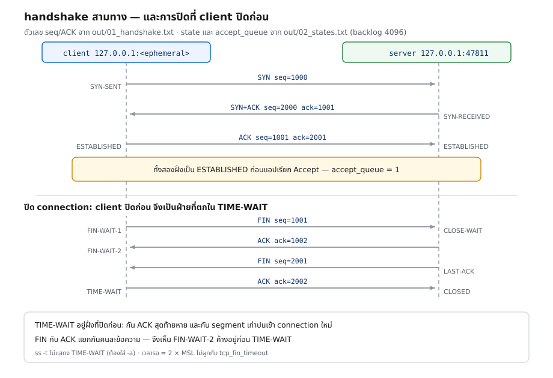
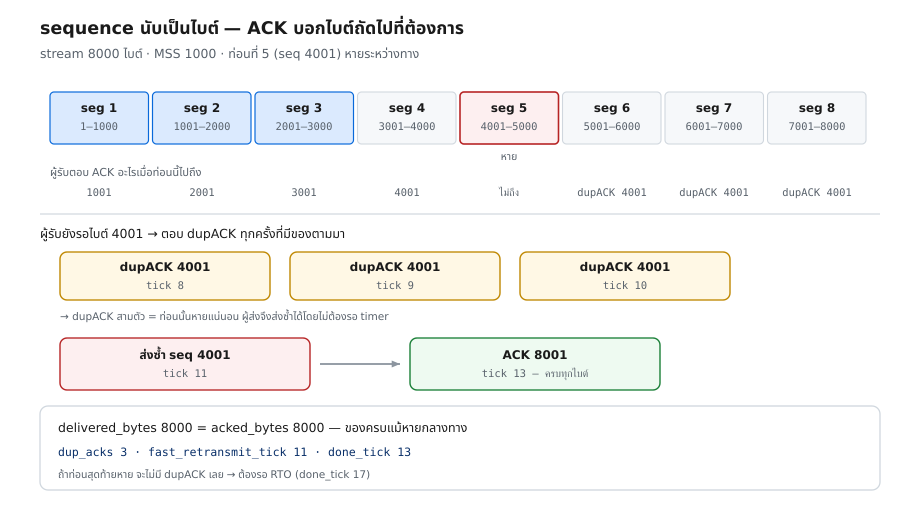
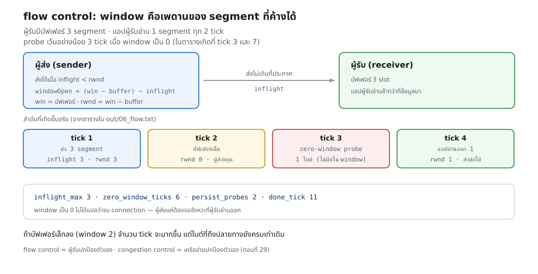

> 📅 เขียนเมื่อ: 21 พฤศจิกายน 2026 (เวลาไทย, UTC+7)
>
> **เครื่องที่รันบทนี้:** Raspberry Pi 5, Debian GNU/Linux 13 (trixie), kernel 6.18.60+rpt-rpi-2712, aarch64 · Go 1.24.4 · iproute2 6.15.0 (`ss`) · ภาพวาดด้วย `gen_svgs.py` แล้วเรนเดอร์ด้วย `rsvg-convert` 2.60.0 · ทุกตัวเลขในบทมาจากไฟล์ใน `out/` ที่สร้างด้วย `bash run_all.sh` ไม่มีตัวเลขใดพิมพ์ด้วยมือ
>
> 🛡️ **จริยธรรม (ใช้กับทั้งซีรีส์):** ทุกการทดลองในบทนี้ต่อกันผ่าน **loopback (`127.0.0.1`) ของเครื่องที่คุณควบคุมเอง** — ไม่มี packet ออกนอกเครื่องแม้แต่ใบเดียว และ `ss` ที่เราใช้อ่าน state ก็อ่านเฉพาะ connection ของโปรเซสตัวเอง (กรองด้วยคู่พอร์ตที่รู้) การดัก packet ของคนอื่นหรือสแกนเครือข่ายที่ไม่ใช่ของคุณเป็นคนละเรื่อง และต้องมีสิทธิ์ก่อนทุกครั้ง

---

## 0. อาการที่ทำให้คนเข้าใจ TCP ผิด

ตั๋วงานที่ขึ้นบ่อยที่สุดหน้าตาแบบนี้: "หน้า checkout ค้างราวครึ่งนาทีแล้วขึ้น timeout แต่ log ฝั่ง server มี request เข้ามาแค่ครึ่งเดียว" หรือ "ยิง request รัว ๆ แล้วมีบางตัวหายไปโดยไม่มี error ที่ฝั่ง client"

ทั้งสองอาการทำให้คนสรุปว่า "TCP ก็ไม่ reliable" ซึ่งกลับด้านกับสิ่งที่ TCP ถูกออกแบบมาให้ทำ สาเหตุที่คนสับสนคือคำว่า **reliable** ในที่นี้ไม่ได้แปลว่า "เร็ว" ไม่ได้แปลว่า "ไม่มีอะไรพัง" และที่สำคัญที่สุด — ไม่ได้แปลว่า "แอปคุณจะได้ข้อความครบตามที่คุณเข้าใจ"

TCP สัญญาสองข้อเท่านั้น และสัญญาแบบแข็ง:

1. ข้อมูลที่ถึงแอปปลายทางจะ **เรียงถูกและไม่ขาด** (หรือถ้าทำไม่ได้จริง ๆ มันจะบอกคุณด้วย error ไม่ใช่ปล่อยผ่านเงียบ ๆ)
2. ระหว่างทางมันอาจแบ่งข้อมูลใหม่ รวมก้อน ส่งซ้ำ หรือทิ้งแล้วส่งใหม่กี่ครั้งก็ได้ — แอปไม่เห็นรายละเอียดพวกนั้น

อาการในตั๋วงานข้างบนจึงไม่ใช่ TCP โกหก แต่คือช่องว่างระหว่าง "สัญญาของ TCP" กับ "สิ่งที่แอปคาดหวัง" — ซึ่งเป็นช่องว่างที่บทนี้จะอุดให้หมด

แผนของบทนี้มีสี่ชั้น เรียงจากของที่เกิดก่อนไปของที่เกิดหลังในชีวิตของ connection หนึ่งครั้ง:

1. **handshake** — สองฝั่งตกลงเลขเริ่มต้นกันก่อนส่งข้อมูล
2. **sequence/ACK** — ข้อมูลถูกนับเป็นไบต์ และผู้รับบอกว่าต้องการไบต์ไหนต่อ
3. **retransmission** — เมื่อของหาย มีสองทางให้กลับมา (dupACK = ACK ซ้ำเลขเดิมเพราะผู้รับยังขาดไบต์เดิม, RTO = ตัวจับเวลาส่งซ้ำเมื่อไม่มี ACK ใหม่)
4. **flow control** — ผู้รับบอกผู้ส่งว่า "ส่งได้อีกแค่ไหน" เพื่อไม่ให้ตัวเองจม

แล้วเราจะเขียน client/server ใน Go ที่ทำครบทั้งสี่อย่าง และดู state ของมันด้วย `ss` — ของจริงบนเครื่อง ไม่ใช่ภาพในตำรา

> ศัพท์ที่ต้องจับให้แน่นก่อนเริ่มมีสามคำ และทั้งสามเป็นคำของ TCP ไม่ใช่ของแอป:
>
> - **segment** — หน่วยข้อมูลที่ TCP ส่งใน packet หนึ่งใบ (ไม่ใช่ "ข้อความ" และไม่จำเป็นต้องตรงกับ `Write` ของแอป)
> - **ACK** (acknowledgment) — ตัวเลขที่ผู้รับส่งกลับเพื่อบอกว่า "ฉันได้ทุกไบต์ก่อนเลขนี้แล้ว" · ตัว `ACK` ยังเป็นชื่อ flag ในช่อง flags ของ TCP header ด้วย
> - **window** — จำนวนไบต์ที่ผู้รับบอกว่า "ส่งมาได้อีกเท่านี้ก่อนรอฉันอ่าน"
>
> สามคำนี้จะโผล่ตลอดบท และความหมายของมันจะไม่เปลี่ยนตามบริบท — ถ้าบทไหนใช้คำพวกนี้ผิดความหมายข้างบน ให้ถือว่าผมเขียนผิด[^1]

---

## 1. "reliable" ประกอบจากสี่ชิ้น

TCP ไม่ได้ทำให้ packet ไม่หาย — มันทำให้ **ผลลัพธ์ที่แอปเห็น** ถูกต้อง แม้ packet จะหาย มาผิดลำดับ หรือมาเป็นชุดซ้ำ สี่กลไกที่ทำงานร่วมกันคือทั้งหมดของเรื่องนี้:

| กลไก | ทำอะไร | ถ้าไม่มี |
|---|---|---|
| checksum | ตรวจว่าไบต์ใน segment ไม่ถูกเปลี่ยนระหว่างทาง | ข้อมูลเพี้ยนผ่านไปถึงแอปได้ |
| sequence number | ติดหมายเลขไบต์ทุกตัว ทำให้รู้ว่าอะไรหาย อะไรซ้ำ อะไรมาผิดที่ | รู้ไม่ได้ว่าขาดอะไร ประกอบกลับไม่ได้ |
| ACK + retransmission | ผู้รับยืนยันความคืบหน้า ผู้ส่งส่งซ้ำเมื่อไม่ได้รับการยืนยัน | ของที่หายไปก็หายไปตลอด |
| flow control window | ผู้รับประกาศว่ารับได้อีกเท่าไร ผู้ส่งเคารพ | ผู้รับช้าถูกถล่มจนบัฟเฟอร์ล้น |


ทั้งสี่ชิ้นนี้ทำงาน *ต่อ connection* ไม่ใช่ต่อ packet — นี่คือเหตุผลที่ TCP ต้องมี **แนวคิดเรื่อง connection** เลย: state ที่ต้องจำ (sequence ที่ส่งไปแล้ว, sequence ที่ได้รับการยืนยัน, window ที่ผู้รับประกาศล่าสุด) ไม่สามารถเก็บไว้ใน packet ใบเดียวได้

### 1.1 TCP สัญญาอะไร และไม่สัญญาอะไร

**สัญญา:** byte stream เรียงถูก ไม่ขาด และไม่ซ้ำ *ในระดับ TCP* · ถ้าส่งไม่ได้จริง ๆ (connection ถูก reset, หรือแอป/ระบบสั่งปิดหรือตั้ง deadline เองแล้ว) TCP จะรายงาน error ให้เห็น ไม่ปล่อยผ่านเงียบ — แต่ "เมื่อไรจะยอมแพ้" ไม่ใช่ TCP ตัดสินคนเดียว (ข้อถัดไป)

**ไม่สัญญา:**

- **ไม่มีขอบเขตของข้อความ** — ถ้าแอปเขียน 2000 ไบต์แล้วเขียนอีก 2500 ไบต์ ผู้รับอาจได้ก้อนเดียวรวมกัน หรือได้ทีละไม่กี่ร้อยไบต์ก็ได้ TCP การันตีแค่ลำดับของไบต์ ไม่ได้การันตี "ก้อน" การแบ่งข้อความจึงเป็นงานของแอป (เราจะทำ length-prefix framing — เอาความยาวของก้อนใส่ไว้ข้างหน้าเนื้อ — ในหัวข้อ 6)
- **ไม่สัญญาเรื่องเวลา** — TCP ไม่รู้จัก deadline ของแอปคุณ มันจะพยายามส่งซ้ำไปเรื่อย ๆ จนกว่าจะสำเร็จหรือจนระบบบอกว่าเลิกลอง
- **ไม่สัญญาเรื่องความเร็ว** — นั่นเป็นเรื่องของ congestion control (การปรับอัตราส่งตามสภาพเครือข่าย) ซึ่งเป็นคนละกลไกกับ flow control ในบทนี้ และจะได้เห็นเต็ม ๆ ในตอนที่ 29 ของซีรีส์
- **ไม่ dedupe ให้แอป** — ถ้าแอปเองส่ง request ซ้ำ (เช่นผู้ใช้กดปุ่มสองครั้ง หรือ client retry หลัง timeout) TCP จะส่งทั้งสองครั้งอย่างซื่อสัตย์ เพราะมันเห็นเป็นข้อมูลสองก้อน

### 1.2 ทำไมเรื่องนี้ถึงถูกคิดตั้งแต่ยุค ARPANET

TCP ถูกเขียนเป็นเอกสารสเปกครั้งแรกในเดือนธันวาคม 1974 (RFC 675, *Specification of Internet Transmission Control Program*) — ยุคนั้น TCP กับ IP ยังเป็นโปรโตคอลเดียวกัน ต่อมาจึงมีฉบับมาตรฐานของ DOD ในปี 1980 (RFC 761) และฉบับที่คนอ้างถึงกันทุกวันนี้คือ RFC 793 (กันยายน 1981) ซึ่งเขียนไว้เองว่า *Replaces: RFC 761*

ในโลกที่ link พังบ่อยกว่าวันนี้มาก — สายโทรศัพท์มี noise, gateway ต้น ๆ crash แล้ว reboot, packet หายเป็นเรื่องปกติของวัน แนวคิดหลักของยุคนั้นคือ: **ให้ปลายทางสองข้างจัดการความผิดพลาดกันเอง** แทนที่จะฝากความหวังไว้กับเครือข่าย

แนวคิดนั้นยังอยู่ครบจนวันนี้ สเปกปัจจุบันคือ RFC 9293 (สิงหาคม 2022) ซึ่งรวบรวมการแก้ไขทั้งหมดที่กระจัดกระจายมาอยู่ที่เดียวและแทนที่ RFC 793 — ตัวโปรโตคอลไม่เปลี่ยนหลักการ มีแต่รายละเอียดที่เพิ่มเข้ามา (SACK, window scaling, timestamps) เพราะเครือข่ายเร็วขึ้นจนของเดิมไม่พอ[^2]

ความน่าสนใจคือคำถามที่ TCP ต้องตอบเมื่อห้าสิบกว่าปีก่อน ยังเป็นคำถามเดียวกับที่คุณต้องตอบตอน debug ระบบวันนี้: *ของหายที่ไหน, ใครรู้ว่าหาย, แล้วมันกลับมาเมื่อไร*

---

## 2. สามทางแรก: handshake

ก่อนจะดูข้อความสามใบ ต้องรู้จักกรอบที่ทุกข้อความถูกตีความก่อน: **state machine** ของ TCP แต่ละฝั่งมี state ของตัวเอง (LISTEN, SYN-SENT, SYN-RECEIVED, ESTABLISHED, FIN-WAIT-1, …) และทุก segment ที่มาถึงจะถูกอ่านด้วยคำถามสองข้อ — "ตอนนี้ฉันอยู่ state ไหน" และ "flag ที่มาเปลี่ยน state ไปทางไหน"

state ไม่ได้อยู่ใน packet — มันอยู่ใน kernel ของแต่ละเครื่องที่ถือ connection นั้น สองฝั่งจึงมี state คนละชุดในเวลาเดียวกันได้ (client เป็น SYN-SENT ขณะที่ server เป็น SYN-RECEIVED) ตารางในหัวข้อถัดไปพิมพ์ state ของแต่ละฝั่งหลังส่งแต่ละข้อความ — อ่านคู่กับคอลัมน์ flags แล้วจะเห็นว่าสองคอลัมน์นี้เป็นเรื่องเดียวกัน: **flag เป็นเหตุ state เป็นผล**

### 2.1 สามข้อความที่เปิดการสนทนา

ก่อนส่งข้อมูลได้ สองฝั่งต้องตกลงกันว่า "จะเริ่มนับไบต์ที่เลขอะไร" และต้องแน่ใจว่าอีกฝั่งได้ยินที่เราพูด ก่อน TCP จะยอมให้แอปเขียนข้อมูลลงไป มันจึงแลกเปลี่ยนสามข้อความนี้ก่อน:

```text
## 3-way handshake: สามข้อความแรกของทุก TCP connection (แบบจำลอง)
isn_client          1000
isn_server          2000

step  direction       flags    bytes  seq    ack    state หลังส่ง
1     client→server   SYN      0      1000   —      SYN-SENT
2     server→client   SYN+ACK  0      2000   1001   SYN-RECEIVED
3     client→server   ACK      0      1001   2001   ESTABLISHED

syn_consumes_seq    1
client_data_first   1001
server_data_first   2001
note                SYN ไม่มีข้อมูลแต่กิน sequence number ไปหนึ่งตัว
```

อ่านทีละบรรทัด — เริ่มจากคอลัมน์ `flags` ก่อน เพราะมันคือช่องใน TCP header ที่บอกว่า segment นี้เป็นชนิดไหน: `SYN` (ขอเปิด connection พร้อมเลขเริ่มต้น), `ACK` (พกเลขยืนยันมาด้วย), `FIN` (ขอปิดฝั่งนี้), `RST` (สั่งยกเลิกทันที) ช่องนี้เป็นบิตแยกกัน จึงรวมกันได้เป็น `SYN+ACK` ในบรรทัดเดียว:

- **step 1 (SYN)** — client เลือกหมายเลขเริ่มต้นของตัวเอง (initial sequence number, ISN) ในเดโมนี้คือ `isn_client 1000` แล้วส่ง SYN ไป ของจริงเลขนี้ถูกสุ่มเพื่อความปลอดภัย ไม่ได้เริ่มที่ 1
- **step 2 (SYN+ACK)** — server ตอบด้วยสองอย่างพร้อมกัน: SYN ของตัวเอง (ISN `isn_server 2000`) และ ACK ที่บอกว่า "ฉันได้ SYN ของคุณแล้ว ขอไบต์ถัดไปคือ `1001`"
- **step 3 (ACK)** — client ยืนยันว่าได้ SYN ของ server แล้ว (`ack 2001`) ตอนนี้ทั้งสองฝั่งเข้าสู่ state `ESTABLISHED`

จุดที่คนอ่านข้ามบ่อยที่สุดคือคอลัมน์ `bytes 0` ทั้งสามแถว: **SYN ไม่มีข้อมูลเลยแต่กิน sequence number ไปหนึ่งตัว** นั่นคือเหตุผลที่ข้อมูลจริงของ client เริ่มที่ `client_data_first 1001` ไม่ใช่ 1000 — เพราะ SYN ใช้ seq 1000 ไปแล้ว (การกินเลขหนึ่งตัวนี้คือสิ่งที่ทำให้ ACK ตอบกลับได้ว่า "ฉันได้ SYN ของคุณแล้ว" ไม่ใช่ "ฉันได้ข้อมูล")

### 2.2 ทำไมต้องสาม ไม่ใช่สอง

คำถามนี้เจอบ่อยและคำตอบมันลึกกว่าที่คิด ลองนับสิ่งที่แต่ละฝั่งต้องรู้หลัง handshake:

- client ต้องรู้: ISN ของตัวเอง (รู้อยู่แล้ว) และ **ISN ของ server** (รู้จาก step 2)
- server ต้องรู้: ISN ของตัวเอง (รู้อยู่แล้ว) และ **ISN ของ client** (รู้จาก step 1)
- และทั้งคู่ต้องรู้ว่า **อีกฝั่งได้รับ ISN ของเราจริง** ไม่ใช่แค่เราส่งไปแล้ว

ถ้าเป็นสองทาง (SYN แล้ว SYN-ACK จบ) client จะไม่เหลือข้อความให้ตอบ ฝั่ง server จึงไม่รู้ว่า SYN-ACK ของตัวเองถึงมือ client หรือเปล่า — ถ้าหาย server จะรอข้อมูลที่ client ไม่รู้ตัวว่าต้องส่ง

ถ้าเพิ่มทางที่สาม ฝั่ง client ได้โอกาสยืนยัน และทั้งสองฝั่งมีหลักฐานครบว่า "ฉันได้เลขของคุณ และคุณได้เลขของฉัน" — นี่คือความต่างระหว่าง two-way ที่เดาเอาว่าอีกฝั่งได้ยิน กับ three-way ที่มีหลักฐานจากอีกฝั่ง

> วิธีคิดแบบวิศวกร: จำนวนข้อความไม่ได้ขึ้นกับจำนวนคน แต่ขึ้นกับจำนวน "ความไม่รู้" ที่ต้องกำจัด แต่ละข้อความกำจัดความไม่รู้ได้หนึ่งก้อน และก้อนสุดท้ายเหลือแค่ "อีกฝั่งได้ยินฉันไหม" ซึ่งต้องรอคำตอบ — นั่นคือทางที่สาม

ผลข้างเคียงที่สำคัญในงานจริง: **SYN ที่ไม่มีใครตอบคือครึ่ง connection** ถ้า server รับ SYN แล้วตอบ SYN-ACK แต่ client ไม่ตอบ ACK (เช่น client ตายไปแล้ว) server จะถือ connection นั้นไว้ครู่หนึ่งก่อนทิ้ง ซึ่งเป็นที่มาของ SYN flood — และเป็นเหตุผลที่ kernel มีคิวแยกอีกชั้น (`tcp_max_syn_backlog` ของเครื่องนี้คือ `512`)

ตารางข้างบนบอกว่า state เปลี่ยนอย่างไร แต่ไม่ได้บอกว่า **ใคร** เป็นคนเปลี่ยน — แอปของคุณหรือ kernel คำตอบของคำถามนี้คือสิ่งที่ทำให้อ่าน log ผิดหรือถูก และมันคือเรื่องของหัวข้อถัดไป

### 2.3 handshake จบ *ก่อน* โปรแกรมคุณเรียก Accept

นี่คือจุดที่ความรู้เรื่อง TCP เปลี่ยนวิธีอ่าน log ของคุณไปตลอด: **kernel เป็นคนทำ handshake ไม่ใช่แอป** โปรแกรมของคุณแค่ขอรับ connection ที่ handshake เสร็จแล้ว

เดโม `-section states` เปิด listener ไว้ แล้วให้ client ต่อเข้ามา แต่ **ยังไม่เรียก `Accept`** จากนั้นอ่าน state ด้วย `ss` — สองภาพแรก:

ก่อนอ่านภาพ ต้องรู้จักคอลัมน์ของ `ss` ก่อน (เรียงตามที่มันพิมพ์): `state` คือ state ของโปรโตคอล · `Recv-Q` คือ **ไบต์ที่ค้างในคิวรับของ socket นี้** — ของที่มาถึงแล้วแต่แอปยังไม่ `Read` · `Send-Q` คือไบต์ที่ค้างในคิวส่ง (ยกเว้น listening socket ที่ค่านี้มีความหมายอื่น ดูข้อถัดไป) · `local`/`peer` คือคู่ address:port ของสองฝั่ง

ชื่อ state ถูกย่อให้พอดีคอลัมน์: **`ESTAB` = ESTABLISHED** (ชื่อเต็มยาวเกิน) ส่วน `TIME-WAIT`/`CLOSE-WAIT` พิมพ์เต็มเพราะสั้นพอ · พอร์ตฝั่ง client เป็น **ephemeral port** (พอร์ตชั่วคราวที่ kernel เลือกให้ตอนต่อออก) ซึ่งเปลี่ยนทุกครั้งที่รัน เราจึงแทนมันด้วย `<ephemeral>` ในผลรัน

```text
## ss snapshot: state ของ TCP connection จริง (loopback เท่านั้น)
listen              127.0.0.1:47811
ephemeral_port      แทนด้วย <ephemeral> เพื่อให้รันซ้ำได้
listen_backlog      4096

--- 1) หลัง Listen ยังไม่มีใครต่อ
client        (ยังไม่มี connection)
server        (ไม่มี socket ในสถานะนี้)
accept_queue  0

--- 2) client Dial กลับมาแล้ว แต่ server ยังไม่เรียก Accept
client        ESTAB 0 0 127.0.0.1:<ephemeral> 127.0.0.1:47811
server        ESTAB 0 0 127.0.0.1:47811 127.0.0.1:<ephemeral>
accept_queue  1
```

อ่านให้ครบทุกช่อง:

- **`listen_backlog 4096`** — คอลัมน์ Send-Q ของ listening socket คือเพดานคิวที่ kernel ยอมรับ (`somaxconn` = เพดาน backlog ที่ kernel ยอมให้ `listen()` ขอ — ของเครื่องนี้ก็ `4096`) ไม่ใช่จำนวน connection ที่มีอยู่จริง
- **`client ESTAB`** และ **`server ESTAB`** ทั้งคู่ — ทั้งที่โปรแกรมฝั่ง server ยังไม่เคยเห็น connection นี้เลย! state ของโปรโตคอลจบไปแล้วตั้งแต่ตอน kernel **รับ ACK ตัวที่สาม** (ไม่ใช่ตั้งแต่ตอนตอบ SYN-ACK: ฝั่ง server จะเป็น `ESTABLISHED` เมื่อได้ ACK นั้น แล้ว kernel จึงย้าย connection เข้า accept queue)
- **`accept_queue 1`** — คอลัมน์ Recv-Q ของ listening socket คือจำนวน connection ที่ handshake เสร็จแล้วและรอให้แอปมา `Accept` นี่คือหลักฐานตรง ๆ ว่า handshake ไม่ได้รอแอป

snapshot ที่ 3–4 คือช่วงที่แอปเรียก `Accept` แล้ว และ client ปิดฝั่งของตัวเอง:

```text
--- 3) หลัง Accept
client        ESTAB 0 0 127.0.0.1:<ephemeral> 127.0.0.1:47811
server        ESTAB 0 0 127.0.0.1:47811 127.0.0.1:<ephemeral>
accept_queue  0

--- 4) client ส่ง FIN แล้ว (Close) แต่ server ยังไม่ปิด
client        FIN-WAIT-2 0 0 127.0.0.1:<ephemeral> 127.0.0.1:47811
server        CLOSE-WAIT 1 0 127.0.0.1:47811 127.0.0.1:<ephemeral>
```

`accept_queue` กลับเป็น `0` เพราะแอปหยิบ connection ออกไปแล้ว และเมื่อ client ส่ง FIN ฝั่ง server จะเป็น `CLOSE-WAIT` — หมายความว่า "ฉันได้ FIN แล้ว แต่ยังไม่ได้ปิดฝั่งตัวเอง" ส่วน `Recv-Q` ฝั่ง server ขึ้นเป็น `1` — ไม่ใช่ข้อมูล 1 ไบต์ แต่คือ **FIN ที่ค้างอยู่ในคิว** เพราะ FIN นับเป็นหนึ่งไบต์ในลำดับของ stream (แม้ไม่มีข้อมูล) และแอปยังไม่เรียก `Read` จึงยังไม่เห็น EOF (EOF = end of file, สัญญาณว่าไม่มีข้อมูลจะมาอีกแล้ว)

### 2.4 ปิดก็เป็นพิธีสาร ไม่ใช่แค่ `close()`

การปิด connection คือ handshake อีกชุด (บางคนเรียกว่า four-way teardown เพราะ FIN กับ ACK แยกกัน) และ state สุดท้ายที่คนเจอบ่อยใน `ss` คือ `TIME-WAIT`:

```text
--- 5) server ปิดตาม — ฝั่งที่ปิดก่อนตกใน TIME-WAIT
client        TIME-WAIT 0 0 127.0.0.1:<ephemeral> 127.0.0.1:47811
server        (ไม่มี socket ในสถานะนี้)
accept_queue  0

closed_first        client (active close)
timewait_side       client
server_saw          EOF ตอนอ่าน FIN
```

ฝั่งที่ **ปิดก่อน** (ที่นี่คือ client) เป็นฝั่งที่ต้องนั่งรอใน `TIME-WAIT` คำถามที่ตามมาคือ "รอทำไม" — คำตอบมีสองข้อ และทั้งสองข้อเป็นเรื่องจริงที่เจอในงาน:

1. **ACK สุดท้ายอาจหาย** ถ้า ACK ที่ client ส่งไปตอนปิดหาย server จะส่ง FIN ซ้ำ client ต้องยังมี state อยู่เพื่อตอบ ACK นั้นอีกครั้ง ถ้าทิ้ง state ทันที server จะได้ `RST` แทน (`RST` = reset, flag ที่สั่งยกเลิก connection ทันทีโดยไม่ต้องมีพิธีปิด)
2. **เศษ segment เก่าของ connection นี้ต้องหมดอายุ** ก่อนที่หมายเลขคู่พอร์ตเดิมจะถูกใช้ซ้ำ ไม่งั้น segment เก่าที่เดินช้าอยู่ในเครือข่ายอาจโผล่เข้ามาใน connection ใหม่และถูกตีความเป็นข้อมูลจริง

ระยะเวลารอคือสองเท่าของ **maximum segment lifetime (MSL)** — ใน Linux ค่านี้ถูกกำหนดตายตัวใน kernel และ **ไม่ผูกกับ `tcp_fin_timeout`** (ค่านั้นคุม FIN-WAIT-2 ของ connection ที่แอปทิ้งไปแล้ว ซึ่งบนเครื่องนี้คือ `tcp_fin_timeout: 60`)[^7]

> **กับดักที่เจอตอนเขียนเดโมนี้เอง (รอบแรก):** `ss -t` ไม่แสดง `TIME-WAIT` เลย ตอนแรกผมคิดว่าเดโมผิด แต่ความจริงคือ TIME-WAIT จะโผล่ก็ต่อเมื่อใส่ `-a` (`ss -tan`) — state ยังอยู่ครบ แต่ `ss -t` ไม่พามาแสดง กติกาใช้งานง่าย ๆ: **เวลา debug การปิด connection ให้ใช้ `ss -tan` เสมอ** ส่วน `ss -t` ใช้ดู connection ที่ยังคุยกันอยู่



---

## 3. sequence และ ACK: TCP นับเป็นไบต์ ไม่ใช่เป็นข้อความ

### 3.1 เลขที่ทุกคนอ้างถึงคือ "ไบต์ที่เท่าไร"

คำว่า sequence number ทำให้คนนึกถึง "หมายเลข packet" ซึ่งผิด TCP ไม่มีหมายเลข packet — มันมี **หมายเลขไบต์** ทุกไบต์ใน stream มีเลขประจำตัว และ segment คือช่วงของเลขนั้น

เดโม `-section segmentize` แบ่ง stream 3000 ไบต์ด้วย MSS 1000 ไบต์ (MSS = maximum segment size, ไบต์สูงสุดของข้อมูลในหนึ่ง segment):

```text
## แบ่ง byte stream เป็น segment: seq คือตำแหน่งไบต์แรกของท่อนนั้น
isn                 0
bytes               3000
mss                 1000
segments            3

hdr_ipv4            20
hdr_tcp             20
hdr_total           40
eth_mtu             1500
mss_from_mtu        1460
window_field_max    65535

seg   seq_start  seq_end   bytes   ack_after
1     1          1000      1000    1001
2     1001       2000      1000    2001
3     2001       3000      1000    3001

first_seq           1
last_ack            3001
total_bytes         3000
```

อ่านสามอย่างจากตารางนี้:

- **`seq_start` ของ segment 2 คือ 1001** ไม่ใช่ 2 — เพราะเลขคือตำแหน่งไบต์ ไม่ใช่ลำดับท่อน
- **`ack_after` ของ segment 2 คือ 2001** — ACK number คือ **ไบต์ถัดไปที่ผู้รับต้องการ** ไม่ใช่หมายเลขไบต์สุดท้ายที่รับมา ต่างกันหนึ่งเสมอ และการเข้าใจผิดข้อนี้ทำให้อ่าน trace ผิดทั้งกระดาษ
- **`mss 1000` ไม่ใช่ค่าที่ TCP กำหนดตายตัว** — MSS เป็นค่าที่สองฝั่งตกลงกันตอน handshake ผ่าน option ใน SYN จึงต่างกันได้ในแต่ละ connection

โดยทั่วไป MSS คือ MTU ของ link (MTU = maximum transmission unit, ขนาด packet สูงสุดที่ link หนึ่งรับได้) ลบ header สองชั้น: `eth_mtu 1500` ลบ `hdr_ipv4 20` ลบ `hdr_tcp 20` เหลือ `mss_from_mtu 1460`[^6] เราลดมาใช้ 1000 เพื่อให้เลขในบทอ่านง่าย (ทุกตัวเลขยังเป็นของจริงจากโปรแกรม)

ค่าคงที่ในบรรทัดกลาง (`hdr_ipv4`, `hdr_tcp`, `eth_mtu`, `window_field_max`) ไม่ใช่ผลวัด — เป็นค่าของโปรโตคอลที่โปรแกรมพิมพ์ออกมาเพื่อให้บทอ้างได้โดยไม่ต้องพิมพ์มือ

### 3.2 cumulative ACK: คำตอบหนึ่งคำตอบได้หลายท่อน

ACK ใน TCP เป็น **cumulative**: `ACK 4001` แปลว่า "ฉันได้ทุกไบต์ที่ตำแหน่งน้อยกว่า 4001 ครบแล้ว" ไม่ได้แปลว่า "ฉันได้ท่อนที่ลงท้ายที่ 4000" — ผลคือ ACK ตัวเดียวสามารถยืนยันหลาย segment พร้อมกันได้ และถ้าท่อนกลางหาย ACK จะค้างอยู่ที่เดิมไม่ว่าจะได้ท่อนหลังจากนั้นมากี่ท่อน

ข้อดีคือประหยัด: ผู้รับไม่ต้องตอบทีละท่อน ข้อเสียคือข้อมูลที่หายมีได้ทีละจุดต่อหนึ่ง round trip — ถ้าหายหลายที่พร้อมกัน ผู้ส่งต้องรอหลายรอบกว่าจะรู้ครบ นี่คือเหตุผลที่ของจริงมี **SACK (selective acknowledgment, RFC 2018)** ซึ่งให้ผู้รับบอกช่วงที่ได้ไปแล้วได้หลายช่วงใน ACK เดียว[^3]

อีกกลไกที่ทำให้เลขใน trace ของคุณดู "ไม่ตรงเวลา": **delayed ACK** ผู้รับอาจหน่วง ACK ไว้เล็กน้อยเพื่อรอว่ามีข้อมูลตามมาอีกไหม จะได้ตอบครั้งเดียว — ในเดโมของเรา ผู้รับตอบทันที (หน่วง 1 tick) เพื่อให้ timeline อ่านง่าย ของจริงจึงมี ACK น้อยกว่าจำนวน segment

### 3.3 ISN ไม่ได้เริ่มที่ 1 และไม่ได้สุ่มเล่น ๆ

ถ้ารันเดโมด้วย `-isn 5000` ตัวเลขทั้งชุดจะเลื่อนตาม:

```text
## แบ่ง byte stream เป็น segment: seq คือตำแหน่งไบต์แรกของท่อนนั้น
isn                 5000
bytes               2000
mss                 1000
segments            2

hdr_ipv4            20
hdr_tcp             20
hdr_total           40
eth_mtu             1500
mss_from_mtu        1460
window_field_max    65535

seg   seq_start  seq_end   bytes   ack_after
1     5001       6000      1000    6001
2     6001       7000      1000    7001

first_seq           5001
last_ack            7001
total_bytes         2000
```

`first_seq 5001` และ `last_ack 7001` — เลขเลื่อนทั้งชุด แต่ *ความต่าง* ระหว่างสองฝั่งเท่าเดิมทุกตัว การอ่าน trace จึงควรอ่านเป็น "ช่วง" ไม่ใช่ "ค่าสัมบูรณ์"

ทำไมต้องสุ่ม ISN แทนที่จะเริ่มที่ 1 ทุกครั้ง: ถ้า ISN ทำนายได้ คนที่ยิง packet ปลอมเข้ามาจะเดา sequence ที่ถูกต้องได้ง่ายขึ้น และ segment เก่าจาก connection ก่อนที่ใช้คู่พอร์ตเดิมก็จะชนกับของใหม่ทันที การสุ่มไม่ใช่ความสวยงาม แต่เป็นส่วนหนึ่งของขอบเขตความปลอดภัย[^4]

แต่การรู้ว่าไบต์ไหนหาย ยังไม่ตอบว่า "ใครทำอะไรต่อ" — คำตอบอยู่ในหัวข้อถัดไป ซึ่งเป็นสองกลไกที่ทำให้ของที่หายกลับมา

---

## 4. retransmission: สองทางที่ของหายกลับมา

TCP ไม่มี packet ที่ "ส่งแล้วส่งเลย" ทุก segment ที่ส่งออกไปจะถูกจดไว้จนกว่าจะมี ACK มาถึง และเมื่อ ACK ไม่มา ก็มีสองทางให้ของกลับมา:

- **fast retransmit** (รู้เร็ว เพราะมี **dupACK** — duplicate ACK, ACK ที่ยืนยันเลขเดิมซ้ำ ๆ เพราะผู้รับยังรอไบต์เดิมอยู่)
- **RTO** (retransmission timeout — ตัวจับเวลาที่ผู้ส่งตั้งไว้ต่อ segment แล้วรู้ช้าเพราะหมดเวลา ไม่มีใครบอกอะไรเลย)

### 4.1 dupACK → fast retransmit

เดโม `-section retransmit` ส่ง 8000 ไบต์ (8 segment) โดยให้ segment ที่ 5 หายไปหนึ่งท่อน:

```text
## ทิ้งหนึ่ง segment: dupACK → fast retransmit
mss                 1000
bytes               8000
segments            8
drop_seg            5
drop_seq            4001
rto_ticks           5
dup_ack_threshold   3

tick  event
1     ส่ง 1 (seq 1–1000, 1000 ไบต์)
2     ส่ง 2 (seq 1001–2000, 1000 ไบต์)
3     ได้ ACK 1001 — ผู้ส่งเลื่อนขอบ window
3     ส่ง 3 (seq 2001–3000, 1000 ไบต์)
4     ได้ ACK 2001 — ผู้ส่งเลื่อนขอบ window
4     ส่ง 4 (seq 3001–4000, 1000 ไบต์)
5     ได้ ACK 3001 — ผู้ส่งเลื่อนขอบ window
5     ส่ง 5 (seq 4001–5000) — หายระหว่างทาง
6     ได้ ACK 4001 — ผู้ส่งเลื่อนขอบ window
6     ส่ง 6 (seq 5001–6000, 1000 ไบต์)
7     ส่ง 7 (seq 6001–7000, 1000 ไบต์)
8     ได้ dupACK 1 ตัวที่ 4001 (ผู้รับยังรอไบต์ 4001)
8     ส่ง 8 (seq 7001–8000, 1000 ไบต์)
9     ได้ dupACK 2 ตัวที่ 4001 (ผู้รับยังรอไบต์ 4001)
10    ได้ dupACK 3 ตัวที่ 4001 (ผู้รับยังรอไบต์ 4001)
11    ส่งซ้ำ 5 (seq 4001–5000) — fast retransmit หลัง dupACK ครบ 3 ตัว
13    ได้ ACK 8001 — ผู้ส่งเลื่อนขอบ window

dup_acks            3
fast_retransmit_tick 11
rto_retransmits     0
delivered_bytes     8000
acked_bytes         8000
done_tick           13
```

อ่าน timeline นี้ให้ครบ เพราะมันคือทั้งเรื่องของ TCP:

- **tick 5** — segment 5 (seq 4001–5000) หายไป ผู้ส่งยังไม่รู้เรื่อง
- **tick 6** — `ได้ ACK 4001` คือการยืนยันครั้งสุดท้ายที่ครอบถึงไบต์ 4000 ผู้ส่งยังคิดว่าทุกอย่างปกติ
- **tick 7–9** — segment 6, 7, 8 ไปถึงผู้รับ (ส่งที่ tick 6, 7, 8 แล้วถึงใน tick ถัดไป) แต่ผู้รับยังรอไบต์ 4001 อยู่ จึงตอบ ACK 4001 ซ้ำที่ tick 8, 9, 10 — นี่คือ **duplicate ACK** — คำตอบที่บอกว่า "ฉันยังรอที่เดิม"
- **tick 10** — dupACK ครบตัวที่ 3 ผู้ส่งจึงสรุปว่า "ท่อนที่ขึ้นต้นที่ 4001 หายแน่นอน" แล้วส่งซ้ำทันที ไม่ต้องรอ timer
- **tick 11** — ส่งซ้ำ segment 5 (`fast_retransmit_tick 11`)
- **tick 13** — ACK 8001 มาถึง ผู้ส่งรู้ว่าทั้ง stream ถึงแล้ว (`done_tick 13`)

ตัวเลข `dup_acks 3` คือเกณฑ์ที่ใช้กันมาหลายสิบปี (RFC 5681): dupACK สามตัวหมายถึงมี segment อย่างน้อยสามท่อนผ่านไปได้หลังจากจุดที่ขาด ซึ่งแทบจะเป็นไปไม่ได้เลยถ้าไม่ได้หายจริง — หนึ่งหรือสองตัวอาจเกิดจาก packet มาเหลื่อมลำดับชั่วคราว

### 4.2 RTO: เมื่อไม่มีใครบอกอะไรเลย

fast retransmit ต้องมี "ท่อนหลังจากจุดที่หาย" มาสร้าง dupACK ถ้าท่อนที่หายเป็นท่อนสุดท้าย ก็ไม่มีอะไรตามมาบอกผู้ส่ง — ต้องรอ **retransmission timeout (RTO)**:

```text
## เทียบ: ทิ้ง segment สุดท้าย (ไม่มีข้อมูลตามหลัง)
drop_seg            8
dup_acks            0
fast_retransmit_tick 0
rto_retransmits     1
delivered_bytes     8000
acked_bytes         8000
done_tick           17

dup_ack_needs       segment ที่ตามมาถึงหลังจากตัวที่หาย
```

`dup_acks 0` และ `rto_retransmits 1` — ไม่มี dupACK เลยสักตัว เพราะไม่มี segment ตามหลัง ผู้ส่งจึงรอ `rto_ticks 5` แล้วส่งซ้ำเอง เวลารวมยืดออกไปเป็น `done_tick 17` เทียบกับ `13` ของกรณีแรก

การนับ tick ตรงนี้ต้องอ่านให้ตรง: ไม่ใช่ "ครบ 5 tick ตอน tick 10 แล้วส่ง" แต่คือ "ไม่มี ACK ใหม่ครบ 5 tick จึงตัดสินใจ แล้วส่งใน tick ถัดไป" ในโจทย์ข้อ 2 (หัวข้อ 4.3) ACK ใหม่ตัวสุดท้ายอยู่ที่ tick 4 ผู้ส่งจึงตัดสินใจตอน tick 9 และส่งจริงที่ tick 10 — ผลรันจึงพิมพ์ทั้งเลข tick ที่ใช้ตัดสินและคำว่า "ส่งใน tick ถัดไป" กำกับไว้

ของจริง RTO ไม่ได้เป็นค่าคงที่: มันคำนวณจาก RTT ที่วัดได้ (smoothed round-trip time + ความแปรปรวนของค่าที่วัด) ตาม RFC 6298 และปรับขึ้นเป็นทวีคูณ (exponential backoff) เมื่อส่งซ้ำแล้วยังไม่ได้รับ ACK — การรอจึงยาวขึ้นเรื่อย ๆ ไม่ใช่คงที่

ตัวเลข `5 tick` ในเดโมคือค่าคงที่ที่เราตั้งไว้เพื่อให้ timeline อ่านง่าย ไม่ใช่ค่าที่ kernel ใช้[^5]

### 4.3 เมื่อ fast retransmit ใช้ไม่ได้เพราะมีข้อมูลน้อยเกินไป

นี่คือเคสที่ทำให้คนเข้าใจผิดบ่อยที่สุด และเป็นโจทย์ข้อ 2 ของบทนี้: ส่ง 4,000 ไบต์ (4 segment) แล้วให้ท่อนที่ 3 หาย

```text
## ทิ้งหนึ่ง segment: dupACK → fast retransmit
mss                 1000
bytes               4000
segments            4
drop_seg            3
drop_seq            2001
rto_ticks           5
dup_ack_threshold   3

tick  event
1     ส่ง 1 (seq 1–1000, 1000 ไบต์)
2     ส่ง 2 (seq 1001–2000, 1000 ไบต์)
3     ได้ ACK 1001 — ผู้ส่งเลื่อนขอบ window
3     ส่ง 3 (seq 2001–3000) — หายระหว่างทาง
4     ได้ ACK 2001 — ผู้ส่งเลื่อนขอบ window
4     ส่ง 4 (seq 3001–4000, 1000 ไบต์)
6     ได้ dupACK 1 ตัวที่ 2001 (ผู้รับยังรอไบต์ 2001)
10    ส่งซ้ำ 3 (seq 2001–3000) — RTO ครบ 5 tick (ไม่มี ACK ใหม่ตั้งแต่ tick 4) — ส่งใน tick ถัดไป
12    ได้ ACK 4001 — ผู้ส่งเลื่อนขอบ window

dup_acks            1
fast_retransmit_tick 0
rto_retransmits     1
delivered_bytes     4000
acked_bytes         4000
done_tick           12
```

มีแค่ `dup_acks 1` — เพราะมี segment ตามหลังจุดที่หายแค่ท่อนเดียว (ท่อนที่ 4) จึงสร้าง dupACK ได้ตัวเดียว ไม่ถึงเกณฑ์สาม ผู้ส่งจึงต้องรอ RTO (`rto_retransmits 1`) แทน

บทเรียนที่ใช้ได้จริง: **"ของหาย" กับ "รู้ว่าของหาย" เป็นคนละเหตุการณ์**

ระยะห่างระหว่างสองเหตุการณ์ขึ้นกับว่ามีข้อมูลตามมาอีกเท่าไร ถ้าคุณกำลังดู trace ของ connection ที่ส่งข้อมูลน้อย ๆ แล้วเจอการรอครั้งละหลายร้อยมิลลิวินาที นี่คือคำอธิบายแรกที่ควรนึกถึง



---

## 5. flow control: window บอก "ส่งได้อีกเท่าไร"

### 5.1 window คือคำเชิญ ไม่ใช่คำสั่ง

จนถึงตอนนี้เราพูดถึง "ของหาย" แต่ปัญหาอีกด้านคือ **ส่งเร็วเกินกว่าผู้รับจะอ่านทัน** ถ้าผู้ส่งยิงข้อมูลเต็มความเร็วของผู้ส่งเสมอ ผู้รับที่มีบัฟเฟอร์จำกัดจะไม่มีที่เก็บ และการทิ้งของที่ผู้รับก็ไม่ช่วยอะไรนอกจากทำให้ต้องส่งซ้ำ

TCP แก้ด้วยการให้ผู้รับเป็นคนกำหนดเพดาน: ทุก ACK มีช่อง **window** บอกว่าผู้รับรับได้อีกกี่ไบต์ ผู้ส่งห้ามมีข้อมูลที่ยังไม่ถูก ACK ค้างอยู่ในเครือข่ายเกินจำนวนนั้น (แบบจำลองของเรานับ "ของที่ยังไม่ถึงผู้รับ" แทน — ดูรายการด้านล่าง)

เดโม `-section flow` จำลองผู้รับที่มีบัฟเฟอร์ 3 segment และแอปผู้รับอ่านได้ 1 segment ทุก 2 tick — เดโมนี้ **นับ window เป็น segment ไม่ใช่ไบต์** เพื่อให้เลขในตารางอ่านง่าย (ของจริงนับเป็นไบต์ และตัวเลขในช่อง window ของ header คือจำนวนไบต์):

```text
tick  inflight  rwnd   buffer  event
1     1         3      0       ส่ง 1 (seq 1–1000) — ค้างในเครือข่าย 1
1     2         3      0       ส่ง 2 (seq 1001–2000) — ค้างในเครือข่าย 2
1     3         3      0       ส่ง 3 (seq 2001–3000) — ค้างในเครือข่าย 3
2     0         0      3       ถึงผู้รับ 3 segment — ประกาศ window 0
2     0         1      2       แอปผู้รับอ่าน 1 segment — window เปิดเป็น 1
2     1         1      2       ส่ง 4 (seq 3001–4000) — ค้างในเครือข่าย 1
3     0         0      3       ถึงผู้รับ 1 segment — ประกาศ window 0
3     0         0      3       window = 0 — ส่ง zero-window probe (1 ไบต์)
4     0         1      2       แอปผู้รับอ่าน 1 segment — window เปิดเป็น 1
4     1         1      2       ส่ง 5 (seq 4001–5000) — ค้างในเครือข่าย 1
5     0         0      3       ถึงผู้รับ 1 segment — ประกาศ window 0
6     0         1      2       แอปผู้รับอ่าน 1 segment — window เปิดเป็น 1
6     1         1      2       ส่ง 6 (seq 5001–6000) — ค้างในเครือข่าย 1
7     0         0      3       ถึงผู้รับ 1 segment — ประกาศ window 0
7     0         0      3       window = 0 — ส่ง zero-window probe (1 ไบต์)
8     0         1      2       แอปผู้รับอ่าน 1 segment — window เปิดเป็น 1
8     1         1      2       ส่ง 7 (seq 6001–7000) — ค้างในเครือข่าย 1
9     0         0      3       ถึงผู้รับ 1 segment — ประกาศ window 0
10    0         1      2       แอปผู้รับอ่าน 1 segment — window เปิดเป็น 1
10    1         1      2       ส่ง 8 (seq 7001–8000) — ค้างในเครือข่าย 1
11    0         0      3       ถึงผู้รับ 1 segment — ประกาศ window 0

inflight_max        3
stall_ticks         9
zero_window_ticks   6
persist_probes      2
done_tick           11
```

อ่านคอลัมน์ตัวเลขในตาราง แล้วปิดท้ายด้วยค่าสรุปที่โปรแกรมพิมพ์ไว้:

- **`inflight`** คือจำนวน segment ที่ส่งออกไปแล้วแต่ **ยังไม่ถึงผู้รับ** (ค้างอยู่ระหว่างทาง) — โมเดลของเราลดค่านี้ตอน segment ถึงผู้รับ ไม่ใช่ตอน ACK กลับมา
- **`rwnd`** คือ window ที่ผู้รับประกาศล่าสุด — เพดานของ `inflight`
- **`buffer`** คือจำนวน segment ที่ผู้รับถือไว้แต่แอปยังไม่ยอมอ่าน (ตัวที่ทำให้ `rwnd` ลด)
- **`stall_ticks`** (สรุปท้ายตาราง) คือจำนวน tick ที่ผู้ส่งอยากส่งต่อแต่ window ไม่เปิด — นับรวม tick ที่ต้องส่ง probe ด้วย

จะเห็นว่า `inflight_max 3` ไม่เคยเกิน 3 เลย เพราะผู้ส่งเคารพเพดาน และเมื่อ `rwnd` เป็น 0 ที่ tick 2 ผู้ส่งก็หยุดส่งทันที — นี่คือทั้งหมดของ flow control ในหนึ่งประโยค: **ผู้ส่งไม่ส่งเกินสิ่งที่ผู้รับบอกว่าไหว**

โมเดลของเราตรวจข้อนี้ด้วยสองสมการที่ตรงกับโค้ดข้างล่างพอดี: `rwnd = win − buffer` (window ที่ประกาศใน ACK) และ `windowOpen = rwnd − inflight` (จำนวน segment ที่ยังส่งเพิ่มได้ตอนนี้) โดย `win` คือขนาดบัฟเฟอร์ผู้รับ:

```go
func windowOpen(winSegs, buffered, inflight int) int {
	// rwnd (window ที่ประกาศใน ACK) = winSegs - buffered
	// windowOpen = rwnd - inflight
	return winSegs - buffered - inflight
}
```

### 5.2 zero window: เมื่อผู้รับบอกว่า "พอแล้ว"

`rwnd` เป็น 0 ไม่ได้แปลว่าจบ connection — ผู้รับแค่บอกว่า "ตอนนี้ไม่มีที่" และผู้รับ **ส่ง window update ได้เอง** (ACK เปล่า ๆ ที่พาเลข window ใหม่) ทันทีที่แอปอ่านของออก

ปัญหาคือ ACK ใบนั้นไม่มีอะไรรับประกัน: TCP ไม่มี ACK ของ ACK ดังนั้นถ้า window update หายไปกลางทาง ผู้ส่งก็ไม่รู้ว่า window เปิดแล้ว และจะนั่งรออยู่เฉย ๆ ตราบที่ไม่มีอะไรกระตุ้น

ทางแก้คือ **zero-window probe**: ผู้ส่งส่งไบต์-probe เล็ก ๆ ออกไปเป็นระยะ (ไบต์นั้นไม่นับใน window) เพื่อบังคับให้ผู้รับตอบ ACK ที่พา window ล่าสุดกลับมา RFC 9293 §3.8.6.1 เลือกคำได้ตรงกับปัญหานี้ที่สุด — probe คือสิ่งที่ทำให้ "การเปิด window ถูกบอกไปถึงอีกฝั่งอย่างเชื่อถือได้" (*reliably*) ไม่ใช่เพราะผู้รับบอกเองไม่ได้ แต่เพราะ ACK ที่บอกนั้นอาจหายและไม่ถูกส่งซ้ำ

ในเดโมของเรามี `persist_probes 2` ครั้ง — และต้องพูดให้ตรงกับโค้ด: โมเดล **นับ** probe และพิมพ์บรรทัดออกมา แต่ไม่ได้จำลอง ACK ที่ผู้รับตอบกลับมา window ที่เปิดใหม่ในตารางจึงมาจาก **แอปผู้รับอ่านของออก** (buffer ลด) ส่วน probe ในโมเดลทำหน้าที่เป็นเครื่องเตือนว่าผู้ส่งต้องไม่เลิกสนใจ connection นี้ — ของจริงสองเรื่องนี้ผูกกันเพราะ probe คือตัวพา window update กลับมาเมื่อ ACK ใบเดิมหาย

นี่คือกลไกที่อธิบายอาการ "ค้างยาว ๆ แล้วฟื้นเอง" ในระบบจริงได้บ่อยครั้ง: ไม่ใช่ network ล่ม แต่ผู้รับหยุดอ่าน (เช่น disk ช้า, GC นาน, thread pool เต็ม) แล้วผู้ส่งกำลังนั่ง probe อยู่

### 5.3 flow control ไม่ใช่ congestion control

สองคำนี้ปนกันตลอด และการปนกันทำให้ตั้งค่า TCP ผิด:

- **flow control** = ผู้รับปกป้องตัวเอง (window) — ปลายทางบอกผู้ส่ง
- **congestion control** = เครือข่ายปกป้องตัวเอง (cwnd = congestion window, เพดานที่ผู้ส่งคำนวณเองจากสัญญาณว่าเครือข่ายเริ่มตัน, slow start, CUBIC/BBR) — ผู้ส่งเดาจากสัญญาณอ้อม เช่น packet หาย

ผู้ส่งต้องเคารพทั้งสองเพดานพร้อมกัน: ส่งได้ไม่เกิน `min(window ของผู้รับ, cwnd)`. ในเดโมนี้เราจำลองเฉพาะอันแรก (จึงเห็น `inflight` เท่ากับ window พอดี) ส่วน congestion control จะยกไปคุยในตอนที่ 29 ซึ่งเป็นตอนที่ตัวเลขพวกนี้กลายเป็นเรื่องของ throughput จริง ๆ



---

## 6. ลงมือทำ: TCP client/server ใน Go

ถึงตรงนี้เราเข้าใจกลไกครบแล้ว ถึงเวลาที่จะเขียนของจริง: server ที่รับ frame แล้วสะท้อนกลับ และ client ที่ส่งสามก้อน ปิดฝั่งเขียน (half-close) แล้วอ่านคำตอบจนจบ

ทั้งหมดอยู่ใน `main.go` ไฟล์เดียวกับเดโมอื่น — เลือกส่วนด้วย `-section` และทุกการเชื่อมต่อวิ่งบน loopback

### 6.1 ปัญหาแรกที่ต้องแก้เอง: TCP ไม่มีขอบเขตข้อความ

ในหัวข้อ 1 เราบอกว่า TCP ให้ byte stream ถ้าแอปเขียนสองก้อนติดกัน ผู้รับอาจได้ก้อนเดียวหรือได้ครึ่งก้อน — จึงต้องมี **framing** ของตัวเอง วิธีที่ง่ายและใช้กันทั่วคือ **length-prefix** (เอาความยาวของก้อนใส่ไว้ข้างหน้าเนื้อ): ใส่ความยาว 4 ไบต์นำหน้าเนื้อทุกก้อน

```go
func writeFrame(w io.Writer, body []byte) error {
	buf := make([]byte, 4+len(body))
	binary.BigEndian.PutUint32(buf, uint32(len(body)))
	copy(buf[4:], body)
	_, err := w.Write(buf)
	return err
}

// readFrame อ่านหนึ่ง frame: 4 ไบต์แรกบอกความยาว ที่เหลือคือเนื้อ
func readFrame(r io.Reader) ([]byte, error) {
	var hdr [4]byte
	if _, err := io.ReadFull(r, hdr[:]); err != nil {
		return nil, err
	}
	// 4 ไบต์นี้เดินมาทางสายใน network byte order = big-endian เสมอ
	n32 := binary.BigEndian.Uint32(hdr[:])
	// maxFrame = เพดาน 1 MiB ที่เดโมยอมรับ: ต้องเทียบก่อน make()
	// ไม่งั้น header ปลอมจะสั่งให้เราจองหน่วยความจำก้อนมหาศาล (memory exhaustion)
	if n32 > maxFrame {
		return nil, fmt.Errorf("ความยาว frame ไม่ถูกต้อง: %d", n32)
	}
	body := make([]byte, n32)
	if _, err := io.ReadFull(r, body); err != nil {
		return nil, err
	}
	return body, nil
}
```

จุดที่ต้องระวังและเป็นที่มาของบั๊กจริงบ่อยมาก:

- **`io.ReadFull` ไม่ใช่ `Read`** — `Read` อาจคืนข้อมูลไม่ครบตามที่ขอ (partial read) การอ่าน header 4 ไบต์ด้วย `Read` ครั้งเดียวจึงพังได้ แม้บน loopback
- **`Write` ก็อาจเขียนไม่ครบ** — เราเขียน buffer ก้อนเดียวจึงมักจบในครั้งเดียว แต่โค้ดที่เขียนทีละส่วนต้องวนจนครบ (หรือใช้ `io.Copy` / `io.WriteString` ที่จัดการให้)
- **ตรวจความยาวก่อนจองหน่วยความจำ** — `n` ที่อ่านจากสายเป็นค่าที่ผู้ส่งกำหนด เราไม่ควร `make([]byte, n)` ทันทีถ้าไม่รู้เพดาน (`maxFrame` ในเดโมนี้คือ 1 MiB) นี่คือช่องโหว่ memory exhaustion แบบคลาสสิก

### 6.2 half-close: บอกว่า "ส่งครบแล้ว" โดยไม่ต้องปิดทั้ง connection

`CloseWrite()` ส่ง FIN อย่างเดียว — ฝั่งเราเลิกเขียน แต่ยังอ่านได้ อีกฝั่งเห็น EOF แล้วยังเขียนตอบกลับได้ตามปกติ นี่คือสิ่งที่ทำให้โปรโตคอลแบบ "ส่งคำขอแล้วรอคำตอบ" ทำงานได้โดยไม่ต้องเดาความยาวคำตอบเลย

```go
func runClient(tc *net.TCPConn) (clientStats, error) {
	// clientStats = ยอดที่วัดฝั่ง client: ขนาดแต่ละ frame, ไบต์ที่เขียน,
	// ไบต์ที่ได้ echo กลับ, จำนวน frame ที่ไม่ตรง, และไบต์ที่อ่านได้หลัง EOF
	st := clientStats{sizes: []int{2000, 2500, 1000}}
	for i, n := range st.sizes {
		// makePayload สร้างไบต์จากสูตรตายตัว (ไม่สุ่ม) จึงเทียบกับ echo ได้ตรง ๆ
		if err := writeFrame(tc, makePayload(i, n)); err != nil {
			return st, fmt.Errorf("เขียน frame %d: %w", i+1, err)
		}
		st.written += n
	}
	// half-close: บอกว่า "ส่งครบแล้ว" แต่ยังอ่านคำตอบได้
	if err := tc.CloseWrite(); err != nil {
		return st, fmt.Errorf("CloseWrite: %w", err)
	}
	// ตั้ง deadline ครั้งเดียวก่อนอ่านทั้งชุด: readTimeout เป็นเวลาสัมบูรณ์ (ตอนนี้ + 3s)
	// จึงครอบทุก readFrame และ io.ReadAll ที่ตามมา — ถ้าอยากได้ deadline ต่อการอ่าน
	// ต้องตั้งใหม่ในลูปเอง · ไม่มี deadline = goroutine ที่รออ่านอาจค้างตลอดไป
	if err := tc.SetReadDeadline(time.Now().Add(readTimeout)); err != nil {
		return st, fmt.Errorf("SetReadDeadline: %w", err)
	}
	for i, n := range st.sizes {
		body, err := readFrame(tc)
		if err != nil {
			return st, fmt.Errorf("อ่าน echo frame %d: %w", i+1, err)
		}
		if !bytes.Equal(body, makePayload(i, n)) {
			st.mismatch++
		}
		st.echoed += len(body)
	}
	rest, err := io.ReadAll(tc)
	if err != nil {
		return st, fmt.Errorf("อ่านคำตอบท้าย: %w", err)
	}
	st.afterEOF = len(rest)
	return st, nil
}
```

สามจุดที่โค้ดนี้ตั้งใจใส่ไว้:

- **`CloseWrite` แล้วยังอ่านต่อได้** — ถ้าใช้ `Close()` แทน connection จะถูกปิดทั้งคู่และคำตอบที่ตามมาจะหายไป
- **ตั้ง deadline ก่อนอ่านทั้งชุด** — `readTimeout = 3s` (ค่าคงที่ต้นไฟล์) เป็นเวลาสัมบูรณ์ จึงครอบทุก `readFrame` และ `io.ReadAll` ที่ตามมา ไม่ต้องตั้งใหม่ทุกครั้ง — และถ้าไม่มี deadline เลย ก็เป็นสูตรของ goroutine ที่ค้างตลอดไปและ leak เงียบ ๆ ในโปรดักชัน (ถ้าต้องการ deadline ต่อการอ่าน ให้ตั้งใหม่ในลูป)
- **อ่านจนเจอ EOF (`io.ReadAll`)** — ไม่เดาจำนวนไบต์ที่เหลือ เพราะนั่นคือการเดา protocol ของอีกฝั่ง

### 6.3 รันและอ่านผล

```bash
go build -o bin/net11 .
./bin/net11 -section handshake    # สามข้อความแรก พร้อม seq/ack
./bin/net11 -section states       # เปิด listener + client แล้วอ่าน state ด้วย ss
./bin/net11 -section abort        # ปิดโดยไม่อ่าน: FIN ค้าง (ปกติ) vs ข้อมูลค้าง (RST)
./bin/net11 -section echo         # client/server จริงบน loopback
./bin/net11 -section segmentize -bytes 3000 -mss 1000
./bin/net11 -section retransmit -bytes 8000 -mss 1000 -drop 5
./bin/net11 -section flow -bytes 8000 -mss 1000 -window 3 -drain 2
```

ผลของ `-section echo`:

```text
## TCP client/server บน loopback: byte stream + framing + half-close
listen              127.0.0.1:47812
frames              3
frame_sizes         2000,2500,1000
bytes_written       5500
bytes_echoed        5500
payload_mismatch    0
bytes_after_eof     20
server_saw_eof      true
server_frames       3
server_read_bytes   5500
reply_bytes         20
```

อ่านให้ครบ เพราะทุกบรรทัดคือข้อที่เราอ้างว่า TCP การันตี:

- **`bytes_written 5500` เท่ากับ `bytes_echoed 5500`** และ `payload_mismatch 0` — ข้อมูลครบและไม่เพี้ยน (ไบต์เข้าเท่าไบต์ออก)
- **`server_saw_eof true`** — server เห็น FIN ที่ client ส่งมาหลัง `CloseWrite` และยังเขียนตอบได้: `reply_bytes 20` กับ `bytes_after_eof 20` คือคำตอบที่ client อ่านได้ *หลังจาก* ตนเองปิดฝั่งเขียนไปแล้ว
- **`frames 3`** — ถึงแม้ TCP จะรวมหรือแบ่งก้อนยังไง framing ของเราก็คืนขอบเขตเดิมได้เสมอ

สังเกตว่าไม่มีบรรทัดไหนบอกว่า "connection ok" — เพราะไม่มีอะไรใน TCP บอกแบบนั้น คุณรู้ว่าข้อมูลถึงก็ต่อเมื่ออ่านมันออกมาครบตาม framing ของคุณ นี่คือความต่างระหว่าง "ส่งสำเร็จ" กับ "ถึงปลายทางจริง"

### 6.4 ดู state เองด้วย `ss`

ถ้าอยากเห็นด้วยตาระหว่างที่โปรแกรมกำลังคุยกัน ให้เปิดอีก terminal แล้วสั่ง:

```bash
ss -tan                                    # ทุก state รวม TIME-WAIT
ss -tan '( sport = :47811 or dport = :47811 )'
ss -tln                                    # listening + Recv-Q = accept queue
ss -tan state established
```

คำที่ควรรู้จักในคอลัมน์แรก: `LISTEN` (รอ connection), `ESTAB` (คุยกันอยู่), `FIN-WAIT-1`/`FIN-WAIT-2` (เราส่ง FIN แล้ว รออีกฝั่ง), `CLOSE-WAIT` (ได้ FIN แล้วแต่แอปเรายังไม่ปิด), `LAST-ACK`, `TIME-WAIT` (ปิดครบแล้ว รอให้เศษ packet หมดอายุ)

> ในเดโมนี้เราแทนพอร์ต ephemeral ด้วย `<ephemeral>` ในผลรัน (ตามที่อธิบายไว้ในหัวข้อ 2.3) เพราะพอร์ตนั้นเปลี่ยนทุกครั้ง — แต่ **state, Recv-Q, Send-Q และคู่ที่อยู่** เป็นของจริงทั้งหมดที่อ่านมาจาก `ss`

---

## 7. กับดักห้าข้อที่เจอจริงในเดโมนี้

### 7.1 ปิด socket โดยไม่อ่านให้สุด — คิวมี FIN กับคิวมีข้อมูลให้ผลคนละอย่าง

หลายคน (รวมถึงผมใน draft แรกของบทนี้) เข้าใจว่า "ปิด server ทันทีหลัง client ส่ง FIN แล้ว client จะไม่ได้ TIME-WAIT เพราะ kernel ส่ง RST" — คำอธิบายนั้นผิดกลไก และผลรันที่ผมอ้างก็ไม่มีอยู่ใน `out/` เลยสักไฟล์

จึงกลับไปทดลองให้เห็นกับตาเป็นสองเคส เดโม `-section abort` ทำสองอย่างที่ต่างกันแค่ "อะไรค้างอยู่ในคิว": เคส A client ปิดก่อน (คิวมีแต่ FIN) เคส B client ส่งข้อมูล 4096 ไบต์แล้วยังไม่ปิด (คิวมีข้อมูล) — ทั้งสองเคส server ปิดทันที **โดยไม่เรียก `Read` สักครั้ง**

```text
## ปิด socket โดยไม่อ่าน: คิวมีแต่ FIN vs คิวมีข้อมูล
--- A) คิวมีแต่ FIN — client ปิดก่อน แล้ว server ปิดโดยไม่อ่าน FIN
server_before_close CLOSE-WAIT
server_recv_q       1
client_state        TIME-WAIT
timewait_present    1
--- B) คิวมีข้อมูล — client ส่ง 4096 ไบต์ แล้ว server ปิดโดยไม่อ่านเลย
server_before_close ESTAB
server_recv_q       4096
client_read_error   read tcp 127.0.0.1:<ephemeral>->127.0.0.1:47814: read: connection reset by peer
client_state        (ไม่มี socket ค้าง)
timewait_present    0

timewait_needs      ให้คิวมีแต่ FIN — ถ้ามีข้อมูลค้างจะได้ RST แทน
```

อ่านสองเคสเทียบกัน:

- **A) คิวมีแต่ FIN** — `server_before_close CLOSE-WAIT`, `server_recv_q 1` (FIN หนึ่งไบต์) แล้ว server ปิด: client ไม่ได้ RST — teardown ปกติและตกใน `TIME-WAIT` (`timewait_present 1`)
- **B) คิวมีข้อมูล** — `server_before_close ESTAB`, `server_recv_q 4096` แล้ว server ปิด: client อ่านได้ `connection reset by peer` และ **ไม่มี socket ค้าง** (`timewait_present 0`)

กลไกจึงไม่ใช่ "ปิด socket ที่ยังไม่อ่าน = RST" แต่คือ **"ปิด socket ที่ยังมีข้อมูลค้าง = ทิ้งข้อมูล"** — FIN เป็นแค่สัญญาณสิ้นสุด ไม่มีไบต์ให้ทิ้ง kernel จึงปิดตามพิธีได้ปกติ ส่วนข้อมูลที่ยังไม่ถูกอ่านคือข้อมูลที่แอปประกาศว่าจะรับแล้วแต่กลับทิ้ง kernel จึงเลือกยกเลิก connection ด้วย RST แทนที่จะปล่อยให้ stream ที่ขาดตอนเดินต่อ

ทางแก้ในเดโม `-section states` คืออ่านจนเจอ EOF ก่อนปิด (นั่นคือ `server_saw EOF` ในผลรัน) — ซึ่งยังเป็นนิสัยที่ถูก เพราะเราไม่รู้ล่วงหน้าว่าคิวจะมีแต่ FIN หรือมีข้อมูลปนมา

บทเรียนสำหรับโค้ดจริง: **ถ้าอยากให้การปิดเป็นมิตร ต้องอ่านให้สุดก่อน** ไม่งั้นอีกฝั่งจะได้ `connection reset` ที่ดูเหมือน network พัง ทั้งที่เรื่องจริงคือโปรแกรมคุณทิ้งข้อมูลค้างไว้ — ทางที่ปลอดภัยคืออ่านจน EOF หรือ `io.Copy(io.Discard, conn)` พร้อม `SetReadDeadline` ก่อน `Close`

### 7.2 `ss -t` ไม่โชว์ TIME-WAIT

ตามที่บอกในหัวข้อ 2.4 — ถ้าไม่ใส่ `-a` คุณจะมองไม่เห็น TIME-WAIT และอาจสรุปผิดว่า connection ไม่ได้ปิดอย่างถูกต้อง

### 7.3 `Read` ไม่ได้คืน "หนึ่งข้อความ"

`conn.Read(buf)` คืน **จำนวนไบต์ที่พร้อมตอนนี้** ซึ่งอาจน้อยกว่าที่ขอ หรืออาจรวมหลาย "ข้อความ" ของแอปเข้าไว้ด้วยกันก็ได้ โค้ดที่ถือว่า `n` เท่ากับความยาวข้อความจะพังเมื่อข้อมูลมาไม่ตรงจังหวะ — และจะพังหนักขึ้นเมื่อ latency สูงขึ้น ซึ่งทำให้บั๊กไปโผล่ในสภาพแวดล้อมจริงแทนที่จะโผล่บนเครื่อง dev (โค้ดที่แก้แล้วอยู่ที่หัวข้อ 6.1)

### 7.4 ไม่มี deadline = goroutine ค้าง

`net.Conn` ไม่มี timeout ในตัว ทุกครั้งที่รออ่านหรือเขียนควรมี `SetDeadline`/`SetReadDeadline` ถ้าไม่มี การที่อีกฝั่งหายไปเงียบ ๆ (เช่นเครื่องถูกตัดไฟ) จะทำให้ goroutine ของคุณค้างตลอดไป และเมื่อเกิดซ้ำ ๆ หน่วยความจำก็หมดโดยไม่มี error สักบรรทัด

### 7.5 เชื่อ `Write` ว่าส่งของครบแล้ว

`Write` คืน `n` ที่อาจน้อยกว่า `len(p)` และคืน error ถ้าส่งไม่ได้ — โค้ดที่ทิ้งค่าที่คืนมาจะพลาดทั้งสองกรณี ทางที่ปลอดภัยคือใช้ `io.Copy`/`io.WriteString` หรือวนจนครบแล้วตรวจ error ทุกครั้ง (`writeFrame` ในหัวข้อ 6.1 ใช้วิธีเขียน buffer ก้อนเดียวแล้วส่งต่อให้ `Write` จัดการ)

---

## 8. โจทย์

### 8.1 Drill — หกข้อที่ตอบได้ด้วยเครื่องมือในบทนี้

**ข้อ 1 — กี่ท่อน ได้อะไร** ส่ง 4192 ไบต์ด้วย MSS 536 ไบต์: ได้กี่ segment, ท่อนสุดท้ายยาวเท่าไร, ACK สุดท้ายคือเลขอะไร

```bash
./bin/net11 -section segmentize -bytes 4192 -mss 536
```

```text
## แบ่ง byte stream เป็น segment: seq คือตำแหน่งไบต์แรกของท่อนนั้น
isn                 0
bytes               4192
mss                 536
segments            8

hdr_ipv4            20
hdr_tcp             20
hdr_total           40
eth_mtu             1500
mss_from_mtu        1460
window_field_max    65535

seg   seq_start  seq_end   bytes   ack_after
1     1          536       536     537
2     537        1072      536     1073
3     1073       1608      536     1609
4     1609       2144      536     2145
5     2145       2680      536     2681
6     2681       3216      536     3217
7     3217       3752      536     3753
8     3753       4192      440     4193

first_seq           1
last_ack            4193
total_bytes         4192
```

คำตอบ: 8 segment เพราะเจ็ดท่อนแรกเต็ม 536 ไบต์ เหลือ 440 ไบต์เป็นท่อนสุดท้าย และ `last_ack 4193` คือไบต์ถัดไปที่ต้องการ — บวกหนึ่งจากไบต์สุดท้ายเสมอ

**ข้อ 2 — ทำไม fast retransmit ไม่ทำงาน** ส่ง 4000 ไบต์ ให้ท่อนที่ 3 หาย: มี dupACK กี่ตัว, ผู้ส่งรู้ว่าหายตอนไหน, และใช้ `done_tick` เท่าไร

```bash
./bin/net11 -section retransmit -bytes 4000 -mss 1000 -drop 3
```

คำตอบอยู่ในผลรันของหัวข้อ 4.3: `dup_acks 1` ไม่ถึงเกณฑ์สาม ผู้ส่งจึงไม่มีสัญญาณใดบอกว่าของหาย และต้องรอ RTO เต็ม `rto_ticks 5` ก่อนได้ส่งซ้ำ — จบที่ `done_tick 12`

**ข้อ 3 — ISN ส่งผลต่ออะไร** รันด้วย `-isn 5000` แล้วเทียบกับ `-isn 0`: อะไรเปลี่ยน อะไรไม่เปลี่ยน

```bash
./bin/net11 -section segmentize -bytes 2000 -mss 1000 -isn 5000
```

คำตอบ: เลขทุกตัวเลื่อน (จาก 1/2001 เป็น `first_seq 5001`/`last_ack 7001`) แต่จำนวน segment, ความยาว, และ *ความต่าง* ระหว่าง seq กับ ack เท่าเดิม — ISN เปลี่ยนจุดเริ่มนับ ไม่เปลี่ยนกลไก

**ข้อ 4 — window แคบลงหนึ่งช่อง** รัน flow ด้วย window 2 แทน 3 แล้วตอบว่า `inflight_max`, `persist_probes` และ `done_tick` เปลี่ยนอย่างไร

```bash
./bin/net11 -section flow -bytes 8000 -mss 1000 -window 2 -drain 2
```

```text
## flow control: ผู้ส่งต้องไม่ส่งเกิน receive window ของผู้รับ
mss                 1000
bytes               8000
segments            8
receive_window      2
app_drain_every     2
probe_every         3

tick  inflight  rwnd   buffer  event
1     1         2      0       ส่ง 1 (seq 1–1000) — ค้างในเครือข่าย 1
1     2         2      0       ส่ง 2 (seq 1001–2000) — ค้างในเครือข่าย 2
2     0         0      2       ถึงผู้รับ 2 segment — ประกาศ window 0
2     0         1      1       แอปผู้รับอ่าน 1 segment — window เปิดเป็น 1
2     1         1      1       ส่ง 3 (seq 2001–3000) — ค้างในเครือข่าย 1
3     0         0      2       ถึงผู้รับ 1 segment — ประกาศ window 0
3     0         0      2       window = 0 — ส่ง zero-window probe (1 ไบต์)
4     0         1      1       แอปผู้รับอ่าน 1 segment — window เปิดเป็น 1
4     1         1      1       ส่ง 4 (seq 3001–4000) — ค้างในเครือข่าย 1
5     0         0      2       ถึงผู้รับ 1 segment — ประกาศ window 0
6     0         1      1       แอปผู้รับอ่าน 1 segment — window เปิดเป็น 1
6     1         1      1       ส่ง 5 (seq 4001–5000) — ค้างในเครือข่าย 1
7     0         0      2       ถึงผู้รับ 1 segment — ประกาศ window 0
7     0         0      2       window = 0 — ส่ง zero-window probe (1 ไบต์)
8     0         1      1       แอปผู้รับอ่าน 1 segment — window เปิดเป็น 1
8     1         1      1       ส่ง 6 (seq 5001–6000) — ค้างในเครือข่าย 1
9     0         0      2       ถึงผู้รับ 1 segment — ประกาศ window 0
10    0         1      1       แอปผู้รับอ่าน 1 segment — window เปิดเป็น 1
10    1         1      1       ส่ง 7 (seq 6001–7000) — ค้างในเครือข่าย 1
11    0         0      2       ถึงผู้รับ 1 segment — ประกาศ window 0
11    0         0      2       window = 0 — ส่ง zero-window probe (1 ไบต์)
12    0         1      1       แอปผู้รับอ่าน 1 segment — window เปิดเป็น 1
12    1         1      1       ส่ง 8 (seq 7001–8000) — ค้างในเครือข่าย 1
13    0         0      2       ถึงผู้รับ 1 segment — ประกาศ window 0

inflight_max        2
stall_ticks         11
zero_window_ticks   7
persist_probes      3
done_tick           13
```

คำตอบ: `inflight_max 2` (เพดานลดตาม window), `persist_probes 3` (ติด zero window บ่อยขึ้น) และ `done_tick 13` ช้ากว่าเดิม 2 tick — window แคบลงไม่ได้ทำให้ข้อมูลเสีย แต่ทำให้ใช้เวลามากขึ้น

**ข้อ 5 — อ่าน state ให้ถูก** อธิบายว่าทำไมใน snapshot ที่ 2 ทั้ง client และ server เป็น `ESTAB` แล้ว ทั้งที่โปรแกรมฝั่ง server ยังไม่ได้เรียก `Accept` และ `accept_queue 1` หมายถึงอะไร

คำตอบ: kernel ทำ handshake ให้เสร็จตั้งแต่ก่อนแอปเห็น connection — `accept_queue` คือจำนวน connection ที่รอแอปมาเก็บ ไม่ใช่จำนวนที่ยัง handshake ไม่เสร็จ

**ข้อ 6 — ค่าที่ไม่มีความหมายต้องถูกปฏิเสธ** รันห้าคำสั่งนี้แล้วอธิบายว่าแต่ละอันควรพังเพราะอะไร

```bash
./bin/net11 -section segmentize -bytes -1
./bin/net11 -section segmentize -mss 0
./bin/net11 -section retransmit -bytes 3000 -mss 1000 -drop 99
./bin/net11 -section flow -window 0
./bin/net11 -section flow -bytes 8000 -mss 1000 -window 8 -drain 2
```

```text
--- bytes ติดลบ
ผิดพลาด: bytes ต้องมากกว่า 0 (ได้ -1)
--- mss = 0
ผิดพลาด: mss ต้องอยู่ 1–65495 (ได้ 0)
--- drop เกินจำนวน segment
ผิดพลาด: drop ต้องอยู่ 1–3 (ได้ 99)
--- window = 0
ผิดพลาด: window ต้องอยู่ 1–64 segment (ได้ 0)
--- window ใหญ่เกินกว่าจะติด
ผิดพลาด: window=8 drain=2 กับ 8 segment ทำให้ไม่เกิดการติด window — เลือกค่าที่เล็กกว่านี้
```

ทุกคำสั่งต้องได้ข้อความที่บอกว่า "ค่าที่ให้มาผิดตรงไหน" ไม่ใช่ panic และไม่ใช่ปล่อยผ่านแล้วให้ผลลัพธ์ที่ดูปกติ — ข้อสุดท้ายเป็นเคสที่ละเอียดที่สุด: ค่าทั้งคู่ถูกในตัวเอง แต่ประกอบกันแล้วไม่เกิดสถานการณ์ที่โจทย์อยากให้เห็น โปรแกรมจึงปฏิเสธแทนที่จะพิมพ์ตารางที่ไม่มีความหมาย

### 8.2 Mini-project — `tcplab`: เครื่องมือวัด connection ของตัวเอง

เขียน CLI ชื่อ `tcplab` ที่รับคำสั่งย่อยสามอย่าง (ต่อยอดจาก `net11` ในบทนี้):

**ขอบเขตขั้นต่ำ**

- `tcplab probe -addr 127.0.0.1:PORT` — ต่อเข้า server, วัดเวลาตั้งแต่ `Dial` จนถึงเขียนไบต์แรกสำเร็จ, แล้วรายงาน state ของ connection ตัวเองที่อ่านจาก `ss` (กรองด้วยคู่พอร์ตของตัวเองเท่านั้น) ทั้งก่อนและหลัง `Close` — ต้องเห็น `TIME-WAIT` หลังปิด และต้องพิสูจน์ได้ว่าอ่านให้สุดก่อนปิด (คิวที่มีข้อมูลค้างจะได้ RST แทน — ดูหัวข้อ 7.1)
- `tcplab serve -addr 127.0.0.1:PORT` — echo server ที่ใช้ length-prefix แบบเดียวกับบทนี้ พร้อมตัวนับ: จำนวน connection, จำนวน frame, ไบต์ที่อ่าน, ไบต์ที่เขียน และ **จำนวน connection ที่ยังค้างอยู่** (ต้องเป็น 0 หลังปิดทั้งหมด — ถ้าไม่ใช่ แปลว่า leak)
- `tcplab plan -bytes N -mss M -rtt R` — คำนวณล่วงหน้าว่าต้องใช้กี่ segment, กี่ round trip ถ้าไม่มีของหาย, และถ้าหายหนึ่งท่อนที่ตำแหน่ง k จะใช้เพิ่มกี่ round trip (ตอบด้วยเลขจากสูตร ไม่ใช่การรันจริง แล้วพิสูจน์ด้วยการรัน `net11 -section retransmit` เทียบกัน)

**โจทย์ท้าทาย**

- เพิ่ม `tcplab probe -repeat N` ที่ต่อใหม่ N ครั้งแล้วสรุปว่า state สุดท้ายของแต่ละรอบเป็นอะไร และจำนวน socket ที่ค้างในแต่ละ state — ระวังว่าการรัวต่อใหม่จะทำให้พอร์ต ephemeral ไม่พอ (`ss -tan | wc -l` จะโตขึ้นจนเห็นได้)
- ทำ server ที่ **จงใจไม่ตอบ** frame แรก (sleep นานกว่า deadline ของ client) แล้วให้ client รายงานว่ามันแยกแยะ "timeout" ออกจาก "connection reset" ได้อย่างไร — ทั้งสองเป็น error คนละชนิดและควรถูกจัดการต่างกัน
- เขียน test แบบ table-driven สำหรับ `windowOpen` ครบทุกขอบ: `(win, buffered, inflight)` ที่ให้ผล 0, 1, และค่าติดลบ (ซึ่งต้องไม่เกิดถ้าผู้ส่งเคารพเงื่อนไข — เขียน assert ว่าไม่มีทางเป็นลบ)
- เพิ่ม `-json` ให้ทุกคำสั่งย่อย พร้อมฟิลด์ `state`, `bytes_read`, `bytes_written`, `active` เพื่อให้เอาไปต่อกับ dashboard ได้

---

## สรุป

TCP ให้ของสี่อย่าง และทั้งสี่อย่างทำงานร่วมกันจนแอปเห็นเป็น "stream ที่เชื่อถือได้":

1. **handshake สามทาง** — สองฝั่งตกลง ISN และยืนยันว่าได้ยินกันครบ ก่อนไบต์แรกจะถูกส่ง (และ kernel ทำให้เสร็จก่อนแอปเรียก `Accept`)
2. **sequence/ACK ระดับไบต์** — ทุกไบต์มีเลข ไม่ใช่ทุก packet และ ACK บอก "ไบต์ถัดไปที่ต้องการ" จึงยืนยันได้หลายท่อนพร้อมกัน
3. **retransmission สองทาง** — dupACK สามตัวทำให้รู้เร็ว (fast retransmit) ส่วนการไม่มีอะไรตามหลังทำให้ต้องรอ timer (RTO)
4. **flow control window** — ผู้รับเป็นคนกำหนดเพดาน ผู้ส่งเคารพ และเมื่อเพดานเป็นศูนย์ก็ยังมี zero-window probe คอยเปิดทาง

และสิ่งที่ TCP ไม่ได้ให้ — ขอบเขตข้อความ, deadline, ความเร็ว — คือส่วนที่แอปต้องเติมเอง ในบทนี้เราเติมด้วย length-prefix framing, `SetReadDeadline` และการอ่านจนเจอ EOF ซึ่งเป็นสามอย่างที่กันบั๊กในโปรดักชันได้มากกว่าความรู้ TCP ทั้งเล่ม

ก้าวต่อไปที่ได้ผลที่สุดคือเลื่อนจาก "เข้าใจกลไก" ไปเป็น "วัดได้": เปิด `ss -tan` ทิ้งไว้ระหว่างที่แอปทำงานจริง เก็บว่า state ไหนค้างมากที่สุด แล้วถามทุกครั้งว่า state นั้นมาจากโค้ดส่วนไหน — เพราะทุก state ใน `ss` มีสาเหตุอยู่ในโปรแกรมของคุณ ไม่ใช่ในเครือข่าย

---

← ตอนก่อน: [Subnetting ลงมือทำ: ห้าเลขที่ต้องตอบได้, VLSM และ subnet calculator ใน Go](/blog/post.html?slug=2026-11-20-network-10-subnetting-hands-on)

---

[^1]: **segment, ACK, window** — ทั้งสามคำเป็นคำของ TCP ไม่ใช่ของแอป · *segment* คือหน่วยข้อมูลที่ TCP ส่ง ซึ่งขนาดไม่เกิน MSS ที่สองฝั่งตกลงกันใน SYN (ขนาดถูกจำกัดด้วย MTU ของ link) · *ACK* คือ segment ที่ไม่มีข้อมูลแต่มีเลขบอกว่าผู้รับต้องการไบต์ถัดไปที่เท่าไร · *window* คือจำนวนไบต์ที่ผู้รับพร้อมรับเพิ่ม ณ ขณะที่ส่ง ACK นั้น ทั้งสามค่าอยู่ใน header ของ TCP ที่แอปไม่เคยเห็น

[^2]: **RFC 9293** (สิงหาคม 2022, STD 7, editor: Wesley M. Eddy) รวบรวมสเปก TCP ทั้งหมดไว้ที่เดียวและแทนที่ RFC 793 (1981) พร้อม RFC อีกหกฉบับที่เคยแก้บางส่วนของ 793 — เส้นทางของเอกสารคือ RFC 675 (ธ.ค. 1974) → RFC 761 (ม.ค. 1980) → RFC 793 (ก.ย. 1981) ซึ่งเขียนในหัวเอกสารเองว่า "Replaces: RFC 761" · เอกสาร 9293 ระบุเองว่าโปรโตคอล "has continuously evolved over decades" และการแก้ไขก่อนหน้านี้ "documented in a piecemeal fashion" จึงเป็นการรวมของเดิมเข้าที่ ไม่ใช่ TCP เวอร์ชันใหม่

[^3]: **SACK (RFC 2018, ตุลาคม 1996)** เกิดจากข้อจำกัดที่เอกสารนั้นเขียนไว้เอง: ด้วย cumulative ACK ผู้ส่งเรียนรู้ของที่หายได้ทีละ packet ต่อหนึ่ง round trip ถ้าหายหลาย packet ใน window เดียวกัน ประสิทธิภาพจะตกมาก SACK จึงให้ผู้รับระบุช่วงไบต์ที่ได้ไปแล้วได้หลายช่วงใน ACK เดียว — ในเดโมของเราไม่ได้จำลอง SACK เพื่อให้เห็น cumulative ACK เปล่า ๆ

[^4]: **ทำไม ISN ต้องสุ่ม** — การทำนาย ISN ได้ทำให้การปลอม segment (off-path injection) ง่ายขึ้นมาก และยังทำให้ segment เก่าจาก connection ก่อนที่ใช้คู่ (IP, port) เดิมชนกับ connection ใหม่ สเปกจึงกำหนดให้เลือก ISN แบบที่คาดเดายาก (ในทางปฏิบัติคือ ผูกกับนาฬิกา + ค่าสุ่ม) ไม่ใช่เริ่มที่ค่าคงที่

[^5]: **RFC 6298** ("Computing TCP's Retransmission Timer", มิถุนายน 2011) กำหนดวิธีคำนวณ RTO จาก RTT ที่วัดได้ (smoothed RTT + bound on variance) และกำหนดให้เพิ่มช่วงรอเป็นทวีคูณเมื่อส่งซ้ำแล้วยังเงียบ — ในเดโมเราใช้ `rto_ticks 5` คงที่ เพราะต้องการให้ timeline อ่านง่ายและรันซ้ำได้ ไม่ใช่เพื่ออ้างว่า kernel ทำแบบนั้น

[^6]: **ทำไม MSS ถึงผูกกับ MTU** — segment ที่ใหญ่กว่า MTU ต้องถูกแบ่งที่ชั้น IP (fragmentation) ซึ่งทำให้ packet ที่เหลือหายไปทั้งชุดเมื่อชิ้นใดชิ้นหนึ่งหาย และทำให้ NAT/firewall หลายตัวจัดการยาก TCP จึงตกลง MSS ให้พอดีกับ MTU ตั้งแต่ต้น: MTU 1500 ลบ header IP 20 ไบต์และ TCP 20 ไบต์ เหลือ 1460 ไบต์ของข้อมูล — ตัวเลข `hdr_total` ในผลรันคือผลบวกของสองตัวแรก

[^7]: **ทำไม TIME-WAIT ต้องอยู่นานขนาดนั้น** — สองเท่าของ maximum segment lifetime (MSL) เพราะต้องเผื่อทั้งกรณี ACK สุดท้ายหาย (ต้องตอบซ้ำได้) และกรณี segment เก่ายังเดินอยู่ในเครือข่าย การรอสั้นเกินไปทำให้ connection ใหม่ที่ใช้คู่พอร์ตเดิมรับของเก่าเข้ามา — อาการที่ได้คือข้อมูลแปลกปลอมโผล่ใน stream ใหม่ ซึ่ง debug ยากมาก · ข้อควรระวังในการตั้งค่า: `net.ipv4.tcp_fin_timeout` ใน Linux คุมเวลารอใน FIN-WAIT-2 ของ connection ที่แอปทิ้งไปแล้ว ไม่ใช่เวลาของ TIME-WAIT — ตัวหลังถูกกำหนดแยกใน kernel จึงลด TIME-WAIT ด้วยค่านั้นไม่ได้
