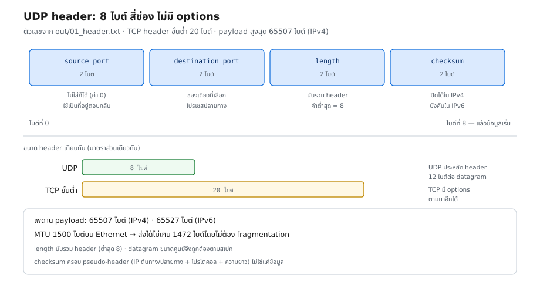
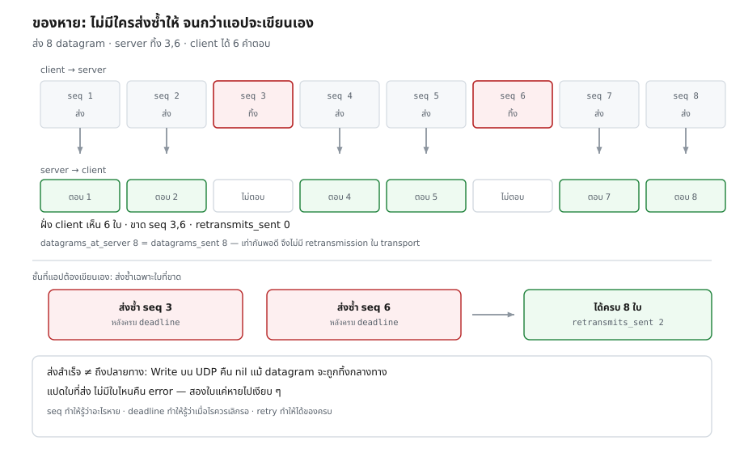
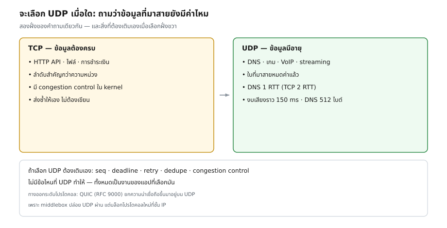

> 📅 เขียนเมื่อ: 22 พฤศจิกายน 2026 (เวลาไทย, UTC+7)
>
> **เครื่องที่รันบทนี้:** Raspberry Pi 5, Debian GNU/Linux 13 (trixie), kernel 6.18.60+rpt-rpi-2712, aarch64 · Go 1.24.4 · iproute2 6.15.0 (`ss`) · OpenBSD netcat (Debian patchlevel 1.229-1) · ภาพวาดด้วย `gen_svgs.py` แล้วเรนเดอร์ด้วย `rsvg-convert` 2.60.0 · ทุกตัวเลขในบทมาจากไฟล์ใน `out/` ที่สร้างด้วย `bash run_all.sh` ไม่มีตัวเลขใดพิมพ์ด้วยมือ
>
> 🛡️ **จริยธรรม (ใช้กับทั้งซีรีส์):** ทุกการทดลองในบทนี้ต่อกันผ่าน **loopback (`127.0.0.1`) ของเครื่องที่คุณควบคุมเอง** — ไม่มี datagram ออกนอกเครื่องแม้แต่ใบเดียว `ss` ที่ใช้ก็กรองเฉพาะพอร์ตที่โปรแกรมของเราเปิด และ `nc -u` ยิงไปที่ server ของเราเองบน loopback เท่านั้น การยิง UDP ไปยังเครื่องคนอื่นแม้แต่เพื่อทดสอบคือการโจมตี ถ้าไม่ได้รับอนุญาต

---

## 0. สองตั๋วงานที่ดูเหมือนไม่มีอะไรเกี่ยวข้องกัน

สัปดาห์เดียวกันมีตั๋วงานเข้ามาสองใบ ใบแรกจากทีมมือถือ: "แอปใช้งานได้ปกติบน WiFi แต่พอสลับไป 4G ต้องรอเป็นสิบนาทีกว่าจะกลับมาเชื่อมได้" ใบที่สองจากทีมเกม: "ping ขึ้นแค่ 20 ms แต่ผู้เล่นเดินทะลุกำแพงเป็นบางครั้ง แล้วกลับมาปกติเอง"

ทั้งสองใบไม่มีคำว่า UDP อยู่ในนั้นเลย แต่สาเหตุอยู่ที่เดียว: **แอปทั้งสองใช้ UDP และไม่มีใครในทีมเขียนส่วนที่ UDP ไม่ได้ให้ไว้**

- ใบแรกคือ **socket** (จุดที่โปรแกรมส่ง/รับข้อมูลผ่าน kernel) ที่ผูกกับ "path เดิม" — path ในที่นี้คือเส้นทางเครือข่ายที่ datagram วิ่งผ่าน ไม่ใช่ path ของไฟล์ พอเครือข่ายเปลี่ยน (WiFi → 4G) **NAT** (ตัวแปลง IP ภายในให้เป็น IP สาธารณะที่ปลายทางเห็น) ก็สร้าง mapping ใหม่ แต่ไม่มีอะไรบอกแอปว่าต้องเริ่มใหม่ — เพราะ UDP ไม่มีสัญญาณ "connection ขาด" ให้ฟัง
- ใบที่สองคือ update ที่หายไปกลางทาง ไม่มีใครส่งซ้ำให้ ฝั่ง client จึงเดาตำแหน่งผู้เล่นไปเรื่อย ๆ จนกว่าจะมี update ใหม่มาทับ

บทที่แล้วเราจบที่ TCP ซึ่งสัญญาว่าข้อมูลจะครบและเรียงถูก บทนี้จะไปดูโปรโตคอลที่ทำงานตรงข้ามในเกือบทุกมิติ — และจะเห็นว่าการถอดความสามารถออกนั้นไม่ใช่ความขี้เกียจ แต่เป็นการตัดสินใจทางวิศวกรรมที่แลกมาด้วยราคาที่ชัดเจน

---

## 1. datagram: หน่วยข้อมูลที่มาพร้อมขอบของตัวเอง

ก่อนจะพูดถึงข้อเสีย ต้องเข้าใจสิ่งที่ UDP ให้ก่อน เพราะมันให้ของที่ TCP ให้ไม่ได้ นั่นคือ **ขอบของข้อความ**

TCP เป็น **byte stream** — มันส่งไบต์ต่อเนื่องและไม่รู้จักคำว่า "ข้อความ" ถ้าแอปเขียน 5 ไบต์แล้วเขียนอีก 900 ไบต์ ผู้รับอาจอ่านได้ทั้งก้อนเดียว หรือได้ทีละ 100 ไบต์ก็ได้ (บทที่แล้วเราจึงต้องทำ length-prefix เอง — คือเขียนความยาวของข้อความไว้ข้างหน้าข้อมูล เพื่อให้ผู้รับรู้ว่าข้อความจบตรงไหน)

UDP เป็น **datagram** — หนึ่งครั้งที่เรียก `Write` คือหนึ่งหน่วยที่แยกจากกัน ปลายทางจะเห็นเป็นหนึ่งครั้งของ `Read` เสมอ ไม่มีการรวม ไม่มีการแบ่ง ไม่มีทางที่สอง datagram จะกลายเป็นก้อนเดียว หรือหนึ่ง datagram จะถูกแบ่งให้อ่านครึ่ง ๆ

ลองนึกภาพเทียบกัน: TCP คือท่อน้ำที่ไหลต่อเนื่อง ส่วน UDP คือซองจดหมายที่แต่ละซองมีขอบของตัวเอง ไปรษณีย์ไม่เอาเศษจดหมายหลายซองมาติดกาวรวมกัน และถ้าซองหนึ่งหายไป คนรับก็แค่ไม่ได้รับซองนั้น — ไม่มีใครรู้ด้วยซ้ำว่ามีซองนั้นอยู่

| หัวข้อ | TCP | UDP |
|---|---|---|
| ความสัมพันธ์ | connection-oriented (มี state ต่อคู่) | connectionless (ไม่มี state ต่อคู่) |
| ก่อนส่งข้อมูล | handshake สามทาง | ส่งได้ทันที |
| การส่งซ้ำ | มี (dupACK + RTO) | ไม่มี |
| ลำดับ | รับประกันว่าเรียงถูก | ไม่รับประกัน |
| flow control | มี window | ไม่มี |
| congestion control (ชะลอการส่งเมื่อเครือข่ายเริ่มแน่น) | มีใน kernel | ไม่มี — แอปต้องใส่เอง |
| ขอบข้อความ | ไม่มี (byte stream) | มี (หนึ่ง write = หนึ่ง datagram) |
| header ขั้นต่ำ | 20 ไบต์ | 8 ไบต์ |

ตารางนี้ไม่ได้บอกว่า UDP แย่กว่า มันบอกว่า UDP **เอาออกเกือบทั้งหมด** แล้วฝากให้แอปตัดสินใจเองว่าจะใส่กลับส่วนไหน — ซึ่งเป็นเรื่องที่เราจะลงมือทำในหัวข้อ 3

### 1.1 แปดไบต์ที่เหลืออยู่

UDP header มีสี่ช่อง สองไบต์ต่อช่อง รวมแปดไบต์ — น้อยกว่า TCP header ขั้นต่ำ (20 ไบต์) ถึงสิบสองไบต์ และไม่มี options ให้ตามมาอีก บล็อกต่อไปคือผลรันจริงของโปรแกรม — ตาราง header แล้วตามด้วยค่าคงที่ที่โปรแกรมพิมพ์ออกมา ใช้อ้างทั้งบท:

```text
## UDP header: 8 ไบต์ (RFC 768)
offset  bytes  field              note
0       2      source_port        ไม่ระบุก็ได้ (ใส่ 0)
2       2      destination_port   ปลายทาง
4       2      length             รวม header — ต่ำสุด 8
6       2      checksum           optional ใน IPv4 · บังคับใน IPv6

header_total              8
tcp_header_min            20
ipv4_header               20
ipv6_header               40
max_ip_packet             65535
max_payload_ipv4          65507
max_payload_ipv6          65527
eth_mtu                   1500
max_payload_no_frag_ipv4  1472
max_payload_no_frag_ipv6  1452
ipv6_min_mtu              1280
ipv6_min_mtu_payload      1232
```

อ่านทีละช่อง:

- **source_port** — ไม่ใส่ก็ได้ ถ้าไม่ต้องการให้ปลายทางตอบกลับ ตามสเปกให้ใส่ค่า 0
- **destination_port** — ช่องเดียวที่ใช้ตัดสินว่า datagram นี้เป็นของโปรเซสไหน
- **length** — ความยาว**รวม header** ไม่ใช่แค่ข้อมูล ดังนั้นค่าต่ำสุดคือ 8 และนี่คือเหตุผลที่ datagram ขนาดศูนย์ยังถูกต้องตามสเปก: length เป็น 8 พอดี
- **checksum** — คำนวณจาก pseudo-header (header ปลอมที่ไม่ได้ส่งจริง ใช้ประกอบการคำนวณ checksum เท่านั้น: IP ต้นทาง/ปลายทาง, หมายเลขโปรโตคอล, ความยาว) บวก UDP header บวกข้อมูล ใน IPv4 อนุญาตให้ปิดได้ด้วยการใส่ศูนย์ แต่ใน IPv6 บังคับ[^1]

ตัวเลขที่คนมักตอบผิดคือเพดาน payload — มีสามค่าที่ต่างกันเพราะมาจากคนละชั้น:

- `max_payload_ipv4 65507` ไบต์ — เพดานทางทฤษฎี: 65535 (ความยาวสูงสุดของ IP packet) ลบ IP header 20 ลบ UDP header 8
- `max_payload_ipv6 65527` ไบต์ — IPv6 นับความยาวหลัง header ตัวเอง จึงไม่ต้องลบ 40
- `max_payload_no_frag_ipv4 1472` ไบต์ — เพดานบน Ethernet ปกติ (MTU 1500) ที่ยังไม่ต้อง fragmentation

สองคำที่ต้องรู้ก่อนอ่านตัวเลขพวกนี้: **MTU** (maximum transmission unit — ขนาดใหญ่สุดของ packet ที่สายหนึ่งส่งได้ในครั้งเดียว) และ **fragmentation** (ชั้น IP หั่น packet ใหญ่เป็นชิ้นแล้วประกอบกลับที่ปลายทาง) — เราจะกลับมาที่ตัวเลขสุดท้ายในหัวข้อ 4

ส่วนอีกสองบรรทัดท้ายของบล็อกเป็นเรื่องของ IPv6: `ipv6_min_mtu 1280` คือ MTU ขั้นต่ำที่ IPv6 บังคับให้ทุก link (ช่วงเครือข่ายหนึ่งทอด — สายหรือคลื่นช่วงระหว่างอุปกรณ์สองตัว) รองรับ — packet ที่ไม่เกิน 1280 ไบต์จึงผ่านได้โดยไม่ต้อง fragmentation และ `ipv6_min_mtu_payload 1232` คือ payload ที่เหลือหลังหัก header (1280 ลบ 40 ลบ 8) ขณะที่ `max_payload_no_frag_ipv6 1452` มาจาก Ethernet MTU ปกติ 1500 (1500 ลบ 40 ลบ 8)



> ข้อควรระวังในการอ่านสเปก: "datagram" กับ "packet" ไม่ใช่คำเดียวกัน[^2] datagram คือหน่วยของชั้น transport ที่แอปเห็น packet คือสิ่งที่ชั้น IP ส่งออกไป และ packet หนึ่งใบอาจแบก datagram ได้แค่ใบเดียว (หรือชิ้นส่วนของใบเดียวเมื่อถูก fragmentation) — `datagram`/`packet`/`fragment` สลับกันเมื่อไร ความเข้าใจเรื่องเพดานขนาดจะเพี้ยนทันที

### 1.2 "connectionless" แปลว่าอะไรในระดับ kernel

คำว่า connectionless ถูกพูดบ่อยจนกลายเป็นคำติดปาก แต่ความหมายจริงของมันชัดเจนมาก: **kernel ไม่เก็บ state ต่อคู่สนทนา** ไม่มี sequence number ที่ต้องจำ ไม่มี window ที่ต้องประกาศ ไม่มี state machine ที่ต้องเดิน

เราดูของจริงได้ด้วย `ss` (เครื่องมือ Linux สำหรับดู socket ที่เปิดอยู่ — ตัวแทน `netstat` รุ่นเก่า) — โปรแกรมของเราเปิด socket แบบไม่ connect แล้วดู หลังจากนั้น connect แล้วดูอีกครั้ง แล้วปิดทั้งคู่:

```text
--- 1) bound แล้วแต่ยังไม่ connect
State  Recv-Q  Send-Q  Local                 Peer
UNCONN 0       0       127.0.0.1:47810       0.0.0.0:*
--- 2) หลัง connect: client ผูก peer ไว้
State  Recv-Q  Send-Q  Local                 Peer
UNCONN 0       0       127.0.0.1:47810       0.0.0.0:*
ESTAB  0       0       127.0.0.1:47811       127.0.0.1:47810
--- 3) หลังปิดทั้งสองฝั่ง
(ไม่มี socket ของเราเหลือใน ss)
listen_state        UNCONN
connected_state     ESTAB
rows_after_close    0
timewait_rows       0
```

คอลัมน์ที่ต้องรู้ก่อนอ่าน: **Recv-Q**/**Send-Q** = จำนวนไบต์ที่ค้างอยู่ในคิวรับ/ส่งของ socket (ทั้งคู่เป็น `0` เพราะยังไม่มีข้อมูลค้าง) อ่านผลนี้ให้ครบสามช่วง:

1. **ช่วงที่ยังไม่ connect** — เห็นแถวเดียว `listen_state UNCONN` คือ socket ที่ผูกพอร์ตไว้ แต่ยังไม่รู้จักใคร
2. **หลัง connect** — เพิ่มแถวที่สอง `connected_state ESTAB` เพราะฝั่ง client ผูกปลายทางไว้ล่วงหน้า
3. **หลังปิด** — `rows_after_close 0` ไม่มีอะไรค้างเลย ไม่มี `TIME-WAIT` ให้รอ

จุดที่ต้องระวังคือคำว่า `ESTAB` ในแถวที่สอง **ไม่ได้แปลว่า UDP มี connection แบบ TCP** มันเป็นเพียงป้ายที่ Linux ใช้บอกว่า "socket นี้ผูก peer ไว้แล้ว" เพื่อให้ `send` เรียกได้โดยไม่ต้องระบุที่อยู่ทุกครั้ง ไม่มี handshake ที่เกิดขึ้น ไม่มี state transition ให้เดิน และถ้าอีกฝั่งหายไปก็ไม่มีอะไรแจ้ง — สังเกตว่า `timewait_rows 0` เพราะ TIME-WAIT เป็นแนวคิดของ TCP ซึ่งไม่มีความหมายกับ UDP

ผลที่ตามมาที่มีค่ามากในงานจริง: server หนึ่งตัวรับ datagram จากลูกค้าหมื่นคนผ่าน socket เดียวได้ โดยไม่ต้องเก็บ state ต่อคนเลย เพราะทุกครั้งที่อ่าน แอปจะได้ address ของผู้ส่งมาด้วย — เราเห็นสิ่งนี้ในโค้ดหัวข้อถัดไป

แต่การไม่มี state ก็แลกมากับการไม่มีคนจัดการให้ ของที่ TCP เคยทำให้ฟรี ๆ หายไปหมด รวมถึง **การรายงาน error** ด้วย ซึ่งนำไปสู่กับดักที่ทำให้คนคิดว่า UDP ไม่มี error เลย — ก่อนจะไปถึงตรงนั้น ขอปูพื้นก่อนว่าการทดลองทั้งหมดในบทนี้อยู่ในโปรแกรม `net12` (โค้ดเต็มอยู่ที่ repo ของซีรีส์) — สั่งด้วย `-section <ชื่อ>` เพื่อเลือกชุดทดลอง:

```bash
./bin/net12 -section refused
```

```text
target              127.0.0.1:47899
read_error          read udp4 127.0.0.1:<ephemeral>->127.0.0.1:47899: read: connection refused
is_conn_refused     1
```

เราส่งไปยังพอร์ตที่ไม่มีใครฟัง แล้ว read กลับได้ error — `is_conn_refused 1` เพราะ kernel ได้ ICMP (โปรโตคอลข้อความแจ้งเหตุของชั้น IP — ตัวที่ปลายทางใช้บอกว่า "ส่งไปไม่ถึง") ข้อความ "port unreachable" กลับมา แล้วส่งต่อให้ socket ที่ connect ไว้[^3] นี่คือเหตุผลที่ log ของระบบที่ใช้ UDP มักมี `connection refused` โผล่มาโดยที่โค้ดไม่ได้เขียนอะไรผิด — มันคือปลายทางยังไม่ขึ้น หรือ process ตายไปแล้ว และ ICMP วิ่งกลับมาทัน

### 1.3 ทำไมสเปกถึงจงใจให้มันบางขนาดนี้

UDP เขียนโดย Jon Postel และเผยแพร่เป็น RFC 768 เมื่อ 28 สิงหาคม 1980 — ก่อนสเปก TCP ฉบับที่คนอ้างถึงทุกวันนี้ (RFC 793, กันยายน 1981) ราวหนึ่งปี แนวคิดตอนนั้นเรียบง่าย: มีแอปที่ต้องการเพียง "ส่งข้อความหนึ่งก้อนไปยังโปรเซสปลายทาง" และไม่ต้องการจ่ายค่า handshake หรือ state เลย ส่วนตัวอย่างที่คนชอบยกมาคู่กับ UDP — การโอนไฟล์เล็ก ๆ ผ่าน TFTP และการถามชื่อโดเมนผ่าน DNS — เป็นสิ่งที่ **ตามมาใช้** datagram นี้ทีหลัง ไม่ใช่แรงจูงใจตอนร่างสเปก (TFTP อยู่ใน RFC 783, มิถุนายน 1981 คือราวสิบเดือนหลัง UDP และ DNS อยู่ในต้นทศวรรษ 1980)

เหตุผลที่มันยังอยู่จนวันนี้ไม่ใช่เพราะมันเก่า แต่เพราะมันวางน้ำหนักถูกที่: งานที่ต้องการความน่าเชื่อถือ *รู้ตัว* ว่าต้องการ และสร้างมันขึ้นมาบน datagram ได้ ขณะที่งานที่ไม่ต้องการก็ไม่ต้องจ่ายราคาให้กับสิ่งที่ไม่ได้ใช้

หลักการนี้มีชื่อว่า **end-to-end argument** — ฟังก์ชันที่ต้องใช้ความรู้ของปลายทางควรถูกทำที่ปลายทาง ไม่ใช่ฝากไว้ที่กลางเครือข่าย เพราะกลางเครือข่ายไม่รู้ว่าแอปต้องการอะไร UDP เป็นตัวอย่างที่ชัดที่สุดของหลักการนี้: ชั้น transport ไม่แอบเติมความน่าเชื่อถือให้ เพราะมันไม่รู้ว่าแอปต้องการแค่ไหน — และการเติมผิด ๆ ยังทำให้แอปที่ต้องการ latency ต่ำต้องจ่ายราคาที่ไม่จำเป็น

---

## 2. ลงมือ: UDP echo server ที่รันได้จริง

เราจะเขียน server/client คู่หนึ่งบน loopback แล้วให้มันพิสูจน์สามอย่าง: datagram ไม่ถูกรวม, datagram ขนาดศูนย์มาถึงจริง และไม่มี handshake แลกเปลี่ยนก่อนส่ง

เริ่มจากฝั่ง server — สังเกตว่าไม่มี loop รับ connection, ไม่มี `Accept`, ไม่มี state ต่อผู้ใช้เลย:

```go
func serveEcho(srv *net.UDPConn, atServer *atomic.Int32, done chan struct{}) {
	defer close(done)
	buf := make([]byte, maxPayloadIPv4+1)
	for {
		srv.SetReadDeadline(time.Now().Add(serveIdle))
		n, peer, err := srv.ReadFromUDP(buf)
		if err != nil {
			var ne net.Error
			if errors.As(err, &ne) && ne.Timeout() {
				continue
			}
			return
		}
		atServer.Add(1)
		if _, err := srv.WriteToUDP(buf[:n], peer); err != nil {
			return
		}
	}
}
```

`ReadFromUDP` คืนสามอย่าง: จำนวนไบต์, address ของผู้ส่ง และ error — address มาจากตัว datagram เอง ไม่ได้มาจาก state ที่เก็บไว้ นี่คือทั้งหมดของ server แบบ connectionless และเป็นเหตุผลที่มันรับลูกค้าได้ไม่จำกัดจำนวนโดยไม่กินหน่วยความจำต่อราย

ฝั่ง client ส่งสาม datagram ที่มีขนาดต่างกันชัดเจน (5, 900 และ 200 ไบต์) แล้วอ่านคำตอบกลับทีละใบ:

```go
func echoClient(sizes []int) (echoResult, error) {
	var out echoResult
	cli, err := net.DialUDP("udp4", nil, mustUDPAddr(addrEcho))
	if err != nil {
		return out, fmt.Errorf("dial %s: %w", addrEcho, err)
	}
	defer cli.Close()

	rbuf := make([]byte, maxPayloadIPv4+1)
	for i, sz := range sizes {
		payload := bytes.Repeat([]byte{byte('A' + i)}, sz)
		if _, err := cli.Write(payload); err != nil {
			return out, fmt.Errorf("ส่ง datagram #%d: %w", i+1, err)
		}
		cli.SetReadDeadline(time.Now().Add(serveIdle))
		n, err := cli.Read(rbuf)
		if err != nil {
			return out, fmt.Errorf("รับ datagram #%d: %w", i+1, err)
		}
		if !bytes.Equal(rbuf[:n], payload) {
			out.mismatch++
		}
		out.recvSizes = append(out.recvSizes, n)
	}

	// datagram ขนาดศูนย์: ส่งได้ และอ่านกลับมาได้ n=0 โดยไม่ใช่ EOF
	if _, err := cli.Write(nil); err != nil {
		return out, fmt.Errorf("ส่ง zero-length: %w", err)
	}
	cli.SetReadDeadline(time.Now().Add(serveIdle))
	out.zeroN, out.zeroErr = cli.Read(make([]byte, 16))
	return out, nil
}
```

สี่จุดในฟังก์ชันนี้ที่ควรอ่านให้ครบ:

- `bytes.Repeat([]byte{byte('A' + i)}, sz)` — สร้าง payload ที่เต็มไปด้วยตัวอักษรเดียวกัน (A, B, C ตามลำดับของ datagram) เพื่อให้ตรวจได้ว่าคำตอบที่ได้กลับมาเป็นของใบไหน
- `cli.SetReadDeadline(...)` — กันการรอค้าง: ถ้าคำตอบไม่มาในเวลาที่ตั้งไว้ `Read` จะคืน error แทนที่จะบล็อกตลอดไป
- `cli.Write(nil)` — datagram ขนาด 0 ไบต์ ส่งได้จริง และเป็น datagram ที่ถูกต้อง ไม่ใช่การปิด connection
- `zeroN`/`zeroErr` — เก็บผลของเคส 2.1 ไว้รายงานว่าได้ `n=0` พร้อม error เป็น nil

รันทั้งคู่แล้วเก็บผล:

```text
listen              127.0.0.1:47800
datagrams_sent      3
sizes_sent          5,900,200
datagrams_recv      3
sizes_recv          5,900,200
payload_mismatch    0
boundaries_preserved 1
zero_len_sent       1
zero_len_recv       1
zero_len_read_error none
datagrams_at_server 4
handshake_packets   0
```

(`<ephemeral>` = พอร์ตต้นทางชั่วคราวที่ kernel เลือกให้ เพราะเราไม่ได้ bind พอร์ตเอง — พอร์ตจริงเปลี่ยนทุกครั้งที่รัน จึงถูกแทนด้วยชื่อนี้เพื่อให้ผลรันซ้ำได้)

สามบรรทัดที่ต้องอ่านคู่กันคือ `sizes_sent 5,900,200`, `sizes_recv 5,900,200` และ `boundaries_preserved 1` — ผู้รับได้สามใบ สามขนาดเท่าเดิม ไม่มีใบไหนถูกรวมหรือแบ่ง ถ้าเป็น TCP การอ่านครั้งเดียวอาจได้ทั้งสามใบรวมเป็นก้อนเดียว ซึ่งไม่ผิดสเปกของ TCP เลย แต่ผิดความคาดหวังของคนที่เขียนโค้ดแบบ "หนึ่ง read = หนึ่งข้อความ" ส่วน `datagrams_at_server 4` คือสามใบปกติบวก datagram ขนาดศูนย์อีกหนึ่งใบ — และบรรทัด `handshake_packets 0` ที่โปรแกรมคำนวณจากจำนวน datagram ที่ถึง server จริง ก็ยืนยันว่าไม่มีใบพิเศษใด ๆ เกิดจาก handshake

### 2.1 datagram ขนาดศูนย์ไม่ใช่ EOF

บรรทัด `zero_len_read_error none` คือจุดที่คนเขียนโค้ดพลาดบ่อยที่สุดในงานจริง: เราส่ง datagram ที่มีความยาว 0 ไบต์ ผู้รับได้ `n=0` และ **error เป็น nil** — นี่คือ datagram ที่ถูกต้อง ไม่ใช่สัญญาณปิด connection

ใน TCP การอ่านได้ 0 ไบต์พร้อม error `io.EOF` หมายถึงอีกฝั่งปิด แต่ใน UDP ไม่มี EOF ให้เห็นเลย เพราะไม่มีอะไรให้ปิด datagram ขนาดศูนย์จึงเป็นข้อความที่ถูกต้องตามสเปก (length = 8) และโค้ดที่ใช้ `if n == 0 { break }` แบบ TCP จะเลิกอ่านทันทีที่เจอข้อความว่างใบแรก ซึ่งอาจเป็นสาเหตุของบั๊กที่หาไม่เจอเป็นวัน[^7]

ยืนยันด้วยเครื่องมือมาตรฐาน — `nc` (netcat: มีดพกของงาน network เปิด TCP/UDP แล้วส่งข้อความดิบได้) ในโหมด `-u` คุยกับ server ของเราได้โดยไม่ต้องเขียนโค้ดอะไรเลย:

```text
--- server (net12 -section serve)
listening           127.0.0.1:47840
recv 1              14 bytes from 127.0.0.1:<ephemeral>
payload             "hello from nc\n"
--- client (nc -u)
hello from nc
```

ฝั่ง server เห็น 14 ไบต์ และฝั่ง client ได้ข้อความเดิมกลับมา อีกครั้ง: ไม่มีขั้นตอนตกลงอะไรก่อน datagram แรกเลย

---

## 3. สิ่งที่ UDP ไม่ทำให้ — และชั้นที่คุณต้องเขียนเอง

ตอนนี้เรามี echo server ที่ทำงานถูกต้อง แต่ยังไม่มีอะไรรับประกันว่าข้อมูลจะไปถึง นี่คือส่วนที่คนมักข้าม และเป็นส่วนที่ทำให้ระบบ UDP ล้มในโปรดักชัน

### 3.1 ของหาย: ไม่มีใครส่งซ้ำให้

เราจำลองของหายแบบกำหนดได้ เพื่อให้ผลรันซ้ำได้ทุกครั้ง — server ทิ้ง datagram ตามลำดับที่รับ (ใบที่หารด้วยค่าที่กำหนดลงตัว) เฉพาะรอบแรก:

```go
func shouldDrop(idx, count, every int) bool {
	return every > 0 && idx <= count && idx%every == 0
}
```

ส่งแปดใบ ให้ server ทิ้งทุกใบที่สาม แล้วดูว่าฝั่ง client เห็นอะไร:

```text
listen              127.0.0.1:47800
datagrams_sent      8
datagrams_at_server 8
server_dropped      2
dropped_seqs        3,6
replies_received    6
missing_seqs        3,6
deadline_ms         250
retransmits_sent    0
```

อ่านสี่บรรทัดนี้ให้ครบ:

- `datagrams_sent 8` และ `datagrams_at_server 8` — จำนวนเท่ากันพอดี นี่คือหลักฐานว่า **transport ไม่ได้ส่งซ้ำให้** ถ้า UDP มี retransmission ตัวเลขฝั่ง server จะมากกว่า 8
- `dropped_seqs 3,6` — สองใบที่หายไปคือ seq 3 กับ 6
- `replies_received 6` และ `missing_seqs 3,6` — client รู้ว่าขาด แต่รู้เพราะเรานับ seq เอง ไม่ใช่เพราะ UDP บอก
- `retransmits_sent 0` — ไม่มีใครส่งอะไรซ้ำ

จุดสำคัญคือความเงียบ: การส่งทั้งแปดครั้ง **ไม่คืน error** แม้สองใบจะไม่ถึงปลายทาง `Write` บน UDP สำเร็จหมายถึง "kernel รับไปส่งแล้ว" ไม่ได้หมายถึง "ถึงปลายทางแล้ว" และนี่คือความหมายที่แท้จริงของคำว่า "unreliable" ในสเปก — ไม่ใช่ "พังบ่อย" แต่คือ "ไม่มีการยืนยัน"



### 3.2 ชั้นความน่าเชื่อถือที่แอปต้องเขียน

ถ้างานของคุณต้องการให้ข้อมูลครบ สิ่งที่ต้องมีคือสี่อย่างนี้: **seq** (รู้ว่าอะไรหาย), **deadline** (รู้ว่าเมื่อไรควรเลิกรอ), **retry** (ส่งซ้ำใบที่ขาด) และ **dedupe** (กันใบซ้ำที่อาจมาถึง) ทั้งสี่อย่างรวมกันในฟังก์ชันเดียว:

```go
func sendWithRetry(cli *net.UDPConn, count, rounds int, wait time.Duration) (map[int]bool, int, error) {
	seen := map[int]bool{}
	sent := 0
	for i := 1; i <= count; i++ {
		if _, err := cli.Write([]byte(fmt.Sprintf("seq=%d", i))); err != nil {
			return seen, sent, fmt.Errorf("ส่ง seq=%d: %w", i, err)
		}
		sent++
	}
	for r := 0; r < rounds; r++ {
		collectSeqs(cli, seen, wait)
		missing := missingFrom(seen, count)
		if len(missing) == 0 {
			break
		}
		for _, seq := range missing {
			if _, err := cli.Write([]byte(fmt.Sprintf("seq=%d", seq))); err != nil {
				return seen, sent, fmt.Errorf("ส่งซ้ำ seq=%d: %w", seq, err)
			}
			sent++
		}
	}
	collectSeqs(cli, seen, wait)
	return seen, sent, nil
}
```

สี่ชื่อที่โผล่ในฟังก์ชันนี้และยังไม่เคยอธิบายที่ไหน:

- `collectSeqs` — อ่านคำตอบจาก socket จนครบเวลารอ แล้วจด seq ที่ได้ลง map
- `missingFrom` — ไล่ seq ตั้งแต่ 1 ถึง count แล้วคืนเฉพาะตัวที่ยังไม่เห็น
- `rounds` — จำนวนรอบส่งซ้ำ (0 เมื่อไม่เปิด `-retry`, 1 เมื่อเปิด)
- `serveIdle` — เวลาที่ server รอ datagram ก่อนเลิก (2 วินาทีในเดโม) และนี่คือเหตุผลว่าทำไม server เจอ timeout แล้ว `continue` ไม่ใช่ `return`: การไม่มีใครส่งมาแป๊บเดียวไม่ใช่เหตุให้ปิด server

รันโหมดเดิมแต่เปิดให้ส่งซ้ำหนึ่งรอบ:

```text
listen              127.0.0.1:47800
datagrams_sent      10
datagrams_at_server 10
server_dropped      2
dropped_seqs        3,6
replies_received    8
missing_seqs        none
deadline_ms         250
retransmits_sent    2
```

`retransmits_sent 2` และ `replies_received 8` — ส่งเพิ่มสองใบ ได้คำตอบครบแปดใบ และ `missing_seqs none` คือสภาพที่แอปต้องการ แต่สังเกตว่าตัวเลขนี้ไม่ได้มาจาก UDP เลย มันมาจาก `map[int]bool` บรรทัดเดียวในฟังก์ชันข้างบน (บรรทัด `seen := map[int]bool{}` — ที่เหลือคือตรรกะที่เราเขียนเอง)

`deadline_ms 250` คือค่าที่เราตั้งไว้ในเดโม (ไม่ใช่ค่าที่วัดได้) ในระบบจริงตัวเลขนี้มาจากงบ latency ของแอป ไม่ใช่จาก kernel — และการเลือกผิด (สั้นเกิน = ส่งซ้ำทั้งที่ของยังมาไม่ถึง, ยาวเกิน = ผู้ใช้รอโดยไม่จำเป็น) เป็นงานออกแบบ ไม่ใช่งานตั้งค่า

การ dedupe สำคัญพอ ๆ กับการส่งซ้ำ เพราะ datagram ที่ส่งซ้ำอาจมาถึงสองครั้ง (ใบที่ส่งซ้ำอาจถึงก่อน ใบเดิมที่มาช้าตามมาทีหลัง ผู้รับจึงเห็น seq เดียวกันสองครั้ง) การใช้ map กัน seq ซ้ำจึงเป็นบรรทัดที่ขาดไม่ได้ — โค้ดที่ "ทำงานได้" บน loopback มักพังตรงนี้เมื่อขึ้นเครือข่ายจริง

### 3.3 ลำดับ: ผู้รับอาจเห็นสลับ

UDP ไม่สัญญาเรื่องลำดับ — และไม่ใช่แค่ "อาจสลับ" แต่สลับได้ตลอดเวลา เพราะ datagram สองใบที่ส่งติดกันอาจถูก router คนละตัวพาไปคนละทาง ในเดโมเราบังคับให้ server ตอบย้อนลำดับ เพื่อให้เห็นผลที่ชัดเจน:

```text
listen             127.0.0.1:47800
datagrams_sent     5
send_order         1,2,3,4,5
arrival_order      5,4,3,2,1
replies_received   5
max_displacement   4
in_order_delivered 0
sorted_order       1,2,3,4,5
```

`arrival_order 5,4,3,2,1` คือลำดับที่ client เห็น ขณะที่ `send_order 1,2,3,4,5` คือลำดับที่ส่ง และ `max_displacement 4` คือระยะห่างมากที่สุดระหว่างใบหนึ่งกับตำแหน่งที่ควรเป็น

`in_order_delivered 0` ยืนยันว่าไม่มีอะไรใน transport ช่วยเรียงให้ — ถ้าแอปต้องการลำดับ ต้อง buffer เองแล้วเรียงด้วย seq (`sorted_order 1,2,3,4,5` คือผลหลังเรียง) ซึ่งแลกมาด้วยความหน่วง: ต้องรอใบที่ขาดก่อนจะส่งต่อให้ชั้นบน

ตารางสรุปว่าความสามารถแต่ละอย่างเป็นอย่างไรเมื่อเลือก UDP:

| ความสามารถ | สถานะเมื่อใช้ UDP | ราคาที่จ่าย |
|---|---|---|
| ขอบข้อความ | มีให้อยู่แล้วใน datagram | ฟรี |
| ตรวจข้อมูลเสีย | checksum มีให้ (ปิดได้ใน IPv4) | ฟรี |
| รู้ว่าของหาย | seq + deadline + retry | ซับซ้อนขึ้น, ต้องเลือก timeout |
| กันของซ้ำ | dedupe ด้วย seq | หน่วยความจำต่อ flow |
| เรียงลำดับ | buffer + sort | latency เพิ่ม |
| flow control | window ของตัวเอง | ต้องออกแบบ |
| congestion control | ต้องมี (สเปกแนะนำชัดเจน) | งานหนักที่สุด[^6] |

บรรทัดสุดท้ายคือบรรทัดที่คนมักลืม: **UDP ไม่มี congestion control** ถ้าแอปยิง datagram เร็วเท่าที่ทำได้ มันจะแย่ง bandwidth กับ TCP จนเครือข่ายพัง และถ้ายิงพร้อมกันหลาย flow ก็ยิ่งแย่ RFC 8085 จึงบอกตรง ๆ ว่าแอปที่เลือกใช้ UDP *ควร* จำกัดอัตราส่งของตัวเองและทำ congestion control — ไม่ใช่เพราะเป็นมารยาท แต่เพราะไม่มีใครทำให้

---

## 4. ขนาด: 65507, 1472 และการตัดที่เงียบสนิท

มีเรื่องของขนาดที่ต้องจำสามเรื่อง และแต่ละเรื่องมาจากคนละชั้น

```text
loopback_mtu            65536
eth_mtu                 1500
max_payload_ipv4        65507
max_payload_ipv6        65527
no_frag_payload_ipv4    1472
no_frag_payload_ipv6    1452
ipv6_min_mtu            1280
ipv6_min_mtu_payload    1232
payload_1472            ok
payload_65507           ok
payload_65508           error=write udp4 127.0.0.1:<ephemeral>->127.0.0.1:47830: write: message too long
payload_65508_errno     EMSGSIZE
trunc_recv_buffer       64
trunc_datagram_bytes    900
trunc_read_returned     64
trunc_read_error        none
trunc_lost_bytes        836
```

**ตัวแรก — เพดานตามสเปก** `max_payload_ipv4 65507` คือเพดานทางทฤษฎีที่มาจากความยาวสูงสุดของ IP packet ถ้าส่งเกินนี้ kernel จะปฏิเสธทันที ไม่ใช่ตัดให้:

```bash
./bin/net12 -section size
```

ผลคือ `payload_65507 ok` แต่ `payload_65508` ได้ error `message too long` และ `payload_65508_errno EMSGSIZE` — error นี้มาจากชั้น IP เพราะ datagram ทั้งใบ (รวม header) เกินเพดานความยาวสูงสุดของ IP packet (65535 ไบต์) ไม่ใช่ข้อจำกัดของ UDP เอง: ช่อง length ใน IPv4 header มีแค่ 16 บิต ใส่ค่ามากกว่านั้นไม่ได้ kernel จึงปฏิเสธตั้งแต่ก่อนส่ง เป็น error ที่ดี เพราะมันดังและมาทันที

**ตัวที่สอง — เพดานที่ไม่ต้อง fragmentation** `max_payload_no_frag_ipv4 1472` คือ MTU 1500 ลบ IP header 20 ลบ UDP header 8 datagram ที่ใหญ่กว่านี้จะถูกแบ่งเป็นหลาย packet ที่ชั้น IP และการแบ่งนั้นอันตรายกว่าที่คิด: ถ้าชิ้นใดชิ้นหนึ่งหาย datagram ทั้งใบหายทั้งใบ เพราะชั้น IP ประกอบกลับไม่ได้ ขนาด 900 ไบต์ที่เราใช้ในเดโมจึงปลอดภัย แต่ 65,507 ไบต์ที่ส่งผ่านได้บน loopback (`loopback_mtu 65536`) จะไม่รอดบน Ethernet จริง

**ตัวที่สาม — และอันตรายที่สุด — buffer ผู้รับที่เล็กกว่า datagram** อันนี้ไม่ error ไม่มี log ไม่มีอะไรทั้งสิ้น:

```go
func truncationDemo(w io.Writer) error {
	// buffer ผู้รับเล็กกว่าขนาด datagram: เกิดอะไรขึ้น
	srv, err := net.ListenUDP("udp4", mustUDPAddr(addrSize))
	if err != nil {
		return fmt.Errorf("listen %s: %w", addrSize, err)
	}
	defer srv.Close()
	cli, err := net.DialUDP("udp4", nil, mustUDPAddr(addrSize))
	if err != nil {
		return fmt.Errorf("dial %s: %w", addrSize, err)
	}
	defer cli.Close()

	const datagramBytes = 900
	if _, err := cli.Write(bytes.Repeat([]byte{'z'}, datagramBytes)); err != nil {
		return fmt.Errorf("ส่ง %d ไบต์: %w", datagramBytes, err)
	}
	small := make([]byte, 64)
	srv.SetReadDeadline(time.Now().Add(serveIdle))
	rn, _, rerr := srv.ReadFromUDP(small)
	readErr := "none"
	if rerr != nil {
		readErr = redactAddrs(rerr.Error(), 47830)
	}
	fmt.Fprintf(w, "trunc_recv_buffer       %d\n", len(small))
	fmt.Fprintf(w, "trunc_datagram_bytes    %d\n", datagramBytes)
	fmt.Fprintf(w, "trunc_read_returned     %d\n", rn)
	fmt.Fprintf(w, "trunc_read_error        %s\n", readErr)
	fmt.Fprintf(w, "trunc_lost_bytes        %d\n", datagramBytes-rn)
	return nil
}
```

อ่าน 900 ไบต์ด้วย buffer 64 ไบต์ ได้ `trunc_read_returned 64` และ `trunc_read_error none` — ข้อมูลหายไป `trunc_lost_bytes 836` ไบต์โดยไม่มีสัญญาณใด ๆ

นี่คือกับดักที่ทำให้ระบบ UDP "ทำงานปกติ" เกือบตลอดเวลา แล้วพังเฉพาะเมื่อมี datagram ใหญ่ผิดปกติหลุดเข้ามา ทางป้องกันมีสองชั้น: ตั้ง buffer ให้ใหญ่ที่สุดที่แอปยอมรับได้ (เพดานคือ 65507) และตรวจ `n == len(buf)` ว่าเต็มพอดีหรือไม่ ถ้าเต็มให้ถือว่า "อาจถูกตัด" แล้วจัดการ — อย่าถือว่าเป็นข้อมูลครบ

ในเดโมของเรา echo server จึงตั้ง buffer ไว้ที่ `maxPayloadIPv4+1` = 65508 ไบต์ ผลคือ `-section echo -sizes 65507` ได้ `sizes_recv 65507` ครบถ้วน ขณะที่ฟังก์ชัน `truncationDemo` ข้างบนจงใจใช้ buffer แค่ 64 ไบต์ เพื่อโชว์ว่าการตัดเงียบหน้าตาเป็นอย่างไร

---

## 5. เมื่อไหร่ควรเลือก UDP

คำถามนี้ตอบด้วยคำถามเดียวได้: **ถ้าข้อมูลนี้มาช้า ข้อมูลนี้ยังมีค่าไหม**

- ถ้าคำตอบคือ "มีค่า" — ใช้ TCP เพราะคุณต้องการให้มันมาครบ
- ถ้าคำตอบคือ "หมดค่าแล้ว" — UDP คือคำตอบ เพราะการส่งซ้ำมีแต่ทำให้แย่ลง



ลองไล่สี่งานที่คนยกมาเสมอ และดูว่าเหตุผลจริง ๆ คืออะไร

### 5.1 DNS — หนึ่งคำถาม หนึ่งคำตอบ และเวลาเดินทางที่สั้นที่สุด

DNS เป็นตัวอย่างที่สะอาดที่สุดของการออกแบบรอบ datagram: หนึ่งคำถาม หนึ่งคำตอบ จบ ไม่มีอะไรต้องจำระหว่างกัน

ค่าใช้จ่ายที่ประหยัดได้ชัดเจนคือ **round trip** ถ้า RTT 50 ms การถามผ่าน TCP ต้องเสีย 1 RTT สำหรับ handshake ก่อน แล้วอีก 1 RTT สำหรับคำถาม/คำตอบ รวมสองรอบ ขณะที่ UDP ใช้รอบเดียว:

```text
rtt_ms               50
queries              100
udp_round_trips      1
tcp_round_trips      2
udp_total_ms         50
tcp_total_ms         100
extra_per_query_ms   50
extra_total_ms       5000
dns_udp_limit_bytes  512
voice_budget_ms      150
```

`udp_round_trips 1` เทียบกับ `tcp_round_trips 2` และที่ 100 query ต่างกัน `extra_total_ms 5000` — ห้าวินาทีที่หายไปฟรี ๆ จากการเลือก transport ให้ตรงกับลักษณะงาน (ตัวเลขชุดนี้เป็นเลขคณิตจาก RTT ที่สมมติ ไม่ใช่การวัด — เราเขียนไว้ให้เห็นโครง ไม่ได้อ้างว่าเครือข่ายจริงเป็นแบบนี้)

ข้อควรระวังในการอ่านตัวเลขนี้: โมเดลข้างบนคิดแบบต่อ connection ใหม่ทุก query ถ้า TCP connection ถูกใช้ซ้ำ — connection reuse ซึ่ง RFC 7766 แนะนำให้ทำกับ DNS — ค่า handshake จะจ่ายแค่ query แรก หลังจากนั้นเหลือ 1 RTT ต่อ query เท่ากับ UDP ส่วนที่ UDP ประหยัดได้จริงในทางปฏิบัติจึงเป็น "การไม่ต้องมี connection ค้างไว้เลย" มากกว่าตัวเลขสองเท่าบนกระดาษ

แต่ DNS ก็ไม่ได้ใช้ UDP แบบไม่มีข้อจำกัด สเปกเดิมกำหนดว่าข้อความทาง UDP ต้องไม่เกิน `dns_udp_limit_bytes 512` ไบต์ ถ้าคำตอบใหญ่กว่านั้น server จะตัดและตั้งบิต TC เพื่อบอกให้ client ไปถามใหม่ทาง TCP[^4] ต่อมามี EDNS(0) ที่ให้ประกาศขนาดใหญ่ขึ้นได้ แต่ข้อจำกัดนี้คือเหตุผลว่าทำไม DNSSEC (ส่วนขยายที่ลงลายเซ็นกำกับคำตอบ DNS) ถึงทำให้ DNS กลับไปพึ่ง TCP มากขึ้น — เป็นตัวอย่างว่าการเลือก UDP ไม่ได้จบที่ "เลือกแล้วจบ" แต่ต้องรู้เพดานของมันด้วย

### 5.2 streaming, เกม และ VoIP — สามงานเดียวกันในเสื้อต่างกัน

ทั้งสามงานมีลักษณะร่วมกัน: **ข้อมูลมีอายุ** ข้อมูลที่มาช้าเกินกำหนดไม่มีค่าอีกต่อไป

- **วิดีโอ/เสียงสด** — frame ที่หายไปแล้วมาถึงอีกหลายร้อยมิลลิวินาทีให้หลัง ไม่มีประโยชน์ เพราะผู้เล่นต้องเล่นต่อแล้ว การส่งซ้ำจึงกิน bandwidth โดยไม่ได้อะไร ฝั่งผู้รับใช้ jitter buffer เพื่อดูดความไม่สม่ำเสมอของเวลา แล้วทิ้ง frame ที่มาช้าเกิน
- **เกม** — update คือ "สถานะล่าสุด" ไม่ใช่ "เหตุการณ์ที่ต้องครบ" ถ้า update ตำแหน่งผู้เล่นใบหนึ่งหาย ใบถัดไปจะมาแทนเอง การส่งซ้ำใบเก่ามีแต่ทำให้สถานะเก่ามาทับสถานะใหม่ ฝั่ง client จึงเดาตำแหน่ง (extrapolate) ไปก่อนแล้วค่อยแก้เมื่อ update ใหม่มา
- **VoIP** — งบเวลาทั้งเส้นทางถูกกำหนดไว้ชัด: G.114 (ฉบับ 05/2003) แนะนำให้ one-way delay ไม่เกิน 400 ms เป็นเพดานสำหรับการวางแผนเครือข่าย และระบุว่างานโต้ตอบส่วนใหญ่ได้รับผลกระทบน้อยกว่าถ้าไม่เกิน 150 ms[^5] การส่งซ้ำหนึ่งครั้งอาจกินเวลาเกินงบทั้งก้อน ระบบจึงเลือก "เสียงขาดหายเล็กน้อย" แทน "เสียงช้าและขาดเป็นจังหวะ"

ทั้งสามงานยังต้องแก้ปัญหาเดียวกันคือ **การรับรู้ว่าของหายแล้วทำอะไรต่อ** ซึ่งไม่ใช่เรื่องของ UDP เลย — เป็นงานของ codec (ตัวบีบอัด/ถอดรหัสเสียงหรือภาพ), jitter buffer หรือ state interpolation ที่อยู่อีกชั้นขึ้นไป

### 5.3 เมื่อไม่ควรใช้ — และกับดักทางวิศวกรรม

อย่าเลือก UDP เพราะ "เร็วกว่า" คำเดียว ถ้างานของคุณต้องการข้อมูลครบทุกไบต์และเรียงถูก การเขียนชั้น reliability เองจะมีบั๊กมากกว่าการใช้ TCP ที่ผ่านการทดสอบมาสี่สิบปี — และจะช้ากว่า TCP ด้วยถ้าเขียน congestion control ไม่ดี

งานที่ **ไม่ควร** ใช้ UDP: HTTP API, การส่งไฟล์, การชำระเงิน, การ sync ฐานข้อมูล, งานที่ต้องมี audit log — ทั้งหมดนี้ต้องการความครบและลำดับมากกว่าความหน่วงไม่กี่มิลลิวินาที

ส่วนงานที่ดูเหมือนต้องใช้ UDP แต่จริง ๆ ไม่ต้อง: เกมเทิร์นเบส, แชทข้อความ, dashboard — ของพวกนี้ latency ระดับร้อยมิลลิวินาทียอมรับได้ และ TCP ก็ให้ความครบมาฟรี

มีกรณีหนึ่งที่ควรรู้ไว้เพราะมันเปลี่ยนภาพทั้งใบ: **QUIC** (RFC 9000, พฤษภาคม 2021) สร้าง transport ที่ reliable, มี congestion control, มี TLS ในตัว และมีหลาย stream บน UDP[^6] เหตุผลที่ไม่สร้างเป็นโปรโตคอลใหม่บน IP โดยตรงคือ middlebox (อุปกรณ์กลางทางที่ไม่ใช่ router ตรง ๆ — firewall, NAT, proxy ที่ดักดูหรือแก้ packet) บน internet บล็อกโปรโตคอลใหม่ แต่ปล่อย UDP ผ่าน เพราะมันหน้าตาเหมือนสิ่งที่รู้จักมานานหลายทศวรรษ

นี่คือบทเรียนที่สำคัญกว่าตัวโปรโตคอล: UDP ไม่ได้แปลว่า "ไม่ต้องการความน่าเชื่อถือ" แต่แปลว่า "ฉันจะจัดการความน่าเชื่อถือเอง ในชั้นที่ฉันควบคุมได้"

---

## 6. กับดักห้าข้อจากงานจริง

### 6.1 อ่านได้ 0 ไบต์แล้วเลิกอ่าน

โค้ดที่พอร์ตมาจาก TCP มักมี `if n == 0 { break }` ซึ่งใน UDP หมายถึง "เจอข้อความว่าง" ไม่ใช่ "ปิด connection" อาการคือแอปหยุดรับข้อมูลหลังจากมี datagram ว่างใบแรกหลุดเข้ามา — และเพราะ datagram ว่างหาได้ยากในเทสต์ปกติ บั๊กนี้จึงโผล่ในโปรดักชันเท่านั้น

### 6.2 buffer เล็กแล้วข้อมูลหายเงียบ

`ReadFromUDP` ไม่บอกว่าตัดข้อมูล เราเห็นแล้วว่า 900 ไบต์ใน buffer 64 ไบต์กลายเป็น 64 ไบต์พร้อม error เป็น nil ทางแก้คือจัด buffer ตามขนาดสูงสุดที่โปรโตคอลของคุณอนุญาต และตรวจ `n == len(buf)` เป็นสัญญาณว่าอาจถูกตัด

### 6.3 คิดว่าไม่มี error เลย

UDP ไม่มี error ของ "ข้อมูลไม่ถึง" แต่มี error จาก ICMP เช่น `connection refused` เมื่อปลายทางไม่มีคนฟัง (เราเห็น `is_conn_refused 1` ในหัวข้อ 1.2) — และมี error ตอนส่งที่ต้องแยกเป็นสองกรณีด้วยกัน: datagram ที่ใหญ่เกินเพดานของ IP packet (payload เกิน 65507 ไบต์) จะถูกปฏิเสธทันทีด้วย `EMSGSIZE`; แต่ datagram ที่ใหญ่กว่า MTU ของ link และไม่ได้ตั้ง DF (Don't Fragment) จะถูกชั้น IP fragmentation แล้วส่งต่อไปได้ ไม่มี error กลับมา การจัดการ error ทั้งสองแบบนี้ต่างกันโดยสิ้นเชิง — แบบแรกบอกว่าปลายทางผิด แบบที่สองบอกว่าข้อมูลของเราใหญ่เกิน และแบบที่สามที่ไม่มี error เลยคือกรณีที่ต้องระวังที่สุด

### 6.4 ไม่มี deadline = goroutine ค้างตลอดกาล

`ReadFromUDP` บล็อกจนกว่าจะมี datagram ถ้าไม่มีใครส่งมา มันจะรอตลอดไป และถ้าเป็น loop ที่สร้าง goroutine ต่อ request ปัญหาจะโตขึ้นเรื่อย ๆ โดยไม่มี error ใน log ทุกครั้งที่รอควรมี `SetReadDeadline` — ในเดโมเราใช้ `deadline_ms 250` เป็นค่าคงที่ เพื่อให้ผลรันซ้ำได้

### 6.5 ลืมว่า receive buffer มีขอบ

ถึงแอปจะอ่านทัน แต่ถ้าอัตราส่งสูงกว่าอัตราอ่านชั่วคราว datagram จะถูกทิ้งที่ kernel ก่อนถึงแอปเลย บนเครื่องนี้ `udp_rmem_min: 16384` คือค่าต่ำสุดของหน่วยความจำรับต่อ socket (อ่านได้จาก `out/00_env.txt`) — ตัวเลขนี้ไม่ใช่คำตอบของทุกงาน แต่เป็นจุดเริ่มต้นที่ดีในการถามว่า "buffer รับของเราพอสำหรับ burst ที่แย่ที่สุดไหม"

---

## 7. โจทย์

### 7.1 Drill — เจ็ดข้อที่ตอบได้ด้วยเครื่องมือในบทนี้

**ข้อ 1 — แปดไบต์ครอบอะไรบ้าง** header ของ UDP มีกี่ไบต์, ช่อง `length` นับอะไร, และเพราะอะไร datagram ขนาดศูนย์จึงถูกต้องตามสเปก

คำตอบอยู่ในหัวข้อ 1.1: `header_total 8`, `length` นับรวม header (ต่ำสุด 8) และ datagram ว่างคือ length 8 ที่ไม่มีข้อมูลตามมา

**ข้อ 2 — สามใบต้องมาสามใบ** ส่ง datagram ขนาด 1 ไบต์สามใบติดกัน แล้วตอบว่าได้กี่ใบ และถ้าเป็น TCP จะเกิดอะไรขึ้น

```bash
./bin/net12 -section echo -sizes 1,1,1
```

```text
listen              127.0.0.1:47800
datagrams_sent      3
sizes_sent          1,1,1
datagrams_recv      3
sizes_recv          1,1,1
payload_mismatch    0
boundaries_preserved 1
zero_len_sent       1
zero_len_recv       1
zero_len_read_error none
datagrams_at_server 4
handshake_packets   0
```

คำตอบ: `datagrams_recv 3` และ `sizes_recv 1,1,1` ไม่มีอะไรถูกรวม ส่วน `datagrams_at_server 4` ที่เห็นในผลรันไม่ใช่ใบพิเศษจาก handshake — มันคือสามใบที่เราส่ง บวก datagram ขนาดศูนย์ที่ฟังก์ชันปิดท้ายให้เอง (หัวข้อ 2.1) ขณะที่ `handshake_packets 0` ยืนยันว่าไม่มี datagram อื่นเลย ถ้าเป็น TCP การอ่านครั้งเดียวอาจได้ 3 ไบต์รวมกัน หรือได้ทีละไบต์ก็ได้ — ทั้งสองแบบถูกต้องตามสเปก TCP แต่ผิดความคาดหวังของคนที่คิดว่าหนึ่ง read คือหนึ่งข้อความ

**ข้อ 3 — ทิ้งทุกใบที่สอง** รันด้วย count 6 และ drop-every 2 แล้วบอกว่า seq ไหนหาย และ client ได้คำตอบกี่ใบ

```bash
./bin/net12 -section loss -count 6 -drop-every 2
```

```text
listen              127.0.0.1:47800
datagrams_sent      6
datagrams_at_server 6
server_dropped      3
dropped_seqs        2,4,6
replies_received    3
missing_seqs        2,4,6
deadline_ms         250
retransmits_sent    0
```

คำตอบ: `dropped_seqs 2,4,6`, `replies_received 3`, `missing_seqs 2,4,6` — และ `retransmits_sent 0` เพราะไม่มีใครส่งซ้ำให้

**ข้อ 4 — ส่งซ้ำแล้วได้ครบไหม** จากเคสเดิม เปิด `-retry` แล้วอธิบายว่าทำไมตัวเลข `datagrams_at_server` เปลี่ยน แต่ `server_dropped` ไม่เปลี่ยน

```bash
./bin/net12 -section loss -count 6 -drop-every 2 -retry
```

คำตอบ: การทิ้งเกิดเฉพาะ datagram ของรอบแรก (ตาม `shouldDrop`) รอบส่งซ้ำจึงผ่านทั้งหมด — จำนวนที่ถึง server เพิ่มขึ้น แต่จำนวนที่ถูกทิ้งยังเท่าเดิม

**ข้อ 5 — ลำดับที่มาถึงไม่ใช่ลำดับที่ส่ง** อธิบายว่าเพราะอะไร `arrival_order` กับ `send_order` ต่างกัน และแอปต้องทำอะไรจึงจะได้ `sorted_order`

คำตอบ: `arrival_order 5,4,3,2,1`, `max_displacement 4`, `in_order_delivered 0` — transport ไม่เรียงให้ แอปต้อง buffer ตาม seq แล้วเรียงเอง ซึ่งเพิ่ม latency เท่ากับเวลารอใบที่ขาด

**ข้อ 6 — งบเวลาของ DNS** ที่ RTT 100 ms และ 10 query การถามผ่าน TCP แพงกว่า UDP เท่าไร

```bash
./bin/net12 -section budget -rtt-ms 100 -queries 10
```

```text
rtt_ms               100
queries              10
udp_round_trips      1
tcp_round_trips      2
udp_total_ms         100
tcp_total_ms         200
extra_per_query_ms   100
extra_total_ms       1000
dns_udp_limit_bytes  512
voice_budget_ms      150
```

คำตอบ: `extra_per_query_ms 100` และ `extra_total_ms 1000` — หนึ่งวินาทีที่หายไปจากการเลือก transport ผิดลักษณะงาน

**ข้อ 7 — ทำไม 65508 ใช้ไม่ได้** ส่ง payload 65508 ไบต์ แล้วบอกว่า error มาจากชั้นไหน และถ้าส่งใหญ่กว่า 1472 อยู่หนึ่งไบต์บน Ethernet จะเกิดอะไรขึ้น

คำตอบ: `payload_65508_errno EMSGSIZE` — มาจากชั้น IP เพราะเกินเพดานของ IP packet ส่วน datagram ที่ใหญ่กว่า 1472 ไบต์บน Ethernet (MTU 1500) ยังส่งได้ แต่จะถูก fragmentation เป็นสอง packet และถ้าชิ้นใดหาย datagram ทั้งใบหาย

### 7.2 Mini-project — `udplab`: เครื่องมือวัด datagram ของตัวเอง

เขียน CLI ชื่อ `udplab` ต่อยอดจาก `net12` ในบทนี้:

**ขอบเขตขั้นต่ำ**

- `udplab serve -addr 127.0.0.1:PORT` — echo server พร้อมตัวนับ: datagram ที่รับ, ไบต์ที่รับ, จำนวน datagram ขนาดศูนย์, จำนวนครั้งที่ buffer เต็มพอดี (สัญญาณว่าอาจถูกตัด) และจำนวนผู้ส่งที่ไม่ซ้ำกัน (นับจาก address)
- `udplab send -addr 127.0.0.1:PORT -count N -size S -timeout D` — ส่ง N datagram พร้อม seq แล้วรายงาน: ได้คำตอบกี่ใบ, ขาด seq ไหน, มี seq ซ้ำไหม, และมีใบที่มาสลับลำดับกี่ใบ
- `udplab bench -addr 127.0.0.1:PORT -rate R -duration D` — ยิงด้วยอัตราคงที่แล้ววัดอัตราการหาย (ทำบน loopback เท่านั้น) พร้อมเตือนถ้าอัตราสูงจน buffer เริ่มล้น

**โจทย์ท้าทาย**

- เพิ่มหน้าต่างส่งซ้ำ (retry window) ที่ส่งซ้ำได้มากกว่าหนึ่งใบพร้อมกัน แล้ววัดว่า throughput เปลี่ยนอย่างไรเมื่ออัตราการหายเพิ่มขึ้น — ระวังว่าการส่งซ้ำถี่เกินไปจะทำให้แย่ลง
- ทำ `-dedupe` ที่กัน seq ซ้ำด้วยหน้าต่างเลื่อน (sliding window) แทน map ที่โตไม่จำกัด แล้วพิสูจน์ว่าหน่วยความจำคงที่เมื่อรันนาน
- เพิ่ม congestion control อย่างง่าย (AIMD หรือ token bucket) แล้วเทียบกับ TCP บน loopback: ใครได้ throughput มากกว่าเมื่อมีสอง flow แย่งกัน — คำตอบจะทำให้เข้าใจว่าทำไม RFC 8085 ถึงจริงจังกับเรื่องนี้
- เพิ่ม `-json` ให้ทุกคำสั่งย่อย พร้อมฟิลด์ `sent`, `received`, `missing`, `duplicated`, `reordered` เพื่อเอาไปต่อกับ dashboard
- เขียน test แบบ table-driven สำหรับ `shouldDrop` และ `missingFrom` ครบทุกขอบ: count 1, count เท่ากับ every, every 0 และ every มากกว่า count

---

## สรุป

UDP ให้ของสี่อย่างเท่านั้น: **port** (ให้รู้ว่าของใคร), **checksum** (ให้รู้ว่าไบต์เพี้ยนไหม), **ขอบของ datagram** (หนึ่ง write = หนึ่ง read) และ **ความว่างเปล่า** ที่เหลือทั้งหมด

ความว่างเปล่านั้นคือคุณสมบัติ ไม่ใช่ข้อบกพร่อง:

1. **ไม่มี handshake** — ประหยัดหนึ่ง round trip ต่อการสนทนาหนึ่งครั้ง และทำให้ datagram แรกออกเดินทางได้ทันที
2. **ไม่มี state** — server รับลูกค้าไม่จำกัดโดยไม่ต้องจำใครเลย และไม่มี TIME-WAIT ให้รอหลังปิด
3. **ไม่มี retransmission** — ของที่หายไม่ถูกส่งซ้ำให้ ซึ่งเป็นสิ่งที่ streaming และเกมต้องการ เพราะของที่มาสายหมดค่าแล้ว
4. **ไม่มี flow/congestion control** — แอปเป็นคนกำหนดจังหวะเอง ซึ่งทั้งอิสระและภาระในคำเดียวกัน

ราคาที่จ่ายคือทั้งสี่ข้อนั้นกลายเป็นงานของคุณ: seq, deadline, retry, dedupe, การเรียงลำดับ, การเลือกขนาดให้พอดี MTU และ congestion control ที่สเปกบอกว่าควรมี

ถ้าจำได้ประโยคเดียวจากบทนี้ ขอให้เป็นประโยคนี้: **UDP ไม่ได้สัญญาว่าข้อมูลจะถึง — มันสัญญาว่าจะไม่แกล้งทำเป็นว่าถึง** ส่วนจะเชื่อถือได้แค่ไหน ขึ้นอยู่กับชั้นที่คุณเขียนขึ้นมาบนมัน

ย้อนกลับไปที่ตั๋วสองใบตอนเปิดบท: ใบแรกจบด้วยการตรวจจับการเปลี่ยนเส้นทางแล้วเปิด socket ใหม่ ใบที่สองจบด้วย seq + deadline — ทั้งคู่คือสิ่งที่ UDP ไม่ได้ให้ และเป็นโค้ดที่ทีมต้องเขียนเอง

ตอนหน้าเราจะขึ้นไปอีกชั้นหนึ่ง: DNS ใช้ datagram พวกนี้ตอบคำถามทั้ง internet ได้อย่างไร และทำไมคำถามง่าย ๆ อย่าง "โดเมนนี้อยู่ที่ IP อะไร" ถึงต้องมีลำดับชั้นของ server หลายระดับ

---

← ตอนก่อน: [TCP: handshake สามทาง, sequence ที่กันของหาย และ window ที่กันผู้รับจม](/blog/post.html?slug=2026-11-21-network-11-tcp-reliability)

---

[^1]: **checksum ของ UDP** — คำนวณจาก pseudo-header ที่ประกอบด้วย IP ต้นทาง, IP ปลายทาง, หมายเลขโปรโตคอล (17 สำหรับ UDP) และความยาว แล้วบวก header กับข้อมูลของ UDP ทั้งหมด ด้วยวิธี one's complement · ใน IPv4 การใส่ศูนย์ในช่องนี้หมายถึง "ไม่ตรวจ" (RFC 768 อนุญาต) แต่ RFC 8085 แนะนำให้เปิดใช้เสมอ เพราะ checksum เป็นสิ่งที่บอกได้ว่าข้อมูลไม่ได้ถูกเปลี่ยนระหว่างทาง และใน IPv6 การใส่ศูนย์ไม่ได้รับอนุญาตให้ใช้เป็นค่า default — ต้องมีกลไกอื่นรองรับก่อน (RFC 8200) · checksum นี้ตรวจการเปลี่ยนแปลงโดยบังเอิญได้ ไม่ได้ป้องกันการถูกแก้โดยเจตนา

[^2]: **datagram กับ packet ต่างกัน** — *datagram* เป็นหน่วยของชั้น transport ที่แอปส่งและรับ (หนึ่งครั้งของ `Write`/`Read`) ส่วน *packet* เป็นหน่วยของชั้น IP ที่วิ่งบนสายจริง packet หนึ่งใบอาจมี datagram หนึ่งใบพอดี หรือเป็นชิ้นส่วน (fragment) ของ datagram ที่ใหญ่เกิน MTU · ใน TCP คำที่ใช้คือ *segment* ซึ่งเป็นหน่วยของ TCP เช่นกัน แต่ TCP ไม่มีขอบให้แอปเห็น เพราะมันรวมทุก segment เป็น byte stream เดียว

[^3]: **ทำไม UDP ถึงได้ `connection refused`** — เมื่อ IP packet ไปถึง host ที่ไม่มี socket ผูกพอร์ตนั้น kernel จะตอบกลับด้วย ICMP "destination unreachable, port unreachable" · ฝั่งผู้ส่งที่ socket ถูก `connect` ไว้จะได้รับ error นี้ในการ read ครั้งถัดไป ซึ่งเป็นพฤติกรรมที่ RFC 1122 กำหนดให้ทำ (ต่างจากระบบ BSD เก่าบางตัวที่ไม่รายงานถ้าไม่ได้ connect) · ถ้าไม่ connect socket คุณอาจไม่เห็น error นี้เลย ซึ่งเป็นเหตุผลที่หลายคนคิดว่า UDP ไม่มี error

[^4]: **DNS กับเพดาน 512 ไบต์** — RFC 1035 กำหนดว่าข้อความที่ส่งทาง UDP ต้องไม่เกิน 512 ไบต์ (ไม่นับ IP/UDP header) ถ้าเกินให้ตัดและตั้งบิต TC (truncated) ใน header เพื่อให้ client ลองใหม่ทาง TCP · EDNS(0) (RFC 6891) เพิ่มกลไกให้ประกาศขนาดที่รับได้ใหญ่ขึ้น ซึ่งลดการตกไปใช้ TCP แต่ก็แลกมาด้วยปัญหา fragmentation ที่เราเห็นในหัวข้อ 4 · นี่คือตัวอย่างว่าข้อจำกัดของ UDP ไม่ได้อยู่ที่ UDP อย่างเดียว แต่อยู่ที่ชั้น IP ข้างใต้ด้วย

[^5]: **งบเวลาเสียง** — ITU-T G.114 (ฉบับ 05/2003) แนะนำว่า one-way delay ไม่ควรเกิน 400 ms สำหรับการวางแผนเครือข่ายทั่วไป และระบุว่า 150 ms คือระดับที่งานโต้ตอบเกือบทั้งหมดได้รับผลกระทบน้อย · ตัวเลข 150 ms ที่หลายคนอ้างว่า "G.114 แนะนำ" มาจากถ้อยคำของฉบับก่อนหน้า — ถ้าจะอ้างให้ตรงฉบับปัจจุบัน ให้ใช้ 400 ms เป็นเพดานวางแผน และ 150 ms เป็นเป้าหมายที่ปลอดภัย · ตัวเลขทั้งสองรวม jitter buffer และเวลา encode/decode ด้วย ไม่ใช่แค่เวลาเดินทางบนสาย · ในทางปฏิบัติ ระบบ VoIP จึงเลือกทิ้ง packet ที่มาสายแทนการรอส่งซ้ำ เพราะการรอจะทำให้เสียงช้ากว่าปากผู้พูด ซึ่งรบกวนการสนทนามากกว่าการขาดหายสั้น ๆ

[^6]: **UDP และ congestion control** — RFC 8085 (UDP Usage Guidelines, BCP 145, มีนาคม 2017) ระบุว่าแอปที่เลือกใช้ UDP *ควร* จำกัดอัตราการส่งและทำ congestion control เพราะ UDP เองไม่มีกลไกนี้ · ถ้าไม่ทำ จะเกิด congestion collapse และแย่ง bandwidth กับ flow ที่ทำถูกต้อง · QUIC (RFC 9000, พฤษภาคม 2021) คือคำตอบระดับโปรโตคอล: ยกความน่าเชื่อถือ, การเรียงลำดับ, flow control และ congestion control ขึ้นมาไว้บน UDP เพื่อให้ deploy ผ่าน middlebox ที่มีอยู่ได้ · การโจมตีแบบ amplification (เช่น DNS/NTP reflection) อาศัย UDP ที่ปลอม source address ได้ง่าย ผนวกกับคำตอบที่ใหญ่กว่าคำถามหลายเท่า — จึงต้องมี rate limit และหลีกเลี่ยงการเป็น open reflector

[^7]: **`n == 0` ไม่ใช่ EOF — และ UDP ไม่คืน `io.EOF` เลย** — ใน Go, `Read` จาก `net.UDPConn` คืน `(0, nil)` เมื่อได้ datagram ที่มีความยาวศูนย์ ซึ่งเป็น datagram ที่ถูกต้อง · UDP ไม่คืน `io.EOF`: ปิด socket เองได้ `net.ErrClosed` (ข้อความจริงใน `out/09_zero.txt` คือ `use of closed network connection`) ส่วน `io.EOF` เป็นเรื่อง half-close ของ TCP — อีกฝั่งปิดทิศทางเดียวแล้วผู้รับอ่านจนหมด · UDP ไม่มีแนวคิดนี้เพราะไม่มี connection ให้ปิดครึ่งทาง · เวลาพอร์ตโค้ดจาก TCP มา UDP ให้ตรวจทุกที่ที่เทียบ `n == 0` หรือเช็ก `io.EOF`
