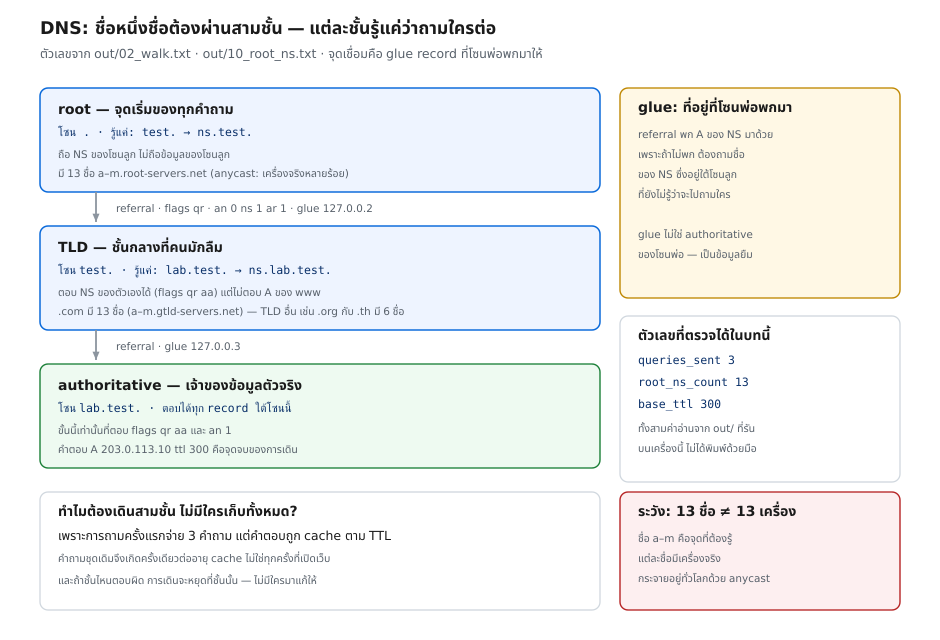
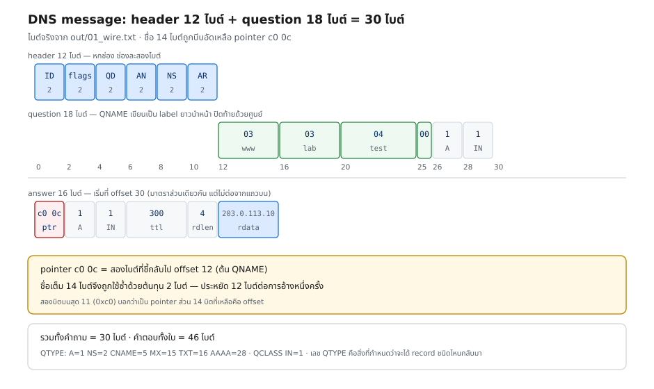
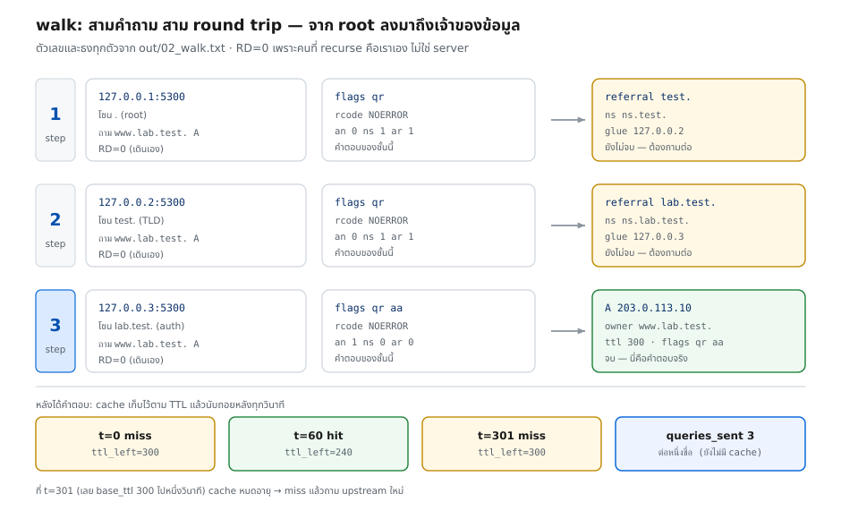

> 📅 เขียนเมื่อ: 23 พฤศจิกายน 2026 (เวลาไทย, UTC+7)
>
> **เครื่องที่รันบทนี้:** Raspberry Pi 5, Debian GNU/Linux 13 (trixie), kernel 6.18.60+rpt-rpi-2712, aarch64 · Go 1.24.4 · BIND `dig` 9.20.30 · ภาพวาดด้วย `gen_svgs.py` และตรวจความอ่านง่ายด้วย `check_svg_readability.py` · ตัวเลขที่**วัดได้**ในบทมาจากไฟล์ใน `out/` ที่สร้างด้วย `bash run_all.sh` ทั้งหมด
>
> 🛡️ **จริยธรรม (ใช้กับทั้งซีรีส์):** query ทั้งหมดในบทวิ่งไปที่ server สามตัวบน **loopback ของเครื่องที่คุณควบคุมเอง** (`127.0.0.1`–`127.0.0.3`) ส่วนการถามของจริงมีแค่สองแบบ: อ่านผ่าน recursive resolver สาธารณะ (`1.1.1.1` ของ Cloudflare) ไม่กี่ครั้ง และถาม root/TLD ตรง ๆ อีกไม่กี่ครั้งแบบ `+norecurse` เพื่อดู referral — ไม่มีการสแกนพอร์ต ไม่มีการดัก packet ของคนอื่น และไม่ยิง query ถี่จนเป็นภาระกับคนอื่น

---

## 0. สองตั๋วงานที่ดูเหมือนไม่มีอะไรเกี่ยวกัน

ตั๋วใบแรกมาจากทีม support: "deploy เว็บใหม่เมื่อคืน ผู้ใช้บางคนยังเห็นหน้าเก่า แล้วก็หายเองภายในชั่วโมง" ตั๋วใบที่สองมาจากฝ่ายขาย: "อีเมลถึงลูกค้ารายใหญ่ไม่เคยเข้าเลย แต่ส่งหาคนอื่นได้ปกติ"

ทั้งสองใบไม่มีคำว่า DNS อยู่ในนั้น และทั้งสองใบจบที่บรรทัดเดียวกันในไฟล์ config ของโดเมน

- ใบแรกคือ **TTL** (time to live — จำนวนวินาทีที่คำตอบหนึ่งถูก cache ได้) ที่ตั้งไว้ยาวเป็นชั่วโมง เครื่องของผู้ใช้จึงยังถือคำตอบเก่าอยู่ ไม่ใช่เพราะ server ยังไม่เปลี่ยน
- ใบที่สองคือ **MX** (mail exchanger — record ที่บอกว่าเมลของโดเมนนี้ส่งไปที่ server ตัวไหน · record = หนึ่งแถวข้อมูลในโซน) ที่ชี้ไปยังชื่อซึ่งเป็น **CNAME** (ชื่อแทน/alias — ชื่ออีกชื่อที่ให้ไปอ่านต่อ) — ซึ่งสเปกห้ามไว้ เพราะผู้ส่งเมลต้องอ่าน MX แล้วไปถาม A (record ที่เก็บ IPv4) ของชื่อนั้นต่อ แต่ CNAME บอกว่า "ชื่อนี้ไม่ใช่ที่อยู่ ให้ไปดูอีกชื่อ" ทำให้บางระบบปฏิเสธไปเลย

ตอนที่แล้วเราจบที่ UDP ซึ่งเป็น transport ที่ DNS เลือกใช้ในเกือบทุกคำถาม — และ[ตอนที่ 12](/blog/post.html?slug=2026-11-22-network-12-udp-connectionless) เองก็ยก DNS ขึ้นมาเป็นตัวอย่างแรกของงานที่ "หนึ่งคำถาม หนึ่งคำตอบ" จบในรอบเดียว[^1] บทนี้จะลงไปในกล่องใบนั้น: คำถามหนึ่งคำถามเดินผ่าน server กี่ตัว ก่อนจะได้ IP กลับมา

---

## 1. ชื่อกับที่อยู่: ทำไมต้องมีคนกลาง

IP address คือที่อยู่ที่ใช้ส่ง packet จริง แต่ IP เปลี่ยนได้ — ย้ายเครื่อง ย้าย cloud ย้าย CDN (content delivery network — เครือข่ายเครื่องที่เก็บสำเนาเนื้อหาไว้ใกล้ผู้ใช้) แล้วเลขก็เปลี่ยน ขณะที่ชื่อควรอยู่กับองค์กรไปตลอด ลูกค้าจำ `gophern.cc` ได้ แต่ไม่มีใครจำ `203.0.113.10` ได้ และถ้าเลขเปลี่ยนทุกครั้งที่ย้ายเครื่อง การพิมพ์เลขก็เท่ากับพิมพ์ที่อยู่ชั่วคราว

ทางออกคือตารางแปลงชื่อเป็นเลข ซึ่งฟังดูง่ายจนน่าตกใจว่าทำไมมันถึงกลายเป็นระบบที่ซับซ้อนที่สุดระบบหนึ่งของ internet

**ก่อนปี 1983 โลกใช้ไฟล์เดียวชื่อ `HOSTS.TXT`** เก็บไว้ที่ SRI-NIC และทุกเครื่องบน ARPANET ดาวน์โหลดไฟล์นี้มาเก็บไว้เอง ทุกครั้งที่มีเครื่องใหม่หรือเปลี่ยน IP ต้องมีคนแก้ไฟล์กลางแล้วทุกคนโหลดใหม่ วิธีนี้ใช้ได้ตราบที่เครือข่ายมีไม่กี่ร้อยเครื่อง — พอเข้าสู่ทศวรรษ 1980 จำนวนเครื่องและความถี่ในการเปลี่ยนแปลงแซงหน้าไปแล้ว

Paul Mockapetris ออกแบบ DNS แทนที่ในปี 1983 (RFC 882 และ 883) แล้วสรุปเป็นสเปกที่ยังใช้อยู่จนวันนี้ใน RFC 1034 และ 1035 (พฤศจิกายน 1987) การตัดสินใจสำคัญอยู่ที่ประโยคเดียว: **ไม่มีเครื่องไหนรู้คำตอบทั้งหมด** แต่ละโซนมีเจ้าของที่ดูแลข้อมูลของตัวเอง แล้วโซนพ่อแค่ชี้ทางลงไป — **โซน (zone)** ในที่นี้คือส่วนหนึ่งของต้นไม้ DNS ที่มีเจ้าของเดียว และตอบคำถามทุกชื่อใต้โซนนั้นได้เอง

คำสามคำที่ต้องแยกให้ออกก่อนอ่านต่อ:

- **stub resolver** — โค้ดในเครื่องคุณ (`getaddrinfo`, `net.LookupHost` ใน Go, ตัวใน libc) ทำหน้าที่แค่ส่งคำถามไปให้ resolver ที่ตั้งไว้ แล้วรอคำตอบ ไม่ได้เดินไล่เอง
- **recursive resolver** — ตัวที่รับคำถามแล้ว "ไปหาคำตอบให้จนจบ" (เช่น resolver ของ ISP, `1.1.1.1` ซึ่งเป็น public resolver ของ Cloudflare, หรือ `unbound` — resolver ที่ติดตั้งไว้ในเครื่องคุณ) มันอาจต้องถามหลาย server ก่อนได้คำตอบ แล้วเก็บคำตอบไว้ใน cache
- **authoritative server** — ตัวที่ถือข้อมูลจริงของโซนหนึ่ง ตอบได้เฉพาะสิ่งที่อยู่ในโซนตัวเอง และคำตอบของมันคือ "คำตอบสุดท้าย" ไม่ใช่คำใบ้

คำว่า recursive กับ iterative ในบทนี้จะใช้ในความหมายเฉพาะ: **recursive query** คือคำถามที่ "ขอให้หาจนได้คำตอบ" (stub → resolver) ส่วน **iterative query** คือคำถามที่ "ตอบเท่าที่รู้ ถ้าไม่รู้ก็บอกว่าถามใครต่อ" (resolver → root → TLD → authoritative)[^2]

| | recursive query | iterative query |
|---|---|---|
| ใครถาม | stub resolver → recursive resolver | recursive resolver → server ในลำดับชั้น |
| คำตอบที่ได้ | คำตอบสุดท้าย หรือ error | คำตอบสุดท้าย **หรือ referral** (คำตอบที่ไม่ใช่คำตอบสุดท้าย แต่บอกว่าถามใครต่อ) |
| ใครทำงานหนัก | resolver | คนถาม (ต้องเดินต่อเอง) |
| จำนวนคำถามต่อหนึ่งชื่อ | 1 | หลายคำถาม (ในเดโมของเราคือ `queries_sent 3`) |

ในบทนี้เราจะสวมบทเป็น recursive resolver เอง — เพราะการได้เดินเองคือวิธีเดียวที่จะเห็นว่าแต่ละชั้นบอกอะไร

---

## 2. ลำดับชั้นสามชั้น และการ delegate

DNS เป็นต้นไม้กลับหัว จุดบนสุดคือ root ที่เขียนแทนด้วยจุดเดียว `.` แล้วแตกออกเป็น TLD (top-level domain เช่น `com`, `org`, `th`) แล้วแตกเป็นโดเมนขององค์กร แล้วแตกเป็นชื่อย่อยได้อีกตามต้องการ

ลองไล่ชื่อ `www.lab.test.` (ชื่อสมมติที่เราจะใช้ทั้งบท) จากบนลงล่าง:

1. **root** — รู้แค่ว่าโซนที่ลงท้ายด้วย `test.` มีชื่อ server อะไร ใครเป็นคนดูแลก็ต้องถามมัน
2. **TLD `test.`** — รู้แค่ว่า `lab.test.` ถูก delegate ให้ server ตัวไหน
3. **authoritative `lab.test.`** — รู้จริงว่า `www.lab.test.` คือ IP อะไร และนี่คือชั้นเดียวที่ตอบด้วยธง `aa` (authoritative answer)

คำว่า **delegate** (มอบอำนาจ) ในที่นี้หมายถึงการตัดโซนลูกออกไปให้คนอื่นดูแล โดยโซนพ่อเก็บไว้แค่ record ชนิด **NS** ที่บอกชื่อ server ของโซนลูก — ไม่เก็บข้อมูลจริงของโซนลูกเลย นี่คือกลไกที่ทำให้ DNS ขยายได้: root ไม่ต้องรู้จักทุกโดเมนในโลก มันแค่รู้ว่า `.com` อยู่ที่ไหน

ขนาดของมันเล่าเรื่องนี้ได้ดี: root มี **13 ชื่อ** (`a.root-servers.net.` ถึง `m.root-servers.net.`) ไม่ใช่ 13 เครื่อง — แต่ละชื่อถูกกระจายไปหลายเครื่องด้วย **anycast** (เทคนิคที่ให้ IP เดียวกันมีเครื่องหลายร้อยเครื่องทั่วโลก แล้ว router ส่ง packet ไปยังเครื่องที่ใกล้ที่สุด) ส่วน `.com` มี 13 ชื่อ server เช่นกัน (`a.gtld-servers.net.` ถึง `m.gtld-servers.net.`) ซึ่งเป็นตัวเลขที่เราเห็นได้จริงในผลรันหัวข้อ 2.1



### 2.1 ของจริง: 13 ชื่อที่ root และ 13 ชื่อที่ .com

เริ่มจากถาม root ว่ามี nameserver อะไรบ้าง — คำถามนี้วิ่งไปที่ recursive resolver ของ `1.1.1.1` ซึ่งตอบจาก cache ของมัน:

```text
--- ถาม NS ของ root จาก recursive resolver (@1.1.1.1)
a.root-servers.net.
b.root-servers.net.
c.root-servers.net.
d.root-servers.net.
e.root-servers.net.
f.root-servers.net.
g.root-servers.net.
h.root-servers.net.
i.root-servers.net.
j.root-servers.net.
k.root-servers.net.
l.root-servers.net.
m.root-servers.net.
root_ns_count 13
root_ns_letters 13
```

`root_ns_count 13` คือจำนวนชื่อ และตัวอักษรนำหน้าวิ่งจาก `a` ถึง `m` ครบทั้ง 13 ตัว — ตัวเลขนี้ไม่ได้บอกจำนวนเครื่องจริง (มีหลายร้อยเครื่องที่ใช้ชื่อเหล่านี้) แต่บอกจำนวน "จุดที่ต้องรู้" ซึ่งเป็นสิ่งที่ระบบใด ๆ ต้องฮาร์ดโค้ดไว้เพื่อเริ่มต้น

จากนั้นลองให้ root ตอบแบบไม่ช่วยเหลือ — ตั้งใจถาม `www.example.com` กับ server ของ root ตรง ๆ โดยไม่ให้มัน recurse ให้ (`+norecurse`):

```text
--- referral จาก root (a.root-servers.net = 198.41.0.4) สำหรับ www.example.com
com.			172800	IN	NS	a.gtld-servers.net.
com.			172800	IN	NS	b.gtld-servers.net.
com.			172800	IN	NS	c.gtld-servers.net.
com.			172800	IN	NS	d.gtld-servers.net.
com.			172800	IN	NS	e.gtld-servers.net.
com.			172800	IN	NS	f.gtld-servers.net.
com.			172800	IN	NS	g.gtld-servers.net.
com.			172800	IN	NS	h.gtld-servers.net.
com.			172800	IN	NS	i.gtld-servers.net.
com.			172800	IN	NS	j.gtld-servers.net.
com.			172800	IN	NS	k.gtld-servers.net.
com.			172800	IN	NS	l.gtld-servers.net.
com.			172800	IN	NS	m.gtld-servers.net.
referral_zone com.
referral_ns_count 13
referral_flags flags: qr; QUERY: 1, ANSWER: 0, AUTHORITY: 13, ADDITIONAL: 27
```

อ่านผลนี้ให้ครบสามอย่าง:

- `ANSWER: 0` — root **ไม่ตอบ** คำถามของเรา มันไม่รู้ว่า `www.example.com` คือ IP อะไร และไม่พยายามเดา
- `AUTHORITY: 13` — มี NS 13 ตัวในส่วน authority ทั้งหมดเป็นของโซน `com.` นี่คือ **referral**: "ฉันไม่รู้คำตอบ แต่โซน `com.` อยู่ที่ 13 ตัวนี้ ไปถามมัน"
- `flags: qr` — ไม่มี `aa` เพราะนี่ไม่ใช่คำตอบสุดท้าย เป็นแค่การชี้ทาง

ทีนี้ถาม `.com` TLD ตรง ๆ ว่า NS ของตัวเองคืออะไร:

```text
--- ถาม .com TLD ตรง ๆ (a.gtld-servers.net = 192.5.6.30): NS ของตัวเอง
com.			172800	IN	NS	a.gtld-servers.net.
com.			172800	IN	NS	b.gtld-servers.net.
com.			172800	IN	NS	c.gtld-servers.net.
com.			172800	IN	NS	d.gtld-servers.net.
com.			172800	IN	NS	e.gtld-servers.net.
com.			172800	IN	NS	f.gtld-servers.net.
com.			172800	IN	NS	g.gtld-servers.net.
com.			172800	IN	NS	h.gtld-servers.net.
com.			172800	IN	NS	i.gtld-servers.net.
com.			172800	IN	NS	j.gtld-servers.net.
com.			172800	IN	NS	k.gtld-servers.net.
com.			172800	IN	NS	l.gtld-servers.net.
com.			172800	IN	NS	m.gtld-servers.net.
tld_ns_count 13
tld_flags flags: qr aa; QUERY: 1, ANSWER: 13, AUTHORITY: 0, ADDITIONAL: 27
```

รอบนี้ได้ `ANSWER: 13` และธง `qr aa` — เพราะ `.com` เป็นเจ้าของข้อมูลชุดนี้จริง ๆ มันจึงตอบได้เต็มปาก สังเกตความต่างของสองผลรันนี้ให้ดี: ทั้งคู่เป็น "คำตอบ" ที่หน้าตาคล้ายกัน แต่ตัวหนึ่งเป็นคำใบ้ อีกตัวเป็นคำตอบสุดท้าย และสิ่งที่บอกความต่างคือ **ธง `aa` กับตัวเลขในช่อง ANSWER** ไม่ใช่ข้อความในคำตอบ

---

## 3. ลงมือ 1: ประกอบ query ด้วยไบต์ดิบ

ก่อนจะไล่ทั้งสามชั้น ต้องสร้างคำถามให้เป็นเสียก่อน DNS message ไม่ได้ซับซ้อนอย่างที่ชื่อฟังดู — มันคือ header 12 ไบต์ ตามด้วยคำถาม และตามด้วยคำตอบ (ถ้ามี)

### 3.1 ประกอบคำถาม: header, QNAME และ name compression

header 12 ไบต์แบ่งเป็นหกช่อง สองไบต์ต่อช่อง:

| offset | ขนาด | ชื่อ | เก็บอะไร |
|---|---|---|---|
| 0 | 2 | ID | เลขประจำคำถาม ใช้จับคู่คำตอบกับคำถาม (สำคัญมากบน UDP ที่ไม่มี connection) |
| 2 | 2 | flags | QR/AA/TC/RD/RA + opcode + rcode |
| 4 | 2 | QDCOUNT | จำนวนคำถาม (ปกติ 1) |
| 6 | 2 | ANCOUNT | จำนวน answer record |
| 8 | 2 | NSCOUNT | จำนวน authority record |
| 10 | 2 | ARCOUNT | จำนวน additional record |

อ่านตัวย่อในช่อง flags: **QR** = query/response (0 = คำถาม, 1 = คำตอบ) · **AA** = authoritative answer · **TC** = truncated · **RD** = recursion desired · **RA** = recursion available · **opcode** = ชนิดคำสั่ง (ปกติ QUERY) · **rcode** = ผลลัพธ์ของคำถาม (0 NOERROR, 2 SERVFAIL, 3 NXDOMAIN, 5 REFUSED) · **QCLASS** IN = 1

ต่อจาก header คือ **QNAME** ซึ่งเขียนแบบ label ต่อกัน: ไบต์แรกบอกความยาวของ label ตามด้วยตัวอักษร แล้วปิดท้ายด้วยไบต์ศูนย์ ชื่อ `www.lab.test.` จึงกลายเป็น `03 www 03 lab 04 test 00` ส่วน QTYPE และ QCLASS อย่างละสองไบต์ปิดท้ายคำถาม

ใน Go เราเขียนส่วนนี้ได้ด้วยสไลซ์ธรรมดา ไม่ต้องใช้ library ภายนอก — เริ่มจากตัวเขียนชื่อ ซึ่งจัดการ **name compression** ไปพร้อมกัน เพราะคำตอบมักอ้างชื่อเดิมซ้ำหลายที่:

ชื่อย่อที่โค้ดทั้งบทใช้: `fqdn()` = เติมจุดปิดท้ายชื่อ (fully qualified domain name) · `classIN` = ชนิด/คลาสของข้อมูล (IN = internet) · `apex` = ชื่อของโซนเอง · `rrset` = กลุ่ม record ชนิดเดียวกันของชื่อเดียว

```go
func (b *builder) name(n string) {
	n = fqdn(n)
	if n == "." {
		b.buf = append(b.buf, 0)
		return
	}
	labels := strings.Split(strings.TrimSuffix(n, "."), ".")
	for i := range labels {
		suffix := strings.Join(labels[i:], ".") + "."
		if off, ok := b.comp[suffix]; ok && off < 0x4000 {
			b.u16(0xc000 | uint16(off))
			return
		}
		if len(b.buf) < 0x4000 {
			b.comp[suffix] = len(b.buf)
		}
		b.buf = append(b.buf, byte(len(labels[i])))
		b.buf = append(b.buf, labels[i]...)
	}
	b.buf = append(b.buf, 0)
}
```

สามบรรทัดที่ควรอ่านช้า ๆ:

- `b.comp[suffix] = len(b.buf)` — จำตำแหน่งไบต์ที่ suffix นี้เริ่มเขียนไว้ พอเจอ suffix เดิมอีกครั้งก็ไม่ต้องเขียนตัวอักษรซ้ำ
- `b.u16(0xc000 | uint16(off))` — เขียน pointer สองไบต์ สองบิตบนสุดเป็น `11` (ค่า `0xc0`) ที่เหลือคือ offset 14 บิต ชี้กลับไปยังที่ที่ชื่อนี้เคยปรากฏ[^3]
- เงื่อนไข `off < 0x4000` — pointer เก็บ offset ได้แค่ 14 บิต ข้อความที่ใหญ่กว่านั้นจึงบีบอัดได้ไม่เต็มที่

ประกอบเป็นคำถามทั้งใบ:

```go
func encodeQuery(id uint16, q question, rd bool) []byte {
	b := newBuilder()
	b.u16(id)
	flags := uint16(0x0100) // RD
	if !rd {
		flags = 0
	}
	b.u16(flags)
	b.u16(1) // QDCOUNT
	b.u16(0) // ANCOUNT
	b.u16(0) // NSCOUNT
	b.u16(0) // ARCOUNT
	b.name(q.name)
	b.u16(q.qtype)
	b.u16(classIN)
	return b.buf
}
```

`rd` คือบิต "recursion desired" — เราใส่ `true` เมื่อถาม resolver ที่รับปากว่าจะหาคำตอบให้ และใส่ `false` เมื่อเราจะเดินเอง (หัวข้อถัดไป) ส่วน `id` ในเดโมเราตั้งค่าคงที่ `0x2a13` เพื่อให้เทียบไบต์ข้ามรอบได้

ประกอบแล้วก็ดูไบต์จริง:

```text
query_name           www.lab.test.
query_type           A (1)
query_class          IN (1)
query_id             0x2a13
rd_bit               1
header_bytes         12
qname_labels         3 (www lab test) + root
qname_wire_bytes     14
question_bytes       18
message_bytes        30
--- ไบต์จริงของ query (30 ไบต์)
0000  2a 13 01 00 00 01 00 00 00 00 00 00 03 77 77 77  *............www
0010  03 6c 61 62 04 74 65 73 74 00 00 01 00 01        .lab.test.....
--- คำตอบจาก authoritative (46 ไบต์)
answer_owner_bytes   2
answer_owner_hex     c0 0c
pointer_target       12 (ต้น question)
```

ไล่ทีละช่วงจาก hex dump:

- `2a 13` — ID ที่เราตั้งไว้
- `01 00` — flags: บิต RD เปิด (ไบต์ที่สองคือ `0x00` เพราะยังไม่มีธงตอบกลับใด ๆ)
- `00 01 00 00 00 00 00 00` — QDCOUNT 1, ที่เหลือศูนย์ (ยังไม่มีคำตอบ)
- `03 77 77 77` — label ยาว 3 ไบต์ คือ `www`
- `03 6c 61 62` — `lab` · `04 74 65 73 74` — `test` · `00` — ปิดชื่อ
- `00 01 00 01` — QTYPE 1 (A) และ QCLASS 1 (IN)

รวมแล้ว `qname_wire_bytes 14` และ `message_bytes 30` ซึ่งเป็นคำถามที่เล็กมาก — 30 ไบต์คือทั้งหมดที่ต้องส่งเพื่อถามว่า "ชื่อนี้อยู่ที่ IP อะไร" และนี่คือเหตุผลที่ DNS ใช้ UDP ได้สบายในเกือบทุกกรณี

### 3.2 อ่านคำตอบ: pointer ที่ชี้ย้อนหลัง และตัวนับรอบ

ตอนอ่านคำตอบ ฝั่งผู้รับต้องรองรับ pointer ที่ชี้กลับไปข้างหลังในข้อความ ซึ่งต้องระวังการวนซ้ำ (pointer ที่ชี้ไปหาตัวเองจะทำให้ parser วนไม่จบ) ฟังก์ชันอ่านชื่อจึงมีตัวนับรอบ:

```go
func parseName(msg []byte, off int) (string, int, error) {
	var labels []string
	next := -1
	for step := 0; step < 64; step++ {
		if off >= len(msg) {
			return "", 0, errShort
		}
		l := int(msg[off])
		if l == 0 {
			if next < 0 {
				next = off + 1
			}
			break
		}
		if l&0xc0 == 0xc0 {
			if off+1 >= len(msg) {
				return "", 0, errShort
			}
			if next < 0 {
				next = off + 2
			}
			off = int(msg[off]&0x3f)<<8 | int(msg[off+1])
			continue
		}
		if off+1+l > len(msg) {
			return "", 0, errShort
		}
		labels = append(labels, string(msg[off+1:off+1+l]))
		off += 1 + l
	}
	if next < 0 {
		next = off
	}
	if len(labels) == 0 {
		return ".", next, nil
	}
	return strings.ToLower(strings.Join(labels, ".")) + ".", next, nil
}
```

จุดที่พลาดกันบ่อยคือ `next` — เมื่อเจอ pointer ครั้งแรกให้จำตำแหน่ง "หลัง pointer" ไว้เป็นตำแหน่งอ่านต่อ (เพราะ pointer เป็นการกระโดดไปอ่านเฉย ๆ ไม่ใช่ที่อยู่จริงของข้อมูลถัดไป) แล้วปล่อยให้การกระโดดเปลี่ยน `off` ไปเรื่อย ๆ จนเจอไบต์ศูนย์

ผลที่ได้ในข้อความตอบกลับคือชื่อ owner ของ answer ไม่ได้เขียนว่า `www.lab.test.` อีกครั้ง แต่เป็น pointer สองไบต์ — สามบรรทัดนั้นอยู่ใน `out/01_wire.txt` ที่ยกมาทั้งไฟล์แล้วด้านบน (ท้ายบล็อกคือ `answer_owner_bytes`, `answer_owner_hex` และ `pointer_target`)

`c0 0c` แปลว่า "ไปอ่านชื่อที่ไบต์ที่ 12" ซึ่งคือต้น question พอดี — ชื่อ 14 ไบต์ที่เคยเขียนไว้ถูกใช้ซ้ำด้วยต้นทุน 2 ไบต์ ประหยัดไป 12 ไบต์ต่อการอ้างชื่อหนึ่งครั้ง และในคำตอบที่มี record หลายสิบใบ การประหยัดนี้คือทั้งหมดที่ทำให้คำตอบยังใส่ใน 512 ไบต์ได้



---

## 4. ลงมือ 2: server สามชั้นในเครื่องเดียว

การทดลองกับ DNS บน internet จริงมีปัญหาว่าผลไม่ซ้ำ: คำตอบเปลี่ยนตามเวลา cache ของ resolver เปลี่ยน TTL ที่เหลือ และเราไม่มีทางรู้ว่าไปถึง server ตัวไหน ทางแก้ที่สะอาดที่สุดคือ **จำลองลำดับชั้นทั้งสามชั้นไว้ในเครื่องเดียว** แล้วเดินไล่เอง

โปรแกรม `net13` จึงเปิด server สามตัวบน loopback คนละ IP แต่พอร์ตเดียวกัน (`5300` — ใช้แทน 53 เพราะไม่ต้องรันด้วยสิทธิ์ root):

| บทบาท | ที่อยู่ | โซนที่ถือ |
|---|---|---|
| root | `127.0.0.1:5300` | `.` (รู้แค่ว่า `test.` อยู่ที่ไหน) |
| TLD | `127.0.0.2:5300` | `test.` (รู้แค่ `lab.test.`) |
| authoritative | `127.0.0.3:5300` | `lab.test.` (ข้อมูลจริงทั้งหมด) |

เหตุที่ใช้ IP ต่างกันแทนพอร์ตต่างกันก็เพราะในโลกจริง nameserver ใช้พอร์ต 53 เหมือนกันหมด สิ่งที่ต่างคือ IP — และ glue record (A ของ nameserver ที่โซนพ่อพกมาให้ — อธิบายใน §4.1) ใน DNS เก็บได้แค่ IP ไม่มีที่สำหรับพอร์ต การจำลองให้ตรงกลไกจึงต้องแยกที่ IP

หัวใจของ server อยู่ที่การตัดสินใจว่าคำถามหนึ่งควรได้คำตอบแบบไหน — ตอบเอง, ส่ง referral, หรือบอกว่าไม่มีชื่อนี้:

```go
func (z *zone) lookup(qname string, qtype uint16) lookupResult {
	var res lookupResult
	qname = fqdn(qname)
	if !within(qname, z.apex) {
		res.rcode = rcodeRefused
		return res
	}

	// มีโซนลูกอยู่ใต้ชื่อนี้ → ตอบเป็น referral (authority = NS, additional = glue)
	if child, ns := z.deepestDelegation(qname); child != "" {
		res.authority = ns
		res.additional = z.glueFor(ns)
		return res
	}

	recs, ownerExists := z.data[qname]
	if !ownerExists && !z.hasDescendant(qname) {
		res.rcode = rcodeNXDomain
		res.authority = []rr{z.soa}
		return res
	}

	if rrset := recs[qtype]; len(rrset) > 0 {
		res.answers = append(res.answers, rrset...)
		if qtype == typeNS {
			res.additional = z.glueFor(rrset)
		}
		return res
	}

	// CNAME: ตอบชื่อปลายทาง แล้วตามต่อให้ถ้าปลายทางอยู่ในโซนเดียวกัน
	if qtype != typeCNAME {
		if cname := recs[typeCNAME]; len(cname) > 0 {
			res.answers = append(res.answers, cname...)
			res.answers = append(res.answers, z.chase(cname[0].rd.target, qtype)...)
			return res
		}
	}

	// NODATA: ชื่อมีอยู่ แต่ไม่มี record ชนิดที่ถาม
	res.authority = []rr{z.soa}
	return res
}
```

ลำดับการตัดสินใจในฟังก์ชันนี้คือลำดับเดียวกับที่ server จริงใช้:

1. **ชื่ออยู่นอกโซนที่เราถือ** → `REFUSED` (rcode 5) ไม่ใช่ NXDOMAIN เพราะเราไม่ใช่เจ้าของ ไม่มีสิทธิ์บอกว่าชื่อนั้นไม่มีอยู่
2. **มีโซนลูกอยู่ใต้ชื่อนี้** → ส่ง referral กลับไป โดย authority คือ NS ของโซนลูก และ additional คือ glue
3. **ไม่มีชื่อนี้จริง ๆ** → `NXDOMAIN` (rcode 3) พร้อม SOA ในส่วน authority
4. **ชื่อมีอยู่แต่ไม่มี record ชนิดที่ถาม** → `NOERROR` ที่ไม่มีคำตอบ (NODATA) พร้อม SOA ใน authority
5. **มี record ชนิดที่ถาม** → ตอบพร้อมธง `aa`

สองข้อกลาง (NXDOMAIN กับ NODATA) คือจุดที่คนอ่าน log สับสนบ่อยที่สุด และเราจะแยกให้ดูชัดในหัวข้อ 7

### 4.1 referral กับ glue: ทำไมต้องมีที่อยู่ปนมาในคำใบ้

referral ที่ root ส่งกลับมามีสองส่วน: **authority** บอกชื่อ NS ของโซนลูก และ **additional** พก A record ของ NS นั้นมาด้วย สิ่งหลังนี้เรียกว่า **glue record** และมันจำเป็นเพราะเหตุผลที่ฟังดูเป็นเกมไก่กับไข่: ถ้าเราไม่รู้ IP ของ `ns.lab.test.` เราต้องถามชื่อนั้นก่อน แต่ชื่อนั้นอยู่ *ใต้* โซน `lab.test.` ที่เรายังไม่รู้ว่าจะไปถามใคร — วนกลับมาที่จุดเดิม โซนพ่อจึงต้องพกที่อยู่ของ server ลูกมาให้ในคำตอบเลย[^4]

ดูของจริงจาก walk ของเรา (หัวข้อถัดไป) จะเห็นบรรทัด `referral test. ns ns.test. glue 127.0.0.2` — สามอย่างที่ต้องไปต่อ: โซนที่ตัดให้, ชื่อ server, และ IP ที่เอาไปใช้ได้ทันที

### 4.2 เดินไล่ทีละชั้น แล้วพิมพ์สิ่งที่เห็น

client ของเราเดินจาก root ตาม referral โดยตั้ง RD เป็นศูนย์ เพราะคนที่ recurse คือตัวเราเอง ไม่ใช่ server:

```text
lab_zones            3 (root / test. / lab.test.)
lab_port             5300
rd_sent              0
--- เดินทีละชั้น
step 1  server 127.0.0.1:5300   www.lab.test.        A     flags qr        rcode NOERROR  an 0  ns 1  ar 1
        referral test.            ns ns.test.             glue 127.0.0.2
step 2  server 127.0.0.2:5300   www.lab.test.        A     flags qr        rcode NOERROR  an 0  ns 1  ar 1
        referral lab.test.        ns ns.lab.test.         glue 127.0.0.3
step 3  server 127.0.0.3:5300   www.lab.test.        A     flags qr aa     rcode NOERROR  an 1  ns 0  ar 0
        answer   www.lab.test.  A  203.0.113.10  ttl 300
--- สรุป
queries_sent         3
result               A 203.0.113.10
```

อ่านสามบรรทัด `step` เทียบกัน — นี่คือทั้งบทอยู่ในสามบรรทัด:

- **step 1** — root ตอบด้วย `flags qr` (ไม่มี `aa`), `an 0` (ไม่มีคำตอบ), `ns 1` (มี NS หนึ่งตัวใน authority) และ `ar 1` (มี glue หนึ่งตัว) นั่นคือ referral ไปที่ `test.`
- **step 2** — TLD ทำแบบเดียวกัน ต่างกันแค่โซนลูก: ตัด `lab.test.` ให้ `ns.lab.test.` ที่ `127.0.0.3`
- **step 3** — ชั้นสุดท้ายตอบด้วย `flags qr aa`, `an 1` และไม่มี authority/additional เลย เพราะมันเป็นเจ้าของข้อมูล

`queries_sent 3` คือราคาของการถามครั้งแรกของชื่อหนึ่งชื่อ — สามคำถาม สาม round trip ถ้า resolver ยังไม่มี cache เลย แต่เพราะทุกชั้นมี TTL คำถามชุดนี้จึงเกิดครั้งเดียวต่ออายุ cache ไม่ใช่ทุกครั้งที่เปิดเว็บ

### 4.3 dig เห็นเหมือนกับที่โปรแกรมเราเห็น

ถ้าเดโมของเราถูกต้อง เครื่องมือมาตรฐานก็ต้องเห็นสิ่งเดียวกัน — นี่คือการตรวจที่ไม่ต้องเชื่อโค้ดตัวเอง เปิด server ค้างไว้แล้วยิง `dig` ใส่ทีละชั้น (`dig` คือ DNS query tool ที่ติดมากับ BIND รูปแบบคำสั่งคือ `dig @<server> -p <port> <ชื่อ> <TYPE>`):

```text
--- step 1: ถาม root (@127.0.0.1) — ยังไม่รู้ว่า lab.test. อยู่ที่ไหน

; <<>> DiG 9.20.30-1~deb13u1-Debian <<>> +norecurse +nostats @127.0.0.1 -p 5300 www.lab.test A
; (1 server found)
;; global options: +cmd
;; Got answer:
;; ->>HEADER<<- opcode: QUERY, status: NOERROR
;; flags: qr; QUERY: 1, ANSWER: 0, AUTHORITY: 1, ADDITIONAL: 1

;; QUESTION SECTION:
;www.lab.test.			IN	A

;; AUTHORITY SECTION:
test.			3600	IN	NS	ns.test.

;; ADDITIONAL SECTION:
ns.test.		3600	IN	A	127.0.0.2

--- step 2: ถาม TLD (@127.0.0.2) — ได้ referral ลงไป lab.test.

; <<>> DiG 9.20.30-1~deb13u1-Debian <<>> +norecurse +nostats @127.0.0.2 -p 5300 www.lab.test A
; (1 server found)
;; global options: +cmd
;; Got answer:
;; ->>HEADER<<- opcode: QUERY, status: NOERROR
;; flags: qr; QUERY: 1, ANSWER: 0, AUTHORITY: 1, ADDITIONAL: 1

;; QUESTION SECTION:
;www.lab.test.			IN	A

;; AUTHORITY SECTION:
lab.test.		3600	IN	NS	ns.lab.test.

;; ADDITIONAL SECTION:
ns.lab.test.		3600	IN	A	127.0.0.3

--- step 3: ถาม authoritative (@127.0.0.3) — ได้คำตอบจริง

; <<>> DiG 9.20.30-1~deb13u1-Debian <<>> +norecurse +nostats @127.0.0.3 -p 5300 www.lab.test A
; (1 server found)
;; global options: +cmd
;; Got answer:
;; ->>HEADER<<- opcode: QUERY, status: NOERROR
;; flags: qr aa; QUERY: 1, ANSWER: 1, AUTHORITY: 0, ADDITIONAL: 0

;; QUESTION SECTION:
;www.lab.test.			IN	A

;; ANSWER SECTION:
www.lab.test.		300	IN	A	203.0.113.10

--- big.lab.test. TXT ทาง UDP: ไม่พอ 512 ไบต์ จึงได้บิต tc (+ignore = ไม่ต้องลอง TCP, +noedns = ไม่ประกาศ EDNS)
;; Got answer:
;; ->>HEADER<<- opcode: QUERY, status: NOERROR
;; flags: qr aa tc; QUERY: 1, ANSWER: 0, AUTHORITY: 0, ADDITIONAL: 0
```

(ผลบรรทัดสุดท้ายมีบิต `tc` — นั่นคือเรื่องของหัวข้อ 8 เก็บไว้ก่อน)

บรรทัดแรกที่ dig พิมพ์ เช่น `; <<>> DiG 9.20.30-1~deb13u1-Debian <<>> +norecurse +nostats ...` คือ dig ประกาศว่ามันถามแบบไหน และ `flags: qr; QUERY: 1, ANSWER: 0, AUTHORITY: 1, ADDITIONAL: 1` ในสองขั้นแรกตรงกับ `an 0 ns 1 ar 1` ที่โปรแกรมเราพิมพ์ — สองเครื่องมืออ่านข้อความชุดเดียวกันแล้วรายงานตรงกัน

ขั้นที่สามได้ `flags: qr aa` และ `ANSWER: 1` พร้อม `203.0.113.10` ซึ่งเป็นที่อยู่ในช่วง TEST-NET-3 ที่สงวนไว้สำหรับเอกสาร (RFC 5737) จึงไม่มีเครื่องจริงบน internet ใช้เลขนี้ — สำคัญสำหรับบทที่คนอ่านอาจลองยิงตาม

### 4.4 ทำไม resolver ถึงตอบครั้งเดียว

ถ้าคุณเปิดเว็บจริง เครื่องคุณถาม resolver ครั้งเดียวแล้วได้คำตอบทันที ไม่เห็นสามขั้นนี้ เพราะ resolver ทำสามขั้นนั้นให้ไปแล้วก่อนหน้านี้ แล้วเก็บผลไว้จน TTL หมด อาการที่คนเห็นจึงเป็น "ครั้งแรกช้า ครั้งต่อไปเร็ว" — และนั่นก็คือคำอธิบายของตั๋วใบแรกในตอนเปิดบท



---

## 5. record types: ชื่อหนึ่งชื่อตอบได้หลายคำถาม

DNS ไม่ได้เก็บแค่ "ชื่อ → IP" มันเก็บ record หลายชนิดไว้ใต้ชื่อเดียวกัน และชนิดที่ถาม (QTYPE) คือส่วนที่กำหนดว่าจะได้อะไรกลับมา

| ชนิด | เลข | เก็บอะไร | ใช้ตอนไหน |
|---|---|---|---|
| A | 1 | IPv4 address | หา IP ของชื่อ |
| AAAA | 28 | IPv6 address (128 บิต) | หา IP เวอร์ชัน 6 |
| CNAME | 5 | ชื่ออีกชื่อหนึ่ง | ทำ alias เช่น `blog` → `www` |
| MX | 15 | ชื่อ server รับเมล + ค่า priority | ส่งอีเมล |
| NS | 2 | ชื่อ nameserver ของโซน | delegation |
| SOA | 6 | ข้อมูลผู้ดูแลโซน + ค่าเวลา | ต้นโซน, negative caching (การจำคำตอบว่า "ไม่มี" ไว้ใช้ซ้ำ — §5.2) |
| TXT | 16 | ข้อความอิสระ | ยืนยันความเป็นเจ้าของโดเมน, SPF |

ถาม authoritative ของเราทีละชนิด:

```text
type   owner                value                                                          ttl
A      www.lab.test.        203.0.113.10                                                   300
AAAA   www.lab.test.        2001:db8::13                                                   300
CNAME  blog.lab.test.       www.lab.test.                                                  300
MX     lab.test.            10 mail.lab.test.                                              3600
MX     lab.test.            20 backup.lab.test.                                            3600
NS     lab.test.            ns.lab.test.                                                   3600
TXT    lab.test.            "v=lab1; owner=havebit"                                        300
SOA    lab.test.            ns.lab.test. hostmaster.lab.test. 2026112301 7200 3600 1209600 300 300
record_types          7
mx_records            2
cname_target          www.lab.test.
soa_serial            2026112301
```

แถว SOA ในบล็อกบนอ่านจากซ้ายไปขวาตามลำดับ field ของ record: ห้าตัวแรกคือ serial refresh retry expire minimum (minimum = ตัวที่ใช้คิด negative cache) ส่วน 300 ตัวสุดท้ายคือคอลัมน์ ttl

สองอย่างในตารางนี้เล่าเรื่องสำคัญ:

- **ชื่อเดียวมีได้หลายชนิด** — `www.lab.test.` มีทั้ง A และ AAAA พร้อมกัน และนั่นคือเหตุผลที่คำถามต้องระบุ QTYPE เสมอ; การถาม A ไม่ได้หมายความว่าไม่มี AAAA
- **MX มีได้หลายใบพร้อมกัน** — ผลรันบอก `mx_records 2` คือ `10 mail.lab.test.` กับ `20 backup.lab.test.` ตัวเลขข้างหน้าคือ priority (ยิ่งน้อยยิ่งได้ก่อน) ผู้ส่งเมลจะลองตัวแรกก่อน แล้วตกไปตัวที่สองเมื่อตัวแรกไม่ตอบ นี่คือ redundancy แบบง่ายที่สุดใน DNS และเป็นเหตุผลว่าทำไม MX ควรมีอย่างน้อยสองใบในระบบจริง — เป็นข้อปฏิบัติของคนดูแลระบบ ไม่ใช่ข้อบังคับของสเปก (RFC 5321 ไม่ได้กำหนดจำนวน MX ขั้นต่ำ)

`record_types 7` คือจำนวนชนิดที่โซนนี้ให้บริการ — ในโลกจริงยังมีอีกหลายชนิด (CAA, SRV, HTTPS, DS, RRSIG) แต่เจ็ดชนิดนี้ครอบงานเกือบทั้งหมดที่คนทั่วไปเจอ

### 5.1 CNAME: alias ที่มีกฎเข้ม

CNAME บอกว่า "ชื่อนี้ไม่ใช่ที่อยู่ ให้ไปถามชื่อปลายทางแทน" และมีกฎที่คนพลาดบ่อยสามข้อ:

1. **ห้ามมี record อื่นอยู่ใต้ชื่อเดียวกับ CNAME** — ชื่อที่เป็น CNAME จะมีได้แค่ CNAME อย่างเดียว ถ้ามี MX หรือ TXT อยู่ด้วย ผู้ถามจะไม่รู้ว่าจะเชื่ออันไหน (RFC 1034 §3.6.2)
2. **ห้ามใช้ CNAME ที่ apex ของโซน** — ชื่ออย่าง `lab.test.` ต้องมี SOA กับ NS ซึ่งขัดกับข้อแรกโดยตรง ผู้ให้บริการ DNS หลายเจ้าจึงเลี่ยงไปใช้ record ชนิดพิเศษ (เช่น ALIAS/ANAME) แทน
3. **MX และ NS ต้องไม่ชี้ไปที่ชื่อซึ่งเป็น CNAME** — นี่คือตั๋วใบที่สองในตอนเปิดบท (RFC 2181 §10.3) ผู้ส่งเมลต้องอ่าน MX แล้วถาม A ต่อทันที ถ้าปลายทางเป็น CNAME การถามจะต้องมีขั้นพิเศษที่บางระบบไม่ทำ

ดูของจริงได้จาก drill ข้อ 2 (หัวข้อ 10) ที่ถาม `blog.lab.test.` ซึ่งเป็น CNAME ไป `www.lab.test.` — server ตอบสอง record มาในคำตอบเดียว คือ CNAME กับ A ของปลายทาง เพราะมันเป็นเจ้าของทั้งสองชื่อ

### 5.2 SOA: record ที่คนลืมแต่มันคุมทุกอย่าง

SOA (start of authority) อยู่บนสุดของทุกโซนและเก็บข้อมูลที่ไม่มีใครอ่านตอนระบบทำงานปกติ แต่สำคัญมากตอนมีปัญหา: ชื่อผู้ดูแล (เขียนเป็นอีเมลโดยแทน `@` ด้วยจุด), หมายเลข serial ของโซน, และค่าสามตัวที่บอกว่า server ลูกควร sync กับ server หลักบ่อยแค่ไหน — refresh, retry และ expire

ส่วนที่เกี่ยวกับบทนี้คือ **minimum** — ค่าที่ห้าในชุด (serial refresh retry expire minimum) ซึ่ง**ไม่ได้**เกี่ยวกับการ sync แต่ใช้กำหนดอายุของ negative cache (จำว่า "ชื่อนี้ไม่มี" ได้นานแค่ไหน)[^5] ตาม RFC 2308 §3 อายุที่ใช้คือ**ค่าที่ต่ำกว่า**ระหว่าง TTL ของ SOA กับช่อง minimum — เป็นข้อบังคับ ไม่ใช่ตัวเลือกของ resolver และไม่เกิน TTL ของ SOA เอง นี่จึงเป็นเหตุผลว่าทำไมคำตอบ NXDOMAIN ต้องพก SOA มาด้วยเสมอ: มันคือคำตอบว่า "จำคำตอบเชิงลบนี้ไว้กี่วินาที"

---

## 6. TTL กับ cache: ทำไม deploy แล้วยังเห็นของเก่า

ทุก record มี TTL ติดมาด้วย และ TTL คือกลไกเดียวที่ทำให้ DNS รับภาระทั้ง internet ไหว — resolver เก็บคำตอบไว้ตามจำนวนวินาทีนั้น แล้วตอบจาก cache โดยไม่ต้องถามใหม่

จำลอง cache ง่าย ๆ ที่นับเวลาเอง (ไม่มีการ sleep ไม่มีเวลาจริงเข้ามาเกี่ยว):

```go
func (c *miniCache) query(w io.Writer, t int, name string, qtype uint16) error {
	key := fqdn(name) + "|" + typeText(qtype)
	if e, ok := c.entries[key]; ok && t < e.expires {
		c.hits++
		fmt.Fprintf(w, "t=%-4d query %-16s %-5s cache=hit   ttl_left=%-4d answers=%d\n",
			t, fqdn(name), typeText(qtype), e.expires-t, len(e.recs))
		return nil
	}
	c.misses++
	c.upstream++
	m, _, err := ask(authAddr, name, qtype)
	if err != nil {
		return err
	}
	if len(m.answer) == 0 {
		return fmt.Errorf("%s ไม่มีคำตอบให้ cache", name)
	}
	ttl := int(m.answer[0].ttl)
	c.entries[key] = cacheEntry{recs: m.answer, expires: t + ttl}
	fmt.Fprintf(w, "t=%-4d query %-16s %-5s cache=miss  ttl_left=%-4d answers=%d\n",
		t, fqdn(name), typeText(qtype), ttl, len(m.answer))
	return nil
}
```

หัวใจมีสองบรรทัด: ตอน miss เก็บ `expires = t + ttl` และตอน hit คำนวณ `expires - t` ออกมาเป็น TTL ที่เหลือ — ซึ่งต้องลดลงทุกวินาที ไม่ใช่ค่าเดิมตลอด (นี่คือเหตุผลที่ `dig` สองครั้งติดกันเห็น TTL ต่างกัน)

รันที่เวลาจำลอง 0, 60 และ 301 วินาที:

```text
t=0    query www.lab.test.    A     cache=miss  ttl_left=300  answers=1
t=60   query www.lab.test.    A     cache=hit   ttl_left=240  answers=1
t=301  query www.lab.test.    A     cache=miss  ttl_left=300  answers=1
cache_hits           1
cache_misses         2
upstream_queries     2
base_ttl             300
simulated_seconds    301
```

อ่านสามบรรทัดนี้ให้ครบ:

- `t=0` — miss เพราะยังไม่มีอะไรใน cache ยิงไปถาม upstream หนึ่งครั้ง เก็บไว้ 300 วินาที
- `t=60` — hit เพราะยังไม่ครบ 300 และ `ttl_left=240` คือ 300 ลบ 60 — คำตอบเดียวกันแต่อายุเหลือน้อยลง
- `t=301` — miss เพราะเลย 300 ไปหนึ่งวินาที ต้องถามใหม่ (`upstream_queries 2` คือจำนวนครั้งที่ยิงจริงตลอดสามคำถาม)

นี่คือคำตอบของตั๋วใบแรก: การ deploy เปลี่ยน IP ที่ authoritative ทันที แต่ resolver ทั่วโลกยังถือคำตอบเก่าจนกว่า TTL จะหมด คนที่ resolver เพิ่งดึงคำตอบชุดเก่าไปก่อนสลับ IP จะเห็นค่าเก่าครบ TTL เต็ม ขณะที่คนที่ดึงไปนานแล้วจะหมดอายุก่อนและได้ค่าใหม่ก่อน — อาการ "บางคนเห็น บางคนไม่เห็น" ที่ทีม support อธิบายไม่ถูก ก็คือภาพของ TTL ที่ต่างกันใน cache แต่ละใบ

บทเรียนเชิงปฏิบัติ: ก่อน deploy ให้ **ลด TTL ล่วงหน้าอย่างน้อยหนึ่งรอบของ TTL เดิม** (เช่นจาก 3600 เหลือ 300 รอหนึ่งชั่วโมง) แล้วค่อยสลับ IP หลังสลับเสร็จค่อยขยาย TTL กลับ ผู้ที่ต้องทำแบบนี้บ่อยจะทำ automation เพราะการลืมขั้นนี้คือสาเหตุของ incident ที่น่าอายที่สุดประเภทหนึ่ง

TTL ที่ควรตั้ง: งานที่ IP เปลี่ยนได้ (A/AAAA ของเว็บ) ใช้ 300 วินาทีขึ้นไปกำลังดี, record ที่แทบไม่เปลี่ยน (MX, NS) ใช้ 3600 หรือมากกว่านั้น, และ record ที่ต้องเปลี่ยนเร็วมาก (ยืนยันความเป็นเจ้าของโดเมนชั่วคราว) ใช้ 60 วินาทีได้ — แต่ยิ่งสั้น ยิ่งมีคนถามคุณมากขึ้น

---

## 7. NXDOMAIN กับ NODATA: "ไม่มีคำตอบ" มีสองความหมาย

นี่คือจุดที่คนอ่าน log แล้ววินิจฉัยผิดบ่อยที่สุดในงาน DNS และมันเกี่ยวกับตั๋วทั้งสองใบในตอนเปิดบททางอ้อม — เพราะการแยกสองกรณีนี้ออกคือการแยกว่า "ชื่อนี้ไม่มีอยู่" กับ "ชื่อนี้มีอยู่ แต่ไม่มีของที่ถาม"

```text
nxdomain_name        nope.lab.test.
nxdomain_rcode       3
nxdomain_text        NXDOMAIN
nxdomain_answers     0
nxdomain_soa_in_auth 1
nodata_name          www.lab.test.
nodata_qtype         MX
nodata_rcode         0
nodata_text          NOERROR
nodata_answers       0
nodata_soa_in_auth   1
soa_minimum_ttl      300
```

สองกรณีนี้ให้ผลที่หน้าตาต่างกันแค่ตัวเลข:

| | NXDOMAIN | NODATA |
|---|---|---|
| rcode | `3` (NXDOMAIN) | `0` (NOERROR) |
| จำนวนคำตอบ | `0` | `0` |
| SOA ใน authority | มี | มี |
| ความหมาย | ชื่อนี้ไม่มีในโซน | ชื่อนี้มี แต่ไม่มี record ชนิดที่ถาม |
| ตัวอย่างในเดโม | `nope.lab.test.` | `www.lab.test.` ที่ถาม MX |

`nxdomain_answers 0` กับ `nodata_answers 0` เท่ากัน แต่ rcode ต่างกัน — และ rcode คือทั้งหมดของเรื่องนี้: `3` บอกว่า "ไม่มีชื่อนี้ จบ", `0` บอกว่า "มีชื่อนี้ แต่คำถามของคุณไม่มีคำตอบ"

ทำไมต้องแยกให้ออก: resolver ใช้ rcode เป็นตัวตัดสินว่าจะ cache คำตอบเชิงลบนานแค่ไหน (ตาม RFC 8020 การตอบ NXDOMAIN หมายถึงชื่อนี้และทุกชื่อใต้มันไม่มีอยู่ จึง cache ได้นานตามค่าที่ต่ำกว่าระหว่าง SOA TTL กับ minimum — แต่ไม่เกิน TTL ของ SOA เอง) และเครื่องมืออย่าง `dig` ก็รายงานต่างกัน ชื่อที่พิมพ์ผิดจะได้ `status: NXDOMAIN` ส่วนชื่อที่ถูกแต่ถามชนิดผิดจะได้ `status: NOERROR, ANSWER: 0` — สองอันนี้ชี้ไปที่การแก้ปัญหาคนละทาง

ในงานจริงมีกับดักเพิ่ม: **empty non-terminal** — ชื่อที่ไม่มี record ของตัวเอง แต่มีชื่อลูกอยู่ใต้มัน (เช่นมี `a.b.example.com` แต่ไม่มี `b.example.com` เอง) ตามสเปกแล้วชื่อนี้ "มีอยู่" และต้องตอบ NODATA ไม่ใช่ NXDOMAIN โค้ดที่ตอบ NXDOMAIN ในกรณีนี้จะทำให้ resolver cache คำตอบผิดและทำให้ชื่อลูกถามไม่ได้ไปด้วย

### 7.1 DNSSEC: ลำดับชั้นเดิม แต่มีลายเซ็นกำกับ

พักเรื่อง NXDOMAIN ไว้แป๊บ — DNSSEC เกี่ยวกับเรื่องนี้เพราะมันใช้ลำดับชั้นเดิมที่เราเพิ่งเดิน

DNS ออกแบบมาโดยไม่มีการพิสูจน์ตัวตน — ใครก็ตอบได้ และผู้ถามไม่มีทางรู้ว่าคำตอบมาจากเจ้าของจริงหรือคนกลางที่ดักแก้ DNSSEC (ส่วนขยายที่ลงลายเซ็นกำกับคำตอบ — [ตอนที่ 12](/blog/post.html?slug=2026-11-22-network-12-udp-connectionless) เกริ่นไว้แล้ว) แก้ปัญหานี้ด้วยการลงลายเซ็นให้ record (RRSIG) และผูกความเชื่อจาก root ลงมาเป็นทอด ๆ ผ่าน DS record ที่โซนพ่อเก็บไว้ให้โซนลูก[^6]

สิ่งที่ควรจำคือ **มันใช้ลำดับชั้นเดียวกับที่เราเพิ่งเดิน** — ความเชื่อเริ่มที่ root (trust anchor ที่ติดมากับ resolver) แล้วไล่ลงมา TLD แล้วลงมาโซนของเรา ถ้าทอดใดขาด การตรวจจะ fail ทั้งเส้น ซึ่งเป็นเหตุผลว่าทำไม DNSSEC ถึงทำให้คำตอบใหญ่ขึ้นมาก (ต้องพา RRSIG มาด้วย) และเป็นเหตุผลที่มันดัน DNS กลับไปพึ่ง TCP มากขึ้น — ซึ่งพาเราไปหัวข้อถัดไป

---

## 8. บิต TC: เมื่อคำตอบไม่พอใน 512 ไบต์

[ตอนที่ 12](/blog/post.html?slug=2026-11-22-network-12-udp-connectionless) เราจบด้วยเพดาน 512 ไบต์ของ DNS ทาง UDP[^1] ถึงเวลาดูว่ามันทำงานยังไงในของจริง: โซน lab ของเรามี TXT ขนาด 900 ตัวอักษร ซึ่งใส่ในคำตอบ UDP ขนาด 512 ไบต์ไม่ลง

client ของเราจึงต้องมีเส้นทางสำรอง — ยิง UDP ก่อน แล้วถ้าเห็นบิต TC (truncated) ก็ถามใหม่ทาง TCP:

```go
func exchange(server string, query []byte) (resp []byte, usedTCP bool, err error) {
	resp, err = exchangeUDP(server, query)
	if err != nil {
		return nil, false, err
	}
	if len(resp) >= 4 && resp[2]&0x02 != 0 {
		resp, err = exchangeTCP(server, query)
		return resp, true, err
	}
	return resp, false, nil
}
```

บิต TC อยู่ที่ไบต์ที่สามของข้อความ (บิตที่เจ็ดของ flags นับจากซ้าย) การเช็กจึงเป็นการ AND กับ `0x02` ตรง ๆ — และสิ่งที่ได้กลับมาคือ "คำตอบที่ถูกตัดจนไม่เหลือคำตอบ" ไม่ใช่คำตอบบางส่วน เพราะสเปกบอกว่าถ้าตัดแล้วต้องตัดให้ผู้ถามรู้ว่าต้องถามใหม่ ไม่ใช่ปล่อยข้อมูลครึ่ง ๆ ที่ตีความผิดได้

วัดของจริงทั้งสองทาง:

```text
query_name           big.lab.test.
query_type           TXT
txt_chars            900
udp_limit_bytes      512
untruncated_bytes    946
udp_response_bytes   30
udp_tc_bit           1
udp_answers          0
tcp_response_bytes   946
tcp_answers          1
tcp_txt_chars        900
fallback_tcp         1
```

- `untruncated_bytes 946` — คำตอบเต็มกิน 946 ไบต์ เกิน `udp_limit_bytes 512` ไปเกือบเท่าตัว
- `udp_response_bytes 30` — ทาง UDP ได้กลับมาแค่ header กับ question (30 ไบต์) พร้อม `udp_tc_bit 1` และ `udp_answers 0`
- `tcp_response_bytes 946` และ `tcp_answers 1` — ทาง TCP ได้ครบ พร้อม `tcp_txt_chars 900` ตรงกับที่ใส่ไว้

ทำไมถึงตัดที่ 512: net13 ไม่ได้ทำ EDNS(0) คำตอบจึงถูกตัดที่ 512 ตาม RFC 1035 เสมอ — แม้ dig เวอร์ชันนี้จะประกาศ udp 1232 มาให้โดยปริยายก็ตาม (ในเดโมข้างบนเราจึงใส่ `+noedns` เพื่อให้เห็นเพดาน 512 ตรง ๆ)

dig แสดงพฤติกรรมเดียวกันให้เห็นในบรรทัดสุดท้ายของหัวข้อ 4.3: `flags: qr aa tc` กับ `ANSWER: 0` — และถ้าไม่ใส่ `+ignore` dig จะรายงานว่า `Truncated, retrying in TCP mode` แล้วไปเอามาให้เอง (ค่าเริ่มต้นของ dig คือพยายามจนได้คำตอบ ไม่ใช่รายงานความล้มเหลว)

ในโลกจริงเพดาน 512 ไบต์ถูกขยายด้วย **EDNS(0)** (RFC 6891) ที่ให้ผู้ถามประกาศได้ว่ารับ UDP ได้ใหญ่แค่ไหน (ค่าที่ใช้กันทั่วไปคือ 4096) แต่การขยายนี้ไม่ได้ฟรี: datagram ที่ใหญ่กว่า MTU จะถูก fragmentation ที่ชั้น IP และถ้าชิ้นใดหาย คำตอบทั้งใบหาย — กลับไปที่กับดักของตอนที่ 12 ตรง ๆ[^1] นี่คือตัวอย่างดีของคำถามที่วิศวกร network ต้องตอบให้ได้: "จะใช้ UDP ใหญ่ ๆ เพื่อลด round trip หรือใช้ TCP เพื่อเลี่ยง fragmentation" คำตอบขึ้นกับว่าแพ้แบบไหนเจ็บกว่า

---

## 9. กับดักห้าข้อจากงานจริง

### 9.1 CNAME ที่ apex แล้วเว็บหาไม่เจอ

การเอา CNAME ไปวางที่ `example.com.` (apex) จะชนกับ SOA และ NS ที่ต้องอยู่ที่นั่น ผู้ให้บริการบางเจ้ายอมให้ทำแล้วแก้ให้ข้างหลัง (เรียกว่า ALIAS/ANAME) แต่ถ้าย้ายผู้ให้บริการ DNS แล้วเจ้าใหม่ไม่รองรับ record นั้น MX ทั้งโซนจะหายไปพร้อมกัน — อาการคือ "เว็บยังได้ แต่อีเมลตาย" ซึ่งชี้ผิดที่ได้ง่ายมาก

### 9.2 MX ชี้ CNAME

ตามข้อ 5.1 ข้อ 3 ผู้ส่งเมลจะถาม A ของชื่อใน MX ต่อทันที ถ้าปลายทางเป็น CNAME ระบบที่เข้มจะปฏิเสธ ระบบที่ผ่อนจะตามต่อให้ — ผลคือเมลถึงบ้างไม่ถึงบ้าง ขึ้นกับผู้ส่ง ซึ่งเป็นบั๊กที่ reproduce ยากที่สุดแบบหนึ่ง ทางแก้คือชี้ MX ไปที่ A record ตรง ๆ เท่านั้น

### 9.3 ตั้ง TTL ยาวแล้ว deploy โดยไม่ลด TTL ก่อน

เราเห็นแล้วว่า TTL 300 ทำให้คำตอบเก่าอยู่นาน 300 วินาที TTL ที่ตั้งไว้หนึ่งวันก็ทำให้คำตอบเก่าอยู่นานขนาดนั้น และไม่มีวิธี "ล้าง cache" ของ resolver คนอื่นได้เลย — คำว่า flush cache ที่ทำได้ในเครื่องตัวเองไม่ได้แปลว่าทำที่ `1.1.1.1` ได้ การวางแผน TTL จึงเป็นส่วนหนึ่งของขั้นตอน deploy ไม่ใช่ค่าที่ตั้งครั้งเดียวแล้วลืม

### 9.4 resolver ในเครื่องตอบไม่เหมือนของสาธารณะ

เครื่องที่รันบทนี้ตั้ง resolver ไว้ที่ router ของบ้าน โดยมี `1.1.1.1` เป็นตัวสำรอง — router ตัวนั้นตอบคำถามปกติได้ แต่ **ไม่ตอบคำถาม NS ของ root** (timeout) ขณะที่ `1.1.1.1` ตอบได้ครบ 13 ชื่อ — เราไม่ได้เจาะลึกว่าอะไรคือสาเหตุที่แน่ชัด แต่*n่าจะ*มาจาก resolver ในอุปกรณ์ราคาถูกที่ตัดความสามารถบางอย่างออก (เช่นไม่ทำ DNSSEC validation หรือไม่ตอบ query บางชนิด) สิ่งที่ยืนยันได้คือข้อสังเกตเชิงประจักษ์: อุปกรณ์ตัวเดียวกันตอบ A ได้ แต่เงียบกับ NS ของ root

นี่คือเหตุผลที่ผลรันในบทนี้ระบุ resolver ชัด ๆ ด้วย `@1.1.1.1` ทุกครั้งที่ต้องเดินลำดับชั้น: ถ้าไม่ระบุ เราจะได้ผลไม่เหมือนกันในแต่ละเครื่องและบทความก็จะตรวจสอบไม่ได้ บทเรียนสำหรับงานจริงคือ — เวลา debug DNS ให้ถามตรง ๆ ว่า "ใครตอบ" (`dig` บอกได้ด้วย `SERVER:` ในผลแบบเต็ม) อย่าเดาจาก nameserver ใน `/etc/resolv.conf` เพราะคำตอบอาจมาจาก cache ของอุปกรณ์กลางที่ไม่รู้เรื่องอะไรเลย

### 9.5 อ่าน NXDOMAIN ว่า "DNS ล่ม"

`NXDOMAIN` ไม่ใช่ความล้มเหลวของระบบ มันคือคำตอบที่ถูกต้องว่า "ชื่อนี้ไม่มี" ส่วนอาการ DNS ล่มจริง ๆ มักเป็น `SERVFAIL` (rcode 2) หรือ timeout หรือ `REFUSED` (rcode 5) — สามอย่างนี้แยกจากกันด้วยสายตาได้ทันทีถ้าเคยเห็น ครั้งต่อไปที่เจอ "เว็บไม่ขึ้น" ให้เริ่มจาก `dig +short ชื่อ @resolver` แล้วอ่าน status ก่อนจะไปแก้ที่อื่น

---

## 10. โจทย์

### 10.1 Drill — เจ็ดข้อที่ตอบได้ด้วยเครื่องมือในบทนี้

**ข้อ 1 — คำถามหนึ่งใบใหญ่แค่ไหน** header ของ DNS มีกี่ไบต์, ชื่อ `www.lab.test.` กินพื้นที่กี่ไบต์ในข้อความ, และทำไมคำถามทั้งใบจึงเล็กกว่า 512 ไบต์มาก

คำตอบอยู่ในหัวข้อ 3: `header_bytes 12`, `qname_wire_bytes 14`, `question_bytes 18` และ `message_bytes 30` — ทั้งใบ 30 ไบต์ เพราะไม่มีอะไรเลยนอกจาก header กับคำถามเดียว

**ข้อ 2 — CNAME ต้องตามต่อ** ถาม `blog.lab.test.` ชนิด A แล้วอธิบายว่าทำไมได้สอง record ในคำตอบเดียว และทำไม authoritative ตอบได้ทั้งสอง

```bash
./bin/net13 -section walk -name blog.lab.test. -qtype A
```

```text
lab_zones            3 (root / test. / lab.test.)
lab_port             5300
rd_sent              0
--- เดินทีละชั้น
step 1  server 127.0.0.1:5300   blog.lab.test.       A     flags qr        rcode NOERROR  an 0  ns 1  ar 1
        referral test.            ns ns.test.             glue 127.0.0.2
step 2  server 127.0.0.2:5300   blog.lab.test.       A     flags qr        rcode NOERROR  an 0  ns 1  ar 1
        referral lab.test.        ns ns.lab.test.         glue 127.0.0.3
step 3  server 127.0.0.3:5300   blog.lab.test.       A     flags qr aa     rcode NOERROR  an 2  ns 0  ar 0
        answer   blog.lab.test.  CNAME  www.lab.test.  ttl 300
        answer   www.lab.test.  A  203.0.113.10  ttl 300
--- สรุป
queries_sent         3
result               CNAME www.lab.test.
```

คำตอบ: `queries_sent 3` เท่าเดิม เพราะการเดินลำดับชั้นไม่เปลี่ยน แต่ขั้นสุดท้ายตอบ `an 2` — CNAME `blog.lab.test. → www.lab.test.` และ A `www.lab.test. → 203.0.113.10` มาพร้อมกัน เพราะ authoritative เป็นเจ้าของทั้งสองชื่อ จึงตามให้ได้ในคำตอบเดียว (ถ้าปลายทางอยู่ต่างโซน มันจะตอบแค่ CNAME แล้วปล่อยให้ผู้ถามไปถามต่อเอง)

**ข้อ 3 — ชื่อที่ไม่มีอยู่จริง** ถาม `nope.lab.test.` แล้วบอกว่าคำตอบสุดท้ายมาจากชั้นไหน และทำไมชั้นก่อน ๆ ไม่ตอบ NXDOMAIN เสียเอง

```bash
./bin/net13 -section walk -name nope.lab.test. -qtype A
```

```text
lab_zones            3 (root / test. / lab.test.)
lab_port             5300
rd_sent              0
--- เดินทีละชั้น
step 1  server 127.0.0.1:5300   nope.lab.test.       A     flags qr        rcode NOERROR  an 0  ns 1  ar 1
        referral test.            ns ns.test.             glue 127.0.0.2
step 2  server 127.0.0.2:5300   nope.lab.test.       A     flags qr        rcode NOERROR  an 0  ns 1  ar 1
        referral lab.test.        ns ns.lab.test.         glue 127.0.0.3
step 3  server 127.0.0.3:5300   nope.lab.test.       A     flags qr aa     rcode NXDOMAIN an 0  ns 1  ar 0
        negative NXDOMAIN (soa_in_authority 1)
--- สรุป
queries_sent         3
result               none
```

คำตอบ: `queries_sent 3` และขั้นที่สามเท่านั้นที่ตอบ `rcode NXDOMAIN` พร้อม `soa_in_authority 1` เพราะสองชั้นแรกไม่ได้ถือโซน `lab.test.` จึงไม่มีสิทธิ์บอกว่าชื่อนั้นมีหรือไม่มี — มันรู้แค่ว่า "โซนนี้อยู่ที่ใคร"

**ข้อ 4 — TTL ที่เหลือครึ่งทาง** จาก cache ที่อายุ 300 วินาที ผ่านไป 250 วินาทีแล้วถามซ้ำ จะได้ hit หรือ miss และเหลือ TTL เท่าไร

```bash
./bin/net13 -section cache -elapsed 250
```

```text
t=0    query www.lab.test.    A     cache=miss  ttl_left=300  answers=1
t=250  query www.lab.test.    A     cache=hit   ttl_left=50   answers=1
t=301  query www.lab.test.    A     cache=miss  ttl_left=300  answers=1
cache_hits           1
cache_misses         2
upstream_queries     2
base_ttl             300
simulated_seconds    301
```

คำตอบ: `cache=hit` และ `ttl_left=50` (300 ลบ 250) — ยังไม่ต้องยิง upstream เลย (`upstream_queries 2` เท่าเดิมเพราะคำถามที่สามที่ 301 วินาทีเป็น miss)

**ข้อ 5 — สองความหมายของ "ไม่มีคำตอบ"** อธิบายความต่างระหว่าง `nxdomain_rcode 3` กับ `nodata_rcode 0` และบอกว่าอันไหนควรทำให้คุณแก้ชื่อ อันไหนควรทำให้แก้ชนิด record

คำตอบ: ดูหัวข้อ 7 — rcode `3` คือชื่อไม่มี (แก้ที่ชื่อหรือการ delegate) ส่วน rcode `0` ที่ไม่มีคำตอบคือชื่อมีแต่ไม่มีชนิดนั้น (แก้ที่ชนิด record หรือเพิ่ม record) ทั้งคู่พก SOA มาใน authority เพื่อบอกอายุ negative cache

**ข้อ 6 — เมื่อ UDP ไม่พอ** จาก TXT 900 ตัวอักษร อธิบายว่าทำไมทาง UDP ได้กลับมาแค่ 30 ไบต์ และทำไม TCP จึงได้ 946 ไบต์

คำตอบ: `udp_limit_bytes 512` บังคับให้ server ตัดคำตอบแล้วตั้ง `udp_tc_bit 1` จึงเหลือแค่ header+question (`udp_response_bytes 30`, `udp_answers 0`) ส่วน TCP ไม่มีเพดาน 512 จึงส่ง `untruncated_bytes 946` ได้ครบ — และ client ต้องอ่านบิต TC แล้วตัดสินใจเองว่าจะถามใหม่ทาง TCP หรือยอมแพ้

**ข้อ 7 — สามชั้นของของจริง** จากผลรันของจริง อธิบายว่าเพราะอะไร root ตอบ `ANSWER: 0, AUTHORITY: 13` ขณะที่ `.com` ตอบ `ANSWER: 13` พร้อม `aa`

คำตอบ: root ไม่ได้ถือข้อมูลของ `com.` มันถือแค่การ delegate (NS) จึงตอบเป็น referral ที่มี 13 ชื่อใน authority ส่วน `.com` เป็นเจ้าของโซนนั้นจริง จึงตอบ NS ของตัวเองเป็น answer พร้อมธง `aa` — ตัวเลข 13 เท่ากันแต่ความหมายต่างกันคนละชั้น

### 10.2 Mini-project — `dnslab`: authoritative server ที่อ่าน zone file ได้

ต่อยอดจาก `net13` ในบทนี้ ให้เขียน CLI ชื่อ `dnslab` ที่รับ zone file จริงได้:

**ขอบเขตขั้นต่ำ**

- `dnslab serve -zone FILE -addr 127.0.0.1:PORT` — อ่าน zone file (ไฟล์ข้อความที่เก็บ record ทั้งโซน — รูปแบบย่อของ RFC 1035 §5: `name ttl IN TYPE rdata` บรรทัดละ record, รองรับ `$ORIGIN` และ `$TTL`) แล้วตอบ query จากข้อมูลนั้น พร้อมบิต `aa`
- รองรับชนิด A, AAAA, CNAME, MX, NS, SOA, TXT และตอบ referral เมื่อมี NS ของโซนลูกในไฟล์
- `dnslab query -server ADDR -name NAME -type TYPE` — client ที่ประกอบข้อความเอง (ใช้โค้ดในบทได้เลย) แล้วพิมพ์คำตอบพร้อม flags/rcode ให้อ่านง่าย
- `dnslab walk -name NAME -type TYPE` — เดินจาก root ตาม referral แล้วพิมพ์ทุกขั้น (แบบหัวข้อ 4.2)

**โจทย์ท้าทาย**

- เพิ่ม caching resolver ฝั่ง client ที่ลด TTL ตามเวลาจริง แล้วพิสูจน์ด้วยเทสต์ว่า TTL ไม่ติดลบและไม่คืนค่าเดิมตลอด
- ทำ negative cache แยก NXDOMAIN กับ NODATA ตาม RFC 2308 แล้วเขียนเทสต์ว่า NXDOMAIN ที่ cache ไว้ไม่ทำให้ชื่อลูกที่ถูกถามกลายเป็น NXDOMAIN ตาม
- เพิ่มการตรวจ DNSSEC แบบอ่านอย่างเดียว: parse RRSIG แล้วรายงานว่ามีลายเซ็นครอบ record ที่ตอบไหม (ไม่ต้องตรวจ crypto ให้ครบ)
- ทำ `-compare` ที่ยิงคำถามเดียวกันไปสอง resolver แล้วรายงานว่าคำตอบต่างกันตรงไหน — เครื่องมือนี้ใช้ debug เคส "resolver ที่บ้านกับที่ทำงานเห็นไม่เหมือนกัน" ได้จริง
- เขียน fuzz test ให้ `parseName` และ `parseRR` (Go มี `testing.F` ในตัว) เพื่อพิสูจน์ว่า pointer ที่ชี้วนไม่ทำให้โปรแกรมค้างหรือ panic

---

## สรุป

DNS ทั้งระบบตอบคำถามเดียว: "ชื่อนี้อยู่ที่ไหน" และมันตอบด้วยกลไกที่ง่ายจนน่าตกใจเมื่อเทียบกับขนาดของมัน — **ลำดับชั้นสามชั้น การ delegate ที่โซนพ่อแค่ชี้ทาง และ cache ที่มี TTL กำกับ**

สิ่งที่ควรจำจากบทนี้:

1. **ทุกคำตอบมีเจ้าของ** — root ไม่รู้ทุกอย่าง มันรู้แค่ว่าใครรู้ต่อ และนี่คือเหตุผลเดียวที่ระบบนี้ขยายไปทั้งโลกได้
2. **referral ไม่ใช่คำตอบ** — ถ้าเห็น `ANSWER: 0` กับ `AUTHORITY` ที่มี NS แปลว่ายังไม่จบ ต้องเดินต่อ
3. **ชื่อหนึ่งชื่อตอบได้หลายชนิด** — A, AAAA, CNAME, MX, NS, SOA, TXT ต่างคนต่างตอบ และ CNAME มีกฎที่ห้ามละเมิด
4. **TTL คือสัญญาเรื่องเวลา** — มันคือสิ่งที่ทำให้ deploy แล้วยังเห็นของเก่า และเป็นค่าที่ต้องวางแผนก่อนเปลี่ยน IP ไม่ใช่หลัง
5. **"ไม่มีคำตอบ" มีสองความหมาย** — NXDOMAIN กับ NODATA แยกด้วย rcode และนำไปสู่การแก้ปัญหาคนละทาง
6. **คำตอบอาจไม่พอใน 512 ไบต์** — บิต TC คือสัญญาณให้เปลี่ยนไป TCP ซึ่งเป็นเพดานเดียวกับที่เราเจอในตอน UDP

ถ้าจำได้ประโยคเดียว ขอให้เป็นประโยคนี้: **DNS ไม่ได้เก็บความจริงไว้ที่เดียว — มันเก็บ "ใครควรถูกถามต่อ" ไว้ที่ทุกระดับ** และการ debug DNS ก็คือการเดินตามคำใบ้นั้นให้ครบก่อนสรุปว่าใครโกหก

ย้อนกลับไปที่ตั๋วสองใบ: ใบแรกจบที่การลด TTL ล่วงหน้าก่อน deploy ใบที่สองจบที่การเปลี่ยน MX ให้ชี้ A record ตรง ๆ — ทั้งคู่เป็นปัญหาเดียวคนละหน้า คือมีคนกลางถือคำตอบของเราไว้ และเราไม่ได้บอกมันว่าจะเปลี่ยนเมื่อไร

ตอนหน้าเราจะลงไปอีกชั้นที่ต่ำกว่านี้: เครื่องที่เพิ่งเปิดใหม่ยังไม่มี IP เลยด้วยซ้ำ มันจะได้ที่อยู่มาจากไหน ก่อนจะถาม DNS ได้

---

← ตอนก่อน: [UDP: datagram ที่ไม่มีมือจับ — และงานสี่ชนิดที่มันชนะ TCP](/blog/post.html?slug=2026-11-22-network-12-udp-connectionless)

---

[^1]: **DNS กับ UDP ในตอนที่แล้ว** — DNS ใช้ UDP เป็นหลักเพราะหนึ่งคำถามหนึ่งคำตอบจบในรอบเดียว ไม่ต้อง handshake และไม่ต้องเก็บ state ค้างไว้ · เพดาน 512 ไบต์มาจาก RFC 1035 (ข้อความ DNS ทาง UDP) · ถ้าคำตอบใหญ่กว่านั้น server ต้องตัดแล้วตั้งบิต TC ให้ client ลองใหม่ทาง TCP · ตอนที่ 12 วัดเรื่องนี้ไว้แล้วในหัวข้อ 5.1 — บทนี้เห็นมันทำงานจริงในหัวข้อ 8

[^2]: **recursive กับ iterative ไม่ใช่คำตรงข้ามแบบที่คนคิด** — สองคำนี้ตอบคำถามต่างกัน: *recursive* พูดถึง "คำสัญญา" (ผู้ตอบรับปากว่าจะหาคำตอบให้จนจบ) ส่วน *iterative* พูดถึง "รูปแบบคำตอบ" (ตอบเท่าที่รู้ หรือบอกว่าถามใครต่อ) · resolver จึงรับ recursive query จาก stub แล้วยิง iterative query ออกไปเองทีละชั้น · ถ้า server ไม่รองรับ recursion (ส่วนใหญ่ของ authoritative) แล้วผู้ถามตั้งบิต RD ไว้ มันจะตอบตามปกติแต่ไม่ตั้งบิต RA (recursion available) — dig แสดงเรื่องนี้ด้วยธง `rd` กับ `ra` ในบรรทัด flags

[^3]: **name compression pointer** — สองไบต์ที่ขึ้นต้นด้วย `11` บนบิตสูงสุด คือ pointer 14 บิตชี้ไปยัง offset ในข้อความเดียวกัน (RFC 1035 §4.1.4) · ตัวชี้ต้องชี้ไปข้างหลังเสมอในทางปฏิบัติ และห้ามชี้ไปยัง pointer อีกทอดที่วนกลับมา ผู้เขียน parser จึงต้องมีตัวนับรอบ · ในคำตอบที่มี record หลายสิบใบ การบีบอัดนี้คือสิ่งที่ทำให้คำตอบยังอยู่ใน 512 ไบต์ได้ และเป็นเหตุผลว่าทำไม parser ที่อ่านชื่อต้องรู้จักทั้ง label และ pointer

[^4]: **glue record** — A/AAAA ของ nameserver ที่โซนพ่อพกมาใน additional section · จำเป็นเพราะการหา IP ของ nameserver ลูกอาจต้องถามโซนลูกเอง ซึ่งจะวนเป็นไก่กับไข่ · glue เป็นข้อมูลที่โซนพ่อ "ถือแทน" ไม่ใช่ข้อมูลที่โซนพ่อเป็นเจ้าของ จึงไม่ถูกนับเป็น authoritative answer ของโซนพ่อ · ถ้า glue ผิดหรือหาย ผู้ถามจะติดกับดักที่เรียกว่า lame delegation คือโซนลูกมีอยู่แต่ไม่มีใครไปถึงได้

[^5]: **negative caching** — RFC 2308 §3 กำหนดให้คำตอบเชิงลบ (NXDOMAIN และ NODATA) ถูก cache ได้ โดยใช้อายุเท่ากับ**ค่าที่ต่ำกว่า**ระหว่าง TTL ของ SOA ในส่วน authority กับช่อง minimum ของ SOA นั้น (ไม่ใช่ minimum เดี่ยว ๆ — เป็นข้อบังคับของสเปก) · นี่คือเหตุผลที่คำตอบ NXDOMAIN ต้องพก SOA มาด้วยเสมอ ถ้าไม่มี SOA ผู้ถามจะไม่รู้ว่าจะจำนานแค่ไหน · การตั้ง minimum ยาวเกินไปทำให้ชื่อใหม่ที่เพิ่งสร้างถูกมองว่าไม่มีอยู่จริงนานเกินไป ซึ่งเป็นปัญหาที่เจอบ่อยตอนย้ายระบบ

[^6]: **DNSSEC ผูกความเชื่อจากบนลงล่าง** — โซนพ่อเก็บ DS record ของโซนลูก (แฮชของ public key) และโซนลูกเซ็น record ของตัวเองด้วย private key (RRSIG) · resolver ที่มี trust anchor ของ root จะไล่ตรวจได้ทั้งเส้น ถ้าทอดใดขาดจะตอบเป็น SERVFAIL ไม่ใช่ปล่อยผ่าน · ข้อควรระวัง: DNSSEC ให้ *ความถูกต้องของข้อมูล* ไม่ได้ให้ *ความเป็นส่วนตัว* — ยังมีคนเห็นว่าคุณถามชื่ออะไร (จึงมีเทคโนโลยีอย่าง DNS over HTTPS/TLS แยกออกไปอีกเรื่อง)

