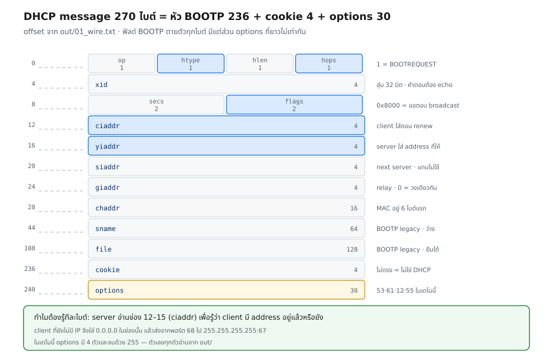
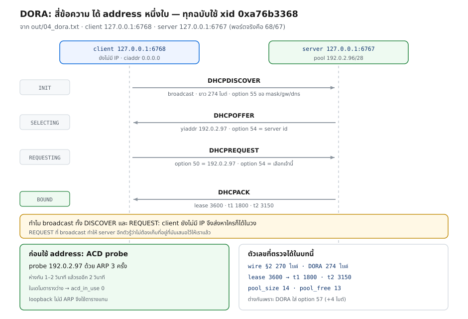
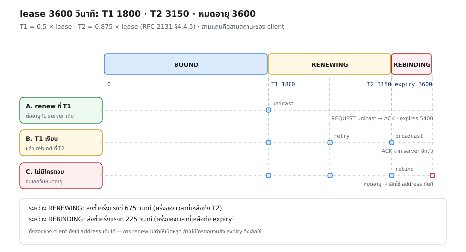
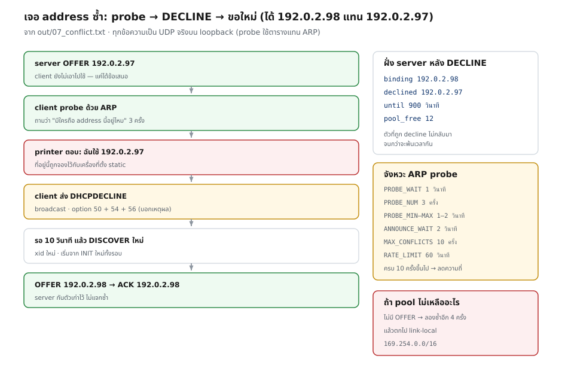

> 📅 เขียนเมื่อ: 24 พฤศจิกายน 2026 (เวลาไทย, UTC+7)
>
> **เครื่องที่รันบทนี้:** Raspberry Pi 5, Debian GNU/Linux 13 (trixie), kernel 6.18.60+rpt-rpi-2712, aarch64 · Go 1.24.4 · iproute2 6.15.0 · iputils 20240905 · NetworkManager 1.52.1 (nmcli) · ภาพวาดด้วย `gen_svgs.py` และตรวจความอ่านง่ายด้วย `check_svg_readability.py` · ตัวเลขที่**วัดได้**ในบทมาจากไฟล์ใน `out/` ที่สร้างด้วย `bash run_all.sh` ทั้งหมด
>
> 🛡️ **จริยธรรม (สำคัญกับบทนี้เป็นพิเศษ):** DHCP server ที่ผิดที่ผิดทาง **ทำให้ทั้งวงเน็ตล่มได้จริง** เพราะมันแจก address ที่ router ก็แจกอยู่ ถ้าใครได้ address ซ้ำกัน ARP cache จะสลับเจ้าของไปมาและ TCP reset เป็นระยะ ทั้งวงจึงพังตามไปด้วย
>
> บทนี้จึงไม่เปิด DHCP server บน LAN จริงเลยสักครั้ง — ทั้ง client และ server ของเราวิ่งบน **loopback** (`127.0.0.1`) พอร์ต `6767`/`6768` ส่วน address ที่แจกอยู่ในช่วง `192.0.2.0/24` ซึ่งเป็นช่วงสำหรับเอกสาร (TEST-NET-1 ตาม RFC 5737) ไม่มีเครื่องจริงใช้ และตัวโปรแกรมเองก็**ปฏิเสธ** ที่อยู่ของ server/client ที่ไม่ใช่ loopback (รวมถึง pool ที่ไม่ใช่ช่วง TEST-NET) ถ้าไม่สั่ง `-allow-lan` เอง (มีผลรันของการปฏิเสธอยู่ใน `out/16_invalid.txt`) โค้ดทั้งหมดของบทอยู่ที่ `code/ep14/` รัน `bash run_all.sh` แล้วจะได้ `out/` ทุกไฟล์ขึ้นมาใหม่ในเครื่องคุณเอง

---

## 0. สองตั๋วงานที่จบที่บรรทัดเดียวกัน

ตั๋วใบแรกจากทีม IT: "เครื่องใหม่ในออฟฟิศได้ IP `192.168.1.47` ทั้งที่ pool ของ DHCP เริ่มที่ `.100` แล้วก็มีอีกสองเครื่องที่ได้ `.47` เหมือนกัน"

ตั๋วใบที่สองจากห้องบัญชี: "เครื่องปริ้นท์หายจากเครือข่ายทุกเช้า ราวสามนาทีแล้วกลับมาเอง ไม่มีใครไปแตะอะไร"

ทั้งสองใบไม่มีคำว่า DHCP เขียนอยู่บนตั๋ว และทั้งสองใบเป็นเรื่องเดียวกัน: **ใครเป็นคนตัดสินว่าเครื่องไหนได้ address อะไร และได้นานแค่ไหน**

- ใบแรกคือ **pool (ช่วง address ที่ DHCP เก็บไว้แจก) ที่ทับกับ address ที่ตั้งมือไว้ (static)** — เครื่องที่ตั้งมือไว้ไม่รู้จัก DHCP และ DHCP ก็ไม่รู้จักมัน สองฝ่ายแจก address เดียวกันโดยไม่มีใครผิด
- ใบที่สองคือ **lease ที่สั้นกว่าที่คิด** (หรือเครื่องเข้า sleep แล้วตื่นมา renew ไม่ทัน) เครื่องจึงต้องทิ้ง address เดิมแล้วขอใหม่ทุกเช้า — ซึ่งไม่ใช่ความผิดปกติ แต่เป็นกลไกที่ทำงานตามที่ออกแบบ

ตอนที่แล้วเราจบที่ DNS ซึ่งตอบคำถามว่า "ชื่อนี้คือ IP อะไร" บทนี้ถอยไปอีกก้าว: **IP ที่จะเอาไปถาม DNS น่ะ มาจากไหน** — และคำถามนี้ยากกว่าที่คิด เพราะมันเป็นปัญหาไก่กับไข่ที่ตัว protocol เองต้องแก้

---

## 1. ปัญหาไก่กับไข่: ส่ง packet ได้ยังไงทั้งที่ยังไม่มี address

การส่ง IP packet หนึ่งใบต้องรู้สองอย่าง: **source address** (ใส่ในหัว packet) และ **MAC ของปลายทาง** (ใส่ในหัว Ethernet ซึ่งได้มาจาก ARP — protocol ที่ถามว่า "IP นี้อยู่ที่ MAC ไหน" · ARP cache = ตารางที่จำคำตอบไว้) แต่เครื่องที่เพิ่งเปิดใหม่ยังไม่มีทั้งสองอย่าง — มันไม่รู้ว่าเลขของตัวเองคืออะไร และ router ก็ไม่รู้จักมัน

ถ้าคิดแบบวิศวกร จะเห็นทางออกเดียว: **ใช้สิ่งที่ยังมีอยู่แล้วให้เป็นประโยชน์** นั่นคือ MAC address ที่ถูกฝังมาจากโรงงาน และ broadcast ที่ทุกคนในวงได้ยิน

- ส่งจาก source `0.0.0.0` (ยังไม่มี address ก็บอกว่ายังไม่มี)
- ไปที่ `255.255.255.255` (ไม่ต้องรู้ว่าใครเป็นคนรับ ใครมีหน้าที่ก็ตอบมา)
- ระบุตัวตนด้วย MAC ในช่อง `chaddr` ของ message
- ใช้ UDP พอร์ต **67** ฝั่ง server และ **68** ฝั่ง client

ทั้งหมดนี้ทำงานได้เพราะ **switch กระจาย broadcast ให้ทุกพอร์ต** ในวงเดียวกัน — ไม่ต้องมี routing ไม่ต้องมี ARP ไม่ต้องมีอะไรที่ต้องมี IP ก่อน

ประวัติของมันเรียงเป็นสามขั้น: **RARP** (RFC 903, ทศวรรษ 1980) ให้เครื่องที่รู้ MAC ถามหาว่า "ฉันควรใช้ IP อะไร" แต่ตอบได้แค่ address เดียว **BOOTP** (RFC 951, ปี 1985) เพิ่มการส่งไฟล์ boot ให้เครื่อง diskless พร้อม config อีกหลายค่า แต่ยังผูก address กับ MAC แบบตายตัว **DHCP** (RFC 2131 และ 2132, มีนาคม 1997) เพิ่มสองสิ่งที่ขาดไป: **lease** (ยืม address แล้วคืนได้) และ **options** (ส่งค่าอะไรก็ได้เป็นคู่ code–length–value)

RFC 2131 §1 แยกกลไกการแจก address ไว้สามแบบ ซึ่งยังใช้กันครบทั้งสามจนวันนี้

| กลไก | address ผูกกับอะไร | เหมาะกับ |
|---|---|---|
| automatic allocation | MAC หรือ client id แบบถาวร | เครื่องที่ต้องได้เลขเดิมตลอด แต่ยังอยากให้ศูนย์กลางเป็นคนเก็บ |
| dynamic allocation | ยืมเป็นช่วงเวลา (lease) แล้วคืน | เครื่องพกพา, Wi-Fi, ห้องประชุม — ของจริงส่วนใหญ่ใช้แบบนี้ |
| manual allocation | ผู้ดูแลกำหนดไว้ล่วงหน้า แล้ว DHCP แค่เป็นคนส่งให้ | เครื่องพิมพ์, กล้อง, อุปกรณ์ที่ต้องจด IP ไว้ในเอกสาร |

คำว่า **lease** ในบทนี้หมายถึงสัญญายืม address ที่มีวันหมดอายุ — ไม่ใช่สัญญาเช่ารถ แต่หลักการเดียวกัน: หมดอายุแล้วไม่ต่อ ต้องคืน



---

## 2. รูปทรงของ message: 236 ไบต์ที่สืบทอดมาสี่สิบปี

DHCP ไม่ได้คิดรูปแบบ message ใหม่ มันยืมของ BOOTP มาทั้งดุ้น แล้วแปะส่วน `options` ต่อท้าย นี่คือเหตุผลที่ฟิลด์บางตัวดูไม่มีเหตุผลในปี 2026 — `sname` 64 ไบต์กับ `file` 128 ไบต์เคยใช้บอกชื่อ server และชื่อไฟล์ boot ของเครื่อง diskless ซึ่งเป็นงานหลักของ BOOTP

ลองประกอบเองทีละฟิลด์ ตามที่ `runWire` ในเดโมทำ (ไม่ผ่าน library ใด ๆ ทั้งสิ้น) — รันโหมด `wire` แล้วมันพิมพ์ทุกฟิลด์พร้อม offset ออกมา:

```bash
cd code/ep14
go build -o bin/net14 .
./bin/net14 -section wire
```

```text
--- DHCPDISCOVER (discover) ที่ประกอบเองทีละฟิลด์ (ไบต์ดิบ ไม่ผ่าน library)
field     offset  size  value
op        0       1     1 (BOOTREQUEST)
htype     1       1     1 (Ethernet)
hlen      2       1     6
hops      3       1     0
xid       4       4     0xa76b3368
secs      8       2     0
flags     10      2     0x0000 (unicast reply ก็ได้)
ciaddr    12      4     0.0.0.0
yiaddr    16      4     0.0.0.0
siaddr    20      4     0.0.0.0
giaddr    24      4     0.0.0.0
chaddr    28      16    02:00:00:00:00:01 (เหลือ 10 ไบต์เป็นศูนย์)
sname     44      64    (ว่าง — BOOTP legacy)
file      108     128   (ว่าง — BOOTP legacy)
cookie    236     4     0x63825363 (99.130.83.99)
options   240     30    (TLV ดูข้างล่าง)
--- option ที่เขียนลงไปตามลำดับ
opt 53  len 1   DHCP Message Type      = 1 (DHCPDISCOVER)
opt 61  len 7   Client Id              = 01:02:00:00:00:00:01
opt 12  len 7   Hostname               = "lab-14a"
opt 55  len 6   Parameter List         = 1,3,6,15,58,59
opt 255 len 0   End
--- ขนาด
bootp_header_bytes 236
cookie_bytes 4
options_bytes 30
message_bytes 270
option_count 4
max_udp_payload_required 576
--- ไบต์จริง 64 ไบต์แรก
0000  01 01 06 00 a7 6b 33 68 00 00 00 00 00 00 00 00  |.....k3h........|
0010  00 00 00 00 00 00 00 00 00 00 00 00 02 00 00 00  |................|
0020  00 01 00 00 00 00 00 00 00 00 00 00 00 00 00 00  |................|
0030  00 00 00 00 00 00 00 00 00 00 00 00 00 00 00 00  |................|
```

ส่วนที่ลงมือจริงคือฟังก์ชันเดียวสั้น ๆ นี้ — `newMessage` วาง `op`/`htype`/`hlen`/`xid`/`chaddr` ตาม offset ของตาราง, `marshal` แปะ magic cookie ที่ไบต์ `236` แล้วต่อ options ทีละ TLV:

ผลรันข้างบนมาจากโหมด `wire` (`runWire`) ที่ยังไม่ใส่ option 57 → `270` ไบต์; ฟังก์ชันด้านล่างคือ `buildDiscover` ของโหมด DORA ที่ใส่ option 57 → `274` ไบต์ (ตรงกับ `len=274` ในหัวข้อ 3)

```go
func buildDiscover(mac macAddr, xid uint32, hostname string) (*dhcp, []byte, error) {
	d := newMessage(msgDiscover, xid, mac.bytes())
	d.addOpt(optClientID, append([]byte{1}, mac.bytes()...))
	d.addString(optHostname, hostname)
	d.addOpt(optParamList, []byte{optSubnetMask, optRouter, optDNS, optDomainName, optRenewalT1, optRebindingT2})
	// option 57 (maximum message size) ยาว 2 ไบต์ตาม RFC 2132 §9.10 ไม่ใช่ 4 ไบต์แบบ option ตัวเลขอื่น
	d.addU16(optMaxMsgSize, 1500)
	raw, err := d.marshal()
	if err != nil {
		return nil, nil, err
	}
	return d, raw, nil
}
```

`addU16` ใช้กับ option 57 เพราะสเปกกำหนดให้ค่านี้ยาว `2` ไบต์ (`1500` เขียนเป็น `0x05dc`) — ถ้าเผลอใช้ `addU32` แบบ option ตัวเลขอื่น message จะยาวเกินจริงไป `2` ไบต์ แล้วตัวเลขทุกตัวที่เหลือในบทจะเพี้ยนตาม

อ่านจากบนลงล่างจะเห็นว่า message หนึ่งใบมีสามส่วน:

1. **หัว BOOTP 236 ไบต์** — ฟิลด์ตายตัวทุกไบต์ offset ไม่ขยับไม่ว่าใครส่ง
2. **magic cookie 4 ไบต์** — `0x63825363` ตัวเลขนี้คือคำสัญญาว่า "ส่วนที่ตามมาเป็น options ของ DHCP ไม่ใช่ vendor area แบบเก่า" ถ้าไม่ตรง ให้ทิ้ง message นั้นได้เลย
3. **options** — ชุดค่าที่ต่อท้ายแบบ TLV (type–length–value) คือคู่ `code`, `length`, `value` เรียงกันไปจนเจอ `255` (End) ระหว่างทางเจอ `0` (Pad) ก็ข้ามไป

อีกห้าฟิลด์ที่เหลืออ่านชื่อแล้วเดาไม่ยาก แต่ต้องรู้ว่ารับผิดชอบอะไร:

- `htype` / `hlen` — ชนิดและความยาวของ hardware address (Ethernet = `1` และ `6` ไบต์) server ใช้สองช่องนี้ตัดสินว่าอ่าน `chaddr` ยาวเท่าไร
- `hops` — จำนวน relay agent ที่ message ผ่านมาแล้ว (client ตั้ง `0`; relay เพิ่มทีละหนึ่ง ถ้าเกิน `16` ให้ทิ้ง)
- `secs` — วินาทีจากตอน client เริ่ม boot (server ใช้ดูว่าใครรอนานแล้ว)
- `chaddr` — hardware address ของ client ยาว `16` ไบต์ โดย MAC อยู่ `6` ไบต์แรกและที่เหลือเป็นศูนย์ — server ใช้ช่องนี้เป็นที่อยู่ปลายทางของ OFFER/ACK
- `xid` — transaction id สุ่ม `32` บิต ใช้จับคู่คำถามกับคำตอบ (คำตอบต้อง echo กลับมาให้ตรงเป๊ะ)

มีตัวเลขขนาดที่ควรรู้สองตัวจาก RFC 2131 §2: client ต้องรับ **options field** ยาวอย่างน้อย `312` ไบต์ได้ (หมายถึง message ทั้งใบยาวได้ถึง `576` ไบต์ — ขนาด IP datagram ขั้นต่ำที่ทุกเครื่องต้องรับ) ถ้าอยากยาวกว่านั้นต้องต่อรองผ่าน option 57 (maximum message size) — ไม่ใช่ยัดไปเรื่อย ๆ แล้วหวังว่าปลายทางจะรับไหว

จุดที่คนอ่านครั้งแรกมักสะดุดคือ **สี่ฟิลด์ address ที่หน้าตาคล้ายกัน**

- `ciaddr` — address ที่ client **มีอยู่แล้ว** (ใส่ตอน renew ไม่ใช่ตอนขอครั้งแรก)
- `yiaddr` — address ที่ server **จะให้** client (`yi` = "your")
- `siaddr` — next server สำหรับ boot (DHCP ยุคใหม่แทบไม่ใช้)
- `giaddr` — address ของ **relay agent** ถ้าคำขอข้าม router มา (เดี๋ยวเจอกันในหัวข้อ 6)

ส่วน `flags` มีบิตที่สำคัญบิตเดียวในทางปฏิบัติ: `0x8000` แปลว่า "client รับ unicast ไม่ได้ ขอให้ตอบ broadcast" — เหตุผลคือ server จะส่ง unicast ไปหา client ได้ต้อง ARP หา MAC ของมันก่อน แต่ client ที่ยังไม่มี address จะตอบ ARP ไม่ได้เลย นี่จึงไม่ใช่ของประดับ

### 2.1 options: ที่ที่ทุกอย่างเกิดขึ้นจริง

ตัว message เองบอกได้แค่ว่า "ฉันเป็น DHCPDISCOVER" (option 53) นอกนั้นอยู่ใน options ทั้งหมด: mask (1), router (3), DNS (6), ชื่อโดเมน (15), lease time (51), T1 (58), T2 (59), server id (54), requested IP (50), parameter request list (55) และ client identifier (61)

ตัวอ่าน options ต้องทนต่อ input ทุกรูปแบบ เพราะข้อความนี้มาจากเครือข่าย ซึ่งอาจมีใครยิงของแปลกเข้ามา

```go
func parseOptions(b []byte) (map[byte][]byte, []byte, error) {
	opts := map[byte][]byte{}
	var order []byte
	for i := 0; i < len(b); {
		code := b[i]
		if code == optPad {
			i++
			continue
		}
		if code == optEnd {
			return opts, order, nil
		}
		if i+1 >= len(b) {
			return nil, nil, fmt.Errorf("option %d: ขาด length byte (เหลือ %d ไบต์)", code, len(b)-i)
		}
		n := int(b[i+1])
		if i+2+n > len(b) {
			return nil, nil, fmt.Errorf("option %d: ประกาศ len %d แต่เหลือ %d ไบต์", code, n, len(b)-i-2)
		}
		v := b[i+2 : i+2+n]
		if prev, seen := opts[code]; seen {
			opts[code] = append(append([]byte{}, prev...), v...)
		} else {
			opts[code] = append([]byte{}, v...)
			order = append(order, code)
		}
		i += 2 + n
	}
	return nil, nil, errors.New("ไม่เจอ option end (255) — message ถูกตัดกลางทาง")
}
```

สามบรรทัดที่สำคัญในฟังก์ชันนี้:

- `if code == optPad` — ข้ามไป ไม่นับเป็น option
- `if i+2+n > len(b)` — length ที่ประกาศไว้อาจโกหก ต้องเช็คก่อนตัด slice ไม่งั้น panic (Go จะ panic ทันทีถ้า slice เกิน length)
- `append(append([]byte{}, prev...), v...)` — option ที่ code เดิมโผล่หลายครั้งต้อง **ต่อกัน** ตาม RFC 3396 เพราะ option ที่ยาวเกิน 255 ไบต์ถูกแบ่งเป็นหลายท่อน ถ้าเอาท่อนหลังทับท่อนแรก คำตอบจะขาดกลาง

เดโมยิงไบต์ขยะ 2000 แบบเข้าไปในตัวอ่านนี้ (seed คงที่) แล้วยืนยันว่าไม่มี panic สักครั้ง — ตัวเลข `garbage_cases` กับ `garbage_rejected` อยู่ใน `out/11_parsejunk.txt` และมีเทสต์ `TestParseGarbageNoPanic` ใน `out/13_test.txt` คุมไว้อีกชั้น

### 2.2 ทำไมต้องมี client identifier ทั้งที่มี MAC อยู่แล้ว

ช่อง `chaddr` มี MAC ของ client อยู่แล้ว แต่ DHCP ยังมี option 61 แยกออกมาอีกชั้น เพราะ MAC ไม่ได้แปลว่า "เครื่องนี้" อีกต่อไป — Wi-Fi สมัยใหม่ใช้ MAC แบบสุ่มต่อ network (private address และหลายระบบสุ่มใหม่ทุกครั้งที่ต่อ) ถ้า server ใช้ MAC เป็นกุญแจ เครื่องเดิมจะได้ address ใหม่ทุกวัน และ pool จะเต็มด้วย address ที่ไม่มีใครใช้

client identifier จึงเป็นกุญแจที่ client เลือกเองได้ (มักเป็น `01` + MAC หรือชื่อเครื่อง) และ **server ต้องใช้มันแทน MAC** เมื่อมีมา ในเดโมของเรา ทุก message ที่ client ส่งออกไปจึงมี option 61 ติดไปด้วยเสมอ — รวมถึง `DHCPDECLINE` ที่เราจะเจอกันในหัวข้อ 5 ซึ่งถ้าลืมใส่ server จะมองว่าเป็นคนละเครื่องแล้วไม่ยอมปลด binding ให้. **binding** คือบันทึกฝั่ง server ว่า client คนนี้ยืม address ไหนถึงเมื่อไร (พิมพ์เป็น MAC เพราะ client id ในเดโมคือ `01` + MAC) เดโมนี้เคยพังด้วยเหตุนี้ตอนเขียนรอบแรก

---

## 3. ลงมือ: DORA (Discover → Offer → Request → Ack) สี่ข้อความบน loopback

ทีนี้เปิด server ของเราขึ้นมาที่ `127.0.0.1:6767` แล้วให้ client ผูกที่ `127.0.0.1:6768` — คำสั่งเดียวจบ สอง socket คุยกันจริงผ่าน UDP

```bash
cd code/ep14 && go build -o bin/net14 . && ./bin/net14 -section dora
```

พอร์ตจริงคือ `67`/`68` ซึ่งเป็น privileged port — ต้องมีสิทธิ์ระดับ root ถึงจะ bind ได้ เดโมจึงเลี่ยงมาใช้เลขที่สูงกว่า แต่รูปร่าง message เหมือนกันทุกไบต์

```text
--- DORA บน loopback (client 127.0.0.1:6768 · server 127.0.0.1:6767)
--- พอร์ตจริงคือ server 67 / client 68 — เป็น privileged port จึงใช้ 6767/6768 ในเดโม
step 1  client -> server  DHCPDISCOVER xid=0xa76b3368 len=274 ciaddr=0.0.0.0 yiaddr=0.0.0.0
step 2  server -> client  DHCPOFFER    xid=0xa76b3368 len=296 yiaddr=192.0.2.97 server_id=192.0.2.1
step 3  client -> server  DHCPREQUEST  xid=0xa76b3368 len=282 ciaddr=0.0.0.0 yiaddr=0.0.0.0
step 4  server -> client  DHCPACK      xid=0xa76b3368 len=296 yiaddr=192.0.2.97 server_id=192.0.2.1
acd_probe_addr 192.0.2.97
acd_probe_count 3
acd_in_use 0
acd_conclusion safe
--- สิ่งที่ client เอาไปตั้งบน interface
addr 192.0.2.97 mask 255.255.255.0 router 192.0.2.1 dns 192.0.2.53 domain lab.test lease 3600
t1 1800 t2 3150 server_id 192.0.2.1
--- ตัวนับฝั่ง client
discover_sent 1
offer_recv 1
request_sent 1
ack_recv 1
decline_sent 0
--- สถานะฝั่ง server
binding 02:00:00:00:00:01 -> 192.0.2.97 hostname=lab-14a expires=3600
pool_size 14
pool_free 13
offers_sent 1
acks_sent 1
naks_sent 0
result ok
```

อ่านทีละบรรทัด:

**step 1 — DHCPDISCOVER** client ไม่รู้ว่าใครเป็น server บ้าง จึงตะโกนลงวง (`ciaddr` กับ `yiaddr` เป็น `0.0.0.0` ทั้งคู่) พร้อมบอกรายการค่าที่อยากได้ผ่าน option 55 ว่า "ขอ mask, router, DNS, ชื่อโดเมน, T1, T2" — server ที่ไม่รู้จัก option หนึ่งจะข้ามไปเฉย ๆ ไม่ error นี่คือเหตุผลที่ DHCP เพิ่มค่าใหม่ได้โดยไม่ต้องแก้ client เก่า

**step 2 — DHCPOFFER** server ตอบว่า "ฉันมี `192.0.2.97` ให้ ยืมได้ 3600 วินาที" สังเกตว่ามันใส่ option 54 (server identifier) มาด้วย — เลขนี้สำคัญมาก เพราะถ้าในวงมี server สองตัว client จะเห็น offer สองใบและต้องเลือกใบเดียว

**step 3 — DHCPREQUEST** client ประกาศว่า "ฉันเลือก offer ของ `192.0.2.1`" แล้วใส่ option 50 บอก address ที่ต้องการกับ option 54 บอกว่าเลือกใคร คำถามที่คนมักถามคือ **ทำไมต้อง broadcast ทั้งที่รู้แล้วว่าจะคุยกับใคร** — คำตอบคือการ broadcast นี้มีผู้รับสองกลุ่ม: server ที่ถูกเลือก (ได้ยินคำยืนยัน) และ server ที่ไม่ได้ถูกเลือก (ได้ยินว่า "ไม่ต้องเก็บที่อยู่ที่เธอเสนอไว้ให้ฉันแล้ว" แล้วคืน address เข้า pool)

**step 4 — DHCPACK** server ยืนยันพร้อมส่งค่าจริงทั้งหมด: mask, router, DNS, ชื่อโดเมน, lease, T1, T2 ตั้งแต่บรรทัดนี้ไป client จึงเริ่มใช้ address ได้ — แต่ยังไม่ทันใช้ เพราะต้อง probe ก่อน (หัวข้อ 5)

ตัวเลข `len=274` ของ DISCOVER ในผลรันนี้มากกว่าตัวอย่างในหัวข้อ 2 (`270` ไบต์) อยู่สี่ไบต์ เพราะในโหมด DORA client เพิ่ม option 57 (maximum DHCP message size) เข้าไป — option นี้กิน `4` ไบต์ (code 1 + length 1 + ค่า `2` ไบต์ ตาม RFC 2132 §9.10) รายละเอียดเล็ก ๆ ที่ทำให้ผลรันสองที่ตัวเลขไม่เท่ากัน และเป็นเหตุผลว่าทำไมต้องอ่านชื่อ field ก่อนเทียบตัวเลข

ทั้งสี่ฉบับใช้ `xid` เดียวกัน (อธิบายไว้ในหัวข้อ 2) — นี่คือสิ่งที่ทำให้ client จับคู่คำตอบกับคำถามได้ โดยไม่ต้องพึ่งพอร์ตหรือลำดับของ packet และเป็นเหตุผลที่ `recv` ของ client ต้องเทียบ `xid` ก่อนรับคำตอบใด ๆ: คำตอบที่ `xid` ไม่ตรงคือของธุรกรรมอื่น ต้องทิ้งแล้วรอต่อ

ระหว่างสี่ข้อความ client ไล่สถานะสี่ขั้น: INIT → SELECTING (รอ offer) → REQUESTING (รอ ACK) → BOUND (ใช้ address ได้) — ภาพท้ายหัวข้อนี้กำกับสถานะไว้ข้างเส้นเวลา

### 3.1 ฝั่ง server: การเลือก address ไม่ใช่การสุ่ม

โค้ดส่วนที่ตัดสินว่าใครได้ address ไหนสั้นกว่าที่คิดมาก และนี่คือที่ที่บั๊กในโลกจริงเกิดขึ้นบ่อยที่สุด

```go
func (s *server) allocate(clientID string) (net.IP, error) {
	if b, ok := s.bindings[clientID]; ok && b.expires > s.clock {
		return b.addr, nil
	}
	for _, ip := range s.cfg.pool {
		key := ip.String()
		if until, bad := s.declined[key]; bad && until > s.clock {
			continue
		}
		if owner, taken := s.used[key]; taken && owner != clientID {
			continue
		}
		return ip, nil
	}
	return nil, errors.New("pool ไม่มี address ว่าง")
}
```

สามเงื่อนไขในลูปนี้คือหัวใจ:

1. ถ้า client คนนี้เคยได้ address และยังไม่หมดอายุ → **คืนตัวเดิม** (นี่คือเหตุผลที่เครื่องของคุณได้ IP เดิมทุกวัน แม้จะปิดเปิดใหม่)
2. ถ้า address ถูก `decline` ไว้และยังไม่พ้นเวลากัน → ข้าม
3. ถ้า address ถูก client อื่นถืออยู่ → ข้าม

และมันไล่ pool **ตามลำดับคงที่** ไม่ใช่สุ่ม — เพราะการสุ่มทำให้หาสาเหตุยาก ("ทำไมเครื่องนี้ได้ .97 ทุกวัน" ตอบไม่ได้ถ้า server สุ่ม) server จริงมักใช้ hash ของ client id เพื่อกระจาย แต่ยัง deterministic

### 3.2 เครื่องมืออีกตัวเห็นเหมือนกัน

เราไม่ต้องเชื่อโปรแกรมของตัวเองอย่างเดียว — `ss` (socket statistics จาก iproute2) มองเห็น socket ที่โปรแกรมเปิดอยู่

```bash
ss -lun
```

```text
--- socket ที่โปรแกรมเราเปิด (ss -lun)
State  Recv-Q Send-Q               Local Address:Port  Peer Address:Port
UNCONN 0      0                        127.0.0.1:6767       0.0.0.0:*   
```

บรรทัด `UNCONN` แปลว่าเป็น UDP ที่ไม่มี state ให้ติดตาม (ต่างจาก TCP ที่มี `LISTEN`/`ESTAB`) และคอลัมน์ `Local Address:Port` คือ `127.0.0.1:6767` ตรงกับที่โปรแกรมบอก — ถ้าสองเครื่องมือไม่ตรงกัน ให้เชื่อเครื่องมือที่ไม่ได้เขียนโดยเรา

### 3.3 ทำไมต้องสี่ข้อความ ไม่ใช่สอง

คำถามที่สมเหตุสมผล: "client ขอ server ให้ ทำไมไม่จบในสองข้อความ"

- **ต้องมี OFFER ก่อน REQUEST** เพราะสเปกเปิดทางให้ client รอเก็บ offer หลายใบก่อนตัดสินใจ ถ้าในวงมี server สองตัว (เช่นตอนย้ายผู้ให้บริการ) มันมีข้อมูลให้เลือกได้ (client ส่วนใหญ่ในโลกจริงตัดสินใจจากใบแรกที่มาถึง)
- **ต้องมี REQUEST ก่อน ACK** เพราะ server ต้องรู้ว่า client ยอมรับของจริง ไม่ใช่แค่เห็น offer แล้วหายไป — address ที่ offer ไปแล้วแต่ไม่มีใครรับ ต้องกลับเข้า pool
- **ต้อง broadcast REQUEST** เพื่อให้ server ที่แพ้การเลือกได้ยินและคืน address ทันที ไม่ต้องรอ lease หมดอายุ

ทั้งสี่ขั้นจึงเป็นการเจรจาสองทาง (two-phase) ที่ยืนยันว่า "ทั้งสองฝ่ายเห็นตรงกัน" ก่อนเริ่มใช้งานจริง



---

## 4. lease: สัญญายืมที่มี T1 กับ T2

address หนึ่งใบไม่ได้เป็นของเราตลอดไป มันถูกยืมมาเป็นเวลา `lease` วินาที และมีจุดตายตัวสามจุดในเส้นเวลา

- **T1** = `0.5 × lease` — เริ่มต่ออายุ (RENEWING)
- **T2** = `0.875 × lease` — เริ่มขอจาก server ตัวไหนก็ได้ (REBINDING)
- **expiry** = `lease` — หมดสิทธิ์ใช้ address นั้นทันที

ค่าเริ่มต้นสองตัวนี้มาจาก RFC 2131 §4.4.5 และ server สามารถส่งค่าอื่นมาแทนผ่าน option 58/59 ได้ (ในเดโมเราส่งมาตรงกับค่าเริ่มต้น เลยดูเหมือนไม่ได้ส่ง)

```go
func timers(lease int64) (t1, t2 int64) {
	// RFC 2131 §4.4.5: T1 = 0.5 × duration, T2 = 0.875 × duration (ปัดลง)
	t1, t2 = lease/2, lease*7/8
	// กัน lease สั้นมากจนปัดเศษแล้ว T2 ไปชน T1: สเปกบังคับ T1 < T2 < expiry
	if t2 <= t1 && t1+1 < lease {
		t2 = t1 + 1
	}
	return t1, t2
}
```

การเดินเส้นเวลาทั้งสามฉาก — renew สำเร็จ, renew ไม่สำเร็จแล้ว rebind, และไม่มีใครตอบเลย — อยู่ในผลรันนี้

```bash
./bin/net14 -section lease
```

```text
--- lease 3600 วินาที · T1 = duration/2, T2 = duration*7/8 (RFC 2131 §4.4.5)
lease_seconds 3600
t1_seconds 1800
t2_seconds 3150
--- ฉาก A: renew สำเร็จที่ T1 (unicast ถึง server เดิม)
t=0     state=BOUND      addr=192.0.2.101 expires=3600
t=1800  state=RENEWING   action=REQUEST unicast to 192.0.2.1 ciaddr=192.0.2.101 server_id=-
t=1800  state=BOUND      action=ACK from 192.0.2.1 expires=5400
--- ฉาก B: server เงียบที่ T1 → rebind ที่ T2 แล้วได้ ACK จาก server อีกตัว
t=1800  state=RENEWING   action=REQUEST unicast to 192.0.2.1 result=timeout
t=2475  state=RENEWING   action=REQUEST retransmit result=timeout
t=3150  state=REBINDING  action=REQUEST broadcast (ไม่ใส่ server_id) result=ACK from 192.0.2.2 lease=1200
t=3150  state=BOUND      addr=192.0.2.101 expires=4350
--- ฉาก C: ไม่มีใครตอบเลย → lease หมดอายุ
t=1800  state=RENEWING   action=REQUEST unicast result=timeout
t=2475  state=RENEWING   action=REQUEST retransmit result=timeout
t=3150  state=REBINDING  action=REQUEST broadcast result=timeout
t=3375  state=REBINDING  action=REQUEST retransmit result=timeout
t=3600  state=EXPIRED    action=เลิกใช้ 192.0.2.101 ทันที next=INIT (DISCOVER ใหม่ xid ใหม่)
--- ตัวเลขที่ใช้ตัดสิน
renew_retry_seconds 675
rebind_retry_seconds 225
lease_end_seconds 3600
fallback_if_no_server 169.254.0.0/16 (RFC 3927 link-local) = address ที่เครื่องตั้งให้ตัวเองเมื่อหา DHCP ไม่เจอ (อธิบายใน §5.1)
```

สามฉากนี้เล่าเรื่องต่างกัน:

**ฉาก A (T1)** client ส่ง DHCPREQUEST **unicast** ไปยัง server ตัวเดิม โดยใส่ `ciaddr` เป็น address ที่ตัวเองถืออยู่ และ **ไม่ใส่** option 54 (เพราะไม่ได้เลือกใครใหม่ แค่ขอต่อกับคนเดิม) server ตอบ ACK แล้วเวลาหมดอายุใหม่กลายเป็นเวลาที่ส่งคำขอ + lease = `5400`

**ฉาก B (T2)** server ตัวเดิมเงียบ (เครื่องล่ม, network หลุด) client ลองซ้ำอีกครั้งที่ `T1 + 675` ซึ่งเป็นครึ่งของเวลาที่เหลือถึง T2 — ตามสเปก "รอครึ่งของเวลาที่เหลือ แต่ไม่น้อยกว่า 60 วินาที" พอถึง T2 มันเปลี่ยนเป็น **broadcast** และไม่ใส่ server id แล้ว ครั้งนี้ server ตัวไหนก็ได้ที่ตอบ จะเป็นตัวที่ถือ lease ต่อให้

**ฉาก C** ไม่มีใครตอบเลยจนถึง `3600` — ณ วินาทีนั้น client **ต้องเลิกใช้ address นั้นทันที** ไม่ใช่ใช้ต่อไปเรื่อย ๆ เพราะ server อาจเอาไปแจกคนอื่นแล้ว การฝืนใช้ต่อคือการสร้าง conflict ด้วยมือตัวเอง

จุดที่คนเข้าใจผิดบ่อยที่สุด: **ระหว่าง renew เน็ตไม่หลุด** client ยังใช้ address เดิมส่ง packet ได้ปกติ เพราะมันยังไม่หมดอายุ การ renew คือการคุยเงียบ ๆ เบื้องหลัง ไม่ใช่การตัดการเชื่อมต่อแล้วต่อใหม่

### 4.1 จำ address เดิมไว้: ทำไมเครื่องเดิมมักได้ IP เดิม

client ที่ปิดแล้วเปิดใหม่มีทางลัด: มันจำ address เดิมไว้ (ในดิสก์) แล้วส่ง DHCPREQUEST ขอตัวเดิมก่อน โดยไม่ต้องเริ่มจาก DISCOVER — เรียกสถานะนี้ว่า INIT-REBOOT ถ้า server ตอบ ACK ก็จบในสองข้อความ ถ้าตอบ NAK (DHCPNAK — server บอกว่า address ที่ขอนั้นใช้ไม่ได้ ต้องเริ่มใหม่ เช่น ย้ายไปอีกวงแล้ว address เดิมใช้ไม่ได้) ก็เริ่ม DORA ใหม่

ฝั่ง server จึงต้องจำ **binding** ไว้ ไม่ใช่แค่แจกตามลำดับที่คนเข้ามา

```bash
./bin/net14 -section bindings
```

```text
--- client สามรอบบน server ตัวเดียว
client A (เข้ามาครั้งแรก)         mac=02:00:00:00:00:01 addr=192.0.2.97 discover=1 ack=1
client B (เครื่องใหม่)            mac=02:00:00:00:00:09 addr=192.0.2.98 discover=1 ack=1
client A (กลับมาก่อน lease หมด)   mac=02:00:00:00:00:01 addr=192.0.2.97 discover=1 ack=1
--- สถานะฝั่ง server
binding 02:00:00:00:00:01 -> 192.0.2.97 hostname=lab-14a expires=3600
binding 02:00:00:00:00:09 -> 192.0.2.98 hostname=lab-14a expires=3600
pool_size 14
pool_free 12
offers_sent 3
acks_sent 3
naks_sent 0
```

บรรทัดที่สามของผลรันคือประเด็น: client A กลับมาและได้ `192.0.2.97` ตัวเดิม ทั้งที่ client B แทรกเข้ามาระหว่างนั้น — เพราะ binding ผูกกับ **client identifier** ไม่ใช่กับลำดับคิว

### 4.2 lease ยาวหรือสั้น: ไม่มีคำตอบเดียว

| lease | ข้อดี | ข้อเสีย |
|---|---|---|
| สั้น (นาที) | address ที่ไม่มีคนใช้กลับมาเร็ว pool เล็กก็พอ | traffic renew ถี่ เครื่องที่ sleep นานอาจหลุด lease ทุกครั้งที่ตื่น |
| ยาว (วัน) | renew น้อย เครื่องอยู่นิ่ง | เครื่องที่ย้ายออกไปแล้วยังกิน address อยู่หลายวัน pool ต้องใหญ่ขึ้น |

ค่าที่เจอบ่อยในบ้านคือหนึ่งวัน และในออฟฟิศคือแปดชั่วโมง (ให้ครอบเวลาทำงานหนึ่งวัน) — ไม่มีค่าที่ถูกสำหรับทุกที่ สิ่งที่ต้องคิดคือ "address หนึ่งใบว่างเฉลี่ยกี่ชั่วโมงต่อวัน" กับ "เครื่องหนึ่งใบ renew บ่อยแค่ไหนถึงจะไม่เป็นภาระ"



---

## 5. วันที่ address ชนกัน: ARP probe กับ DHCPDECLINE

กลับไปที่ตั๋วใบแรก — เครื่องได้ `192.168.1.47` ทั้งที่ pool เริ่มที่ `.100` แปลว่า address นั้นไม่ได้มาจาก server ของเรา เคสแบบนี้มีได้สองทาง: มีคนตั้ง static ทับช่วง pool หรือมี DHCP server อีกตัว (ของใครก็ไม่รู้) อยู่ในวงเดียวกัน — งานแรกคือไปหาว่าใครตอบ `DISCOVER` ในวงนี้

DHCP แก้เรื่องนี้ได้แค่บางส่วน เพราะมันเป็น protocol ที่ **เชื่อคนที่ตะโกนมาว่าเป็น server** ไม่มีการพิสูจน์ตัวตน

### 5.1 probe ก่อนใช้: ADDRESS CONFLICT DETECTION

ก่อนใช้ address ที่ได้มา client ที่ดีจะถามก่อนว่า "มีใครใช้อยู่นะ" ด้วย **ARP probe** (RFC 5227) — ARP request ที่ส่งจาก `0.0.0.0` ไปหาว่า "ใครถือ address นี้" ถ้ามีคำตอบกลับมา แปลว่ามีคนใช้อยู่จริง

ตัวเลขจังหวะมาจากสเปกโดยตรง ไม่ใช่ค่าที่เราตั้งเอง: รอสุ่ม `0–1` วินาทีก่อนเริ่ม แล้วยิง probe `3` ครั้ง ห่างกัน `1–2` วินาที จากนั้นรออีก `2` วินาทีเพื่อให้คำตอบที่ช้ากว่ามาถึง — รวมแล้วราวห้าวินาทีต่อหนึ่ง address ซึ่งเป็นเหตุผลที่ต่อ Wi-Fi แล้วบางครั้งต้องรอสักครู่ก่อนเน็ตขึ้น

บน loopback ไม่มี ARP (ไม่มีอะไรให้ resolve) เดโมจึงแทน probe ด้วยตารางที่เราคุมเอง แล้วพิมพ์ผลออกมาตรง ๆ ว่ากำลังทำอะไร:

```bash
./bin/net14 -section conflict
```

```text
--- ฉากที่ 1: server ให้ address แรกใน pool แต่มีเครื่องที่ตั้ง static อยู่ก่อน
pool_size 14
offer_will_be 192.0.2.97
step 1  client -> server  DHCPDISCOVER xid=0xa76b3368 len=274 ciaddr=0.0.0.0 yiaddr=0.0.0.0
step 2  server -> client  DHCPOFFER    xid=0xa76b3368 len=296 yiaddr=192.0.2.97 server_id=192.0.2.1
step 3  client -> server  DHCPREQUEST  xid=0xa76b3368 len=282 ciaddr=0.0.0.0 yiaddr=0.0.0.0
step 4  server -> client  DHCPACK      xid=0xa76b3368 len=296 yiaddr=192.0.2.97 server_id=192.0.2.1
acd_probe_addr 192.0.2.97
acd_probe_count 3
acd_in_use 1
acd_conflict_owner 02:00:00:00:00:aa (static printer)
step 5  client -> server  DHCPDECLINE  xid=0x7883ffa7 len=319 ciaddr=0.0.0.0 yiaddr=0.0.0.0
decline_wait_seconds 10
decline_wait_simulated_ms 10
--- รอบสองหลังรอ: เริ่มจาก INIT ใหม่ (xid ใหม่ ไม่มีของเก่าติดมือ)
step 1  client -> server  DHCPDISCOVER xid=0xa7849975 len=274 ciaddr=0.0.0.0 yiaddr=0.0.0.0
step 2  server -> client  DHCPOFFER    xid=0xa7849975 len=296 yiaddr=192.0.2.98 server_id=192.0.2.1
step 3  client -> server  DHCPREQUEST  xid=0xa7849975 len=282 ciaddr=0.0.0.0 yiaddr=0.0.0.0
step 4  server -> client  DHCPACK      xid=0xa7849975 len=296 yiaddr=192.0.2.98 server_id=192.0.2.1
acd_probe_addr 192.0.2.98
acd_probe_count 3
acd_in_use 0
acd_conclusion safe
--- ตัวนับฝั่ง client
discover_sent 2
offer_recv 2
request_sent 2
ack_recv 2
decline_sent 1
decline_hold_seconds 900
--- สถานะฝั่ง server
binding 02:00:00:00:00:01 -> 192.0.2.98 hostname=lab-14a expires=3600
declined 192.0.2.97 until=900
pool_size 14
pool_free 12
offers_sent 2
acks_sent 2
naks_sent 0
--- สิ่งที่ client เอาไปตั้งบน interface
addr 192.0.2.98 mask 255.255.255.0 router 192.0.2.1 dns 192.0.2.53 domain lab.test lease 3600
t1 1800 t2 3150 server_id 192.0.2.1
result ok
```

ลำดับเหตุการณ์ในผลรัน:

1. server ให้ `192.0.2.97`
2. client probe แล้วเจอว่า **มีคนใช้** (`acd_in_use 1` เจ้าของคือ `02:00:00:00:00:aa`)
3. client ส่ง **DHCPDECLINE** (broadcast, option 50 บอก address, option 54 บอก server, option 56 บอกเหตุผล)
4. server เอา `192.0.2.97` ออกจาก pool และกันไว้ `900` วินาที (`declined ... until=900`)
5. client รอ 10 วินาที (สเปกกำหนดขั้นต่ำไว้เท่านี้ เพื่อไม่ให้วนถี่ยิงกันมั่ว) แล้วเริ่มจาก DISCOVER ใหม่ — ในเดโมย่อการรอลงเหลือ 10 มิลลิวินาที ตามที่บรรทัด `decline_wait_simulated_ms` บอก
6. รอบสองได้ `192.0.2.98` — client probe address ใหม่ก่อนใช้เหมือนเดิม (`acd_probe_addr 192.0.2.98` แล้ว `acd_in_use 0` แปลว่าคราวนี้ว่างจริง) จึงตั้งค่าและจบ

สังเกต `xid` ของ DECLINE (`0x7883ffa7`) ไม่เหมือนของรอบแรก: DECLINE เป็นธุรกรรมใหม่ server จึงต้องจับคู่ด้วย client identifier + option 50 ไม่ใช่ด้วย xid

จังหวะของ probe ไม่ใช่ค่าที่เราตั้งเอง — มันเป็นค่าคงที่ของสเปก และนี่คือทั้งหมดที่ RFC 5227 §1.1 กำหนดไว้

```text
--- ACD ตาม RFC 5227 §1.1 (ค่าคงที่ของสเปก ไม่ได้วัดจากเครื่องนี้)
PROBE_WAIT 1
PROBE_NUM 3
PROBE_MIN 1
PROBE_MAX 2
ANNOUNCE_WAIT 2
ANNOUNCE_NUM 2
ANNOUNCE_INTERVAL 2
MAX_CONFLICTS 10
RATE_LIMIT_INTERVAL 60
DEFEND_INTERVAL 10
probe_rate_after_limit 1 ครั้งต่อ 60 วินาที
```

สามบรรทัด `ANNOUNCE_*` คือขั้นตอน **หลัง** ได้ address มาแล้ว (คนละช่วงกับ probe): client ประกาศซ้ำว่า "address นี้เป็นของฉัน" `2` ครั้ง ห่างกัน `2` วินาที หลังรอ `2` วินาทีก่อนเริ่ม — เพื่อให้เพื่อนบ้านอัปเดต ARP cache ของตัวเอง ถ้าไม่มีขั้นนี้ เครื่องอื่นอาจยังจำ MAC เก่าที่ address เดียวกันได้

`MAX_CONFLICTS`, `RATE_LIMIT_INTERVAL` และ `DEFEND_INTERVAL` คือกลไกป้องกันไม่ให้เกิด ARP storm: ถ้าเจอ conflict ตั้งแต่ `MAX_CONFLICTS` (`10`) ครั้งขึ้นไปบน interface หนึ่ง เครื่องต้องลดความถี่ลงเหลือลอง address ใหม่ได้ไม่เกินหนึ่งครั้งต่อ `RATE_LIMIT_INTERVAL` วินาที (ป้องกัน server ที่แจก address เดิมให้ทุกเครื่องซ้ำ ๆ) ส่วน `DEFEND_INTERVAL` คุมว่าเครื่องจะประกาศปกป้อง address ของตัวเองได้ถี่แค่ไหน

ถ้า pool ไม่เหลือ address อะไรให้แจกจริง ๆ ผลลัพธ์คือหน้าตาแบบนี้

```bash
./bin/net14 -section conflict -pool 192.0.2.101/32
```

คราวนี้ `/32` ทำให้ pool มี address เดียวคือ `192.0.2.101` — พอตัวนั้นถูก decline ก็ไม่เหลืออะไรให้แจกอีก

```text
--- ฉากที่ 1: server ให้ address แรกใน pool แต่มีเครื่องที่ตั้ง static อยู่ก่อน
pool_size 1
offer_will_be 192.0.2.101
step 1  client -> server  DHCPDISCOVER xid=0xa76b3368 len=274 ciaddr=0.0.0.0 yiaddr=0.0.0.0
step 2  server -> client  DHCPOFFER    xid=0xa76b3368 len=296 yiaddr=192.0.2.101 server_id=192.0.2.1
step 3  client -> server  DHCPREQUEST  xid=0xa76b3368 len=282 ciaddr=0.0.0.0 yiaddr=0.0.0.0
step 4  server -> client  DHCPACK      xid=0xa76b3368 len=296 yiaddr=192.0.2.101 server_id=192.0.2.1
acd_probe_addr 192.0.2.101
acd_probe_count 3
acd_in_use 1
acd_conflict_owner 02:00:00:00:00:aa (static printer)
step 5  client -> server  DHCPDECLINE  xid=0x7883ffa7 len=319 ciaddr=0.0.0.0 yiaddr=0.0.0.0
decline_wait_seconds 10
decline_wait_simulated_ms 10
--- รอบสองหลังรอ: เริ่มจาก INIT ใหม่ (xid ใหม่ ไม่มีของเก่าติดมือ)
step 1  client -> server  DHCPDISCOVER xid=0xa7849975 len=274 ciaddr=0.0.0.0 yiaddr=0.0.0.0
discover_retry 2 xid=0xa7849975 (รอ 500 ms ไม่มีใครตอบ)
discover_retry 3 xid=0xa7849975 (รอ 500 ms ไม่มีใครตอบ)
discover_retry 4 xid=0xa7849975 (รอ 500 ms ไม่มีใครตอบ)
--- ตัวนับฝั่ง client
discover_sent 5
offer_recv 1
request_sent 1
ack_recv 1
decline_sent 1
decline_hold_seconds 900
--- สถานะฝั่ง server
declined 192.0.2.101 until=900
pool_size 1
pool_free 0
offers_sent 1
acks_sent 1
naks_sent 0
result no_free_address
fallback 169.254.0.0/16 (RFC 3927 link-local)
```

รอบสอง client ลองอีก `4` ครั้ง (บรรทัด `discover_retry` สามบรรทัด บวก DISCOVER ใบแรกของรอบนั้นอีกหนึ่ง) แล้วยอมแพ้ — พอนับรวม DISCOVER ของรอบแรกด้วย ตัวนับจึงรายงาน `discover_sent 5` ตามที่เห็นในผลรัน — สเปกบอกว่าถ้าไม่ได้ address จาก DHCP เลย เครื่องอาจตั้ง address แบบ **link-local** (`169.254.0.0/16` ตาม RFC 3927) เพื่อให้คุยกับเพื่อนบ้านในวงเดียวกันได้ก่อน นี่คือ address ที่ขึ้นต้นด้วย `169.254.` ซึ่งแปลว่า "ฉันหา DHCP ไม่เจอ"

### 5.2 สองเครื่องถือ address เดียวกันโดยไม่มี DHCP เกี่ยวข้อง

เคสที่ DHCP ช่วยไม่ได้คือตอนที่คนตั้ง static ชนกันเอง หรือ DHCP แจกไปแล้วแต่มีคนไปตั้งมือทับ สิ่งที่เกิดขึ้นคือ ARP cache ของทุกเครื่องในวงจะสลับเจ้าของไปมา ทุกครั้งที่เครื่องหนึ่งประกาศตัว

```bash
./bin/net14 -section static
```

```text
--- สองเครื่องตั้ง static ชนกันเอง (จำลอง ARP cache ไม่ได้ยิง ARP จริงบน loopback)
t=0   announce A 192.0.2.150 is-at 02:00:00:00:00:a1 cache_owner=02:00:00:00:00:a1
t=1   announce B 192.0.2.150 is-at 02:00:00:00:00:b2 cache_owner=02:00:00:00:00:b2
t=2   announce A 192.0.2.150 is-at 02:00:00:00:00:a1 cache_owner=02:00:00:00:00:a1
arp_owner_flips 2
symptom TCP reset เป็นระยะ ทุกครั้งที่เจ้าของใน ARP cache สลับ
```

บรรทัด `is-at` คือ ARP announcement (`is-at` = ประกาศว่า address นี้อยู่ที่ MAC นี้) — เครื่องที่ถือ address ยิงประกาศนี้ลงวง ทุกเครื่องจึงอัปเดต ARP cache ตาม ลำดับในผลรันจึงอ่านได้ว่าเจ้าของสลับกันไปมา

อาการที่ผู้ใช้เห็นคือ "เน็ตหลุดเป็นช่วง ๆ" หรือ "เข้าเว็บนี้ไม่ได้ แต่เว็บอื่นได้" ซึ่งทำให้หาสาเหตุยากมาก เพราะไม่มีอะไรเสียเลย — มีแค่คนสองคนแย่งกันเป็นเจ้าของ address เดียว

การป้องกันจึงต้องทำที่ **การจัดสรร** ไม่ใช่ที่ protocol: กันช่วง static ออกจาก pool ให้ชัด, จด IP ที่ตั้งมือไว้ที่เดียว, และก่อนตั้ง static ให้ ping หรือใช้ `arping -D` (`-D` = duplicate address detection — ยิง ARP probe ถามว่า address นี้มีคนใช้อยู่แล้วหรือยัง · มาจากแพ็กเกจ `iputils-arping`)



---

## 6. กับดักห้าข้อจากงานจริง

### 6.1 pool ทับกับช่วง static

ถ้า pool คือ `.100–.199` ของวง `192.168.1.0/24` แต่มีเครื่องพิมพ์ตั้งมือไว้ที่ `.150` วันหนึ่ง DHCP จะแจก `.150` ให้โน้ตบุ๊กที่เพิ่งเปิด แล้วทั้งสองเครื่องจะแย่งกันเป็นเจ้าของ สิ่งที่ควรทำคือ **แบ่งช่วงให้ขาดจากกัน** เช่น static `.1–.99` (รวม gateway `.1`), pool `.100–.199` — และเขียนไว้ในเอกสารที่คนอื่นหาเจอ

### 6.2 broadcast ไม่ข้าม router: นี่คือเหตุผลที่ giaddr มีอยู่

DHCPDISCOVER เป็น broadcast ซึ่ง router ไม่ส่งต่อ — broadcast อยู่ได้แค่วงเดียว (VLAN = การแบ่งวงย่อยเชิง logical บน switch ตัวเดียว; broadcast ไม่ข้าม VLAN) องค์กรที่มีสิบ VLAN จึงไม่ควรมี DHCP server สิบตัว

ทางออกคือ **relay agent** (มักเป็น router หรือ switch เอง) ที่รับ broadcast ในแต่ละวงแล้วส่งต่อให้ server กลางแบบ unicast พร้อมใส่ `giaddr` บอกว่า "คำถามนี้มาจากวงไหน" — server จึงเลือก pool ตาม `giaddr` และตอบกลับไปที่ relay ไม่ใช่ไปที่ client ตรง ๆ

ถ้า VLAN ใหม่ไม่มี relay ชี้ไปที่ server เครื่องใน VLAN นั้นจะไม่ได้ IP เลย — อาการคือ "เครื่องใน VLAN ใหม่ขึ้น `169.254.x.x` แต่ VLAN เก่าปกติ" ซึ่งหลอกคนได้บ่อย เพราะดูจากระยะไกลแล้วเหมือน DHCP server ล่มทั้งระบบ

### 6.3 rogue DHCP: server ปลอมที่ไม่มีใครตรวจ

DHCP ไม่มีการพิสูจน์ตัวตนในทางปฏิบัติ client จะเชื่อ offer ใบแรกที่ยอมรับได้ นี่คือช่องโหว่ที่ใช้ทำ man-in-the-middle ได้ตรง ๆ: server ปลอมแจก address พร้อม router และ DNS ที่ชี้ไปที่ตัวมัน แล้ว traffic ทั้งหมดก็ไหลผ่านมัน

```bash
./bin/net14 -section rogue
```

```text
--- สอง server ตอบพร้อมกัน (จำลองลำดับการตอบ ไม่ได้เปิด server สองตัวจริง)
offer_1 from=192.0.2.66 router=192.0.2.66 dns=192.0.2.66 lease=600 arrived_ms=1
offer_2 from=192.0.2.1 router=192.0.2.1 dns=192.0.2.53 lease=3600 arrived_ms=7
accepted from=192.0.2.66 (ตัวที่ตอบถึงก่อน — client เลือกตัวแรกที่ยอมรับได้)
result_addr 192.0.2.111
result_router 192.0.2.66
result_dns 192.0.2.66
next_hop_is_rogue 1
dhcp_authentication_option 90 (RFC 3118 — มีในสเปก แต่ deployment จริงแทบไม่ใช้)
```

ในผลรันนี้ client รับ offer จาก `192.0.2.66` (ตัวที่ตอบถึงก่อน) แล้วได้ router กับ DNS เป็น `192.0.2.66` ทั้งคู่ — หลังจากนั้นทุก packet ที่ออกนอกวงจะผ่านเครื่องนั้น

มี RFC 3118 ที่ออกแบบ authentication ของ DHCP ไว้ตั้งแต่ปี 2001 แต่ในทางปฏิบัติแทบไม่เห็น deployment เพราะต้องแลกกุญแจล่วงหน้าทุกเครื่อง การป้องกันที่ใช้จริงจึงอยู่ที่ Layer 2: **DHCP snooping** บน switch (กำหนดว่าพอร์ตไหนเป็น "พอร์ตของ server" พอร์ตอื่นส่ง offer ไม่ได้), port security, และ 802.1X (802.1X = การพิสูจน์ตัวตนก่อนอุปกรณ์จะได้สิทธิ์บนพอร์ต switch)

### 6.4 "ไม่ได้ IP" กับ "DHCP ล่ม" ไม่ใช่เรื่องเดียวกัน

เวลาเครื่องขึ้น `169.254.x.x` คนมักสรุปว่า DHCP server ตาย ทั้งที่สาเหตุที่เป็นไปได้มีหลายอย่าง: สาย/switch หลุด, VLAN ผิด, relay ไม่ถึง server, pool เต็ม, หรือ client ยังไม่ทันได้ DISCOVER (delay เริ่มต้น 1–10 วินาทีตามสเปก)

ลำดับการตรวจที่ได้ผล: ดู `ip addr` ว่าได้ `169.254` (ไม่เจอ server) หรือได้ address แต่ ping gateway ไม่ได้ (เจอ server แต่ config ผิด) — สองอาการนี้ชี้ไปคนละที่

### 6.5 ห้าร้อยเครื่องบูตพร้อมกัน

ในห้องสอบหรือออฟฟิศที่ไฟดับแล้วกลับมา ทั้งวงบูตพร้อมกันและยิง DISCOVER พร้อมกัน สเปกจึงกำหนดให้ client **รอสุ่ม 1–10 วินาที** ก่อนยิงครั้งแรก เพื่อกระจายโหลด นี่คือเหตุผลที่บางเครื่องในห้องได้เน็ตช้ากว่าเพื่อนหลายนาที — ไม่ใช่เพราะ DHCP ทำงานผิด แต่เพราะมันกำลังทำตามที่ควรทำ

ถ้าออกแบบระบบที่ต้องรับ client จำนวนมากพร้อมกัน สิ่งที่ต้องคิดคือ pool ที่ใหญ่พอ **และ** server ที่ตอบได้ทันก่อนที่ client จะหมดความอดทน (สเปกให้ retransmit หลายครั้งรวมกันราวหนึ่งนาทีก่อนยอมแพ้)

---

## 7. โจทย์

### 7.1 Drill — เจ็ดข้อที่ตอบได้ด้วยเครื่องมือในบทนี้

ทุกข้อมีคำตอบอยู่ใน `out/` ที่รันได้จริง ไม่ต้องเดา

โจทย์ข้อ 7 ใช้ `-section serve` ซึ่งเป็นโหมดที่เปิด server ค้างไว้เฉย ๆ (ไม่รัน DORA) — ไว้ดูว่าค่าที่ไม่ปลอดภัยถูกปฏิเสธหน้าด่าน: `./bin/net14 -section serve -server 192.168.101.10:67`

1. message ที่ `-section wire` ประกอบได้ยาวกี่ไบต์ และแบ่งเป็นหัว BOOTP, cookie, options อย่างละเท่าไร
2. ถ้าเปลี่ยน `-lease 600` แล้ว T1 กับ T2 กลายเป็นเท่าไร และ retry ในช่วง RENEWING ห่างกันกี่วินาที
3. ใน `-section wire -msgtype renew` ช่อง `ciaddr` มีค่าอะไร และทำไม **ไม่มี** option 50 — ต่างจาก `-msgtype request` ตรงไหน
4. client สองตัว (MAC ต่างกัน) เข้ามาทีละตัว แล้วตัวแรกกลับมาอีกครั้ง ได้ address อะไร เพราะอะไร
5. `-section conflict -pool 192.0.2.101/32` ให้ผลต่างจาก pool ปกติอย่างไร และในรอบสอง client ลองอีกกี่ครั้งก่อนยอมแพ้ (นับรวม DISCOVER ของรอบแรกเป็น `discover_sent` เท่าไร)
6. ถ้าลบ option 61 ออกจาก DHCPDECLINE จะเกิดอะไรขึ้นกับ binding (ลองแก้โค้ดจริง ไม่ใช่เดา)
7. ทำไม `-section serve -server 192.168.101.10:67` ถูกปฏิเสธ และข้อความที่ได้บอกอะไร

#### ผลรันของข้อ 2 และข้อ 3

```bash
./bin/net14 -section lease -lease 600
```

```text
--- lease 600 วินาที · T1 = duration/2, T2 = duration*7/8 (RFC 2131 §4.4.5)
lease_seconds 600
t1_seconds 300
t2_seconds 525
--- ฉาก A: renew สำเร็จที่ T1 (unicast ถึง server เดิม)
t=0     state=BOUND      addr=192.0.2.101 expires=600
t=300   state=RENEWING   action=REQUEST unicast to 192.0.2.1 ciaddr=192.0.2.101 server_id=-
t=300   state=BOUND      action=ACK from 192.0.2.1 expires=900
--- ฉาก B: server เงียบที่ T1 → rebind ที่ T2 แล้วได้ ACK จาก server อีกตัว
t=300   state=RENEWING   action=REQUEST unicast to 192.0.2.1 result=timeout
t=412   state=RENEWING   action=REQUEST retransmit result=timeout
t=525   state=REBINDING  action=REQUEST broadcast (ไม่ใส่ server_id) result=ACK from 192.0.2.2 lease=1200
t=525   state=BOUND      addr=192.0.2.101 expires=1725
--- ฉาก C: ไม่มีใครตอบเลย → lease หมดอายุ
t=300   state=RENEWING   action=REQUEST unicast result=timeout
t=412   state=RENEWING   action=REQUEST retransmit result=timeout
t=525   state=REBINDING  action=REQUEST broadcast result=timeout
t=562   state=REBINDING  action=REQUEST retransmit result=timeout
t=600   state=EXPIRED    action=เลิกใช้ 192.0.2.101 ทันที next=INIT (DISCOVER ใหม่ xid ใหม่)
--- ตัวเลขที่ใช้ตัดสิน
renew_retry_seconds 112
rebind_retry_seconds 37
lease_end_seconds 600
fallback_if_no_server 169.254.0.0/16 (RFC 3927 link-local) = address ที่เครื่องตั้งให้ตัวเองเมื่อหา DHCP ไม่เจอ (อธิบายใน §5.1)
```

```bash
./bin/net14 -section wire -msgtype renew
```

```text
--- DHCPREQUEST (renew) ที่ประกอบเองทีละฟิลด์ (ไบต์ดิบ ไม่ผ่าน library)
field     offset  size  value
op        0       1     1 (BOOTREQUEST)
htype     1       1     1 (Ethernet)
hlen      2       1     6
hops      3       1     0
xid       4       4     0xa76b3368
secs      8       2     0
flags     10      2     0x0000 (unicast reply ก็ได้)
ciaddr    12      4     192.0.2.101
yiaddr    16      4     0.0.0.0
siaddr    20      4     0.0.0.0
giaddr    24      4     0.0.0.0
chaddr    28      16    02:00:00:00:00:01 (เหลือ 10 ไบต์เป็นศูนย์)
sname     44      64    (ว่าง — BOOTP legacy)
file      108     128   (ว่าง — BOOTP legacy)
cookie    236     4     0x63825363 (99.130.83.99)
options   240     22    (TLV ดูข้างล่าง)
--- option ที่เขียนลงไปตามลำดับ
opt 53  len 1   DHCP Message Type      = 3 (DHCPREQUEST)
opt 61  len 7   Client Id              = 01:02:00:00:00:00:01
opt 12  len 7   Hostname               = "lab-14a"
opt 255 len 0   End
--- ขนาด
bootp_header_bytes 236
cookie_bytes 4
options_bytes 22
message_bytes 262
option_count 3
max_udp_payload_required 576
--- ไบต์จริง 64 ไบต์แรก
0000  01 01 06 00 a7 6b 33 68 00 00 00 00 c0 00 02 65  |.....k3h.......e|
0010  00 00 00 00 00 00 00 00 00 00 00 00 02 00 00 00  |................|
0020  00 01 00 00 00 00 00 00 00 00 00 00 00 00 00 00  |................|
0030  00 00 00 00 00 00 00 00 00 00 00 00 00 00 00 00  |................|
```

### 7.2 Mini-project — `dhcpleash`: client ที่จำ lease ได้และกล้า decline

เป้าหมาย: ทำให้ client ของเราประหยัดข้อความและปลอดภัยขึ้น โดยยังใช้โค้ดประกอบ message ในบทนี้

ข้อกำหนดขั้นต่ำ:

1. เก็บ lease ลงไฟล์ (address, server id, lease, เวลาที่ได้มา) แล้วตอนเปิดใหม่ให้ลอง **INIT-REBOOT** — ส่ง REQUEST ขอ address เดิมก่อน ถ้าได้ NAK (server บอกว่า address เดิมใช้ไม่ได้) ค่อยเริ่ม DORA
2. ทำ ACD ก่อนใช้ address ทุกครั้ง และส่ง DECLINE พร้อม option 56 ที่บอกเหตุผลเมื่อ probe เจอว่ามีคนใช้
3. นับ `conflicts` ต่อ interface และทำ rate limit ตาม RFC 5227: ตั้งแต่ 10 ครั้งขึ้นไป ให้ลอง address ใหม่ได้ไม่เกินหนึ่งครั้งต่อ 60 วินาที
4. ทำ renew ที่ T1 และ rebind ที่ T2 โดยใช้เวลาจริง (`time.Timer`) ไม่ใช่ sleep คงที่ และต้องยกเลิกได้ด้วย `context`
5. log ทุก transition (`BOUND → RENEWING → BOUND`) พร้อม `xid` เพื่อให้ grep หาเหตุได้
6. เขียนเทสต์ที่พิสูจน์ว่า client ไม่ใช้ address ที่ถูก decline และไม่ panic กับ message ที่ยาวผิดรูป

เกณฑ์ผ่าน: รันกับ server ในบทนี้แล้วเห็นลำดับ `INIT-REBOOT → ACK` ตอนเปิดครั้งที่สอง (ไม่ใช่ DORA เต็มสี่ข้อความ) และเห็น `DECLINE` เมื่อ probe เจอ address ที่มีคนใช้

---

## สรุป

- DHCP แก้ปัญหาไก่กับไข่ด้วย broadcast ที่ Layer 2, source `0.0.0.0` และ UDP 67/68 — ไม่ต้องมี IP ก่อนก็ขอ IP ได้
- message คือหัว BOOTP 236 ไบต์ + magic cookie + options แบบ TLV ตัวที่ทำให้เพิ่มค่าใหม่ได้โดยไม่ต้องแก้ client เก่าคือ options
- DORA สี่ข้อความเป็น **การเจรจาสองทาง**: OFFER ให้ทางเลือก, REQUEST ประกาศการเลือกให้ทุกคนได้ยิน, ACK คือสัญญาที่เริ่มนับเวลา
- lease ไม่ใช่ของถาวร: T1 ต่ออายุกับ server เดิม, T2 ขอจากใครก็ได้, หมดอายุแล้วต้องเลิกใช้ทันที — และระหว่าง renew เน็ตไม่หลุด
- address ที่ได้มาต้องถูก probe ก่อนใช้ ถ้าเจอว่ามีคนถืออยู่ ให้ส่ง DECLINE แล้วเริ่มใหม่ — server จะกัน address นั้นไว้ไม่ให้ใครได้อีก
- ปัญหาจริงมักไม่ได้อยู่ที่ protocol แต่อยู่ที่การจัดสรร: pool ทับ static, relay ที่ขาด, server ปลอมที่ไม่มีใครตรวจ

ตอนที่แล้วเราว่าด้วยชื่อ (DNS) ตอนนี้เราได้ที่อยู่ (DHCP) มาแล้ว — สองอย่างนี้คือของที่ต้องมีก่อนจะคุย HTTP ได้

← ตอนก่อน: [DNS — ชื่อเดียวที่ต้องถามสามชั้น](/blog/post.html?slug=2026-11-23-network-13-dns-resolution)
