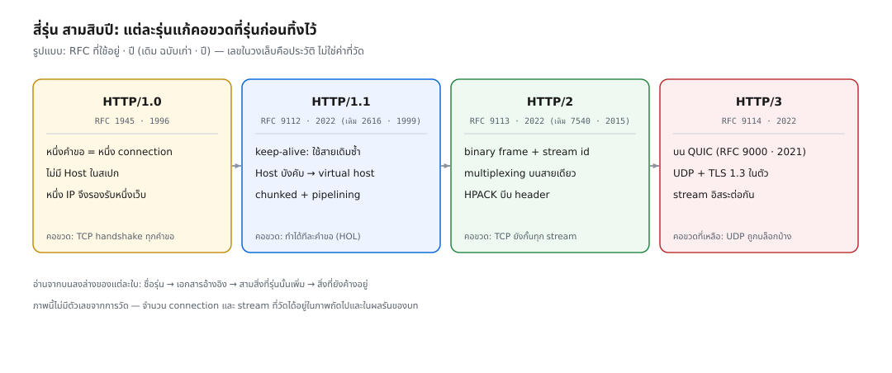
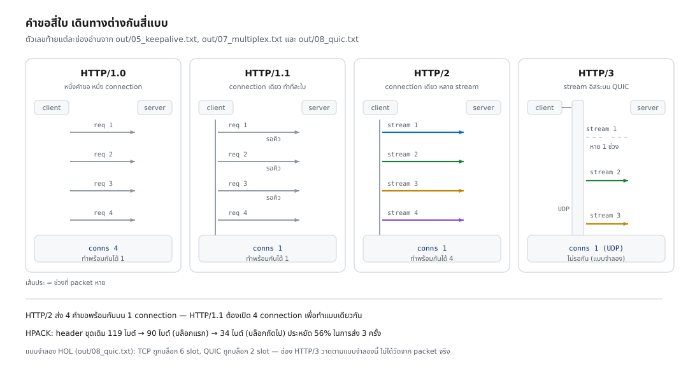

> 📅 เขียนเมื่อ: 25 พฤศจิกายน 2026 (เวลาไทย, UTC+7)
>
> **เครื่องที่รันบทนี้:** Raspberry Pi 5, Debian GNU/Linux 13 (trixie), kernel `6.18.60+rpt-rpi-2712`, aarch64 · Go `1.24.4` · curl `8.14.1` (nghttp2 `1.64.0`, nghttp3 `1.8.0`, OpenSSL `3.5.7`) · ภาพวาดด้วย `gen_svgs.py` แล้วตรวจความอ่านง่ายด้วย `check_svg_readability.py`
>
> ตัวเลขที่**วัดได้**ในบทมาจากไฟล์ใน `out/` ที่สร้างด้วย `bash run_all.sh` ทั้งหมด — รวมถึงค่าเวอร์ชันเครื่องมือด้านล่างนี้ ซึ่งดึงจาก `out/00_env.txt` ในรอบรันเดียวกัน
>
> 🛡️ **ขอบเขตของเดโม:** ทั้งบทวิ่งบน **loopback** (`127.0.0.1`) ของเครื่องนี้เท่านั้น — HTTP/1.x ที่พอร์ต `18080` และ HTTPS+ALPN ที่ `18443` ใบรับรอง TLS เป็นแบบ self-signed ที่สร้างขึ้นในหน่วยความจำของโปรเซส (self-signed = เซ็นรับรองตัวเอง ไม่มีหน่วยงานกลางมารับรองให้) แล้วเราต่อด้วย `curl -k` (ข้ามการตรวจใบรับรอง) เพื่อดูว่า ALPN ต่อรองอะไร (ALPN = ตอนต่อ TLS ที่สองฝ่ายตกลงกันว่าจะคุยภาษาไหน เช่น h2) — ไม่มี traffic ออกนอกเครื่อง ไม่มีการดัก packet ของใคร และไม่มี server ปลอมบน LAN

```text
host: Linux 6.18.60+rpt-rpi-2712
kernel: 6.18.60+rpt-rpi-2712
arch: aarch64
os: Debian GNU/Linux 13 (trixie)
go_version: go1.24.4
system_go: go1.24.4
curl_version: 8.14.1
curl_nghttp2: 1.64.0
curl_nghttp3: 1.8.0
curl_openssl: 3.5.7
curl_features: alt-svc AsynchDNS brotli GSS-API HSTS HTTP2 HTTP3 HTTPS-proxy IDN IPv6 Kerberos Largefile libz NTLM PSL SPNEGO SSL threadsafe TLS-SRP UnixSockets zstd
openssl: 3.5.7
iproute2: 6.15.0
gofmt_unformatted_files: 0
go_vet: ok
build_warnings: 0
```

---

## 0. สองตั๋วงานที่จบที่ connection เดียวกัน

ตั๋วใบแรกจากทีมการตลาด: "หน้า gallery มีรูป 40 รูป เปิดบนมือถือช้ากว่าที่ควร ทั้งที่ไฟล์รูปย่อแล้ว"

ตั๋วใบที่สองจากทีม backend: "API ตั้ง timeout ไว้ 5 วินาที พอคนใช้เยอะขึ้นก็เริ่มมี request ตก 0.5% ทั้งที่ CPU ยังว่าง"

ทั้งสองใบไม่มีคำว่า HTTP version เขียนอยู่บนตั๋ว และทั้งสองใบเป็นเรื่องเดียวกัน: **การเดินทางของคำขอหนึ่งใบต้องจ่ายค่าอะไรบ้าง และคำขอหลายใบทับกันได้แค่ไหน** — ซึ่งเป็นคนละคำถามกับ "server เร็วไหม" ทั้งสิ้น

ตอนที่แล้วเราจบที่ [DHCP](/blog/post.html?slug=2026-11-24-network-14-dhcp-bootstrapping) (IP มาจากไหน) ก่อนหน้านั้นคือ [DNS](/blog/post.html?slug=2026-11-23-network-13-dns-resolution) (ชื่อคือ IP อะไร) สองตอนนั้นตอบคำถามว่า **จะไปถึงใคร** บทนี้เริ่มตอนที่ไปถึงแล้ว: **จะคุยกันด้วยภาษาอะไร และคุยได้กี่เรื่องพร้อมกันบนสายเดียว**



---

## 1. HTTP/1.0 (RFC 1945, 1996): หนึ่งคำขอ หนึ่งสาย

HTTP เกิดมาพร้อม WWW ในปี 1991 ในรูปที่เรียกว่า HTTP/0.9 — คำขอมีบรรทัดเดียว (`GET /page` แล้วขึ้นบรรทัดใหม่) ตอบกลับมาเป็น HTML ดิบ ไม่มี header ไม่มี status code ฉบับที่เป็นเอกสารจริงจังคือ **RFC 1945 (พฤษภาคม 1996)** ซึ่งเขียนย้อนหลังเพื่ออธิบายว่าคนใช้กันจริงอย่างไร

รูปทรงของ message ในรุ่นนี้คือ **ข้อความล้วน** (plain text) อ่านออกด้วยตา:

- บรรทัดแรกของ request = method + path + version
- ต่อด้วย header ทีละบรรทัดในรูป `ชื่อ: ค่า`
- จบหัวด้วยบรรทัดว่าง แล้วตามด้วย body (ถ้ามี)

บรรทัดที่ลงท้ายด้วย `\r\n` ในผลรันข้างล่าง — `\r\n` คืออักขระขึ้นบรรทัดใหม่ CR+LF ที่ HTTP ใช้จริงบนสาย (ไม่ใช่ตัวอักษรที่พิมพ์ตามตัว):

```text
--- HTTP/1.0: ไม่มี Host ก็ยังผ่าน (สเปก RFC 1945 ไม่บังคับ)
GET /atoms/42 HTTP/1.0\r\n
User-Agent: net15/1.0 (linux; aarch64)\r\n
\r\n
request_bytes 66
--- HTTP/1.1: Host บังคับ (RFC 9112 §3.2) — ขาดแล้วได้ 400
GET /atoms/42 HTTP/1.1\r\n
Host: net15.lab.test\r\n
User-Agent: net15/1.0 (linux; aarch64)\r\n
Accept: */*\r\n
Accept-Encoding: gzip, deflate\r\n
Cookie: sid=8f2c1d4e; theme=dark\r\n
\r\n
request_bytes 167
header_bytes 141
header_field_count 5
```

ตัวเลข `66` กับ `141` ไม่ใช่เรื่องบังเอิญ: `66` คือ request ทั้งใบของ 1.0 ส่วน `141` คือเฉพาะ header ของ 1.1 (request เต็มใน 1.1 คือ `167` ไบต์) — **header ของ HTTP เป็นข้อความที่ต้องส่งซ้ำทุกคำขอ** ไม่มีการบีบอัด ไม่มีการจำของเก่า — คำขอที่สองที่เหมือนเดิมเป๊ะก็จ่ายเท่าคำขอแรก นี่คือเมล็ดของปัญหาในหัวข้อ 3

### 1.1 ปัญหาที่แท้จริงของ 1.0 ไม่ใช่ความยาว header แต่คือจำนวนรอบ

สเปก RFC 1945 ไม่ได้กำหนดให้ connection อยู่ต่อ หลังจาก response จบ server ปิด TCP connection นั้นทันที (จะเปิดค้างไว้ก็ได้ถ้าทั้งสองฝ่ายตกลงกันแบบไม่เป็นทางการผ่าน `Connection: keep-alive` ซึ่งเป็นของที่ Netscape ใส่เข้ามาและยังไม่อยู่ในสเปก)

ผลคือคำขอหนึ่งใบต้องจ่าย:

1. **TCP three-way handshake** — หนึ่ง round trip ก่อนจะส่งข้อมูลได้ (SYN → SYN/ACK → ACK; round trip = ไป-กลับหนึ่งรอบ)
2. **TLS handshake** — อีกหนึ่งถึงสอง round trip ถ้าเป็น HTTPS (TLS handshake = ขั้นแลกกุญแจเข้ารหัสก่อนจะส่งข้อมูลจริง)
3. **slow start** — TCP เริ่มด้วย congestion window เล็ก (ราว 10 packet สมัยใหม่) แล้วค่อย ๆ เพิ่ม คำขอแรกจึงไม่ได้ใช้ bandwidth เต็มที่มี (congestion window = จำนวนข้อมูลที่ TCP ยอมส่งค้างไว้ก่อนรอใบตอบรับ)
4. ส่ง request, รอ response, ปิด

หน้าเว็บที่มี 40 รูปบน HTTP/1.0 จึงเท่ากับ 40 ครั้งของทั้งหมดข้างบน — และเพราะ slow start รีเซ็ตทุกครั้ง แต่ละรอบจึงช้ากว่าที่ควร

ลองวัดกับ server ของเราเอง เปิด connection ใหม่ทุกคำขอ (นี่คือพฤติกรรมของ 1.0):

```bash
cd code/ep15
go build -o bin/net15 .
./bin/net15 -section keepalive
```

```text
--- HTTP/1.0: 4 requests บน connection ใหม่ทุกใบ
requests_served 4
conns_accepted 4
reuse_count 0
proto HTTP/1.0=4
```

`conns_accepted 4` คือหัวใจของเรื่อง: **สี่คำขอ สี่ connection** และ `reuse_count 0` แปลว่าไม่มีอะไรถูกใช้ซ้ำเลย

### 1.2 ทำไมไม่มี Host header ถึงเป็นปัญหาใหญ่

ในปี 1996 เครื่องหนึ่งเครื่องรับผิดชอบเว็บหนึ่งเว็บ — address หนึ่งตัว = server หนึ่งตัว เพราะคำขอบอกแค่ path (`GET /index.html`) ไม่ได้บอกว่า **เว็บไหน** พอธุรกิจเริ่มมีเว็บหลายอันบน server เดียว (virtual hosting = เครื่องเดียวรับหลายชื่อโดเมน) สเปกก็ไม่มีอะไรให้ใช้แยก: DNS ชี้ทุกชื่อมาที่ IP เดียวได้ แต่ server ไม่มีทางรู้ว่าผู้ใช้พิมพ์ชื่อไหนมา

HTTP/1.1 แก้ด้วยการบังคับให้ **ทุกคำขอต้องมี `Host`** — และนี่คือเหตุผลที่ทุกวันนี้คุณเปิดเว็บร้อยเว็บที่แชร์ IP เดียวกันได้

---

## 2. HTTP/1.1 (RFC 2068 1997 → RFC 2616 1999 → RFC 9112 2022): keep-alive, Host, chunked

HTTP/1.1 คือรุ่นที่แก้ปัญหา "จ่ายค่า handshake ทุกคำขอ" ด้วยไอเดียง่าย ๆ: **อย่าปิด connection** คำขอถัดไปวิ่งบน connection เดิมได้เลย กลไกนี้ชื่อ **persistent connection** หรือที่คนเรียกติดปากว่า **keep-alive**

เทียบกับฉากเดิมได้ตรง ๆ (server ตัวเดียวกัน client ตัวเดียวกัน ต่างกันแค่ version ในบรรทัดแรก):

```text
--- HTTP/1.1: 4 requests บน connection เดียว (keep-alive)
requests_served 4
conns_accepted 1
reuse_count 3
proto HTTP/1.1=4
last_response_status 200
last_response_proto HTTP/1.1
```

`requests_served 4` แต่ `conns_accepted 1` และ `reuse_count 3` — สี่คำขอ จ่ายค่า handshake ครั้งเดียว

keep-alive เป็นค่าเริ่มต้นของ 1.1 ถ้าฝั่งใดฝั่งหนึ่งอยากปิดก็ส่ง header `Connection: close` มาบอก (นี่คือเหตุผลที่ curl กับ HTTP/1.0 พิมพ์ `assume close after body` — เพราะ 1.0 ไม่มีกลไกนี้เป็นมาตรฐาน)

### 2.1 Host บังคับ และสิ่งที่เกิดเมื่อลืมใส่

เราสามารถพิสูจน์เรื่องนี้กับ server จริงในบท (`TestHostRequiredForHTTP11`) — ยิงคำขอเดียวกันสองแบบ:

- `GET /x HTTP/1.1` ไม่มี `Host` → server ตอบ `400 Bad Request`
- `GET /x HTTP/1.0` ไม่มี `Host` → server ตอบ `200 OK`

ต่างกันแค่เลข version ในบรรทัดแรก แต่ผลคือผ่านกับไม่ผ่าน — เพราะ 1.1 ถือว่า `Host` เป็นส่วนหนึ่งของ syntax ที่ขาดไม่ได้ (RFC 9112 §3.2) ไม่ใช่ของแถม

### 2.2 chunked transfer encoding: ตอบทั้งที่ยังไม่รู้ความยาว

ใน 1.0 การบอกความยาว response เป็นเรื่องตายตัว: ถ้าไม่รู้ความยาวก็ต้องปิด connection ตอนจบ (แล้ว keep-alive ก็จบไปด้วย) 1.1 แก้ด้วย **chunked transfer encoding**: ส่ง body เป็นก้อน แต่ละก้อนนำด้วยความยาวเป็นเลขฐานสิบหกแล้วจบด้วยก้อนขนาด `0`

บนสายมันหน้าตาแบบนี้ (โครง ไม่ใช่ผลรันของเดโม): หัว response มีบรรทัด `Transfer-Encoding: chunked`, ตามด้วยก้อนข้อมูลที่แต่ละก้อนนำด้วยความยาวเป็นเลขฐานสิบหกของตัวเอง (`1a` = 26 ไบต์) แล้วปิดท้ายด้วยก้อนขนาด `0`

ปลายทางจึงรู้จุดจบของ body โดยไม่ต้องรอ connection ปิด — และ keep-alive ใช้ต่อได้แม้ response จะถูกสร้างแบบ streaming

### 2.3 pipelining: ไอเดียที่ถูก แต่โลกไม่รับ

ถ้า keep-alive ให้ใช้สายเดิมได้ คำถามถัดมาคือ **ทำไมต้องรอ response ก่อนถึงจะส่งคำขอถัดไป** — pipelining คือคำตอบ: ส่งคำขอ 2, 3, 4 ต่อกันไปเลยไม่ต้องรอ

มันล้มเหลวในทางปฏิบัติด้วยเหตุผลที่คาดไม่ถึง: **คำตอบต้องกลับตามลำดับคำขอ** (ตามสเปก) ถ้าคำขอแรกใช้เวลานาน คำตอบของอีกสามใบที่เสร็จแล้วก็ต้องรอคิวอยู่ดี — เรียกอาการนี้ว่า **head-of-line blocking (HOL)** ระดับ HTTP และเมื่อรวมกับ proxy เก่า ๆ ที่จัดการ pipelining ผิด (สลับคำตอบ, ค้างกลางทาง) เบราว์เซอร์หลักแทบไม่เคยเปิด pipelining เป็นค่าเริ่มต้นเลย (Firefox ถอดโค้ดส่วนนี้ออกในเวอร์ชัน 54 ปี 2017)

ทางออกที่โลกเลือกใช้แทนคือ **เปิดหลาย connection ต่อ host** (host = ชื่อเว็บ/โดเมนเดียว) โดยพฤตินิยมอยู่ที่ประมาณ 6 connection ซึ่งแลกมาด้วยหน่วยความจำและ connection ที่เพิ่มขึ้นทั้งฝั่ง client และ server — และยังทิ้งปัญหาเดิมไว้: ในหนึ่ง connection ยังทำทีละคำขอ

เดโม keep-alive ในหัวข้อนี้ (และการทดลอง multiplex ในหัวข้อ 3.2) ใช้ฟังก์ชันนี้ตัวเดียว — อ่านโค้ดก่อน คำอธิบายอยู่ข้างล่าง

```go
func rawRoundTrip(br *bufio.Reader, c net.Conn, req string) (*http.Response, error) {
	if _, err := io.WriteString(c, req); err != nil {
		return nil, err
	}
	resp, err := http.ReadResponse(br, &http.Request{Method: "GET"})
	if err != nil {
		return nil, err
	}
	_, _ = io.Copy(io.Discard, resp.Body)
	_ = resp.Body.Close()
	return resp, nil
}
```

ฟังก์ชันเล็ก ๆ นี้คือทั้งหมดของเดโม keep-alive: เขียน request ลง connection เดิม (`c`) แล้วอ่าน response จาก `bufio.Reader` ตัวเดิม ถ้าใช้ `bufio.Reader` ใหม่ทุกครั้งที่เรียก อ่าน response ที่สองจะพังทันทีเพราะไบต์ส่วนต้นถูกอ่านค้างไว้ในบัฟเฟอร์เก่า — รายละเอียดเล็ก ๆ แบบนี้คือสิ่งที่ทำให้ "เขียน HTTP เอง" ต่างจาก "เรียก library"

---

## 3. HTTP/2 (RFC 7540, 2015 → RFC 9113, 2022): frame, stream และ HPACK

HTTP/2 เปลี่ยนสองอย่างพร้อมกัน: **รูปแบบบนสาย** และ **หน่วยของการทำงาน**

### 3.1 binary framing: ทุกอย่างเป็น frame ที่มีหัว 9 ไบต์

ข้อความล้วนอ่านง่ายแต่ parse ยาก (ต้องจัดการ whitespace, บรรทัดพับ, header ที่ยาวไม่จำกัด, ช่องว่างหลอก) HTTP/2 จึงทิ้งมันทั้งดุ้น: บนสายมีแต่ **frame** ที่มีหัวตายตัว `9` ไบต์ (frame ของ HTTP/2 ไม่ใช่ Ethernet frame ในตอน 3 — มันเป็นหน่วยข้อมูลของชั้นแอปพลิเคชัน มีหัวของตัวเอง 9 ไบต์)

```text
--- frame header มี 9 ไบต์ตายตัว: length(24) type(8) flags(8) R|stream_id(31)
headers_frame_bytes 99 (payload 90 + header 9)
0000  00 00 5a 01 05 00 00 00 01 82 87 44 09 2f 61 74  |..Z........D./at|
0010  6f 6d 73 2f 34 32 41 0e 6e                       |oms/42A.n|
headers_frame_type 0x01
headers_frame_flags 0x05
headers_frame_stream_id 1
--- DATA ของอีก stream หนึ่ง (0x0) สลับกันได้เพราะแยกตาม stream id
data_frame_type 0x00
data_frame_stream_id 3
0000  00 00 0c 00 00 00 00 00 03 68 65 6c 6c 6f 20 73  |.........hello s|
0010  74 72 65 61 6d                                   |tream|
--- SETTINGS (0x4) มาจากฝั่ง client ต้องมี stream_id = 0
settings_frame_type 0x04
settings_frame_stream_id 0
settings_ack_flag 0x01
frame_header_bytes 9
```

hexdump แบ่งเป็นสามคอลัมน์: ซ้ายสุดคือ offset ของไบต์แรกในแถวนั้น (เลขฐานสิบหก), กลางคือไบต์จริง 16 ไบต์, ขวาในเครื่องหมาย `|..Z....D./at|` คือไบต์ชุดเดียวกันในรูปตัวอักษร (จุด = ไบต์ที่พิมพ์เป็นตัวอักษรไม่ได้)

อ่านบรรทัดแรกของ hexdump ให้ได้: `00 00 5a` คือความยาว payload (`0x5a` = 90 ไบต์), `01` คือ type (HEADERS), `05` คือ flags (END_STREAM + END_HEADERS), แล้ว `00 00 00 01` คือ stream id 1 (บิตบนสุด reserved) — parser อ่านแค่ 9 ไบต์แรกก็รู้ว่าต้องอ่านต่ออีกกี่ไบต์ ไม่ต้องไล่หาบรรทัดว่าง

```go
func http2Frame(typ, flags byte, stream uint32, payload []byte) []byte {
	buf := make([]byte, frameHeaderLength+len(payload))
	n := len(payload)
	buf[0] = byte(n >> 16)
	buf[1] = byte(n >> 8)
	buf[2] = byte(n)
	buf[3] = typ
	buf[4] = flags
	binary.BigEndian.PutUint32(buf[5:9], stream&0x7fffffff)
	copy(buf[frameHeaderLength:], payload)
	return buf
}
```

`buf[0..2]` คือความยาว payload 24 บิต (เขียนบิตสูงลงต่ำ), `buf[3]` คือ type, `buf[4]` คือ flags, `buf[5:9]` คือ stream id 31 บิต (`& 0x7fffffff` เคลียร์บิตบนสุดที่สงวนไว้) — ที่เหลือคือ payload ต่อท้าย

### 3.2 stream: หลายบทสนทนาบนสายเดียว

frame ทุกใบมี **stream id** กำกับ — **stream** คือ "ช่องบทสนทนา" ที่มีลำดับของตัวเอง คำขอหนึ่งใบ = หนึ่ง stream

กติกาเลข id เรียบง่าย: client เริ่มด้วยเลขคี่, server เริ่มด้วยเลขคู่ และ `0` สงวนไว้สำหรับเรื่องระดับ connection (เช่น SETTINGS) ไม่ใช่คำขอ

เพราะ frame ของ stream ต่างกันสลับกันไปมาได้ ปลายทางจึงประกอบแต่ละ stream แยกกันได้ด้วย id — ความสามารถนี้คือ **multiplexing**

วัดจริง: ยิง 4 คำขอ พร้อมกัน ในสามรูปแบบ แล้วนับว่า server เห็นอะไร

```text
--- HTTP/1.1: 4 requests บน connection เดียว ทำทีละใบ
mode h1-sequential
requests 4 conns_accepted 1 max_inflight 1
--- HTTP/1.1: 4 requests พร้อมกัน ต้องเปิด connection คนละใบ
mode h1-parallel
requests 4 conns_accepted 4 max_inflight 4
--- HTTP/2: 4 requests พร้อมกัน บน connection เดียว (multiplexed streams)
mode h2-parallel
requests 4 conns_accepted 1 max_inflight 4
client_proto HTTP/2.0
server_proto HTTP/2.0=5
delay_per_request_ms 120
```

`max_inflight` คือจำนวนคำขอที่ **อยู่ใน handler พร้อมกัน** ณ จุดหนึ่ง (handler = ฟังก์ชันที่รับผิดชอบตอบคำขอหนึ่งใบ · handler หน่วง `120` ms ทุกใบ จึงเห็นการทับกันชัด) อ่านสามก้อนนี้เรียงกัน:

- `h1-sequential` — connection เดียว แต่ inflight `1`: ทำทีละใบ (นี่คือ keep-alive ธรรมดา)
- `h1-parallel` — inflight `4` แต่ต้องแลกด้วย `4` connection
- `h2-parallel` — inflight `4` บน connection เดียว (`client_proto HTTP/2.0` ยืนยันว่าเป็น h2 จริง ไม่ใช่ h1 ที่บังเอิญ reuse)

นี่คือกำไรจริงของ HTTP/2: **ความขนานที่ไม่ต้องจ่ายด้วยจำนวน connection**



### 3.3 HPACK: header ที่ส่งซ้ำไม่ต้องส่งซ้ำ

header ของ HTTP ซ้ำกันมหาศาล — `user-agent`, `accept`, `cookie` ค่าเดิมทุกคำขอ ใน 1.1 มันถูกส่งซ้ำทุกครั้ง (นั่นคือ `119` ไบต์ต่อคำขอในเดโมของเรา — คนละชุดกับ `141` ในหัวข้อ 1 นี่คือ 8 ฟิลด์ของเทสต์ HPACK) HTTP/2 จึงบีบด้วย **HPACK (RFC 7541)** ซึ่งมีสองเครื่องมือ:

- **static table** 61 entries ที่ทุกคนมีเหมือนกัน (`:method GET` คือ index 2, `user-agent` คือ index 58) ส่งแค่เลข index — `:method`, `:scheme`, `:path` คือ **pseudo-header** (header พิเศษที่ขึ้นต้นด้วย `:` ใช้แทนบรรทัด request ของ 1.1)
- **dynamic table** ที่จำของที่เพิ่งเห็น แล้วอ้างด้วย index ต่อ ๆ มา
- **integer representation** ที่ยืดหยุ่น — ค่าเล็กกิน 1 ไบต์ ค่าใหญ่ค่อยขยาย

```text
--- header list เดียวกัน ส่งสามครั้งบน connection เดียว (HPACK จำของเดิม)
header_list_fields 8
h1_header_bytes 119 (ข้อความล้วน ทุกครั้งส่งซ้ำเท่าเดิม)
hpack_first_bytes 90
hpack_second_bytes 34
hpack_third_bytes 34
hpack_dynamic_table_size 211
h1_total_3_requests 357
hpack_total_3_requests 158
save_percent 56
--- บล็อกแรก (literal + incremental indexing ยกเว้น cookie ที่เป็น never-indexed)
0000  82 87 44 09 2f 61 74 6f 6d 73 2f 34 32 41 0e 6e  |..D./atoms/42A.n|
0010  65 74 31 35 2e 6c 61 62 2e 74 65 73 74 53 03 2a  |et15.lab.testS.*|
0020  2f 2a 90 7a 1a 6e 65 74 31 35 2f 31 2e 30 20 28  |/*.z.net15/1.0 (|
0030  6c 69 6e 75 78 3b 20 61 61 72 63 68 36 34 29 1f  |linux; aarch64).|
0040  11 18 73 69 64 3d 38 66 32 63 31 64 34 65 3b 20  |..sid=8f2c1d4e; |
0050  74 68 65 6d 65 3d 64 61 72 6b                    |theme=dark|
--- บล็อกที่สอง (ทุกฟิลด์เหลือหนึ่งไบต์ ยกเว้น cookie ที่ตั้งใจไม่ index)
0000  82 87 c1 c0 bf 90 be 1f 11 18 73 69 64 3d 38 66  |..........sid=8f|
0010  32 63 31 64 34 65 3b 20 74 68 65 6d 65 3d 64 61  |2c1d4e; theme=da|
0020  72 6b                                            |rk|
```

อ่านไบต์แรก ๆ ของบล็อกแรกให้ออก: `82` = indexed header field ที่ index 2 (`:method GET`), `87` = index 7 (`:scheme https`), `44 09` = literal (ส่งข้อความเต็มแทนการอ้างเลข index) ที่ใช้ *ชื่อ* จาก index 4 (`:path /`) ตามด้วยค่าที่ยาว 9 ไบต์ (`/atoms/42`) — และ `90` คือ index 16 (`accept-encoding: gzip, deflate`) ที่ค่าตรงกับตาราง static พอดี

สรุปสามชั้น: บล็อกแรก `90` ไบต์ (ชื่อ header ส่วนใหญ่ยังต้องส่งเป็น literal), บล็อกที่สอง `34` ไบต์ (ทุกอย่างเหลือ index ยกเว้น cookie) และ `save_percent 56` คือภาพรวมของการส่งสามครั้ง

```go
func appendInt(dst []byte, v uint64, prefixBits uint, prefix byte) []byte {
	max := uint64(1)<<prefixBits - 1
	if v < max {
		return append(dst, prefix|byte(v))
	}
	dst = append(dst, prefix|byte(max))
	v -= max
	for v >= 128 {
		dst = append(dst, byte(v%128)+128)
		v /= 128
	}
	return append(dst, byte(v))
}
```

ไบต์แรกแบ่งที่ว่างออกเป็นสองส่วน: บิตล่าง n บิตเก็บค่า (ได้สูงสุด 2^n − 1) บิตที่เหลือเป็นธง ถ้าค่าเกินเพดานของ prefix ก็เขียนค่าเต็มเพดานนั้นแล้วต่อด้วยไบต์ละ 7 บิต โดยตั้งบิตสูงสุดของแต่ละไบต์หมายถึง "ยังมีไบต์ต่อ"

```go
func (e *hpackEncoder) encode(list []hfield, sensitive map[string]bool) []byte {
	var out []byte
	for _, f := range list {
		if sensitive[f.name] {
			_, nameOnly := e.staticLookup(f)
			if nameOnly == 0 {
				nameOnly, _ = e.dynLookup(f)
			}
			out = appendInt(out, uint64(nameOnly), 4, 0x10)
			out = appendStr(out, f.value)
			continue
		}
		if exact, _ := e.staticLookup(f); exact != 0 {
			out = appendInt(out, uint64(exact), 7, 0x80)
			continue
		}
		if exact, _ := e.dynLookup(f); exact != 0 {
			out = appendInt(out, uint64(exact), 7, 0x80)
			continue
		}
		_, nameOnly := e.staticLookup(f)
		if nameOnly == 0 {
			nameOnly, _ = e.dynLookup(f)
		}
		out = appendInt(out, uint64(nameOnly), 6, 0x40)
		if nameOnly == 0 {
			out = appendStr(out, f.name)
		}
		out = appendStr(out, f.value)
		e.insert(f)
	}
	return out
}
```

จุดที่ควรสังเกตใน `encode` คือ `sensitive` — `cookie` ถูกส่งเป็น **never-indexed literal** (`0x10` prefix; never-indexed = ส่งเต็มทุกครั้งและ *ห้าม* จำลงตาราง ตรงข้ามกับ incremental indexing ที่ส่งเต็มครั้งแรกแล้วจำไว้ใช้ครั้งถัดไป) คือ *ห้าม*ใส่ลง dynamic table เพราะถ้าใส่ ค่าของ cookie จะกลายเป็นของที่ผู้โจมตีเดาได้จากความยาวของบล็อก (ตระกูลการโจมตีแบบ CRIME — วัดความยาวหลังบีบเพื่อเดา secret — ที่เคยเล่นงาน DEFLATE ซึ่งเป็นอัลกอริทึมบีบที่เคยใช้ จึงเลี่ยงด้วยการไม่ใส่ cookie ลงตาราง) ตัวเลข `1f 11 18` ใน hexdump ของบล็อกที่สองคือหลักฐานว่า cookie ยังถูกส่งเต็มทุกครั้ง ไม่ได้ถูกบีบ

ความถูกต้องของโค้ดนี้ไม่ได้มาจากความมั่นใจของผู้เขียน แต่มาจาก **ตัวอย่างใน RFC 7541 §C.3** — เทสต์ `TestHPACKKnownVectorsRFC7541` เปรียบไบต์ที่ encoder เราผลิตกับไบต์ในเอกสารทีละไบต์ (คำขอแรก `828684410f...`, คำขอที่สาม `828785bf400a...`) ถ้าตาราง static หรือการเข้ารหัส integer เพี้ยนแม้แต่ไบต์เดียว เทสต์จะตกทันที

### 3.4 สิ่งที่ HTTP/2 แก้ไม่ได้: TCP ยังเป็นท่อเดียว

multiplexing ของ HTTP/2 อยู่ **เหนือ** TCP — แต่ TCP ไม่รู้จัก stream มันรู้จักแค่ไบต์ที่ต้องส่งถึงปลายทางตามลำดับ ถ้า segment หนึ่งหาย ทุกอย่างที่ตามมาจะรอ retransmit แม้จะเป็นข้อมูลของ stream อื่นก็ตาม นี่คือ **TCP-level HOL blocking** ซึ่งเป็นเหตุผลที่ HTTP/3 ไม่ได้อยู่บน TCP

ก่อนไปถึงตรงนั้น มีอีกสองเรื่องที่เปลี่ยนใน RFC 9113 (ฉบับ 2022 ที่แทน RFC 7540): **priority tree แบบเดิมถูก deprecate** (deprecate = เลิกใช้/เลิกแนะนำ แม้ของเก่ายังอยู่ในสเปกเพื่อความเข้ากันได้) — RFC 9113 ยังเก็บรูปแบบ PRIORITY frame ไว้ แต่ไม่กำหนดความหมายของมัน แล้วแนะนำให้ใช้ extensible priorities (RFC 9218) ที่ประกาศความสำคัญเป็น header แทนการสร้างต้นไม้ · ส่วน **server push** (server ส่งไฟล์ล่วงหน้าที่ client ยังไม่ขอ) **ยังอยู่ในสเปกครบ** (§8.4 ปิดได้ด้วย `SETTINGS_ENABLE_PUSH=0`) แต่แทบไม่มีใครใช้เพราะวัดแล้วช้ากว่า — ที่ Chrome ถอดออกคือ push ในปี 2022 ไม่ใช่ตัวกลไกในสเปก

---

## 4. HTTP/3 (RFC 9114, 2022) บน QUIC (RFC 9000, 2021): ย้าย HOL ไปไว้ที่ stream

HTTP/3 ตัดสินใจแรงกว่า HTTP/2: ถ้าปัญหาอยู่ที่ TCP ก็เลิกใช้ TCP — ไปวิ่งบน **QUIC** ซึ่งเป็น transport ใหม่ที่สร้างบน **UDP** และมีสิ่งที่ TCP ไม่มี:

- **stream หลายตัวในตัว transport** (transport = ชั้นขนไบต์ เช่น TCP/UDP) — แต่ละ stream มีลำดับของตัวเอง ข้อมูลของ stream 2 ไปถึงได้แม้ stream 1 ยังรอของที่หาย
- **TLS 1.3 ฝังอยู่ใน handshake** (TLS 1.3 = ชั้นเข้ารหัสที่ HTTPS ใช้) — ไม่มีรอบแยกสำหรับ TLS; ต่อใหม่ใช้ 1 round trip และถ้าเคยคุยกันมาก่อนใช้ 0-RTT (0-RTT = ส่งข้อมูลได้ตั้งแต่ packet แรก ไม่ต้องรอ handshake ครบ แต่ replay ได้ — replay = มีคนดัก packet เดิมแล้วยิงซ้ำ — จึงควรใช้กับคำขอที่ปลอดภัยต่อการทำซ้ำ)
- **connection id แทน 4-tuple** (4-tuple = IP ต้นทาง, port ต้นทาง, IP ปลายทาง, port ปลายทาง) — ย้ายเครือข่าย (Wi-Fi → 4G) แล้ว connection ยังอยู่ เพราะปลายทางรู้จักจาก connection id ไม่ใช่ IP กับ port ที่เปลี่ยนไป
- **ไม่มีการบล็อกทั้ง connection** — flow control ทำเป็นราย stream (flow control = จำกัดข้อมูลค้างไม่ให้ฝั่งรับล้น)

ข้อควรรู้: **QPACK (RFC 9204)** เป็น HPACK เวอร์ชันของ HTTP/3 ที่ต่างกันตรงหัวใจ — HPACK พึ่ง dynamic table ที่ *ทุกฝ่ายต้องเห็นตรงกันตามลำดับ* ซึ่งบน QUIC จะทำให้ stream ที่รอ index ใหม่ต้องรอ stream อื่น (สร้าง HOL กลับมา) QPACK จึงแยก "คำสั่งแก้ตาราง" ออกเป็น stream พิเศษ และยอมให้ stream ที่ต้องการ index นั้นรอแค่คำสั่งเดียว

การวัด HOL ให้เห็นกับตาบนเครื่องเดียวยากมาก — ต้องมีการทำ packet loss จริง ซึ่งเราคุมไม่ได้บน loopback เราจึงใช้ **แบบจำลองที่บอกชัดว่าเป็นแบบจำลอง**: สาม stream ส่ง stream ละ 4 ก้อน โดยกำหนดให้ segment หนึ่งของ stream แรกหาย แล้ว retransmit มาถึงอีก 2 tick ให้หลัง (tick = หน่วยเวลาของแบบจำลอง: 1 tick = 1 รอบที่แต่ละ stream ส่งได้ 1 ก้อน)

```text
--- จำลอง (ไม่ใช่การวัด): segment ที่ 2 ของ stream1 หายไปหนึ่งใบ
streams 3 chunks_per_stream 4 loss_stream stream1 loss_tick 2 retransmit_after_ticks 2
--- บน TCP: ทุก stream ใช้ช่องเดียว ตัวที่หายกั้นทุกคน
tcp stream1 done_tick 6
tcp stream2 done_tick 6
tcp stream3 done_tick 6
tcp_blocked_slot_ticks 6
tcp_last_done_tick 6
--- บน QUIC: แต่ละ stream มีลำดับของตัวเอง ตัวอื่นไปต่อได้
quic stream1 done_tick 6
quic stream2 done_tick 4
quic stream3 done_tick 4
quic_blocked_slot_ticks 2
quic_last_done_tick 6
```

อ่านที่ `done_tick`: บน TCP ทุก stream จบที่ tick เดียวกัน (`6`) เพราะถูกกั้นด้วยไบต์ที่หายและ `tcp_blocked_slot_ticks 6` คือจำนวน "ช่องที่ถูกบล็อก" ทั้งหมด ส่วนบน QUIC stream 2 กับ 3 จบที่ tick `4` — ช้ากว่าปกติเพราะรอของตัวเองเท่านั้น ไม่ได้รอของ stream 1 (`quic_blocked_slot_ticks 2`)

ตัวเลขชุดนี้มาจากแบบจำลอง ไม่ใช่จาก packet จริง — สิ่งที่พิสูจน์ได้จริงในบทนี้คือ **curl บนเครื่องนี้รองรับ HTTP/3** (ดู `curl_features` ใน `out/00_env.txt` ที่มี `HTTP3`) แต่ server ของเราเป็น TCP+TLS ธรรมดา จึงไม่มีอะไรฟังอยู่บน UDP:

```text
--- curl --http3-only ไปที่ server ที่พูด TCP+TLS เท่านั้น
* QUIC connect to 127.0.0.1 port 18443 failed: Could not connect to server
```

ข้อความนี้คือทั้งหมดของเรื่อง: HTTP/3 ไม่ใช่ "HTTP/2 ที่เร็วขึ้น" แต่เป็นคนละ transport — ต่อกับ server ที่พูด TCP ไม่ได้เลย แม้พอร์ตจะเลขเดียวกัน

---

## 5. ดูของจริงด้วย curl

ถึงตรงนี้เราเห็นตัวเลขจากการนับของ server แล้ว คราวนี้ดูจากฝั่ง client บ้าง — ทั้งหมดยิงไปที่ server เดียวกันในบท ซึ่งเปิดด้วยคำสั่งเดียว (รับทั้ง HTTP/1.x ที่ 18080 และ HTTPS ที่ 18443)

```bash
./bin/net15 -section serve -hold 25s
```

```text
listening h1=http://127.0.0.1:18080 h2=https://127.0.0.1:18443
ready
```

**HTTP/1.0** — สังเกตบรรทัด `assume close after body`: client เดาเอาจาก version ว่าไม่มี keep-alive

curl ยังใส่ `Host` ให้แม้จะเป็น 1.0 (มันสุภาพกว่าที่สเปกบังคับ) — ตัวที่พิสูจน์ว่า 1.0 ไม่ต้องการ `Host` จริง ๆ คือเทสต์ในหัวข้อ 2.1 ที่ยิงคำขอไม่มี `Host` ตรง ๆ

```bash
curl -sv --http1.0 http://127.0.0.1:18080/one
```

```text
* Connected to 127.0.0.1 (127.0.0.1) port 18080
* using HTTP/1.x
> GET /one HTTP/1.0
> Host: 127.0.0.1:18080
* HTTP 1.0, assume close after body
< HTTP/1.0 200 OK
* shutting down connection #0
net15 HTTP/1.0 /one
```

**HTTP/1.1 สองคำขอต่อกัน** — บรรทัด `Re-using existing http: connection` คือหลักฐานว่าไม่มีการเปิด connection ใหม่

```bash
curl -sv --http1.1 http://127.0.0.1:18080/one http://127.0.0.1:18080/two
```

```text
* Connected to 127.0.0.1 (127.0.0.1) port 18080
* using HTTP/1.x
> GET /one HTTP/1.1
> Host: 127.0.0.1:18080
< HTTP/1.1 200 OK
* Connection #0 to host 127.0.0.1 left intact
net15 HTTP/1.1 /one
* Re-using existing http: connection with host 127.0.0.1
> GET /two HTTP/1.1
> Host: 127.0.0.1:18080
< HTTP/1.1 200 OK
* Connection #0 to host 127.0.0.1 left intact
net15 HTTP/1.1 /two
```

**HTTP/2 ผ่าน TLS** — สังเกตสามอย่าง: `ALPN: server accepted h2` (การต่อรองว่าใช้ภาษาอะไร ก่อนจะส่ง HTTP แม้แต่ไบต์แรก), `[:method: GET]` (pseudo-header = header พิเศษที่ขึ้นต้นด้วย `:` แทนบรรทัด request ของ 1.1 — ไม่เคยมีใน 1.1) และ stream id ที่กระโดดจาก `1` ไป `3` (เพราะ client เป็นฝ่ายเริ่ม stream เลขคี่)

```bash
curl -sv --http2 -k https://127.0.0.1:18443/one https://127.0.0.1:18443/two
```

```text
* ALPN: server accepted h2
* Connected to 127.0.0.1 (127.0.0.1) port 18443
* using HTTP/2
* [HTTP/2] [1] OPENED stream for https://127.0.0.1:18443/one
* [HTTP/2] [1] [:method: GET]
* [HTTP/2] [1] [:scheme: https]
* [HTTP/2] [1] [:authority: 127.0.0.1:18443]
* [HTTP/2] [1] [:path: /one]
* [HTTP/2] [1] [user-agent: curl/8.14.1]
* [HTTP/2] [1] [accept: */*]
> GET /one HTTP/2
> Host: 127.0.0.1:18443
< HTTP/2 200 
* Connection #0 to host 127.0.0.1 left intact
net15 HTTP/2.0 /one
* Re-using existing https: connection with host 127.0.0.1
* [HTTP/2] [3] OPENED stream for https://127.0.0.1:18443/two
* [HTTP/2] [3] [:method: GET]
* [HTTP/2] [3] [:scheme: https]
* [HTTP/2] [3] [:authority: 127.0.0.1:18443]
* [HTTP/2] [3] [:path: /two]
* [HTTP/2] [3] [user-agent: curl/8.14.1]
* [HTTP/2] [3] [accept: */*]
> GET /two HTTP/2
> Host: 127.0.0.1:18443
< HTTP/2 200 
* Connection #0 to host 127.0.0.1 left intact
net15 HTTP/2.0 /two
```

**เลข version ที่ curl รายงาน** — ใช้ตรวจ Server หรือ API ปลายทางได้เร็ว ๆ ว่า "คุยภาษาอะไรกันอยู่" (สังเกตว่า HTTP/1.0 curl พิมพ์แค่ `1` ไม่ใช่ `1.0`)

```bash
curl -s -o /dev/null -w '%{http_version}\n' http://127.0.0.1:18080/one
curl -s --http1.0 -o /dev/null -w '%{http_version}\n' http://127.0.0.1:18080/one
curl -s -k -o /dev/null -w '%{http_version}\n' https://127.0.0.1:18443/one
curl -s -k --http1.1 -o /dev/null -w '%{http_version}\n' https://127.0.0.1:18443/one
```

```text
http://127.0.0.1:18080  (ค่าเริ่มต้นของ curl)      -> http_version 1.1
http://127.0.0.1:18080  --http1.0                  -> http_version 1
https://127.0.0.1:18443 -k (ALPN ต่อรองเอง)        -> http_version 2
https://127.0.0.1:18443 -k --http1.1 (บังคับ 1.1)   -> http_version 1.1
```

**ฝั่ง server เห็นอะไร** — log ของ server ในบท บันทึก `proto` ของทุกคำขอที่เข้ามา (สังเกตว่าโปรแกรมเดียวรับทั้งสาม version ได้ เพราะ HTTP version เป็นเรื่องของ message ไม่ใช่ของโปรเซส)

```text
listening h1=http://127.0.0.1:18080 h2=https://127.0.0.1:18443
ready
req proto=HTTP/1.0 path=/one seq=1
req proto=HTTP/1.1 path=/one seq=2
req proto=HTTP/1.1 path=/two seq=3
req proto=HTTP/2.0 path=/one seq=4
req proto=HTTP/2.0 path=/two seq=5
```

**socket ที่เปิดอยู่** — ทั้งสอง listener เป็น TCP และ **ไม่มี UDP เลย** ซึ่งตรงกับที่ควรเป็น: HTTP/2 ไม่มีอะไรเกี่ยวกับ UDP ส่วน HTTP/3 ต่างหากที่จะมี socket UDP เพิ่ม

```text
--- listener ของเดโม (ss -ltn)
State  Recv-Q Send-Q   Local Address:Port  Peer Address:Port
LISTEN 0      4096         127.0.0.1:18080      0.0.0.0:*   
LISTEN 0      4096         127.0.0.1:18443      0.0.0.0:*   
--- socket แบบ UDP (ss -lun) — ไม่มี เพราะทั้งสอง listener เป็น TCP
State  Recv-Q Send-Q               Local Address:Port  Peer Address:Port
```

---

## 6. กับดักที่เจอในงานจริง

### 6.1 HTTP/2 บน URL ปกติต้องมี ALPN

`http://` ไม่มีทางได้ HTTP/2 โดยอัตโนมัติ เพราะไม่มีที่ให้ต่อรอง version ก่อนส่ง request (ALPN = ส่วนขยายของ TLS ให้สองฝ่ายตกลงชื่อโปรโตคอลก่อนส่งข้อมูลแรก) ถ้าอยากได้ h2 บน cleartext (cleartext = ไม่เข้ารหัส ไม่มี TLS) ต้องใช้ **h2c** (h2c = HTTP/2 บน cleartext) ซึ่งมีสองโหมด: upgrade ผ่าน header (`Upgrade: h2c` — RFC 9113 ถอด upgrade ออกแล้ว) หรือ "prior knowledge" ที่ client รู้อยู่แล้วว่า server พูด h2 — ทั้งคู่พบได้น้อยมากในเว็บจริง สรุปให้จำง่าย: **h2 ในโลกจริง = https**

### 6.2 กับดัก ForceAttemptHTTP2 ใน Go

ถ้าเขียน client แล้วใส่ `TLSClientConfig` เอง (เช่นเพื่อข้ามการตรวจใบรับรองในเครื่องทดสอบ) Go จะ **ปิด HTTP/2 ให้โดยปริยาย** เพราะถือว่าเจ้าของโค้ดอาจต้องการคุม TLS เองทั้งหมด ผลคือได้ HTTP/1.1 เงียบ ๆ — ไม่มี error ไม่มี warning

```go
func newH2Transport() *http.Transport {
	return &http.Transport{
		TLSClientConfig:   &tls.Config{InsecureSkipVerify: true},
		ForceAttemptHTTP2: true,
	}
}
```

เทสต์ `TestForceAttemptHTTP2Trap` พิสูจน์เรื่องนี้กับ server เดียวกัน: `Transport` ที่ไม่เปิด flag ได้ `HTTP/1.1`, ตัวที่เปิดได้ `HTTP/2.0`

### 6.3 keep-alive ไม่ได้แปลว่าไม่มีค่าใช้จ่าย

connection ที่ค้างไว้กินหน่วยความจำและ file descriptor (เลขที่ OS ออกให้แทนไฟล์/connection ที่เปิดค้างไว้) ทั้งสองฝั่ง LB (load balancer) และ proxy ส่วนใหญ่จึงมี idle timeout ของตัวเอง (มัก 30–60 วินาที) แล้วปิดเงียบ ๆ ถ้า client ไม่รู้ตัว มันจะส่งคำขอลง connection ที่ตายแล้ว ได้ RST กลับมา แล้วต้อง retry — อาการที่ผู้ใช้เห็นคือ "ช้าครั้งแรกหลังว่างนาน" ซึ่งดูไม่ออกเลยถ้าไม่รู้เรื่องนี้

### 6.4 header case และช่องว่าง: h2 เข้มกว่า 1.1 มาก

HTTP/1.1 ยอมรับ `Content-Type` และ `content-type` ว่าเป็นตัวเดียวกัน (จริง ๆ สเปกบอกว่าไม่สน case) แต่ HTTP/2 **บังคับตัวพิมพ์เล็กทั้งหมด** และห้าม whitespace ฟุ่มเฟือยรอบค่า — proxy ที่แปลง 1.1 → 2 จึงต้อง normalize header ก่อนเสมอ และนี่คือที่มาของบั๊กที่เจอบ่อยเวลา header ที่เขียนเองมีช่องว่างหรือตัวพิมพ์ใหญ่ปน

### 6.5 version ใหม่ไม่ใช่คำตอบของทุกอย่าง

ถ้าปัญหาคือ response ใหญ่ 5 MB การเปลี่ยนเป็น HTTP/2 แทบไม่ช่วยอะไร เพราะคอขวดคือ bandwidth ไม่ใช่จำนวนรอบ

และถ้า connection เดียวต้องรับหลายสิบ stream พร้อมกันบนลิงก์ที่ buffer ใหญ่ (bufferbloat = เราเตอร์มีคิวใหญ่จนข้อมูลจ่อค้างนาน) h2 อาจให้ผลแย่กว่า h1 ที่แยก connection เพราะทุก stream แช่คิวเดียวกัน

สิ่งที่ช่วยจริงในเคสนั้นคือ priority แบบ extensible (RFC 9218 — บอกลำดับความสำคัญของ stream ผ่าน header), การลดขนาด payload และการ cache — ไม่ใช่การเปลี่ยนเลข version

---

## 7. โจทย์

### 7.1 Drill — เจ็ดข้อที่ตอบได้ด้วยเครื่องมือในบทนี้

ทุกข้อมีคำตอบอยู่ใน `out/` ที่รันได้จริง

1. request ของ HTTP/1.0 ในเดโมยาวกี่ไบต์ และของ HTTP/1.1 ยาวกว่าเท่าไร เพราะ header อะไรเพิ่มเข้ามาบ้าง
2. ถ้าลดจำนวนคำขอจาก 4 เหลือ 3 (`-requests 3`) ตัวเลข `conns_accepted` กับ `reuse_count` เปลี่ยนเป็นเท่าไร และทำไม `reuse_count` ไม่ใช่ 3
3. header ชุดเดิมถูกส่งซ้ำ 3 ครั้ง: HTTP/1.1 จ่ายกี่ไบต์ HPACK จ่ายกี่ไบต์ และส่วนที่ประหยัดได้มาจากกลไกไหน
4. ในแบบจำลอง QUIC ถ้าเลื่อนจุดที่ segment หายไปเป็น tick 3 (`-loss-tick 3`) ตัวเลขที่เปลี่ยนคือตัวไหน และตัวไหนไม่เปลี่ยน เพราะอะไร
5. ในผลรัน `h2-parallel` มี `conns_accepted 1` แต่ `server_proto HTTP/2.0=5` — ทำไม 5 กับ 4 ต่างกัน
6. ถ้าเอา `ForceAttemptHTTP2: true` ออกจาก `newH2Transport` แล้วรัน `-section multiplex` ผลจะเปลี่ยนอย่างไร (ลองแก้จริง แล้วดูว่าเทสต์ตัวไหนจับได้)
7. `curl -s -o /dev/null -w '%{http_version}' --http1.0 ...` รายงานอะไร และทำไมไม่ใช่ `1.0`

#### ผลรันของข้อ 2 และข้อ 4

```bash
./bin/net15 -section keepalive -requests 3
```

```text
--- HTTP/1.0: 3 requests บน connection ใหม่ทุกใบ
requests_served 3
conns_accepted 3
reuse_count 0
proto HTTP/1.0=3
--- HTTP/1.1: 3 requests บน connection เดียว (keep-alive)
requests_served 3
conns_accepted 1
reuse_count 2
proto HTTP/1.1=3
last_response_status 200
last_response_proto HTTP/1.1
```

```bash
./bin/net15 -section quic -loss-tick 3
```

```text
--- จำลอง (ไม่ใช่การวัด): segment ที่ 3 ของ stream1 หายไปหนึ่งใบ
streams 3 chunks_per_stream 4 loss_stream stream1 loss_tick 3 retransmit_after_ticks 2
--- บน TCP: ทุก stream ใช้ช่องเดียว ตัวที่หายกั้นทุกคน
tcp stream1 done_tick 6
tcp stream2 done_tick 6
tcp stream3 done_tick 6
tcp_blocked_slot_ticks 6
tcp_last_done_tick 6
--- บน QUIC: แต่ละ stream มีลำดับของตัวเอง ตัวอื่นไปต่อได้
quic stream1 done_tick 6
quic stream2 done_tick 4
quic stream3 done_tick 4
quic_blocked_slot_ticks 2
quic_last_done_tick 6
```

### 7.2 Mini-project — `httpmeter`: วัดว่า "เว็บนี้ใช้ HTTP อะไรจริง"

เป้าหมาย: เครื่องมือบรรทัดคำสั่งที่ตอบคำถามที่คนมักตอบผิดในที่ประชุม

ข้อกำหนดขั้นต่ำ:

1. รับ URL แล้วรายงาน `proto` ที่ใช้จริง, จำนวน connection ที่เปิด และเวลาที่ใช้ (แยกเวลารอ connection กับเวลารอ response ด้วย `httptrace`)
2. ยิงคำขอ N ใบพร้อมกัน (ทำเป็น flag) แล้วรายงานว่า server ใช้ connection กี่ใบจริง — ถ้าเป็น h2 ควรได้ 1
3. วัดขนาด header ที่ส่งออกไปเทียบกับขนาดหลังบีบอัด (นับจาก `httptrace.GotConn` + `WroteHeaders` หรือใช้ `-w '%{size_request}'` ของ curl เป็นตัวเทียบ)
4. ตรวจว่า server ประกาศ HTTP/3 ผ่าน `Alt-Svc` หรือไม่ แล้วรายงานแยก (Alt-Svc = header ที่ server ประกาศว่าโปรโตคอล/ที่อยู่ใหม่ของบริการนี้อยู่ที่ไหน — เป็นทางที่เบราว์เซอร์รู้ว่ามี HTTP/3; อย่าเดาจากเลข version อย่างเดียว)
5. ถ้า server เป็น h1 และมี `Connection: close` ให้รายงานเตือน เพราะแปลว่า keep-alive ถูกปิด
6. เขียนเทสต์ที่รันกับ server ในบทนี้ (ทั้ง h1 และ h2) และ assert ว่า `httpmeter` รายงาน proto ถูกต้องทั้งสองกรณี

เกณฑ์ผ่าน: รันกับ server ในบทแล้วเห็น `h1` กับ `h2` ถูกแยกออกจากกันด้วยข้อมูลที่วัดได้ ไม่ใช่ด้วยการเดาจาก URL

---

## สรุป

- HTTP/1.0 ให้หนึ่งคำขอต่อหนึ่ง connection — ทุกคำขอจ่าย TCP handshake และเริ่ม slow start ใหม่ และไม่มี `Host` จึงทำ virtual hosting ไม่ได้
- HTTP/1.1 เพิ่ม **keep-alive** (ใช้สายเดิมซ้ำ), บังคับ **Host**, และเพิ่ม **chunked** สำหรับ response ที่ไม่รู้ความยาว — แต่ยังทำทีละคำขอ ส่วน pipelining ล้มเหลวเพราะคำตอบต้องกลับตามลำดับ
- HTTP/2 เปลี่ยนเป็น **binary frame** ที่มีหัว 9 ไบต์, เพิ่ม **stream** ให้หลายคำขอซ้อนบน connection เดียว (**multiplexing**) และบีบ header ด้วย **HPACK** (static table 61 entries + dynamic table) แต่ยังเหลือ HOL ที่ระดับ TCP
- HTTP/3 ไปวิ่งบน **QUIC** (UDP) ที่ฝัง TLS 1.3 ไว้ใน handshake และให้ stream อิสระต่อกันจริง — พร้อม 0-RTT และ connection migration
- ตัวเลขที่ควรจำเป็นทิศทาง: header ชุดเดิมของเรา `119` ไบต์บน 1.1 → `90` ไบต์ในบล็อกแรกของ h2 → `34` ไบต์ในบล็อกถัดไป และ 4 คำขอพร้อมกันใช้ `1` connection บน h2 เทียบกับ `4` บน h1
- เลือกให้ตรงกับคอขวด: ถ้าคอขวดคือจำนวนรอบและ header ที่ซ้ำ ๆ h2/h3 ช่วยได้จริง ถ้าคอขวดคือขนาด payload หรือ bandwidth การเปลี่ยน version แทบไม่ช่วย

จาก DHCP (ได้ address) → DNS (ได้ปลายทาง) → HTTP (คุยกันได้) ตอนนี้เราคุยกับ server ได้แล้วด้วยภาษาที่เลือกตามคอขวดได้จริง และการเลือกนั้นเป็นเรื่องที่**วัดได้** ไม่ใช่เรื่องของความเชื่อ — วิธีคิดแบบเดียวกันนี้จะใช้ได้กับทุกชั้นที่เหลือของเครือข่าย

← ตอนก่อน: [DHCP — ได้ IP ยังไงทั้งที่ยังไม่มี IP](/blog/post.html?slug=2026-11-24-network-14-dhcp-bootstrapping)
