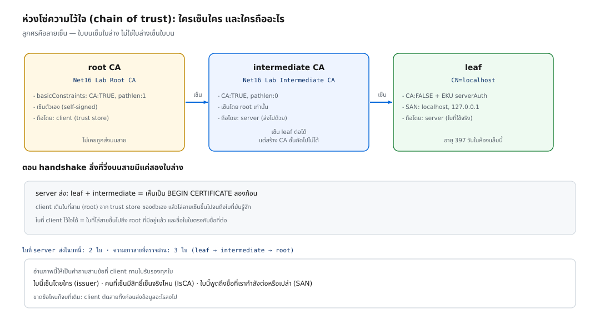
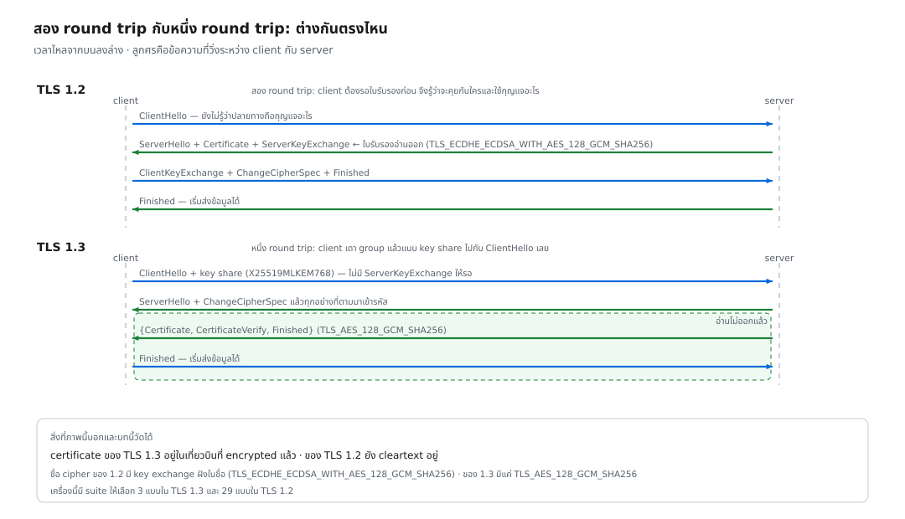

> 📅 เขียนเมื่อ: 26 พฤศจิกายน 2026 (เวลาไทย, UTC+7)
>
> **เครื่องที่รันบทนี้:** Raspberry Pi 5, Debian GNU/Linux 13 (trixie), kernel `6.18.60+rpt-rpi-2712`, aarch64 · Go `1.24.4` · OpenSSL `3.5.9` · curl `8.14.1` (OpenSSL `3.5.9`) · ภาพวาดด้วย `gen_svgs.py` แล้วตรวจความอ่านง่ายด้วย `check_svg_readability.py`
>
> ตัวเลขที่**วัดได้**ในบทมาจากไฟล์ใน `out/` ที่สร้างด้วย `bash run_all.sh` ทั้งหมด — รวมถึงค่าเวอร์ชันเครื่องมือด้านล่างนี้ ซึ่งดึงจาก `out/00_env.txt` ในรอบรันเดียวกัน
>
> 🛡️ **ขอบเขตของเดโม:** ทั้งบทวิ่งบน **loopback** (`127.0.0.1`) ของเครื่องนี้เท่านั้น ใบรับรองทุกใบสร้างเองในห้องแล็บ (`gen_certs.sh` — private CA ไม่ได้ขอจาก CA สาธารณะ) server ฟังที่พอร์ต `19443` ไม่มี traffic ออกนอกเครื่อง ไม่มีการดัก packet ของใคร และไม่มี server ปลอมบน LAN — การทดลองแบบ "ปลอมใบรับรอง" ในบทนี้ทำกับโปรเซสของเราเองเท่านั้น

```text
host: Linux 6.18.60+rpt-rpi-2712
kernel: 6.18.60+rpt-rpi-2712
arch: aarch64
os: Debian GNU/Linux 13 (trixie)
go_version: go1.24.4
system_go: go1.24.4
openssl: 3.5.9
openssl_built: Mon Nov  9 14:53:27 2026 UTC
curl_version: 8.14.1
curl_openssl: 3.5.9
iproute2: 6.15.0
gofmt_unformatted_files: 0
go_vet: ok
build_warnings: 0
```

---

## 0. สองตั๋วที่หน้าตาไม่เหมือนกัน แต่เป็นเรื่องเดียวกัน

ตั๋วใบแรกจากทีม ops: "ย้ายเว็บขึ้นเครื่องใหม่แล้ว ผู้ใช้กลุ่มหนึ่งเจอหน้าเตือนสีแดง `NET::ERR_CERT_AUTHORITY_INVALID` แต่เพื่อนที่นั่งข้าง ๆ เปิดได้ปกติ"

ตั๋วใบที่สองจากทีมความปลอดภัย: "มีคนเห็นรหัสผ่านของผู้ใช้ใน log ของ proxy ตัวกลาง ทั้งที่เว็บเป็น https"

สองใบนี้ไม่มีคำว่า TLS เขียนอยู่เลย และทั้งคู่เป็นคำถามเดียวกัน: **ตอนที่ client ต่อเข้า server มันตรวจอะไรบ้างก่อนจะยอมส่งข้อมูลลงไป** ใบแรกคือขั้นตอนตรวจไม่ผ่าน ใบที่สองคือคำถามว่า "ผ่านแล้วจริงไหม หรือผ่านเพราะไม่ได้ตรวจ"

ตอนที่แล้วเราจบที่ [HTTP/1.0 → 3](/blog/post.html?slug=2026-11-25-network-15-http-evolution) ซึ่งปิดท้ายด้วยข้อสังเกตที่ค้างคา: HTTP/1.1 ส่ง header ทุกอย่างเป็น**ข้อความล้วน** อ่านออกด้วยตา และเราเห็นมันในผลรันจริง ๆ ก่อนหน้านั้นคือ [DHCP](/blog/post.html?slug=2026-11-24-network-14-dhcp-bootstrapping) กับ [DNS](/blog/post.html?slug=2026-11-23-network-13-dns-resolution) ที่ตอบคำถาม "จะไปถึงใคร" — บทนี้ตอบคำถามที่เหลือ: **จะรู้ได้ยังไงว่าคนที่เราต่อด้วยคือคนที่เราตั้งใจต่อด้วย และจะคุยกันแบบที่คนกลางอ่านไม่ออกได้อย่างไร**

เรื่องเข้ารหัสไม่ได้เริ่มที่นี่ เราเรียน RSA, Diffie-Hellman, hash, MAC มาก่อนแล้วในซีรีส์ Software Security — ภาพใหญ่ของ crypto อยู่ที่ [ประวัติการเข้ารหัส](/blog/post.html?slug=2026-10-14-software-security-06-crypto-history) และการใช้งานจริงอยู่ที่ [crypto in practice](/blog/post.html?slug=2026-11-02-software-security-24-crypto-in-practice) บทนี้ไม่สอน RSA ใหม่ แต่จะชี้ว่า TLS เอากระดาษพวกนั้นมาประกอบเป็นขั้นตอนยังไง — และขั้นตอนที่ว่าเคยพังมาจริงใน [Heartbleed](/blog/post.html?slug=2026-10-15-software-security-07-heartbleed-2014) ซึ่งเป็นบั๊กในไลบรารีที่ทำหน้าที่นี้โดยตรง



---

## 1. TLS คือชั้นที่อยู่ระหว่าง TCP กับ HTTP

จำ encapsulation จาก [ตอนที่ 7](/blog/post.html?slug=2026-11-17-network-07-osi-tcpip-model) ได้ไหม — แต่ละชั้นห่อข้อมูลของชั้นบน TLS เป็นชั้นที่แทรกเข้ามาระหว่าง TCP กับ HTTP พอดี:

- **handshake** — ขั้นตอนเปิดประชุม: ตกลง version, ตกลงชุดอัลกอริทึม, แลกกุญแจ, และตรวจใบรับรอง
- **record layer** — ขั้นตอนส่งข้อมูลจริง: ทุกไบต์ที่ HTTP อยากส่งถูกตัดเป็นก้อน (record) แล้วเข้ารหัสพร้อม tag ตรวจความถูกต้อง

ดังนั้น `https://` ไม่ใช่โปรโตคอลใหม่ มันคือ HTTP ตัวเดิมจากตอนที่แล้วที่ถูกห่อด้วย TLS — request ที่เราพิมพ์ในตอนที่แล้วยังหน้าตาเหมือนเดิมทุกตัวอักษร ต่างกันแค่ไบต์ที่วิ่งบนสาย

| รุ่น | เอกสาร | ปี | สถานะวันนี้ (พ.ย. 2026) |
|---|---|---|---|
| SSL 3.0 | — | 1996 | ตายแล้ว ห้ามใช้ |
| TLS 1.0 | RFC 2246 | 1999 | deprecate (ประกาศเลิกใช้) โดย RFC 8996 (มี.ค. 2021) |
| TLS 1.1 | RFC 4346 | 2006 | deprecate โดย RFC 8996 เช่นกัน |
| TLS 1.2 | RFC 5246 | 2008 | ใช้ได้ แต่ RFC 9846 วางข้อกำหนดใหม่เพิ่ม |
| TLS 1.3 | RFC 8446 → **RFC 9846** | 2018 → 2026 | รุ่นที่ควรใช้ |

จุดที่ต้องอัปเดตความเข้าใจ: **TLS 1.3 ฉบับที่ใช้อ้างอิงตอนนี้คือ RFC 9846 (กรกฎาคม 2026)** ซึ่งมาแทน RFC 8446 ฉบับปี 2018 และยัง obsoletes (มาแทนที่เอกสารฉบับเดิม — ตัวโปรโตคอลยังใช้ได้ ไม่ได้ถูกห้าม) RFC 5246 (TLS 1.2) ไปด้วยพร้อมกัน — เลข RFC ในบล็อกเก่าหลายที่ยังเขียน 8446 อยู่ ซึ่งไม่ผิดในเชิงประวัติ แต่ถ้าจะอ้างอิงสเปกปัจจุบันให้ใช้ 9846

ชื่อ "SSL" ยังติดปากคนทั้งอุตสาหกรรม ทั้งที่ SSL รุ่นสุดท้าย (3.0) ตายไปตั้งแต่ปี 2014 จากช่องโหว่ POODLE[^1] — เวลามีคนพูดว่า "SSL certificate" ให้อ่านว่า "ใบรับรองสำหรับ TLS" เสมอ

---

## 2. ทำไมต้องมี: สามคำถามที่ TLS ตอบ

HTTP เปล่า ๆ ตอบไม่ได้สามข้อนี้ และทั้งสามข้อ**แยกกัน** — แก้ข้อหนึ่งไม่ทำให้อีกข้อดีขึ้น

### 2.1 Confidentiality: บนสายมีแต่อะไรที่อ่านไม่ออก

เดโมแรกง่ายที่สุด: เขียนข้อความหนึ่งบรรทัดลง connection แล้วดักดูว่า client เขียนอะไรลงสายจริง ๆ

```bash
cd code/ep16
bash gen_certs.sh
go build -o bin/net16 .
./bin/net16 -section wire   # -section เลือกเดโมที่จะรัน — wire = ดักดูไบต์ที่ client เขียนลงสาย
```

```text
--- TCP ตรง ๆ (ไม่มี TLS): อ่าน marker ได้ด้วยตา
plain_marker_hits 1
plain_record_prefix 4e4554
--- TCP + TLS 1.3: ไบต์บนสายเป็น ciphertext
tls_marker_hits 0
tls_record_prefix 160301
```

อ่านทีละบรรทัด: บน TCP ธรรมดา ตัวอักษร `NET16-MARKER` ปรากฏครบหนึ่งครั้งในไบต์ที่ออกจากเครื่อง และไบต์แรก ๆ คือ `4e 45 54` ซึ่งก็คือตัว `N` `E` `T` นั่นเอง — ตรงกับที่ตอนที่แล้วเราเห็น HTTP เป็นข้อความล้วน

พอใส่ TLS ตัว marker หายไปจากสายเลย (`tls_marker_hits 0`) และไบต์แรกกลายเป็น `16 03 01`: `0x16` คือ record ชนิด handshake และ `03 01` คือเลข version ของ record layer ที่ยังเขียนว่า "TLS 1.0" เพื่อความเข้ากันได้กับ middlebox (อุปกรณ์กลางทางอย่าง proxy/firewall) เก่า ๆ — ตัวเลขนี้ไม่ใช่ version ที่ต่อรองได้จริง RFC 8996 §4 ระบุตรง ๆ ว่า server ต้องยอมรับ record version `{03,XX}` จาก ClientHello (ข้อความแรกที่ client ส่งไปทัก) แต่ห้ามต่อรองเป็น TLS 1.0 — เป็นตัวอย่างดีของคำว่า "บนสายเขียนอย่างหนึ่ง ในสเปกหมายถึงอีกอย่างหนึ่ง"

เครื่องมือที่ทำให้เห็นภาพนี้คือ conn wrapper ไม่กี่บรรทัด: ห่อ `net.Conn` แล้วเก็บทุกไบต์ที่ client เขียน **ก่อน** ที่มันจะลงสายจริง

```go
func (s *snoopConn) Write(b []byte) (int, error) {
	s.sent.Write(b) // เก็บสำเนาไว้ดูทีหลัง (ตัวข้อมูลที่ส่งจริงไม่ถูกแก้)
	return s.Conn.Write(b)
}
```

เพราะ wrapper ตัวนี้อยู่**ใต้** TLS มันจึงเห็นเฉพาะ ciphertext (ข้อความที่เข้ารหัสแล้ว) ไม่ใช่ plaintext (ข้อความที่ถอดออกมาแล้ว) — ถ้าเราเห็น marker ในนั้นได้ แปลว่าการเข้ารหัสไม่ทำงาน

### 2.2 Integrity: แก้ไบต์เดียวกลางทางก็รู้

ข้อสองต่างจากข้อแรก: ถึงอ่านไม่ออก ผู้โจมตีที่คุมเส้นทางได้ยัง**แก้ไบต์**ได้ การเข้ารหัสเปล่า ๆ ไม่กันเรื่องนี้ — แก้ ciphertext เสี้ยวเดียว แล้ว plaintext ที่ถอดออกมาก็เพี้ยนตาม (ทั้งสองคำอธิบายไว้แล้วในหัวข้อ 2.1) TLS จึงแนบ tag (ชิ้นส่วนท้าย record ที่ใช้ตรวจว่าถูกแก้หรือไม่) ไปกับทุก record

ลองของจริง: พลิกหนึ่งบิตใน record แรกที่เป็นข้อมูล (ชนิด `0x17` = application data) แล้วอ่านต่อ

```bash
./bin/net16 -section integrity
```

```text
--- ผู้โจมตีพลิกหนึ่งบิตใน record แรกที่เป็น application data
bytes_flipped 1
read_failed 1
read_error remote error: tls: bad record MAC
```

`bad record MAC` คือข้อความที่แปลว่า "tag ไม่ตรงกับข้อมูล" — ฝั่งที่รับรู้ทันทีว่า record นี้ถูกยุ่ง และตัด connection ทิ้งก่อนที่ข้อมูลเพี้ยนจะไปถึงแอปพลิเคชัน

โค้ดที่ใช้พลิกบิตมีเงื่อนไขเดียว: แตะเฉพาะ record ที่เป็น application data และแตะครั้งเดียว

```go
func (t *tamperConn) Write(b []byte) (int, error) {
	// 5 ไบต์แรกของ record คือ header (b[0] = ชนิด record, b[1:3] = version,
	// b[3:5] = ความยาว) ดังนั้น b[6] คือไบต์ที่สองของ payload ที่เข้ารหัสแล้ว
	// — พลิกไบต์ไหนก็ได้ ขอให้อยู่ใน payload ไม่ใช่ header
	//
	// หมายเหตุ: การแก้ b ตรง ๆ คือแก้ buffer ของผู้เรียก (tls.Conn) ในเดโมนี้ตั้งใจ
	// ให้ ciphertext เพี้ยนจึงยอมรับได้ แต่ wrapper ในงานจริงต้อง copy ก่อนแก้
	if len(b) > 8 && b[0] == 0x17 && t.flips == 0 {
		b[6] ^= 0x01
		t.flips++
	}
	return t.Conn.Write(b)
}
```

การรวมการเข้ารหัสกับการตรวจความถูกต้องไว้ในขั้นตอนเดียวแบบนี้เรียกว่า **AEAD** (Authenticated Encryption with Associated Data)[^2] และ TLS 1.3 ยอมให้ใช้เฉพาะอัลกอริทึมตระกูลนี้ — CBC mode กับ RC4 ถูกถอดออกทั้งตระกูล เพราะการแยก "เข้ารหัส" กับ "ตรวจ MAC" เป็นสองขั้นคือรากของช่องโหว่หลายตัวใน TLS 1.2

### 2.3 Authenticity: ต่อติดไม่ได้แปลว่าต่อถูกคน

ข้อสามคือข้อที่คนมักข้าม และเป็นสาเหตุของตั๋วใบแรกในบทนี้ การเข้ารหัสที่แน่นหนาแค่ไหนก็ไร้ความหมายถ้าคนที่ถือกุญแจปลายทางคือคนอื่น

เดโม: รัน server สองแบบ แล้วดูว่า client พูดอะไร

```bash
./bin/net16 -section mitm
```

```text
--- server ที่ถือใบรับรองจาก CA อื่น (rogue)
rogue_dial_error x509: certificate signed by unknown authority
--- server ตัวจริง แต่ client ต่อด้วยชื่อ shop.example
hostname_dial_error x509: certificate is valid for localhost, not shop.example
```

สอง error นี้**ไม่เหมือนกัน** และแยกให้ออกมีประโยชน์มากเวลาดู log:

- ใบมาจาก CA (Certificate Authority — ผู้ออกและผู้เซ็นใบรับรอง) ที่ client ไม่รู้จัก → `certificate signed by unknown authority` (ปัญหาเรื่องสายการรับรอง)
- ใบออกโดย CA ที่ client รู้จัก แต่**ชื่อไม่ตรง** → `certificate is valid for localhost, not shop.example` (ปัญหาเรื่องชื่อ)

ฝั่ง client เขียนไม่กี่บรรทัด: ระบุ `RootCAs` ว่ามีใครบ้างที่เราไว้ใจ และ `ServerName` ว่าเราตั้งใจต่อกับใคร — บวก `MinVersion: tls.VersionTLS12` กันไม่ให้ต่อรองต่ำกว่านั้นลงไป

```go
func dialOnly(addr, serverName string) error {
	raw, err := net.Dial("tcp", addr)
	if err != nil {
		return err
	}
	defer raw.Close()
	conn := tls.Client(raw, &tls.Config{
		RootCAs:    rootPool(),
		ServerName: serverName,
		MinVersion: tls.VersionTLS12, // กันไม่ให้ต่อรองต่ำกว่า TLS 1.2 (1.0/1.1 ตายแล้ว)
	})
	err = conn.Handshake()
	// เก็บ error ตอน Close ด้วย (เช่น เขียน close_notify ไม่สำเร็จ) — alert ที่มาหลัง
	// Handshake() จะเห็นตอน Read ไม่ใช่ตอน Close; เขียนทับเฉพาะเมื่อยังไม่มี error
	if closeErr := conn.Close(); err == nil {
		err = closeErr
	}
	return err
}
```

โค้ดเก็บ error ตอนปิด connection ด้วย (`if closeErr := conn.Close(); err == nil`) เผื่อการเขียน `close_notify` ตอนปิดล้มเหลว — ส่วน alert ที่ server ส่งมาหลัง `Handshake()` นั้นจะโผล่ตอน `Read` ครั้งถัดไป ไม่ใช่ตอน `Close` (ทดสอบบน Go `1.24` แล้ว: `Close()` ไม่เคยคืน error ของ handshake) และมันเขียนทับ error เดิมเฉพาะเมื่อยังไม่มี error

`ServerName` คือชื่อที่ client จะใช้ตรวจใบรับรอง **ไม่ใช่** ชื่อที่ใช้ต่อ TCP (TCP ต่อด้วย IP อยู่แล้ว) — สองอย่างนี้แยกกัน และการแยกนี้คือเหตุผลที่ SNI[^4] ทำงานได้: client บอกชื่อที่ต้องการใน ClientHello ตั้งแต่ packet แรก server จึงเลือกใบรับรองให้ถูกใบก่อนจะมีการเข้ารหัสอะไรทั้งสิ้น

---

## 3. Certificate: ใบที่บอกว่า "ฉันคือใคร" และ "ใครรับรองฉัน"

ใบรับรอง X.509 (โครงสร้างตาม RFC 5280) คือข้อความที่เซ็นด้วยกุญแจส่วนตัวของผู้ออก เนื้อในมีแค่ไม่กี่อย่างที่ต้องอ่านให้ออก:

| ฟิลด์ | ในห้องแล็บนี้ | ใช้ทำอะไร |
|---|---|---|
| subject | `CN=localhost` | ชื่อเจ้าของใบ (ไม่ใช่ชื่อที่ใช้ตรวจ — ดูข้อถัดไป) |
| issuer | `CN=Net16 Lab Intermediate CA` | ใครเซ็นใบนี้ |
| validity | notBefore / notAfter | ช่วงเวลาที่ใบยังใช้ได้ |
| public key | EC P-256 | ใช้ตรวจลายเซ็นใน handshake (key exchange ใช้กุญแจชั่วคราวของ group แยกต่างหาก — ดูหัวข้อ 4.2) |
| subjectAltName (SAN) | `localhost`, `127.0.0.1` | **ชื่อที่ client ใช้ตรวจจริง** |
| basicConstraints | `CA:FALSE` | ใบนี้เซ็นใบอื่นต่อได้หรือไม่ |
| extendedKeyUsage | `serverAuth` | ใบนี้มีไว้ทำอะไร (รับ TLS ฝั่ง server) |

ประเด็นที่คนเข้าใจผิดบ่อยที่สุด: **CN ไม่ถูกใช้ตรวจชื่ออีกแล้ว** ตั้งแต่ RFC 9525 (พฤศจิกายน 2023) ซึ่งมาแทน RFC 6125 — ระบุว่าชื่อของ service ต้องอยู่ใน `subjectAltName` เท่านั้น และห้ามใช้ commonName ตัดสิน ใบที่ใส่ชื่อไว้ใน CN แต่ไม่มี DNS-ID ใน SAN จึงไม่มีอะไรให้ client เอาไปเทียบ

ของจริงจากใบในห้องแล็บ:

```text
--- leaf
X509v3 Basic Constraints: critical
    CA:FALSE
X509v3 Key Usage: critical
    Digital Signature
X509v3 Extended Key Usage: 
    TLS Web Server Authentication
X509v3 Subject Alternative Name: 
    DNS:localhost, IP Address:127.0.0.1
```

สังเกตว่า leaf (ใบปลายทางที่ใช้กับเว็บจริง) มี `CA:FALSE` (เซ็นใบอื่นไม่ได้) ส่วนอีกสองใบมี `CA:TRUE` พร้อม `pathlen` ต่างกัน — `pathlen:1` ที่ root แปลว่าใต้ root ลงไปมี CA ได้อีกหนึ่งชั้น, `pathlen:0` ที่ intermediate แปลว่าเซ็น leaf ได้แต่สร้าง CA ชั้นถัดไปไม่ได้ `pathlen` คือกลไกที่จำกัดความเสียหายถ้า intermediate ตัวหนึ่งถูกยึด

### 3.1 ทำไมต้องมี intermediate

คำถามที่นักศึกษาถามทุกปี: ทำไมไม่ให้ root เซ็นใบเว็บเลย จะได้สั้นกว่า

เหตุผลคือความเสี่ยง: root key เก็บใน offline HSM (ฮาร์ดแวร์เก็บกุญแจที่ดึงออกมาไม่ได้) และแทบไม่ถูกแตะ ถ้าให้ root เซ็นใบเว็บทุกวัน มันต้องออนไลน์ทุกวัน และถ้ารั่วครั้งเดียวก็จบทั้งระบบ โลกจึงแยกเป็นชั้น — **root** (offline, อายุยาว), **intermediate** (ออนไลน์, เซ็นใบเว็บ), **leaf** (ใบที่ใช้จริง, อายุสั้น)

และมีรายละเอียดที่ทำให้หลายคน debug พัง: **server ไม่ส่งใบ root** เพราะ client มีอยู่แล้ว การส่งไปก็เสียไบต์เปล่า ๆ สิ่งที่ server ส่งคือ leaf + intermediate

```bash
./bin/net16 -section chain
```

```text
--- สามใบในสาย (subject ← issuer)
leaf_subject localhost
leaf_issuer Net16 Lab Intermediate CA
leaf_is_ca 0
intermediate_subject Net16 Lab Intermediate CA
intermediate_issuer Net16 Lab Root CA
intermediate_is_ca 1
root_subject Net16 Lab Root CA
root_issuer Net16 Lab Root CA
root_is_ca 1
leaf_dns_names localhost
leaf_ip_addresses 127.0.0.1
leaf_ext_key_usage serverAuth
leaf_valid_days 397
--- ตรวจ leaf ด้วย root อย่างเดียว (ไม่มี intermediate)
verify_without_intermediate x509: certificate signed by unknown authority
--- ตรวจ leaf ด้วย root + intermediate
verify_with_intermediate ok
chain_length 3
```

บรรทัดสุดท้ายคือหัวใจ: `verify_without_intermediate` ล้มเหลวด้วยข้อความ `certificate signed by unknown authority` ทั้งที่เรา**มี root อยู่แล้ว** — เพราะ Go (และ browser ทุกตัว) ไม่ไปค้น intermediate ให้เอง (ไม่มีใครไปดึงมาจากเน็ตให้ — browser อาจมีแคชจากเว็บอื่นที่ใช้ CA เดียวกัน ดูหัวข้อ 6.1) มันไล่จากใบที่ได้รับขึ้นไปเท่านั้น ถ้าโซ่ขาดหนึ่งชั้นก็จบ

ตรวจด้วย `openssl` ได้ผลเหมือนกัน (คนละเครื่องมือ คนละ implementation):

```bash
openssl verify -CAfile certs/root.pem certs/leaf.pem
openssl verify -CAfile certs/root.pem -untrusted certs/inter.pem certs/leaf.pem
openssl verify -CAfile certs/root.pem certs/rogue.pem
```

```text
--- ตรวจ leaf ด้วย root อย่างเดียว (ไม่มี intermediate ไปด้วย)
C=TH, O=Net16 Lab, CN=localhost
error 20 at 0 depth lookup: unable to get local issuer certificate
error certs/leaf.pem: verification failed
--- ตรวจ leaf ด้วย root + intermediate
certs/leaf.pem: OK
Chain:
depth=0: C=TH, O=Net16 Lab, CN=localhost (untrusted)
depth=1: C=TH, O=Net16 Lab, CN=Net16 Lab Intermediate CA (untrusted)
depth=2: C=TH, O=Net16 Lab, CN=Net16 Lab Root CA
--- ตรวจใบปลอม (rogue) ด้วย root ของเรา
C=TH, O=Rogue Lab, CN=localhost
error 18 at 0 depth lookup: self-signed certificate
error certs/rogue.pem: verification failed
```

`error 20` คือ "หา issuer ของใบนี้ไม่เจอ" ส่วน `depth=0/1/2` ในผลรันที่ผ่านคือการไล่จากล่างขึ้นบน: ใบ leaf, intermediate, root — และหมายเหตุ `(untrusted)` ที่สองชั้นล่างคือ "ใบเหล่านี้ไม่ได้อยู่ใน trust store ของเรา[^5] เราแค่ใช้มันเป็นบันได"

กรณีที่สามคือใบปลอม (rogue) ซึ่งเซ็นตัวเอง ชื่อก็เป็น `localhost` เหมือนกัน: `openssl verify` ให้ `error 18` (self-signed certificate) ไม่ใช่ 20 เพราะมันเจอ issuer — issuer คือตัวมันเอง — แต่ไม่ใช่ issuer ที่เราไว้ใจ ความต่างระหว่าง 18 กับ 20 คือความต่างระหว่าง "โซ่ขาด" กับ "โซ่ต่อถึงคนแปลกหน้า" ซึ่งนำไปสู่การแก้ปัญหาคนละทาง

---

## 4. handshake: สอง round trip กับหนึ่ง round trip

ตอนนี้เรารู้แล้วว่า "ตรวจอะไร" คำถามถัดมาคือ "ตรวจตอนไหน" — และนี่คือจุดที่ TLS 1.3 ต่างจาก 1.2 มากที่สุด (round trip = ไป-กลับหนึ่งรอบ: ส่งไปแล้วต้องรอคำตอบก่อนไปต่อ)



คำว่า **เที่ยวบิน** (flight) ในภาพนี้คือข้อความหลายอันที่ฝ่ายหนึ่งส่งต่อกันในรอบเดียว — client ส่งไปหนึ่งเที่ยวบิน แล้วรอ server ตอบกลับมาอีกเที่ยวบิน

### 4.1 TLS 1.2: ต้องรู้ว่าคุยกับใครก่อน จึงจะส่งกุญแจได้

ใน TLS 1.2 ลำดับเป็นแบบนี้ (ย่อ):

1. client ส่ง ClientHello — บอก version, ชุดอัลกอริทึมที่รองรับ, SNI
2. server ตอบ ServerHello + **Certificate** + ServerKeyExchange (ข้อความที่ server ส่งค่ากุญแจสาธารณะชั่วคราวของมันมาให้ client คำนวณกุญแจร่วม)
3. client ตรวจใบรับรอง แล้วสร้างคู่กุญแจชั่วคราว (ephemeral) ของตัวเอง ส่งค่าสาธารณะไป (ClientKeyExchange — ค่ากุญแจสาธารณะชั่วคราวของฝั่ง client ที่ server ใช้คำนวณกุญแจร่วมเดียวกัน) — จากตรงนี้ทั้งสองฝ่ายคำนวณกุญแจลับร่วมกันด้วย ECDHE (วิธีแลกกุญแจแบบ Diffie-Hellman บนเส้นโค้ง elliptic ที่ใช้คู่กุญแจชั่วคราว) แล้ว **client** ส่ง Finished
4. server ตอบ Finished — เริ่มส่งข้อมูลได้

นับ round trip: client ต้องรอข้อ 2 ก่อนจึงจะทำข้อ 3 ได้ → **สองรอบ** และเพราะใบรับรองมาถึงก่อนที่ทั้งสองฝ่ายจะมีกุญแจร่วม มันจึงวิ่งบนสายแบบที่ใครคั่นกลางก็อ่านได้

ข้อ 3 ที่เพิ่งอ่านไปคือรูปแบบที่ใช้กันจริงในทุกวันนี้ (ECDHE) แต่ถ้าย้อนไปยุค RSA key exchange ข้อ 3 จะเป็นการ "หากุญแจลับขึ้นมาเองแล้วห่อด้วยกุญแจสาธารณะของ server" — ซึ่งแปลว่าคนที่เก็บ ciphertext ไว้และยึดกุญแจส่วนตัวของ server ได้ในภายหลัง จะถอดย้อนหลังได้ทุก session นั่นคือเหตุผลที่ TLS 1.3 ถอด RSA key exchange ออกทั้งตัว

### 4.2 TLS 1.3: เดา group แล้วแนบ key share ไปเลย

TLS 1.3 ตัดสินใจยอมแลก "ความยืดหยุ่น" กับ "ความเร็ว": จำนวน group ที่ใช้แลกกุญแจเหลือน้อยมาก client จึง**เดาล่วงหน้า**ได้ว่า server จะเลือกอะไร แล้วแนบ key share ของ group ที่น่าจะถูกไปกับ ClientHello ตั้งแต่ packet แรก (group = วิธีแลกกุญแจที่จะใช้ เช่น X25519; key share = ค่ากุญแจสาธารณะชั่วคราวของ group นั้น)

ผลคือ:

- ไม่มี ServerKeyExchange ให้รอ → **หนึ่ง round trip**
- หลัง ServerHello ทั้งสองฝ่ายมีกุญแจแล้ว ทุกอย่างที่ตามมาจึงเข้ารหัสหมด **รวมถึงใบรับรอง** (และกุญแจที่ใช้เป็นกุญแจชั่วคราวต่อ session จึงได้ forward secrecy มาด้วย[^3])

ข้อสองนี้สำคัญกว่าเรื่องความเร็ว เพราะมันปิดข้อมูลที่ผู้ดักฟังเอาไปใช้ประโยชน์ได้ (ว่าเรากำลังคุยกับเว็บไหน ใบรับรองออกโดยใคร รองรับอะไรบ้าง) ซึ่งเป็นข้อมูลที่เอาไปใช้คัดกรองและวางแผนโจมตีได้โดยไม่ต้องถอดรหัสอะไรเลย

### 4.3 ให้ curl เล่าให้ฟัง

curl พิมพ์ลำดับ handshake ออกมาให้ดูตรง ๆ เมื่อใส่ `-v` — และการเทียบสอง version คือหลักฐานที่ชัดที่สุดในบทนี้ (`--cacert` = บอก curl ให้ถือ root ในไฟล์นี้เป็นที่ไว้ใจ — ธงเดียวกันกับ `-CAfile` ของ `openssl s_client`)

```bash
curl -sv --cacert certs/root.pem https://localhost:19443/
curl -sv --tls-max 1.2 --cacert certs/root.pem https://localhost:19443/
```

```text
* ALPN: curl offers h2,http/1.1
* TLSv1.3 (OUT), TLS handshake, Client hello (1):
* TLSv1.3 (IN), TLS handshake, Server hello (2):
* TLSv1.3 (IN), TLS change cipher, Change cipher spec (1):
* TLSv1.3 (IN), TLS handshake, Encrypted Extensions (8):
* TLSv1.3 (IN), TLS handshake, Certificate (11):
* TLSv1.3 (IN), TLS handshake, CERT verify (15):
* TLSv1.3 (IN), TLS handshake, Finished (20):
* TLSv1.3 (OUT), TLS change cipher, Change cipher spec (1):
* TLSv1.3 (OUT), TLS handshake, Finished (20):
* SSL connection using TLSv1.3 / TLS_AES_128_GCM_SHA256 / X25519MLKEM768 / id-ecPublicKey
* ALPN: server accepted http/1.1
* Server certificate:
*  subject: C=TH; O=Net16 Lab; CN=localhost
*  subjectAltName: host "localhost" matched cert's "localhost"
*  issuer: C=TH; O=Net16 Lab; CN=Net16 Lab Intermediate CA
*  SSL certificate verify ok.
* Connected to localhost (127.0.0.1) port 19443
* using HTTP/1.x
* TLSv1.3 (IN), TLS handshake, Newsession Ticket (4):
< HTTP/1.1 200 OK
* Connection #0 to host localhost left intact
net16 tls lab
```

```text
* ALPN: curl offers h2,http/1.1
* TLSv1.2 (OUT), TLS handshake, Client hello (1):
* TLSv1.2 (IN), TLS handshake, Server hello (2):
* TLSv1.2 (IN), TLS handshake, Certificate (11):
* TLSv1.2 (IN), TLS handshake, Server key exchange (12):
* TLSv1.2 (IN), TLS handshake, Server finished (14):
* TLSv1.2 (OUT), TLS handshake, Client key exchange (16):
* TLSv1.2 (OUT), TLS change cipher, Change cipher spec (1):
* TLSv1.2 (OUT), TLS handshake, Finished (20):
* TLSv1.2 (IN), TLS handshake, Finished (20):
* SSL connection using TLSv1.2 / ECDHE-ECDSA-AES128-GCM-SHA256 / x25519 / id-ecPublicKey
* ALPN: server accepted http/1.1
* Server certificate:
*  subject: C=TH; O=Net16 Lab; CN=localhost
*  subjectAltName: host "localhost" matched cert's "localhost"
*  issuer: C=TH; O=Net16 Lab; CN=Net16 Lab Intermediate CA
*  SSL certificate verify ok.
* Connected to localhost (127.0.0.1) port 19443
* using HTTP/1.x
< HTTP/1.1 200 OK
* Connection #0 to host localhost left intact
net16 tls lab
```

วางสองบล็อกเทียบกันแล้วอ่านบรรทัด `TLS change cipher`:

- ใน TLS 1.3 มันอยู่**บรรทัดที่สี่** — ตามหลัง ServerHello ทันที ทุกอย่างหลังจากนั้น (Encrypted Extensions, Certificate, CERT verify, Finished) จึงอยู่ในซอง
- ใน TLS 1.2 มันอยู่**บรรทัดที่แปด** — Certificate กับ Server key exchange มาก่อนหน้านั้นแล้ว แบบอ่านออก

และสังเกตสิ่งที่ **ไม่มี** ใน TLS 1.3: ไม่มี `Server key exchange` เลย เพราะ client แนบ key share ไปกับ ClientHello ตั้งแต่แรก

```text
tls13_certificate_flight encrypted
tls12_certificate_flight cleartext
tls13_has_server_key_exchange 0
tls12_has_server_key_exchange 1
```

`tls13_certificate_flight encrypted` กับ `tls12_certificate_flight cleartext` คือข้อสรุปสองบรรทัดของทั้งหัวข้อนี้ และมันไม่ได้มาจากความจำ — มันมาจากการนับลำดับบรรทัดในผลรันของ curl

### 4.4 cipher suite (ชุดอัลกอริทึม): 1.3 แยกของที่เคยติดกันออกจากกัน

ดูจำนวนและหน้าตาของชุดอัลกอริทึมที่ OpenSSL 3.5 บนเครื่องนี้มี — สองคำสั่งแรกนับจำนวน อีกสองคำสั่งดูรายชื่อ (ทั้งหมดถูกเก็บดิบไว้ใน `out/18_ciphers.txt` พร้อมป้ายกำกับ)

```bash
openssl ciphers -v | grep -c 'TLSv1.3'
openssl ciphers -v | grep -c 'TLSv1.2'
openssl ciphers -v | grep 'TLSv1.3' | awk '{print $1}' | sort
openssl ciphers -v | grep 'TLSv1.2' | awk '{print $1}' | head -3
```

```text
tls13_cipher_suites 3
tls12_cipher_suites 29
configured_cipher_total 60
--- สามชื่อที่ TLS 1.3 มีให้เลือกในเครื่องนี้
TLS_AES_128_GCM_SHA256
TLS_AES_256_GCM_SHA384
TLS_CHACHA20_POLY1305_SHA256
--- สามตัวอย่างจาก TLS 1.2 (ชื่อมี Kx และ Au ฝังอยู่)
ECDHE-ECDSA-AES256-GCM-SHA384
ECDHE-RSA-AES256-GCM-SHA384
DHE-RSA-AES256-GCM-SHA384
```

`configured_cipher_total 60` คือทุกบรรทัดที่ `openssl ciphers -v` พิมพ์ — 60 = 3 + 29 + suite ของ SSLv3 14 ตัว + ของ TLSv1 14 ตัว ที่ยังอยู่ในลิสต์ของ OpenSSL 3.5 แต่ไม่ได้อยู่ในสองตัวเลขข้างบน

สามแบบกับยี่สิบเก้าแบบ (`tls13_cipher_suites 3` กับ `tls12_cipher_suites 29`) ต่างกันเกือบสิบเท่า — และเลข 3 ตัวแรกคือจำนวนที่ OpenSSL 3.5 บนเครื่องนี้เปิดใช้ ไม่ใช่ขนาดของสเปก (RFC 9846 §B.4 นิยาม TLS 1.3 ไว้ 5 suite; อีกสองตัวคือ TLS_AES_128_CCM_SHA256 กับ TLS_AES_128_CCM_8_SHA256)

ส่วนเหตุผลไม่ใช่ "1.3 เก่งกว่า" แต่มาจากการออกแบบ: ชื่อ suite ของ TLS 1.2 ฝังสามอย่างไว้ในชื่อเดียว (key exchange + authentication + encryption) เช่น `ECDHE-ECDSA-AES128-GCM-SHA256` ส่วน TLS 1.3 แยกสองอย่างแรกออกไปเป็น**การต่อรองแยก** เหลือ suite เป็นแค่ "algorithm เข้ารหัส + hash" เช่น `TLS_AES_128_GCM_SHA256`

ผลที่ตามมาคือชุดผสมที่ต้องรองรับลดลงจากหลายร้อยเหลือหลักสิบ — และนี่คือเหตุผลเชิงวิศวกรรมที่การต่อรองเร็วขึ้น

Go มองเห็นความต่างนี้ในชื่อตรง ๆ:

```bash
./bin/net16 -section handshake
```

```text
--- TLS 1.3 (ช่วง version = 1.3 เท่านั้น)
negotiated_version TLS 1.3
negotiated_cipher TLS_AES_128_GCM_SHA256
alpn net16/1
peer_certificates 2
verified_chains 1
did_resume 0
--- TLS 1.2 (บังคับให้ไม่เกิน 1.2)
negotiated_version TLS 1.2
negotiated_cipher TLS_ECDHE_ECDSA_WITH_AES_128_GCM_SHA256
alpn net16/1
peer_certificates 2
verified_chains 1
did_resume 0
```

`TLS_ECDHE_ECDSA_WITH_AES_128_GCM_SHA256` (1.2) มี `ECDHE` กับ `ECDSA` อยู่ข้างหน้า ส่วน `TLS_AES_128_GCM_SHA256` (1.3) ไม่มี — เทสต์ในบท (`TestCipherSuiteCarriesKeyExchangeInTLS12Only`) ตรวจเรื่องนี้และจะตกทันทีถ้าวันหนึ่ง Go เปลี่ยนชื่อ

หมายเหตุอีกข้อที่เห็นในผลรัน: `peer_certificates 2` แต่ `verified_chains 1` — สองคือจำนวนใบที่ **server ส่งมา** (leaf + intermediate) หนึ่งคือจำนวนสายที่ **ตรวจผ่าน** ซึ่งรวม root ที่ client มีอยู่แล้วเป็นใบที่สาม (ตรงกับ `chain_length 3` ในหัวข้อ 3)

### 4.5 1-RTT (RTT = round trip) ยังไม่พอสำหรับบางคน: 0-RTT และราคาของมัน

TLS 1.3 มีโหมด 0-RTT สำหรับ client ที่เคยคุยกับ server มาก่อน — ใช้ PSK จาก session ticket แล้วส่งข้อมูลไปกับ packet แรกได้เลย ไม่ต้องรอ round trip ใด ๆ — PSK (pre-shared key) คือกุญแจที่สองฝ่ายเก็บไว้จาก session ก่อนหน้า ซึ่ง server ออกมาในรูป session ticket (ตั๋วที่ client เก็บไว้ใช้ต่อ)

ราคาที่ต้องจ่ายคือ **replay**: ข้อมูลใน 0-RTT ไม่ผูกกับ handshake รอบนี้ ผู้โจมตีที่ดัก packet ไว้สามารถยิงซ้ำได้ จึงควรใช้กับคำขอที่ทำซ้ำแล้วไม่เป็นไร (GET) ไม่ใช่คำสั่งที่เปลี่ยนสถานะ

resumption (ต่อ session ใหม่โดยไม่ต้อง handshake เต็ม) ที่ปลอดภัยกว่าคือ 1-RTT ที่ใช้ PSK — วัดได้ในเดโม:

```bash
./bin/net16 -section resume
```

```text
--- ต่อสองครั้งด้วย ClientSessionCache ตัวเดียวกัน
connection_1 did_resume 0
connection_2 did_resume 1
```

connection แรกจ่าย handshake เต็ม ส่วนครั้งที่สองใช้ ticket ที่ได้มาแล้ว (`did_resume 1`) ใน Go เรื่องนี้ผูกกับ `ClientSessionCache` และต้องอ่านให้ ticket ถูกเก็บก่อนปิด connection

ส่วน 0-RTT ฝั่ง client: Go `1.24` **ยังไม่มี API สำหรับส่ง early data** — `tls.Config` ไม่มีฟิลด์ใด ๆ ที่เกี่ยวกับ 0-RTT แม้ตัว handshake จะรู้จัก message type ของมันไว้ (`typeEndOfEarlyData`, `extensionEarlyData`) เพื่อรับมือกับ peer ที่ส่งมา (นี่คือข้อจำกัดที่ต้องรู้ ไม่ใช่บั๊ก) ถ้าต้องใช้จริงต้องไปฝั่งที่รองรับ เช่น OpenSSL หรือ QUIC stack ที่ทำเอง

---

## 5. ลงมือทำ: ของจริงบน loopback

ถึงตรงนี้ทุกอย่างที่พูดมายืนยันได้ด้วยคำสั่งสองสามบรรทัด ลำดับที่ใช้:

```bash
cd code/ep16
bash gen_certs.sh          # สร้าง root → intermediate → leaf (+ ใบปลอมสำหรับเดโม)
go build -o bin/net16 .
./bin/net16 -section serve -hold 40s
```

server จะพิมพ์สองบรรทัดแรกแล้วนิ่งรอ connection (อีก 40 วินาทีมันจะปิดตัวเอง) เปิดอีกหน้าต่างแล้วต่อด้วย `openssl s_client` ซึ่งเป็นเครื่องมือที่ตอบคำถาม "การต่อครั้งนี้ตกลงอะไรกัน" ได้ครบที่สุด

```bash
openssl s_client -connect 127.0.0.1:19443 -servername localhost -CAfile certs/root.pem
```

```text
depth=2 C=TH, O=Net16 Lab, CN=Net16 Lab Root CA
verify return:1
depth=1 C=TH, O=Net16 Lab, CN=Net16 Lab Intermediate CA
verify return:1
depth=0 C=TH, O=Net16 Lab, CN=localhost
verify return:1
Peer signature type: ecdsa_secp256r1_sha256
Negotiated TLS1.3 group: X25519MLKEM768
Verification: OK
New, TLSv1.3, Cipher is TLS_AES_128_GCM_SHA256
Protocol: TLSv1.3
Server public key is 256 bit
No ALPN negotiated
Early data was not sent
Verify return code: 0 (ok)
Cipher    : TLS_AES_128_GCM_SHA256
Verify return code: 0 (ok)
Extended master secret: no
```

อ่านจากบนลงล่าง: `depth=2/1/0` คือการไล่สายที่ผ่าน, `Verification: OK` คือผลรวม, `New, TLSv1.3, Cipher is TLS_AES_128_GCM_SHA256` คือสิ่งที่ตกลงได้ และ `Verify return code: 0 (ok)` คือคำตอบสุดท้าย

บรรทัดที่ผมชอบที่สุดคือ `Negotiated TLS1.3 group: X25519MLKEM768` — group ที่ใช้แลกกุญแจในรอบนี้เป็น **hybrid**: X25519 (elliptic curve แบบเดิม) ผสมกับ ML-KEM-768 (post-quantum KEM มาตรฐาน FIPS 203) ซึ่งเป็นค่าเริ่มต้นของการแลกกุญแจใน OpenSSL 3.5 ตั้งแต่รุ่น 3.5.0 (เมษายน 2025) แนวคิดคือ "ต่อให้วันหนึ่งคอมพิวเตอร์ควอนตัมถอด X25519 ได้ ผู้โจมตีก็ยังต้องถอด ML-KEM ด้วย" — และมันทำงานได้เพราะ TLS 1.3 แยกการต่อรอง group ออกจาก cipher suite นั่นเอง

บังคับให้เป็น TLS 1.2 ดูบ้าง:

```bash
openssl s_client -connect 127.0.0.1:19443 -servername localhost -CAfile certs/root.pem -tls1_2
```

```text
depth=2 C=TH, O=Net16 Lab, CN=Net16 Lab Root CA
verify return:1
depth=1 C=TH, O=Net16 Lab, CN=Net16 Lab Intermediate CA
verify return:1
depth=0 C=TH, O=Net16 Lab, CN=localhost
verify return:1
Peer signature type: ecdsa_secp256r1_sha256
Verification: OK
New, TLSv1.2, Cipher is ECDHE-ECDSA-AES128-GCM-SHA256
Protocol: TLSv1.2
Server public key is 256 bit
No ALPN negotiated
Cipher    : ECDHE-ECDSA-AES128-GCM-SHA256
Verify return code: 0 (ok)
Extended master secret: yes
```

สังเกตสองอย่าง: ชื่อ cipher กลับมามี `ECDHE-ECDSA-` นำหน้า และมีบรรทัด `Extended master secret: yes` โผล่มา — extension ตัวนี้เป็น**การแก้บั๊กของ TLS 1.2** (ผูก master secret กับ handshake ทั้งรอบ) ที่ TLS 1.3 ไม่ต้องใช้เพราะออกแบบให้ผูกอยู่แล้ว

ถ้าไม่ส่ง `-CAfile` ไปด้วย จะเห็นอีกอาการหนึ่ง:

```bash
openssl s_client -connect 127.0.0.1:19443 -servername localhost
```

```text
depth=1 C=TH, O=Net16 Lab, CN=Net16 Lab Intermediate CA
verify error:num=20:unable to get local issuer certificate
verify return:1
depth=0 C=TH, O=Net16 Lab, CN=localhost
verify return:1
Peer signature type: ecdsa_secp256r1_sha256
Negotiated TLS1.3 group: X25519MLKEM768
Verification error: unable to get local issuer certificate
New, TLSv1.3, Cipher is TLS_AES_128_GCM_SHA256
Protocol: TLSv1.3
Server public key is 256 bit
No ALPN negotiated
Early data was not sent
Verify return code: 20 (unable to get local issuer certificate)
Cipher    : TLS_AES_128_GCM_SHA256
Verify return code: 20 (unable to get local issuer certificate)
Extended master secret: no
```

`verify error:num=20` กับ `Verify return code: 20` คือกรณีเดียวกับตั๋วใบแรกในบทนี้: ใบรับรองส่งมาครบ ต่อติดครบ แต่ client ไม่มี root ให้ไล่ถึง — ซึ่งอธิบายได้ว่าทำไม "บางคนเปิดได้ บางคนเปิดไม่ได้": เครื่องที่เคย import root ไว้แล้วผ่าน เครื่องใหม่ไม่ผ่าน

และ ALPN (Application-Layer Protocol Negotiation — ชื่อภาษา HTTP ที่ client กับ server ต่อรองกันตั้งแต่ handshake; เห็นเป็นบรรทัด `ALPN:` ในผลรันของ curl ด้านบน) ก็เห็นได้จากที่เดียวกัน:

```bash
openssl s_client -connect 127.0.0.1:19443 -servername localhost -CAfile certs/root.pem -alpn http/1.1
```

```text
depth=2 C=TH, O=Net16 Lab, CN=Net16 Lab Root CA
verify return:1
depth=1 C=TH, O=Net16 Lab, CN=Net16 Lab Intermediate CA
verify return:1
depth=0 C=TH, O=Net16 Lab, CN=localhost
verify return:1
Peer signature type: ecdsa_secp256r1_sha256
Negotiated TLS1.3 group: X25519MLKEM768
Verification: OK
New, TLSv1.3, Cipher is TLS_AES_128_GCM_SHA256
Protocol: TLSv1.3
Server public key is 256 bit
ALPN protocol: http/1.1
```

ถ้าไม่ใส่ `-alpn` จะได้ `No ALPN negotiated` (เห็นในบล็อกแรก) — และ curl ใส่ให้เองโดยอัตโนมัติ (`ALPN: curl offers h2,http/1.1`) server ของเราตอบ `http/1.1` เพราะตั้ง `NextProtos` ไว้แบบนั้น

ปิดท้ายด้วยการดูว่า server ส่งใบรับรองไปกี่ใบ:

```bash
openssl s_client -connect 127.0.0.1:19443 -servername localhost -showcerts | grep -c 'BEGIN CERTIFICATE'
```

```text
certs_sent_by_server 2
```

สองใบ — leaf กับ intermediate ไม่มี root ตรงกับที่อธิบายไว้ในหัวข้อ 3.1 (ผลรันเขียนไว้ตรง ๆ ว่า `certs_sent_by_server 2`)

สภาพ socket ตอน server ทำงาน:

```bash
ss -ltn | awk 'NR==1 || /127.0.0.1:19443/'
```

```text
State  Recv-Q Send-Q Local Address:Port  Peer Address:Port
LISTEN 0      4096       127.0.0.1:19443      0.0.0.0:*   
```

listener เดียว เป็น TCP ไม่มี UDP — ต่างจาก HTTP/3 ที่จะเห็น socket UDP เพิ่ม (ตอนที่แล้วเราเห็นว่า QUIC ต้องมี UDP จริง ๆ)

และ log ของ server ตลอดบท — สอง request ที่เข้ามา สอง version ที่ต่างกัน ทั้งที่โปรเซสเดียว:

```text
listening https://127.0.0.1:19443
ready
req path=/ proto=HTTP/1.1 tls=TLS 1.3
req path=/ proto=HTTP/1.1 tls=TLS 1.2
```

เทสต์ทั้งชุดที่รันใน `run_all.sh`:

```bash
go test -count=1 -v ./...
```

```text
=== RUN   TestChainNeedsIntermediate
--- PASS: TestChainNeedsIntermediate (T)
=== RUN   TestMarkerHiddenUnderTLS
--- PASS: TestMarkerHiddenUnderTLS (T)
=== RUN   TestCipherSuiteCarriesKeyExchangeInTLS12Only
--- PASS: TestCipherSuiteCarriesKeyExchangeInTLS12Only (T)
=== RUN   TestSessionTicketResumes
--- PASS: TestSessionTicketResumes (T)
=== RUN   TestTamperedRecordRejected
--- PASS: TestTamperedRecordRejected (T)
PASS
ok  	net16	T
```

ห้าเทสต์นี้คือข้ออ้างทั้งบทในรูปที่รันซ้ำได้: โซ่ขาดไม่ได้ตรวจผ่าน, marker หายใต้ TLS, ชื่อ cipher บอก key exchange เฉพาะ 1.2, ticket ทำให้ resume ได้, และ record ที่ถูกแก้ต้องถูกปฏิเสธ

---

## 6. กับดักที่เจอในงานจริง

### 6.1 ลืม intermediate: อาการที่ขึ้นกับว่าใครเป็นคนต่อ

`certificate signed by unknown authority` ไม่ได้แปลว่า root หายเสมอไป — กรณีที่พบบ่อยกว่าคือ **server ไม่ได้ส่ง intermediate มาด้วย** อาการจะแปลกมาก: Chrome บนเครื่อง developer เปิดได้ (เพราะมันแคช intermediate ไว้จากเว็บอื่นที่ใช้ CA เดียวกัน) แต่ `curl` ใน CI (เครื่อง build อัตโนมัติ) พังทุกครั้ง

วิธีเช็กที่เร็วที่สุดคือ `openssl s_client -showcerts` แล้วนับใบ — ถ้าได้หนึ่งใบสำหรับเว็บที่ควรมี intermediate แปลว่าตั้งค่า server ผิด (ใน nginx คือ `ssl_certificate` ต้องชี้ไฟล์ที่ต่อ leaf + intermediate เข้าด้วยกัน ไม่ใช่แค่ leaf)

### 6.2 ชื่อไม่ตรง: CN ไม่ช่วยแล้ว

`certificate is valid for localhost, not shop.example` เกิดได้ทั้งกรณี "ใบผิด" และ "ต่อผิดชื่อ" — และชอบเกิดกับกรณีที่คนไม่ค่อยนึกถึง: ต่อด้วย IP (`https://10.0.0.5`) ทั้งที่ใบมีแต่ DNS name ถ้าจำเป็นต้องต่อด้วย IP จริง ๆ ต้องใส่ `iPAddress` ใน SAN ด้วย (ใบในห้องแล็บนี้ใส่ไว้ทั้ง `localhost` และ `127.0.0.1` เพื่อให้เห็นว่าทั้งสองแบบอยู่ในฟิลด์เดียวกัน)

อีกกับดักคือ SNI ที่ถูกตัดกลางทาง: client ส่ง SNI ไปแล้ว แต่ proxy หรือ firewall บางตัว strip ทิ้ง ทำให้ server ส่งใบเริ่มต้น (default cert) กลับไป ซึ่งอาจเป็นใบของโดเมนอื่น — อาการคือ "บาง path ของ API ผ่าน บาง path ไม่ผ่าน" ทั้งที่ใช้ใบเดียวกัน

### 6.3 อายุใบรับรองสั้นลงทุกปี

ตั้งแต่ **15 มีนาคม 2026** ใบรับรอง TLS สาธารณะมีอายุได้ไม่เกิน **200 วัน** (ก่อนหน้านั้น 398 วัน) ลดลงเป็น 100 วันในปี 2027 และ 47 วันในปี 2029 ตาม CA/Browser Forum ballot SC-081v3 — ซึ่งหมายความว่า "ซื้อใบหนึ่งปี" ไม่มีอยู่จริงอีกแล้ว และงานต่ออายุที่เคยทำปีละครั้งกลายเป็นทุก 6 เดือน แล้วจะกลายเป็นทุกเดือน

ข้อยกเว้นที่ต้องรู้: เพดานนี้บังคับใช้กับใบที่ **browser ไว้ใจ** (chained ถึง root ที่อยู่ใน trust store) ใบจาก private CA อย่างในห้องแล็บนี้ไม่ติดเพดาน — ใบ leaf ของเราจึงมีอายุ `leaf_valid_days 397` ได้โดยไม่ผิดกฎอะไร (แต่ก็แลกมาด้วยการที่ client ต้อง import root เอง)

### 6.4 `InsecureSkipVerify: true` ในโค้ดที่หลุดขึ้น production

ใน Go การปิดการตรวจใบรับรองทำได้ด้วยบรรทัดเดียว (`InsecureSkipVerify: true` ใน `tls.Config`) และมันปิด**ทั้ง** การตรวจสายและการตรวจชื่อ — ซึ่งปิดข้อ 2.3 ทั้งข้อโดยที่โค้ดยังดูปกติทุกบรรทัด

วิธีที่ถูกสำหรับเทสต์คือใส่ใบรับรองของตัวเองลง `RootCAs` (แบบเดียวกับที่ `dialOnly` ในหัวข้อ 2.3 ทำ) และระบุ `ServerName` ให้ตรงกับที่ใบรับรองครอบคลุม — ได้ทั้งการตรวจสายและการตรวจชื่อในคราวเดียว

### 6.5 TLS termination: หลัง LB (load balancer) แล้วเป็น HTTP เปล่า

สถาปัตยกรรมที่พบบ่อยที่สุดในงานจริงคือ client —TLS→ load balancer —HTTP→ app server คำถามที่ต้องตอบให้ได้คือ "ความลับวิ่งตั้งแต่ตรงไหนถึงตรงไหน" ถ้า app server อยู่คนละเครื่องในดาต้าเซ็นเตอร์เดียวกัน การที่ช่วงหลังเป็น HTTP เปล่าอาจยอมรับได้ แต่ต้องรู้ตัว และต้องไม่ log body ที่มีข้อมูลอ่อนไหว (ซึ่งเป็นที่มาของตั๋วใบที่สองในบทนี้)

อาการที่ตามมาคือ header พวก `X-Forwarded-Proto` กลายเป็นแหล่งความจริงเดียวว่า request มาจาก https หรือไม่ — และถ้า app เชื่อ header นี้โดยไม่จำกัดว่าใครส่งได้ คนที่ยิงตรงเข้า app server จะปลอมได้

### 6.6 0-RTT ที่ replay ได้

ถ้าเปิด 0-RTT เพื่อลด latency ต้องแยกให้ออกว่าอะไรวิ่งใน early data ได้ คำขอ `GET` ที่ไม่มีผลข้างเคียง ok; `POST` ที่สร้างคำสั่งซื้อไม่ ok — และต้องมีมาตรการกัน replay ฝั่ง server ด้วย (เช่น single-use token) ไม่ใช่หวังว่า TLS จะจัดการให้

### 6.7 เวลาเครื่องเพี้ยน

ใบรับรองมี `notBefore`/`notAfter` และการตรวจใช้เวลาของเครื่อง client ถ้าเครื่อง client เพี้ยนไปหนึ่งปีจะได้ error `certificate has expired or is not yet valid` ทั้งที่ใบยังดี — บน container ที่ไม่ได้ sync เวลานี่เจอได้จริง และ debug ยากเพราะข้อความดูเหมือนปัญหาใบรับรอง

---

## 7. โจทย์

### 7.1 Drill — แปดข้อที่ตอบได้จากผลรันในบทนี้

ทุกข้อมีคำตอบใน `out/` ที่รันได้จริง

1. ใน `out/10_wire.txt` ไบต์ `4e 45 54` คืออะไร และทำไมในเดโม TLS ไม่เห็นตัวอักษรเดียวกันนี้เลย
2. `tls_record_prefix 160301` — เลข `03 01` ใน record header หมายถึงอะไร และทำไมไม่ขัดกับ RFC 8996 ที่ห้ามใช้ TLS 1.0
3. ใบ leaf ของเรามี `CA:FALSE` แต่ใบ intermediate มี `CA:TRUE, pathlen:0` — ถ้า intermediate ถูกยึด ผู้โจมตีสร้าง CA ชั้นที่สามได้ไหม
4. `openssl verify` ให้ `error 20` กับ leaf และ `error 18` กับ rogue — สองอันต่างกันตรงไหน และแก้ปัญหาต่างกันอย่างไร
5. ทำไม `peer_certificates` เป็น `2` แต่ `chain_length` เป็น `3`
6. ในผลรันของ curl, TLS 1.3 ไม่มีบรรทัด `Server key exchange` เลยเพราะอะไร และมันเกี่ยวกับจำนวน round trip อย่างไร
7. TLS 1.3 มี cipher suite ให้เลือก `3` แบบ (RFC นิยาม 5; OpenSSL เปิด 3) แต่ TLS 1.2 มี `29` — อะไรที่ 1.3 ย้ายออกไปจากการต่อรองชุดเดียว
8. ทำไม ClientHello ของ TLS 1.3 ถึงแนบ key share ไปได้ทั้งที่ยังไม่รู้ว่า server จะเลือก group ไหน

### 7.2 Mini-project — `certwatch`: ใบรับรองนี้เหลืออีกกี่วัน และใครเซ็น

เป้าหมาย: เครื่องมือบรรทัดคำสั่งที่ตอบคำถามของทีม ops ก่อนที่หน้าเตือนสีแดงจะโผล่

ข้อกำหนดขั้นต่ำ:

1. รับ `-addr host:port` และ `-servername name` แล้วต่อ TLS เองด้วย `crypto/tls` (ไม่ใช้ `http.Get` เพราะเราอยากเห็น handshake ดิบ)
2. รายงาน: version ที่ต่อรองได้, cipher suite, และใบรับรองที่ server ส่งมา — ถ้าอยากได้ชื่อ group ที่ใช้แลกกุญแจต้อง parse ClientHello เอง เพราะ `tls.ConnectionState` ไม่มีฟิลด์นี้ใน Go `1.24` (บันทึกข้อจำกัดนี้ไว้ใน README ของโปรเจกต์)
3. รายงานจำนวนวันถึง `NotAfter` และเตือนเมื่อต่ำกว่าเกณฑ์ที่กำหนด (เช่น 30 วัน) — เกณฑ์ต้องเป็น flag ไม่ใช่ค่าคงที่ในโค้ด
4. ตรวจว่าใบครอบคลุมชื่อที่ต่อจริง โดยใช้ `leaf.VerifyHostname(name)` และรายงานผลแยกจากการตรวจสาย
5. รายงานความยาวสายที่ตรวจผ่าน (`len(state.VerifiedChains[0])`) และจำนวนใบที่ server ส่งมา (`len(state.PeerCertificates)`) — ถ้าจำนวนที่ส่งมาน้อยกว่าความยาวสายลบหนึ่ง ให้เตือนว่าอาจขาด intermediate (และบอกว่าบาง client จะหามาเองไม่ได้)
6. เขียนเทสต์ที่รันกับ server ในบทนี้ (ต้องได้ `TLS 1.3`, สองใบ, สามชั้น) และกับ rogue server (ต้องได้ error ที่ระบุว่า unknown authority)

เกณฑ์ผ่าน: รันกับ server ในบทแล้วรายงานครบทั้งหกข้อ โดยตัวเลขที่รายงานตรงกับ `out/11_handshake.txt`, `out/14_chain.txt` และ `out/24_certs_sent.txt` — ถ้าไม่ตรง แปลว่าเครื่องมืออ่านค่าผิด ไม่ใช่ผลรันผิด

---

## สรุป

- **TLS = handshake + record layer** วางระหว่าง TCP กับ HTTP; `https://` คือ HTTP ตัวเดิมที่ถูกห่อ — สเปก TLS 1.3 ปัจจุบันคือ **RFC 9846 (2026)** แทน RFC 8446 (2018)
- **สามคำถามแยกกัน**: confidentiality (marker หายไปจากสาย), integrity (`bad record MAC` เมื่อพลิกหนึ่งบิต), authenticity (`unknown authority` / ชื่อไม่ตรง) — แก้ข้อหนึ่งไม่ช่วยอีกข้อ
- **ใบรับรองคือข้อความที่เซ็นแล้ว** และสิ่งที่ client ตรวจคือ (1) ไล่สายถึง root ที่ตัวเองมี (2) `IsCA` ของแต่ละชั้น (3) ชื่อใน `subjectAltName` ตาม RFC 9525 — ไม่ใช่ CN
- **server ส่งสองใบ ไม่ส่ง root** และ Go/OpenSSL ไม่ไปค้น intermediate ให้เอง: ขาดหนึ่งชั้นได้ `error 20` ทันที
- **TLS 1.3 จบในหนึ่ง round trip** เพราะ client แนบ key share ไปกับ ClientHello และทำให้ certificate อยู่ในเที่ยวบินที่เข้ารหัสแล้ว — วัดได้จากลำดับบรรทัดของ curl ไม่ใช่จากความเชื่อ
- **cipher suite ของ 1.3 ไม่มี key exchange ในชื่อ** (3 แบบที่ OpenSSL เปิด — RFC นิยาม 5 — เทียบกับ 29 แบบของ 1.2) เพราะแยกการต่อรอง group ออกมา — และนั่นคือช่องที่ทำให้ hybrid อย่าง `X25519MLKEM768` ถูกใส่เข้ามาได้ในภายหลังโดยไม่ต้องแก้สเปกหลัก

จาก DNS (ชื่อคืออะไร) → TCP (คุยกันได้) → HTTP (คุยด้วยภาษาอะไร) → TLS (คุยกับคนที่ใช่ แบบที่คนอื่นอ่านไม่ออก) ตอนนี้เรามีครบทั้งสี่ชั้นที่ทำให้ "เปิดเว็บหนึ่งหน้า" ทำงานได้จริง สิ่งที่เหลือของเส้นทางนี้คือการพาคำขอเหล่านั้นไปหา server ที่อยู่คนละเครือข่าย — routing ซึ่งเริ่มจากสิ่งที่ง่ายที่สุด: ตารางเส้นทางในเครื่องเราเอง

← ตอนก่อน: [HTTP สี่รุ่นในสามสิบปี: 1.0 → 1.1 → 2 → 3](/blog/post.html?slug=2026-11-25-network-15-http-evolution)

ตอนถัดไป → [Routing พื้นฐาน: routing table, default gateway และ ICMP](/blog/post.html?slug=2026-11-27-network-17-routing-basics-icmp)

---

## เชิงอรรถ

[^1]: **SSL กับ TLS** — SSL (Secure Sockets Layer) เป็นชื่อเดิมที่ Netscape ตั้งไว้ ตั้งแต่รุ่น 3.0 (1996) ก็ถูกยกให้ IETF ดูแลและเปลี่ยนชื่อเป็น TLS (Transport Layer Security) โดยรุ่น 1.0 แทบจะเหมือน SSL 3.0 ทุกอย่าง คำว่า "SSL" ที่ยังเห็นในชื่อฟังก์ชัน (`ssl_certificate` ของ nginx, `OpenSSL`) จึงเป็นชื่อที่ค้างมาจากสมัยนั้น ไม่ได้หมายความว่ายังใช้ SSL อยู่

[^2]: **AEAD (Authenticated Encryption with Associated Data)** — อัลกอริทึมที่เข้ารหัสและตรวจความถูกต้องในขั้นตอนเดียว เช่น AES-GCM และ ChaCha20-Poly1305 ผลลัพธ์คือ ciphertext + tag ถ้าไบต์ใดถูกแก้ tag จะไม่ตรงและถอดไม่ได้ ต่างจากยุคก่อนที่ต้อง "เข้ารหัสแล้วค่อยคำนวณ MAC" ซึ่งถ้าลำดับขั้นผิดก็มีช่องโหว่ (padding oracle, MAC-then-encrypt) — TLS 1.3 เลือกใช้แต่ AEAD

[^3]: **Forward secrecy** — คุณสมบัติที่ทำให้กุญแจของ session เก่าถอดไม่ได้แม้กุญแจส่วนตัวระยะยาวของ server จะรั่วในภายหลัง เกิดจากการใช้กุญแจชั่วคราว (ephemeral) ต่อ session แล้วทิ้งไป — TLS 1.3 บังคับเมื่อใช้ (EC)DHE ซึ่งเป็นโหมดที่ใช้จริงทั้งหมด (PSK-only resumption ไม่มี forward secrecy) เพราะถอด RSA key exchange (ซึ่งกุญแจ session ถูกส่งมาห่อด้วยกุญแจระยะยาว) ออกทั้งตัว

[^4]: **SNI (Server Name Indication, RFC 6066)** — ส่วนขยายของ ClientHello ที่ให้ client บอกชื่อเว็บที่ต้องการตั้งแต่ packet แรก เพราะ server ที่มีหลายโดเมนบน IP เดียวต้องรู้ว่าจะส่งใบรับรองใบไหนก่อนจะมีการเข้ารหัส ข้อเสียเชิงความเป็นส่วนตัวคือชื่อนี้วิ่งแบบอ่านออก (จึงมี ECH มาแก้ในภายหลัง)

[^5]: **trust store** — รายการ root CA ที่ระบบปฏิบัติการหรือ browser ติดตั้งมาให้และถือว่า "ไว้ใจได้" โดยปริยาย การที่ใบรับรองหนึ่ง "ใช้ได้" บนเครื่องหนึ่งแต่ "ใช้ไม่ได้" บนอีกเครื่อง มักมาจาก trust store ต่างกัน ไม่ใช่ใบรับรองเสีย
