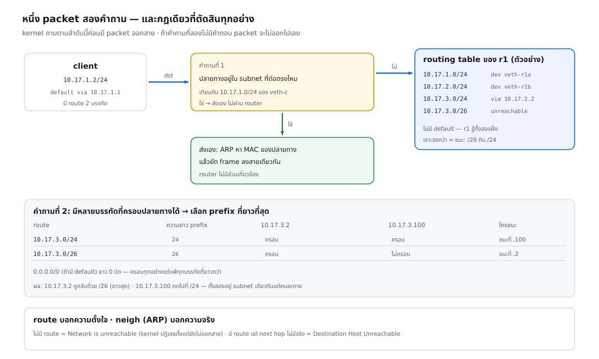
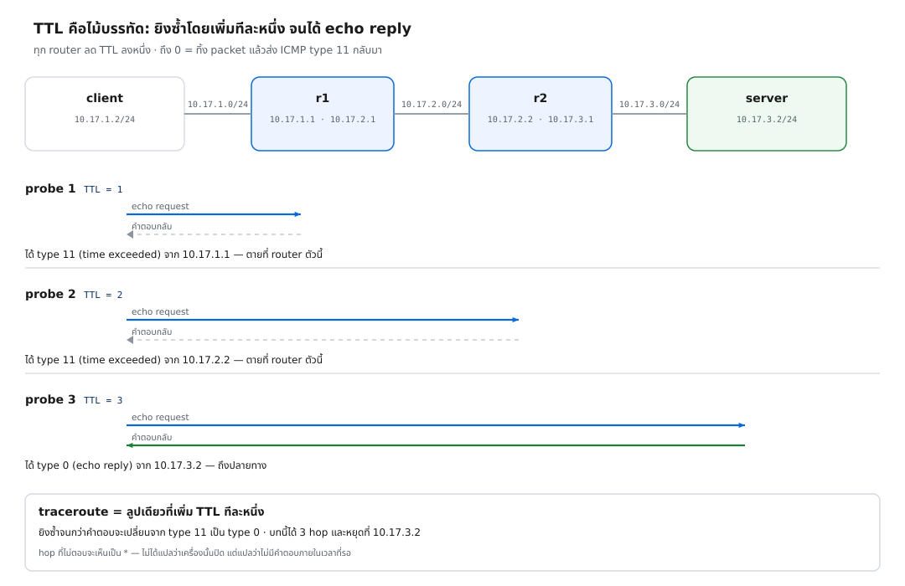

> 📅 เขียนเมื่อ: 27 พฤศจิกายน 2026 (เวลาไทย, UTC+7)
>
> **เครื่องที่รันบทนี้:** Raspberry Pi 5, Debian GNU/Linux 13 (trixie), kernel `6.18.60+rpt-rpi-2712`, aarch64 · Go `1.24.4` · iproute2 `6.15.0` · iputils `20240905` (คอลัมน์เวอร์ชันด้านล่างดึงจาก `out/00_env.txt` ในรอบรันเดียวกัน)
>
> ตัวเลขที่**วัดได้**ในบทมาจากไฟล์ใน `out/` ที่สร้างด้วย `bash run_all.sh` ทั้งหมด — แล็บทั้งห้องสร้างใหม่ได้ด้วย `lab.sh` (network namespace) และถูกรื้อทิ้งเมื่อจบสคริปต์
>
> 🛡️ **ขอบเขตของเดโม:** routing table ที่เราแก้ในบทนี้อยู่ใน **network namespace ของเราเอง** (`ep17-client`, `ep17-r1`, `ep17-r2`, `ep17-server`) ซึ่งแยกจากตารางของเครื่องจริง — ไม่มี traffic ออกนอกเครื่อง ไม่มีการสแกนหรือดัก packet ของใคร ส่วน `traceroute` ที่เราเขียนขึ้นยิงไปยังปลายทางในแล็บของตัวเองเท่านั้น · การอ่าน routing table ของเครื่องจริงเป็นการอ่านอย่างเดียว ไม่ได้แก้

```text
host: Linux 6.18.60+rpt-rpi-2712
kernel: 6.18.60+rpt-rpi-2712
arch: aarch64
os: Debian GNU/Linux 13 (trixie)
go_version: go1.24.4
system_go: go1.24.4
iproute2: 6.15.0
iputils: 20240905
sysctl_ping_group_range: 0	2147483647
gofmt_unformatted_files: 0
go_vet: ok
build_warnings: 0
```

---

## 0. ตั๋วสองใบที่ไม่มีคำว่า routing เขียนอยู่เลย

*ticket (ตั๋ว) = ใบแจ้งปัญหาที่คนเปิดเข้ามา — สองใบนี้ไม่มีคำว่า routing เขียนอยู่สักคำ*

ตั๋วใบแรกจากทีม support: "ลูกค้าเปิดเว็บภายนอกได้ทุกเว็บ แต่เข้าเครื่อง `10.20.0.5` ในดาต้าเซ็นเตอร์อีกที่ไม่ได้ — ping gateway ของตัวเองก็ผ่าน"

ตั๋วใบที่สองจากทีม network: "เมื่อวานมีคนเพิ่ม static route ไป `10.17.3.0/24` ตามเอกสารของ firewall ตัวใหม่ หลังจากนั้น ping ไป `10.17.3.2` ไม่ผ่าน แต่ ping ไป `10.17.3.100` ผ่านปกติ"

สองใบนี้คนละทีม คนละเครื่อง คนละวัน แต่เป็นคำถามเดียวกัน: **เครื่องตัดสินใจยังไงว่าจะเอาสิ่งที่อยากส่งไปวางไว้ที่ไหน** ใบแรกคือ "ไม่รู้จะไปทางไหน จึงไม่ส่งอะไรเลย" ใบที่สองคือ "รู้จะไปทางไหน แต่ทางที่เลือกเป็นทางตัน" — และทั้งสองกรณี**ไม่เกี่ยวกับ firewall หรือ bandwidth ที่คนมักโทษก่อน**

เราเรียน IP address กับ CIDR มาแล้วใน [ตอนที่ 9](/blog/post.html?slug=2026-11-19-network-09-ip-address-cidr) และ [ตอนที่ 10](/blog/post.html?slug=2026-11-20-network-10-subnetting-hands-on) เรียน ARP ใน [ตอนที่ 8](/blog/post.html?slug=2026-11-18-network-08-ethernet-mac-arp) และเรียน TCP/UDP กับ DNS ไปแล้วในตอนที่ 11–13 ทุกตอนเหล่านั้นมีประโยคที่เราพูดผ่าน ๆ อยู่ประโยคหนึ่ง: "แล้ว packet ก็ถูกส่งไป" บทนี้คือตอนที่เราเปิดประโยคนั้นออกมาดู — **ระหว่าง "อยากส่ง" กับ "ออกสาย" มีตารางหนึ่งตารางที่ตัดสินทุกอย่าง** และมันชื่อ routing table



---

## 1. สองคำถามที่ kernel ถามก่อนมี packet ออกสาย

ตอนที่เราสั่ง `curl https://example.com` สิ่งที่เกิดขึ้นกับปลายทางหนึ่งรายการไม่ได้เริ่มที่ "จะออกการ์ดใบไหน" แต่เริ่มที่คำถามสองข้อนี้ตามลำดับ:

**คำถามที่หนึ่ง: ปลายทางอยู่ใน subnet ที่ต่อตรงกับเราไหม** — ถ้าใช่ ก็ไม่มีใครต้องช่วย เราเดินไปส่งเองถึงที่: kernel เอา prefix ของ interface แต่ละใบมาคิด (นี่คือเหตุผลที่ตอนที่ 10 สอน subnet mask ละเอียด) ถ้าปลายทางอยู่ใน subnet เดียวกัน มันจะหา MAC address ของปลายทางด้วย ARP แล้วยัด frame ลงสายตรง ๆ — router ไม่เกี่ยวเลย

**คำถามที่สอง: ถ้าไม่ใช่ แล้วใครรับฝาก** — เราฝาก packet ให้ router หนึ่งตัว ซึ่งเรียกว่า **next hop** (ก้าวถัดไป) หรือถ้าเป็นตัวที่รับฝากทุกอย่างที่ไม่รู้จัก ก็เรียกว่า **default gateway** เครื่องเราไม่ต้องรู้ว่าปลายทางอยู่ไหนในโลก — รู้แค่ว่า "ส่งให้ใครต่อ" ก็พอ

ทั้งสองคำถามตอบจากที่เดียว: **routing table** ซึ่งเป็นรายการของ "ปลายทางช่วงไหน ไปทางไหน" ที่ kernel ถือไว้ในหน่วยความจำ ถ้าตารางไม่มีคำตอบสำหรับปลายทางนั้นเลย kernel จะไม่ส่งอะไรออกไปทั้งสิ้น และจะรายงาน error กลับมาที่โปรเซสว่าไม่มีทางไป — ไม่ใช่ "timeout" ไม่ใช่ "ช้า" แต่คือ "ฉันไม่รู้จะไปทางไหน ตั้งแต่ยังไม่เริ่ม"

ตรงนี้คือจุดที่คนมักสับสนที่สุดในงานจริง: อาการ "ไปไม่ถึง" มีสองตระกูลที่หน้าตาคล้ายกันแต่สาเหตุตรงข้ามกัน

| สิ่งที่ kernel พูด | ความหมาย | ไปถึงไหนแล้ว |
|---|---|---|
| `Network is unreachable` | routing table ไม่มีคำตอบ | ยังไม่ออกจากเครื่อง |
| `No route to host` | มี route ชนิด `unreachable` ที่ตั้งใจสั่งปฏิเสธ (kernel มีคำตอบว่า "ห้ามไป" ไม่ใช่ "ไม่มีทาง") | ยังไม่ออกจากเครื่อง |
| `Destination Host Unreachable` | มี route แต่คนที่ควรรับต่อไม่ตอบ ARP (ถ้าปลายทางอยู่ subnet เดียวกันและไม่ตอบ ARP คนที่เอ่ย error คือเครื่องเราเอง) หรือมี route ชนิด `unreachable` ที่ router ตอบกลับมา | ออกไปถึง router แล้ว (หรือแค่บนสายเดียวกัน) |
| `Request timeout` (ping ไม่ตอบ) | ส่งออกไปแล้ว ไม่มีใครตอบกลับ | ขึ้นกับว่าใครทิ้ง |

ตารางนี้จะกลับมาใช้อีกหลายรอบในบทนี้ เพราะมันแยก "ปัญหา routing" ออกจาก "ปัญหา host" ได้ในบรรทัดเดียว

### 1.1 ทำไมเรื่องนี้คือหัวใจของ internet

คำว่า internet มาจากคำว่า "network of networks" และคำนี้ไม่ได้เป็นการเปรียบเปรย — มันคือคำอธิบายสถาปัตยกรรม

- แต่ละบ้าน องค์กร หรือดาต้าเซ็นเตอร์ เป็น network ของตัวเอง ที่รู้รายละเอียดแค่ภายในของตัวเอง บวกกับ "ทางออก" หนึ่งทาง
- router คือเครื่องที่ต่อ network เหล่านั้นเข้าด้วยกัน และมันก็ไม่ได้รู้แผนที่ทั้งโลก — มันรู้แค่ "ช่วง address นี้ ฝากให้ใครต่อ"
- ด้วยเหตุนี้ **ไม่มีเครื่องไหนในโลกที่รู้เส้นทางทั้งหมด** และไม่จำเป็นต้องรู้ — แต่ละก้าวรู้แค่ก้าวถัดไป ก็พอ
- ถ้าไม่มี routing table เลย เครื่องจะคุยได้แค่กับคนใน LAN ของตัวเอง (และนั่นคือสิ่งที่เกิดขึ้นจริงตอนเราถอด default route ออกในหัวข้อ 4)

ทุกครั้งที่เราเปิดเว็บหนึ่งหน้า packet ต้องข้าม router หลายตัว — ในแล็บของบทนี้สองตัว ในโลกจริงมักสิบกว่าตัว และการที่มันทำงานได้ทั้งที่ไม่มีใครถือแผนที่ทั้งโลก คือสิ่งที่บทนี้กำลังอธิบาย

บทนี้เป็นตอนแรกของ**ระยะที่ 3** ของซีรีส์ (Routing + Network engineering) — เราจะไล่จากระดับที่เล็กที่สุด (ตารางในเครื่องเดียว) ขึ้นไปถึงระดับที่ router หลายสิบตัวคุยกันเองในตอนถัด ๆ ไป

---

## 2. อ่าน routing table ให้เป็น

ก่อนอื่นปูผัง: `client 10.17.1.2` — `r1` — `r2` — `server 10.17.3.2` โดย `r1` กับ `r2` เป็น router คั่นกลาง (ผังเต็มพร้อม address ทุกขาของทั้งสี่เครื่องอยู่ในหัวข้อ 7)

เริ่มจากของจริงที่เล็กที่สุด: เครื่องปลายทางในแล็บของเรา (`client`) มีตารางแค่สองบรรทัด

```text
--- client: ip route show table main
default via 10.17.1.1 dev veth-c 
10.17.1.0/24 dev veth-c proto kernel scope link src 10.17.1.2 
```

อ่านทีละฟิลด์:

- `default` คือ `0.0.0.0/0` — prefix ที่สั้นที่สุดเท่าที่เป็นไปได้ (ยาว 0 บิต) แปลว่า "ทุกปลายทางที่ไม่มีใครจับก่อน"
- `via 10.17.1.1` คือ next hop — ไม่ใช่ปลายทางสุดท้าย แต่เป็นคนที่เราฝากของไปให้
- `dev veth-c` คือ interface ที่ packet จะออก — `veth` (virtual ethernet) คือสายเสมือนเส้นเดียวที่มีปลายสองข้าง คนละชื่อ: ฝั่ง `client` เห็นปลายของตัวเองชื่อ `veth-c` ส่วนปลายอีกข้างที่ไปโผล่ใน `r1` ชื่อ `veth-r1a` (สายเส้นเดียวกัน — เดินจากปลายไหนก็ถึงอีกปลายหนึ่ง)
- `proto kernel` แปลว่าบรรทัดนี้ kernel สร้างเองตอนเราสั่ง `ip addr add` — ไม่มีใครพิมพ์เข้ามา (ตรงข้ามกับบรรทัดที่เราพิมพ์เองซึ่งจะไม่มี `proto kernel`)
- `scope link` แปลว่าปลายทางของ route นี้อยู่ "บนสายเดียวกัน" (เข้าถึงได้ด้วย ARP ไม่ต้องผ่าน router)[^6]
- `src 10.17.1.2` คือ source address ที่ kernel จะเลือกใส่ให้ packet ที่ออกทางนี้

ส่วน router `r1` ซึ่งอยู่ตรงกลาง มีสามบรรทัด — สองบรรทัดแรก kernel สร้างให้เพราะมันมี address อยู่ในสอง subnet และบรรทัดที่สามเป็น static route ที่คนตั้งใจใส่เข้าไป:

```text
--- r1: ip route show table main
10.17.1.0/24 dev veth-r1a proto kernel scope link src 10.17.1.1 
10.17.2.0/24 dev veth-r1b proto kernel scope link src 10.17.2.1 
10.17.3.0/24 via 10.17.2.2 dev veth-r1b 
```

บรรทัด `10.17.3.0/24 via 10.17.2.2` ไม่มี `proto kernel` และไม่มี `src` — นี่คือลายเซ็นของ route ที่ "คนเขียน" ไม่ใช่ "เครื่องรู้เอง" ในงานจริง บรรทัดแบบนี้คือสิ่งที่ทีม network พิมพ์ใส่ตอนตีสอง แล้วตื่นมาเจอตั๋วตอนแปดโมง (และ `10.17.2.2` ในบรรทัดนี้คือ address ของ `r2` ฝั่งที่ติดกับ `r1`)

### 2.1 ตารางที่ `ip route` ไม่โชว์: `table local`

สั่ง `ip route` เปล่า ๆ เราจะเห็นแค่ตารางชื่อ `main` แต่ kernel เก็บคำตอบที่จำเป็นกว่าอีกตารางไว้ต่างหาก

```text
--- client: ip route show table local
local 10.17.1.2 dev veth-c proto kernel scope host src 10.17.1.2 
broadcast 10.17.1.255 dev veth-c proto kernel scope link src 10.17.1.2 
local 127.0.0.0/8 dev lo proto kernel scope host src 127.0.0.1 
local 127.0.0.1 dev lo proto kernel scope host src 127.0.0.1 
broadcast 127.255.255.255 dev lo proto kernel scope link src 127.0.0.1 
```

สองบรรทัดแรกบอกว่า "ถ้าปลายทางคือ address ของฉันเอง (`10.17.1.2`) หรือ broadcast ของ subnet ฉัน (`10.17.1.255`) อย่าส่งออกสาย — มันคือฉัน" สามบรรทัดที่เหลือเป็นของ loopback ซึ่ง kernel ใส่ให้เองทุกเครื่อง · การมีตารางนี้แยกไว้ทำให้คำถาม "ส่งถึงตัวเอง" ไม่ต้องไปปนกับ "ส่งออกนอก" · และเพราะ `ip rule` กำหนดให้ตาราง `local` มี priority `0` ส่วนตาราง `main` มี priority `32766` (เลขน้อยกว่าถูกดูก่อน) ตาราง `local` จึงถูกถามก่อนเสมอ · (`ip rule` คือกฎที่บอกว่าให้ดูตารางไหนก่อน — ยังไม่ต้องลงลึกตอนนี้)

ถ้าอยากรู้ว่า kernel จะตัดสินยังไงกับปลายทางใดปลายทางหนึ่งจริง ๆ มีคำสั่งที่ตอบตรง ๆ:

```text
--- client: ip route get 10.17.3.2
10.17.3.2 via 10.17.1.1 dev veth-c src 10.17.1.2 uid 0 
    cache 
--- client: ip route get 10.17.1.1
10.17.1.1 dev veth-c src 10.17.1.2 uid 0 
    cache 
--- client: ip route get 10.17.1.2
local 10.17.1.2 dev lo src 10.17.1.2 uid 0 
    cache <local> 
--- client: ip route get 10.17.1.255
broadcast 10.17.1.255 dev veth-c src 10.17.1.2 uid 0 
    cache <local,brd> 
```

`ip route get` ไม่ได้บอกว่า "ตารางเขียนอะไร" แต่บอกว่า **"ถ้าตอนนี้มี packet ไปปลายทางนี้ kernel จะทำอะไร"** ซึ่งเป็นคำถามที่เราถามได้ทั้งก่อนและหลังแก้อะไรก็ตาม — และเป็นเครื่องมือที่เราใช้ทั้งบทนี้ในการพิสูจน์ว่าโค้ดของเราเข้าใจกฎเดียวกับ kernel

สังเกตบรรทัดที่สอง: `10.17.1.1 dev veth-c src 10.17.1.2` ไม่มี `via` เลย เพราะ `10.17.1.1` อยู่ใน subnet ที่ต่อตรง — ส่งถึงได้เองด้วย ARP · บรรทัดที่สามกับสี่มาจากตาราง `local` ที่เพิ่งดูไป (`dev lo`) ทั้งที่ในตาราง `main` ไม่มีบรรทัดไหนพูดถึง `10.17.1.2` เลย

---

## 3. longest prefix match: กฎเดียวที่ตัดสินทุกอย่าง

ถ้าตารางมีหลายบรรทัดที่ "ครอบ" ปลายทางเดียวกันได้ kernel เลือก**prefix ที่ยาวที่สุด** หรือพูดอีกแบบคือ "คำตอบที่เจาะจงที่สุด" ไม่ใช่ "บรรทัดล่าสุด" ไม่ใช่ "บรรทัดแรก" และไม่ใช่ "บรรทัดที่ metric ดีที่สุด" (metric คือตัวเลข "ความน่าเลือก" ยิ่งต่ำยิ่งถูกเลือก — แต่ใช้ตัดสินเฉพาะเมื่อ prefix ยาวเท่ากัน)

ลองเขียนกฎนี้เป็นโค้ดสั้น ๆ — ทั้งหมดของ longest prefix match อยู่ในสิบกว่าบรรทัดนี้:

```go
func matchTable(rs []route, dst net.IP) (route, bool) {
	var best route
	found := false
	for _, r := range rs {
		if !r.dst.Contains(dst) {
			continue
		}
		// prefix ยาวเท่ากัน → metric ต่ำกว่าชนะ (route ที่ไม่ระบุ metric = 0)
		if !found || r.bits() > best.bits() ||
			(r.bits() == best.bits() && r.metric < best.metric) {
			best, found = r, true
		}
	}
	return best, found
}
```

`r.dst.Contains(dst)` ถามว่า prefix นี้ครอบปลายทางไหม `r.bits()` คือความยาว prefix (เช่น `/24` = 24) แล้วเราเก็บตัวที่ยาวที่สุดไว้ ถ้ายาวเท่ากันค่อยดู metric ที่ต่ำกว่า นั่นคือทั้งหมด — ไม่มีอะไรมากกว่านี้

ส่วนที่เหลือคือการแปลงบรรทัดข้อความของ `ip route` ให้เป็น struct ที่เอาไปคิดได้:

```go
func parseRouteLine(table, line string) (route, error) {
	f := strings.Fields(line)
	if len(f) == 0 {
		return route{}, errors.New("บรรทัดว่าง")
	}
	// route ที่ไม่ได้ระบุ metric ถือว่า metric 0 — ค่าที่ kernel ใช้จริง
	// (ไม่ใช่ "แย่กว่าใคร" จึงต้องเทียบด้วยตัวเลขตรง ๆ ไม่มีเงื่อนไขพิเศษ)
	r := route{table: table, typ: "unicast", metric: 0}
	known := map[string]bool{
		"unicast": true, "local": true, "broadcast": true,
		"blackhole": true, "unreachable": true, "prohibit": true, "throw": true,
	}
	if known[f[0]] {
		r.typ = f[0]
		f = f[1:]
	}
	if len(f) == 0 {
		return route{}, fmt.Errorf("ไม่มี prefix: %q", line)
	}
	spec := f[0]
	if spec == "default" {
		spec = "0.0.0.0/0"
	} else if !strings.Contains(spec, "/") {
		// ip route get ไม่ได้ใส่ /32 แต่ ip route show ใส่เสมอ
		spec += "/32"
	}
	_, n, err := net.ParseCIDR(spec)
	if err != nil {
		return route{}, fmt.Errorf("prefix ผิด %q: %w", spec, err)
	}
	r.dst = n
	for i := 1; i < len(f); i++ {
		switch f[i] {
		case "via":
			if i+1 < len(f) {
				r.via = net.ParseIP(f[i+1])
				i++
			}
		case "dev":
			if i+1 < len(f) {
				r.dev = f[i+1]
				i++
			}
		case "metric":
			if i+1 < len(f) {
				r.metric, _ = strconv.Atoi(f[i+1])
				i++
			}
		}
	}
	return r, nil
}
```

สี่จุดที่ทำให้ตัวแปลงนี้ใช้ได้กับบรรทัดจริง:

- `strings.Fields` ตัดบรรทัดเป็นคำ — ช่องว่างหรือแท็บหลายตัวติดกันก็นับเป็นตัวคั่นตัวเดียว
- `known` คือชุดคำที่บอก "ชนิดของ route" — ถ้าคำแรกอยู่ในชุดนี้ มันคือ type ไม่ใช่ prefix จึงตัดออกก่อน parse
- `switch` วนทีละคำ เก็บ `via`/`dev`/`metric` แล้ว `i++` ข้ามค่าที่เพิ่งอ่าน (ไม่งั้นค่า address ของ `via` จะถูกวนมาอ่านซ้ำในรอบถัดไป)
- `spec += "/32"` เพราะบรรทัดจาก `ip route get` พิมพ์ address เดี่ยว ๆ ไม่มี `/` (เช่น `broadcast 10.17.1.255`) — เติมให้เป็น CIDR ก่อน `net.ParseCIDR` ไม่งั้นจะถูกปฏิเสธ

สองฟังก์ชันนี้รวมกันคือ "kernel ตัวจิ๋ว" ของเรา — และเพื่อไม่ให้เป็นการเชื่อตัวเอง เราจึงให้มันตอบทีละปลายทางแล้วเทียบกับคำตอบของ kernel ตัวจริงในบรรทัดถัดไป (`ip route get`) ถ้าไม่ตรงแม้แต่ปลายทางเดียว โปรแกรมจะจบด้วย exit code ไม่ใช่ 0

ก่อนดูผลรัน ขอปูศัพท์ที่ `ip route` วางไว้หน้าสุดของบรรทัด — ตำแหน่งที่ปกติเป็น prefix — เพื่อบอกว่า route นี้เป็นชนิดไหน บทนี้ใช้สามคำนี้บ่อย:

- `unreachable` — "ห้ามไป ตอบ error ทันที": ถ้าเป็นเครื่องที่ตั้ง route นี้เอง ส่งไม่ออกจะได้ `No route to host` (ตรงกับที่ `ip route get` ตอบ) · ถ้าเป็น router ที่รับ packet ของคนอื่นมา forward แล้วเจอ route นี้ จะตอบ ICMP `Destination Host Unreachable` กลับไป (ต่างจากกรณี **ไม่มี route เลย** ที่ kernel ไม่มีคำตอบให้ตั้งแต่แรก)
- `blackhole` — "ทิ้งเงียบ ๆ": packet หายไปโดยไม่มีใครตอบอะไรกลับมา (`ip route get` รายงาน `Invalid argument`)
- `prohibit` — "ปฏิเสธอย่างเป็นทางการ": ทิ้ง packet แล้วตอบ ICMP ว่า "ถูกห้ามโดยผู้ดูแล" (`communication administratively prohibited`)

(`throw` — คืนการตัดสินให้ตารางถัดไป — ยังไม่ใช้ในบทนี้ เก็บไว้เล่าตอนแตะ policy routing)

เราเพิ่ม `unreachable 10.17.3.0/26` เข้าไปในตารางของ `r1` แล้วให้เครื่องมือของเรา (`matchTable` + `parseRouteLine`) ตัดสินปลายทางทั้งสี่ — ในรอบนี้ `/26` ที่เพิ่งใส่เข้ามา เจาะจงกว่า `/24` เดิม จึงชนะ:

```text
--- r1: ip route add unreachable 10.17.3.0/26
tables: local=7 routes, main=4 routes
dst             table  prefix             via            dev       kernel    agree
10.17.3.2       main   10.17.3.0/26       -              -         unreachable yes
10.17.3.100     main   10.17.3.0/24       10.17.2.2      veth-r1b  unicast   yes
10.17.1.2       main   10.17.1.0/24       -              veth-r1a  unicast   yes
10.17.9.9       -      -                  -              -         unreachable yes
resolved=4 agree=4 mismatched=0
```

คอลัมน์ `kernel` บอกชนิดของ route ที่ kernel เลือก — `unicast` คือ route ปกติ (ส่งถึงเครื่องเดียว) ส่วน `unreachable` คือชนิดที่เราเพิ่งเพิ่มเข้าไป

อ่านสี่บรรทัดกลางให้ครบ เพราะมันคือทั้งกฎในตัวอย่างเดียว:

- `10.17.3.2` ถูกจับด้วย `10.17.3.0/26` (ยาว 26 บิต) แม้จะมี `/24` ที่ครอบมันอยู่ด้วย
- `10.17.3.100` ไม่ได้อยู่ใน `/26` นั้น จึงตกไปที่ `/24`
- `10.17.1.2` มาจาก subnet ที่ต่อตรง — `via` ว่างเพราะไม่ต้องผ่านใคร
- `10.17.9.9` ไม่มี route ไหนจับเลย และ kernel ก็พูดแบบเดียวกัน (`unreachable`) ทั้งสองฝ่ายจึง "ตรงกัน" ในความหมายว่า "ไม่มีทางไป"

`resolved=4 agree=4 mismatched=0` คือประโยคที่เราอยากได้จากทุกเครื่องมือที่เราเขียน: **โค้ดเราเข้าใจกฎเดียวกับ kernel ในทุกกรณีที่ทดสอบ** และตรงนี้คือคำตอบของตั๋วใบที่สอง — route ที่เพิ่มทีหลังชนะของเดิม**เพราะ prefix ยาวกว่า** ไม่ใช่เพราะใหม่กว่า

---

## 4. default gateway: ทางออกเดียวที่เหลือ

`default` คือ route ที่ prefix ยาว 0 บิต — สั้นที่สุด จึงแพ้ทุกบรรทัดอื่นเสมอ มันจึงทำหน้าที่เป็น "ที่ทิ้งของสุดท้าย": ปลายทางไหนที่ไม่มีใครจับได้ ก็ไปทางนี้

ลองตัดมันออกจากเครื่อง `client` ดู (ในแล็บของเราเท่านั้น):

```text
--- client: ip route del default
--- client: ip route get 10.17.3.2
RTNETLINK answers: Network is unreachable
--- client: ping 10.17.3.2
ping: connect: Network is unreachable
--- client: ip route get 10.17.1.1 (ใน subnet เดียวกันยังได้)
10.17.1.1 dev veth-c src 10.17.1.2 uid 0 
    cache 
--- client: ip route add default via 10.17.1.1
--- client: ip route get 10.17.3.2 (คืน default แล้ว)
10.17.3.2 via 10.17.1.1 dev veth-c src 10.17.1.2 uid 0 
    cache 
```

สามอย่างที่ควรสังเกต:

1. `ip route get 10.17.3.2` ตอบ `Network is unreachable` — kernel ไม่ได้พยายามส่งแล้วรอ timeout มัน**ปฏิเสธตั้งแต่ต้น**
2. `ping` ก็รายงานแบบเดียวกัน (`ping: connect: Network is unreachable`) เพราะ ping ก็ต้องขอ route ก่อนจะยิง — นี่คือหลักฐานว่า "ping ไม่ผ่าน" กับการ "ไม่มี route" เป็นเรื่องเดียวกันในเคสนี้
3. แต่ `ip route get 10.17.1.1` **ยังทำงาน** เพราะ `10.17.1.1` อยู่ใน subnet ที่ต่อตรง — ไม่ต้องใช้ default เลย

ข้อสามคือสิ่งที่ทำให้ตั๋วใบแรกดูเหมือน "เน็ตเสียเป็นบางส่วน" ทั้งที่ความจริงคือ "ออกนอกบ้านไม่ได้ แต่เดินในบ้านได้ปกติ" และมันอธิบายอีกอาการที่พบบ่อย: เครื่องที่ default gateway ผิดจะ ping gateway ผ่าน (เพราะ gateway อยู่ใน subnet เดียวกัน) แต่เปิดเว็บไม่ได้เลย — คนจึงไปโทษ DNS ก่อนเสมอ

> **ศัพท์:** default gateway กับ default route เป็นสิ่งเดียวกันคนละมุม — "route" คือบรรทัดในตาราง ส่วน "gateway" คือ address ของเครื่องที่บรรทัดนั้นชี้ไป[^1]

---

## 5. static route: สิ่งที่ kernel รับปาก แต่ไม่ได้สัญญา

การเพิ่ม route ด้วยมือคือการบอก kernel ว่า "เชื่อฉัน" — และ kernel ก็เชื่อจริง ๆ ในแบบที่อาจทำให้เราประหลาดใจ

ลองใส่ next hop ที่**ไม่มีเครื่องอยู่จริง** ลงไปในตารางของ `r1` (แทนที่ `10.17.2.2` ด้วย `10.17.2.99` ซึ่งอยู่ใน subnet เดียวกันแต่ไม่มีใครถือ address นี้):

```text
--- r1: ip route replace 10.17.3.0/24 via 10.17.2.99
--- r1: ip route get 10.17.3.2 (kernel รับ route โดยไม่ตรวจว่า 10.17.2.99 มีจริง)
10.17.3.2 via 10.17.2.99 dev veth-r1b src 10.17.2.1 uid 0 
    cache 
--- client: ping 10.17.3.2 (ARP ยิงถามซ้ำแล้วยอมแพ้ — ราวหนึ่งวินาที)
From 10.17.1.1 icmp_seq=1 Destination Host Unreachable
1 packets transmitted, 0 received, +1 errors, 100% packet loss
--- r1: ip neigh show dev veth-r1b (เฉพาะ next hop ที่ไม่มีจริง)
10.17.2.99 FAILED 
--- r1: ip route replace 10.17.3.0/24 via 10.17.2.2
```

สิ่งที่เกิดขึ้นเรียงตามลำดับ:

1. `ip route replace` **สำเร็จ** — kernel ยอมรับ route ที่ชี้ไป `10.17.2.99` โดยไม่ถามว่า "มีเครื่องนี้จริงไหม" เพราะงานของมันคือเลือกทาง ไม่ใช่ยืนยันปลายทาง (มันตรวจแค่ว่า next hop นี้ "มีทางไปถึง" ผ่าน route อื่นในตาราง — ไม่ได้ตรวจว่ามีใครตอบ ARP)
2. `ip route get 10.17.3.2` ก็ตอบตามที่ตารางบอก — ยังไม่มีอะไรผิดให้เห็น
3. พอมี packet จริงวิ่งเข้ามา `r1` ต้องหา MAC ของ `10.17.2.99` ด้วย ARP — และไม่มีใครตอบ
4. `ip neigh` (ตาราง ARP/neighbor — ตัวเดียวกับที่[ตอนที่ 8](/blog/post.html?slug=2026-11-18-network-08-ethernet-mac-arp) ใช้ดู MAC) จึงขึ้น `10.17.2.99 FAILED` และคนที่ ping อยู่เห็น `Destination Host Unreachable` (มาจาก `r1` ไม่ใช่จากปลายทาง)

นี่คือบทเรียนที่แพงที่สุดของบทนี้: **routing table บอก "ความตั้งใจ" ส่วน ARP/neighbor table บอก "ความจริง"** เครื่องมือที่ดูแค่ตารางจะเห็นทุกอย่างปกติตลอดเวลา จนกว่าจะมี packet จริงมาทดสอบ

และมันอธิบายตั๋วใบที่สองได้พอดี: route ที่ทีมเพิ่มเข้าไป "ถูกต้องตามตาราง" ทุกไบต์ — ผิดที่ปลายทางของมันเท่านั้น

---

## 6. ICMP: ภาษาที่ router ใช้บอกว่า "ไปต่อไม่ได้"

ถึงตรงนี้เรารู้ว่า packet ไปทางไหน แต่ยังไม่รู้ว่า **ระหว่างทางมันตายที่ไหน** — และนั่นคือหน้าที่ของ ICMP (Internet Control Message Protocol, RFC 792)[^2]

ICMP ไม่ใช่ "โปรแกรม ping" และไม่ใช่ TCP/UDP ด้วย — มันเป็นโปรโตคอลชั้น IP (protocol number `1`) ที่ไม่มี port และไม่มี connection หน้าที่ของมันคือ **รายงานเหตุการณ์**: ปลายทางไปไม่ถึง, TTL หมด, ต้องแบ่ง packet แต่ห้ามแบ่ง ฯลฯ ข้อความพวกนี้มี `type` และ `code` บอกว่าเป็นเหตุอะไร

| type | code | ชื่อ | ใครส่ง | ความหมาย |
|---|---|---|---|---|
| 8 | 0 | echo request | เรา | "มีใครอยู่ไหม" |
| 0 | 0 | echo reply | ปลายทาง | "อยู่" |
| 3 | 1 | host unreachable | router | "ฉันมี route แต่หาปลายทางไม่เจอ" |
| 3 | 3 | port unreachable | ปลายทาง | "ถึงเครื่องแล้ว แต่ไม่มีโปรแกรมฟัง port นี้" |
| 11 | 0 | time exceeded | router | "TTL หมดก่อนถึงปลายทาง" |

`ping` คือการยิง type 8 แล้วรอ type 0 คำถามเดียวที่มันตอบคือ "ไปถึงไหม และไปกลับเร็วแค่ไหน" — ไม่ได้ตอบว่าเส้นทางเป็นยังไง เราเขียน echo เองใน Go เพื่อดู header จริง:

```text
request dst=10.17.3.2 id=4660 seq=1 type=8 code=0 payload=16 bytes
reply from=10.17.3.2 type=0 code=0 id=4660 seq=1 bytes=24
```

`type=8` คือคำขอ, `type=0` คือคำตอบ, `id=4660` คือเลขที่เราตั้งไว้เพื่อแยกว่าคำตอบนี้เป็นของเรา (ไม่ใช่ของ ping ที่ใครอื่นรันอยู่), `bytes=24` คือ 8 ไบต์ header + 16 ไบต์ payload ที่เราส่งไป — และ kernel ไม่ได้แก้ payload ให้เลย มันสะท้อนกลับมาเฉย ๆ

โค้ดที่สร้างข้อความนี้สั้นกว่าที่คิด:

```go
func echoRequest(id, seq uint16, payload []byte) []byte {
	b := make([]byte, 8+len(payload))
	b[0] = 8 // type 8 = echo request
	copy(b[4:6], []byte{byte(id >> 8), byte(id)})
	copy(b[6:8], []byte{byte(seq >> 8), byte(seq)})
	copy(b[8:], payload)
	binary.BigEndian.PutUint16(b[2:4], checksum(b))
	return b
}
```

`checksum` เป็นการบวกแบบ one's complement 16 บิต (RFC 1071): บวกทุก 16 บิตเข้าด้วยกัน พับบิตที่ล้นเกิน 16 บิตกลับมาบวกซ้ำ แล้วกลับบิตทั้งคำ (one's complement) — ถ้าคำนวณถูก เอาผลรวมทั้งข้อความมารวมอีกครั้งจะได้ `0` ซึ่งเป็นสิ่งที่เทสต์ใน `main_test.go` ตรวจ · ส่วน `binary.BigEndian` คือการเรียงไบต์แบบ network byte order (ไบต์สูงก่อน) ซึ่งทุกฟิลด์ของ IP/ICMP ใช้ — สลับลำดับแล้ว checksum จะผิดทันที

### 6.1 TTL: ตัวเลขที่ router ทุกตัวต้องลด

เราเห็นฟิลด์นี้แล้วใน[ตอนที่ 7](/blog/post.html?slug=2026-11-17-network-07-osi-tcpip-model) ตอนที่ประกอบ header ทีละไบต์ แต่ยังไม่เคยใช้มันวัดอะไร — บทนี้เอามาวัดจริงบนแล็บ

ใน header ของ IP มีฟิลด์เล็ก ๆ ชื่อ TTL (time to live)[^3] ค่าเริ่มต้นส่วนใหญ่คือ `64` ทุก router ที่ packet ผ่านจะลดค่านี้ลงหนึ่ง และถ้าลดจนเหลือ `0` มันจะทิ้ง packet แล้วส่ง ICMP type 11 (`time exceeded`) กลับมาหาคนส่ง

เราจึงใช้ TTL เป็นไม้บรรทัดวัดระยะทางได้ — ยิงด้วย `ping -t 1`, `-t 2`, `-t 3` แล้วดูว่าใครเป็นคนตอบ (ใน iputils ตัวเลือก `-t` คือ TTL ไม่ใช่ timeout — ตัวหลังคือ `-W`)

```text
--- client: ping 10.17.3.2 (ปกติ)
64 bytes from 10.17.3.2: icmp_seq=1 ttl=62
1 packets transmitted, 1 received, 0% packet loss
--- client: ping -t 1 10.17.3.2 (TTL หมดที่ router ตัวแรก)
From 10.17.1.1 icmp_seq=1 Time to live exceeded
1 packets transmitted, 0 received, +1 errors, 100% packet loss
--- client: ping -t 2 10.17.3.2 (หมดที่ router ตัวที่สอง)
From 10.17.2.2 icmp_seq=1 Time to live exceeded
1 packets transmitted, 0 received, +1 errors, 100% packet loss
--- client: ping -t 3 10.17.3.2 (พอดีถึงปลายทาง)
64 bytes from 10.17.3.2: icmp_seq=1 ttl=62
1 packets transmitted, 1 received, 0% packet loss
```

- TTL 1 → ตายที่ `10.17.1.1` (router ตัวแรก)
- TTL 2 → ตายที่ `10.17.2.2` (router ตัวที่สอง)
- TTL 3 → ถึงปลายทาง และคำตอบบอก `ttl=62` — `64` คือค่าเริ่มต้นของ **server ตอนสร้างคำตอบ** แล้ว `r2` กับ `r1` ลดตัวละหนึ่งตอนส่งกลับ เหลือ `62`



`ttl=62` ในผลลัพธ์ของ `ping` ไม่ได้บอกว่า "เส้นทางยาว 62 hop" แต่บอกว่า "เหลือ 62" — ตัวเลขที่คนอ่านผิดบ่อยที่สุดตัวหนึ่งในงาน network

### 6.2 traceroute: ใช้ TTL ยิงไล่ทีละ hop

หนึ่ง hop คือผ่าน router หนึ่งตัว — เมื่อรู้ว่า router แต่ละตัวตอบ type 11 เมื่อ TTL หมด ก็ไม่ต้องมีอะไรซับซ้อนไปกว่านี้: ยิง TTL 1, รอคำตอบ, ยิง TTL 2, รอคำตอบ ไปเรื่อย ๆ จนกว่าจะได้ echo reply แทน type 11 นั่นคือ traceroute ทั้งโปรแกรม

Debian 13 ไม่ได้ติดตั้งคำสั่ง `traceroute` มาให้ (มันอยู่ในแพ็กเกจแยก) แต่ในบทนี้เราไม่ต้องติดตั้งอะไรเพิ่ม เพราะการเขียนเองใช้โค้ดน้อยกว่าที่คิด และได้เปรียบกว่าตรงที่เราเห็นว่าแต่ละ hop มาจาก probe ตัวไหน (คำสั่งสำเร็จรูปจะซ่อนรายละเอียดนี้ไว้)

เครื่องมือของเราทำแบบนั้นด้วย ICMP echo ล้วน — `traceroute` มาตรฐานเลือกได้หลายวิธี (`-I` ICMP, `-T` TCP และค่าเริ่มต้นคือ UDP datagram ไปยัง port สูง ๆ) แต่ทุกวิธีใช้กลไก TTL เดียวกัน การเลือก ICMP echo ทำให้เราไม่ต้องเปิด port อะไรเลยทั้งสองฝั่ง:

```text
trace dst=10.17.3.2 max_hops=8 probe=icmp-echo id=4660
hop 1  from 10.17.1.1       type 11 code 0  time-exceeded
hop 2  from 10.17.2.2       type 11 code 0  time-exceeded
hop 3  from 10.17.3.2       type  0 code 0  echo-reply  reached
result reached at hop 3
```

การยิงหนึ่งครั้งด้วย TTL ที่เพิ่มขึ้นหนึ่งคือหนึ่ง hop — และสิ่งที่ได้กลับมาเป็นคำตอบตรง ๆ ว่า "ใครเป็นคนทิ้ง packet ของฉันที่ระยะนี้" บรรทัดสุดท้าย `result reached at hop 3` คือคำตอบของทั้งบทนี้ในบรรทัดเดียว: ปลายทางอยู่ห่างออกไปสามก้าว และเรารู้ชื่อของคนกลางทุกคนระหว่างทาง

ส่วนที่ต้องลงไปถึงระดับ socket เพราะ Go ไม่มีเมธอดตั้ง TTL ให้:

```go
func setTTL(conn net.PacketConn, ttl int) error {
	ipc, ok := conn.(*net.IPConn)
	if !ok {
		return errors.New("socket ไม่ใช่ IPConn")
	}
	rc, err := ipc.SyscallConn()
	if err != nil {
		return err
	}
	var serr error
	if err := rc.Control(func(fd uintptr) {
		serr = syscall.SetsockoptInt(int(fd), syscall.IPPROTO_IP, syscall.IP_TTL, ttl)
	}); err != nil {
		return err
	}
	return serr
}
```

`SyscallConn()` เปิด file descriptor (หมายเลขที่ kernel ใช้แทนช่องทางที่เปิดอยู่) ดิบของ socket — Go ไม่มีเมธอดตั้ง TTL ให้ใช้ตรง ๆ จึงต้องลงไปถึงระดับ kernel เอง · `SetsockoptInt` ตั้ง `IP_TTL` ให้ socket นี้ แล้วทุก packet ที่มันส่งจากนั้นจะได้ TTL ตามที่ตั้งไว้ (นี่คือเหตุผลที่ `probeOnce` เรียก `setTTL` ทุก hop — เปลี่ยนค่าแล้วยิงใหม่)

และหัวใจของหนึ่ง hop อยู่ที่ฟังก์ชันนี้ — ยิงหนึ่งครั้ง แล้วแยกว่าคำตอบที่ได้เป็น "ถึงแล้ว" หรือ "ตายกลางทาง":

```go
func probeOnce(conn net.PacketConn, dst net.IP, ttl int, payload []byte) hop {
	h := hop{ttl: ttl, from: "*", typ: "no-reply"}
	if err := setTTL(conn, ttl); err != nil {
		h.typ = "socket-error"
		return h
	}
	msg := echoRequest(icmpID, uint16(ttl), payload)
	if _, err := conn.WriteTo(msg, &net.IPAddr{IP: dst}); err != nil {
		h.typ = "send-error"
		return h
	}
	buf := make([]byte, 1500)
	for {
		n, from, err := conn.ReadFrom(buf)
		if err != nil {
			return h // หมดเวลา: ปล่อยเป็น no-reply
		}
		m, perr := icmpMessage(buf[:n])
		if perr != nil {
			continue
		}
		switch m[0] {
		case 11: // time exceeded
			if !embedsOurProbe(m) {
				continue
			}
			h.from, h.typ, h.code = ipOf(from), "time-exceeded", int(m[1])
		case 3: // destination unreachable
			if !embedsOurProbe(m) {
				continue
			}
			h.from, h.typ, h.code = ipOf(from), "dest-unreachable", int(m[1])
		case 0: // echo reply
			if binary.BigEndian.Uint16(m[4:6]) != icmpID {
				continue
			}
			h.from, h.typ, h.code, h.final = ipOf(from), "echo-reply", 0, true
		default:
			continue
		}
		return h
	}
}
```

จุดที่มองไม่เห็นในบล็อกนี้คือการหมดเวลา: ก่อนเรียก `probeOnce` แต่ละครั้ง `sectionTrace` (ฟังก์ชันที่ไล่ยิงทีละ hop) ตั้ง `SetReadDeadline` ไว้แล้ว (ไม่แสดงในบล็อกนี้) พอครบกำหนด `ReadFrom` คืน error แล้วฟังก์ชันก็คืน `hop` ที่ยังเป็น `no-reply` — ไม่มีลูปที่สอง ไม่มีการรอซ้ำ

> **กับดักเครื่องมือที่เจอจริงในบทนี้:** เราเขียนตัวอ่าน packet ให้เดาว่า buffer เริ่มที่ IP header (แบบที่ raw socket บน Linux คืนมา) แต่ของ Go ไม่เป็นแบบนั้น — socket ตระกูล `ip4` **ตัด IP header ออกให้แล้ว** ผลคือโค้ดเวอร์ชันแรกอ่านข้ามไป 20 ไบต์แล้วเจอขยะ จึงรอคำตอบไปจน timeout ทั้งที่ reply มาถึงแล้ว ทางแก้คือ `icmpMessage` ในโค้ดนี้: ดู nibble แรก (nibble = 4 บิต ครึ่งไบต์) ด้วย `>> 4` ว่าเป็น `4` (IPv4) ไหม ถ้าใช่จึงตัด header — **อย่าเดาว่า buffer เริ่มที่ไหน ให้ตรวจ**

> **ทำไมต้อง root:** raw ICMP socket ต้องมี `CAP_NET_RAW` ซึ่งปกติมีแค่ root[^4] ถ้าไม่มีสิทธิ์จะได้ `permission denied` ตั้งแต่ `ListenPacket` · `ping` บน Linux รุ่นใหม่ไม่ต้อง root เพราะใช้ "ping socket" (`SOCK_DGRAM` คู่กับ `IPPROTO_ICMP` ตาม `net.ipv4.ping_group_range`) และ socket ชนิดนั้นก็ทำ traceroute ได้ด้วย — ผ่าน `IP_RECVERR` ที่ให้ kernel ส่ง ICMP error ขึ้นมาโดยไม่ต้องอ่าน packet ดิบ (traceroute รุ่นใหม่ทำแบบนั้น) · ที่บทนี้ยังเลือก raw ไม่ใช่เพราะทำอย่างอื่นไม่ได้ แต่เพราะ Go stdlib ไม่มีทางสร้าง ping socket — ต้องพึ่ง `x/net/icmp` หรือ syscall เองทั้งดุ้น เราเลือก raw + stdlib ล้วนเพื่อให้โค้ดที่เห็นคือทั้งหมดที่รัน

---

## 7. ลงมือทำ: แล็บสาม subnet สอง router ใน network namespace

การทดลอง routing บนเครื่องจริงเป็นเรื่องอันตราย — แก้ default route ผิดบรรทัดเดียวคือตัดเน็ตตัวเอง และถ้าเราทำงานผ่าน SSH ก็คือตัดขาดตัวเองทันที ทางออกที่ปลอดภัยและทำซ้ำได้คือ **network namespace**[^5] — network stack คนละชุดใน kernel เดียวกัน แต่ละ namespace มี interface, routing table, neigh table ของตัวเองแยกขาด

ในโฟลเดอร์ `code/ep17` ไฟล์ที่เกี่ยวกับบทนี้มีไม่กี่ไฟล์: `main.go` กับ `main_test.go` (เครื่องมือที่เราจะอ่านทีละฟังก์ชัน), `lab.sh` (สร้าง/รื้อแล็บ), `run_all.sh` (รันทุกอย่างแล้วเก็บผลลง `out/`) และ `gen_svgs.py` (วาดภาพในบท) — ทั้งบทจึงสร้างซ้ำได้ด้วยคำสั่งเดียว

`lab.sh` สร้างแล็บนี้ขึ้นมาใหม่ทุกครั้ง (ลบของเก่าก่อน จึงรันซ้ำได้ไม่สะสม):

```text
--- สอง subnet ปลายทาง + router สองตัว (interface ละ subnet)
client  veth-c    10.17.1.2/24     default via 10.17.1.1
r1      veth-r1a  10.17.1.1/24     -
r1      veth-r1b  10.17.2.1/24     -
r2      veth-r2a  10.17.2.2/24     -
r2      veth-r2b  10.17.3.1/24     -
server  veth-s    10.17.3.2/24     default via 10.17.3.1
```

สาม subnet สอง router — `client` กับ `server` มี default gateway คนละตัว และ router ทั้งสองมี static route ข้ามไปฝั่งตรงข้าม สองเครื่องที่ไม่มี default คือ router ทั้งคู่ — มันไม่ต้องมี default เพราะรู้ทางไปทั้งสองฝั่ง (และในแล็บนี้ไม่มีทางที่สามให้ไป)

จุดที่คนมักลืมตอนสร้างแล็บแบบนี้: **router ต้องเปิด forwarding** (`net.ipv4.ip_forward=1`) ซึ่งใน namespace ก็เป็น sysctl ของ namespace ตัวเอง ไม่กระทบเครื่องจริง — ถ้าลืม packet จะมาถึง router แล้วเงียบหายทันที (kernel ไม่ยอมส่งต่อสิ่งที่ไม่ได้เป็นของตัวเอง) และนี่ก็เป็นสาเหตุคลาสสิกของ "ping ถึง gateway แต่ไม่ถึงปลายทาง"

> **หมายเหตุเรื่องความปลอดภัย:** ทั้งบทใช้ `sudo` เฉพาะกับคำสั่งที่อยู่ใน namespace ของเรา และ `lab.sh down` ถูกรันทุกครั้งที่จบสคริปต์ (ตรวจใน `out/31_teardown.txt` ว่าเหลือ namespace ค้าง `0`)

---

## 8. ของจริงบนเครื่องนี้

แล็บคือของที่เราคุมได้ แต่คำถามที่คนถามจริงคือ "แล้วเครื่องฉันล่ะ" — ตารางของ Raspberry Pi ที่รันบทนี้มีหน้าตาแบบนี้ (ตัดมาเฉพาะบรรทัดที่บทพูดถึง):

```text
--- เครื่องนี้: ip route show table main (ตัดเหลือสองบรรทัดที่บทพูดถึง)
default via 192.168.101.1 dev wlan0 proto static metric 600 
192.168.101.0/24 dev wlan0 proto kernel scope link src 192.168.101.134 metric 600 
--- เครื่องนี้: ip route get 1.1.1.1
1.1.1.1 via 192.168.101.1 dev wlan0 src 192.168.101.134 uid 1000 
    cache 
```

- `default via 192.168.101.1 dev wlan0` คือบ้านของเรา — router ตัวเดียวที่ทุกอย่างที่ไม่รู้จักถูกฝากไป
- `192.168.101.0/24 ... src 192.168.101.134` คือ subnet ที่เครื่องนี้อยู่จริง (ได้มาจาก DHCP ในตอนที่ 14) พร้อม address ที่ kernel จะใช้เป็น source
- `ip route get 1.1.1.1` ตอบครบทั้ง `via`, `dev` และ `src` — สามอย่างที่ต้องรู้ก่อน packet แรกจะออก และ `metric 600` บน default route คือเบอร์ที่บอกว่า "ถ้ามี default หลายเส้น ให้เลือกเส้นที่ metric ต่ำกว่า"
- `proto static` ในบรรทัดแรกคือลายเซ็นของ "โปรแกรมจัดการ network ติดตั้งให้" — บนเครื่องนี้ NetworkManager (โปรแกรมจัดการ network ของระบบ — บนเครื่องอื่นอาจเป็น dhcpcd ที่ทำหน้าที่คล้ายกัน) ดูแล `wlan0` และเป็นคนใส่ `metric 600` ให้ Wi-Fi เป็นค่าเริ่มต้น · มันไม่ใช่ `proto kernel` ที่ kernel สร้างตอนตั้ง address และไม่ใช่ route ที่คนพิมพ์เองในหัวข้อ 5 ซึ่งไม่มี `proto` เลย (`ip -d route` เรียกอันนั้นว่า `proto boot`)

บนเครื่องที่มี docker หรือ VM จะเห็นบรรทัดเพิ่มเป็นชุด: ทุก bridge ที่ docker สร้างจะมี connected route (route ที่ผูกกับ subnet ของ interface เอง) ของตัวเอง (ช่วง `172.x`) เพราะมันคือ subnet จริง ๆ ที่ผูกกับ interface จริง ๆ — นี่คือเหตุผลที่ routing table ของเครื่อง developer ดูยาวกว่าเครื่อง server ทั้งที่ทำงานเรื่องเดียวกัน

---

## 9. กับดักที่เจอในงานจริง

**9.1 default gateway หาย/ผิด → LAN ยังได้ แต่โลกภายนอกไม่ได้** อาการคือ ping gateway ผ่าน (มันอยู่ใน subnet เดียวกัน) แต่ทุกอย่างนอกบ้าน timeout · วินิจฉัยในสามคำสั่ง: `ip route`, `ip route get 1.1.1.1`, `ip route get <gateway>`

**9.2 route ที่เพิ่มชนะของเดิมเงียบ ๆ** เพราะ prefix ยาวกว่า — ไม่มี warning ไม่มี log (ในแล็บเราเห็นชัด: `/26` ฆ่า `/24` โดยที่ตารางยังดูปกติ) ก่อนเพิ่ม route ให้ถามก่อนเสมอว่า "มีบรรทัดที่เจาะจงกว่านี้อยู่แล้วไหม" ด้วย `ip route get <ปลายทาง>` หลังเพิ่ม

**9.3 next hop ที่ไม่มีจริง** kernel รับ (มันตรวจแค่ว่ามีทางไปถึง next hop) แล้วปล่อยให้ ARP ล้มเหลวตอนมี packet จริง · หลักฐานอยู่ใน neigh table ไม่ใช่ใน route table

**9.4 ICMP ถูกบล็อก ทำให้สรุปผิด** firewall จำนวนมากทิ้ง ICMP ทั้งที่ service ทำงานปกติ — "ping ไม่ผ่าน" จึงไม่ใช่หลักฐานว่าเครื่องล่ม ต้องทดสอบที่ port จริง (`curl`, `ss`) ก่อนสรุป

**9.5 traceroute เห็น `*` ไม่ได้แปลว่าปิด** `*` แปลว่า "ไม่ได้รับคำตอบภายในเวลาที่รอ" ซึ่งเกิดได้ทั้งจาก firewall ทิ้ง ICMP, router จำกัด rate การตอบ, หรือ path ไม่สมมาตร (ไปทางหนึ่ง กลับอีกทางหนึ่ง)

**9.6 routing ไม่สมมาตร + stateful firewall** ขาไปผ่าน router A ขากลับผ่าน router B — firewall ที่จำ state จะเห็น packet ขากลับเป็น "connection แปลกปลอม" แล้วทิ้ง อาการคือ handshake ไม่จบทั้งที่ route ทั้งสองฝั่ง "ถูก" ทั้งคู่

**9.7 หลาย default route** เครื่องที่มี wlan0 + eth0 + VPN พร้อมกันจะมี default หลายเส้นแข่งกันด้วย metric — อาการ "บางทีก็เร็ว บางทีก็ช้า" มักมาจากเส้นที่ถูกเลือกไม่คงที่ ไม่ใช่ bandwidth

---

## 10. โจทย์

### 10.1 Drill — แปดข้อที่ตอบได้จากผลรันในบทนี้

1. ใน `out/13_route_local_client.txt` มีบรรทัด `local 10.17.1.2` และ `broadcast 10.17.1.255` — ทำไมสองอันนี้อยู่ในตาราง `local` ไม่ใช่ `main` และถ้าเอามันออกจะเกิดอะไรกับ `ping 127.0.0.1`
2. `out/14_route_get_client.txt` แสดง `local 10.17.1.2 dev lo` — `dev lo` หมายความว่า packet ออกทางไหน และทำไมไม่ใช่ `veth-c`
3. ตารางของ `r1` มีสามบรรทัด แต่ตารางของ `client` มีสอง — อะไรคือความต่างเชิงบทบาทของสองเครื่องนี้ และทำไม `r1` จึงไม่ต้องมี default route ในแล็บนี้
4. ใน `out/20_route_types.txt` ปลายทาง `10.17.3.2` กับ `10.17.3.100` อยู่ subnet เดียวกัน แต่ได้ผลต่างกัน — บรรทัดไหนในตารางเป็นคนตัดสิน และเพราะอะไร
5. `unreachable` กับ `blackhole` ให้ผลกับคน ping ต่างกันอย่างไร และเพราะอะไร `ip route get` จึงตอบต่างกันด้วย (`No route to host` กับ `Invalid argument`)
6. `out/23_wrong_nexthop.txt` — kernel ยอมรับ route ที่ชี้ไป `10.17.2.99` ได้เพราะอะไร และหลักฐานอะไรในผลรันบอกว่า "รับแล้วแต่ใช้ไม่ได้"
7. `out/24_ping_ttl.txt` แสดง `ttl=62` — 62 มาจากอะไร และถ้าปลายทางตั้ง TTL เริ่มต้นเป็น `255` ตัวเลขนี้จะเปลี่ยนไหม
8. `out/26_trace.txt` มีสาม hop — ถ้าเราเอา `blackhole 10.17.3.0/26` ใส่ที่ `r1` แล้วรัน trace ใหม่ (`out/28_trace_blackhole.txt`) ทำไม**ไม่มี hop ไหนได้คำตอบเลยแม้แต่ hop 1** (ผลรันบอก `hops_tried=8` — ยิงครบแปด hop แล้วเงียบทั้งหมด) ทั้งที่กรณี `unreachable` ใน `out/20_route_types.txt` มี `r1` ตอบ `Destination Host Unreachable` กลับมาถึง `client` · และถ้าเปลี่ยนเป็น `unreachable` แล้วรัน trace ทำไมได้คำตอบแค่ hop 1 กับ hop 2 (เป็น `dest-unreachable` จาก `r1`) แล้ว hop ถัดจากนั้นส่วนใหญ่เงียบ — ทั้งที่ route ยังอยู่และ `r1` ยังตอบ ping ได้ (ใบ้: ICMP error ที่ router ส่งมี rate limit ต่อปลายทาง ค่าเริ่มต้นจำกัดไม่ให้ตอบรัว ๆ)

### 10.2 Mini-project — `routewhy`: ตอบว่า "ทางนี้ ทำไม"

เป้าหมาย: เครื่องมือที่ตอบคำถามแบบตั๋วทั้งสองใบได้ในคำสั่งเดียว — "packet ไปปลายทางนี้จะออกทางไหน เพราะบรรทัดไหน และระหว่างทางตายที่ใคร"

ข้อกำหนดขั้นต่ำ:

1. รับ `-dst <ip>` แล้วอ่านทั้งตาราง `local` และ `main` ด้วย `ip route show table ...` (ไม่ hardcode) แล้วทำ longest prefix match เอง
2. รายงานผลเป็นสามชั้น: (ก) ตารางไหนจับ (ข) บรรทัดที่ชนะพร้อมความยาว prefix (ค) next hop กับ interface — และถ้าไม่มี route ให้บอกตรง ๆ ว่า "ไม่มีทางไป" ไม่ใช่ "timeout"
3. เทียบคำตอบของตัวเองกับ `ip route get` แล้วรายงานว่าเห็นตรงกันหรือไม่ — ถ้าไม่ตรงให้ exit code ไม่เป็น 0 (นี่คือเทสต์ที่จับบั๊กของ longest prefix match ได้ทันที)
4. มีโหมด `-trace` ที่ยิง ICMP echo ด้วย TTL ไล่ขึ้น (ใช้ `probeOnce` ของบทนี้เป็นฐาน) และรายงาน hop ที่ตายพร้อม type/code
5. รองรับ `-json` สำหรับเอาไปต่อในสคริปต์ และข้อความ error ที่โปรแกรมพิมพ์เองต้องเป็นภาษาคน — **เข้มกับสิ่งที่ `routewhy` ผลิตเอง**: อย่าปล่อย message ของ syscall ออกไปดิบ ๆ (`socket: operation not permitted` แบบที่เครื่องมือต้นแบบในบทนี้พิมพ์) ให้แมปเป็นประโยคที่บอกว่าต้องรันด้วยสิทธิ์อะไร
6. เขียนเทสต์อย่างน้อยสามตัวที่ไม่ต้อง root: parse ตารางจริงจาก `out/*.txt`, longest prefix match กับตารางที่สร้างเอง, และการแปลง ICMP error ที่ฝัง probe ของเรา

เกณฑ์ผ่าน: รันในแล็บของบทนี้แล้ว `routewhy -dst 10.17.3.2` ต้องตอบว่า `/26` ชนะ `/24` (เมื่อมี `unreachable` route อยู่) และ `-trace` ต้องได้สาม hop ตรงกับ `out/26_trace.txt` — ถ้าตัวเลขไม่ตรง แปลว่าเครื่องมืออ่านตารางผิด ไม่ใช่ผลรันผิด

---

## สรุป

- **ทุก packet ถูกตัดสินด้วยคำถามสองข้อ**: ปลายทางอยู่ใน subnet ที่ต่อตรงไหม (ส่งเองด้วย ARP) หรือไม่ (ฝาก next hop) — ทั้งสองข้อตอบจาก routing table
- **routing table มีสามชนิดที่ต้องแยก**: connected (`proto kernel`, kernel สร้างให้), static (คนพิมพ์, ไม่มี `proto kernel`), และ default (`0.0.0.0/0` — prefix สั้นสุด จึงเป็นที่ทิ้งของสุดท้ายเสมอ)
- **ตาราง `local` ตอบก่อน `main`** และ `ip route` เปล่า ๆ ไม่โชว์มัน — ต้อง `ip route show table local` ถึงจะเห็นว่า "ส่งถึงตัวเอง" เป็น route ชนิดหนึ่ง
- **longest prefix match คือกฎเดียวที่เหลือ** — route ใหม่ชนะของเก่าเพราะ prefix ยาวกว่า ไม่ใช่เพราะใหม่กว่า และเราพิสูจน์ได้ด้วยโค้ดสิบกว่าบรรทัดที่เห็นตรงกับ kernel ทุกปลายทาง
- **"ไม่มี route" กับ "ไปไม่ถึง" คนละเรื่อง** — `Network is unreachable` คือ routing table ไม่มีคำตอบเลย (เช่น default route หาย) kernel ปฏิเสธตั้งแต่ยังไม่ออกสาย · `No route to host` คือเครื่องเราเองตั้ง route ชนิด `unreachable` ไว้ — ก็ปฏิเสธตั้งแต่ยังไม่ออกสาย แต่เป็น "ตั้งใจห้าม" ไม่ใช่ "ไม่มีทาง" · `Destination Host Unreachable` มีสองสาเหตุ: router ที่รับ packet ต่อไม่ตอบ ARP (ปลายทางไม่มีจริง) หรือ router เจอ route ชนิด `unreachable` ที่ตั้งใจให้ตอบแบบนี้ — ทั้งคู่แปลว่า "ออกไปถึง router แล้ว แต่ไปต่อไม่ได้"
- **routing table = ความตั้งใจ, neigh table = ความจริง** — kernel รับ next hop ที่ไม่มีเครื่องอยู่ได้ และปล่อยให้ ARP เป็นคนบอกความจริงตอนมี packet จริง
- **ICMP คือภาษารายงานเหตุ** (type 8/0/3/11) และ TTL คือกลไกที่ทำให้ traceroute ทำงานได้ — `ttl=62` ใน ping คือ "เหลือ 62" ไม่ใช่ "ระยะทาง 62"

จากตรงนี้ ระยะที่ 3 ของซีรีส์จะเริ่มขยายจาก "เครื่องหนึ่งรู้ทางไปได้อย่างไร" เป็น "router หลายสิบตัวตกลงกันได้อย่างไรว่าจะส่ง packet ไปทางไหน" — เริ่มจากโปรโตคอลที่ให้ router คุยกันเองและคำนวณเส้นทางที่สั้นที่สุด นั่นคือ OSPF ในตอนหน้า

← ตอนก่อน: [HTTPS คือ HTTP ที่ใส่ซอง: TLS handshake, certificate และห่วงโซ่ที่ client ไล่ตรวจให้](/blog/post.html?slug=2026-11-26-network-16-tls-https)

ตอนถัดไป → OSPF: link-state, Dijkstra และ areas (ตอนที่ 18)

---

## เชิงอรรถ

[^1]: **default route / default gateway** — "route" คือบรรทัดในตาราง (`default via 10.17.1.1 dev wlan0`) ส่วน "gateway" คือ address ปลายทางของบรรทัดนั้น (`10.17.1.1`) เวลาพูดถึงอุปกรณ์มักเรียกว่า default gateway แต่เวลาพูดถึงตารางมักเรียกว่า default route — สิ่งเดียวกัน คนละชั้นของคำ

[^2]: **ICMP (RFC 792, 1981)** — โปรโตคอลแจ้งเหตุของชั้น IP ไม่มี port ไม่มี connection ข้อความที่พบบ่อยคือ echo (8/0), destination unreachable (3 พร้อม code บอกเหตุ), time exceeded (11) และ redirect (5) — ICMP error ทุกตัวแนบ IP header กับ 8 ไบต์แรกของ packet ที่ทำให้เกิดเหตุมาด้วย ซึ่งเป็นเหตุผลที่ traceroute รู้ได้ว่า error นั้นเป็นของ probe ตัวไหน (ฟังก์ชัน `embedsOurProbe` ในบทนี้ทำแบบนั้น)

[^3]: **TTL (time to live)** — ฟิลด์ 8 บิตใน IP header ตั้งใจให้เป็น "จำนวน router สูงสุดที่ packet นี้มีสิทธิ์ผ่าน" ไม่ใช่ "เวลามีชีวิต" ตามชื่อ ค่าเริ่มต้นขึ้นกับ OS (Linux/macOS ส่วนใหญ่ `64`, Windows `128`, อุปกรณ์ network หลายรุ่น `255`) จึงอ่าน TTL ของคำตอบเพื่อเดาระยะทางได้แค่ "หยาบ ๆ" และเดาผิดได้ถ้าปลายทางใช้ค่าเริ่มต้นคนละแบบ

[^4]: **CAP_NET_RAW** — capability ของ Linux ที่อนุญาตให้สร้าง raw socket (ส่ง packet ที่ประกอบเองได้) ปกติมีเฉพาะ root การให้ capability นี้เทียบเท่าให้สิทธิ์ระดับสูงมาก จึงไม่ควรให้กับโปรเซสที่รับ input จากภายนอก

[^5]: **network namespace** — การแยก network stack (interface, routing table, ARP table, firewall rule, port) ออกจากกันใน kernel เดียวกัน สร้างด้วย `ip netns add <ชื่อ>` แล้วรันคำสั่งข้างในด้วย `ip netns exec <ชื่อ> <คำสั่ง>` — เป็นพื้นฐานของ container สมัยใหม่ (docker ใช้กลไกเดียวกันนี้ต่อ interface เข้า namespace ของ container)

[^6]: **scope** — ขอบเขตที่ route หนึ่งใช้ได้: `host` (เฉพาะเครื่องนี้), `link` (บนสายเดียวกัน เข้าถึงด้วย ARP), `global` (ผ่าน router ได้) kernel ใช้ค่านี้ตัดสินว่า route นั้นควรถูกพิจารณาในบริบทไหน — อาการ "route มีอยู่แต่ไม่ถูกใช้" หลายครั้งมาจาก scope ผิด
